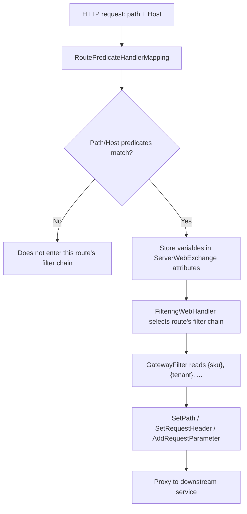

# URI Variables Extracted from Path or Host

## 1. Goal and Context

In **SPRING_CLOUD_GATEWAY**, a single route can receive many URLs that share the same structure while differing in specific values. For example:

- `GET /api/products/AB-120` and `GET /api/products/CD-445` both go to the product service; `AB-120` and `CD-445` are product codes.
- `GET /orders/9001` hitting `alpha.edge.example.test` and the same path hitting `beta.edge.example.test` must identify two different tenants.
- The Gateway can rewrite paths, attach tracking headers, or add corresponding query parameters without creating a separate route for every product or tenant.

Spring Cloud Gateway Server WebFlux solves this with **URI template variables**, extracted when route predicates such as **`Path`** or **`Host`** match a request. Then certain `GatewayFilter`s read these variables to transform the request or response.

By the end of this lesson, you will understand:

1. The `{variableName}` syntax in `Path` and `Host`, and the difference between named variables and wildcards.
2. Where variables are stored in `ServerWebExchange`, how they are read from Java, and how filters use them.
3. How to configure `SetPath`, `AddRequestHeader`, `SetRequestHeader`, `SetResponseHeader`, and `AddRequestParameter` to consume variables.
4. How to test locally and recognize unmatched-route versus unavailable-downstream cases.
5. Security boundaries of `Host`/headers, especially when the application needs authentication, tenant isolation, rate limiting, and request observability.

**Scope:** examples use **Spring Cloud Gateway Server WebFlux** from Spring Cloud 2025.0.x (Gateway 4.3.x), with starter `spring-cloud-starter-gateway-server-webflux` and prefix `spring.cloud.gateway.server.webflux`. For other release trains, check the corresponding docs: many older examples use `spring-cloud-starter-gateway` and `spring.cloud.gateway.routes`.

## 2. What Are URI Template Variables?

A URL template contains fixed segments and **named placeholders**:

```text
Path template: /api/products/{sku}
Request:       /api/products/AB-120
Extracted:     sku = AB-120

Host template: {tenant}.edge.example.test
Host header:   alpha.edge.example.test
Extracted:     tenant = alpha
```

**Curly braces `{...}` define variable names.** The captured value is the string taken from the actual request portion matching the template, not a fixed configuration constant and not an authenticated identity claim.

Distinguish closely related terms:

| Concept | Example | Meaning |
| --- | --- | --- |
| **Path template variable** | `Path=/api/products/{sku}` | Extracts `sku` from the request path matching the template. |
| **Host template variable** | `Host={tenant}.edge.example.test` | Extracts `tenant` from the Host matching the template. |
| Wildcard | `Path=/api/products/**`, `Host=**.example.test` | Helps match multiple values; `**` itself does not create a variable named `sku` or `tenant`. |
| Query parameter | `?page=2` | The query portion of an HTTP request; does not automatically become a variable captured by `Path` or `Host`. |
| Route target URI | `uri: http://127.0.0.1:9001` | The destination address the Gateway forwards to, distinct from variables extracted during matching. |
| HTTP header | `X-Tenant: alpha` | Can be populated by a filter from a variable; not automatically synonymous with a template variable. |

**Important example:** with `Path=/api/products/{sku}`, the request `/api/products/AB-120?lang=vi` captures `sku=AB-120`. `lang=vi` is a separate query parameter. The request `/api/products/AB-120/details` **does not match** a pattern expecting a single `{sku}` segment at the end.

## 3. `Path` Predicate: Extracting from the Path

Declare the route:

```yaml
spring:
  cloud:
    gateway:
      server:
        webflux:
          routes:
            - id: product-by-path
              uri: http://127.0.0.1:9001
              predicates:
                - Path=/api/products/{sku}
```

`PathRoutePredicateFactory` matches the request path against the declared pattern. When a match occurs, it extracts names/values into a map. Examples:

| Request path | Route matches? | Extracted variables |
| --- | --- | --- |
| `/api/products/AB-120` | Yes | `sku=AB-120` |
| `/api/products/42` | Yes | `sku=42` |
| `/api/products/42?sort=asc` | Yes | `sku=42`; query `sort` stays separate |
| `/api/products` | No | No variables from this route |
| `/api/products/42/reviews` | No | No variables from this route |
| `/api/orders/42` | No | No variables from this route |

The row with a query in the table shows the **request URL**; path matching inspects only the path part, while `?sort=asc` is not part of the path. If the application has other routes matching the "No" requests, those requests can still be handled by another route.

You can place multiple placeholders in a single `Path`:

```yaml
predicates:
  - Path=/customers/{customerId}/orders/{orderId}
```

For `/customers/C-17/orders/O-902`, the map contains:

```text
customerId -> C-17
orderId    -> O-902
```

Distinct names let subsequent filters know which value belongs to which role.

### Named Variables vs. Wildcards

`Path=/files/**` is useful for matching deep paths under `/files/`, but `**` **does not automatically assign a name** to the matched subpath. To obtain a variable usable as `{name}`, declare a template pattern supported by the framework and verify the match conditions. Never assume a variable name arises from a wildcard.

Version 4.3.x also includes a trailing-slash option (`matchTrailingSlash`, depending on configuration/version). When you need to distinguish `/items/42` from `/items/42/`, check your exact version's documentation and add regression tests; do not assume all versions treat trailing slashes identically.

## 4. `Host` Predicate: Extracting from the Domain Name

Declare a route that separates tenants by domain name:

```yaml
spring:
  cloud:
    gateway:
      server:
        webflux:
          routes:
            - id: tenant-by-host
              uri: http://127.0.0.1:9001
              predicates:
                - Host={tenant}.edge.example.test
```

`HostRoutePredicateFactory` checks the domain name in the HTTP `Host` header using an Ant-style pattern with dots as separators. The `{tenant}` placeholder captures the matching portion.

| HTTP Host | Matches `{tenant}.edge.example.test`? | `tenant` value |
| --- | --- | --- |
| `alpha.edge.example.test` | Yes | `alpha` |
| `beta.edge.example.test` | Yes | `beta` |
| `edge.example.test` | No | — |
| `alpha.other.example.test` | No | — |

`Host=**.edge.example.test` is a broader wildcard pattern for matching hostnames; **it has no placeholder named `tenant`**. Therefore, filters referencing `{tenant}` should not be attached to a wildcard-only route unless another predicate actually provides that name.

In local labs, you do not need public DNS: `curl -H 'Host: alpha.edge.example.test' http://127.0.0.1:8080/...` lets you test the `Host` predicate over an HTTP connection to the Gateway on `127.0.0.1`. However, overriding `Host` via `curl` demonstrates that this header **can be freely supplied by the client**; in production, never treat a tenant name extracted from `Host` as proof of authentication.

## 5. Where Are Variables Stored and What Is Their Lifecycle?

After route predicates match, variables are placed in **`ServerWebExchange` attributes** under the key:

```java
ServerWebExchangeUtils.URI_TEMPLATE_VARIABLES_ATTRIBUTE
```

Helper method to read the map:

```java
import java.util.Map;
import org.springframework.cloud.gateway.support.ServerWebExchangeUtils;
import org.springframework.web.server.ServerWebExchange;

Map<String, String> variables =
        ServerWebExchangeUtils.getUriTemplateVariables(exchange);

String sku = variables.get("sku");
String tenant = variables.get("tenant");
```

This snippet illustrates code **inside a Gateway handler method that has `exchange`**, such as `GlobalFilter.filter(...)` or `GatewayFilter.filter(...)`; it is not a standalone Java program.

Data flow:



Lifecycle notes:

- `ServerWebExchange` is scoped to **a single request**. Never store this variable map in a static/singleton field to share across requests.
- Filters of the **selected route** can read variables extracted during matching. Unselected routes do not contribute variables to the current request.
- Filters can use `{sku}` or `{tenant}` syntax if that factory supports URI template variables; not **every** Gateway configuration field automatically performs placeholder substitution.
- If you declare the same placeholder name in multiple predicates on the same route, its meaning becomes ambiguous and risks overwriting depending on how data is merged. **Use unique names**, such as `{tenant}` and `{orderId}`, rather than reusing `{id}` across both `Host` and `Path`.
- Do not confuse `URI_TEMPLATE_VARIABLES_ATTRIBUTE` with `GATEWAY_ROUTE_ATTR`: the first holds extracted values, while the second holds the matched `Route` object.

### A Metadata-Only `GlobalFilter` Example

For debugging, you can create a filter that logs only the **variable names** seen by the Gateway, avoiding logging sensitive values:

```java
package com.example.gateway;

import java.util.Map;
import org.slf4j.Logger;
import org.slf4j.LoggerFactory;
import org.springframework.cloud.gateway.filter.GatewayFilterChain;
import org.springframework.cloud.gateway.filter.GlobalFilter;
import org.springframework.cloud.gateway.support.ServerWebExchangeUtils;
import org.springframework.core.Ordered;
import org.springframework.stereotype.Component;
import org.springframework.web.server.ServerWebExchange;
import reactor.core.publisher.Mono;

@Component
public class RouteVariableDebugFilter implements GlobalFilter, Ordered {

    private static final Logger log =
            LoggerFactory.getLogger(RouteVariableDebugFilter.class);

    @Override
    public int getOrder() {
        return -50;
    }

    @Override
    public Mono<Void> filter(
            ServerWebExchange exchange, GatewayFilterChain chain) {

        Map<String, String> variables =
                ServerWebExchangeUtils.getUriTemplateVariables(exchange);

        // Log only variable key names; do not log tokens, full URIs, or tenant values.
        log.debug("Captured URI template keys: {}", variables.keySet());
        return chain.filter(exchange);
    }
}
```

This `GlobalFilter` runs in the chain for **routes selected by the Gateway**. It is not a `WebFilter` applied to every WebFlux HTTP request. The order value `-50` is for illustration only; do not rely on it to dictate the ordering of all infrastructure filters.

## 6. Using Variables in Built-In `GatewayFilter`s

Filters provided by Spring Cloud Gateway can reuse values captured by `Path` or `Host`.

| Filter | Example | Key behavior |
| --- | --- | --- |
| `SetPath` | `SetPath=/internal/products/{sku}` | Builds a **new target path** from the `sku` variable. |
| `AddRequestHeader` | `AddRequestHeader=X-Product, {sku}` | Adds a request header using the variable's value. If the header already exists, multiple values may be sent. |
| `SetRequestHeader` | `SetRequestHeader=X-Tenant, {tenant}` | Replaces existing values of that header with the new value. |
| `AddRequestParameter` | `AddRequestParameter=source, gateway-{sku}` | Adds a query parameter to the forwarded request. |
| `SetResponseHeader` | `SetResponseHeader=X-Tenant-Route, {tenant}` | Replaces the corresponding header value in the returned response. |

**`Add` and `Set` are not the same.** For a trust-sensitive header like `X-Tenant`, if you choose to pass an inspected value to an upstream request, `SetRequestHeader` is safer than appending a value that could compete with a client-supplied header. Even so, **`SetRequestHeader` does not authenticate the tenant by itself**: the filter merely transforms strings.

With `uri: http://127.0.0.1:9001`, `SetPath` changes the **path** sent to that server. It does not turn `http://127.0.0.1:9001` into a dynamic host by embedding `{tenant}` in the authority part. If an application must pick upstreams by tenant, use a controlled service/route mapping table, service discovery, or separately verified routing logic.

### Combined Example: Both Extraction Types

Place the following content in `src/main/resources/application.yml` of the Gateway Server WebFlux application:

```yaml
server:
  port: 8080

spring:
  application:
    name: variable-demo-gateway
  cloud:
    gateway:
      server:
        webflux:
          routes:
            - id: product-by-path
              uri: http://127.0.0.1:9001
              predicates:
                - Path=/api/products/{sku}
              filters:
                - SetPath=/products/{sku}
                - SetRequestHeader=X-Product-Sku, {sku}
                - AddRequestParameter=source, gateway-{sku}
                - SetResponseHeader=X-Matched-Route, product-by-path

            - id: orders-by-host-and-path
              uri: http://127.0.0.1:9001
              predicates:
                - Host={tenant}.edge.example.test
                - Path=/orders/{orderId}
              filters:
                - SetPath=/orders/{orderId}
                - SetRequestHeader=X-Selected-Tenant, {tenant}
                - SetRequestHeader=X-Order-Id, {orderId}
                - SetResponseHeader=X-Matched-Route, orders-by-host-and-path
                - SetResponseHeader=X-Matched-Tenant, {tenant}
```

In **`product-by-path`**, there is only a `Path` predicate, so `{sku}` comes from the path. In **`orders-by-host-and-path`**, both predicates on the same route are combined with **AND**:

- `Host` must match `{tenant}.edge.example.test`.
- `Path` must match `/orders/{orderId}`.
- Values are referenced in filters by their declared names: `tenant` from `Host`, `orderId` from `Path`.

To target `/orders/9001` for tenant `alpha`, the request needs both the right **path** and the right **Host**. Calling the right path with a different `Host` will not match this route.

Result flow:

```text
Request A:
  GET http://localhost:8080/api/products/AB-120

Path captures:
  {sku} = AB-120

Filters:
  SetPath             -> /products/AB-120
  SetRequestHeader    -> X-Product-Sku: AB-120
  AddRequestParameter -> source=gateway-AB-120

Upstream:
  http://127.0.0.1:9001/products/AB-120?source=gateway-AB-120


Request B:
  GET http://127.0.0.1:8080/orders/9001
  Host: alpha.edge.example.test

Host + Path captures:
  {tenant} = alpha
  {orderId} = 9001

Filters:
  SetPath           -> /orders/9001
  SetRequestHeader  -> X-Selected-Tenant: alpha
  SetRequestHeader  -> X-Order-Id: 9001

Upstream:
  http://127.0.0.1:9001/orders/9001
```

Once `Path=/api/products/{sku}` is defined, you do **not** need to add `StripPrefix` in this example: `SetPath` already sets the entire target path. Combining both `StripPrefix` and `SetPath` without accounting for order can cause unintended path changes.

### Distinction from `RewritePath`

`SetPath` can use URI template variables like `{sku}`. By contrast, `RewritePath` relies on **regular expressions (regex)** and named capture groups inside the regex itself. For example, a regex group `(?<remaining>.*)` is a separate mechanism and **is not the same** as `{remaining}` from `Path`/`Host`. When using `RewritePath` in YAML, you also need to escape `$` so it is not processed as a configuration property placeholder. For simple path changes using `Path` variables, `SetPath` is usually cleaner and easier to test.

## 7. Complete Hands-On Lab with a Local Echo Backend

To observe what the upstream receives, use a small HTTP server built into JDK 17. This requires no Eureka/Consul, `lb://`, databases, or external network infrastructure.

### 7.1. Prepare the Gateway Application

The application uses Java 17+, Spring Boot 3.5.x with compatible Spring Cloud 2025.0.x, and the dependency:

```xml
<dependency>
    <groupId>org.springframework.cloud</groupId>
    <artifactId>spring-cloud-starter-gateway-server-webflux</artifactId>
</dependency>
```

The `spring-cloud-dependencies` BOM must be imported under `dependencyManagement`; the starter itself does not need an explicit version. You only need a `@SpringBootApplication` class with `SpringApplication.run(...)` and the `application.yml` from section 6. You can use a skeleton from Spring Initializr or an existing Gateway Server WebFlux project. Ensure nothing else is occupying port `8080`.

### 7.2. Create the Request-Inspecting Server

Create `EchoBackend.java` in a local lab directory (do not package it inside the Gateway):

```java
import com.sun.net.httpserver.HttpServer;
import java.net.InetSocketAddress;
import java.nio.charset.StandardCharsets;

public class EchoBackend {
    public static void main(String[] args) throws Exception {
        HttpServer server = HttpServer.create(
                new InetSocketAddress("127.0.0.1", 9001), 0);

        server.createContext("/", exchange -> {
            String path = exchange.getRequestURI().getRawPath();
            String query = exchange.getRequestURI().getRawQuery();

            String sku = exchange.getRequestHeaders()
                    .getFirst("X-Product-Sku");
            String tenant = exchange.getRequestHeaders()
                    .getFirst("X-Selected-Tenant");
            String order = exchange.getRequestHeaders()
                    .getFirst("X-Order-Id");

            String body = "path=" + path + "\n"
                    + "query=" + query + "\n"
                    + "sku=" + sku + "\n"
                    + "tenant=" + tenant + "\n"
                    + "order=" + order + "\n";

            byte[] bytes = body.getBytes(StandardCharsets.UTF_8);
            exchange.getResponseHeaders().set(
                    "Content-Type", "text/plain; charset=UTF-8");
            exchange.sendResponseHeaders(200, bytes.length);

            try (var output = exchange.getResponseBody()) {
                output.write(bytes);
            }
        });

        server.start();
        System.out.println("Echo backend listening on 127.0.0.1:9001");
    }
}
```

This is a test server with no authentication, no rate limiting, and no TLS. It binds only to loopback `127.0.0.1`; never deploy this code as a production backend.

Run it in **terminal A**:

```bash
java EchoBackend.java
```

Start the Gateway in **terminal B**, inside the project directory containing `pom.xml`:

```bash
mvn spring-boot:run
```

If the Spring Initializr project includes Maven Wrapper, use `./mvnw spring-boot:run` (Linux/macOS) or `mvnw.cmd spring-boot:run` (Windows). Make sure the Gateway listens on `8080` and the backend listens on `9001`.

### 7.3. Testing Variables from `Path`

In **terminal C**, run:

```bash
curl -i "http://127.0.0.1:8080/api/products/AB-120"
```

You should receive `200 OK`, header `X-Matched-Route: product-by-path`, and a body similar to:

```text
path=/products/AB-120
query=source=gateway-AB-120
sku=AB-120
tenant=null
order=null
```

From the output, you can verify:

1. `Path=/api/products/{sku}` matched the request path.
2. `sku` was extracted as `AB-120`.
3. `SetPath` rewrote the path before calling the backend.
4. `SetRequestHeader` attached the SKU value for the backend to read.
5. `AddRequestParameter` appended the new query parameter; the response header confirms the selected route.

Send another request that already has a query parameter:

```bash
curl -i "http://127.0.0.1:8080/api/products/CD-445?lang=vi"
```

The backend is expected to receive a query containing both `lang=vi` and `source=gateway-CD-445` (display order may vary). The `sku=CD-445` variable still comes from the **path**, not from `lang`.

### 7.4. Testing Variables from `Host` and `Path` Together

Call the Gateway via local IP while setting `Host` manually:

```bash
curl -i -H "Host: alpha.edge.example.test" \
     "http://127.0.0.1:8080/orders/9001"
```

On Windows PowerShell, you can enter it on a single line:

```powershell
curl.exe -i -H "Host: alpha.edge.example.test" "http://127.0.0.1:8080/orders/9001"
```

Expected output:

```text
HTTP/1.1 200 OK
X-Matched-Route: orders-by-host-and-path
X-Matched-Tenant: alpha

path=/orders/9001
query=null
sku=null
tenant=alpha
order=9001
```

For this route, `tenant` did not come from `/orders/9001`; it came from **`Host`**. `orderId` came from **`Path`**. Both were reused by filters to populate headers for the upstream.

### 7.5. Testing Non-Matching Cases

```bash
# Right Host, wrong path
curl -i -H "Host: alpha.edge.example.test" \
     "http://127.0.0.1:8080/products/9001"

# Right path, wrong Host
curl -i -H "Host: unknown.example.invalid" \
     "http://127.0.0.1:8080/orders/9001"

# Path has an extra segment beyond the template
curl -i "http://127.0.0.1:8080/api/products/AB-120/details"
```

In an application declaring only the two example routes and no other endpoints, these three requests are expected to return **404 Not Found**. They do not populate route variables because no route matched.

Stop the `9001` backend and call a route-matching URL again: the Gateway can still extract `sku` or `tenant`, but proxying to the backend will fail, typically returning a **5xx** error. Keep the two cases distinct: **predicate mismatch** versus **matched route with unreachable upstream**.

## 8. Using Variables in Java Without Leaking Data

In custom filters, always check whether a variable exists before using it:

```java
Map<String, String> vars =
        ServerWebExchangeUtils.getUriTemplateVariables(exchange);

String tenant = vars.get("tenant");
if (tenant == null || tenant.isBlank()) {
    // Do not assume every route has a tenant variable.
    // In a filter dedicated to tenant routes, return an appropriate rejection response.
}
```

If a filter applies across multiple routes, `tenant == null` may be completely normal on a route that only defines `{sku}`. Handle missing values according to route policy rather than rejecting every request just because an optional variable is absent.

In real multi-tenant deployments:

- Validate that `Host` belongs to the domain list owned by your organization; configure proxies/load balancers/TLS and DNS accordingly.
- **Do not use `tenant` extracted from `Host` as proof of access rights.** Callers can send any `Host` value. After authentication, cross-check the Host-derived tenant against claims/permissions from an authenticated token or session.
- Use `SetRequestHeader` to avoid keeping client-supplied values in internal headers such as `X-Selected-Tenant`, and configure backends to trust that header only when requests arrive from the protected Gateway. Replacing a header does not create a trust mechanism by itself.
- Restrict variable formats before using them in sensitive logic: tenant names, customer IDs, service names; never concatenate unvalidated values to pick arbitrary outbound hosts, ports, or file paths.
- Never log the entire `ServerWebExchange`, access tokens, or sensitive values inside URIs. Route predicates and filters only handle routing and transformation; place Spring Security WebFlux, rate limiting, circuit breakers, retries, and TLS in the appropriate layers.

## 9. Common Errors

| Symptom | Possible cause | How to check |
| --- | --- | --- |
| `404` even though URL looks close | Path has extra/missing segments, `Host` domain mismatch, or multiple predicates must all match. | Compare every segment of the pattern; retry with `curl -i -H "Host: ..."`. |
| Filter does not substitute `{sku}` | Route lacks a `sku` placeholder, misspelled name, or factory does not support interpolation. | Check spelling in `Path` and filter; read that filter's documentation. |
| Using `Path=/api/**` but `sku` reads `null` | Wildcards do not automatically extract named variables. | Use a pattern like `/api/{sku}` when a single segment makes sense. |
| `tenant` is `null` | Request lacked a matching `Host`, another route won, or pattern lacked `{tenant}`. | Inspect actual `Host` and route ID; check the `Host` predicate. |
| Internal header has multiple values | Using `AddRequestHeader` when client also sends the same header name. | For Gateway-managed headers, consider `SetRequestHeader` alongside full auth/authorization. |
| Wrong upstream path | Wrong `SetPath` template, or extra `StripPrefix`/`RewritePath` altering the path. | Call the Echo backend to inspect the path; strip filters down and re-add carefully. |
| HTTP 5xx after route matches | Backend `127.0.0.1:9001` is stopped or unreachable. | Call the backend directly; inspect Gateway connection/timeout logs. |
| Config valid in old docs, but new routes fail to work | Using `spring.cloud.gateway.routes` prefix in a project migrated to `spring.cloud.gateway.server.webflux`. | Verify release train, starter, and prefix for your exact version. |
| Confusing `Host` with user identity | Clients can spoof `Host`; proxies can alter metadata. | Authenticate identity and tenant authorization via a dedicated security system. |

### Step-by-Step Troubleshooting Workflow

When an error occurs, narrow down the scope in order:

1. Confirm the route is declared under the right prefix for your Gateway version and has been loaded.
2. Check **predicate matching** first: exact `Path`, exact `Host`, and remember predicates on the same route combine with AND.
3. Check **extracted variables** using a dev-only debug filter or the output of built-in filters.
4. Check **request transformations** at the Echo backend: path, query, headers; confirm the route ID via the illustrative response header.
5. Check **downstream**: whether the service is running, whether the target URI scheme/port are right, and whether timeouts occur.
6. Only after that investigate advanced filters like auth, rate limiting, retries, circuit breakers, and tracing.

## 10. Self-Check Questions

**1.** Given `Path=/inventory/{sku}` and request `/inventory/A1?region=apac`, what does the variable map contain?

The map contains `sku=A1`. `region` is a query parameter and does not automatically become a `Path` predicate variable.

**2.** Does `Host=**.edge.example.test` produce a variable named `tenant`?

No. To extract a named portion, declare a template such as `Host={tenant}.edge.example.test`.

**3.** In a route with `Host={tenant}.edge.example.test` and `Path=/orders/{orderId}`, is matching OR or AND?

It is **AND**. Both host and path must match for that route to be selected.

**4.** Where does `SetPath=/internal/{orderId}` get `orderId` from?

From the URI template variables extracted by the route predicates—not from an arbitrary Java variable or an automatic HTTP header.

**5.** Why does an `X-Selected-Tenant: alpha` header populated from `Host` still not prove the caller is allowed to access tenant `alpha`?

Because `Host` is client-controlled; it must be cross-checked against an authenticated identity and permissions.

**6.** If you replace `uri: http://127.0.0.1:9001` with a string containing `{tenant}`, does the Gateway automatically interpolate it like `SetPath`?

Do not assume so. Interpolation support is specific to individual `GatewayFilterFactory` implementations; choosing target services must be designed and controlled independently.

**7.** What is the Java utility method for retrieving the variable name/value map from the exchange?

`ServerWebExchangeUtils.getUriTemplateVariables(exchange)`.

## Conclusion

URI variables in **Spring Cloud Gateway Server WebFlux** are extracted when `Path` or `Host` route predicates match a request. They are stored in `ServerWebExchange` and can be reused by template-aware `GatewayFilter`s to build paths, request headers, response headers, or query parameters. Extraction lets a single route handle many resources and hosts cleanly, but **does not provide authentication, service discovery, rate limiting, or tenant authorization on its own**. Those responsibilities must be integrated and tested separately when operating a microservices edge.

### Official References

- [Spring Cloud Gateway Server WebFlux 4.3 — Route Predicate Factories: Host and Path](https://docs.spring.io/spring-cloud-gateway/reference/4.3/spring-cloud-gateway-server-webflux/request-predicates-factories.html)
- [Spring Cloud Gateway 4.3 — SetPath GatewayFilter Factory](https://docs.spring.io/spring-cloud-gateway/reference/4.3/spring-cloud-gateway-server-webflux/gatewayfilter-factories/setpath-factory.html)
- [Spring Cloud Gateway 4.3 — AddRequestHeader GatewayFilter Factory](https://docs.spring.io/spring-cloud-gateway/reference/4.3/spring-cloud-gateway-server-webflux/gatewayfilter-factories/addrequestheader-factory.html)
- [Spring Cloud Gateway 4.3 — SetRequestHeader GatewayFilter Factory](https://docs.spring.io/spring-cloud-gateway/reference/4.3/spring-cloud-gateway-server-webflux/gatewayfilter-factories/setrequestheader-factory.html)
- [Spring Cloud Gateway 4.3 — AddRequestParameter GatewayFilter Factory](https://docs.spring.io/spring-cloud-gateway/reference/4.3/spring-cloud-gateway-server-webflux/gatewayfilter-factories/addrequestparameter-factory.html)
- [Spring Cloud 2025.0 Release Notes — starter names and property prefixes](https://github.com/spring-cloud/spring-cloud-release/wiki/Spring-Cloud-2025.0-Release-Notes)
