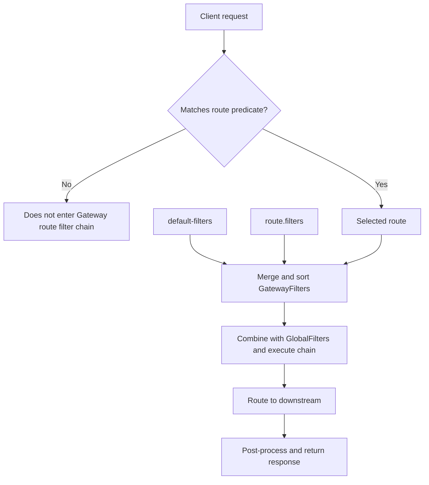

# Default Filters and Their Application Scope Across Routes in Spring Cloud Gateway

## 1. The Problem to Solve

In microservices systems, **Spring Cloud Gateway** typically manages many routes: `/api/catalog/**` goes to the catalog service, `/api/orders/**` goes to the orders service, and `/api/payments/**` goes to the payments service. Each route has its own **predicates**, target URI, and **filter chain**. Yet certain behaviors—such as adding a gateway-identification header, appending a response header, or stripping unwanted headers—need to be shared across routes.

Repeating the same filter inside `routes[*].filters` makes configuration verbose and prone to inconsistency when adding new routes. In **Gateway Server WebFlux**, the **`default-filters`** setting solves this problem: you declare a list of default `GatewayFilter`s to attach to the **route definitions** loaded through the Gateway's configuration mechanism.

After this lesson, you will know how to:

- Place `default-filters` under the right configuration prefix for your Gateway version.
- Distinguish between a **default filter**, a **route-specific filter**, a **`GlobalFilter`**, and a Spring Security filter.
- Determine which routes receive default filters, when default filters do not run, and how they are ordered.
- Use default filters for shared policies while preserving per-route path/header transformations, service discovery, rate limiting, circuit breakers, retries, TLS, and observability as needed.
- Verify behavior using `curl`, logs, and Actuator.

> **Technical scope:** examples focus on **Spring Cloud Gateway Server WebFlux**. Gateway Server Web MVC is built on Servlet/WebMvc.fn and has its own filter APIs and configuration namespace. Do not assume every WebFlux `default-filters` configuration is supported identically in Server MVC.

## 2. Concept: Where Do Default Filters Attach?

A **route** combines an ID, target URI, predicates, and filters. When a request arrives, the Gateway finds a route whose predicates match; only then does it pass the request through that route's filter chain.

When routes are declared in YAML/properties, `RouteDefinitionRouteLocator` builds a `Route` from each `RouteDefinition` and merges two filter sources:

1. **`default-filters`**: a shared filter list defined once at the Gateway Server WebFlux level.
2. **`routes[*].filters`**: a filter list written individually inside each route definition.

The Gateway sorts the resulting filters by `order` and combines them with **`GlobalFilter`** beans in the Gateway filter chain. Therefore, `default-filters` is not a separate chain that always runs before all route filters.



**Prerequisite:** a route must be selected before Gateway Server's default filters execute. `GET /no-matching-route` does not automatically receive headers or policies from `default-filters` if no route matches. Requests blocked by Spring Security before route matching may also never enter the Gateway chain.

### 2.1. Comparing Four Filter Layers

| Mechanism | Where is it declared? | Typical scope | Key point to remember |
|---|---|---|---|
| **Default `GatewayFilter`** | `spring.cloud.gateway.server.webflux.default-filters` (4.3+) | Route definitions loaded through Gateway Server WebFlux configuration | Reuses filter factories; does not cover WebFlux endpoints outside Gateway routes |
| **Route-specific `GatewayFilter`** | `spring.cloud.gateway.server.webflux.routes[*].filters` (4.3+) | Only that specific route | Suits `StripPrefix`, `RewritePath`, timeouts, retries, or route-specific policies |
| **`GlobalFilter` bean** | Java class/bean implementing `org.springframework.cloud.gateway.filter.GlobalFilter` | Requests that matched a route and entered the Gateway Server WebFlux filter chain | Written in code; can inspect `ServerWebExchange`; ordered via `Ordered`/`@Order` |
| **Spring Security `WebFilter`** | `SecurityWebFilterChain` configuration | Defined by `securityMatcher` and Spring Security's filter chain | Can authenticate/reject requests before the Gateway matches a route; not generated by `default-filters` |

Gateway's `HttpHeadersFilter` and web-layer CORS filters are also separate mechanisms. For example, global CORS configuration should use the proper CORS mechanism; do not treat `AddResponseHeader=Access-Control-Allow-Origin,...` as a complete CORS solution.

## 3. Choosing the Right Property by Version

The name `default-filters` appears across multiple Gateway versions, but **the property path changed** when Gateway introduced dedicated namespaces for the server and web stack.

| Gateway Server WebFlux line | Typical Spring Cloud release train | `default-filters` property | Corresponding starter |
|---|---|---|---|
| 3.x–4.2.x | `2021.0.x`–`2024.0.x` | `spring.cloud.gateway.default-filters` | `spring-cloud-starter-gateway` |
| **4.3.x** | **`2025.0.x`** | **`spring.cloud.gateway.server.webflux.default-filters`** | `spring-cloud-starter-gateway-server-webflux` |
| **5.0.x–5.1.x** | **`2025.1.x`–`2026.0.x`** | **`spring.cloud.gateway.server.webflux.default-filters`** | `spring-cloud-starter-gateway-server-webflux` |

**For new applications from Gateway 4.3 onward**, YAML examples should sit under `spring.cloud.gateway.server.webflux`. Some *Default Filters* documentation pages in 4.3/5.1 still show examples with the older `spring.cloud.gateway.default-filters` prefix; the 5.1 **Configuration Properties** reference explicitly lists the new property as `spring.cloud.gateway.server.webflux.default-filters`. Cross-check with your running version before copying configuration.

Do not use the WebFlux prefix for **Gateway Server MVC** just because both are called Spring Cloud Gateway. Check the MVC docs for your exact version and verify which filters that stack supports.

## 4. Example Configuration: Two Routes Sharing Default Filters

Suppose the Gateway listens on port `8080` and there are two backends:

- `catalog-service` at `http://localhost:8081`, handling `/catalog/**`.
- `orders-service` at `http://localhost:8082`, handling `/orders/**`.

Goal: both backends receive header `X-Edge-Source: api-gateway`; clients receive response header `X-Handled-By: spring-cloud-gateway`; each route individually strips the `/api` prefix.

### 4.1. `application.yml` for Server WebFlux 4.3+

```yaml
server:
  port: 8080

spring:
  application:
    name: edge-gateway
  cloud:
    gateway:
      server:
        webflux:
          default-filters:
            - SetRequestHeader=X-Edge-Source, api-gateway
            - AddResponseHeader=X-Handled-By, spring-cloud-gateway
          routes:
            - id: catalog-route
              uri: http://localhost:8081
              predicates:
                - Path=/api/catalog/**
              filters:
                - StripPrefix=1

            - id: orders-route
              uri: http://localhost:8082
              predicates:
                - Path=/api/orders/**
              filters:
                - StripPrefix=1
                - AddRequestHeader=X-Route-Id, orders-route
```

Here `SetRequestHeader` replaces any existing value of the header on the forwarded request, while `AddResponseHeader` adds a header to the response. Because they are configured at the default level, **both route definitions receive them**. `StripPrefix=1` is declared per route because path transformation depends on each backend's API contract.

| Client calls | Selected route | Backend receives | Shared header sent downstream | Route-specific header |
|---|---|---|---|---|
| `GET /api/catalog/42` | `catalog-route` | `GET http://localhost:8081/catalog/42` | `X-Edge-Source: api-gateway` | None declared |
| `GET /api/orders/42` | `orders-route` | `GET http://localhost:8082/orders/42` | `X-Edge-Source: api-gateway` | `X-Route-Id: orders-route` |
| `GET /api/users/42` | No matching route | Neither backend above is called | Default filters are not applied to non-existent routes | None |

For matched routes, responses passing through the Gateway include `X-Handled-By: spring-cloud-gateway`, even when the backend returns a normal HTTP error status, provided the response passes through the filter phase and commits. If the client drops the connection or an error occurs outside the Gateway route chain, do not assume the header is always present.

### 4.2. Expanded `name` and `args` Form

Besides the `FilterName=arg1, arg2` shorthand, you can write the same filters explicitly for readability and to avoid argument mistakes:

```yaml
spring:
  cloud:
    gateway:
      server:
        webflux:
          default-filters:
            - name: SetRequestHeader
              args:
                name: X-Edge-Source
                value: api-gateway
            - name: AddResponseHeader
              args:
                name: X-Handled-By
                value: spring-cloud-gateway
```

The two `default-filters` snippets in sections 4.1 and 4.2 are **alternative representations**—do not put both in the same file. When filters have many parameters, regexes, or special characters, the `name`/`args` form is usually easier to maintain and review.

### 4.3. Configuration for Server WebFlux 4.2 and Earlier

For releases prior to the new namespace, the equivalent configuration sits directly under `spring.cloud.gateway`:

```yaml
spring:
  cloud:
    gateway:
      default-filters:
        - SetRequestHeader=X-Edge-Source, api-gateway
        - AddResponseHeader=X-Handled-By, spring-cloud-gateway
      routes:
        - id: catalog-route
          uri: http://localhost:8081
          predicates:
            - Path=/api/catalog/**
          filters:
            - StripPrefix=1
```

The core behavior of default filters is the same as in section 4.1, but **starter and property prefix** must match the running release line. When upgrading from 4.2 to 4.3+, review `routes`, `default-filters`, and other Gateway Server properties together.

## 5. Actual Scope: Which Routes Receive Default Filters?

Documentation often describes `default-filters` as **applying to every route**. At the implementation level, "every route" means **route definitions** converted into routes via `RouteDefinitionRouteLocator`.

| Route/request source | Should you expect WebFlux `default-filters`? | Explanation |
|---|---|---|
| `routes:` in `application.yml`/`.properties` | **Yes** | Built from `RouteDefinition` via Gateway's config mechanism |
| Route definition loaded from another `RouteDefinitionLocator` | **Yes**, when processed by `RouteDefinitionRouteLocator` | Default filters are merged with the route definition's filters |
| Route definition generated by `DiscoveryClient` locator | **Yes**, when passing through the same mechanism | `DiscoveryClient`'s own default filters (e.g., stripping service ID from path) are a separate config layer from Gateway's `default-filters` |
| Route built directly with Java `RouteLocatorBuilder` | **Do not assume yes by default** | The Java DSL can build `Route` directly and bypass `RouteDefinitionRouteLocator` merging; verify or attach filters explicitly |
| Actuator/health endpoints or other WebFlux handlers | **No** | Not requests selected by the Gateway route chain |
| Request matching no route | **No** | No route exists to apply filters to |
| Request rejected by Spring Security before Gateway route handler | **Not guaranteed** | Blocked in a `WebFilter` layer outside the route chain |

### 5.1. Why Is the Java DSL a Case Requiring Separate Verification?

Example of a Java bean building a route directly:

```java
@Bean
RouteLocator routes(RouteLocatorBuilder builder) {
    return builder.routes()
            .route("java-route", r -> r.path("/java/**")
                    .filters(f -> f.stripPrefix(1))
                    .uri("http://localhost:8090"))
            .build();
}
```

This snippet assumes `RouteLocator`, `RouteLocatorBuilder`, and `@Bean` are imported in a Gateway Server WebFlux application. A route built directly with the Java DSL may **not** pass through `RouteDefinitionRouteLocator`, where `default-filters` are merged into `RouteDefinition`s. Therefore, never treat the presence of `default-filters` in YAML as proof that `java-route` receives `X-Edge-Source`.

For programmatic Java routes, you can **attach filters directly in the builder** or write a shared `GlobalFilter` when a policy genuinely must apply to all matched routes. For security requirements covering every URL, enforce protection in the **Spring Security** layer with `securityMatcher` and explicit authentication/authorization policies.

### 5.2. Discovery Locator Does Not Replace Global Default Filters

When the service discovery locator is enabled, the Gateway can generate route definitions for discovered services (`lb://service-id`). The `discovery.locator.filters` property defines **default filters for discovery-generated routes**, such as `RewritePath` to remove the service ID from the URL. That scope belongs **specifically to discovery-generated routes**.

By contrast, Gateway Server's `default-filters` applies across loaded route definitions, including discovery route definitions when they pass through the same locator pipeline. Do not confuse `discovery.locator.filters` with `default-filters`: replacing the discovery filter list can drop the default path-rewrite filter even though global `default-filters` still exist.

## 6. Execution Order: Default Does Not Mean Always Running First

For filters that do not implement `Ordered` themselves, the Gateway assigns order based on **declaration position starting at 1**. The `default-filters` list and each `routes[*].filters` list **are numbered independently**, then merged and stable-sorted by order. When two filters share the same order, the default filter is inserted ahead of the route filter, so it keeps its earlier position in the stable sort.

Example:

```text
default-filters = [D1, D2, D3, D4]
route.filters   = [R1, R2]

Default orders:
  D1=1, D2=2, D3=3, D4=4
  R1=1, R2=2

Sorted GatewayFilter chain:
  D1 -> R1 -> D2 -> R2 -> D3 -> D4
```

**Common pitfall:** "All default filters run first, and only then do route filters run" is an **incorrect** assumption. The order above can also change if a filter factory creates an `OrderedGatewayFilter` with its own order, or when combined with `GlobalFilter`s later.

When filters have logic before and after `chain.filter(...)`, lower-order filters run earlier in the **pre** phase and later in the **post** phase. If a filter returns a response immediately (short-circuits), filters deeper in the chain may not execute.

### 6.1. Example of Conflict Between Filter Levels

Suppose `default-filters` contains `AddRequestHeader=X-Mode, default`, while a route contains `AddRequestHeader=X-Mode, route`. Having the same header name does **not** mean the route filter automatically overwrites the default filter. Because both are `AddRequestHeader`, the downstream request may carry **multiple values** for `X-Mode`, depending on header representation.

If you need **one** final value, define the exact behavior (`SetRequestHeader` replaces values) and execution order, or declare the policy at only one configuration level. Avoid putting `StripPrefix`/`RewritePath` in both default and route levels without testing: a path can end up stripped or rewritten **twice**, resulting in 404 at the backend.

## 7. Which Filters Belong in Default Filters?

Shared filters should behave validly for **every route definition** they affect. Favor transformations that depend little on individual microservice URL contracts or access rules.

| Idea | Good fit for default? | Reasons and conditions |
|---|---|---|
| Adding a gateway identifier header like `X-Edge-Source` | Usually suitable | Prefer `SetRequestHeader` to avoid keeping spoofed client values; backends still need inter-service trust |
| Adding a general informational response header | Usually suitable | Only use headers that leak no internals/secrets; avoid duplicates and ensure pre-commit timing |
| `RemoveRequestHeader` for sensitive headers | Needs care | Could accidentally strip `Authorization` or trace headers that backends actually need |
| `StripPrefix`, `PrefixPath`, `RewritePath` | Usually best per route | Backends have different path contracts; sharing easily breaks URLs |
| `Retry` | Should not be applied broadly | POST/PATCH have side effects and streaming bodies may not be safe to replay |
| `RequestRateLimiter` | Can be shared with clear key/quota design | Requires a `KeyResolver` and state store like Redis depending on limiter type; shared quotas can cause APIs to interfere with one another |
| `CircuitBreaker` | Consider per downstream or route group | Thresholds, fallbacks, and failure policies differ; unseparated shared config can cause unwanted failure coupling |
| CORS, JWT, endpoint authorization | Do not rely solely on `default-filters` | CORS should use proper CORS support; JWT and authorization need Spring Security / Resource Server |

**TLS** for client-to-Gateway connections uses server HTTPS config (`server.ssl.*`), while TLS for Gateway-to-backend HTTP client calls sits in the HTTP client layer; neither is "enabled" merely by adding a default filter. Likewise, service discovery requires an instance provider and load balancer when URIs use `lb://service-name`.

### 7.1. When You Want a Policy for Only One Group of Routes

There is no requirement to put every shared policy into `default-filters`. If only `/api/private/**` needs a filter, configure it in `routes[*].filters` on routes in that group. If many routes share structure, consider generating route definitions or using the Java DSL appropriately; before automating, verify actual runtime behavior within the intended scope.

For requirements that **every HTTP request must be authenticated**, including URLs matching no route, configuring `SecurityWebFilterChain` at the WebFlux layer is a far more reliable boundary than relying solely on Gateway default filters.

## 8. Testing: Proving Scope with Real Requests

To run the example from section 4, you need the Gateway at `localhost:8080` and two backends accepting requests on `8081` and `8082`. The backends should expose an echo endpoint showing path, headers, and status so you can observe the results. When a backend is down, connection errors do not mean default filters failed to attach.

### 8.1. Testing Route A and Route B

```bash
curl -i http://localhost:8080/api/catalog/42
curl -i http://localhost:8080/api/orders/42
```

Expected results:

1. `catalog-route` handles the first URL and forwards to `http://localhost:8081/catalog/42`; `orders-route` handles the second URL and forwards to `http://localhost:8082/orders/42`.
2. Both backends receive `X-Edge-Source: api-gateway` from the shared filter.
3. Only requests to `orders-route` additionally receive `X-Route-Id: orders-route`.
4. The client receives response header `X-Handled-By: spring-cloud-gateway` when the response passes through the Gateway filter chain and writes normally.

### 8.2. Testing an Unmatched URL and Header Overwrite Behavior

```bash
# Matches neither route in the example:
curl -i http://localhost:8080/api/users/42

# Client tries to inject a different X-Edge-Source value:
curl -i -H 'X-Edge-Source: untrusted-client' \
  http://localhost:8080/api/catalog/42
```

In the first command, the Gateway applies no route default filters when no route matches; if the app only has the two example routes and no other handler, it typically returns `404`. In the second command, the backend is expected to see `X-Edge-Source: api-gateway` because `SetRequestHeader` replaces the client-supplied header value. **Do not use this header alone as identity proof**: backends must still verify Gateway/caller identity under the system's security model.

### 8.3. Inspecting Loaded Routes and Filters

If **Spring Boot Actuator** is configured with the Gateway management endpoint enabled and restricted to read-only access for operators, you can inspect the route list via:

```bash
curl -i http://localhost:8080/actuator/gateway/routes
```

This path will not work unless Actuator is added and endpoint access is configured. Never open management endpoints publicly just to test a lesson. Exact response fields/filter formats depend on version and configuration; the goal is to verify **the loaded routes and attached filters**, then confirm with real HTTP requests.

When checking discovery-generated routes, inspect the route definition, service ID, `lb://` URI, and path-rewrite filter together. When Java DSL routes lack shared headers, verify how those routes are created before concluding the `default-filters` property is broken.

## 9. Common Configuration Errors

| Symptom | Cause to investigate | How to fix |
|---|---|---|
| Route works but lacks default headers | `default-filters` placed under old prefix in Gateway 4.3+, or route bypasses `RouteDefinitionRouteLocator` | Verify version and new namespace; check how the route is created |
| Only YAML routes have shared headers, Java DSL routes do not | Java DSL builds `Route` directly | Attach filters explicitly in the DSL or use a `GlobalFilter` |
| Backend receives wrong path / 404 | `StripPrefix` or `RewritePath` placed in both default and route levels | Remove duplicate config; inspect filter order and downstream path |
| Header has two values or conflicts | `AddRequestHeader`/`AddResponseHeader` used at multiple levels | Switch to `Set...Header` when replacing, or declare only once |
| Filter does not run on 404 URLs | No route matched; request never entered route chain | Check predicates before checking filters |
| Filter does not run on 401-rejected requests | Spring Security handled the request outside before the Gateway handler | Check `SecurityWebFilterChain` and rejection point |
| All routes slow down after adding `Retry` | Shared retry policy causes extra downstream attempts | Review idempotency, timeouts, and per-route retry limits |
| `lb://service` fails to connect | Missing service discovery/instances or Spring Cloud LoadBalancer | Add matching registry/load-balancer support and verify instances |

## 10. Self-Check Exercises

**Exercise 1 — Predict scope.** Config has `default-filters: [AddResponseHeader=X-Edge, yes]` plus two YAML routes `/a/**` and `/b/**`. Client calls `/a/1`, `/b/2`, `/c/3`. Which requests definitely pass through the default filter?

**Answer:** when `/a/1` and `/b/2` match the two declared routes, both receive the default filter. `/c/3` has no matching route, so it does not enter the Gateway route filter chain unless the application declares another matching route.

**Exercise 2 — Find the order.** Default filters are D1, D2, D3; route filters are R1, R2. None specify a custom order. Write the pre-phase execution order.

**Answer:** `D1 → R1 → D2 → R2 → D3`, because the two lists are numbered independently starting at 1 and stable-sorted. If each filter wraps `chain.filter(...)`, post-logic runs in reverse order; any filter specifying a custom order can change this sequence.

**Exercise 3 — Resolve conflict.** Default uses `AddRequestHeader=X-Env, common`; route uses `AddRequestHeader=X-Env, private`. Will the backend definitely receive only `private`?

**Answer:** no. Both are **Add** operations, so the header can carry multiple values. Clarify the intended behavior and switch to `SetRequestHeader` or adjust filter placement if only one value is desired.

**Exercise 4 — Check Java DSL.** A project has both Java `RouteLocatorBuilder` routes and YAML routes. YAML `default-filters` is configured, yet the header appears only when calling YAML routes. Likely cause?

**Answer:** the DSL route may go directly into `RouteLocator`, bypassing `RouteDefinitionRouteLocator` where default filters are merged into route definitions. Check how the route is constructed, attach filters directly in the DSL, or use a `GlobalFilter` if a shared Gateway policy should apply to all matched routes.

**Exercise 5 — Protection policies.** A team puts `RequestRateLimiter`, `Retry`, and `RewritePath` into `default-filters` for every route to share. Identify three risks.

**Answer:** the rate limiter may share quotas across unintended targets or lack a proper `KeyResolver`/backing store; retry may replay non-idempotent operations; a shared path rewrite can break the distinct URL contracts of different backends. Evaluate scope and configure per route group or purpose instead.

## 11. References

- [Spring Cloud Gateway 5.1 – Configuration Properties](https://docs.spring.io/spring-cloud-gateway/reference/5.1/configprops.html): confirms `spring.cloud.gateway.server.webflux.default-filters` as the list of filter definitions applied to routes.
- [Spring Cloud Gateway – Default Filters and default/route filter ordering](https://docs.spring.io/spring-cloud-gateway/reference/spring-cloud-gateway-server-webflux/gatewayfilter-factories/default-filters.html): independent numbering and stable sort rules; note that examples on that page still show the older prefix.
- [Spring Cloud Gateway – Configuration / RouteDefinitionLocator](https://docs.spring.io/spring-cloud-gateway/reference/spring-cloud-gateway-server-webflux/configuration.html): route definitions and filter configuration.
- [Spring Cloud Gateway – Global Filters](https://docs.spring.io/spring-cloud-gateway/reference/spring-cloud-gateway-server-webflux/global-filters.html): `GlobalFilter`, `GatewayFilter`, and chain ordering.
- [Spring Cloud Gateway – DiscoveryClient Route Definition Locator](https://docs.spring.io/spring-cloud-gateway/reference/spring-cloud-gateway-server-webflux/the-discoveryclient-route-definition-locator.html): generating routes from discovery and path-rewrite filters.

**Remember:** `default-filters` is a way to **reuse `GatewayFilter`s across route definitions** in Spring Cloud Gateway Server WebFlux. They participate only after a route matches and are sorted together with route filters; they do not automatically replace Spring Security, `GlobalFilter`s, or all Java routes. Verify the **version, route source, ordering, and scope** before rolling out a shared policy to a production gateway.
