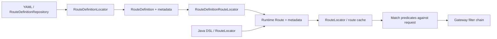
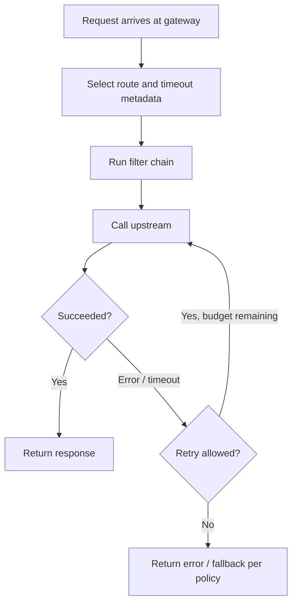

# Per-Route Metadata and Version-Dependent Configuration Constraints

In an API Gateway serving multiple microservices, routes rarely share identical operational needs. A product-catalog API may respond very quickly, a report-generation API may need more time, an orders API may require strict tracking, and some routes need dedicated CORS policies. **Spring Cloud Gateway** lets you attach **per-route metadata** to describe context or adjust behaviors for Gateway components that know how to read that metadata.

However, adding a key to `metadata` does not automatically turn it into an active feature. Some keys are natively supported by Spring Cloud Gateway—such as HTTP timeouts or `cors` metadata in the WebFlux variant—while many others are purely application-defined data that your own code or another component must read. Furthermore, **the same configuration concept can use different property names, data types, or implementation details across versions and between Server WebFlux and Server Web MVC**.

This lesson belongs to the **Route Configuration** chapter of the **SPRING_CLOUD_GATEWAY** module. The goal is to understand where metadata lives, how to read and apply it, how to configure per-route timeouts, how metadata differs from predicates/filters, and how to verify compatibility during upgrades. Route examples are also placed in the context of routing, path/header transformations, service discovery, authentication, rate limiting, circuit breakers, retries, TLS, and request observability in a microservices system.

> **Technical scope:** The `Route`, `RouteLocatorBuilder`, `GlobalFilter`, `ServerWebExchange`, and timeout metadata examples below target **Spring Cloud Gateway Server WebFlux**. The YAML snippets illustrate the property hierarchy in current WebFlux documentation; older releases and the Web MVC variant require dedicated configuration matching their own version's documentation.

## 1. What Is Route Metadata?

A typical route consists of an ID, target URI, route predicates, filters, and priority order. **Metadata** is a set of **key → value** pairs attached to a route to provide extra context or configure features that read those keys.

For example, an e-commerce system has three routes:

| Route ID | Upstream URI | Predicate | Illustrative metadata |
| --- | --- | --- | --- |
| `catalog-route` | `lb://catalog-service` | `Path=/api/catalog/**` | `owner=catalog-team`, `policy-tier=standard`, `response-timeout=2500` |
| `orders-route` | `lb://order-service` | `Path=/api/orders/**` | `owner=orders-team`, `policy-tier=strict` |
| `report-route` | `lb://report-service` | `Path=/api/reports/**` | `owner=analytics-team`, `response-timeout=15000` |

In the table, `owner` and `policy-tier` are **application-defined keys**; the gateway does not automatically email the owner or enforce an authentication policy simply because it sees a string like `strict`. By contrast, `response-timeout` is a key recognized by Gateway Server WebFlux HTTP handling when written with the syntax and units supported by your version.

### How Does Metadata Differ from Predicates, Filters, and Headers?

| Concept | Question it answers | Example |
| --- | --- | --- |
| **Predicate** | Should this request be routed here? | `Path=/api/catalog/**`, `Method=GET` |
| **Filter** | How should the request/response be processed? | `StripPrefix=2`, `AddRequestHeader`, `Retry` |
| **Metadata** | What extra parameters or context does this route carry? | `response-timeout=2500`, `owner=catalog-team` |
| **HTTP header** | What data is carried inside the request/response on the wire? | `Authorization`, `X-Correlation-Id` |
| **Env var / global property** | What is the gateway process's shared configuration? | HTTP client timeouts, connection settings, enabling metrics |

Metadata belongs to **route configuration** and does not automatically become HTTP headers. If you want to pass information from metadata to an upstream, you need a purpose-built filter while also evaluating trust sources and information-exposure risks.

## 2. From `RouteDefinition` to Runtime `Route` Metadata

In Gateway Server WebFlux, routes declared via YAML/properties can be loaded as `RouteDefinition` objects and converted into runtime `Route` instances. The `Route` handling a request carries the corresponding metadata.



**Metadata does not need to be read to match a route** when matching relies only on path/host/method. Metadata is typically used **after a route is selected**, when an operational component or filter needs parameters belonging to the active route.

If a route is created directly via the Java DSL, it can also carry metadata without passing through a YAML-declared `RouteDefinition`. This is an important distinction when writing route inspection or dynamic update tooling.

### Lifecycle of a Metadata Change

When you change `response-timeout` or `policy-tier` in a configuration source:

1. Update the **route source** that the gateway process actually reads.
2. Let Gateway Server WebFlux reload runtime routes via the appropriate refresh/deploy mechanism.
3. Verify the updated route carries the right metadata on **every gateway instance**.
4. Send test requests and measure whether the component reading that metadata uses the new value.

Simply editing a file in a directory that the running process does not re-read is not enough. Nor does a route-refresh event recompile Java DSL code packaged inside an existing artifact.

## 3. Declaring Metadata in YAML

Example for an application using **the WebFlux syntax from current documentation**:

```yaml
spring:
  cloud:
    gateway:
      server:
        webflux:
          routes:
            - id: catalog-route
              uri: lb://catalog-service
              predicates:
                - Path=/api/catalog/**
              filters:
                - StripPrefix=2
              metadata:
                owner: catalog-team
                group: storefront
                policy-tier: standard
                connect-timeout: 800
                response-timeout: 2500
```

Conditions required for the example to run:

- A **Spring Cloud Gateway Server WebFlux** starter compatible with the application's Spring Boot/Spring Cloud versions.
- Spring Cloud LoadBalancer and an instance source configured for `lb://catalog-service`; metadata does not enable service discovery by itself.
- A backend expecting `/products/**` after the gateway strips the two segments `api` and `catalog`.
- Timeout values written as integer **milliseconds** per WebFlux's per-route rules.
- `owner`, `group`, and `policy-tier` are custom keys; they have no business or security effect unless a component explicitly reads them.

With the request:

```http
GET /api/catalog/products/42?currency=VND
```

The Gateway checks `Path`, runs `StripPrefix=2`, and forwards to `catalog-service` with `/products/42?currency=VND`. During forwarding, HTTP client components that read timeout keys can enforce `catalog-route`'s per-route limits.

### Metadata Supports Multiple Data Types

`metadata` is a map structure; for instance, a route can declare:

```yaml
metadata:
  owner: catalog-team
  revision: 3
  audit-enabled: true
  labels:
    domain: commerce
    team: catalog
```

As data, these values can be strings, numbers, booleans, or nested maps. However, whether a value can be **bound, converted, and consumed** depends on the framework, version, and consumer. A filter expecting an `Integer` may reject the string `"2500"` even though it looks like the number `2500`.

Do not stuff large configs, secrets, tokens, TLS keys, or user data into route metadata. Route details may appear in logs or management endpoints and are generally shared across many requests.

## 4. Reading Metadata of the Selected Route

In WebFlux, once `RoutePredicateHandlerMapping` selects a route, the route is attached to `ServerWebExchange`. Components inside the filter chain can access it via `GATEWAY_ROUTE_ATTR`:

```java
import org.springframework.cloud.gateway.route.Route;
import org.springframework.cloud.gateway.support.ServerWebExchangeUtils;
import org.springframework.web.server.ServerWebExchange;

void inspectSelectedRoute(ServerWebExchange exchange) {
    Route route = exchange.getAttribute(
        ServerWebExchangeUtils.GATEWAY_ROUTE_ATTR);

    if (route != null) {
        String routeId = route.getId();
        Object tier = route.getMetadata().get("policy-tier");
        Object timeout = route.getMetadata().get("response-timeout");
        // Use the values at the appropriate internal processing layer.
    }
}
```

`Route#getMetadata()` accesses the metadata map; the WebFlux API also provides a key lookup helper such as `route.getMetadata("policy-tier")` in supported versions. When writing code that must stay compatible across release lines, verify the method signature and return type in your actual dependencies.

### A `GlobalFilter` That Only Annotates Internal Context

The example below shows how to **read a custom key**, without yet enforcing any rate limit or authorization:

```java
import org.springframework.cloud.gateway.filter.GlobalFilter;
import org.springframework.cloud.gateway.route.Route;
import org.springframework.cloud.gateway.support.ServerWebExchangeUtils;
import org.springframework.context.annotation.Bean;
import org.springframework.context.annotation.Configuration;

@Configuration
public class RouteMetadataConfiguration {

    @Bean
    GlobalFilter annotatePolicyTier() {
        return (exchange, chain) -> {
            Route route = exchange.getAttribute(
                ServerWebExchangeUtils.GATEWAY_ROUTE_ATTR);

            if (route != null) {
                Object raw = route.getMetadata().get("policy-tier");
                if (raw instanceof String tier) {
                    exchange.getAttributes().put("app.policyTier", tier);
                }
            }
            return chain.filter(exchange);
        };
    }
}
```

Storing a value in exchange attributes is only an **in-process data-preparation step**. To actually enforce a `policy-tier` rule, write tested logic integrating with security, rate limiters, or tracing. Never treat an administrator-attached metadata string on a route as proof of a client's identity or permissions.

### Things to Avoid When Reading Metadata

- Check that `route` is non-null before reading metadata, especially in extension points that may run before route matching.
- Check data types before casting; choose intentional defaults.
- Never mutate a shared `Route`'s metadata map directly across concurrent requests to "dynamically update" configuration.
- Never emit high-cardinality metric labels from metadata, such as values unique to every user ID.
- Never expose sensitive metadata in response headers or access logs merely for debugging convenience.

## 5. Per-Route Timeouts: Metadata with Runtime Behavior

This is the most important case for understanding **context-dependent limits and data types**.

In Gateway Server WebFlux, the HTTP timeouts documentation describes both **global timeouts** and **per-route timeouts**, yet they do not always use the same units.

| Parameter | Configuration level | Type/unit per WebFlux docs | Main meaning |
| --- | --- | --- | --- |
| `connect-timeout` | Global HTTP client | Milliseconds | Time limit for establishing a connection to the upstream. |
| `response-timeout` | Global HTTP client | `java.time.Duration`, e.g., `5s` | Time limit waiting for an upstream response per the HTTP client's semantics. |
| `metadata.connect-timeout` | Per route | Milliseconds, e.g., `800` | Overrides connection timeout for supported routes. |
| `metadata.response-timeout` | Per route | Milliseconds, e.g., `2500` | Overrides response timeout for supported routes. |

### 5.1. Global Timeouts

Using the WebFlux property branch in newer documentation, an illustrative example is:

```yaml
spring:
  cloud:
    gateway:
      server:
        webflux:
          httpclient:
            connect-timeout: 1000
            response-timeout: 5s
```

The exact **property prefix** must be verified against your version. In many older Gateway docs, these same parameters appear under `spring.cloud.gateway.httpclient.*`. Do not arbitrarily mix the two formats in one application.

In the example above, connection timeout is **1 second** and response timeout is **5 seconds**. Connection timeout and response timeout are distinct: a connection may succeed quickly while the backend still takes a long time to produce a response.

### 5.2. Overriding Per Route

Suppose a gateway prioritizes fast responses for catalog while allowing reports more time:

```yaml
spring:
  cloud:
    gateway:
      server:
        webflux:
          routes:
            - id: catalog-route
              uri: http://localhost:8081
              predicates:
                - Path=/api/catalog/**
              filters:
                - StripPrefix=2
              metadata:
                connect-timeout: 500
                response-timeout: 1500

            - id: report-route
              uri: http://localhost:8082
              predicates:
                - Path=/api/reports/**
              filters:
                - StripPrefix=2
              metadata:
                connect-timeout: 1000
                response-timeout: 12000
```

In this snippet:

- Catalog has a **500 ms** connect timeout and **1,500 ms** response timeout.
- Report has a **1,000 ms** connect timeout and **12,000 ms** response timeout.
- `localhost` URIs are only for local tests where both backends run on those ports; inside containers, the gateway's `localhost` does not automatically point to backend containers.
- The numbers are **hypothetical values for learning**, not universal recommendations for every application.

A common error-inducing misconception is writing `response-timeout: 5s` inside `metadata` because the global setting uses `5s`. For WebFlux per-route metadata, the documentation requires **millisecond values**, so write `5000`. Similarly, `5` in metadata means **5 ms**, not 5 seconds.

### 5.3. Setting Timeout Metadata with the Java DSL

WebFlux documentation defines metadata constants in `RouteMetadataUtils`:

```java
import static org.springframework.cloud.gateway.support.RouteMetadataUtils.CONNECT_TIMEOUT_ATTR;
import static org.springframework.cloud.gateway.support.RouteMetadataUtils.RESPONSE_TIMEOUT_ATTR;

import org.springframework.cloud.gateway.route.RouteLocator;
import org.springframework.cloud.gateway.route.builder.RouteLocatorBuilder;
import org.springframework.context.annotation.Bean;
import org.springframework.context.annotation.Configuration;

@Configuration
public class GatewayRouteConfig {

    @Bean
    RouteLocator customRoutes(RouteLocatorBuilder builder) {
        return builder.routes()
            .route("catalog-route", r -> r
                .path("/api/catalog/**")
                .filters(f -> f.stripPrefix(2))
                .uri("http://localhost:8081")
                .metadata(CONNECT_TIMEOUT_ATTR, 500)
                .metadata(RESPONSE_TIMEOUT_ATTR, 1500)
                .metadata("owner", "catalog-team"))
            .build();
    }
}
```

This Java DSL example creates the runtime route directly. It does not require a separate YAML route definition, and you should avoid defining another route with a duplicate ID in another configuration source.

### 5.4. Disabling the Global Response Timeout for One Route

Per WebFlux's HTTP timeouts documentation, a **negative** `response-timeout` value at the route level can **disable the global response timeout for that route**:

```yaml
metadata:
  response-timeout: -1
```

This does **not** mean the entire transaction becomes unbounded: clients, ingresses, reverse proxies, networks, circuit breakers, or backends may impose their own timeouts. Never use a negative value as a blanket fix for timeout errors. If long-lived connections or streaming are genuinely required, carefully evaluate protocol semantics, heartbeats, idle timeouts, and intermediate layers.

### 5.5. How Do Timeouts, Retries, and Circuit Breakers Interact?

Suppose `catalog-route` has `response-timeout: 1500`. If you add a `Retry` filter with 3 attempts in an appropriate scenario, the total duration observed by the client can exceed a single upstream wait. With a circuit breaker, call duration, open/half-open states, and fallbacks are yet another set of mechanics.



To prevent load amplification, design a **total time budget**, cap retries, and retry only when safe. Never blindly retry state-mutating requests such as `POST /api/payments` unless the backend implements idempotency keys and duplicate-transaction protection.

Gateway timeouts do not replace backend timeouts, connection pools, DNS, TLS handshakes, or network infrastructure limits. When testing, observe the error type, total client-measured duration, and how many times the upstream actually received the request together.

## 6. Per-Route CORS Metadata

Another example of metadata **understood with built-in semantics by the gateway** in WebFlux is `cors`. Per-route CORS configuration accepts properties matching Spring Framework's `CorsConfiguration`:

```yaml
spring:
  cloud:
    gateway:
      server:
        webflux:
          routes:
            - id: catalog-public
              uri: http://localhost:8081
              predicates:
                - Path=/api/catalog/**
              metadata:
                cors:
                  allowedOrigins:
                    - https://shop.example
                  allowedMethods:
                    - GET
                  allowedHeaders:
                    - Authorization
                    - Content-Type
                  maxAge: 300
```

In this scenario, browsers from origin `https://shop.example` can send requests allowed by the CORS policy. Also test **OPTIONS preflight** requests when requests are non-simple. If the route also includes `Method=GET` so preflight requests fail the predicate, CORS handling may require global CORS/handler-mapping configuration instead.

**CORS is neither authentication nor authorization.** It is a browser mechanism controlling cross-origin access. Non-browser clients can still invoke the endpoint if network and security permit; an orders API still requires JWT authentication and backend authorization per system policy.

Avoid `allowedOrigins: '*'` on sensitive APIs, especially when credentials/cookies are involved. Declare the exact permitted origins and test preflights, cookies, headers, and browser caching.

## 7. Custom Metadata: Project Conventions

The Gateway does not automatically understand arbitrary keys you invent. For example:

```yaml
metadata:
  app.owner: catalog-team
  app.policy-tier: gold
  app.observability-group: storefront
  app.contract-version: v2
```

A project team can standardize these keys for a **custom filter**, config validator, or dashboard, provided responsibilities are documented clearly:

| Custom key | Team-defined meaning | Responsible reader |
| --- | --- | --- |
| `app.owner` | Team owning the API | Route governance workflows, config audits |
| `app.policy-tier` | Desired policy tier label | Custom filter/policy engine, if actually implemented |
| `app.observability-group` | Dashboard grouping for aggregation | Custom instrumentation/metrics code |
| `app.contract-version` | Public contract version | API documentation registry/validator |

Without a corresponding consumer, **all four keys are inert data**. Writing `app.policy-tier: gold` does not raise `RequestRateLimiter` quotas; writing `app.contract-version: v2` does not rewrite URLs or responses.

### Guidelines for Designing Custom Metadata

1. **Use a dedicated namespace** such as `app.*` to avoid colliding with keys the gateway may introduce in future releases.
2. **Define a schema**: key list, data types, allowed values, defaults, and owning team.
3. **Validate before deploy/refresh**: route IDs, permitted URIs, mistyped metadata, negative or out-of-range values.
4. **Keep secrets out of metadata**: credentials, private keys, API tokens, and passwords belong in proper secret managers.
5. **Keep a single source of truth** for critical policies so metadata does not claim `gold` while actual rate limits run at `basic`.
6. **Document fallback behavior** when metadata is absent or an upgraded version does not yet recognize a key.
7. **Never mutate a shared runtime map** to push new config; update the route source, reload, and test.

Metadata is well suited for describing **route parameters and context**, but should not become a dumping ground for full business rule engines or per-user permission lists.

## 8. Version-Dependent Configuration Constraints

### 8.1. Configuration Prefixes Can Change

Older WebFlux examples—such as Spring Cloud Gateway 4.2 docs—commonly used:

```yaml
spring:
  cloud:
    gateway:
      routes:
        - id: catalog-route
          uri: http://localhost:8081
          predicates:
            - Path=/api/catalog/**
          metadata:
            response-timeout: 1500
```

Current WebFlux documentation uses the more specific branch:

```yaml
spring:
  cloud:
    gateway:
      server:
        webflux:
          routes:
            - id: catalog-route
              uri: http://localhost:8081
              predicates:
                - Path=/api/catalog/**
              metadata:
                response-timeout: 1500
```

The difference lies in the **property path**, even though the route metadata semantics are the same. Never assume both branches are active in your deployed version. Using the wrong prefix can let the app start without loading the expected routes.

### 8.2. WebFlux and Web MVC Have Different Runtime Models

| Aspect | Gateway Server WebFlux | Gateway Server Web MVC |
| --- | --- | --- |
| Stack | Spring WebFlux/Reactive, typically Netty HTTP | Spring MVC/Servlet/WebMvc.fn |
| Routes in current docs | `spring.cloud.gateway.server.webflux.routes` | `spring.cloud.gateway.server.webmvc.routes` or the corresponding MVC route model |
| Code reading runtime route | `Route`, `ServerWebExchange`, `GATEWAY_ROUTE_ATTR` | MVC-specific route/request attributes and extension points |
| Defining routes in code | `RouteLocatorBuilder`, `RouteLocator` | `RouterFunction`, `HandlerFunctions`, and MVC helpers |
| WebFlux timeout metadata | `connect-timeout`, `response-timeout` per WebFlux docs | Must check **MVC-specific** timeout catalogs/APIs/configs |
| Filters | `GatewayFilter` / `GlobalFilter` | `HandlerFilterFunction` and MVC before/after filters |

Do not copy WebFlux `GlobalFilter` code into an MVC gateway; nor copy timeout keys verbatim from WebFlux docs into MVC assuming they are supported. Features sharing a similar purpose can require completely different APIs, dependencies, or properties.

### 8.3. Starters, Compatibility, and Lifecycle

Before choosing metadata configurations, lock down:

- The **JDK** in use.
- Compatible **Spring Boot** and **Spring Cloud release train** versions.
- **Spring Cloud Gateway** and the choice between Server WebFlux and Server Web MVC.
- The matching starter artifact—such as `spring-cloud-starter-gateway-server-webflux` in newer documentation.
- Actual integrations: Spring Cloud LoadBalancer, Spring Security, Redis/rate limiting, CircuitBreaker, Micrometer/Actuator.
- Security patching policies, support timelines, and upgrade paths.

For dependencies managed by the Spring Cloud BOM, prefer BOM-managed compatible versions rather than manually pinning mismatched Gateway, Reactor Netty, or Security versions.

### 8.4. Pre-Upgrade Verification Matrix

| Item | Common pitfall | How to prove it works |
| --- | --- | --- |
| Route properties | Routes disappear when using an older prefix | Check Configuration Properties for that version; inspect runtime routes via management endpoint. |
| Timeout metadata | Confusing `Duration` with milliseconds | Use a slow mock backend and measure elapsed time plus actual exception type. |
| CORS metadata | Preflight blocked or unlisted origins accepted | Test OPTIONS/GET requests, origins, allowed headers, and credentials. |
| Discovery integration | `lb://` URI finds no instances | Check dependencies, registry, and LoadBalancer instance lists. |
| Authentication | Copying servlet security chains into reactive apps or vice versa | Test missing, invalid, and expired tokens, scopes, and resource permissions. |
| Rate limiting | Custom key exists without an active limiter | Test quotas across two gateway replicas using the same client identity. |
| Circuit breaker/Retry | Filter missing or behaves unexpectedly | Verify version-specific dependencies/DSL, errors, timeouts, and backend call counts. |
| Actuator | Management endpoint unreachable or permissions changed | Verify enablement, web exposure, and access restrictions in the target version. |
| Metrics | Metric names/tags changed after upgrade | Compare dashboards, traces, and alerts before and after deployment. |

## 9. Metadata, Route Caching, and Refresh

For dynamically loaded route definitions in WebFlux, runtime `Route` objects may be cached to avoid rebuilding them on every request. Consequently:

- **Updating the source** does not automatically mean **runtime routes on all replicas have updated**.
- Changing `metadata.response-timeout` in a repository requires the corresponding route refresh mechanism.
- If routes are defined in static Java DSL, modifying Java code requires building and deploying a new artifact.
- If a config file is edited without the process reloading it, refreshing the route cache will not pick up values bound from the old file.

WebFlux Gateway versions support management endpoints such as:

```http
GET /actuator/gateway/routes
POST /actuator/gateway/refresh
```

In versions whose documentation supports metadata-filtered refresh, you can request, for example:

```http
POST /actuator/gateway/refresh?metadata=group:storefront
```

This command refreshes the group of routes matching that metadata; it **does not write a new route definition**. Verify the API, semantics, and access controls for your deployed version. With three gateway replicas, each replica holds its own in-process route cache and must be synchronized per your rollout process.

**Securing Actuator:** in newer Spring Boot/Gateway versions, the gateway endpoint may require `read-only` or `unrestricted` access settings alongside web exposure. Enable write/refresh permissions only inside protected admin networks; never expose management endpoints publicly to the Internet. Exact management property names, permissions, and defaults depend on version.

### Does Metadata Appear in Actuator Output?

The `/actuator/gateway/routes` endpoint helps inspect runtime routes, but **its response format is not fixed across versions and verbosity settings**. Never build logic assuming every endpoint or version returns all metadata in the exact same JSON schema.

To verify an important metadata key, combine these checks:

1. Confirm the route definition source already contains the new value.
2. Verify the gateway loaded the right route ID.
3. Use the appropriate management endpoint or inspect `Route.getMetadata()` directly in internal diagnostics.
4. Send requests to a mock backend to verify **actual behavior**, such as real timeout enforcement.
5. Compare across all replicas, especially during rolling deployments.

## 10. Hands-On Lab: Configuring Timeouts, Metadata, and Version Verification

### Context

You have a local Gateway Server WebFlux and two mock backends:

- `catalog-service` responds quickly at `http://localhost:8081/products/42`.
- `report-service` supports a delay parameter at `http://localhost:8082/reports/summary`.

The Gateway exposes:

| Public URL | Forwarded URL | Key metadata |
| --- | --- | --- |
| `/api/catalog/products/42` | `/products/42` | `response-timeout=1500` |
| `/api/reports/summary` | `/reports/summary` | `response-timeout=12000` |

Using the Java DSL or YAML **for your running version**, configure `StripPrefix=2` and timeouts for both routes.

### Steps

**Step 1 — Verify route configuration.** Start the gateway and check the route observation endpoint if enabled. Confirm both routes exist with the intended target URIs, predicates, and filters.

**Step 2 — Send normal requests.**

```bash
curl -i "http://localhost:8080/api/catalog/products/42"
curl -i "http://localhost:8080/api/reports/summary"
```

When backends respond faster than the timeout, requests succeed normally. The final body and HTTP status depend on the backend and filters, not on custom metadata by itself.

**Step 3 — Introduce an intentional delay on the backend.** Make catalog respond after 2 seconds. With `response-timeout=1500`, observe whether the gateway enforces the configured limit, what response status code is returned, and what error type appears in logs. Do not assume every timeout returns the exact same HTTP status across all versions and filter chains.

**Step 4 — Compare units.** In a test environment, change `response-timeout: 1500` to `response-timeout: 5` and observe why requests almost always time out. Restore the original value; never deploy an overly short timeout to production just for testing.

**Step 5 — Verify refresh.** If using a dynamic route source, update `group: storefront` or `response-timeout` and trigger refresh using your version's supported mechanism. Verify runtime state and new behavior. If using static Java DSL, rebuild and redeploy the application instead of merely calling refresh.

**Step 6 — Re-run on the target upgrade version.** When upgrading Spring Boot/Spring Cloud/Gateway, check configuration prefixes, starters, and metadata APIs, and re-run the entire test suite. If migrating from WebFlux to MVC, rewrite the examples and verification criteria against the MVC documentation.

### Recommended Test Evidence Table

| Test case | Configuration | Input | Evidence to record |
| --- | --- | --- | --- |
| T01 | Catalog timeout 1500 ms | Backend responds in 100 ms | Success, route ID, and latency. |
| T02 | Catalog timeout 1500 ms | Backend responds in 2000 ms | Timeout type, status code, trace/logs. |
| T03 | Report timeout 12000 ms | Backend responds in 5000 ms | Compare with catalog to confirm per-route override. |
| T04 | `metadata.response-timeout=-1` | Slow backend | Verify global response-timeout bypass, while checking timeouts at other layers. |
| T05 | Route with no override | Slow backend | Measure behavior under global timeout config. |
| T06 | Update metadata on dynamic source | Request after refresh | Both source and runtime route show new revision/value. |
| T07 | Two gateway replicas | Call via each replica | Consistent behavior after rollout/refresh. |
| T08 | Per-route CORS | Preflight with valid/invalid origin | Status and CORS headers match policy. |
| T09 | Custom `policy-tier` | Routes with/without the key | Filter reads the data; does not automatically enforce security/rate limits. |

When logging or sharing test results, never include tokens, session cookies, passwords, payment data, or full sensitive request bodies.

## 11. Common Errors and How to Diagnose Them

| Symptom | Possible cause | How to check |
| --- | --- | --- |
| Added `metadata`, but no effect observed | Custom key has no consumer reading it | Identify the metadata consumer; inspect the corresponding filter/logic. |
| Timeout fires 1000x sooner than expected | Used `5` instead of `5000` on the route | Verify millisecond units for per-route timeouts. |
| Global setting has no effect | Wrong property prefix or wrong data type | Check version-specific Configuration Properties and property binding. |
| Route disappears after version upgrade | Used YAML key from an older release | Verify starter, `routes` path, and route-definition logs. |
| CORS still fails despite metadata | Predicate rejects OPTIONS or origin/header policy is wrong | Test preflight, global CORS mapping, and security chain. |
| Client receives 401/403 | Authentication/authorization failure | Inspect JWT, session, scopes, and backend permissions. |
| `lb://` URI cannot resolve | Missing discovery/LoadBalancer or zero instances | Inspect registry, health, and dependencies rather than editing metadata. |
| Some requests still use old timeout | Replica not refreshed or source not reloaded | Check revision on every gateway process. |
| Retries inflate total request time | `Retry` filter makes multiple attempts | Measure upstream call count and total time budget. |
| Internal header leaked to client | Custom filter writes metadata into responses unchecked | Inspect chain, strip sensitive data, and test at the edge. |

## 12. Pre-Production Checklist

- [ ] Lock down **Server WebFlux or Server Web MVC**, JDK, Spring Boot, Spring Cloud release train, and Gateway version.
- [ ] Verify exact property prefixes, starters, APIs, and data types in **same-version** documentation.
- [ ] Define route IDs, predicates, filters, URIs, and metadata per a team-agreed schema.
- [ ] Classify which metadata keys are **framework-supported** versus **application-handled**.
- [ ] Test connect timeout, response timeout, total timeout, and interactions with `Retry`/`CircuitBreaker` separately.
- [ ] Verify CORS preflights, authentication, and authorization; never treat custom metadata as a security policy.
- [ ] Verify discovery/load balancing when using `lb://`; define TLS and proxy trust per hop.
- [ ] Protect management endpoints and record route load/refresh evidence across every replica.
- [ ] Collect logs, metrics, and traces tagged by route ID; avoid leaking secrets or high-cardinality labels.
- [ ] Have a rollback plan for route metadata changes and a post-upgrade verification procedure.

## 13. Self-Check Questions

1. Why is `metadata: {policy-tier: gold}` not enough by itself to grant higher quotas to premium customers?
2. In WebFlux, why can `response-timeout: 5s` be valid at the global HTTP client level while the same notation in route metadata violates the documented unit?
3. How does updating `metadata.response-timeout` in a dynamic route repository differ from editing the Java DSL and redeploying?
4. If a route uses `lb://order-service` and cannot find a backend instance, will refreshing route metadata fix it?
5. What must you verify before copying a route from a Gateway 4.2 tutorial into a Gateway 5.x project?
6. In a three-replica gateway deployment, how do you prove a per-route timeout update took effect uniformly?

## References and Usage Principles

The links below are **version-checked references** from the project documentation. When implementing, use the versions locked in your application rather than assuming every example found online is compatible:

- [Spring Cloud Gateway Server WebFlux — Route Metadata Configuration](https://docs.spring.io/spring-cloud-gateway/reference/spring-cloud-gateway-server-webflux/route-metadata-configuration.html)
- [Spring Cloud Gateway Server WebFlux — HTTP timeouts configuration](https://docs.spring.io/spring-cloud-gateway/reference/spring-cloud-gateway-server-webflux/http-timeouts-configuration.html)
- [Spring Cloud Gateway Server WebFlux — CORS Configuration](https://docs.spring.io/spring-cloud-gateway/reference/spring-cloud-gateway-server-webflux/cors-configuration.html)
- [Spring Cloud Gateway Server WebFlux — Actuator API](https://docs.spring.io/spring-cloud-gateway/reference/spring-cloud-gateway-server-webflux/actuator-api.html)
- [Spring Cloud Gateway 4.2 — Route Metadata Configuration](https://docs.spring.io/spring-cloud-gateway/reference/4.2/spring-cloud-gateway/route-metadata-configuration.html)
- [Spring Cloud Gateway — Configuration Properties](https://docs.spring.io/spring-cloud-gateway/reference/configprops.html)
- [Spring Cloud Gateway Server Web MVC — How It Works](https://docs.spring.io/spring-cloud-gateway/reference/spring-cloud-gateway-server-webmvc/how-it-works.html)

**Conclusion:** Metadata is supplemental information **attached to a route**; only keys read by the framework or your own code alter runtime behavior. In Spring Cloud Gateway Server WebFlux, timeouts and CORS are two concrete uses where **units, data types, and scope** must be understood accurately. When designing a microservices gateway, treat metadata configuration as part of your operational contract that must be tested against **the exact variant and version** before every change.
