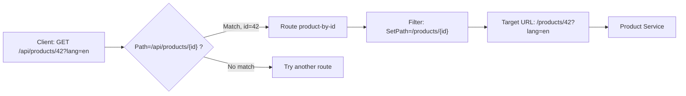
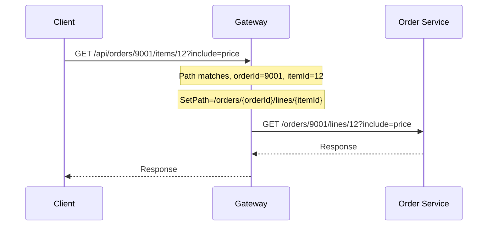

# Path Route Predicate: path patterns, URI variables, and trailing slashes in Spring Cloud Gateway

In a microservices architecture, an API Gateway typically exposes unified paths such as `/api/products/42`, `/api/orders/99`, or `/api/accounts/me`, and then routes requests to the appropriate backend. **Spring Cloud Gateway** uses **route predicates** to decide which route is selected; among them, **`Path` Route Predicate Factory** is the most common tool for matching requests based on the URL path.

This lesson belongs to the **Route Predicates** chapter of the `SPRING_CLOUD_GATEWAY` module and focuses on three skills:

1. Writing and accurately reading **path patterns** (`Path` pattern), including wildcards and single-segment matching conditions.
2. Understanding and using **URI variables** (`{id}`, `{segment}`) extracted when a request matches a route.
3. Controlling **trailing slashes** (`/api/products/42` vs. `/api/products/42/`) to avoid subtle discrepancies between the gateway and the backend.

These topics connect directly to filter chains, path/header rewriting, and service discovery, while also laying the foundation for configuring authentication, rate limiting, circuit breakers, retries, TLS, and request observability consistently.

> **Scope:** Examples use **Spring Cloud Gateway Server WebFlux**. Configuration namespace details and default behaviors may differ across Spring Cloud Gateway versions; in actual implementations, you must use the exact starter, APIs, and documentation for the version compatible with your running Spring Boot version.

## 1. What does `Path` do in the request processing flow?

Suppose the gateway receives a request:

```http
GET /api/products/42?lang=en HTTP/1.1
Host: api.example.com
```

A route can declare:

```yaml
predicates:
  - Path=/api/products/{id}
```

The gateway compares the **path part** `/api/products/42` against the pattern `/api/products/{id}`. If it matches, the route becomes a candidate for selection; the variable `id` carries the value `42`. The **query string** `?lang=en` and **Host** `api.example.com` are not evaluated by `Path`.

After the route is selected, its corresponding filters transform the request or apply policies. For example, `SetPath` can replace `/api/products/42` with `/products/42` before the gateway forwards the request to the Product Service.



**Distinguishing three responsibilities:**

| Task | Primary component | Result |
| --- | --- | --- |
| Does the request belong to this API group? | **`Path` predicate** | Matches or does not match the route; may capture URI variables. |
| Does the path sent to the backend need to change? | Filters such as `StripPrefix`, `SetPath`, `RewritePath` | Transformed URI/path in the pipeline. |
| Which backend will receive the request? | Route URI, `RouteToRequestUrlFilter`, and load balancing/routing filters | Target URL for forwarding, possibly via `lb://service-name`. |

`Path` is a **routing condition**, not an HTTP endpoint created by the gateway, and it does not call the backend on its own.

## 2. Structure of a route using `Path`

Example of a route for a product service:

```yaml
spring:
  cloud:
    gateway:
      server:
        webflux:
          routes:
            - id: product-by-id
              uri: http://localhost:8081
              predicates:
                - Path=/api/products/{id}
                - Method=GET
              filters:
                - SetPath=/products/{id}
```

How to read this:

- `id: product-by-id` is the route identifier for tracking and distinguishing it from other routes.
- `uri` is the target address; it can be replaced with `lb://product-service` if integrating service discovery/load balancing.
- `Path=/api/products/{id}` matches paths that have a single segment at the `{id}` position.
- `Method=GET` requires the request to also use the `GET` method.
- `SetPath=/products/{id}` uses the captured URI variable to build the path expected by the backend.

The configuration above illustrates the `spring.cloud.gateway.server.webflux.routes` namespace. In older Spring Cloud Gateway Server WebFlux branches, route configurations usually live under `spring.cloud.gateway.routes`. You should not declare both namespaces without verifying the actual version.

Comparison examples:

| Request | `Path` matches? | `Method=GET` matches? | Route `product-by-id` selected? |
| --- | --- | --- | --- |
| `GET /api/products/42` | Yes | Yes | Yes |
| `GET /api/products/abc` | Yes | Yes | Yes |
| `POST /api/products/42` | Yes | No | No |
| `GET /api/products/42/reviews` | No | Yes | No |
| `GET /api/orders/42` | No | Yes | No |

The table above does not yet consider variants with a trailing `/`; that part is configured separately in section 5.

When a route has multiple predicates, Gateway combines the conditions within the route using **AND logic**. If you want any one of several path patterns to be accepted, you can declare multiple patterns **within the same `Path` predicate**, as shown in the next section.

## 3. Path pattern syntax

`Path` uses Spring's path pattern syntax, typically via the `PathPattern` mechanism in Spring WebFlux. This is a way of describing **path segments**, rather than treating the entire URI as a pure regular expression.

Some important syntax forms:

| Pattern | Meaning | Matching example |
| --- | --- | --- |
| `/api/products` | Fixed path. | `/api/products` |
| `/api/products/*` | A single segment with any characters, not crossing the `/` separator. | `/api/products/42` |
| `/api/products/**` | The trailing part of the path may contain multiple segment levels. | `/api/products/42/reviews` |
| `/api/products/{id}` | Captures **one segment** into a variable named `id`. | `/api/products/42` → `id=42` |
| `/api/products/{id:[0-9]+}` | Captures one segment when the value satisfies the specified regular expression. | `/api/products/42` |
| `/api/files/{*path}` | Captures the remaining path using `PathPattern` catch-all syntax. | `/api/files/docs/2026/readme.txt` |
| `/api/items/item-?` | The `?` in a pattern represents one character of a segment. | `/api/items/item-1` |

### 3.1. `*` and `**`: single level or multiple levels?

Consider these requests:

```text
/api/products/42
/api/products/42/reviews
/api/products/42/reviews/7
```

- The pattern `/api/products/*` matches **one** segment after `/api/products`, so it is suitable for `/api/products/42`.
- The pattern `/api/products/**` covers multi-level nested paths, such as `/api/products/42/reviews/7`.
- The pattern `/api/products/{id}` also requires one segment, but differs from `*` in that it **assigns a name** to the captured value.

Do not use `/**` for every route just for convenience: an overly broad pattern can capture admin URLs, newly added URLs, or requests you intended to assign to another route.

With `PathPattern`, `**` and the catch-all variable `{*path}` are used **at the end of the pattern** to avoid ambiguous matching. If you need to match multiple levels in the middle, redesign your URL groups or use a different routing mechanism intentionally.

### 3.2. Patterns with format constraints

Suppose an endpoint only accepts positive unsigned integer IDs:

```yaml
predicates:
  - Path=/api/products/{id:[0-9]+}
```

- `GET /api/products/42`: the `42` part matches the expression `[0-9]+`.
- `GET /api/products/abc`: does not match this route.
- `GET /api/products/42/reviews`: has an extra segment, so it does not match.

This is **path pattern checking**, not checking whether the resource exists or whether the user has permission to view that product. The backend must still validate business constraints; if a path does not match, Gateway can try another route.

You should not write complex regexes in `Path` just to replace backend validation. The harder a predicate is to read, the harder overlapping routes are to predict.

### 3.3. A single `Path` containing multiple patterns

For example, the same backend serves both public paths `/api/catalog/**` and `/api/items/**`:

```yaml
predicates:
  - Path=/api/catalog/**,/api/items/**
```

Multiple **patterns inside a single `Path` predicate** are evaluated as **OR**: matching any one of the patterns is enough for that predicate to evaluate to true. Other predicates in the route (such as `Method=GET`) must still evaluate to true.

You can use the expanded configuration form for better readability:

```yaml
predicates:
  - name: Path
    args:
      patterns:
        - /api/catalog/**
        - /api/items/**
```

Do not confuse this mechanism with two independent routes. A route with multiple patterns still shares the same target URI, filters, and associated policies.

## 4. URI variables: `{id}`, `{segment}`, and extracted values

### 4.1. How URI variables are obtained

Given the pattern:

```text
/api/orders/{orderId}/items/{itemId}
```

With the request:

```text
GET /api/orders/9001/items/12
```

After the `Path` predicate matches, Gateway can extract the variables:

| Variable name | Value |
| --- | --- |
| `orderId` | `9001` |
| `itemId` | `12` |

A **URI variable** here is the value of **a matched path segment**. It does not automatically pull values from query parameters, headers, or a JSON body.

Variables are placed in the `ServerWebExchange` context for related components to use. In Spring Cloud Gateway Server WebFlux, there is a helper:

```java
Map<String, String> variables =
    ServerWebExchangeUtils.getUriTemplateVariables(exchange);

String orderId = variables.get("orderId");
String itemId = variables.get("itemId");
```

If you write a custom filter, you must handle the case where a variable does not exist (for example, when a filter is shared across multiple routes). Never assume every request passing through Gateway has `orderId` or `itemId`.

### 4.2. Using URI variables with `SetPath`

A common use case is exposing "clean" URLs at the Gateway while the backend has a different path structure.

The client calls:

```text
GET /api/orders/9001/items/12?include=price
```

The route is configured as:

```yaml
- id: order-item
  uri: lb://order-service
  predicates:
    - Path=/api/orders/{orderId}/items/{itemId}
    - Method=GET
  filters:
    - SetPath=/orders/{orderId}/lines/{itemId}
```

After `SetPath`, the forwarded path becomes:

```text
/orders/9001/lines/12?include=price
```

The `SetPath` filter uses the captured variables to substitute into the template. The query parameter `include=price` is not a `Path` variable; it is preserved unless another filter actively modifies the query.



This request only succeeds when there is a matching route, a valid `order-service` instance, and a corresponding backend endpoint.

### 4.3. URI variables with headers and custom filters

Some Gateway Filter Factories support substituting URI variables in configuration values, for example:

```yaml
filters:
  - AddRequestHeader=X-Product-Id, {id}
```

For a route with `Path=/api/products/{id}`, the header is added based on the `id` value of the matched path. However, **headers added by Gateway do not serve as proof of identity or access permissions**; the backend must still authenticate trusted information and verify business permissions.

When you need to inspect variables inside a `GlobalFilter`:

```java
import java.util.Map;

import org.springframework.cloud.gateway.filter.GatewayFilterChain;
import org.springframework.cloud.gateway.filter.GlobalFilter;
import org.springframework.cloud.gateway.support.ServerWebExchangeUtils;
import org.springframework.core.Ordered;
import org.springframework.stereotype.Component;
import org.springframework.web.server.ServerWebExchange;
import reactor.core.publisher.Mono;

@Component
public class PathVariableContextFilter implements GlobalFilter, Ordered {

    @Override
    public int getOrder() {
        return -100;
    }

    @Override
    public Mono<Void> filter(ServerWebExchange exchange,
                             GatewayFilterChain chain) {
        Map<String, String> vars =
            ServerWebExchangeUtils.getUriTemplateVariables(exchange);

        String productId = vars.get("id");
        if (productId != null) {
            exchange.getAttributes().put("matchedProductId", productId);
        }
        return chain.filter(exchange);
    }
}
```

This code only stores the variable into an **internal attribute** of the exchange for illustration; it does not add HTTP headers and performs no blocking operations. In practice, you should only add a custom filter when built-in filters cannot meet the requirement, and avoid treating path variables as an unverified source of authority.

### 4.4. What to keep in mind when naming variables?

- Use meaningful names: `{orderId}`, `{tenantId}` are clearer than `{x}`.
- If a route accepts multiple `Path` patterns, ensure that filters using templates have all required variables present in **every pattern**. For example, `SetPath=/products/{id}` will run into issues if one pattern of the route does not capture `id` at all.
- Variables used for routing and path transformation are **not business-validated data**.
- Avoid concatenating an untrusted variable directly into an arbitrary target hostname/URI. If tenant-based routing is needed, use an allowlist of destinations and validate context beforehand.

## 5. Trailing slashes and `matchTrailingSlash`

A trailing slash is a `/` character at the end of the path part:

```text
/api/products/42
/api/products/42/
```

These two URLs may be treated as equivalent by some components, but they can also be two distinct endpoints depending on configuration, framework version, proxies, and backends. When the gateway matches a route while the backend handles the path differently, you may encounter confusing 404 errors or security mismatches.

### 5.1. The `matchTrailingSlash` parameter

`Path` Route Predicate Factory supports the `matchTrailingSlash` parameter in corresponding WebFlux versions. It controls whether the path pattern allows an optional trailing `/` when matching.

To avoid relying on version defaults, **declare it explicitly** whenever trailing `/` behavior matters.

For example, to allow only the exact path **without** a trailing slash:

```yaml
predicates:
  - name: Path
    args:
      patterns:
        - /api/products/{id}
      matchTrailingSlash: false
```

When `matchTrailingSlash: false`, the pattern `/api/products/{id}` matches `/api/products/42` but **does not** match `/api/products/42/`. If you want to accept both variants, use `matchTrailingSlash: true` when your Gateway version supports this behavior.

| Requested path | `/api/products/{id}`, `matchTrailingSlash: false` | `/api/products/{id}`, `matchTrailingSlash: true` |
| --- | --- | --- |
| `/api/products/42` | Match | Match |
| `/api/products/42/` | No match | Match |
| `/api/products/42/reviews` | No match | No match |
| `/api/products/` | No match | No match |

Some Spring Cloud Gateway documentation/releases default `matchTrailingSlash` to `true`; meanwhile, Spring Framework path-parsing APIs have undergone their own changes across versions regarding trailing separators. **Do not infer Gateway behavior solely from Spring MVC/WebFlux controller defaults or experience with another version**. Explicit configuration and testing with real requests is the safest approach.

### 5.2. Matching both variants does not mean rewriting the URL

Suppose a route has:

```yaml
predicates:
  - name: Path
    args:
      patterns:
        - /api/products/{id}
      matchTrailingSlash: true
```

If a client sends `GET /api/products/42/`, the predicate can accept the request, but it **does not automatically remove the trailing `/`**. The current path still has the trailing slash until a filter actively transforms it.

If the backend only exposes `GET /products/{id}` and does not accept `/products/{id}/`, setting `matchTrailingSlash: true` on Gateway does not guarantee the backend will succeed. You need to align the path contract between gateway and backend.

Three common strategies:

| Policy | Implementation | Characteristics |
| --- | --- | --- |
| **Distinguish the two URLs** | `matchTrailingSlash: false`; configure exact patterns or separate routes. | Easy to enforce strict APIs, but clients must send the exact URL. |
| **Allow both** | `matchTrailingSlash: true`, backend handles both variants. | Convenient for clients, but security/caching layers must be aligned. |
| **Normalize to one form** | Let the predicate accept needed variants, then use a filter/path mapping or intentional redirect. | Produces a canonical URI, but you must check method, body, query, redirect status, and backend impact. |

`SetPath=/products/{id}` can be helpful when the goal is to **forward to the backend with a canonical path** after capturing `{id}`. This is the behavior of a path-transforming filter, not of the `Path` predicate.

### 5.3. Do not confuse trailing slashes with multi-level slashes

The following three requests are different:

```text
/api/products/42       # no trailing slash
/api/products/42/      # one trailing slash
/api/products/42//     # two consecutive slashes
```

`matchTrailingSlash` is not a general-purpose tool for stripping all extra slashes, decoding percent-encoded characters, or collapsing empty segments. Similarly, `/**` expresses a broad path pattern, **not** a slash-normalization command.

In particular, proxies, firewalls, servlet containers, WebFlux routing, and backends may handle `//`, `.%2e`, `%2F`, or URL encoding differently. For sensitive paths, test across the entire infrastructure rather than relying on a single match check.

## 6. Combining `Path` with other predicates

In real systems, the path alone is often not enough to determine routing.

### 6.1. `Path` + `Method`

```yaml
predicates:
  - Path=/api/orders/{id}
  - Method=GET
```

The route only accepts requests that both match the path and use `GET`. A `DELETE /api/orders/42` request does not match this route, though it **may** match another `DELETE` route if one is declared.

### 6.2. `Path` + `Host`

```yaml
predicates:
  - Host=admin.example.com
  - Path=/api/reports/**
```

The route only applies when both the host and path satisfy the conditions. However, clients may control the `Host` header or forwarded headers depending on deployment; the `Host` predicate **does not by itself prove** the user is authorized to access an admin API.

### 6.3. `Path` + `Query`

```yaml
predicates:
  - Path=/api/catalog/**
  - Query=version, v2
```

The route requires the path to fall under `/api/catalog/**` and the query parameter `version` to match the value/pattern `v2`. For `GET /api/catalog/products?version=v2`, the query is evaluated by **`Query`**, not by `Path`.

### 6.4. What about multiple `Path` predicates in one route?

Do not use multiple independent `Path` entries to express OR. Independent predicates within the same route are combined with **AND**. To accept `/api/products/**` **or** `/api/items/**`, use a single `Path` with multiple patterns or split into explicit routes.

## 7. Overlapping routes and precedence order

A single request can match multiple patterns:

```text
GET /api/products/42
```

That path can simultaneously match:

- `Path=/api/**`
- `Path=/api/products/**`
- `Path=/api/products/{id}`

You should not assume Gateway will always prioritize the **longest** or **most specific** pattern in every configuration. When multiple routes are valid candidates, design non-overlapping predicates or configure `order` explicitly.

Example:

```yaml
spring:
  cloud:
    gateway:
      server:
        webflux:
          routes:
            - id: product-detail
              order: -10
              uri: lb://product-service
              predicates:
                - Path=/api/products/{id}
                - Method=GET
              filters:
                - SetPath=/products/{id}

            - id: api-fallback
              order: 100
              uri: lb://legacy-service
              predicates:
                - Path=/api/**
```

Lower `order` values take precedence first. If `GET /api/products/42` matches both routes, the configuration's intent is to select `product-detail` first; other requests under `/api/**` can fall through to `api-fallback`.

With a broad route like `Path=/**`, be especially careful: it can capture unintended requests, including health endpoints, security routes, or URLs owned by another backend if no additional conditions are present.

## 8. `Path` and URI-transforming filters: order affects the outcome

To reiterate a key rule: **route predicates are evaluated to select a route before that route's GatewayFilters process the request**. If `Path=/api/products/{id}` matches, the `SetPath=/products/{id}` filter only alters the path **after** the route has been chosen.

### 8.1. `StripPrefix` does not extract variables

```yaml
- id: product-api
  uri: lb://product-service
  predicates:
    - Path=/api/products/**
  filters:
    - StripPrefix=1
```

For `GET /api/products/42`, `StripPrefix=1` removes the `api` segment, producing `/products/42`. If the URL sent to the backend still looks like `/api/products/42`, either the filter did not run or the route/configuration did not match as expected.

`StripPrefix` itself does not create an `id` variable from the path. If you want to use `{id}`, declare a `Path` pattern that captures the variable.

### 8.2. `SetPath` uses variables

```yaml
- id: product-api
  uri: lb://product-service
  predicates:
    - Path=/api/products/{id}
  filters:
    - SetPath=/products/{id}
```

Here `SetPath` uses `id` to construct the target path. If you need the route to also support `/api/products/{id}/reviews`, declare an appropriate pattern and filter rather than expecting `{id}` to swallow multiple segments.

### 8.3. `RewritePath` uses regex differently from `Path`

`Path` uses segment-based patterns. `RewritePath` uses **regular expressions** to modify the path. Even though both can contain `{...}` or capture groups, you should not treat the syntax of the two filters/predicates as equivalent.

In simple cases where you only replace a prefix or insert variables, prefer `StripPrefix`/`SetPath` because they are easier to read and verify. Only use regex rewriting when complex transformation rules are genuinely needed, and make sure to check YAML escaping and test edge cases.

### 8.4. When forwarding via `lb://`

For example, a route has `uri: lb://product-service`. After selecting the route and transforming the path, `RouteToRequestUrlFilter` creates a logical URL, such as:

```text
lb://product-service/products/42
```

Then the appropriate load balancer filter selects an instance of `product-service`, and the HTTP routing filter forwards the actual request. The `Path` predicate **does not resolve service names**, and service discovery is not responsible for determining `{id}` variables.

## 9. Security: path matching is not authorization

Consider two requests:

```text
GET /api/users/123/profile
GET /api/users/456/profile
```

A route `Path=/api/users/{id}/profile` matches both and extracts different `id` values. That does not prove the caller is authorized to view either profile.

**Separation of responsibilities:**

| Component | Question it can answer | What it cannot replace |
| --- | --- | --- |
| `Path` predicate | Does this URL belong to a route? | JWT/session authentication, roles, resource permissions. |
| Spring Security at gateway | Is the caller valid; do they meet entry access policies? | Record ownership checks and backend business constraints. |
| Backend service | Can the caller read/modify a specific resource? | Routing configuration, global traffic rate limiting. |
| Other gateway filters | Rate limiting, retries, circuit breaking, header policies, and observability. | Automatically guaranteeing incoming data/URLs are trustworthy. |

In particular, **path normalization discrepancies across layers** can create vulnerabilities when the gateway or security policy treats `/admin` and `/admin/` as equivalent while the backend differentiates them, or vice versa. Align trailing slash policies, case sensitivity, encoded characters, and multi-slash paths.

Some operational guidelines:

1. Do not use a `Path=/api/admin/**` predicate to assert that only administrators are allowed access. You need explicit authentication/authorization mechanisms.
2. Do not trust a client-controlled `{tenantId}` variable when deciding which tenant the caller is allowed to access.
3. Restrict the use of `/**` in routes with broad access permissions.
4. Verify both the public URL and the actual path the backend receives after filters run.
5. Log route IDs, trace IDs, and HTTP statuses with sanitized data; do not log tokens, passwords, or full query strings containing sensitive information.

## 10. Testing routes with a request matrix

Suppose the configuration is:

```yaml
- id: product-detail
  uri: http://localhost:8081
  predicates:
    - name: Path
      args:
        patterns:
          - /api/products/{id:[0-9]+}
        matchTrailingSlash: false
    - Method=GET
  filters:
    - SetPath=/products/{id}
```

Assume the backend exposes `GET /products/{id}` and only returns 200 when the product exists. Test matrix:

| Request to gateway | Does route match? | Backend path if route selected | Notes |
| --- | --- | --- | --- |
| `GET /api/products/42` | Yes | `/products/42` | Numeric ID, matching method. |
| `GET /api/products/42?lang=en` | Yes | `/products/42?lang=en` | Query does not affect `Path`. |
| `GET /api/products/42/` | No | — | `matchTrailingSlash: false`. |
| `GET /api/products/abc` | No | — | `abc` does not match numeric regex. |
| `GET /api/products/42/reviews` | No | — | One extra segment. |
| `POST /api/products/42` | No | — | Fails `Method=GET`. |
| `GET /api/orders/42` | No | — | Wrong path prefix. |

"No" only means **the `product-detail` route is not selected**; if Gateway has another matching route, the request may still be forwarded. Even when the route matches and the path is right, the backend may still return 404 because the product does not exist.

Test with `curl` when Gateway is at `http://localhost:8080`:

```bash
curl -i "http://localhost:8080/api/products/42"
curl -i "http://localhost:8080/api/products/42/"
curl -i "http://localhost:8080/api/products/abc"
curl -i -X POST "http://localhost:8080/api/products/42"
curl -i "http://localhost:8080/api/products/42?lang=en"
```

Do not look solely at HTTP status if your system has multiple routes. To know which route was selected, add logging/metrics by route ID, trace ID, or inspect the request received at a mock backend. Distinguish:

- **404 because no route matched:** the request did not reach the backend through the route under test.
- **404 from the backend:** the route matched and forwarded, but the downstream endpoint/resource does not exist.
- **503 because no instance is available:** an `lb://...` route may match, but the load balancer cannot find a backend.
- **5xx/timeout from upstream:** the request may have reached the backend, and the error occurred during connection or processing.

### 10.1. Automated testing

At the WebFlux integration layer, you can use `WebTestClient` with your Gateway configuration and a mock backend to verify the actual paths:

```java
webTestClient.get()
    .uri("/api/products/42")
    .exchange()
    .expectStatus().isOk();

webTestClient.get()
    .uri("/api/products/42/")
    .exchange()
    .expectStatus().isNotFound();
```

The example assumes **no other route** accepts the path with a trailing slash, and the mock backend returns 200 for product `42`. You must also verify the actual request sent to the backend, because a 200 status alone does not prove `SetPath` or URI variables were handled properly when multiple routes exist.

### 10.2. Edge cases to add

For real-world applications, expand testing to cover:

- `/api/products/42` and `/api/products/42/`.
- `/api/products/42//` and paths containing repeated `/` characters.
- Upper/lowercase differences in paths: `/API/products/42`.
- Percent-encoded characters, UTF-8, and encoded slash/dot segments if allowed by the API.
- URLs with complex query strings but identical path parts.
- Overlap between `/api/**`, `/api/products/**`, and `/api/products/{id}` routes.
- Requests using other methods, especially `HEAD`, `OPTIONS`, `POST`.
- Paths with empty, overly long, or malformed variable values.
- How proxies/ingress and the backend handle the path after filters run.

Path encoding and normalization outcomes can depend on the Spring Framework version, web server, reverse proxy, and security configuration. Therefore, test **end-to-end** rather than assuming every component decodes and normalizes identically.

## 11. Common errors and troubleshooting

| Symptom | Possible cause | How to check/fix |
| --- | --- | --- |
| `GET /api/products/42/` returns 404, while without slash it returns 200. | `matchTrailingSlash` rejects trailing slashes, or the backend rejects the forwarded path. | Check the predicate, path-transforming filters, and backend endpoint; define a clear slash policy. |
| `/api/products/42/reviews` does not go through `/api/products/{id}`. | `{id}` only matches a single segment. | Create a `/api/products/{id}/reviews` route or a broader pattern if truly needed. |
| `SetPath=/products/{id}` is missing the `id` value. | A pattern on the same route does not extract `id`, or variable names do not match. | Inspect each pattern, standardize variable names, and test all branches. |
| Requests are sent to the wrong backend. | Overlapping routes; a broader route has higher precedence. | Narrow predicates, set `order`, and verify the actual matched route ID. |
| Path is right at Gateway, but backend returns 404. | Wrong `StripPrefix`/`SetPath`, trailing slash mismatch, or missing backend endpoint. | Capture the backend-received path using a mock or controlled tracing. |
| Query `?id=42` does not populate `{id}`. | `Path` extracts values from URL segments, not query parameters. | Use the `Query` predicate to check queries or read query params in the appropriate handler/filter. |
| Specially encoded URLs match unexpectedly. | Proxy, Spring WebFlux, and backend interpret paths differently. | Test encodings, eliminate assumptions about decoding/normalization, and harden security policies. |
| Enabling `/**` sends requests to an unintended route. | Overly broad pattern, overlapping routes. | Scope URLs intentionally, use `order`, and test fallback routes. |
| Route exists, but `lb://` returns an error. | No instances found, wrong service name, or missing load balancer integration. | Check discovery, `ServiceInstance`, and `Spring Cloud LoadBalancer` configuration; `Path` does not resolve instances. |

## 12. Practice exercises with answers

### Exercise 1 — Reading patterns

Given three patterns:

```text
A: /api/docs/{docId}
B: /api/docs/**
C: /api/docs/{docId:[0-9]+}
```

Which patterns does `GET /api/docs/abc` match?

**Answer:** A and B. Pattern C requires `docId` to contain only digits. Pattern A captures `docId=abc`; pattern B covers paths under `/api/docs`.

### Exercise 2 — Finding URI variables

Route:

```yaml
predicates:
  - Path=/api/shops/{shopId}/products/{productId}
filters:
  - SetPath=/shops/{shopId}/items/{productId}
```

The client calls `GET /api/shops/7/products/25?currency=VND`. What path is forwarded to the backend?

**Answer:** `/shops/7/items/25?currency=VND`. The variables `shopId=7` and `productId=25` are taken from the path; query parameters are preserved unless another filter modifies them.

### Exercise 3 — Controlling trailing slashes

An API only exposes `/api/invoices/{id}`, and the backend does not recognize `/invoices/{id}/`. You want Gateway to reject requests with a trailing slash right at route matching. Which configuration should you choose?

**Answer:** Declare `Path` with `patterns: [/api/invoices/{id}]` and `matchTrailingSlash: false` on a version that supports this parameter; also verify that the backend, reverse proxy, and security layer apply the corresponding policy.

### Exercise 4 — Spotting a security mistake

A route `Path=/api/users/{userId}/profile` is deployed. Someone suggests taking `userId` from the URL as the authenticated identity of the caller to access the profile.

**Answer:** Unsafe. `userId` is client-controlled data. Caller authentication must rely on a trusted token/session or security mechanism, followed by an authorization check for the `userId` resource at the appropriate layer.

### Exercise 5 — Distinguishing OR and AND

You want to accept `GET` on either `/api/products/**` or `/api/items/**`, but reject `POST`. Which predicate configuration expresses this intent clearly?

```yaml
predicates:
  - Path=/api/products/**,/api/items/**
  - Method=GET
```

**Answer:** The Path patterns combine with OR inside a single predicate; `Method=GET` combines with AND alongside that predicate.

### Exercise 6 — Diagnosing when path is right but upstream fails

The route `Path=/api/products/{id}` matches and `SetPath=/products/{id}` produces the right path, but `lb://product-service` cannot find an instance. Should `{id}` be changed to `**`?

**Answer:** No, there is no basis for that. The issue lies in service discovery/load balancing, not URI variable capture syntax. Check the service ID, registry, instance list, and load balancer integration.

## 13. Project implementation checklist

Before taking a `Path` route into production, make sure you can answer:

1. Which specific endpoints does this pattern accept? Is `/**` being used more broadly than necessary?
2. Are all `{...}` variables named consistently and populated in every branch of the route?
3. Does the route need `Method`, `Host`, or `Query` constraints alongside `Path`?
4. Should variants with and without a trailing slash be accepted? Has that been explicitly configured?
5. What path do `StripPrefix`, `SetPath`, and `RewritePath` filters produce before the routing step?
6. Can other routes match this URL as well? Does `order` express the intended precedence?
7. Do the gateway, proxy, security filters, and backend share the same interpretation of paths, encoding, and normalization?
8. Are authentication, business authorization, and rate limiting configured independently of the `Path` predicate?
9. Does `lb://` have valid instances, timeouts, and appropriate fault-tolerance policies?
10. Can you observe route IDs, post-filter paths, and backend results without logging sensitive data?

## 14. Summary

**`Path` Route Predicate Factory** determines whether a request belongs to a route based on **path patterns**. Forms such as `*`, `**`, `{id}`, and `{id:regex}` serve different needs; **URI variables** are extracted so filters like `SetPath` can reuse them; and **`matchTrailingSlash`** controls matching variants with a trailing `/` without rewriting the URL itself.

When designing an API Gateway with Spring Cloud Gateway, ask the questions in order: **Which paths are allowed to match? Which variables are extracted? How are trailing slashes handled? Which path will filters produce? Which route takes precedence and which backend actually receives the request?** Consistency across these steps ensures accurate routing, avoids security mismatches, and supports implementing rate limiting, retries, circuit breakers, TLS, service discovery, and observability on a secure microservices entry point.
