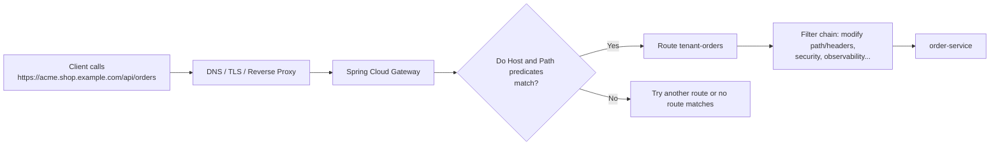
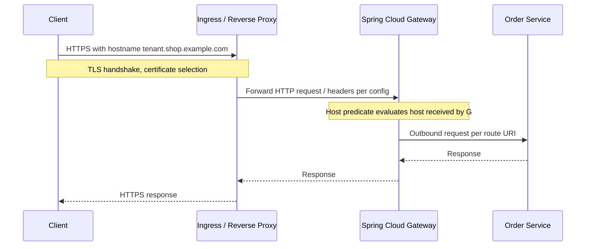

# Host: matching domains, subdomains, and template variables

When multiple APIs share a single **Spring Cloud Gateway**, the URL path is not the only criterion for determining the target microservice. For example, these three addresses can all use the path `/api/orders` while serving different user groups:

- `https://api.example.com/api/orders`: public API.
- `https://admin.example.com/api/orders`: operations interface.
- `https://acme.shop.example.com/api/orders`: API for a tenant named `acme`.

Spring Cloud Gateway's **Host Route Predicate Factory** solves the problem of route selection based on the **host name requested by the client**. It supports exact hosts, wildcard domain patterns, and template variables extracted from the hostname. This lesson belongs to the **Route Predicates** chapter in the **SPRING_CLOUD_GATEWAY** module: using route predicates to send requests to the right service, then combining filter chains, path/header transformations, service discovery, authentication, rate limiting, circuit breakers, retries, TLS, and traffic observability.

> **Scope:** Examples focus on **Spring Cloud Gateway Server WebFlux**. Configuration prefix syntax varies by version and starter; the shortcut syntax `Host=...` and matching concepts are used throughout this lesson. Do not assume all routing mechanisms in the Server MVC edition share the same internal implementation.

## 1. What does the Host predicate check?

Every HTTP request to a public address carries information about the target host. In HTTP/1.1, this information typically appears in the `Host` header:

```http
GET /api/orders/42 HTTP/1.1
Host: acme.shop.example.com
Accept: application/json
```

With HTTP/2, authority information is typically transmitted via the `:authority` field and interpreted by the HTTP framework as the request's host information. At the routing level, the **Host predicate** compares the request host seen by the gateway against the configured patterns, returning **match / no match**.

The Host predicate does not prove the client accessed from the right website, nor does it determine whether a business resource is allowed to be accessed. It only helps **select a route**.



To avoid confusion, distinguish the layers:

| Concept | Role | Does it replace the Host predicate? |
| --- | --- | --- |
| **DNS** | Resolves `api.example.com` into an IP address or network endpoint | No. DNS brings the connection to the machine/ingress; it does not select a Spring Cloud Gateway route. |
| **TLS/SNI** | When using HTTPS, helps identify the TLS certificate/configuration during the handshake | No. TLS happens before HTTP route processing; SNI and HTTP Host may not match. |
| **HTTP Host / authority** | Indicates the target host name in the HTTP request received by the gateway | This is the data the Host predicate evaluates after the framework processes the request. |
| **Route URI** | The *upstream* address Gateway will call, such as `lb://order-service` | No. The Route URI is the destination after matching; it does not have to match the public Host. |
| **Path predicate** | Evaluates paths such as `/api/orders/**` | Can be combined with Host to define a more specific route. |
| **Authentication/authorization** | Verifies identity and action permissions | Must be implemented with separate mechanisms; the Host predicate is not an authorization layer. |

**Remember:** a client can craft an HTTP request with an arbitrary `Host` header in many situations. Therefore, sensitive decisions such as "which tenant's orders may a user view?" must not rely solely on a Host match result.

## 2. Configuring Host for exact domain matching

Suppose the gateway is listening on `localhost:8080` and there is a test backend at `localhost:8081`. We want a route that only matches requests to `api.example.com` whose path starts with `/api/catalog/`:

```yaml
spring:
  cloud:
    gateway:
      routes:
        - id: public-catalog
          uri: http://localhost:8081
          predicates:
            - Host=api.example.com
            - Path=/api/catalog/**
          filters:
            - StripPrefix=1
```

**Explanation:**

- `Host=api.example.com`: the request must match the host `api.example.com`.
- `Path=/api/catalog/**`: the request must also match the path `/api/catalog/` and anything after it according to the pattern.
- `Host` and `Path` are **two different predicate types within the same route**: both must be satisfied for this route to match.
- `StripPrefix=1`: removes the first segment `api`; for example, `/api/catalog/products` becomes `/catalog/products` when sent to the backend.
- `uri: http://localhost:8081`: is the backend address in the test environment, not the domain requested by the client.

With this configuration, a `GET /api/catalog/products` request to `api.example.com` will match the `public-catalog` route. The same path with `Host: admin.example.com` will not match this route.

**Version note:** Some Spring Cloud Gateway Server WebFlux versions declare routes under `spring.cloud.gateway.routes`; newer versions may use `spring.cloud.gateway.server.webflux.routes`. Check the documentation for the exact dependency version you are running and only use the prefix supported by that version.

### How to test locally from a development machine

Because `api.example.com` might not point to the local gateway, we can simulate the `Host` header:

```bash
curl -i \
  -H "Host: api.example.com" \
  http://localhost:8080/api/catalog/products
```

Test a non-matching Host:

```bash
curl -i \
  -H "Host: other.example.com" \
  http://localhost:8080/api/catalog/products
```

In the second command, **the `public-catalog` route will not match**. The final status depends on whether the application has another route or handler for the request; do not assume it will always be `404` in every application.

Local HTTP commands are only for route testing. They do not verify that production HTTPS configuration, TLS certificates, or DNS are correct.

## 3. Host matching single-level and multi-level subdomains

Spring Cloud Gateway's Host predicate accepts **Ant-style patterns** using a dot (`.`) as the delimiter between hostname parts. Two important symbols are:

- `*`: suitable for matching characters within **one hostname part**.
- `**`: suitable for matching across **multiple hostname parts** in the pattern.

Example:

```yaml
predicates:
  - Host=*.example.com
```

A common case is matching hosts like `api.example.com` or `admin.example.com` (one level before `example.com`).

If you want to support multiple subdomain levels:

```yaml
predicates:
  - Host=**.example.com
```

For example, this can match `api.example.com`, `v1.api.example.com`, or `a.b.example.com` under the Host predicate's Ant matching mechanism.

| Host pattern | Request Host | Expected result |
| --- | --- | --- |
| `api.example.com` | `api.example.com` | Exact domain match |
| `api.example.com` | `admin.example.com` | No match |
| `*.example.com` | `shop.example.com` | Matches one subdomain part |
| `*.example.com` | `a.b.example.com` | Should not be expected to match multiple levels |
| `**.example.com` | `a.b.example.com` | Matches pattern for multiple levels |
| `{tenant}.shop.example.com` | `acme.shop.example.com` | Matches and extracts `tenant=acme` |
| `{tenant}.shop.example.com` | `a.b.shop.example.com` | Not a single-level tenant value |

**Apex domain case:** If you want to ensure both `example.com` (the apex domain) and subdomains are allowed, **declare the apex domain explicitly**, for example `Host=example.com,**.example.com`. Do not rely on assumptions about whether `**` can match zero segments or how hosts are normalized across versions/infrastructure.

**Ports and normalization:** In a local environment, the `Host` header may be sent as `api.example.com:8080`. A reverse proxy can also alter the Host/authority seen by the gateway. When matching depends on exact hostnames, write integration tests with real Host values with or without ports, different letter cases, and corresponding proxy configurations; do not assume a single route pattern covers every authority format.

### Host patterns differ from TLS certificate wildcards

A route with `Host=**.example.com` **does not grant** a TLS certificate for all subdomains. A wildcard certificate like `*.example.com` typically covers only one domain level according to TLS certificate verification rules; it does not cover `a.b.example.com`. For HTTPS access to succeed, the client must complete the TLS handshake with an appropriate certificate before the Host predicate runs.

## 4. Multiple Host patterns in one predicate: OR relationship

A single Host predicate can accept a **list of patterns**, separated by commas:

```yaml
spring:
  cloud:
    gateway:
      routes:
        - id: tenant-api
          uri: http://localhost:8081
          predicates:
            - Host=api.example.com,api.example.net
            - Path=/v1/**
```

With this route:

- Either `api.example.com` **or** `api.example.net` satisfies the Host condition.
- At the same time, the request must still satisfy `Path=/v1/**`.
- If the Host matches neither pattern, the route does not match regardless of the path.

This can be expressed as a logical expression:

```text
Route match =
    (Host is api.example.com OR api.example.net)
    AND
    (Path matches /v1/**)
```

Common pitfall: instead of writing multiple patterns inside **one** Host predicate, learners sometimes accidentally configure **two separate Host predicates** in the same route. Predicates within the same route are combined with AND, causing the route to never match if two independent Host predicates require two values that cannot both be true simultaneously. When you need alternative hosts, put them in the same `Host=...,...`.

### Combining with Method, Header, and Query

```yaml
- id: orders-read
  uri: http://localhost:8082
  predicates:
    - Host=api.example.com
    - Path=/api/orders/**
    - Method=GET
  filters:
    - StripPrefix=1
```

The route only matches requests that satisfy Host, Path, and the `GET` method. `POST /api/orders` may need another route with its own policies, even when using the same backend.

**Predicate design should stay clear:** Host separates access domains (public/admin/tenant), Path separates resources, Method separates operation types, and filters apply HTTP and technical policies.

## 5. Template variables in Host: extracting subdomains

In multi-tenant systems, you cannot manually declare every hostname when the number of tenants grows continuously. The Host predicate can use a **URI template variable**:

```yaml
spring:
  cloud:
    gateway:
      routes:
        - id: tenant-orders
          uri: http://localhost:8083
          predicates:
            - Host={tenant}.shop.example.com
            - Path=/api/orders/**
          filters:
            - StripPrefix=1
            - SetRequestHeader=X-Matched-Subdomain, {tenant}
```

Example:

```http
GET /api/orders/42 HTTP/1.1
Host: acme.shop.example.com
```

When the Host pattern matches, Gateway extracts the value:

```text
tenant = acme
```

The `SetRequestHeader` filter can expand the extracted URI template variable to populate the `X-Matched-Subdomain` header sent upstream. `SetRequestHeader` is chosen because it **sets/replaces** the header value, avoiding accumulating values sent by the client as adding a new header would.

| Component | In request/configuration | On match |
| --- | --- | --- |
| Host pattern | `{tenant}.shop.example.com` | Pattern for one subdomain named `tenant` |
| Actual Host | `acme.shop.example.com` | Extracts `tenant = acme` |
| Public path | `/api/orders/42` | `StripPrefix=1` produces `/orders/42` |
| Outbound header | `X-Matched-Subdomain: {tenant}` | Sends `X-Matched-Subdomain: acme` |
| Route URI | `http://localhost:8083` | Backend receives the request at a fixed upstream |

In Gateway WebFlux, variables collected from route predicates can be accessed from the `ServerWebExchange` attributes map. The following snippet only illustrates reading metadata and **does not perform authorization**:

```java
Map<String, String> variables =
    ServerWebExchangeUtils.getUriTemplateVariables(exchange);

String requestedTenant = variables.get("tenant");
```

The snippet assumes `java.util.Map` and `org.springframework.cloud.gateway.support.ServerWebExchangeUtils` are imported, and that it is running inside a `GatewayFilter`/`GlobalFilter` after the route has matched.

### 5.1. Why is the tenant name from Host not enough for authentication?

Host is **client-supplied input**. A client can try:

```bash
curl -i \
  -H "Host: another-tenant.shop.example.com" \
  http://localhost:8080/api/orders/42
```

If the gateway simply extracts the tenant name from Host and the backend implicitly allows viewing that tenant's orders, that creates a cross-tenant authorization vulnerability.

A safer design:

1. Gateway **authenticates** the token/session/API key using an appropriate mechanism; control the Host source if an external proxy is present.
2. Gateway can forward the requested tenant name as **routing metadata**.
3. The backend compares the requested tenant against the **verified identity**, access permissions, and actual data. If the user does not belong to that tenant, the backend rejects the request.
4. If the backend trusts internal headers only, you must ensure clients cannot bypass the gateway and that the gateway strips/overwrites identity headers supplied by the client. Signed tokens or mTLS combined with identity binding in the service can be preferred.

The `{tenant}` variable is also not validated for format or tenant existence. The service or policy layer must validate the tenant name, tenant status, corresponding permissions, and hostname management rules.

### 5.2. A template variable does not automatically create dynamic per-backend routes

Setting `Host={tenant}.shop.example.com` does not mean an `lb://...` URI or upstream address will be dynamically generated from the tenant name. In the example, all tenants still go to `http://localhost:8083`. If you need to route each tenant to a separate service or cluster, you must design a dynamic route mechanism, service discovery, or appropriate upstream selection policy with safety checks; do not construct URIs from arbitrary Host strings and send requests out to the Internet because of SSRF/open proxy risks.

## 6. Route ordering when Host patterns overlap

Suppose the gateway has both a route for `admin.example.com` and a general route for `**.example.com`. A request to `admin.example.com` can match **both**. When multiple routes match, route order/precedence determines which route is selected.

Example configuration:

```yaml
spring:
  cloud:
    gateway:
      routes:
        - id: admin-api
          order: -10
          uri: http://localhost:8082
          predicates:
            - Host=admin.example.com
            - Path=/api/**
          filters:
            - StripPrefix=1

        - id: public-api
          order: 0
          uri: http://localhost:8081
          predicates:
            - Host=**.example.com
            - Path=/api/**
          filters:
            - StripPrefix=1
```

Here `admin-api` has a lower `order` value and takes precedence when a request matches all of its conditions. However, relying solely on `order` for security isolation is hard to maintain: a new route added later or a predicate change can accidentally send admin traffic to the wrong backend.

**Design recommendation:** try to avoid overlapping match regions for routes with different security requirements. If overlap is unavoidable, define precedence explicitly, write tests verifying **the actual selected route ID**, and always enforce separate authorization on admin endpoints.

### Scenario where a broad route swallows a narrow route

| Request | Candidate matching routes | Intended route |
| --- | --- | --- |
| `Host: admin.example.com`, `GET /api/users` | `admin-api`, `public-api` | `admin-api` |
| `Host: shop.example.com`, `GET /api/catalog` | `public-api` | `public-api` |
| `Host: admin.example.com`, `GET /other` | No route matches Path `/api/**` | No matching route in this config |
| `Host: malicious.example.net`, `GET /api/users` | No route matches Host `*.example.com` / `**.example.com` | No matching route in this config |

Do not mistake "route matched early" for an authorization mechanism. For sensitive APIs, Spring Security can block requests and the backend must still check permissions on resources.

## 7. Client Host differs from upstream connection Host

A common misconception is thinking `Host=shop.example.com` makes Gateway connect to `shop.example.com`. In reality:

- The **Host predicate** inspects the **inbound** host seen by the gateway.
- The **route `uri`** determines the **outbound** destination (e.g., `http://localhost:8081` or `lb://catalog-service`).
- When using `lb://catalog-service`, the load balancer/discovery finds an instance; ultimately the HTTP client has a concrete URI to connect to.
- The **outbound Host header** depends on header/proxy rules and filters like `PreserveHostHeader` if enabled. This header does not change where the TCP/TLS connection is established.

Example:

```yaml
- id: catalog-by-domain
  uri: lb://catalog-service
  predicates:
    - Host=shop.example.com
    - Path=/api/catalog/**
  filters:
    - StripPrefix=1
```

The client sends `Host: shop.example.com`, yet the target service can be an internal instance like `catalog-service-2:8080` returned by discovery. To use `lb://`, you must have Spring Cloud LoadBalancer integration and an appropriate instance source; simply declaring the URI does not enable service discovery automatically.

### Is `PreserveHostHeader` used to select a route?

The `PreserveHostHeader` filter is useful when the upstream requires the **original Host** for virtual hosting or HTTP configuration checks. It affects the **outbound forwarding** direction, not whether the Host predicate matched beforehand.

Test carefully when using it with HTTPS upstreams: the name used for TLS SNI and certificate verification on the outbound connection must align with the HTTP client and actual backend configuration. Do not assume enabling `PreserveHostHeader` will automatically fix all hostname/certificate errors.

## 8. Reverse proxies, TLS, and Host trustworthiness

Many systems place an ingress, reverse proxy, or load balancer in front of Spring Cloud Gateway:



Key checkpoints:

1. **TLS before route matching:** if a client connects over HTTPS but the ingress/gateway lacks a valid certificate for that host, the handshake can fail before any Host predicate is evaluated.
2. **Host received by Gateway:** a reverse proxy may preserve the client's Host or replace it with an internal name. If replaced, `Host=api.example.com` will not match as expected. Configure the ingress/proxy according to system requirements.
3. **Forwarded headers:** `Forwarded` and `X-Forwarded-Host` can only be trusted when they originate from a trusted reverse proxy with anti-spoofing policies in place. They are not automatically synonymous with the Host header used by the Host predicate.
4. **HTTP/2 authority and HTTP/1.1 Host:** infrastructure may normalize these fields differently. Test at the actual protocol layer deployed.
5. **Port in authority:** for requests like `Host: api.example.com:8443`, test the matcher against your version and topology. Avoid blanket claims that every version handles `:port` identically.
6. **User-supplied domain names:** do not use Host to build arbitrary outbound URIs or grant admin/tenant access. Maintain an allowlist and verify identity, permissions, and proxy source accordingly.

In multi-tenant systems, Host can be used to select the **requested context**, after which the backend uses the authenticated token/identity to check **permission to access that context**. This is the core distinction between routing and business security.

## 9. Testing the Host predicate in practice

### 9.1. Local HTTP testing with curl

With the configuration:

```yaml
spring:
  cloud:
    gateway:
      routes:
        - id: tenant-orders
          uri: http://localhost:8083
          predicates:
            - Host={tenant}.shop.example.com
            - Path=/api/orders/**
          filters:
            - StripPrefix=1
            - SetRequestHeader=X-Matched-Subdomain, {tenant}
```

Run a test backend on `localhost:8083` with an `/orders/42` endpoint that logs the path and headers. Then call:

```bash
# Valid Host, single-level tenant
curl -i \
  -H "Host: acme.shop.example.com" \
  http://localhost:8080/api/orders/42

# Wrong Host suffix
curl -i \
  -H "Host: acme.other.example.com" \
  http://localhost:8080/api/orders/42

# Wrong path even though Host matches
curl -i \
  -H "Host: acme.shop.example.com" \
  http://localhost:8080/api/catalog/products
```

For the first request, expect the `tenant-orders` route to match and the backend to receive `/orders/42` and the header `X-Matched-Subdomain: acme`. The next two requests **do not match the `tenant-orders` route**; the final status depends on whether the application has other routes or handlers.

Test a client sending a spoofed header with the same name:

```bash
curl -i \
  -H "Host: acme.shop.example.com" \
  -H "X-Matched-Subdomain: attacker" \
  http://localhost:8080/api/orders/42
```

With the `SetRequestHeader` filter in the example, the backend should see the value set from the matched variable (`acme`) instead of `attacker`. Even so, the backend must still not treat `acme` as proof that the user is authorized to access that tenant.

### 9.2. Testing HTTPS, Host, and SNI together

When the gateway/ingress is configured with TLS and listening on port `8443`, you can use `--resolve` to direct the connection to a desired IP while **still using the hostname in the URL**:

```bash
curl -i \
  --resolve api.example.com:8443:127.0.0.1 \
  https://api.example.com:8443/api/catalog/products
```

This command succeeds only when the TLS endpoint, certificate, and hostname/port are validly configured. `--resolve` controls the target IP during testing and does not make an invalid certificate valid. Never use flags that skip certificate verification as a way to test production security.

### 9.3. Recommended test matrix

| Test group | Example | Check |
| --- | --- | --- |
| Exact Host | `api.example.com` | Exact route is selected |
| Different Host | `admin.example.com` | Not mistakenly matched by the exact route |
| Single-level subdomain | `acme.example.com` | Matches `*.example.com` as expected |
| Multi-level | `a.b.example.com` | Test `**.example.com`; do not assume `*.example.com` matches |
| Apex domain | `example.com` | Explicit route exists if apex is intended to be supported |
| Template variable | `acme.shop.example.com` | Extracts `tenant=acme`; do not trust variable for authorization |
| Wrong Path | Valid Host, Path outside pattern | Route does not match |
| Wrong Method | Valid Host/Path, different Method | Route with Method predicate does not match |
| Overlapping routes | `admin.example.com` with broad pattern | Correct route ID/`order` and access controls |
| Reverse proxy | Host preserved or modified by ingress | Route matching works in real topology |
| TLS/certificate | Different HTTPS domain and SNI | Handshake and certificate verification behave properly |
| Spoofed header | Client sets `X-Matched-Subdomain` | Header is handled by policy and backend checks authorization itself |

When multiple routes overlap, observing the **route ID** in metrics/logs/traces is more helpful than only looking at the response body.

## 10. Common errors and diagnostics

| Symptom | Causes to check | Resolution |
| --- | --- | --- |
| Route does not match even though path is right | Wrong Host, port present, proxy alters Host, wrong domain suffix | Log Host metadata safely in test env, inspect request and ingress; write targeted tests |
| `Host=*.example.com` does not accept multi-level domains | `*` is not meant for multiple hostname parts | Use `**` if multi-level matching is the goal, re-verify intended scope |
| Admin route captured by public route | Overly broad `**` pattern, overlapping routes, or unexpected order | Narrow patterns, configure `order`, and verify route IDs; keep authorization separate |
| `{tenant}` variable missing in header | Host pattern didn't match, wrong variable name, filter running before/on wrong route | Check Host, variable name, and filters on matched route; test a minimal example |
| Backend sees internal Host instead of public Host | HTTP client builds outbound request from backend URI | Evaluate whether `PreserveHostHeader` is truly needed; configure per backend virtual host and TLS |
| Gateway fails TLS before returning a response | Mismatched certificate/hostname/SNI | Fix TLS and certificate config; do not try to tweak Host predicate to bypass handshake |
| Tenant A accesses Tenant B's data | Backend logic trusts subdomain variable or unauthenticated header | Enforce authorization by identity and data ownership, network policy, and anti-spoofing |
| Gateway forwards to client-suggested address | Uncontrolled URI construction from Host | Restrict upstream URIs via allowlist/discovery, preventing SSRF/open proxy |

When troubleshooting, determine whether the failure belongs to **DNS/TLS, ingress, route matching, filters, load balancing, HTTP proxying, or the backend**. For example, `404` can mean either no route matched or the backend returned "resource not found"; you need traces and the route ID to tell them apart.

## 11. Practice lab: designing three API domains

**Context:** A company provides a public API, an admin portal, and a multi-tenant sales system. Domains:

- `api.example.com`: client applications calling the public REST API.
- `admin.example.com`: admin API with dedicated security requirements.
- `{tenant}.shop.example.com`: API for reading orders per tenant.

**Task:** Create three routes to three test backends (e.g., `localhost:8081`, `8082`, `8083`) with these requirements:

1. The public route matches exact Host `api.example.com` and Path `/api/catalog/**`.
2. The admin route matches exact Host `admin.example.com` and Path `/api/**`, with appropriate authentication/authorization enforced via Spring Security and the backend.
3. The tenant route matches the template variable `{tenant}.shop.example.com` with Path `/api/orders/**`; pass tenant metadata to the backend via a header **overwritten from the matched variable**.
4. Use `StripPrefix=1` so the backend receives paths without the `/api` segment.
5. Verify route ID, path, and headers on the backend using `curl`; add tests with a wrong Host or spoofed header request.
6. If switching routes to `lb://service-name`, verify discovery and LoadBalancer provide valid instances. Do not treat tenant names as arbitrary upstream hostnames.

An illustrative configuration:

```yaml
spring:
  cloud:
    gateway:
      routes:
        - id: public-catalog
          uri: http://localhost:8081
          predicates:
            - Host=api.example.com
            - Path=/api/catalog/**
          filters:
            - StripPrefix=1

        - id: admin-api
          uri: http://localhost:8082
          predicates:
            - Host=admin.example.com
            - Path=/api/**
          filters:
            - StripPrefix=1

        - id: tenant-orders
          uri: http://localhost:8083
          predicates:
            - Host={tenant}.shop.example.com
            - Path=/api/orders/**
          filters:
            - StripPrefix=1
            - SetRequestHeader=X-Matched-Subdomain, {tenant}
```

In this example, the Host predicate only **routes traffic**. In production, you still need authentication, admin endpoint permissions, tenant data permissions, rate limits, timeouts, request observability, TLS, and trusted header controls according to the application design. Never treat reaching the admin hostname as proof that the caller holds an admin role.

### Self-check questions

**1. How does `Host=api.example.com` differ from `uri: lb://api-service`?**

> The Host predicate inspects inbound host information to select a route. The route URI describes the upstream Gateway will connect to after matching and appropriate load balancing/discovery.

**2. If `Host=api.example.com,api.example.net` is configured, must a request carry both Hosts at once?**

> No. Two patterns inside one Host predicate are alternatives (OR). The request only needs to satisfy one pattern; other predicates in the route must still simultaneously match.

**3. Why should `Host=*.example.com` not be used when you need to match `eu.tenant.example.com`?**

> The `*` pattern serves a single hostname part. When the target includes multiple levels, use an appropriate pattern like `**.example.com` or design more specific routes and test them.

**4. Why is `{tenant}` from the hostname not sufficient to return an order list?**

> A client can request another tenant name. The backend must verify the principal's identity, their permissions on that tenant, and access rights for each resource.

**5. Does the Host predicate guarantee a `*.example.com` certificate works for `a.b.example.com`?**

> No. The Host predicate processes HTTP after TLS. Route matching conditions and the domain scope protected by a TLS certificate are two separate concerns.

**6. If requests pass through an ingress, where should you check Host when a route does not match?**

> Check both the Host/authority sent by the client and the value the ingress actually forwards to Gateway, along with trust policies and forwarded headers. Gateway can only match based on the request information it receives.

## 12. Checklist before deploying the Host predicate

- [ ] Choose **exact Host**, `*`, or `**` based on the domain scope to accept; declare the apex domain explicitly if required.
- [ ] Combine Host with Path/Method/Headers when needed, keeping in mind **OR inside a Host pattern list** and **AND across route predicates**.
- [ ] Avoid broad routes overlapping sensitive routes; configure `order` and verify route IDs in integration tests.
- [ ] Treat `{tenant}` as request metadata, **never as the sole basis for granting access**.
- [ ] If passing tenant via a header, overwrite/strip client-spoofed values; the backend still verifies ownership and authorization.
- [ ] Distinguish inbound Host from upstream URI; handle `lb://` through discovery and LoadBalancer when used.
- [ ] Test ingress Host preservation/rewriting, forwarded headers, and requests with ports or differing letter cases.
- [ ] Test TLS certificates/SNI as well; route matching does not establish valid HTTPS by itself.
- [ ] Never build arbitrary outbound URIs from Host headers or domain variables; prevent SSRF/open proxies.
- [ ] Add rate limiting, timeouts, circuit breakers, and retries with proper semantics; they do not replace authentication and authorization.
- [ ] Observe route ID, HTTP status, latency, and trace ID; do not put unbounded client-controlled Host values directly into metric labels.
- [ ] Test valid Host, invalid Host, multi-level subdomains, overlapping routes, and header spoofing attacks.

## Conclusion

**Host Route Predicate Factory** enables Spring Cloud Gateway to route requests by **exact domain**, **subdomain patterns**, and **template variables** like `{tenant}`. It is an essential tool when public, admin, or tenant APIs share a single microservices entry point. A list of patterns within one Host predicate has an OR relationship, while Host combines with Path/Method and other predicates via AND to select the right route.

To operate safely, distinguish **HTTP routing conditions** from **DNS, TLS/SNI, outbound Host, and business permissions**. Combining the Host predicate with filter chains, service discovery, authentication, rate limiting, and observability helps the gateway send requests to the right place, while each service remains responsible for verifying whether the user is authorized for the actual tenant and resource.
