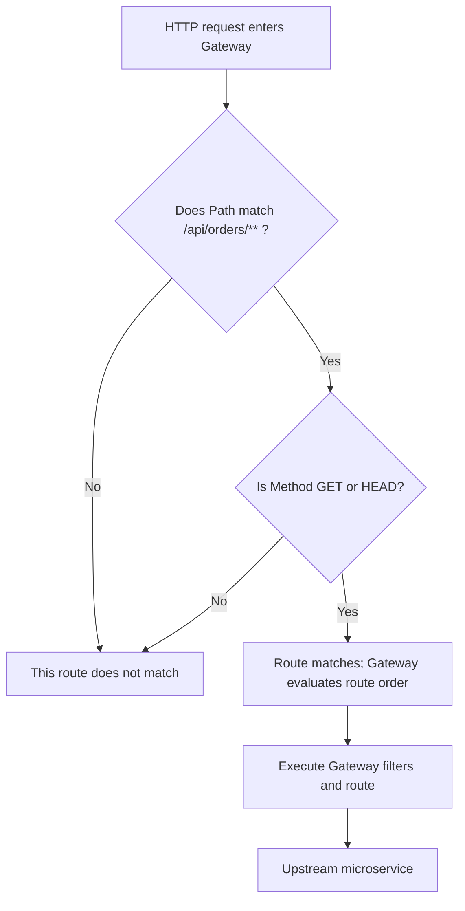
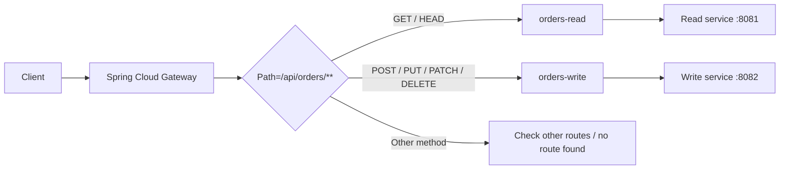

# Method: selecting routes by one or more HTTP methods

In **Spring Cloud Gateway**, a single URL can serve multiple different operations: `GET /api/orders/42` to read an order, `POST /api/orders` to create an order, `PATCH /api/orders/42` to update, and `DELETE /api/orders/42` to delete. Even though they all start with `/api/orders`, these requests may need to be routed to different services, rate-limiting policies, or filters.

**`Method` Route Predicate Factory** helps Gateway decide **which route matches** based on the HTTP method of the request. You can declare a single method or multiple methods on the same route. This is a routing condition in Spring Cloud Gateway Server WebFlux that can be combined with `Path`, `Host`, `Header`, `Query`, and other predicates; by itself, it does not perform authentication, change the method, or send requests to the backend.

This lesson belongs to the **Route Predicates** chapter, using API Gateway management examples for microservices. After this lesson, you will be able to configure `Method`, understand how conditions combine, predict outcomes when requests do not match, test with `curl`, and avoid critical misconceptions around `HEAD`, `OPTIONS`, authorization, and retries.

## 1. What does the Method predicate decide?

An HTTP method is the verb in the HTTP request line: `GET`, `POST`, `PUT`, `PATCH`, `DELETE`, `HEAD`, `OPTIONS`, etc. In WebFlux, a request's method is represented via `org.springframework.http.HttpMethod`.

A route includes at least three key parts:

- **`id`:** route identifier, useful for logging and metrics.
- **`uri`:** forwarding destination if the route is selected, which can be a concrete HTTP address or a load-balanced URI such as `lb://order-service`.
- **`predicates`:** the set of conditions that must be satisfied before the route is chosen.

Suppose a route declares:

```yaml
predicates:
  - Path=/api/orders/**
  - Method=GET,HEAD
```

The route will match when **both**:

1. The request path matches `/api/orders/**`.
2. The method is **GET or HEAD**.

This can be written concisely as:

```text
Match(route, request)
    = Match(Path = /api/orders/**)
      AND
      (Method = GET OR Method = HEAD)
```

In a list of multiple methods within the **same `Method` predicate**, the methods have an **OR** relationship. Between `Method` and other predicates on the **same route**, results are typically combined with **AND**. If any condition is false, that route is not selected.



**Evaluation timing:** Route predicates are checked **before** running the Gateway filters of the selected route. Therefore, `StripPrefix`, `RewritePath`, or `AddRequestHeader` in the filter chain cannot retroactively make a request that did not match `Method` match. The `Method` configuration inspects the method **Gateway receives from the client**, not by default how the target service interprets the request.

## 2. Configuring a single HTTP method

Example allowing only `GET` requests onto the order-reading route:

```yaml
spring:
  cloud:
    gateway:
      routes:
        - id: orders-read
          uri: http://localhost:8081
          predicates:
            - Path=/api/orders/**
            - Method=GET
          filters:
            - StripPrefix=1
```

In this configuration:

- `GET /api/orders/42` satisfies `Path` and `Method`, and is sent to `http://localhost:8081/orders/42` after `StripPrefix=1` removes the `api` segment.
- `POST /api/orders/42` satisfies `Path` but **does not** satisfy `Method`, so **the `orders-read` route is not selected**.
- `GET /api/customers/42` does not satisfy `Path`, even though the method is `GET`.

The YAML example uses the `spring.cloud.gateway.routes` property name from traditional Gateway WebFlux configuration. **Property prefix names depend on the version/starter**: in newer Spring Cloud Gateway Server WebFlux releases, the corresponding configuration group may be `spring.cloud.gateway.server.webflux.routes`. When using a specific version, choose the exact prefix from that version's documentation; the `- Method=GET` syntax and method-matching principles remain the same.

There is no requirement that a route using `Method` must have only one method, nor is every route required to declare `Method`. **If `Method` is omitted**, the route is not restricted by this method predicate, though it may still be constrained by `Path` and other conditions.

### The Method predicate does not change the HTTP method

`Method=GET` is a **check**. It does not turn `POST` into `GET`, does not alter the request body, and does not call the backend directly. Responsibilities are clearly separated:

| Component | Role |
| --- | --- |
| `Method` predicate | Decides whether the request qualifies to match the route |
| `Path` predicate | Matches the request's initial URL path |
| `GatewayFilter` | Applies policies and/or transforms the request/response after route selection |
| Routing filter | Forwards to the resolved target URI |
| Spring Security | Authenticates and authorizes the request per security configuration |

## 3. Selecting a single route for multiple HTTP methods

You can list methods separated by commas in a single `Method` predicate:

```yaml
spring:
  cloud:
    gateway:
      routes:
        - id: orders-write
          uri: http://localhost:8082
          predicates:
            - Path=/api/orders/**
            - Method=POST,PUT,PATCH,DELETE
          filters:
            - StripPrefix=1
            - AddRequestHeader=X-Edge-Route,orders-write
```

This same route can match all four methods. It can direct write operations to a shared upstream, apply a common set of filters, and attach metrics to the `orders-write` route ID.

Another variant uses `GET,HEAD` to group read methods:

```yaml
predicates:
  - Path=/api/products/**
  - Method=GET,HEAD
```

The comma here represents the **set of accepted methods**. Do not interpret it as a priority order: `Method=GET,HEAD` does not prioritize GET over HEAD; it simply checks set membership.

### How to read a concrete request

With `Path=/api/orders/**` and `Method=POST,PUT,PATCH,DELETE`:

| Request | Matches `Path`? | Matches `Method`? | Route matches? |
| --- | --- | --- | --- |
| `POST /api/orders` | Yes | Yes | Yes |
| `PUT /api/orders/42` | Yes | Yes | Yes |
| `PATCH /api/orders/42` | Yes | Yes | Yes |
| `DELETE /api/orders/42` | Yes | Yes | Yes |
| `GET /api/orders/42` | Yes | No | No |
| `HEAD /api/orders/42` | Yes | No | No |
| `POST /api/customers` | No | Yes | No |

**Note:** The table results apply only to the **route under consideration**. A request that does not match this route may still match **another route** in Gateway.

## 4. Separating read and write routes for the same API

This is a common scenario when backends split read and write services or when you want different policies across operations.

```yaml
spring:
  cloud:
    gateway:
      routes:
        - id: orders-read
          order: 0
          uri: http://localhost:8081
          predicates:
            - Path=/api/orders/**
            - Method=GET,HEAD
          filters:
            - StripPrefix=1

        - id: orders-write
          order: 0
          uri: http://localhost:8082
          predicates:
            - Path=/api/orders/**
            - Method=POST,PUT,PATCH,DELETE
          filters:
            - StripPrefix=1
```

Both routes share the same `Path`, but their method sets are **disjoint**, so they do not compete for the same request among the declared methods.



**The correctness of this configuration depends on the API contract.** Not every path under `/api/orders/**` allows all four write operations. For instance, `DELETE /api/orders` might not be supported by the backend. The Method predicate only chooses where to forward; **the backend must still validate specific endpoints**, input data, and access permissions.

### Equivalent Java DSL

When configuring routes in Java code in Gateway WebFlux:

```java
@Configuration
public class OrderGatewayRoutes {

    @Bean
    public RouteLocator orderRoutes(RouteLocatorBuilder builder) {
        return builder.routes()
            .route("orders-read", r -> r
                .path("/api/orders/**")
                .and()
                .method(HttpMethod.GET, HttpMethod.HEAD)
                .filters(f -> f.stripPrefix(1))
                .uri("http://localhost:8081"))

            .route("orders-write", r -> r
                .path("/api/orders/**")
                .and()
                .method(
                    HttpMethod.POST,
                    HttpMethod.PUT,
                    HttpMethod.PATCH,
                    HttpMethod.DELETE)
                .filters(f -> f.stripPrefix(1))
                .uri("http://localhost:8082"))
            .build();
    }
}
```

Key types: `RouteLocatorBuilder`, `RouteLocator`, `HttpMethod`, `Configuration`, and `Bean`. Calling `.path(...).and().method(...)` builds a combined condition semantically equivalent to the YAML above.

Java DSL is advantageous when routes are described in code or need shared constants; YAML is advantageous when routing policies need to be adjusted via configuration. Either way, the outcome is **selecting a route by request method**.

## 5. Multiple matching routes: understanding precedence order

The Method predicate **does not by itself decide the winning route** when multiple routes satisfy the request. Spring Cloud Gateway evaluates routes in sorted order and uses the first matching route; the `order` property lets you explicitly control precedence. **Lower `order` values have higher priority.**

For example, suppose you want `POST /api/orders/**` requests to go to the write service, while other requests fall into a broader catch-all route:

```yaml
spring:
  cloud:
    gateway:
      routes:
        - id: orders-write
          order: -10
          uri: http://localhost:8082
          predicates:
            - Path=/api/orders/**
            - Method=POST

        - id: api-general
          order: 100
          uri: http://localhost:8090
          predicates:
            - Path=/api/**
```

`POST /api/orders` matches **both routes**, but `orders-write` is evaluated first because `-10` is less than `100`. `GET /api/orders` does not match the first route and can enter `api-general`.

| Case | Selected route if not blocked by another layer |
| --- | --- |
| `POST /api/orders` | `orders-write` (order `-10`) |
| `GET /api/orders` | `api-general` (order `100`) |
| `PATCH /api/orders/42` | `api-general` (order `100`) |
| `POST /other` | Matches neither route above |

A `Path=/api/**` route **without `Method`** can accept unintended methods, including `PATCH` or `DELETE`. Only use broad routes when genuinely needed and enforce strict security/rate-limiting policies.

If two routes have overlapping conditions and the same `order`, do not rely on YAML declaration position as a long-term priority contract. Assign `order` explicitly or make predicates mutually exclusive, then verify the chosen route in integration tests.

## 6. Common pitfalls: HEAD, OPTIONS, 404, and 405

### `HEAD` does not automatically imply `GET`

By HTTP semantics, `HEAD` requests the metadata corresponding to `GET` without a response body. Some framework/controller layers automatically support `HEAD` for `GET` endpoints. However, **Gateway's Method predicate checks the declared method**. Do not rely on automatic controller behavior to assume:

```yaml
predicates:
  - Method=GET
```

will match `HEAD`. If Gateway needs to forward `HEAD`, declare **`Method=GET,HEAD`** and ensure the upstream handles `HEAD` according to contract.

### `OPTIONS` and CORS preflight

Browsers may issue an `OPTIONS` request before a cross-origin request to query CORS policy. For example:

```http
OPTIONS /api/orders HTTP/1.1
Origin: https://app.example
Access-Control-Request-Method: POST
Access-Control-Request-Headers: authorization,content-type
```

**The actual method of the preflight is `OPTIONS`**, not `POST`. The `Access-Control-Request-Method: POST` header indicates the browser **intends** to send `POST` after the preflight is accepted. Therefore, a `Method=POST` route **does not directly match** the `OPTIONS` preflight.

In real systems, CORS preflight is usually handled by the CORS mechanism of WebFlux, Gateway, and/or Spring Security before or outside normal route filters. Configure CORS globally for the accessible paths and integrate it with Security, rather than simply adding `Method=OPTIONS` to every route and forwarding preflights to microservices.

A CORS configuration must explicitly specify allowed origins, headers, methods, and credentials. If using cookies/credentials, do not configure wildcards indiscriminately; avoid having multiple layers write conflicting CORS headers.

### Failing to match a route does not automatically return `405`

If no route satisfies both `Path` and `Method`, Gateway typically **finds no route handler**, and the request may end with `404 Not Found`, depending on other handlers and application settings. Gateway **does not automatically guarantee** building an allowed-methods list and returning `405 Method Not Allowed` just because `Path` matched while `Method` did not.

Conversely, the **upstream** may receive the request after Gateway picks a broader route and return `405` itself. Another WebFlux controller in the same application can also have its own behavior. Therefore, distinguish clearly:

- **Route predicate mismatch:** that route is not selected; another route may still be evaluated.
- **Gateway selected a route, upstream returns `405`:** the HTTP response was generated by the target service.
- **Spring Security blocks:** may return `401` or `403` before Gateway selects a route.
- **CORS preflight rejected:** may be handled by the CORS/Security layer; it does not prove the `Method` predicate is broken.

### `TRACE`, `CONNECT`, and unused methods

Do not let an overly broad route accidentally forward methods outside the contract. Enforce method-control policies at the ingress/infrastructure and Spring Security layers when needed, while keeping independent method validation in the backend. For endpoints supporting only `GET`/`POST`, declaring `Method` explicitly also reduces unintended routing surface, though it **does not replace firewalls or security controls**.

## 7. The Method predicate is not access control

A dangerous misconception is thinking `Method=POST` "protects" write operations. The predicate only checks that the request has method `POST`—it **does not know who the caller is** and does not check order-creation permissions.

In a Gateway using Spring Security WebFlux, authentication/authorization belongs in `SecurityWebFilterChain`. Example illustrating scope policies:

```java
@Bean
SecurityWebFilterChain securityWebFilterChain(ServerHttpSecurity http) {
    return http
        .csrf(ServerHttpSecurity.CsrfSpec::disable)
        .authorizeExchange(exchanges -> exchanges
            .pathMatchers(HttpMethod.GET, "/api/orders/**")
                .hasAuthority("SCOPE_orders.read")
            .pathMatchers(HttpMethod.HEAD, "/api/orders/**")
                .hasAuthority("SCOPE_orders.read")
            .pathMatchers(HttpMethod.POST, "/api/orders/**")
                .hasAuthority("SCOPE_orders.write")
            .pathMatchers(HttpMethod.PUT, "/api/orders/**")
                .hasAuthority("SCOPE_orders.write")
            .pathMatchers(HttpMethod.PATCH, "/api/orders/**")
                .hasAuthority("SCOPE_orders.write")
            .pathMatchers(HttpMethod.DELETE, "/api/orders/**")
                .hasAuthority("SCOPE_orders.write")
            .anyExchange().authenticated())
        .oauth2ResourceServer(oauth2 ->
            oauth2.jwt(Customizer.withDefaults()))
        .build();
}
```

This snippet assumes Gateway is configured as an OAuth2 Resource Server verifying JWTs, with scopes `orders.read` or `orders.write` mapped to corresponding authorities. Disabling CSRF is only appropriate for stateless Bearer-token APIs that do not use browser cookie/session authentication; projects using sessions/cookies must apply CSRF properly.

Guidelines:

1. **Security evaluates client-facing requests.** Security WebFilters typically run before Gateway route selection; if using `StripPrefix`/`RewritePath`, Security rules must be written against the public URL before rewriting.
2. **Adding a new route does not create a new security policy.** Always maintain a default rule for unlisted endpoints.
3. **Same path with different methods may require different permissions.** Reading an order and canceling an order are not the same permission.
4. **Target microservices remain responsible for protecting sensitive data and actions** under the system's trust model.

Additionally, do not allow headers like `X-HTTP-Method-Override` from untrusted clients to bypass method policies. If a proxy/upstream layer supports method override, you must align **the actual method checked across Gateway, Security, and backend**; otherwise, method-interpretation discrepancies can cause vulnerabilities.

## 8. Interaction with filters, retries, and discovery

A route can combine `Method` with functional filters:

```yaml
spring:
  cloud:
    gateway:
      routes:
        - id: inventory-read
          uri: lb://inventory-service
          predicates:
            - Path=/api/inventory/**
            - Method=GET,HEAD
          filters:
            - StripPrefix=1
            - AddRequestHeader=X-Entry-Point,gateway
```

Processing flow for `GET /api/inventory/sku-001`:

1. `Path` and `Method` match; route `inventory-read` is selected.
2. Gateway filters change the path to `/inventory/sku-001` and add the `X-Entry-Point` header.
3. The load balancer/service discovery locates an instance of `inventory-service` if configured.
4. Gateway forwards the request with its original HTTP method to the chosen instance.
5. The response is returned to the client through the filter chain.

**Header note:** Custom headers from clients can be spoofed; when the upstream treats a Gateway-added header as trusted, define rules to overwrite or strip client-sent headers of the same name. Never treat an unprotected custom header as proof of identity.

### Retrying by method: consider idempotency

If enabling Gateway `Retry` on a route with `POST,PUT,PATCH,DELETE`, inspect carefully:

- **`GET` and `HEAD`:** generally better suited for bounded retries on transient errors, while still requiring deadlines and retry limits.
- **`PUT`, `DELETE`:** have idempotent HTTP semantics when implemented properly, though retries can still trigger auxiliary side effects such as logs, events, or operational costs.
- **`POST`, `PATCH`:** not idempotent by default; retries can create duplicate transactions. Require idempotency keys, deduplication mechanisms, or explicit backend guarantees.
- **Requests with bodies:** retries may need to buffer/replay the request body depending on Gateway capabilities; inspect memory limits and `DataBuffer` handling.
- **Timeouts and circuit breakers:** the Method predicate only routes; it does not set timeouts, guarantee rollbacks, or configure circuit breakers.

In production, group methods on routes when you need different rate-limit, timeout, or retry policies, but do not apply those policies solely by method name while ignoring business contracts.

## 9. Testing with curl and mock upstreams

Suppose two upstreams are running:

- Read service at `http://localhost:8081`, exposing `GET /orders/42`.
- Write service at `http://localhost:8082`, exposing `POST /orders`.

Gateway runs at `http://localhost:8080` with the two `orders-read`/`orders-write` routes from section 4.

### Sending matching requests

```bash
# GET -> orders-read -> http://localhost:8081/orders/42
curl -i -X GET http://localhost:8080/api/orders/42

# HEAD -> orders-read, if upstream supports HEAD
curl -I http://localhost:8080/api/orders/42

# POST -> orders-write -> http://localhost:8082/orders
curl -i -X POST http://localhost:8080/api/orders \
  -H "Content-Type: application/json" \
  -d '{"productId":"sku-001","quantity":2}'

# PATCH -> orders-write -> http://localhost:8082/orders/42
curl -i -X PATCH http://localhost:8080/api/orders/42 \
  -H "Content-Type: application/json" \
  -d '{"status":"CONFIRMED"}'
```

On Windows PowerShell, you can use `curl.exe` if `curl` is an alias for a PowerShell cmdlet in your environment.

Do not verify routing **solely by HTTP status**: two upstreams could coincidentally return the same status. Use a mock server, access logs, or response headers added by the mock upstream to verify where the request actually went and with which method/path it was forwarded.

### Sending non-matching requests

```bash
# Matches neither route if only GET,HEAD and POST,PUT,PATCH,DELETE are allowed.
curl -i -X OPTIONS http://localhost:8080/api/orders/42

# Does not match Path=/api/orders/**
curl -i -X GET http://localhost:8080/api/customers/42
```

Observed results can be influenced by CORS, Security, or another route. Therefore, do not hardcode a test asserting every `OPTIONS` request must return `404`. Identify the input conditions, active configuration layers, and **which route was actually selected**.

### Recommended test matrix

| Test | Method | Path | Expectation at routing layer |
| --- | --- | --- | --- |
| T1 | GET | `/api/orders/42` | `orders-read` |
| T2 | HEAD | `/api/orders/42` | `orders-read` |
| T3 | POST | `/api/orders` | `orders-write` |
| T4 | PUT | `/api/orders/42` | `orders-write` |
| T5 | PATCH | `/api/orders/42` | `orders-write` |
| T6 | DELETE | `/api/orders/42` | `orders-write` |
| T7 | OPTIONS | `/api/orders/42` | Neither of the two routes is selected; CORS may handle separately |
| T8 | GET | `/api/customers/42` | Neither of the two routes is selected |
| T9 | POST | `/api/orders` without valid token | Security may reject **before** route selection |

In integration tests, pair `WebTestClient` with a mock upstream (WireMock, MockWebServer, or a test service) to also verify **the actual request reaching the backend**. For two routes sharing a path with different policies, also test route `order` when introducing broad routes into the system. If using `lb://`, provide proper test load balancer/discovery configuration or temporarily use fixed HTTP URLs.

## 10. Diagnosing when the Method predicate does not behave as expected

| Symptom | Causes to check | Resolution |
| --- | --- | --- |
| `GET` works, `HEAD` does not enter the route | Only `Method=GET` is declared | Add `HEAD` if the upstream supports it |
| `POST` enters a broad route | Broad route does not restrict methods or has higher priority order | Check `order` and predicate sets of each route |
| `OPTIONS` returns an error | CORS/Security does not allow preflight or request wasn't handled at CORS layer | Align CORS configuration with Security and public paths |
| Confusing `404` with `405` | Only Path matched while Method did not; no other route matched | Distinguish route mismatch errors from backend responses |
| Request goes to wrong backend | Overlapping methods/paths across routes, unclear order | Make condition sets mutually exclusive or set explicit `order` |
| Gateway reports no route despite seemingly right config | Wrong config prefix for the version/starter | Check configuration for your Gateway version and verify routes loaded |
| `POST` gets retried multiple times | Route retry policy ignores side effects | Set retry allowlists, deadlines, and idempotency keys |
| Valid route exists but still returns `401/403` | Spring Security rejects before Gateway routing | Check authentication/authorization, not just predicates |

When observing behavior, log at least **method**, **path**, **HTTP status**, **route ID** (if present), **correlation/trace ID**, and processing latency. Never log Bearer tokens, cookies, or sensitive payloads. A `405` response from the backend and a `404` due to no matching route must be categorized differently so you do not edit the wrong routing condition.

## 11. Self-check practice exercise

**Exercise:** Design Gateway routes for the `/api/payments/**` API:

- `GET` and `HEAD` route to the lookup service `payment-query`.
- `POST` routes to the payment execution service `payment-command`.
- `PUT`, `PATCH`, `DELETE` are not used in this public API.
- Upstream paths strip the `/api` prefix.
- Unauthorized requests must not reach the upstream.

**Suggested route configuration:**

```yaml
spring:
  cloud:
    gateway:
      routes:
        - id: payment-query
          uri: lb://payment-query
          predicates:
            - Path=/api/payments/**
            - Method=GET,HEAD
          filters:
            - StripPrefix=1

        - id: payment-command
          uri: lb://payment-command
          predicates:
            - Path=/api/payments/**
            - Method=POST
          filters:
            - StripPrefix=1
```

To complete the setup, add appropriate Spring Security authorization and decide how to handle `OPTIONS`/CORS. For `POST /api/payments`, **do not blindly enable retries**: a request timeout does not prove the payment was not processed; design idempotency keys and payment status reconciliation.

**Self-check questions:**

1. Why does `Method=GET,HEAD` mean "GET **or** HEAD", whereas two lines `Path` and `Method` on the same route mean "Path **and** Method"?
2. If a route `Path=/api/**` omits `Method` and has higher priority order than a `Method=POST` route, where will a POST request go?
3. Why does a preflight with `Access-Control-Request-Method: POST` still **not** match `Method=POST`?
4. When a client sends `DELETE` and no route matches, why must you not automatically conclude Gateway must return `405`?
5. Why does `Method=POST` not replace Spring Security or idempotency keys?

**Key takeaway:** `Method` is a **route selection condition based on the request's HTTP method**, accepting one or more methods and combining with other predicates before the Gateway filter chain runs. Use it to split traffic and apply operation-specific policies, while managing route order, CORS, authorization, and retries independently so Gateway operates safely.
