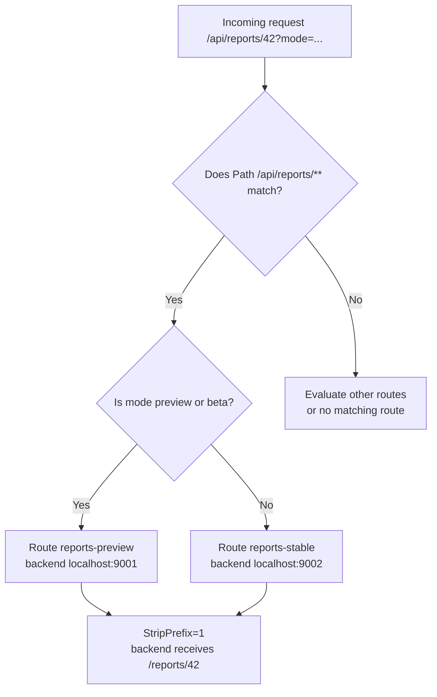
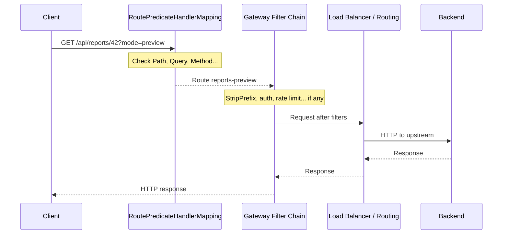

# Query: checking query parameter names and values

## Lesson objectives

In the **Route Predicates** chapter of **Spring Cloud Gateway**, this lesson introduces the **Query Route Predicate**: how to check the name and value of a query parameter to decide whether an HTTP request matches a route. This is one component of the route predicate mechanism; filter chains, path/header transformations, service discovery, authentication, rate limiting, circuit breakers, retries, TLS, and observability are handled by other gateway components.

After this lesson, you will be able to:

- Distinguish query parameters from path, method, headers, and request body.
- Configure `Query=<name>` when only parameter presence is needed, or `Query=<name>,<regexp>` when checking the value is needed.
- Combine Query with `Path`, `Method`, and routes with different priority orders.
- Understand behavior with empty values, letter casing, duplicate parameter names, and URL encoding.
- Test which route is selected and the actual HTTP request sent to the backend.
- Avoid misusing client-controlled query parameters for authentication or authorization.

## 1. What is a query parameter?

Consider an HTTP request:

```http
GET /api/reports/42?mode=preview&lang=en HTTP/1.1
Host: api.example.com
```

Key parts:

| Component | Example | Common checking mechanism |
| --- | --- | --- |
| HTTP method | `GET` | `Method` predicate |
| Path | `/api/reports/42` | `Path` predicate |
| Query string | `mode=preview&lang=en` | `Query` predicate |
| Query parameter name | `mode`, `lang` | `param` argument of `Query` |
| Query parameter value | `preview`, `en` | Optional regex argument of `Query` |
| Header | `Host: api.example.com` | `Host` or `Header` predicate as required |

The query string appears after the `?` in the URL; multiple name–value pairs are typically separated by `&`. Examples:

```text
/api/catalog/items?category=books
/api/search?q=spring%20cloud
/api/reports/42?format=csv
/api/reports/42?mode=preview
```

Query parameters can be used to choose a display mode, return format, data source, or API group. The Query predicate is evaluated **during route selection**, not while processing body contents. It does not add, remove, or modify query parameters on its own.

## 2. Query Route Predicate Factory

In Spring Cloud Gateway Server WebFlux, `QueryRoutePredicateFactory` provides the predicate named **`Query`**, with two parameters:

1. **`param`** (required): the query parameter name to check.
2. **`regexp`** (optional): a Java regular expression used to check the parameter's value.

Shortcut syntax:

```yaml
predicates:
  - Query=campaign
```

This condition matches when the request has a parameter named `campaign`, without requiring a specific value:

| Request | Predicate `Query=campaign` |
| --- | --- |
| `/api/products/7?campaign=sale` | Match |
| `/api/products/7?campaign=2026` | Match |
| `/api/products/7?campaign=` | Match |
| `/api/products/7?campaign` | Matches by parameter name presence check |
| `/api/products/7?Campaign=sale` | No match; name differs in letter case |
| `/api/products/7` | No match; parameter is missing |

For `?campaign` without an equals sign, how an HTTP stack represents the *value* may differ from `?campaign=`, but checking only whether **the name is present** still matches. When defining an API contract involving empty values, test against your actual HTTP stack and library version.

### 2.1. Checking both name and value

```yaml
predicates:
  - Query=mode,^(preview|beta)$
```

In this configuration:

- `mode` is the parameter name.
- `^(preview|beta)$` is a regex accepting only `preview` or `beta`.
- Other query parameters, such as `lang=en`, do not invalidate `mode`'s match.

| Query string | Matches? | Explanation |
| --- | --- | --- |
| `?mode=preview` | Yes | Value `preview` is accepted |
| `?mode=beta` | Yes | Value `beta` is accepted |
| `?mode=stable` | No | Value is not in the set |
| `?mode=PREVIEW` | No | Case-sensitive by default |
| `?mode=preview-extra` | No | Does not match the entire value |
| `?mode=` | No | Empty value is not accepted |
| `?lang=en` | No | Missing parameter `mode` |
| `?mode=preview&lang=en` | Yes | `mode` is valid; extra parameters do not interfere |

In the standard `QueryRoutePredicateFactory` implementation, values are matched with a **Java regular expression using full-string match behavior**, similar to `String.matches(...)`. Thus, regex `preview` does not automatically accept `preview-extra`. Using `^` and `$` expresses intent clearly; verify behavior on the Gateway version actually deployed.

Some useful regex patterns:

| Regex | Example valid values | Used when |
| --- | --- | --- |
| `^(json|csv)$` | `json`, `csv` | Selecting report format |
| `^[1-9][0-9]*$` | `1`, `35`, `200` | Checking positive integer shape |
| `^(v1|v2)$` | `v1`, `v2` | Selecting API group |
| `(?i)^preview$` | `preview`, `PREVIEW` | Case-insensitive value |
| `^[A-Z]{2}$` | `VN`, `US` | Checking two-uppercase-letter code |

Regex only checks the **shape** of the data. For instance, `[1-9][0-9]*` does not check whether the value falls within business bounds, fits integer limits, or is authorized for use.

### 2.2. Expanded configuration form

When a regex contains commas (e.g., quantifier `{2,4}`) or has complex structure, use the `name` and `args` form so the shortcut parser does not mistake a comma for an argument separator:

```yaml
spring:
  cloud:
    gateway:
      routes:
        - id: regional-reports
          uri: http://localhost:9001
          predicates:
            - Path=/api/reports/**
            - name: Query
              args:
                param: region
                regexp: '^[A-Z]{2,4}$'
```

Here, `?region=VN` and `?region=APAC` match, whereas `?region=vn` and `?region=ASIA5` do not. Wrapping the regex in YAML single quotes avoids many issues with special characters and backslashes.

**Version note:** examples in this lesson use the familiar `spring.cloud.gateway.routes` style of **Spring Cloud Gateway Server WebFlux**. Some versions or variants (such as Server MVC) use different configuration namespaces and APIs. When adopting examples into a project, check the documentation matching your chosen dependency.

## 3. Complete example: routing by `mode`

Suppose a reporting API has two backends:

- `reports-preview`: runs the new processor at `http://localhost:9001`.
- `reports-stable`: runs the stable version at `http://localhost:9002`.

Requirement: requests to `/api/reports/**` with `mode=preview` or `mode=beta` use preview, while requests to the same path with another `mode` value or no `mode` use stable.

```yaml
spring:
  cloud:
    gateway:
      routes:
        - id: reports-preview
          order: -10
          uri: http://localhost:9001
          predicates:
            - Path=/api/reports/**
            - Query=mode,^(preview|beta)$
          filters:
            - StripPrefix=1

        - id: reports-stable
          order: 0
          uri: http://localhost:9002
          predicates:
            - Path=/api/reports/**
          filters:
            - StripPrefix=1
```

Both backends above are test addresses; running this configuration requires starting the corresponding servers. Both backends in the example are assumed to support `/reports/**`.

### 3.1. How is a route selected for a request?



Logical flow:

1. Gateway inspects routes in priority order; lower `order` values come first.
2. For `reports-preview`, both `Path` **and** `Query` must be true.
3. If `mode=preview` or `mode=beta`, the preview route is selected and its filter chain runs.
4. If Query does not match, Gateway continues to evaluate `reports-stable`, which only checks `Path`.
5. `StripPrefix=1` removes the `api` segment, so `/api/reports/42` becomes `/reports/42`; the query string is still forwarded unless another filter alters it.

If you omit the `reports-stable` route, `?mode=stable` will not automatically go to stable: it might match another route or find no matching route.

### 3.2. Result matrix

| Request | Selected route | Request to backend after `StripPrefix=1` |
| --- | --- | --- |
| `GET /api/reports/42?mode=preview` | `reports-preview` | `GET /reports/42?mode=preview` |
| `GET /api/reports/42?mode=beta` | `reports-preview` | `GET /reports/42?mode=beta` |
| `GET /api/reports/42?mode=stable` | `reports-stable` | `GET /reports/42?mode=stable` |
| `GET /api/reports/42` | `reports-stable` | `GET /reports/42` |
| `GET /api/reports/42?mode=PREVIEW` | `reports-stable` | `GET /reports/42?mode=PREVIEW` |
| `POST /api/reports/42?mode=preview` | `reports-preview` | `POST /reports/42?mode=preview` |
| `GET /api/catalog/42?mode=preview` | Neither route above | Not applicable |

The Query predicate does not restrict the HTTP method. If the preview backend only supports `GET` and a client sends `POST`, the route may still match and the backend will return an unsupported-method error. To restrict methods, add `Method=GET` to predicates.

## 4. Combining Query with other predicates

### 4.1. Multiple predicates in one route are AND

```yaml
predicates:
  - Path=/api/reports/**
  - Method=GET
  - Query=format,^csv$
```

The route only matches when:

```text
Path matches AND method is GET AND query format is csv
```

Having `?format=csv` alone will not make requests to another path or using another method match the route. This clearly defines the HTTP contract.

### 4.2. Multiple Query predicates checking multiple names

```yaml
predicates:
  - Path=/api/export/**
  - Query=format,^(csv|json)$
  - Query=source,^partner$
```

For the route to match, the request needs both a valid `format` **and** `source=partner`. Matching examples:

```text
/api/export/orders?format=csv&source=partner
/api/export/orders?format=json&source=partner
```

Non-matching example:

```text
/api/export/orders?format=csv
```

Two lines `Query=mode,preview` and `Query=mode,beta` in the **same route** do not express OR; they are two conditions combined with **AND**. For a single parameter name with multiple allowed values, use regex `^(preview|beta)$`. If different filters/upstreams are needed, split into separate routes and set appropriate `order` values.

### 4.3. A general route can shadow a specific route

Configuration to avoid:

```yaml
routes:
  - id: reports-generic
    order: -20
    uri: http://localhost:9002
    predicates:
      - Path=/api/reports/**

  - id: reports-preview
    order: 0
    uri: http://localhost:9001
    predicates:
      - Path=/api/reports/**
      - Query=mode,^preview$
```

`?mode=preview` matches **both routes**, but the generic route has higher priority and can capture the request. Fix this by placing the specific route first (lower order) or designing intentionally mutually exclusive conditions. When debugging, check **the actual selected route**, not just whether a regex looks right.

## 5. Edge cases you must understand

### 5.1. Parameter presence does not mean valid value

Example:

```yaml
- Query=page
```

This configuration only checks for the name `page`; values like `0`, `-3`, or `abc` will still satisfy the predicate. If you want to restrict to positive-integer shape:

```yaml
- Query=page,^[1-9][0-9]*$
```

Still, regex does not replace range checks, pagination limits, and backend validation.

### 5.2. Uppercase and lowercase

With `Query=mode,^preview$`:

```text
?mode=preview  → match
?mode=Preview  → no match
?Mode=preview  → no match
```

The regex `(?i)^preview$` can make the **value** case-insensitive. It does not turn the parameter name `Mode` into `mode`; standardize query parameter names in your API contract.

### 5.3. Duplicate parameter names

HTTP permits multiple values for the same name:

```text
?mode=preview&mode=stable
?mode=stable&mode=preview
```

WebFlux represents query parameters as a `MultiValueMap<String, String>`. In the standard `QueryRoutePredicateFactory` implementation, when a regex is provided, the predicate checks the **first value** for that name (`getFirst`), rather than searching for any matching value. Thus, occurrence order can change the outcome.

Do not rely on this behavior as a security rule. If an API allows only a single `mode`, define the contract clearly and reject duplicate parameters at an appropriate request validation layer. Test the exact behavior in your deployed Gateway version.

### 5.4. Empty values, missing equals sign, and regex

`?flag` and `?flag=` both indicate the presence of the name `flag` in many HTTP stacks, so `Query=flag` can match. However, verify how the parser represents the value without `=` if you use a regex that distinguishes `null` from an empty string.

If the flag must equal `true`:

```yaml
- Query=flag,^true$
```

Never treat `?flag`, `?role=admin`, or `?authorized=yes` as proof of authentication or authorization.

### 5.5. URL encoding

Example:

```text
?q=spring%20cloud
?lang=en
```

The HTTP server/WebFlux parses the query string before the predicate reads names and values. The regex is applied to **the value supplied by the parser**, not necessarily the raw bytes of the URL string. Characters like `&`, `+`, `%`, equals signs, and spaces must be properly encoded per HTTP client rules; if `&` is not encoded, it can start a new query parameter.

Test with real HTTP tools and use `--data-urlencode` when needed. Avoid overly broad regexes (like `.*`) when you only want to match a finite set of values.

### 5.6. The Query predicate does not transform the request

Configuration:

```yaml
predicates:
  - Query=version,^v2$
```

This does not strip `version=v2` from the request sent to the backend, does not add an `X-Api-Version: v2` header, and does not rewrite the path to `/v2/...`. Modifying the request requires dedicated filters such as `RemoveRequestParameter`, `RewritePath`, `SetRequestHeader`, or custom filters per the backend contract. You can combine Query with those filters, but the two groups serve different roles.

## 6. Where does Query sit in the request lifecycle?



In Spring Cloud Gateway Server WebFlux:

- **Route predicates** evaluate requests to pick a route. `Query` only reads query parameters while checking the condition.
- **Route** contains ID, target URI, order, predicates, and filter list. The selected route can be observed via `GATEWAY_ROUTE_ATTR` on the exchange when the filter chain begins executing.
- **Gateway filter chain** can rewrite paths/headers, authenticate, rate limit, retry, and apply circuit breakers if configured.
- **Load balancing/service discovery** resolves instance addresses when the URI uses `lb://service-name`, provided dependencies and instance sources are configured.
- **Routing** forwards HTTP/WebSocket traffic per route; TLS, timeouts, and backend responses are separate concerns.

Declaring `Query` alone does not cause Gateway to authenticate identities, rate limit, configure circuit breakers, or pick instances from a service registry. Query helps **select the logical route** so other policies can be applied in the right place.

## 7. Hands-on HTTP testing

Reusing the two routes `reports-preview` and `reports-stable` from section 3. Suppose Gateway runs at `http://localhost:8080` and two stub backends are running:

```bash
# Preview:
curl -i "http://localhost:8080/api/reports/42?mode=preview"

# Beta:
curl -i "http://localhost:8080/api/reports/42?mode=beta"

# Stable:
curl -i "http://localhost:8080/api/reports/42?mode=stable"

# Without mode:
curl -i "http://localhost:8080/api/reports/42"

# Query does not restrict method by itself:
curl -i -X POST "http://localhost:8080/api/reports/42?mode=preview"
```

To safely encode values containing spaces:

```bash
curl -i --get \
  --data-urlencode "mode=preview build" \
  "http://localhost:8080/api/reports/42"
```

Because `preview build` does not match the regex `^(preview|beta)$`, this request goes to the stable route.

### 7.1. Test matrix

| Group | Test request | Behavior to verify |
| --- | --- | --- |
| Exact name, exact value | `?mode=preview` | Selects preview |
| Other value | `?mode=stable` | Selects stable |
| Missing key | No `mode` | Selects stable |
| Wrong name casing | `?Mode=preview` | Does not match preview's Query |
| Wrong value casing | `?mode=PREVIEW` | Does not match regex |
| Empty | `?mode=` | Does not match preview regex |
| Extra parameter | `?mode=preview&lang=en` | Still selects preview |
| Duplicate key | `?mode=stable&mode=preview` | Verify policy and version behavior |
| Different path | `/api/catalog/42?mode=preview` | Matches neither example route |
| Different method | `POST ...?mode=preview` | May select preview if no `Method` predicate is set |
| Overlapping routes | Generic route has higher priority | Confirm `order` determines selected route |

**Checking HTTP 200 alone is not enough.** Both backends could return 200. Have stub backends return a response header `X-Backend: preview` or `X-Backend: stable`, or log the actual path received at the backend; then verify the right upstream and path `/reports/42`.

Example integration test assertions with `WebTestClient` (assuming WebTestClient and stub backends are configured):

```java
webTestClient.get()
    .uri("/api/reports/42?mode=preview")
    .exchange()
    .expectStatus().isOk()
    .expectHeader().valueEquals("X-Backend", "preview");

webTestClient.get()
    .uri("/api/reports/42?mode=stable")
    .exchange()
    .expectStatus().isOk()
    .expectHeader().valueEquals("X-Backend", "stable");
```

These are example assertions, not a standalone test class: your project needs the test framework, Gateway test server, and test backends. Whenever you change predicates or order, re-run both happy-path and fallback cases.

## 8. Security and operations

### 8.1. Query is client-controlled data

Clients can freely send:

```text
?mode=preview
?role=admin
?tenant=customer-b
```

Therefore, **never use the Query predicate in place of authentication/authorization**. For example, `?role=admin` cannot be the sole gate to access an admin API. Gateway must verify identity and permissions at the appropriate layer, and the backend must enforce resource and business permissions. Routing by `mode` is only safe when all candidate upstreams already meet required security controls.

### 8.2. Do not put secrets in query strings

Query strings can appear in browser history, access logs, monitoring tools, shared URLs, or navigation flows. Avoid putting tokens, passwords, API keys, or sensitive personal data in URLs just to select a route.

When observing the gateway, prioritize **route ID, HTTP status, latency, error rate, and trace ID/correlation ID**. Never log raw URLs, query strings, or tokens. Use only bounded-cardinality labels in metrics.

### 8.3. Regex and processing cost

Overly complex regexes can spike CPU usage under high traffic or long inputs. You should:

- Prefer short expressions with clear value sets like `^(json|csv)$`.
- Avoid nested repetition groups prone to expensive backtracking.
- Cap URI/query length at the appropriate HTTP/proxy layer.
- Never construct regexes directly from untrusted input.
- Test unusual queries, duplicate names, and requests with many parameters.

When multiple routes share a path and branch on Query, API documentation must clearly state valid values, fallback routes, precedence order, and how to modify configurations safely. If using `lb://` instead of a static upstream, the selected route must still pass through load balancing/service discovery to reach a concrete instance.

## 9. Practice exercise with answers

An image processing system has two backends:

```yaml
routes:
  - id: image-fast
    order: -5
    uri: http://localhost:9101
    predicates:
      - Path=/api/images/**
      - Query=quality,^(low|medium)$

  - id: image-default
    order: 0
    uri: http://localhost:9102
    predicates:
      - Path=/api/images/**
```

Determine the route for these requests:

1. `GET /api/images/8?quality=low`
2. `GET /api/images/8?quality=high`
3. `POST /api/images/8?quality=medium`
4. `GET /api/images/8?Quality=low`
5. `GET /api/videos/8?quality=low`

**Answers:**

1. `image-fast`: both Path and Query match.
2. `image-default`: `high` is not in the fast route's regex.
3. `image-fast`: there is no `Method` predicate, so POST can still match.
4. `image-default`: parameter name `Quality` differs from `quality`.
5. Matches neither route above because the Path differs; it may be handled by another route or have no matching route.

**Extension:** add `Method=GET,POST` and `Query=source,^web$` to `image-fast`; predict the outcome when `source` is missing, then write an HTTP integration test to confirm the behavior. When a route has multiple predicates, remember to apply **AND** logic.

## Summary

**Query Route Predicate** in Spring Cloud Gateway checks a **query parameter name** and optionally a **Java regex for its value**:

```yaml
- Query=campaign
- Query=mode,^(preview|beta)$
```

Query is a routing tool based on HTTP input, not an authentication or request-transformation tool. Clearly design accompanying `Path`/`Method` rules, precedence order for overlapping routes, fallbacks, and unusual query cases. Tests must confirm **which backend receives the request and which path it receives**. Combined with filter chains, service discovery, rate limiting, circuit breakers, retries, TLS, and tracing, Query directs requests to the right route so API Gateway operational policies work consistently.
