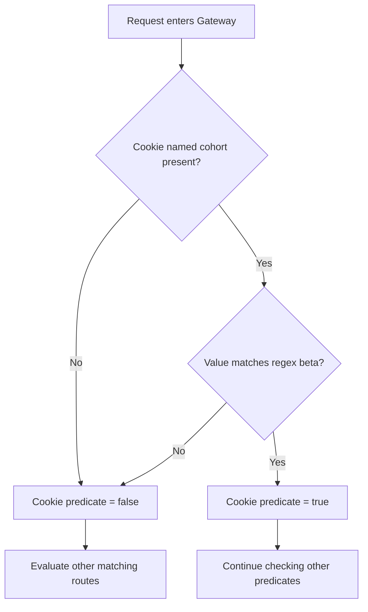
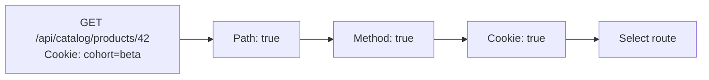
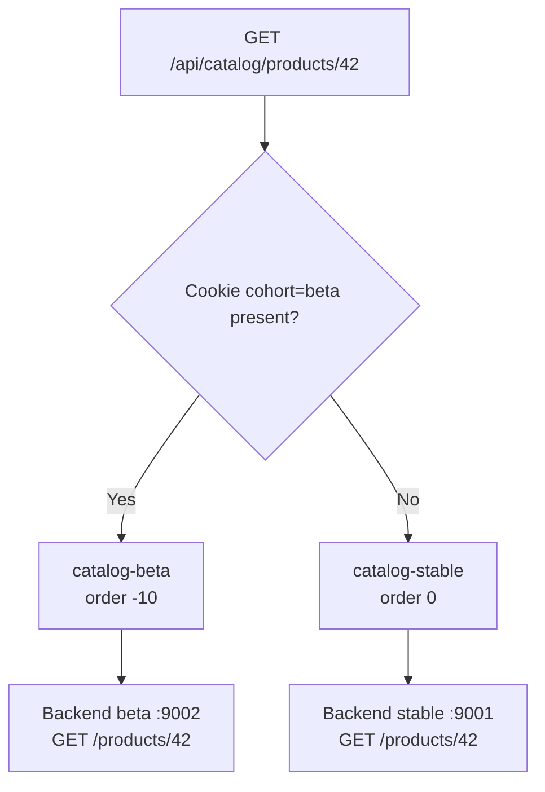

# Cookie Route Predicate: routing conditions based on cookie name and value

In **Spring Cloud Gateway**, a **route predicate** is a condition that determines which requests are allowed to match a route. Alongside `Path`, `Method`, or `Host`, the **Cookie Route Predicate Factory** allows selecting a route based on the **cookie name** and **cookie value** sent by the client in an HTTP request. This approach is well-suited for UI canary testing, cohort-based experimentation, or directing a group of requests to a dedicated backend.

This is part of the **Route Predicates** chapter. The lesson focuses on Spring Cloud Gateway **Server WebFlux** on the Gateway **5.0.x** release line, using the configuration path `spring.cloud.gateway.server.webflux.routes`. Older versions may use a different prefix, such as `spring.cloud.gateway.routes`; the Server Web MVC variant also has its own APIs and configuration details. Consult the documentation for your exact version before copying examples.

> **Important limitation:** Cookies sent by clients can be modified by users. A matching Cookie predicate **does not prove** the sender is logged in, belongs to a paid tier, or has permission to call an API. Authentication and authorization must be implemented separately using Spring Security, verified tokens, or verified sessions.

## 1. Learning objectives

After this lesson, you will be able to:

1. Explain where Gateway obtains cookie names and values, and how the Cookie predicate returns `true` or `false`.
2. Declare `Cookie=<name>, <regexp>` in `application.yml`, using both the shortcut syntax and `name`/`args`.
3. Distinguish between **missing cookie**, **wrong name**, **wrong value**, and **regex-matching value**.
4. Combine `Cookie` with `Path` and `Method`, designing a beta route with a fallback stable route.
5. Test with `curl` and troubleshoot cases where browsers do not send cookies due to `Path`, `Domain`, `Secure`, or `SameSite`.
6. Place the Cookie predicate in its proper role within an API Gateway: routing traffic, without replacing security, rate limiting, or resilience.

## 2. How do cookies travel from client to Gateway?

An HTTP request can carry a `Cookie` header containing `name=value` pairs, typically separated by semicolons:

```http
GET /api/catalog/products/42 HTTP/1.1
Host: localhost:8080
Cookie: cohort=beta; theme=dark; locale=vi
```

Here:

- The first cookie name is `cohort`, with value `beta`.
- The second cookie name is `theme`, with value `dark`.
- The third cookie name is `locale`, with value `vi`.

Spring Cloud Gateway's Cookie predicate reads **request cookies already parsed by the HTTP stack**, finds the cookie matching the declared name, and checks its **value using a regular expression** (regex). It does not depend on the order of cookie pairs in the header.



**Key point:** The Cookie predicate only inspects the incoming **request** entering Gateway. The `Set-Cookie` header typically appears in the **response** to instruct the browser to store or update a cookie; it is not what the Cookie predicate uses to select a route for the current request.

## 3. Configuration syntax of Cookie Route Predicate Factory

### 3.1. Shortcut syntax

Under `predicates` of a route:

```yaml
predicates:
  - Cookie=cohort, beta
```

Cookie Route Predicate Factory accepts **two parameters**:

| Parameter | Role | Example |
|---|---|---|
| `name` | Cookie name to look up in the request | `cohort` |
| `regexp` | Regular expression applied to the cookie **value** | `beta` |

The configuration above means: *the request has a cookie named `cohort`, and that cookie's value matches the regex `beta`*. If the cookie is missing or its value does not match, the predicate returns `false`.

Gateway documentation examples commonly use `Cookie=chocolate, ch.p`: the cookie `chocolate=chip` matches because `.` in regex matches one character; `chocolate=chop` matches as well. When exact value comparison is required, use a fixed string like `beta` or an explicitly anchored expression.

### 3.2. Expanded syntax with `name` and `args`

The same condition can be written as:

```yaml
predicates:
  - name: Cookie
    args:
      name: cohort
      regexp: 'beta'
```

This form clearly distinguishes the **predicate factory name** (`Cookie`) from the **cookie name** (`cohort`). It is also easier to read when the regex contains special characters:

```yaml
predicates:
  - name: Cookie
    args:
      name: cohort
      regexp: 'beta|preview'
```

Here, a `cohort` cookie with value `beta` **or** `preview` will match. Wrapping complex regexes in YAML single quotes is generally safe because backslashes are preserved verbatim, avoiding double-escaping as required in double-quoted strings.

**Do not declare both styles** for the same condition within one route. Shortcut and fully expanded are two alternative notations.

## 4. How does regex validate cookie values?

The second parameter is a **Java regular expression**, not a plain string list. The goal is to match the **value of a specific cookie**, not the entire `Cookie` header.

| Configuration | Matching values | Non-matching values | Notes |
|---|---|---|---|
| `Cookie=cohort, beta` | `beta` | `stable`, `Beta`, `beta123` | Exact value, case-sensitive |
| `Cookie=cohort, beta|preview` | `beta`, `preview` | `stable` | OR alternation in regex |
| `Cookie=locale, (vi|en)` | `vi`, `en` | `fr` | Grouped choices |
| `Cookie=variant, [AB]` | `A`, `B` | `a`, `AB` | Character class |
| `Cookie=release, v[0-9]+` | `v1`, `v2026` | `v`, `vA` | One or more digits |
| `Cookie=flag, .+` | Non-empty string | Empty string | Checks that value has at least one character |

In the WebFlux implementation, value checking follows **regex matching** on the cookie value; do not rely on substring matching by default. For example, `beta` does not match `my-beta-test`. To allow multiple values, declare explicit groups (`beta|preview`) instead of overly broad `.*beta.*`.

If you want to emphasize full-string boundaries, you can write:

```yaml
predicates:
  - name: Cookie
    args:
      name: cohort
      regexp: '^(beta|preview)$'
```

The `^` and `$` anchors make full-value matching intent explicit; in many Gateway versions, `matches` itself already requires matching the whole value. When using regex on client-controlled values, **avoid overly complex expressions** that can incur heavy evaluation costs on long inputs.

### 4.1. Exact cookie name lookup

With:

```yaml
predicates:
  - Cookie=cohort, beta
```

different requests yield different results:

| Request header | Does predicate match? | Why |
|---|---|---|
| `Cookie: cohort=beta` | Yes | Exact name `cohort` and value `beta` |
| `Cookie: cohort=stable` | No | Wrong value |
| `Cookie: theme=beta` | No | No cookie named `cohort` |
| `Cookie: Cohort=beta` | Should not be treated as matching | Cookie names are case-sensitive; use exact `cohort` |
| `Cookie: cohort=Beta` | No | Regex `beta` is case-sensitive |
| No `Cookie` header | No | Required cookie not found |
| `Cookie: cohort=beta; theme=dark` | Yes | Has exact `cohort=beta`; other cookies do not interfere |

Do not rely on behavior when a request sends **multiple cookies with the same name** (sometimes occurring when a browser holds cookies of the same name with different `Path` attributes). Which value is picked may depend on the cookie-parsing layer and backend handling. Design cookie names/paths clearly to avoid ambiguity, then test with real requests.

### 4.2. Value encoding and special characters

Cookies sent over the wire may contain application-encoded or signed values. For example, a logical value `beta user` might be encoded into another string by the app to satisfy cookie syntax. The predicate does not understand business formatting: the regex must target **the value Gateway actually sees**. For session IDs, JWTs, or signed cookies, never attempt to parse contents with regex to make access decisions.

## 5. Combining Cookie with other predicates

Within a route, predicates are normally combined with **AND**: all of them must return `true`.

```yaml
predicates:
  - Path=/api/catalog/**
  - Method=GET
  - Cookie=cohort, beta
```

This route matches when:

1. Path falls under `/api/catalog/**`.
2. HTTP method is `GET`.
3. Request carries cookie `cohort=beta`.



If a client sends `POST /api/catalog/products/42` with `cohort=beta`, the route **does not** match because of `Method=GET`. If a client sends `GET /api/orders/42` with `cohort=beta`, the route does not match either because of the wrong `Path`.

### 5.1. Requiring two cookies simultaneously

If you want to accept requests carrying **both** cookie pairs, you can write:

```yaml
predicates:
  - Path=/api/catalog/**
  - Cookie=cohort, beta
  - Cookie=locale, (vi|en)
```

The request must carry `cohort=beta` **and** either `locale=vi` or `locale=en`. Do not write two predicates `Cookie=cohort, beta` and `Cookie=cohort, preview` expecting an OR: two conditions on the same name can reject most requests; for beta **or** preview, use **one** regex `beta|preview`.

### 5.2. Comparing Cookie with Header predicate

| Scenario | Cookie predicate | Header predicate |
|---|---|---|
| Condition based on `cohort` cookie value | `Cookie=cohort, beta` | Can match raw `Cookie` header via regex, but easily collides with other cookies |
| Condition based on HTTP header `X-Client-Version` | Not applicable | `Header=X-Client-Version, v2` |
| Cookie header with multiple `name=value` pairs | Looks up by cookie name | Matches header string representation, fragile to formatting/regex |
| Protecting sensitive APIs | Not an authentication mechanism | Also not an authentication mechanism |

When the requirement is genuinely **cookie name and value**, the Cookie predicate expresses intent most clearly.

## 6. Real-world scenario: splitting stable and beta traffic

A development team wants to test a **beta version of catalog-service** for users who received the `cohort=beta` cookie, while other users continue going to the stable backend. The public API stays unchanged: `GET /api/catalog/products/42`.

Assume:

- Gateway listens at `http://localhost:8080`.
- **Stable** backend listens at `http://localhost:9001`.
- **Beta** backend listens at `http://localhost:9002`.
- Both backends serve `/products/**`.

Complete `application.yml` configuration for **Server WebFlux 5.0.x**:

```yaml
server:
  port: 8080

spring:
  application:
    name: catalog-gateway
  cloud:
    gateway:
      server:
        webflux:
          routes:
            - id: catalog-beta
              uri: http://localhost:9002
              order: -10
              predicates:
                - Path=/api/catalog/**
                - Method=GET
                - Cookie=cohort, beta
              filters:
                - StripPrefix=2
                - AddRequestHeader=X-Selected-Variant, beta
                - AddResponseHeader=X-Gateway-Route, catalog-beta

            - id: catalog-stable
              uri: http://localhost:9001
              order: 0
              predicates:
                - Path=/api/catalog/**
                - Method=GET
              filters:
                - StripPrefix=2
                - AddRequestHeader=X-Selected-Variant, stable
                - AddResponseHeader=X-Gateway-Route, catalog-stable
```

**Why are two routes needed?**

- `catalog-beta` matches only when `Path`, `Method`, and `Cookie` are all true.
- `catalog-stable` needs no Cookie predicate; it accepts any remaining qualifying `GET /api/catalog/**`.
- `order: -10` causes the beta route to be evaluated before the stable route at `order: 0`. **Lower numbers have higher priority.**
- Without `cohort=beta`, the beta route does not match; gateway can select the stable route.
- `StripPrefix=2` removes the **first two segments**, `api` and `catalog`. Thus `/api/catalog/products/42` becomes `/products/42`.
- The two headers `X-Selected-Variant` and `X-Gateway-Route` assist testing and are not required by the Cookie predicate.



**Beware of fallback route limitations:** The stable route here is selected only **when the beta route's condition does not match**. If a request matches the beta route and backend `9002` fails, Gateway **does not automatically retry the stable route**. Handling backend failures requires timeouts, circuit breakers, fallbacks, or appropriate failover mechanisms; those are separate features from the Cookie predicate.

### 6.1. Routing decision table

| Request | Cookie | Route | Target URI |
|---|---|---|---|
| `GET /api/catalog/products/42` | None | `catalog-stable` | `http://localhost:9001/products/42` |
| `GET /api/catalog/products/42` | `cohort=beta` | `catalog-beta` | `http://localhost:9002/products/42` |
| `GET /api/catalog/products/42` | `cohort=stable` | `catalog-stable` | `http://localhost:9001/products/42` |
| `GET /api/catalog/products/42` | `cohort=Beta` | `catalog-stable` | `http://localhost:9001/products/42` |
| `GET /api/orders/42` | `cohort=beta` | Neither route above | Typically `404` if no other handler exists |
| `POST /api/catalog/products` | `cohort=beta` | Neither route above | Typically `404` if no other handler exists |

If you omit `order` and leave both routes at equal priority, do not rely on YAML appearance order to guarantee beta gets selected. Set explicit priority while designing predicates to minimize overlap.

## 7. Full hands-on lab with echo backends

To verify which route is actually selected, we create **two minimal HTTP backends** using the `jdk.httpserver` module built into JDK 17+.

### 7.1. Creating the Gateway application

Use Spring Initializr to create a Spring Boot application compatible with the corresponding Spring Cloud release train, adding **Spring Cloud Gateway Server WebFlux**. If editing `pom.xml` manually, the main dependency is:

```xml
<dependency>
    <groupId>org.springframework.cloud</groupId>
    <artifactId>spring-cloud-starter-gateway-server-webflux</artifactId>
</dependency>
```

The Maven project still needs a **Spring Cloud BOM compatible with Spring Boot** to manage versions; this dependency snippet is not a complete `pom.xml`. With WebFlux, avoid accidentally adding the Servlet MVC starter.

A minimal startup class:

```java
import org.springframework.boot.SpringApplication;
import org.springframework.boot.autoconfigure.SpringBootApplication;

@SpringBootApplication
public class CatalogGatewayApplication {
    public static void main(String[] args) {
        SpringApplication.run(CatalogGatewayApplication.class, args);
    }
}
```

Place the YAML configuration from section 6 in `src/main/resources/application.yml`.

### 7.2. Creating two test backends

In a lab folder, create `CatalogBackend.java`:

```java
import com.sun.net.httpserver.HttpServer;
import java.net.InetSocketAddress;
import java.nio.charset.StandardCharsets;

public class CatalogBackend {
    public static void main(String[] args) throws Exception {
        if (args.length != 2) {
            System.err.println("Usage: java CatalogBackend.java <port> <variant>");
            return;
        }

        int port = Integer.parseInt(args[0]);
        String variant = args[1];
        HttpServer server = HttpServer.create(
                new InetSocketAddress("127.0.0.1", port), 0);

        server.createContext("/", exchange -> {
            String response =
                    "backend=" + variant + "\n" +
                    "method=" + exchange.getRequestMethod() + "\n" +
                    "path=" + exchange.getRequestURI().getRawPath() + "\n" +
                    "query=" + exchange.getRequestURI().getRawQuery() + "\n" +
                    "X-Selected-Variant=" +
                    exchange.getRequestHeaders()
                            .getFirst("X-Selected-Variant") + "\n";

            byte[] body = response.getBytes(StandardCharsets.UTF_8);
            exchange.getResponseHeaders().set(
                    "Content-Type", "text/plain; charset=utf-8");
            exchange.sendResponseHeaders(200, body.length);
            try (var out = exchange.getResponseBody()) {
                out.write(body);
            }
        });

        server.start();
        System.out.println("Listening on " + port + " (" + variant + ")");
    }
}
```

Open **two terminals** to run them independently:

```bash
# Terminal 1: stable backend
java --add-modules jdk.httpserver CatalogBackend.java 9001 stable

# Terminal 2: beta backend
java --add-modules jdk.httpserver CatalogBackend.java 9002 beta
```

Open a **third terminal** in the Gateway project directory and run the application:

```bash
# Linux/macOS
./mvnw spring-boot:run

# Windows PowerShell
.\mvnw.cmd spring-boot:run
```

The example backend here simply returns `200` along with path and variant info; it does not represent a real API or security mechanism. Each backend terminal keeps its process running until manually stopped.

### 7.3. Testing each branch with `curl`

**Without cookie:**

```bash
curl -i "http://localhost:8080/api/catalog/products/42"
```

Sample response:

```http
HTTP/1.1 200 OK
X-Gateway-Route: catalog-stable
Content-Type: text/plain; charset=utf-8

backend=stable
method=GET
path=/products/42
query=null
X-Selected-Variant=stable
```

**With beta cookie:**

```bash
curl -i --cookie "cohort=beta" \
  "http://localhost:8080/api/catalog/products/42?lang=vi"
```

Sample response:

```http
HTTP/1.1 200 OK
X-Gateway-Route: catalog-beta
Content-Type: text/plain; charset=utf-8

backend=beta
method=GET
path=/products/42
query=lang=vi
X-Selected-Variant=beta
```

**With multiple cookies, where the target cookie still matches:**

```bash
curl -i -H "Cookie: theme=dark; cohort=beta; locale=vi" \
  "http://localhost:8080/api/catalog/products/42"
```

The request still goes to the beta backend. The Cookie predicate only cares about the `cohort` cookie and its value; other cookies do not make the condition `false`.

**With cookie present, but wrong value:**

```bash
curl -i -H "Cookie: cohort=stable" \
  "http://localhost:8080/api/catalog/products/42"
```

The request goes to the stable backend. Continue testing with `cohort=Beta`, `cohort=preview`, and `theme=beta` to observe the difference between cookie name and cookie value.

> On PowerShell 5.1, `curl` may be an alias for a PowerShell cmdlet; invoke `curl.exe` if you want to use the exact syntax above. Commands with `\` line continuations are for Unix shells; on Windows you can write them on **one line**, e.g., `curl.exe -i --cookie "cohort=beta" "http://localhost:8080/api/catalog/products/42"`.

### 7.4. Inspecting loaded routes with Actuator

If the project includes `spring-boot-starter-actuator`, configure the Gateway endpoint in read-only mode in the same `application.yml`:

```yaml
management:
  endpoint:
    gateway:
      access: read-only
  endpoints:
    web:
      exposure:
        include: health,info,gateway
```

Restart the application and call:

```bash
curl -i http://localhost:8080/actuator/gateway/routes
```

Look for route IDs `catalog-beta` and `catalog-stable`, along with `predicates` and `order` in the returned data (JSON structure may vary across releases). This check confirms **the routes were loaded**; it does not prove the Cookie predicate matched a request. To verify actual selection, combine `curl` requests, the debug response header `X-Gateway-Route`, and logs/tracing. In production, restrict access to management endpoints to avoid exposing internal routing details to arbitrary clients.

## 8. Why does a browser have the cookie while Gateway does not receive it?

When `curl --cookie` sends a cookie manually, the test command bypasses cookie selection rules enforced by **browsers**. Browsers only send cookies when domain/path, protocol, and cookie policies match. Cookie attributes are typically set by the server via the `Set-Cookie` header.

For example, a backend response might contain:

```http
Set-Cookie: cohort=beta; Path=/api; Max-Age=86400; SameSite=Lax; Secure; HttpOnly
```

This instructs the browser to store the cookie with specific constraints; subsequent requests only carry `Cookie: cohort=beta` when the browser determines it is permitted to send it.

| Attribute | Meaning when testing routing |
|---|---|
| `Domain` | Restricts hosts/domains receiving the cookie; cookies from another domain are normally not sent to Gateway |
| `Path` | Restricts request paths; `Path=/account` will not be sent to `/api/catalog/**` |
| `Secure` | Browser sends cookie only over secure connections per browser rules; for local HTTP, pay attention to `localhost` behavior |
| `HttpOnly` | Page JavaScript cannot read the cookie, but the browser **can still send it** in HTTP requests |
| `SameSite` | Governs sending cookies in cross-site requests |
| `Expires` / `Max-Age` | Expired cookies will no longer be sent |

**Do not confuse:** Attributes like `Path`, `SameSite`, and `HttpOnly` are metadata used when setting a cookie via `Set-Cookie`; they are **not** repeated as parameters inside each request's `Cookie` header. Gateway's Cookie predicate checks the `name=value` pair actually delivered.

An effective debugging workflow:

1. Open **DevTools → Network** in the browser, select the request sent to the gateway, and check whether request headers include the expected `Cookie`.
2. If the cookie is absent, inspect `Domain`, `Path`, `Secure`, `SameSite`, expiration, incognito mode, and browser policies.
3. If using cross-origin `fetch`, check credentials configuration (`credentials`), CORS, and cross-site cookie rules.
4. If the cookie is present but the route does not match, verify **exact name (case-sensitive)**, value, and regex, then re-test with `curl`.
5. If the cookie matches yet the backend is still wrong, check `order`, overlapping routes, and the path after `StripPrefix`.

When accessing Gateway through a reverse proxy, ensure no intermediary accidentally strips the `Cookie` header. Never log the full `Cookie` header in production as it may contain session IDs or sensitive data.

## 9. The Cookie predicate is not an authorization system

Suppose you write:

```yaml
predicates:
  - Path=/api/admin/**
  - Cookie=role, admin
```

This is **not** protecting admin privileges. A user can send `Cookie: role=admin` with `curl`. If the route leads to an admin API and the system lacks real authentication/authorization, you have created a vulnerability.

Proper design separates responsibilities:

| Need | Responsible component |
|---|---|
| Choosing beta vs. stable backend using a non-sensitive client tag | `Cookie` route predicate |
| Identifying who the user is | Session/JWT authentication via WebFlux-appropriate Spring Security |
| Checking permission to read orders or call admin | Authorization at Gateway and/or backend; backend still enforces resource permissions |
| Rate limiting per user/tenant | Rate limiter with verified identity keys |
| Handling slow, failing, or disconnected backends | Timeouts, bounded retries, circuit breakers/fallbacks |
| Securing transport channel | TLS and proper certificate validation |
| Analyzing requests per route | Actuator, Micrometer, tracing, and safe logging |

A signed/encrypted cookie can carry trusted data **after the server verifies its signature, expiration, and context**. The Cookie predicate **does not perform that verification step**: it only runs a regex on the received value string.

For the canary grouping example, if cohort assignment must be server-determined and tamper-resistant, verify the session or signed cookie before using trusted identity/cohort in routing policies. Do not use a client-modifiable cookie to gate sensitive privileges.

## 10. Common mistakes when using the Cookie predicate

| Symptom | Common cause | Resolution |
|---|---|---|
| Calling `curl --cookie "cohort=beta"` still goes to stable | Beta route not loaded, wrong prefix, `order`, or another predicate didn't match | Check Actuator, verify `Path`/`Method` and route priority |
| Browser goes to stable while curl goes to beta | Browser omits cookie due to Domain/Path/Secure/SameSite/credentials | Inspect actual request in DevTools Network |
| `cohort=Beta` does not enter beta | Regex is case-sensitive by default | Standardize values or write an explicit regex if both should be supported |
| Wrote `Cookie=cohort, beta|preview` and confused by result | `regexp` is a regex; `|` means OR | Test different values and prefer explicit expressions |
| Missing cookie returns `404` | Only a Cookie-gated route was declared, no general route matches | Add a cookie-independent stable route if appropriate |
| Beta backend down, beta requests fail despite stable existing | Cookie routing does not automatically fail over when the chosen upstream breaks | Design circuit breaker/fallback or deployment rollback |
| Using `Cookie=role, admin` to protect an API | Self-asserted client cookie, unauthenticated | Use Spring Security and enforce real permissions |
| Backend receives path `/api/catalog/products/42` | Missing `StripPrefix` or wrong segment count | For this example path, `StripPrefix=2` sends `/products/42` |
| Regex containing commas parsed incorrectly | Shortcut splits on argument list commas | Use `name`/`args` form and quote YAML strings |
| Test route matches, production differs | Different Gateway version, extra GlobalFilter, proxy altering headers, or different DNS/container | Check version, inspect routes, trace, and test end-to-end |

Do not rely on status code alone to conclude whether the Cookie predicate matched: `404` can mean no route matched **or** the selected backend returned `404`. In a learning environment, a route-marking response header helps distinguish the two; in production, rely on metrics/tracing rather than exposing internal details.

## 11. Extension: when routes and cookies evolve across a system

The Cookie predicate is especially handy in **canary releases** or **A/B testing**, where a client needs to stay in a cohort across requests. However, for stable execution in microservices:

- Agree on who sets the `cohort` cookie, when it expires, and which environments may use it. Do not let each backend interpret a different value.
- Give overlapping routes explicit `order` values, and test missing or invalid cookies.
- When backends scale to multiple instances, you can replace `uri: http://localhost:9002` with `uri: lb://catalog-beta` if **Spring Cloud LoadBalancer** and an appropriate service discovery source are set up. `lb://` does not create a registry by itself.
- Never configure rate limiting solely on a cookie value that clients can freely change. For real quotas, use verified user IDs/tenant IDs or trusted keys.
- Monitor stable/beta traffic ratios, p95/p99 latency, 4xx/5xx errors, timeouts, retries, and circuit breaker states to detect faulty canaries.
- When an emergency beta rollback is needed, define rollout/rollback mechanisms; route predicates only decide **matching requests** and do not control release lifecycles.

In a secure API Gateway, route predicates (`Path`, `Method`, `Cookie`...) are only one route-selection layer. Filter chains and Spring Security must enforce access control, path/header transformations, rate limiting, and resilience per route.

## 12. Self-check questions

**Question 1.** Does `Cookie=cohort, beta` inspect the cookie name or the entire `Cookie` string?

**Answer:** It looks up the cookie named `cohort` in the request, then tests the cookie's **value** against the regex `beta`. It does not apply the regex to the entire Cookie header.

**Question 2.** When a request has `Cookie: theme=dark; cohort=beta`, does `Cookie=cohort, beta` match?

**Answer:** Yes. The `cohort` cookie exists and its value matches; the `theme` cookie does not interfere.

**Question 3.** Write a route that accepts only `GET /api/catalog/**` for users with `cohort=beta`.

**Sample answer:**

```yaml
predicates:
  - Path=/api/catalog/**
  - Method=GET
  - Cookie=cohort, beta
```

**Question 4.** Within a single route, does writing two lines `Cookie=cohort, beta` and `Cookie=cohort, preview` create an OR?

**Answer:** No. Predicates in the same route combine with AND. Use a single line `Cookie=cohort, beta|preview` to accept either value.

**Question 5.** Why can the stable route be selected when the `cohort` cookie is missing?

**Answer:** The beta route fails the Cookie predicate, while the stable route in the example only requires Path and Method. With the configured `order`, the beta route is checked first when eligible; otherwise, stable can still match.

**Question 6.** Will Gateway automatically send beta requests to stable if the beta backend returns `503`?

**Answer:** No. The stable route matches non-beta requests; switching when a backend fails requires dedicated resilience/fallback mechanisms.

**Question 7.** Does `HttpOnly` prevent the Cookie predicate from seeing a cookie?

**Answer:** No. `HttpOnly` prevents JavaScript from reading the cookie, yet the browser can still send it in HTTP requests when other conditions are met.

**Question 8.** Is `Cookie=role, admin` secure enough to allow access to an admin endpoint?

**Answer:** No. Users can send that cookie themselves; authentication and authorization must rely on verified credentials.

## 13. Official references

- [Spring Cloud Gateway Server WebFlux — Route Predicate Factories (Cookie)](https://docs.spring.io/spring-cloud-gateway/reference/5.0/spring-cloud-gateway-server-webflux/request-predicates-factories.html).
- [Spring Cloud Gateway Server WebFlux — Configuring Route Predicate Factories and Gateway Filter Factories](https://docs.spring.io/spring-cloud-gateway/reference/5.0/spring-cloud-gateway-server-webflux/configuring-route-predicate-factories-and-filter-factories.html).
- [Spring Cloud Gateway Server WebFlux — How It Works](https://docs.spring.io/spring-cloud-gateway/reference/5.0/spring-cloud-gateway-server-webflux/how-it-works.html).
- [Spring Cloud Gateway Server WebFlux — Actuator API](https://docs.spring.io/spring-cloud-gateway/reference/5.0/spring-cloud-gateway-server-webflux/actuator-api.html).
- [MDN — Cookie HTTP request header](https://developer.mozilla.org/en-US/docs/Web/HTTP/Reference/Headers/Cookie).
- [MDN — Set-Cookie HTTP response header and cookie attributes](https://developer.mozilla.org/en-US/docs/Web/HTTP/Reference/Headers/Set-Cookie).

**Key takeaway:** `Cookie=<name>, <regexp>` is a routing condition based on **cookie name and value in the request**. Combine it with `Path`/`Method` and `order` to select the right route, verify with real HTTP requests, and always keep cookie-based routing separate from authentication, authorization, and backend error handling.
