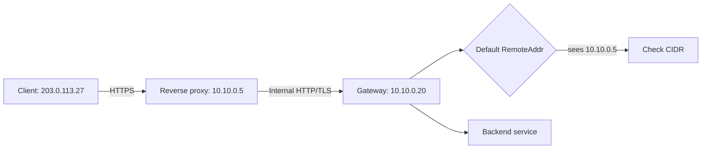
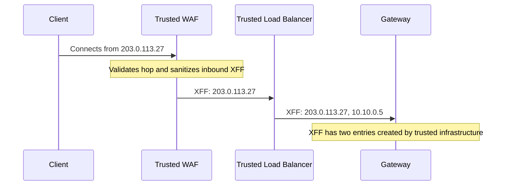

# RemoteAddr: IP addresses, CIDR, and address resolvers

## 1. Role of RemoteAddr in Spring Cloud Gateway

**Spring Cloud Gateway** is an API Gateway for microservices: it selects target services with **route predicates**, applies a **filter chain** to transform paths/headers, and can integrate service discovery, authentication, rate limiting, retries, circuit breakers, TLS, metrics, and tracing. When you want a route to match only requests coming from an internal network or an allowed IP range, you can use the **`RemoteAddr` Route Predicate Factory**.

For example, a system exposes `/internal/reports/**` for employees accessing over VPN, while the public API `/public/**` serves all clients. `RemoteAddr` helps **decide which route is selected** based on network address; however, it **does not replace access-blocking security mechanisms** such as Spring Security, firewalls, or API management policies.

After this lesson, you will know how to:

- Read the IP address of the TCP connection to Gateway and distinguish it from the user's origin IP.
- Write **CIDR** address ranges for IPv4 and IPv6, and predict whether an IP matches a network.
- Declare `RemoteAddr` using YAML and Java `RouteLocatorBuilder` on **Gateway Server WebFlux**.
- Use `RemoteAddressResolver` and `XForwardedRemoteAddressResolver.maxTrustedIndex(n)` when behind trusted reverse proxies.
- Identify `X-Forwarded-For` spoofing risks, differences with `XForwardedRemoteAddr`, and build an operational test suite.

> **Version scope:** Examples are based on **Spring Cloud Gateway Server WebFlux 5.0.x** using the `spring.cloud.gateway.server.webflux.routes` namespace (the 4.x line typically uses `spring.cloud.gateway.routes`). In the predicate reference for **Gateway Server Web MVC 5.0.x**, `RemoteAddr` is not listed as an equivalent built-in predicate. Do not copy WebFlux Java APIs to MVC; if using MVC, inspect the features of your running version and apply `RequestPredicate`, Servlet filters, or suitable security mechanisms.

## 2. Which address does RemoteAddr actually inspect?

Suppose a client calls:

```http
GET /internal/reports/monthly HTTP/1.1
Host: gateway.example.test
```

Gateway Server WebFlux receives a connection with a **remote socket address** (typically retrieved via `ServerHttpRequest.getRemoteAddress()`). By default, the `RemoteAddr` predicate matches that address against the configured IP ranges. This is the address of the **peer connecting directly to Gateway**.



If Gateway sits **behind a reverse proxy**, a request from client `203.0.113.27` may arrive from peer `10.10.0.5`. At that point `RemoteAddr=10.10.0.0/16` matches **the proxy IP**, which does not prove the user is inside the internal network. This is a common source of authorization bugs.

| Address / data | Example | Provided by? | Can it be used directly as a trusted origin IP? |
|---|---|---|---|
| Remote socket IP at Gateway | `10.10.0.5` | Network connection from the hop immediately before Gateway | Represents only the direct hop; topology awareness is required |
| `X-Forwarded-For` | `203.0.113.27, 10.10.0.5` | HTTP header forwarded by proxy or supplied by client | **No** without a trusted proxy boundary |
| `Forwarded: for=...` | `for=203.0.113.27` | RFC 7239 header | Also header data; source must be verified |
| IP seen by backend | `10.10.0.20` | Connection from Gateway to backend | Usually Gateway's IP, not the client's IP |

**Distinguish three functions:** `RemoteAddr` is a **route selection predicate**; `XForwardedRemoteAddressResolver` defines **how the address is resolved for the predicate** in Java DSL; and filters that create/forward `X-Forwarded-*` are **header handling between Gateway and downstream**. Enabling a header-forwarding filter does not automatically change how `RemoteAddr` selects routes.

## 3. CIDR: representing a network of multiple IPs

`RemoteAddr` accepts **at least one** `sources` string in **CIDR** (Classless Inter-Domain Routing) notation, supporting **both IPv4 and IPv6**. Common syntax:

```text
IPv4: 192.168.50.0/24
IPv6: 2001:db8:1234::/48
      └─ network addr ─┘  └ prefix bits
```

- **IPv4** is 32 bits long: `/24` keeps the first 24 bits to identify the network; the remaining 8 bits are the host part. The network `192.168.50.0/24` spans from `192.168.50.0` to `192.168.50.255` under CIDR matching.
- **IPv6** is 128 bits long: `/48` keeps the first 48 bits; for instance `2001:db8:1234::/48` contains `2001:db8:1234:abcd::10`.
- **`/32` (IPv4)** or **`/128` (IPv6)** selects one exact specific address. `/0` matches the entire address space of the corresponding IP family; it is overly broad and unsuitable for restricting access.
- You can pass multiple CIDRs to **one** predicate; a request matches if the address lies within **at least one** range—an **OR** across sources. By contrast, `Path` and `RemoteAddr` are separate predicates in the same route and combine with **AND**.

### 3.1. IPv4 network matching examples

| CIDR | IP under test | Matches? | Reason |
|---|---|---|---|
| `192.168.50.0/24` | `192.168.50.42` | Yes | Same first 24 network bits |
| `192.168.50.0/24` | `192.168.51.42` | No | Belongs to `192.168.51.0/24` |
| `10.20.0.0/16` | `10.20.200.9` | Yes | First two octets are `10.20` |
| `10.20.0.0/16` | `10.21.0.9` | No | Second octet differs |
| `198.51.100.17/32` | `198.51.100.17` | Yes | Single host |
| `127.0.0.1/32` | `127.0.0.2` | No | Two different loopback addresses |

IP blocks `192.0.2.0/24`, `198.51.100.0/24`, `203.0.113.0/24`, and IPv6 `2001:db8::/32` are reserved for **documentation examples**; never use them as production allowlists. Choose CIDRs from network diagrams maintained by your operations team. Avoid using DNS IPs of hostnames or load balancer VIPs in place of client ranges when the goal is identifying user origin.

### 3.2. Two mistakes when reading CIDR

1. `192.168.1.10/24` still represents the **network sharing the first 24 bits**, not only the single IP `192.168.1.10`. For an exact single host, use `192.168.1.10/32`.
2. `10.0.0.0/8` matches a massive space (`10.x.x.x`); if this is an allowlist for sensitive endpoints, narrow the network and verify that the seen IP is truly the client's, not a proxy's.

IPv6 must be factored into the design even when primary examples use IPv4. A client may reach Gateway via `::1` instead of `127.0.0.1`, or over public IPv6; test both address families thoroughly. An IPv4 address does not automatically match an IPv6 CIDR and vice versa; IPv4-mapped IPv6 forms also need verification in the actual runtime.

## 4. Declaring `RemoteAddr` in `application.yml`

The example below targets **Gateway Server WebFlux**. Suppose Gateway runs on `:8080`, a demo `catalog-service` backend runs on `:8081`, and we want to route `/internal/**` only when the socket remote IP belongs to `10.20.0.0/16` or the local loopback address.

```yaml
# gateway-demo/src/main/resources/application.yml
server:
  port: 8080

spring:
  application:
    name: gateway-demo
  cloud:
    gateway:
      server:
        webflux:
          routes:
            - id: internal-network-route
              uri: http://localhost:8081
              predicates:
                - Path=/internal/**
                - RemoteAddr=10.20.0.0/16,127.0.0.1/32,::1/128
              filters:
                - StripPrefix=1
                - AddRequestHeader=X-Edge-Route, internal-network-route
```

**Explanation:**

1. `Path=/internal/**`: only evaluates requests to URLs like `/internal/status`; a `/public/status` request will not enter this route.
2. `RemoteAddr=...`: the route matches only if the **remote address returned by the resolver** falls into **at least one** of the three IPv4/IPv6 ranges.
3. `StripPrefix=1`: once the route matches, drops the `internal` segment; the backend receives `/status`.
4. `AddRequestHeader`: adds a header so the backend sees which route handled the request. This header is not authentication proof.
5. `uri: http://localhost:8081`: demo downstream HTTP destination. In production, it can be replaced with `lb://catalog-service` **once** Spring Cloud LoadBalancer and service discovery are configured.

**Do not confuse two HTTP status codes:** a request failing `RemoteAddr` is skipped during route lookup; if no other handler/route matches, the client typically receives **404**, **not automatically 403 Forbidden**. A request matching the route when the backend is down may receive a **5xx connection error**. To return an explicit 403, use Spring Security policies or a filter enforcing denial.

### 4.1. Minimal testing on a development machine

Start an HTTP backend on port `8081` serving `GET /status` (for instance, a Spring Boot controller returning JSON). Then start Gateway WebFlux with the configuration above and run:

```bash
# Force IPv4 and bypass any HTTP proxy configured in curl's environment.
curl --noproxy '*' -4 -i 'http://127.0.0.1:8080/internal/status'

# Does not match Path predicate.
curl --noproxy '*' -4 -i 'http://127.0.0.1:8080/public/status'

# Intentionally add a spoofed header; default resolver still uses remote socket IP.
curl --noproxy '*' -4 -i \
  -H 'X-Forwarded-For: 203.0.113.88' \
  'http://127.0.0.1:8080/internal/status'
```

On a machine connecting directly over IPv4 loopback, both `/internal/status` requests match `127.0.0.1/32`; adding `X-Forwarded-For` **does not change the source used by default `RemoteAddr`**. The `/public/status` request does not enter this route. These are **expected outcomes**; this document does not claim to have executed the app or `curl` commands.

If Gateway runs inside Docker/Kubernetes, the remote IP may be a bridge, ingress, or proxy IP; `127.0.0.1/32` is no longer a valid test from the host. Observe the actual peer IP and trace the network path rather than blindly adding `0.0.0.0/0` as a "fix".

## 5. Java DSL: `RouteLocatorBuilder` with direct connection address

With **Gateway Server WebFlux**, Java DSL attaches predicates and filters to routes without declaring them in YAML. The class below is an alternative configuration to the YAML route in section 4:

```java
package com.example.gateway;

import org.springframework.cloud.gateway.route.RouteLocator;
import org.springframework.cloud.gateway.route.builder.RouteLocatorBuilder;
import org.springframework.context.annotation.Bean;
import org.springframework.context.annotation.Configuration;

@Configuration
public class NetworkRouteConfig {

    @Bean
    public RouteLocator networkRoutes(RouteLocatorBuilder builder) {
        return builder.routes()
            .route("internal-network-route", r -> r
                .path("/internal/**")
                .and()
                .remoteAddr("10.20.0.0/16", "127.0.0.1/32", "::1/128")
                .filters(f -> f
                    .stripPrefix(1)
                    .addRequestHeader("X-Edge-Route", "internal-network-route"))
                .uri("http://localhost:8081"))
            .build();
    }
}
```

`remoteAddr(String... sources)` uses the default resolution strategy. `.and()` requires satisfying both path and remote IP conditions. Do not define both a Java bean and YAML with the **same route ID** in a lab, to avoid confusion over which route is active.

When you need to customize how client IP is determined **for a specific route**, Java DSL provides an overload accepting a `RemoteAddressResolver` before the CIDR list; the next section explains how to use it safely.

## 6. When Gateway sits behind a proxy: `X-Forwarded-For`

### 6.1. A header containing a chain of addresses across hops

`X-Forwarded-For` (abbreviated **XFF**) typically looks like:

```http
X-Forwarded-For: 203.0.113.27, 10.10.0.5
```

The order is normally the recorded client address on the left, followed by participating proxies as the header is appended across hops. However, **a client can also send an XFF header itself** before the request enters your infrastructure. Hence, the "leftmost element" **is not guaranteed to be the real client**.



This diagram holds only **when the WAF/LB is configured to sanitize/overwrite inbound XFF and Gateway has no direct access path bypassing the proxy chain**. If clients can call Gateway directly or the first proxy preserves spoofed headers, counting hops alone provides no trustworthiness.

### 6.2. `RemoteAddressResolver` as the extension point

By default, `RemoteAddr` uses the request's remote IP. Spring Cloud Gateway Server WebFlux allows passing a custom **`RemoteAddressResolver`**. The built-in implementation is `XForwardedRemoteAddressResolver`, which uses the XFF header to determine the address across a proxy chain.

| Resolver | Address source | Characteristics |
|---|---|---|
| Default | Peer IP of connection to Gateway | Does not read leftmost XFF IP; behind proxies this is usually the proxy IP |
| `XForwardedRemoteAddressResolver.trustAll()` | **First** value of XFF | Easily spoofed when clients can supply XFF; **do not use as a production security basis** |
| `XForwardedRemoteAddressResolver.maxTrustedIndex(n)` | Value counted from the **right** of XFF, up to `n` steps | Useful when the number of trusted proxy hops is **verified** and ingress is controlled |
| Custom resolver | Based on organizational policy | Use only when understanding header specs, trust boundaries, and IPv4/IPv6; thoroughly tested and reviewed |

For `maxTrustedIndex(n)`, `n` **must be positive**; `0` or negative values throw `IllegalArgumentException` at initialization. `n` should reflect the number of trusted proxies in front of Gateway and align with how those proxies **write, append, or sanitize** XFF.

### 6.3. Example: which element does `maxTrustedIndex` select?

Suppose Gateway receives:

```http
X-Forwarded-For: 192.0.2.10, 198.51.100.20, 203.0.113.30
```

By Spring Cloud Gateway's rules, the selected value is:

| `maxTrustedIndex` | Resolved IP value | Interpretation |
|---:|---|---|
| `1` | `203.0.113.30` | Last value (rightmost) |
| `2` | `198.51.100.20` | Second value from the right |
| `3` | `192.0.2.10` | First value on the left |
| `4` | `192.0.2.10` | List has only three entries, so it still takes the first entry |
| `0` | Fails to initialize | Invalid value |

Addresses in the table are purely for illustrating position. **Choosing `n` larger than the actual number of trusted hops can accidentally fall back to a client-supplied value.** Choosing `n` too small picks an intermediate proxy IP, causing allow/deny policies to target the wrong entity.

### 6.4. Java DSL using `maxTrustedIndex(1)`

This example is **only suitable for a single proxy in front of Gateway** that is configured to normalize the XFF header. Illustrative HTTP backend on `:8081`, route `/partner/**` allowing documentation IPs in `198.51.100.0/24`:

```java
package com.example.gateway;

import org.springframework.cloud.gateway.route.RouteLocator;
import org.springframework.cloud.gateway.route.builder.RouteLocatorBuilder;
import org.springframework.cloud.gateway.support.ipresolver.RemoteAddressResolver;
import org.springframework.cloud.gateway.support.ipresolver.XForwardedRemoteAddressResolver;
import org.springframework.context.annotation.Bean;
import org.springframework.context.annotation.Configuration;

@Configuration
public class PartnerRouteConfig {

    @Bean
    public RouteLocator partnerRoutes(RouteLocatorBuilder builder) {
        RemoteAddressResolver resolver =
            XForwardedRemoteAddressResolver.maxTrustedIndex(1);

        return builder.routes()
            .route("partner-allowed", r -> r
                .path("/partner/**")
                .and()
                .remoteAddr(resolver, "198.51.100.0/24")
                .filters(f -> f.stripPrefix(1))
                .uri("http://localhost:8081"))
            .build();
    }
}
```

When the trusted proxy sends `X-Forwarded-For: 198.51.100.45`, the resolver picks `198.51.100.45` and the route matches the example range. When the header has multiple entries, `maxTrustedIndex(1)` picks the **last entry**, per the table above. In real deployments, replace documentation addresses with an approved allowlist.

**Mandatory security prerequisite:** lock down ingress to Gateway so **only trusted proxies** can connect, and configure those proxies to **strip/overwrite untrusted XFF** or append headers under verified rules. If clients can still call Gateway directly and forge XFF, the Java DSL above provides no complete anti-spoofing protection. A resolver may fall back to the peer IP when XFF is absent; make sure to test the **missing-header** scenario too.

## 7. Distinguishing `RemoteAddr` and `XForwardedRemoteAddr`

WebFlux documentation also describes **`XForwardedRemoteAddr` Route Predicate Factory**:

```yaml
# Another WebFlux route illustrating the factory based on the XFF header.
spring:
  cloud:
    gateway:
      server:
        webflux:
          routes:
            - id: xff-inspection-demo
              uri: http://localhost:8081
              predicates:
                - Path=/xff-demo/**
                - XForwardedRemoteAddr=198.51.100.0/24
              filters:
                - StripPrefix=1
```

Key differences:

| Characteristic | `RemoteAddr` | `XForwardedRemoteAddr` |
|---|---|---|
| Default value inspected | Remote socket IP | Contents of `X-Forwarded-For` header |
| Accepts CIDR list | Yes | Yes |
| Customize resolver in Java DSL | Has `remoteAddr(resolver, ...)` overload | Do not assume it shares the same overload |
| Behind a reverse proxy | Typically sees proxy IP unless another resolver is set | Relies on header forwarded by proxy |
| Sufficient to prove client identity | **No** | **No** |

**Warning:** `XForwardedRemoteAddr` inspects header data. If proxies do not strip client-declared XFF data, a request **matching a CIDR in the header** does not prove the client owns that IP. In particular, never turn an XFF-only predicate into a protection boundary for admin endpoints. For security requirements, enforce allowlists at a trusted ingress/firewall or use custom resolvers with clear policies, combined with authentication and authorization.

**Another very easy-to-confuse setting:** the `spring.cloud.gateway.server.webflux.trusted-proxies` property in the HTTP headers docs configures trusted proxies when processing `Forwarded` / `X-Forwarded-*` for **forwarding headers downstream**. Do not assume setting this property alone automatically turns every `RemoteAddr` into an XFF origin-IP check; the route's `RemoteAddressResolver` must still be chosen/configured in the right place.

## 8. Practice testing with proxies and multiple IP sources

### 8.1. Designing a test suite before enabling an allowlist

A meaningful test suite must vary the **actual remote socket IP** or route requests through a **clearly configured proxy**. Simply adding `-H 'X-Forwarded-For: ...'` in `curl` does not simulate the remote socket IP for default `RemoteAddr`.

| Case | Entry path | Real IP / XFF | Expected |
|---|---|---|---|
| T1 | Direct connection | Peer inside CIDR | `RemoteAddr` route matches |
| T2 | Direct connection | Peer outside CIDR | Route does not match |
| T3 | Direct connection | Peer outside CIDR, sends spoofed XFF with valid IP | **Default** `RemoteAddr` still does not match |
| T4 | Through one trusted proxy | Proxy normalizes XFF, valid client IP | `maxTrustedIndex(1)` selects valid IP |
| T5 | Through one trusted proxy | Proxy normalizes XFF, invalid client IP | `maxTrustedIndex(1)` does not match |
| T6 | Through multiple trusted proxies | XFF has verified hops appended | Choose `n` matching topology and verify selected IP |
| T7 | Through trusted proxy | Client tries prepending spoofed XFF before real address | Spoofed entry must not bypass policy |
| T8 | Direct call to Gateway | Spoofed XFF; entry bypasses proxy | Connection must be blocked at network/ingress |
| T9 | Direct IPv6 | `::1` or IPv6 inside/outside prefix | Correct outcome for IPv6 |

Test **missing header**, **multi-entry header**, **empty/malformed header**, **IP outside list**, and **actual hop count differing from config**. Requests should traverse a production-like topology, because networks/NAT/ingress can alter peer IPs.

### 8.2. Path-testing commands

Illustrative example with Gateway at `127.0.0.1:8080`:

```bash
# Default RemoteAddr: XFF does not change peer IP.
curl --noproxy '*' -4 -i \
  'http://127.0.0.1:8080/internal/status'

curl --noproxy '*' -4 -i \
  -H 'X-Forwarded-For: 198.51.100.45' \
  'http://127.0.0.1:8080/internal/status'

# Test XFF-based route / custom resolver (lab environment ONLY),
# after configuring the corresponding example routes properly:
curl --noproxy '*' -4 -i \
  -H 'X-Forwarded-For: 198.51.100.45' \
  'http://127.0.0.1:8080/xff-demo/status'
```

The final command can make an XFF-based route match **even when the client adds the header itself**. This demonstrates **spoofing risk in a lab**, not a guide to enabling that policy in production. Do not use the introductory example in section 7 as a security ACL.

### 8.3. Observability data to collect

To investigate a request taking the wrong route, collect with proper controls:

- **Route ID**, path, method, and predicate match result.
- **Remote socket IP** actually seen by Gateway, not only `X-Forwarded-For`.
- The XFF chain **after trusted hops** and the IP value selected by the resolver (written to access-controlled internal logs).
- Expected proxy IPs and hop counts; proxy rules for overwriting or appending XFF.
- Gateway and downstream statuses, latency, timeouts, and signs of rate limiting or circuit breaking.

Never indiscriminately log tokens, cookies, passwords, sensitive payloads, or entire header dumps. IP addresses can also have privacy implications; set appropriate retention periods and log-access permissions.

## 9. Security: an IP predicate is not enough as a protection layer

### 9.1. Route mismatch does not mean the request is blocked

A `RemoteAddr` predicate returning **false** only means **that route is not selected**. Gateway can still match a broader route like `Path=/**`, or handle it via another handler. If you need to deny with `403`, use **Spring Security** and network policies by design. Never rely on the accidental absence of another route to protect data.

Dangerous example:

```yaml
# Illustrates a design flaw; DO NOT use to protect /admin.
routes:
  - id: admin-limited
    uri: http://localhost:8081
    predicates:
      - Path=/admin/**
      - RemoteAddr=10.20.0.0/16
  - id: catch-all
    uri: http://localhost:8081
    predicates:
      - Path=/**
```

If `admin-limited` fails to match, `catch-all` **can still forward `/admin/**` requests to the backend**. To protect admin endpoints, enforce denials/authorization consistently across ingress, the Gateway security chain, and the backend.

### 9.2. Pre-production checklist

1. **Draw the topology explicitly:** client → CDN/WAF → LB/Ingress → Gateway → service; document who terminates TLS and who may modify XFF.
2. **Lock down ingress:** security groups/firewalls/network policies ensure Gateway accepts traffic only from trusted proxies when relying on XFF.
3. **Normalize headers at the edge:** strip or overwrite client-sent XFF, and verify address append order across every hop.
4. **Pick the right resolver:** peer IP when checking the direct connecting peer; `maxTrustedIndex(n)` only when trusted hop count is known; never use `trustAll()` for security decisions.
5. **Narrow CIDRs:** use approved network lists; separate IPv4/IPv6 policies; update when NAT, ingress, or subnets change.
6. **Enforce access control:** Spring Security (JWT/OAuth2/mTLS or RBAC), firewalls, and upstream/downstream policies; never treat `RemoteAddr` as user authentication.
7. **Test spoofing:** test forged XFF, direct Gateway calls, adding/removing proxies, missing headers, and fallback routes.
8. **Monitor changes:** track route IDs, denial reasons, metrics, and traces; re-review policies after adding service discovery, retries, rate limiting, or circuit breakers.

### 9.3. Relationship with other Gateway capabilities

`RemoteAddr` **selects routes by IP**; `RequestRateLimiter` limits traffic by a key; `TokenRelay` or Spring Security handles tokens; circuit breakers and retries guard against downstream failures; TLS encrypts connections; tracing provides request observability. Each mechanism solves **a different goal**. If using IP as a rate-limiting key, apply **the same trusted resolver policy** so quotas cannot be bypassed or accidentally bucket multiple users behind NAT/proxies together.

## 10. Common errors and diagnostics

| Symptom | Possible cause | How to check |
|---|---|---|
| Internal request gets 404 at Gateway | CIDR doesn't match peer IP, wrong `Path`, wrong config namespace | Check route ID, predicate logs, and remote socket IP |
| All users behind the same LB enter the internal-IP route | Default `RemoteAddr` is matching the LB's IP | Enforce policies at ingress or use a safely configured resolver |
| Adding `X-Forwarded-For` doesn't change `RemoteAddr` result | Default resolver ignores XFF | Distinguish peer IP from custom resolvers |
| Unknown IPs allowed when using `trustAll()` | Client spoofed leftmost XFF entry | Strip/overwrite header at the first proxy and never use `trustAll` for protection |
| `maxTrustedIndex(2)` picks the wrong IP | Actual hop count or header append behavior differs from expectation | Capture XFF chain after trusted proxies and test each topology |
| IPv4 localhost matches, IPv6 localhost fails | Only `127.0.0.1/32` was declared | Add `::1/128` when needed and test dual-stack |
| IP allowed, yet backend still returns 404 | Route matched, but post-filter path is wrong | Check `StripPrefix`/`RewritePath` and backend URL |
| Gateway returns 5xx | Backend down, DNS/TLS/timeout, or service discovery error | Call downstream from Gateway environment, inspect logs and traces |
| Calling container from host fails loopback match | NAT/bridge/ingress changes peer IP | Inspect actual remote address inside container; never widen to `/0` |
| Created restricted route, yet endpoint remains reachable | Another fallback route still accepts the request | Check all matching routes and Spring Security/network policies |

When inspecting routes via Actuator, expose management APIs only per security policy; never expose route configs or internal network addresses to the public Internet.

## 11. Practice exercises

**Exercise 1 — CIDR:** Given `RemoteAddr=10.30.0.0/16,192.168.5.0/24`, determine whether requests from `10.30.17.4`, `10.31.1.1`, `192.168.5.99`, and `192.168.6.1` match.

**Exercise 2 — Loopback IP:** Gateway has `RemoteAddr=127.0.0.1/32`; when calling `http://localhost:8080`, is it guaranteed to match? Explain the effects of IPv6, DNS, and containers.

**Exercise 3 — Reverse proxy:** Client `203.0.113.18` → WAF `10.1.0.8` → LB `10.1.0.9` → Gateway. At Gateway, `X-Forwarded-For: 203.0.113.18, 10.1.0.8`. Which IP do the default resolver, `maxTrustedIndex(1)`, and `maxTrustedIndex(2)` see, respectively? Under what conditions is the answer trustworthy?

**Exercise 4 — Spoofing:** A client sends `X-Forwarded-For: 198.51.100.9` directly to Gateway while its real socket IP is `203.0.113.29`. Compare default `RemoteAddr` and `trustAll()` when the allowlist contains only `198.51.100.0/24`.

**Exercise 5 — Routing and security:** A `/admin/**` route has `RemoteAddr=10.0.0.0/8`, followed by a catch-all `/**` route to the same backend. Why can clients outside the IP range still reach the endpoint? Propose practical layers of defense.

### Suggested answers

1. Yes, no, yes, no — in the given IP order.
2. Not guaranteed: `localhost` may resolve to `::1`, and between host and container a bridge IP may appear. Check the actual peer IP.
3. Default sees **LB IP `10.1.0.9`**; `maxTrustedIndex(1)` picks **`10.1.0.8`**; `maxTrustedIndex(2)` picks **`203.0.113.18`**. Trust the result only when the proxy chain is controlled, XFF is built by trusted infrastructure, and direct ingress to Gateway is restricted.
4. Default `RemoteAddr` **does not match** the allowlist (socket IP is `203.0.113.29`); `trustAll()` **can falsely match** the client-supplied IP `198.51.100.9`.
5. A false predicate only skips the first route, while the catch-all can still send the request to the same backend. You need **network ACLs**, an authentication/authorization security chain, trusted proxy boundaries, and tests covering fallback routes as well.

## Official references

- [Spring Cloud Gateway Server WebFlux 5.0 — Route Predicate Factories](https://docs.spring.io/spring-cloud-gateway/reference/5.0/spring-cloud-gateway-server-webflux/request-predicates-factories.html) — `RemoteAddr`, `RemoteAddressResolver`, `maxTrustedIndex`, `XForwardedRemoteAddr`.
- [Spring Cloud Gateway Server WebFlux 5.0 — Fluent Java Routes API](https://docs.spring.io/spring-cloud-gateway/reference/5.0/spring-cloud-gateway-server-webflux/fluent-java-routes-api.html) — `RouteLocatorBuilder` and Java predicates.
- [Spring Cloud Gateway Server WebFlux 5.0 — HttpHeadersFilters](https://docs.spring.io/spring-cloud-gateway/reference/5.0/spring-cloud-gateway-server-webflux/httpheadersfilters.html) — `Forwarded`, `X-Forwarded-*`, and `trusted-proxies`.
- [Spring Cloud Gateway Server Web MVC 5.0 — Gateway Request Predicates](https://docs.spring.io/spring-cloud-gateway/reference/5.0/spring-cloud-gateway-server-webmvc/gateway-request-predicates.html) — comparing predicates available in the Servlet stack.
- [RFC 4632 — Classless Inter-domain Routing (CIDR)](https://www.rfc-editor.org/rfc/rfc4632) — IPv4 network prefix concepts.
- [RFC 7239 — Forwarded HTTP Extension](https://www.rfc-editor.org/rfc/rfc7239) — `Forwarded` header and intermediary model.
- [RFC 5737 — IPv4 Address Blocks Reserved for Documentation](https://www.rfc-editor.org/rfc/rfc5737) and [RFC 3849 — IPv6 Documentation Address Prefix](https://www.rfc-editor.org/rfc/rfc3849) — IP blocks reserved for examples.
