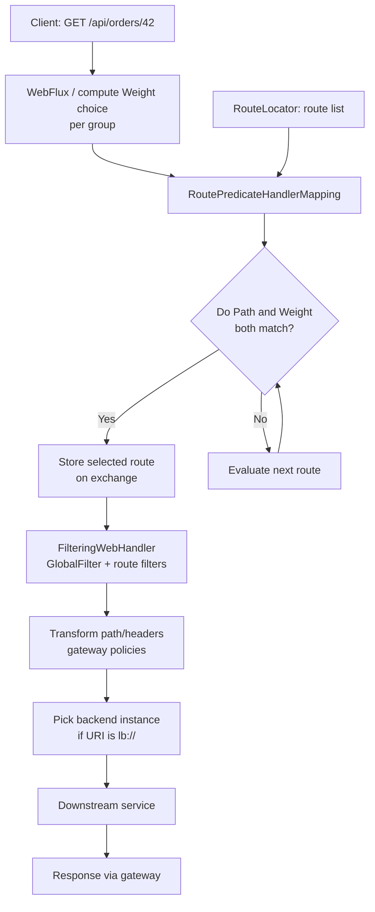
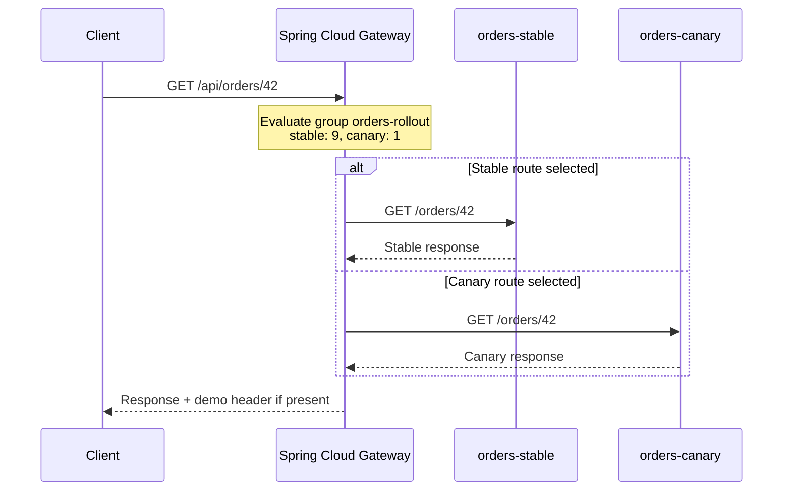

# Weight: splitting traffic by group and weights

When releasing a new version of a microservice, you do not have to switch all requests to the new version immediately. A safer deployment approach is to let the stable version handle most traffic while the new version receives a small share to measure errors, latency, and compatibility before gradually increasing its weight.

In **Spring Cloud Gateway**, the **`Weight` Route Predicate Factory** splits **requests among routes belonging to the same group** by relative weights. For example, if route A has weight `8` and route B has weight `2` in the same group, over the long run they receive approximately **80% and 20%** of the traffic within that configured scope. This is a **route selection** capability that can be used for canary releases, gradual backend migrations, or testing an alternative processing flow.

This lesson belongs to the **Route Predicates** chapter of the **SPRING_CLOUD_GATEWAY** module. On the path to building an API Gateway, `Weight` works alongside route predicates like `Path`, `Method`, `Host`; with filter chains to rewrite paths/headers; and with service discovery and load balancing to call actual instances. Layers for authentication, rate limiting, circuit breakers, retries, TLS, and request observability must still be designed independently, especially when two backend versions receive different traffic proportions.

## 1. Weight is a routing condition, not a fixed percentage

A normal route answers the question: **does this request match or not?** The `Weight` predicate adds a probabilistic choice among routes declared with the same `group`. Shortcut syntax:

```yaml
predicates:
  - Weight=orders-rollout, 8
```

The two arguments are:

| Argument | Type/meaning | Example | Notes |
| --- | --- | --- | --- |
| `group` | Name of the group of routes sharing one traffic split | `orders-rollout` | Must match **exactly** across routes intended to split traffic with one another. |
| `weight` | Integer expressing the relative size of the traffic share | `8` | Use positive integers. This is not an individual percentage value. |

Example of routes in the **same group**:

```yaml
- id: orders-stable
  uri: lb://orders-stable
  predicates:
    - Weight=orders-rollout, 8

- id: orders-canary
  uri: lb://orders-canary
  predicates:
    - Weight=orders-rollout, 2
```

The system computes each route's share based on the **sum of weights in that group**. It does not require the weights to sum to `10` or `100`.

### 1.1. Formula

For a group with `n` routes, where each route `i` has a positive weight `w_i`:

\[
P(\text{select route }i)
=\frac{w_i}{\sum_{j=1}^{n}w_j}
\]

Examples:

| Group weights | Expected probability per route | Interpretation |
| --- | --- | --- |
| `8 : 2` | `80% : 20%` | Stable version receives roughly four times as many requests as canary. |
| `9 : 1` | `90% : 10%` | Canary receives roughly one tenth. |
| `95 : 5` | `95% : 5%` | A small canary step. |
| `5 : 3 : 2` | `50% : 30% : 20%` | Three routes in the same group. |
| `1 : 1` | `50% : 50%` | Roughly equal split. |
| `2 : 2` | `50% : 50%` | Same ratio as `1 : 1`. |

**Do not confuse:** `Weight=orders-rollout, 8` **does not** mean this route receives exactly `8%` of requests. It receives `8 / total_group_weight` under probabilistic selection.

### 1.2. Statistical expectation differs from exact quotas

Weight-based splitting is **probabilistic request sampling**, so there is no guarantee that in the **first 10 requests** with an `8:2` ratio, exactly 8 requests go to A and 2 go to B. Over a short interval, 10 consecutive requests could all land on A or several consecutive requests on B.

With `1,000` independent requests, a `10%` canary rate yields an expected count around `100`, yet the observed count could be `91`, `108`, or something else. As sample size grows, the observed ratio typically approaches the configured ratio; no timer forces every minute to distribute in an exact deterministic ratio.

Under an approximate independent sampling model, the number of requests reaching canary has expectation `np` and standard deviation `sqrt(np(1-p))`, where `n` is the request count and `p` is the canary probability. This is a tool for **interpreting test results**, not a per-time-window traffic quota guarantee.

## 2. `group` defines the competition scope among routes

Weights only carry **relative meaning among routes in the same group**. Example:

```text
Group: orders-rollout
  orders-stable       weight 9  -> ~90%
  orders-canary       weight 1  -> ~10%

Group: catalog-rollout
  catalog-stable      weight 7  -> ~70%
  catalog-canary      weight 3  -> ~30%
```

These two groups have **separate** weighted selections. Weight `9` in the orders group is never compared against `7` in the catalog group, and raising catalog's canary from `3` to `5` does not alter orders' computed proportions.

However, **separating groups does not replace API matching conditions**. Routes still participate in the gateway's overall matching process. You need predicates like `Path`, `Host`, and `Method` to distinguish orders requests from catalog requests; at the same time, ensure routes belonging to **one split** share the same baseline predicates apart from `Weight`, unless a more complex behavior has been deliberately designed and tested.

### 2.1. Naming groups

Name groups after the **traffic boundary being split**, for example:

- `orders-v2-rollout` for requests to the orders API.
- `catalog-rollout` for the catalog API.
- `partner-api-migration` for a partner API migration.

Avoid generic names like `group1` everywhere in the system. If two unrelated sets of routes are accidentally assigned to the same group, weighted selection can make them compete for one winner, causing some requests to miss their intended route.

**A group is not a service discovery instance group.** It is a label for **weighted route selection**. After selecting a route, an `lb://...` URI can still be resolved by Spring Cloud LoadBalancer to pick **an instance of the logical service**.

## 3. Request processing flow when using `Weight`

In Spring Cloud Gateway **Server WebFlux**, the weight filter at the WebFlux layer (typically implemented by `WeightCalculatorWebFilter`) prepares the per-group selection; when `RoutePredicateHandlerMapping` evaluates routes, each route's `Weight` predicate checks against that selection to decide whether it matches.

Logical diagram:



The diagram illustrates processing responsibilities, not a separate `WeightCalculatorWebFilter` server. The per-group choice applies to **the current request**; gateway does not automatically remember that user A received the canary version on a previous call.

Importantly, **`Weight` only qualifies a route for selection**. Afterward:

1. `RoutePredicateHandlerMapping` determines the actual route from the runtime route list.
2. `FilteringWebHandler` executes the filter chain of the chosen route; filters on unselected routes do not run.
3. Rewrite filters like `StripPrefix` or `RewritePath` modify the path **after route selection**.
4. Routing/load-balancing filters resolve `lb://service-id` and forward the request.
5. The backend and protection layers continue processing; the response returns through the gateway.

**Separate the two selection steps:** `Weight` distributes requests **across routes** that may point to different services. Spring Cloud LoadBalancer distributes requests **across instances** of the chosen service. A system can use both layers at once.

## 4. Complete example: 90% stable, 10% canary

Suppose there are two versions of order processing:

- `orders-stable`: the stable production version.
- `orders-canary`: the new version to monitor before expanding traffic.

Clients still call the unified `GET /api/orders/42`. Gateway needs to send roughly 90% of requests to stable and 10% to canary. **Both routes share the same `Path` and same group, but have different weights.**

### 4.1. YAML example

The following example uses the **Spring Cloud Gateway Server WebFlux** configuration namespace from current reference docs:

```yaml
spring:
  cloud:
    gateway:
      server:
        webflux:
          routes:
            - id: orders-stable
              order: -20
              uri: lb://orders-stable
              predicates:
                - Path=/api/orders/**
                - Weight=orders-rollout, 9
              filters:
                - StripPrefix=1
                - AddResponseHeader=X-Demo-Variant, stable

            - id: orders-canary
              order: -20
              uri: lb://orders-canary
              predicates:
                - Path=/api/orders/**
                - Weight=orders-rollout, 1
              filters:
                - StripPrefix=1
                - AddResponseHeader=X-Demo-Variant, canary

            - id: api-fallback
              order: 100
              uri: lb://legacy-service
              predicates:
                - Path=/api/**
              filters:
                - StripPrefix=1
```

**Version compatibility:** Earlier Spring Cloud Gateway Server WebFlux lines used `spring.cloud.gateway.routes`, whereas newer documentation places properties under `spring.cloud.gateway.server.webflux.routes`. Pick the exact prefix and starter matching **your project's version**, and do not define both route sets simultaneously just to experiment.

How to read this:

- `Path=/api/orders/**` scopes the split to orders requests.
- `Weight=orders-rollout, 9` and `Weight=orders-rollout, 1` declare two routes in **one group**, with expected shares `9/(9+1)=90%` and `1/(9+1)=10%`.
- Setting `order=-20` on both routes ensures the orders group is evaluated before the fallback at `order=100`. Between the two routes in the split, the `Weight` outcome determines the single matching route; never expect route names or file position to dictate proportions.
- `StripPrefix=1` turns `/api/orders/42` into `/orders/42` for the target backend.
- `lb://orders-stable` and `lb://orders-canary` are **logical service IDs**, requiring Spring Cloud LoadBalancer integration and a suitable instance source. That step happens after route selection.
- `AddResponseHeader` attaches a tag for **observability during practice**. Do not expose internal variant metadata by default in production.
- The `api-fallback` route only illustrates precedence for other API groups; in real deployments, narrow its scope and avoid letting fallbacks mask route selection failures or send sensitive requests to an inappropriate backend.

Both backends must understand the same API contract—including paths, methods, auth context, and response formats—so clients can be served by either version without unexpected errors.

### 4.2. What can happen for a single request?



The `alt` branch shows **one** selection outcome for an illustrative request. Gateway does not send the request to **both** backends and pick one response. Duplicating requests (*shadow traffic/mirroring*) is a separate problem requiring dedicated mechanisms and appropriate data safeguards.

### 4.3. Example of adjusting weights

Keep the group and predicates unchanged, adjusting only the two weights:

| Stage | Stable | Canary | Expected ratio | Operational decision |
| --- | ---: | ---: | --- | --- |
| Start | 99 | 1 | 99% / 1% | Verify ability to handle minimal traffic. |
| Probe | 95 | 5 | 95% / 5% | Compare errors and latency across versions. |
| Expand | 90 | 10 | 90% / 10% | Monitor further under real load. |
| Ramp up | 50 | 50 | 50% / 50% | Verify capacity and stability on both sides. |
| Full cutover | Remove stable route | Only canary route remains | 100% on remaining route | After verification and controlled config change. |

Do not assume `Weight=group, 0` is a universal standard way to "disable" a route across every version. The clear approach when retiring a route is to **remove/disable the route in controlled configuration**, ensure runtime routes and weight calculation data refresh together, and verify the actual routing path.

## 5. Major pitfall: routes in the same group having different baseline predicates

To split the **same set of requests** across versions, routes in the same group should share **the same predicates outside `Weight`**. Otherwise, the system may pick a route by weight that then fails to match the `Path` or `Method` of the incoming request.

### 5.1. Bad example: putting orders and payments APIs in one group

```yaml
# Risky mistake: same group, but two routes serve two different paths.
- id: orders
  uri: lb://order-service
  predicates:
    - Path=/api/orders/**
    - Weight=business-rollout, 8

- id: payments
  uri: lb://payment-service
  predicates:
    - Path=/api/payments/**
    - Weight=business-rollout, 2
```

This is **not** how you split 80% orders requests and 20% payments requests. Callers pick APIs by **path**, not by chance. With group-based weight selection, if an orders request draws `payments`, the `payments` `Path` fails to match; and the `orders` route was not the Weight winner for that request either. The result may find no matching route or fall into another fallback. Symptoms look like random, hard-to-reproduce routing failures.

Fix: if you simply want path-based routing, **remove `Weight`**:

```yaml
- id: orders
  uri: lb://order-service
  predicates:
    - Path=/api/orders/**

- id: payments
  uri: lb://payment-service
  predicates:
    - Path=/api/payments/**
```

If **each API** needs a canary, create **two separate groups**, such as `orders-rollout` and `payments-rollout`. Inside each group, stable/canary routes share the exact same `Path` and other baseline predicates.

### 5.2. Bad example: one GET route and one POST route in the same group

```yaml
# Risky mistake: GET and POST routes do not compete for the same request set.
- id: orders-read
  uri: lb://orders-read
  predicates:
    - Path=/api/orders/**
    - Method=GET
    - Weight=orders-mixed, 9

- id: orders-write
  uri: lb://orders-write
  predicates:
    - Path=/api/orders/**
    - Method=POST
    - Weight=orders-mixed, 1
```

This does not guarantee GET goes to `orders-read` and POST goes to `orders-write`. For a GET request, Weight selection can pick the POST route, whose POST predicate then fails to match; the request is not served as expected. If splitting only by method, **remove Weight** and use `Method`; if you want **separate** canaries for GET or POST, use two separate groups and keep method predicates identical within each group.

### 5.3. Interaction with `order` and fallbacks

Even when two routes have proper weights, a broad route like `Path=/api/**` with a higher-priority `order` can win **before both weighted routes**. Therefore:

1. Use `order` to place the weighted group ahead of general fallbacks.
2. Within a weighted group, keep baseline predicates identical and avoid other routes with overlapping conditions inadvertently having higher priority.
3. Test sensitive endpoints, especially admin paths and disallowed HTTP methods.
4. Never take a successful gateway response as proof that it chose **the intended route**.

**Weight does not re-roll when the chosen route fails another condition.** Do not design expecting it to draw a second winner in the same group until it finds one with a matching `Path`.

## 6. Distinguishing `Weight` from other traffic distribution tools

| Mechanism | What does it distribute? | Typical selection method | Example |
| --- | --- | --- | --- |
| **`Weight` Route Predicate** | **Routes** within the same group | Probability by relative weights | Choosing `orders-stable` vs. `orders-canary`. |
| **Spring Cloud LoadBalancer** | **Instances** of the same service ID | Configured algorithm such as round-robin or custom strategy | Choosing an instance of `orders-stable`. |
| **Route `order`** | Evaluation order when multiple routes can match | Lower numbers evaluated first | Orders routes before `/api/**` fallback. |
| **`Path`/`Method`/`Host`** | Eligible request set for a route | Conditions on the HTTP request | Only GET orders API. |
| **RequestRateLimiter** | Request admission / rate quota | Token bucket or configured rate limiter policy | Throttling requests per client/API. |
| **Circuit breaker** | Whether to call downstream when errors occur | Error state / recovery state | Stopping calls to a failing downstream. |

**Do not equate 10% route traffic with 10% of users.** A single user sending multiple requests may hit both stable and canary because `Weight` does not bind decisions to users, sessions, or cookies by default. When you need **per-user consistent** A/B experiments or sticky canaries, add selection based on identity/cookie/hash at a trusted boundary or use an appropriate stickiness solution.

**Do not equate Weight with health-based routing.** The canary route still has probability of being selected even when the canary backend is failing, unless additional error detection and handling mechanisms are present. `Weight` does not measure health, does not automatically reduce share as errors climb, and does not guarantee failover to stable.

## 7. Hands-on traffic ratio testing

Assume the 9:1 configuration from section 4 is loaded, gateway runs at `localhost:8080`, and both services have available instances returning valid responses.

### 7.1. Manual probing

```bash
curl -i http://localhost:8080/api/orders/42
curl -i http://localhost:8080/api/orders/42
curl -i http://localhost:8080/api/orders/42
```

The demo header `X-Demo-Variant` shows which route was picked. However, a handful of requests is **an insufficient sample** to evaluate a 90:10 split; three consecutive `stable` responses is completely normal.

Do not use `curl -I` in place of GET when routes restrict `Method=GET`, because `-I` sends HTTP HEAD. Requests in a measurement run must share the same method, path, host, and relevant predicate conditions.

### 7.2. Sampling ~1,000 requests in a test environment

Example Bash command using the demo header, suitable when backends are ready and the gateway does not cache responses in a way that skews call counts:

```bash
for i in $(seq 1 1000); do
  curl -sS -D - -o /dev/null http://localhost:8080/api/orders/42 |
    awk 'tolower($1) == "x-demo-variant:" {
      gsub("\r", "", $2);
      print $2
    }'
done | sort | uniq -c
```

An **illustrative** output might look like:

```text
  904 stable
   96 canary
```

This example is not a real execution output; counts are expected to fluctuate around 900/100 over 1,000 samples. If only 980 labels are recorded, inspect whether the remaining 20 requests returned errors, lacked the response header, or hit another route/handler. **Never silently drop failed requests from the sample and conclude the split is accurate.**

When testing against real systems, rate-limit your sampling, avoid overloading services, and follow policies for the target environment. Never test with state-mutating or payment requests that create side effects unless using test data and proper idempotency mechanisms.

### 7.3. Measuring by route ID instead of relying only on headers

In Gateway Server WebFlux, the selected route is normally stored in `ServerWebExchangeUtils.GATEWAY_ROUTE_ATTR`. A custom `GlobalFilter` can read it for observability:

```java
import org.springframework.cloud.gateway.route.Route;
import org.springframework.cloud.gateway.support.ServerWebExchangeUtils;

Route selected = exchange.getAttribute(
    ServerWebExchangeUtils.GATEWAY_ROUTE_ATTR
);
String routeId = selected == null ? "unknown" : selected.getId();
```

This snippet illustrates reading at a point **after handler mapping has selected the route**, not a standalone compilable filter program without context. In operations, rely on built-in gateway metrics, traces, and logs to measure by route ID, response status, and latency; aggregate figures over identical time windows.

**Measured ratios can differ depending on the metric.** The shares of *requests selected for a route*, *requests received by backend*, *successful requests*, and *unique users* are not the same quantity. If 10% of requests select canary but many canary calls time out, the percentage of successful responses from canary will sit below 10% even while weights work properly.

## 8. Interpreting test results statistically

Suppose canary has probability `p=0.10`. Over `n=1,000` independent requests:

- Expected requests to canary: `n×p = 100`.
- Approximate standard deviation: `sqrt(1,000×0.10×0.90) ≈ 9.49` requests.
- Approximate 95% reference interval around expectation via normal approximation: roughly `100 ± 19` requests, or about `81–119` out of 1,000 requests.

This approximation helps recognize **normal** sampling fluctuation for independent trials; it is not a sole pass/fail criterion and does not replace real traffic analysis. Caching, retries, fallbacks, connection failures, session behavior, or configuration drift across gateway replicas can shift observed ratios substantially.

When sample sizes are small, such as `20` requests, getting `1` canary (5%) or `4` canary (20%) is not enough evidence that the configuration is broken. Increase sample size, check route conditions, and compare consistent metric definitions before tuning.

### 8.1. With multiple replicas of the gateway itself

If the gateway runs three instances behind a load balancer, each gateway instance must have **consistent route/weight configuration** and refresh cleanly. One gateway at 90:10 while another remains at 80:20 produces an unexpected aggregate split. Moreover, the upstream load balancer may send uneven request counts to each replica.

Inspect traffic broken down by **gateway instance**, **route ID**, **time**, and **deployment version**; aggregate statistics are meaningful only when all instances serve the intended configuration.

## 9. Testing scenarios beyond the happy path

A trustworthy Weight test suite must verify both **accurate routing** and **backend behavior**. Scenarios to include in integration tests:

| Scenario | What to verify |
| --- | --- |
| Two routes in same group, same `Path`, weight 9:1 | After enough samples, route IDs approximate configured ratio and every request matches an expected route. |
| Request outside `/api/orders/**` | Does not accidentally enter either weighted orders route. |
| With `/api/**` fallback | Weighted orders routes take precedence properly; fallback receives only requests genuinely outside orders. |
| Client calls `POST` while routes specify `Method=GET` | Do not extrapolate from GET measurements; test POST flows and method policies separately. |
| Stable and canary have different filters | Correct filters apply to the winning route; any differences must be intentional. |
| One backend down or no instances | Gateway returns error/fallback per config; do not expect Weight to avoid unhealthy backends automatically. |
| One route removed or reweighted | Runtime route list and weight group data update in sync; old route no longer affects decisions. |
| Multiple gateway replicas | Every replica holds the same group and weights; measure ratios per replica to avoid masking drift. |

### 9.1. Testing statistical properties vs. functional correctness

Separate two categories of tests:

1. **Deterministic tests:** for a request, verify the selected route belongs to the valid group, post-`StripPrefix` path is right, headers/policies apply, and the stub backend receives the expected request. Use `WebTestClient` with mock backends for this.
2. **Distribution tests:** send enough independent requests in a controlled environment, count route IDs, and compare proportions against pre-defined statistical tolerances. Avoid tiny sample counts asserting an exact 90/10 split.

Do not write canary tests assuming the first request always hits stable and the tenth always hits canary. If an application requires **deterministic** routing, use a deterministic selection mechanism based on appropriate criteria rather than expecting probability to form a fixed round-robin cycle.

### 9.2. Checking CORS policies and HTTP methods

If weighted routes are constrained with `Method=GET`, `OPTIONS` preflight requests will not match them automatically. CORS may be handled at a separate layer per WebFlux/Gateway configuration; test both preflights and actual requests, especially if canary alters response headers. Avoid using Weight as a way to "pick" one CORS branch across different backends.

## 10. Common configuration errors and fixes

### Error 1: Two routes do not share the exact group name

```yaml
- id: stable
  predicates:
    - Weight=orders-rollout, 9

- id: canary
  predicates:
    - Weight=order-rollout, 1
```

`orders-rollout` and `order-rollout` are **two different groups**. No 90:10 split occurs as intended. Fix both to **one identical group name**, then confirm runtime routes updated.

### Error 2: Entering weight as a percentage or decimal

```yaml
# Do not express 90% as a decimal in Weight.
- Weight=orders-rollout, 0.9
```

`weight` is an **integer**, not a `float`. To express 90:10, use `9` and `1`, or `90` and `10`. Avoid `0` or negative weights unless explicitly confirmed by your version's contract; to stop sending traffic to a route, use a verified route modification/removal workflow.

### Error 3: Assuming specific routes automatically beat general routes

A `Path=/api/**` route with `order=-100` can shadow the entire `/api/orders/**` group at `order=0`. Place the weighted group ahead of fallbacks, define explicit match scopes, and test requests in overlapping regions.

### Error 4: Same group but differing `Path`, `Host`, or `Method`

Group selection does not guarantee the chosen route satisfies other baseline conditions. Keep **each group dedicated to one set of requests sharing baseline predicates**, or remove Weight if you only need path/method separation.

### Error 5: Changed YAML, yet proportions stay unchanged

Check:

- Was the config loaded under **the right namespace** and active profile?
- Do runtime routes show the expected IDs, groups, and weights?
- Does a dynamic route/cached setup require emitting a refresh event?
- Did weight calculation data refresh alongside route definitions?
- Is a gateway replica still running an old configuration?
- Does a higher-priority route intercept requests before the weighted group?

Certain versions/deployments have exhibited bugs updating weight tables during dynamic route refreshes; do not treat editing a config file as proof the runtime applied it. Verify by observing real requests after every change, and check patches for your deployed version if issues arise.

### Error 6: Treating Weight as an "automatic circuit breaker"

Weight does not automatically shift traffic away from a failing route. To dial canary down from 10% to 1% or remove it, update route weights/config through a rollout process, sync across gateway replicas, and verify results. Circuit breakers, retries, timeouts, and fallbacks are separate mechanisms.

### Error 7: Concluding traffic ratios from successful responses

If stable succeeds 99% of the time while canary succeeds 50% of the time, the ratio of successful responses from the two sides will **differ** from the routed request ratio. Count error statuses and routing events by route ID rather than looking only at successful traffic and misadjusting weights.

## 11. Security and resilience when splitting traffic

### 11.1. Auth and authorization must stay consistent across both paths

Both stable and canary must enforce consistent authentication, scope checks, and resource authorization. Which route gets picked must never decide whether a user bypasses permission checks.

For instance, if stable has a filter restricting write APIs while canary lacks it, 10% of requests hitting canary could miss stable's policy. Prefer enforcing global policies at the right layer, keeping per-route policies consistent, and protecting resources in the backend. **The `Weight` route predicate is not proof of authorization.**

### 11.2. Rate limiting and canary capacity

Receiving 10% of requests can still overload canary if it has only one small instance or runs more expensive database queries. Measure actual RPS, concurrency, p95/p99 latency, 4xx/5xx rates, and saturation on each backend. Rate limiters attached **per route** can produce split quotas; global per-user/per-API limits must be designed clearly so users cannot "bypass" quotas simply by landing across multiple routes.

### 11.3. Retries can multiply calls to the backend

A single gateway request selects one route, yet during processing it may issue **multiple downstream calls** if retries are enabled. Therefore, 10% of requests **at the edge** does not equate to exactly 10% of backend connections or 10% of CPU/database load.

Configure timeouts, retry budgets, backoff, and idempotency appropriately. Be especially cautious with POST payments, order creation, or state transitions. Never test a canary by sending repeated write requests without safeguards against side effects.

### 11.4. TLS and service discovery on each path

Two URIs `lb://orders-stable` and `lb://orders-canary` may resolve to different services/instances. Verify DNS/discovery, networking, certificates, and TLS between gateway and each backend. HTTPS on client–gateway does not guarantee HTTPS/mTLS on the gateway–backend hop. Weighted routing only chooses the route; it does not provide transport security.

### 11.5. Canaries must have a clear rollback plan

Before increasing weights, define:

1. **Entry criteria:** canary backend is healthy; API contracts and database migrations are compatible.
2. **Watched metrics:** error rates, latency, throughput, saturation, and key business metrics comparing canary against stable.
3. **Stop thresholds:** when to halt ramp-up or revert to the stable route.
4. **Rollback actions:** which route config to edit/remove, and how to sync route refreshes across all gateway replicas.
5. **Post-rollback verification:** confirm live requests no longer hit canary unintentionally; monitor long enough for in-flight requests to drain.

Never assume changing weights interrupts in-flight connections or cancels requests already delivered to the backend.

## 12. Self-check exercises

### Scenario A — Three versions

The same group `orders-rollout` has three routes with weights `5`, `3`, and `2`. **What are the expected shares?**

**Answer:** Total weight is `10`, so `50%`, `30%`, and `20%` respectively. All three must compete for **the same request set** if the goal is splitting versions of one API.

### Scenario B — Weights not summing to 100

Stable uses `Weight=orders-rollout, 12`, and canary uses `Weight=orders-rollout, 3`. **Does canary receive 3% of traffic?**

**Answer:** No. Expected shares are `3/(12+3)=20%` for canary and `80%` for stable.

### Scenario C — Same group name across two APIs

The orders route has `Path=/api/orders/**` with Weight in `group1`; the payments route has `Path=/api/payments/**` also in `group1`. **Why might requests occasionally miss the right backend?**

**Answer:** Both participate in **the same weighted draw** even though they serve different path sets. A route picked for the group may not match the request's path. Separate the groups or remove Weight if you simply want path-based routing.

### Scenario D — A 20-request test

At a 10% canary weight, a test sends 20 requests and only 1 hits canary. **Is the config broken?**

**Answer:** Insufficient evidence. Getting 1/20 (5%) is completely normal in a small sample. Increase sample size, track route IDs, and rule out route/fallback/backend errors.

### Scenario E — Canary version is failing

Gateway still routes ~10% to canary, yet 30% of canary requests return `503`. **Does Weight automatically drop to 0%?**

**Answer:** No. You need dedicated resilience/rollout policies and an explicit rollback workflow. Separate the share of requests **routed to the route** from the share of requests **handled successfully**.

### Scenario F — Client requires stickiness

A user must consistently hit the same version because the two versions do not yet share session state. **Is Weight alone enough?**

**Answer:** No. Default Weight does not guarantee user stickiness. You need a consistent routing mechanism, or a stateless/shared-session architecture so requests can safely land on either version.

## 13. Key points to remember

1. **`Weight=group, weight`** is a predicate selecting routes by **relative weight within a group**. With 8:2, the expected ratio is roughly 80%:20%, with no exact guarantee over small request batches.
2. **Use the same group for routes serving the same request set**; keep `Path`/`Method`/`Host` and baseline conditions consistent across routes splitting traffic.
3. **`Weight` selects the route, `lb://` selects the logical service, and the load balancer selects the instance.** These are distinct steps.
4. **`order` still matters**: a higher-priority general fallback route can completely shadow a weighted group.
5. **Observe route IDs and failed requests too**, gather sufficient samples, and distinguish routed request share from success rate or backend load.
6. **Canaries require safety policies** covering auth, quotas, retries, TLS, observability, config synchronization, and rollback.

**Practical conclusion:** Use `Weight` when splitting **the same API surface** across different target routes, such as stable and canary versions. Configure groups cleanly, keep matching conditions identical, set proper priorities, and measure results with meaningful metrics. Combined properly with filter chains, service discovery, rate limiting, circuit breakers, retries, and observability, Spring Cloud Gateway becomes an observable and reversible control point for API version rollouts.

### References

- [Spring Cloud Gateway — Route Predicate Factories (Server WebFlux)](https://docs.spring.io/spring-cloud-gateway/reference/spring-cloud-gateway-server-webflux/request-predicates-factories.html), section **The Weight Route Predicate Factory**: `group`/`weight` syntax and 8:2 example.
- [Spring Cloud Gateway 4.2 — Route Predicate Factories](https://docs.spring.io/spring-cloud-gateway/reference/4.2/spring-cloud-gateway/request-predicates-factories.html): `spring.cloud.gateway.routes` namespace examples in older versions.
