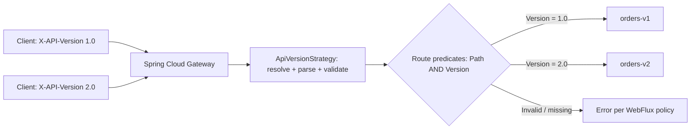
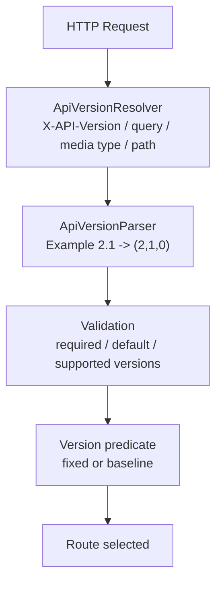

# Version and ApiVersionStrategy for API version-based routing when supported

A microservices API often has to serve multiple client generations simultaneously. Older mobile apps may still rely on the **v1** data contract, while new web apps have moved to **v2**. With **Spring Cloud Gateway**, you can route both request types to different backends via route predicates instead of forcing clients to memorize deployment addresses for each version.

For example, both requests call the path `GET /api/orders/42` while carrying different metadata:

```http
GET /api/orders/42 HTTP/1.1
Host: api.example.com
X-API-Version: 1.0
```

```http
GET /api/orders/42 HTTP/1.1
Host: api.example.com
X-API-Version: 2.0
```

In versions of **Spring Cloud Gateway Server WebFlux that support the `Version` Route Predicate Factory**, the gateway can use the API version extracted and normalized by **`ApiVersionStrategy`** to pick the appropriate route. This lesson belongs to the **Route Predicates** chapter of the **SPRING_CLOUD_GATEWAY** module, connecting predicate knowledge with filter chains, path/header transformations, service discovery, authentication, rate limiting, circuit breakers, retries, TLS, and request observability.

The objectives of this lesson are to understand:

1. What data does the `Version` predicate rely on, and how does it differ from `Header`, `Query`, or `Path` predicates?
2. Why must `ApiVersionStrategy` be configured before using `Version`, and what goes wrong when the strategy is missing?
3. How does `Version=1.3` differ from `Version=1.1+`, and how are overlapping routes and invalid versions handled?
4. How can you route APIs by version when your Gateway library **does not yet support** `Version`?

> **Important version scope:** Official documentation for Spring Cloud Gateway **Server WebFlux 5.0.x and 5.1.x** describes the `Version` Route Predicate Factory along with `spring.webflux.apiversion.*` configuration. Gateway WebFlux **4.3.x** docs do not list this factory. Therefore, **do not use `Version=...` simply after seeing an example config**; first verify your Gateway version, Spring Framework, Spring Boot, and compatible starter in the application. This lesson uses **Gateway Server WebFlux 5.x** config syntax for the main part, then presents alternatives.

## 1. Why route by API version?

An **API version** expresses changes to the **client communication contract**: resources, data fields, parameter semantics, error codes, or behavior. It differs from a service build number, Java library version, or container image tag.

Example:

| Client | API contract | Backend requirement |
| --- | --- | --- |
| Legacy mobile | v1: returns `totalAmount` as a string | `orders-v1` |
| New web | v2: returns `total` as a currency object | `orders-v2` |
| Internal tool | v2: supports new filters | `orders-v2` |

If all requests went indiscriminately to the v2 backend, legacy mobile clients could hit response-parsing failures even though the path is still `/api/orders/42`.

Version routing is helpful when you need to:

- Maintain multiple **API contracts** concurrently during transitions.
- Swap the backend behind a contract while preserving public endpoints.
- Roll out breaking changes in a planned manner.
- Observe the share of clients still on v1 to decide when to retire support.

Version routing is **not synonymous** with canary deployments or A/B testing. In a canary deployment, a slice of clients calling the same v2 contract can be routed to a new build by weight; in version routing, clients explicitly request the **v1/v2 contract**.

### High-level model



Public paths, authentication, and gateway policies can stay unified; each backend remains responsible for upholding its own contract and business rules.

## 2. Supportability: identifying the right Gateway generation

The name `Version` easily misleads learners into thinking it exists in every Spring Cloud Gateway release. In reality, this capability depends on **framework generation and server type**.

| Component / version | Correct understanding |
| --- | --- |
| **Gateway Server WebFlux 5.0.x, 5.1.x** | Official docs include `Version` Route Predicate Factory, using Spring Framework WebFlux's `ApiVersionStrategy`. |
| **Gateway Server WebFlux 4.3.x** | Official route predicate docs for this branch do not list `Version`; do not assume `Version=...` syntax is supported. |
| **Gateway Server Web MVC 5.x** | Also documents a version predicate, but its resolver namespace is `spring.mvc.apiversion.*` and runtime differs from WebFlux. |
| **Spring Framework 7 / Spring Boot 4** | Includes WebFlux versioning support and corresponding `spring.webflux.apiversion.*` settings on supported stacks. |
| **Other Gateways, custom builds, or internal libs** | Must inspect actual classes/factories, starters, docs, and integration tests for your deployed version. |

This is a **prerequisite**, not purely a syntax choice. If Gateway lacks the `Version` factory, a route using `Version=1.0` may fail during route initialization/binding. If the factory exists but the strategy is missing, a more insidious failure mode occurs: **routes can match incorrectly regardless of version**.

### YAML prefix also depends on version

In primary Gateway Server WebFlux 5.x examples, configuration lives under:

```yaml
spring:
  cloud:
    gateway:
      server:
        webflux:
          routes:
            # ...
```

Many examples from older Gateway versions use `spring.cloud.gateway.routes`. Do not copy a namespace from another version and conclude a predicate "doesn't work". Verify your actual dependencies before configuring.

**Official reference documentation:**

- [Spring Cloud Gateway WebFlux 5.x — Route Predicate Factories](https://docs.spring.io/spring-cloud-gateway/reference/spring-cloud-gateway-server-webflux/request-predicates-factories.html)
- [Spring Cloud Gateway WebFlux 4.3.x — Route Predicate Factories](https://docs.spring.io/spring-cloud-gateway/reference/4.3/spring-cloud-gateway-server-webflux/request-predicates-factories.html)
- [Spring Framework — API Versioning in WebFlux](https://docs.spring.io/spring-framework/reference/web/webflux-versioning.html)
- [Spring Boot — Reactive Web Applications / API Versioning](https://docs.spring.io/spring-boot/reference/web/reactive.html)

## 3. What problem does ApiVersionStrategy solve?

The `Version` route predicate does not necessarily read a hardcoded header directly. Extracting and interpreting the **client-requested version** belongs to `ApiVersionStrategy`, Spring Framework's unified mechanism for API versioning.

The strategy coordinates three roles:

1. **`ApiVersionResolver`:** locates the raw version in the HTTP request, such as `X-API-Version: 2.0`, `?apiVersion=2.0`, a media type parameter, or a path segment.
2. **`ApiVersionParser`:** parses the raw string into a comparable representation. The default semantic parser interprets `major.minor.patch` numerically rather than comparing plain strings.
3. **Validation:** verifies whether the request supplies a version per policy, whether the version is valid, and whether it is in the supported list.



With the default semantic parser, values like `1.9` and `1.10` are compared by numeric components; **`1.10` is newer than `1.9`**. Treating `"1.10" > "1.9"` via lexicographical string comparison is wrong here.

### Why can't you just write `Version=2.0`?

Suppose a config has only:

```yaml
predicates:
  - Path=/api/orders/**
  - Version=2.0
```

Without configuring at least one resolver and without a corresponding `ApiVersionStrategy` bean, per Gateway 5.x docs, **the `Version` predicate is still registered, yet returns true/matches when no version can be resolved**. Thus, a request lacking any version header could still enter a route named `orders-v2`.

This is why you must check both **route config** and **strategy config**. Writing `Version=2.0` in YAML **does not automatically create version validation**.

## 4. Configuring ApiVersionStrategy via `application.yml`

Example choosing **a single version source from header** `X-API-Version` and declaring two supported versions:

```yaml
spring:
  webflux:
    apiversion:
      use:
        header: X-API-Version
      required: true
      detect-supported: false
      supported:
        - "1.0"
        - "2.0"
```

Explanation:

| Property | Meaning |
| --- | --- |
| `spring.webflux.apiversion.use.header` | Specifies the header name from which the resolver extracts the API version. |
| `required: true` | Requires the request to provide a version; requests missing a version may be rejected, typically with HTTP `400` per WebFlux versioning. |
| `detect-supported: false` | Disables auto-detecting supported versions from controller mappings; appropriate for gateways focused on proxy routing. |
| `supported` | List of versions the API currently accepts; must stay aligned with routes and real support policy. |

Declaring `supported` helps govern the API lifecycle: if a client requests an **unsupported** version, the system can reject it early instead of forwarding it to the wrong backend. In Spring Framework, missing or invalid versions can raise `MissingApiVersionException` or `InvalidApiVersionException`, mapped to HTTP `400` by corresponding handling.

In real environments, the `supported` list must reflect the published API contract. Gateways normally lack controller annotations listing every backend service's versions, so do not rely on controller auto-detection when APIs are proxy routes.

### Can other version sources be chosen?

Yes. Spring Framework WebFlux supports configuring resolvers for common metadata types:

```yaml
spring:
  webflux:
    apiversion:
      use:
        # Illustrates configurable resolver types only;
        # pick a clear strategy and priority for production.
        header: X-API-Version
        query-parameter: apiVersion
        media-type-parameter:
          "[application/json]": version
      required: false
```

In this example, the version can come from a header, query parameter, or media type parameter when the request matches. When enabling multiple sources, define **priority order and conflict handling**; Spring Boot may require configuring `WebFluxConfigurer.configureApiVersioning(...)` if strict ordering is needed. Never assume that when a client sends both `X-API-Version: 1.0` and `?apiVersion=2.0`, the system guarantees picking a particular source without testing.

If the version resides in the URL, you can use a **path segment index** resolver via `spring.webflux.apiversion.use.path-segment`. Segment indices must be verified against how Spring Framework actually parses paths; do not guess by counting `/` characters or post-rewrite paths. When placing versions in paths, coordinate route configs and path-rewriting filters so the backend receives the expected path.

### How do `required`, `default`, and `supported` differ?

- **`required`:** whether clients must specify a version.
- **`default`:** configured fallback version, useful to keep legacy clients working during transition.
- **`supported`:** accepted API versions; this does not automatically create routes for them.

For example, during a migration window, you can set:

```yaml
spring:
  webflux:
    apiversion:
      use:
        header: X-API-Version
      default: "1.0"
      required: false
      detect-supported: false
      supported:
        - "1.0"
        - "2.0"
```

Requests without a version are then designed to default to `1.0` under the versioning policy; verify this behavior and associated routes with integration tests. Once clients are required to declare a version, switch to `required: true` and remove the default per your roadmap.

## 5. Version predicate: fixed version and baseline version

The `Version` route predicate accepts one `version` argument in two main forms.

### 5.1. Fixed: matching only one version

```yaml
predicates:
  - Path=/api/orders/**
  - Version=2.0
```

This route is reserved for requests whose resolved, parsed, and validated version **equals** `2.0`. A request asking for `1.0` should not match this route.

Fixed versions fit backends with distinct API contracts, such as v1 and v2 returning different JSON structures.

### 5.2. Baseline: matching from one version onward

```yaml
predicates:
  - Path=/api/catalog/**
  - Version=1.1+
```

A trailing `+` is baseline syntax: matches versions equal to or **greater than** `1.1`. For example, `1.2`, `1.5`, or `2.0` can satisfy it as long as the strategy accepts them. This is **API version comparison**, not an addition operator and not a regex.

| Client-sent version | `Version=1.3` | `Version=1.1+` | Notes |
| --- | --- | --- | --- |
| `1.0` | No | No | Older than baseline 1.1. |
| `1.1` | No | Yes | Equals baseline. |
| `1.2` | No | Yes | Higher than baseline. |
| `1.3` | Yes | Yes | Can **overlap** two routes. |
| `1.10` | No | Yes | Compared as parsed version, not string. |
| `2.0` | No | Yes | Baseline can span across major versions. |
| Missing version | Depends on strategy | Depends on strategy | `required/default` governs version resolution. |
| `banana` | Cannot be treated as valid semantic version | Cannot be treated as valid semantic version | Parser/validation may reject before route selection. |

This table illustrates predicate behavior **assuming the version resolved and falls within the `supported` policy**. If `supported` excludes `1.10` or `2.0`, the request may be rejected before route selection occurs per the table.

**Warning:** `Version=1.1+` **does not** mean "only 1.x minor versions" or "all backward-compatible versions". If `2.0` introduces breaking changes, narrow supported versions, define dedicated routes, or apply an explicit versioning strategy; never assume baseline automatically knows what constitutes a breaking change.

## 6. Complete example: routing orders v1 and v2 by HTTP header

Suppose two local backends run at:

- `http://localhost:8081`: serves v1 JSON contract, endpoint `GET /orders/42`.
- `http://localhost:8082`: serves v2 JSON contract, endpoint `GET /orders/42`.

Gateway WebFlux 5.x runs at `http://localhost:8080`. Below is a self-contained example using the `Version` predicate, a single resolver, and an explicit `supported` list:

```yaml
spring:
  webflux:
    apiversion:
      use:
        header: X-API-Version
      required: true
      detect-supported: false
      supported:
        - "1.0"
        - "2.0"

  cloud:
    gateway:
      server:
        webflux:
          routes:
            - id: orders-v1
              order: 0
              uri: http://localhost:8081
              predicates:
                - Path=/api/orders/**
                - Version=1.0
              filters:
                - StripPrefix=1

            - id: orders-v2
              order: 0
              uri: http://localhost:8082
              predicates:
                - Path=/api/orders/**
                - Version=2.0
              filters:
                - StripPrefix=1
```

Both routes share the same `order` value because fixed-version predicates **have no overlapping match region** when the strategy works properly and each request carries one version. If adding a broader route, review `order` and strategies to avoid accidental overlap.

Flow for v2:

1. Client calls `GET /api/orders/42` with header `X-API-Version: 2.0`.
2. WebFlux `ApiVersionResolver` reads the version from the header; parser and validator process it.
3. Gateway checks `Path=/api/orders/**` and `Version=2.0`; route `orders-v2` matches.
4. Filter `StripPrefix=1` turns public path `/api/orders/42` into `/orders/42`.
5. Reactor Netty HTTP client proxies the request to `http://localhost:8082/orders/42`.
6. The v2 backend performs required authentication/authorization and returns data per the v2 contract.
7. Gateway returns the response to the client, applying associated filter and observability policies.

**Testing with curl:**

```bash
# Request v1 contract
curl -i http://localhost:8080/api/orders/42 \
  -H "X-API-Version: 1.0"

# Request v2 contract
curl -i http://localhost:8080/api/orders/42 \
  -H "X-API-Version: 2.0"

# Missing version: with required=true, expected to be rejected
curl -i http://localhost:8080/api/orders/42

# Unsupported per configuration
curl -i http://localhost:8080/api/orders/42 \
  -H "X-API-Version: 9.9"

# Unparseable value
curl -i http://localhost:8080/api/orders/42 \
  -H "X-API-Version: abc"
```

In a test environment, backends should log the **received route** or return a non-sensitive marker such as `X-Api-Contract: v1` / `v2` to verify **which backend was actually called**. Checking HTTP status alone does not confirm routing.

If both backends use service discovery, `uri` can be replaced with `lb://orders-v1` and `lb://orders-v2` when Spring Cloud LoadBalancer and a discovery client or instance source are configured. Version matching and instance selection are two distinct steps.

## 7. Combining Version with other route predicates

Spring Cloud Gateway combines **different predicates within the same route** using AND logic. Thus, you can simultaneously require:

- Host is `api.example.com`.
- Path falls under `/api/orders/**`.
- HTTP method is `GET`.
- Version equals `2.0`.

```yaml
- id: orders-v2-read
  uri: http://localhost:8082
  predicates:
    - Host=api.example.com
    - Path=/api/orders/**
    - Method=GET
    - Version=2.0
  filters:
    - StripPrefix=1
```

This is **a fragment of the route list** under `spring.cloud.gateway.server.webflux.routes`, not a standalone complete YAML file. With this route, a `POST` request even with `X-API-Version: 2.0` still fails to match because `Method=GET` is unsatisfied.

### Version and header modification

`Version` uses request metadata to select a route; it **does not automatically alter the backend contract**. If you need to pass a standardized internal header, you can use `SetRequestHeader` / `RemoveRequestHeader` filters by design. Example:

```yaml
filters:
  - StripPrefix=1
  - SetRequestHeader=X-Resolved-Api-Contract, v2
```

This acts as a marker telling the backend which contract the route applies; never use this header as proof of identity or access permissions. If clients can send a header with the same name, `SetRequestHeader` overwrites the value on the outbound request when the filter runs properly. The backend must still authenticate requests per system rules.

### Does version-in-URL need the `Version` predicate?

Not necessarily. If the public API uses `/v1/orders` and `/v2/orders`, the `Path` predicate can already separate routes. `Version` is most useful when you want a unified API versioning strategy with shared resolver/parser/validation configuration, such as keeping the same URL while carrying the version in a header or query parameter.

If combining path-embedded versions **and** `Version`, design the path resolver and `Path` predicate consistently. `RewritePath`/`StripPrefix` mainly transform the request in the filter chain after route matching; do not rely on rewritten paths to explain how the resolver determined the version beforehand.

## 8. Baseline routes, precedence, and overlap risk

Suppose catalog API versions 1.0 and 1.1 are compatible, while 2.0 uses a completely different backend:

```yaml
- id: catalog-v2
  order: -10
  uri: http://localhost:8082
  predicates:
    - Path=/api/catalog/**
    - Version=2.0

- id: catalog-legacy-baseline
  order: 10
  uri: http://localhost:8081
  predicates:
    - Path=/api/catalog/**
    - Version=1.0+
```

If the strategy allows `2.0`, a `2.0` request can match both `Version=2.0` **and** `Version=1.0+`. In this configuration, `catalog-v2` has `order=-10` so it takes precedence when both match.

This choice carries risk: an overly broad baseline route can accidentally catch a new version if the dedicated route is removed, misconfigured, or missing instances. Never rely on `order` as a safety guarantee for API contracts.

**Safer design:**

1. Restrict supported versions explicitly in `ApiVersionStrategy`.
2. Use fixed-version routes for breaking contracts.
3. Only use baselines when the service truly guarantees compatibility across the declared range.
4. Write tests for **every supported version** verifying **the selected route ID**, not just `200` responses.
5. If a default `Path=/api/**` route exists, verify it does not allow invalid-version requests to slip into an unintended backend.

Do not assume Gateway's `Version` predicate automatically applies a "closest baseline wins" rule like some Spring Framework `@RequestMapping` controller selection mechanisms. **Gateway route selection** still depends on route ordering and other predicates. Rely only on behavior verified against your exact current Gateway version.

## 9. Alternatives when Gateway does not yet support the `Version` predicate

For older Spring Cloud Gateway Server WebFlux releases lacking the `Version` factory, use the built-in **`Header`, `Query`, or `Path`** predicates. They match requests directly and do not require `ApiVersionStrategy`.

### 9.1. Routing by header

```yaml
spring:
  cloud:
    gateway:
      routes:
        - id: orders-v1
          uri: http://localhost:8081
          predicates:
            - Path=/api/orders/**
            - Header=X-API-Version,1[.]0
          filters:
            - StripPrefix=1

        - id: orders-v2
          uri: http://localhost:8082
          predicates:
            - Path=/api/orders/**
            - Header=X-API-Version,2[.]0
          filters:
            - StripPrefix=1
```

`Header` uses regex; the pattern `1[.]0` matches a **literal dot**, preventing regex `1.0` from matching any arbitrary middle character. This works cleanly for two fixed versions and a single header source.

Limitation: the `Header` predicate **lacks** semantic parsing, `supported`, default versions, and unified validation like `ApiVersionStrategy`. If no route matches, the response may go through "route not found" handling or a fallback route depending on your app. Do not assume version errors automatically become `400`.

### 9.2. Routing by query parameter

```yaml
predicates:
  - Path=/api/orders/**
  - Query=apiVersion,2[.]0
```

Clients call `/api/orders/42?apiVersion=2.0`. This is easy to test, but pay attention to cache keys, URL logging, and clients sending duplicate query parameters. If query version alters the API contract, caching layers must distinguish versions properly.

### 9.3. Routing by path

```yaml
predicates:
  - Path=/api/v2/orders/**
filters:
  - StripPrefix=2
```

For `/api/v2/orders/42`, `StripPrefix=2` strips `api` and `v2` so the backend receives `/orders/42`. This is straightforward, though the public URL changes with each new version.

### Comparing the two approaches

| Criterion | `Version` + `ApiVersionStrategy` | `Header` / `Query` / `Path` |
| --- | --- | --- |
| Version condition | Parsed and validated via strategy | Direct header/query/path match |
| "From version X onward" comparison | Has baseline syntax `1.1+` when supported | Custom regex or multiple routes; hard to ensure semantic ordering |
| Missing/unsupported version policy | Has `required`, `default`, `supported`, and WebFlux handling | Must implement custom policies/responses |
| Legacy Gateway compatibility | Cannot be assumed present | Practical option when `Version` factory is absent |
| Testability | Test resolver, parser, validation, and routes | Test regex/URL, route order, and non-matching branches |

**Do not build a custom `VersionRoutePredicateFactory` just to mimic 5.x support** if the system is not ready to upgrade or maintain custom version comparison logic. Basic predicates handle simple needs; if strict semantic versioning is required, design an explicit tested policy rather than assuming regex suffices.

## 10. Version routing does not replace security and API contract governance

### 10.1. Version is an input, not a permission

Clients can freely send `X-API-Version: 2.0`; this header **does not prove** the client is an admin, purchased a Pro plan, or has access to another tenant's data. Gateway still needs token/session authentication per design, rate limiting, request size controls, and appropriate edge policies. Backends must check permissions on actual resources.

**Bad example:** the v2 route exposes admin capabilities, and the gateway assumes "only new clients know version 2.0" so it skips authentication. Any client who guesses the header can send `2.0`.

**Proper design:** pass both v1/v2 through the appropriate authentication layer; privileged permissions are verified against authenticated principals/claims and business rules.

### 10.2. Keeping an API stable within a version

Version routing only picks a backend. It does not ensure the v2 backend actually returns valid v2 JSON. Crucial practices remain with the service and release process:

- Contract tests for request/response of each version.
- Backward-compatibility rules, field deprecation, and clear error codes.
- Deprecation/sunset policies and client communication.
- Idempotency for write operations, especially when gateway retries are active.
- Rollback plans while multiple versions run concurrently.

### 10.3. TLS, discovery, resilience, and caching

| Topic | Impact when version routing |
| --- | --- |
| **TLS** | The version header appears only after HTTP/TLS is established; TLS certificates and trust policies must still be sound. |
| **Service discovery** | `lb://orders-v1` and `lb://orders-v2` require real instance sources and LoadBalancer setup. |
| **Timeout/circuit breaker** | Can be tuned per route or backend since v1/v2 may have different load profiles; never fake a "v2 succeeded" fallback when v2 fails. |
| **Retry** | Consider HTTP method, side effects, idempotency, and body replay capability; never blindly retry payment requests. |
| **Cache** | If responses vary by `X-API-Version`, caches must include version in cache keys or distinguish properly; consider `Vary: X-API-Version` per HTTP caching. |
| **Observability** | Use route ID, status, latency, trace ID, and a bounded set of version labels; avoid turning arbitrary raw version strings into metric labels. |

When calling a policy service from a filter (e.g., looking up allowed versions per tenant), use a reactive client and avoid synchronous I/O on the WebFlux event loop. The `Version` predicate does not rescue a custom filter containing `Thread.sleep()` or blocking JDBC calls.

## 11. Troubleshooting common errors

| Symptom | Causes to check | Diagnostic steps |
| --- | --- | --- |
| Startup reports unknown `Version` predicate | Gateway version/starter lacks support or WebFlux/MVC mismatch | Check dependencies, version, YAML prefix, and corresponding docs; use Header/Path fallback if needed |
| Client omits version, yet still hits v2 | Missing `ApiVersionStrategy`; or `required: false`/`default` configured | Verify resolver bean/properties and actual route ID; test requests lacking the header |
| `X-API-Version: 1.0` enters v2 route | Overlapping routes, order, broad regex/fallback; strategy failed to initialize properly | Inspect route list, resolver setup, and route ID in traces/logs |
| Client sends `1.10` with unexpected comparison result | Plain string version comparison or loose regex | Use semantic parser when available; test boundary versions `1.9` / `1.10` |
| Unsupported version returns `400` | Validator rejected version per `supported` policy | Verify `supported` list, client header/query syntax, and published policy |
| No route matches despite valid version | `Path`/`Host`/`Method` must also match; route URI/order/config may be wrong | Inspect every predicate and route ID; do not look at version alone |
| Configured Header and Query together, unexpected version chosen | Priority unset when multiple sources hold values | Pick a single source or configure explicit resolver order; test conflicting values |
| Both v1 and v2 requests return v1 content | Wrong upstream selected, backend lacks contract distinction, or cache ignores version | Check backend markers, proxy URIs, cache keys/`Vary`, and contract tests |
| Route v2 never reaches backend | Discovery has no instances, upstream timeout/TLS/connection pool issue | Use route ID + trace ID + HTTP client metrics to separate routing bugs from version bugs |
| p95/p99 spikes after adding version handling | Custom predicate/resolver performs blocking I/O, heavy logging, or slow policy calls | Profile threads/latency; eliminate blocking on the Reactor Netty event loop |

**Distinguish clearly:** `400` can come from the parser/validator; `404` can mean no route matched or the backend returned "not found"; `503` can relate to missing instances, an open circuit breaker, or an unavailable upstream. HTTP status alone never pinpoints the root cause.

## 12. Practice lab: testing Version routing and error cases

### Setup

Use Gateway WebFlux **with Version predicate support**, the config from section 6, two test backends, and a client like `curl`. Have each backend return a distinct marker:

- Backend 8081 returns `X-Api-Contract: v1` and a v1-contract body.
- Backend 8082 returns `X-Api-Contract: v2` and a v2-contract body.

Never use backend markers as proof of authorization; use them solely in tests to verify routing.

### Scenario matrix

| Request | Outcome to verify |
| --- | --- |
| `X-API-Version: 1.0` | Route `orders-v1`, backend 8081, path `/orders/42` |
| `X-API-Version: 2.0` | Route `orders-v2`, backend 8082, path `/orders/42` |
| Missing header with `required: true` | Rejected per WebFlux policy; must not fall into v2 |
| `X-API-Version: 9.9` when supported is only 1.0, 2.0 | Rejected as unsupported version; no silent fallback |
| `X-API-Version: invalid` | Parser/validator handles malformed value; not forwarded arbitrarily to backend |
| Path `/api/catalog/42` | Orders routes do not match even with valid version |
| Wrong Host/Method when predicates are added | Route does not match because conditions combine with AND |
| Add baseline route `Version=1.0+` | Version 2.0 can match both fixed and baseline routes; verify precedence |
| Remove version resolver in isolated test env | Observe `Version` predicate always matching when strategy is absent; restore resolver right after testing |
| Stop v2 backend | Clearly identify upstream failure, not version error; observe timeouts/circuit breaker |

**Important:** Removing the resolver should only be done in a test environment; never deploy a `Version` configuration lacking `ApiVersionStrategy` to production.

### Self-check quiz

**Question 1.** Why is `Version=1.0` insufficient to guarantee requests without a version are rejected?

> Because in Gateway 5.x, without `ApiVersionStrategy`, the `Version` predicate may always match. You must configure a resolver, validation, and test missing-version behavior.

**Question 2.** Does `Version=1.1+` automatically pick the route closest to the client's version when multiple baseline routes match?

> Never assume so. Baseline only expresses matching from that version upward; route order and other predicates still govern route selection. Design to avoid overlap or explicitly test precedence.

**Question 3.** If an app runs Gateway WebFlux 4.3 and does not recognize `Version`, what should you do?

> Use `Header`, `Query`, or `Path` predicates supported by that version to split routes and define corresponding validation policies; or upgrade to a compatible Spring version stack when appropriate.

**Question 4.** Why must `1.10` not be treated as lower than `1.9`?

> Because semantic API versioning compares numeric components. `1.10` has minor version 10, which is greater than minor version 9 of `1.9`.

**Question 5.** Should `X-API-Version: 2.0` be used to decide whether a user paid for a new feature?

> No. Version is a client-proposed API contract choice. Entitlement to use features belongs to authentication, authorization, and business rules.

**Question 6.** When a client requests v2 but receives v1 JSON, where should you investigate?

> Check whether the strategy resolves the version properly, route ID and order, upstream URI, header/path filters, the actual backend, and whether caches distinguish by version.

## 13. Production deployment checklist

- [ ] Verified your **Spring Cloud Gateway Server WebFlux version** includes `Version` Route Predicate Factory; otherwise, use `Header`/`Query`/`Path` appropriately.
- [ ] Used the right routes namespace `spring.cloud.gateway.server.webflux.routes` for Gateway WebFlux 5.x and the right versioning namespace `spring.webflux.apiversion.*`.
- [ ] Configured a resolver explicitly; never use `Version=...` without `ApiVersionStrategy`.
- [ ] Defined `required`, `default`, and `supported` intentionally and wrote tests for missing, invalid, and unsupported versions.
- [ ] If using multiple version sources, set explicit precedence order and tested requests sending conflicting values.
- [ ] Distinguished fixed versions from baselines; baselines can match higher major versions if supported.
- [ ] Tested overlapping route regions, `order`, and **the actual selected route ID**.
- [ ] Ensured path/header transformation filters do not break backend API contracts; configured discovery/load balancer when using `lb://`.
- [ ] Never treated version as proof of identity or authorization; backends verify permissions on resources.
- [ ] Caches and HTTP responses distinguish versions properly, with a deprecation/sunset plan for retiring v1.
- [ ] Applied timeouts, retries, circuit breakers, rate limits, and TLS per backend; avoided fake-success fallbacks.
- [ ] Observed traffic by bounded route ID/version labels, trace ID, parser/validator errors, and latency; never logged tokens or personal data.

## Conclusion

When **Spring Cloud Gateway Server WebFlux supports the `Version` predicate**, API version routing should be designed alongside **`ApiVersionStrategy`** to standardize version extraction, semantic parsing, and validation. `Version=1.3` targets fixed contracts; `Version=1.1+` targets versions from a baseline upward, though you must control the supported list and prevent overlapping routes. Especially remember that **lacking `ApiVersionStrategy` can cause the `Version` predicate to always match** rather than guarding routes by version.

For Gateways that do not yet support `Version`, `Header`, `Query`, and `Path` predicates remain practical routing options when paired with appropriate version-checking policies. Combining this knowledge with filter chains, service discovery, security, rate limiting, resilience, TLS, and observability lets you operate multiple API contracts behind a single microservices entry point while keeping gateway and backend responsibilities crystal clear.
