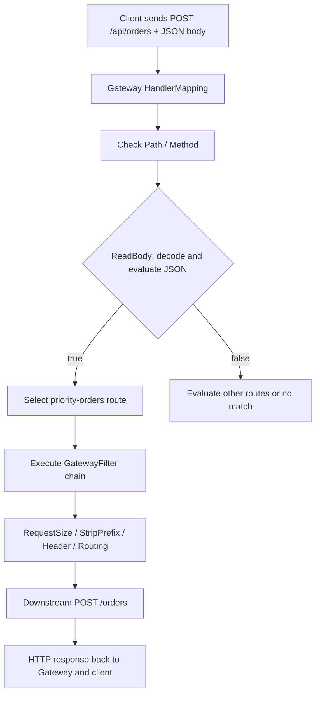
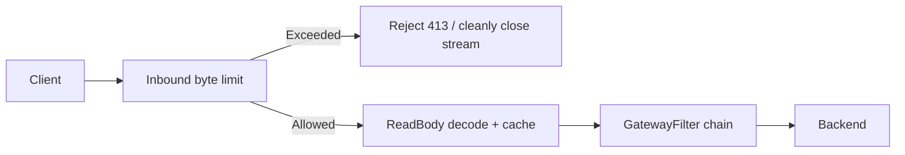

# ReadBody via Java DSL and request body caching limits

**Chapter:** Route Predicates  
**Module:** `SPRING_CLOUD_GATEWAY` — Spring Cloud Gateway

In an API Gateway for microservices, route predicates typically inspect information **without reading the request content**: `Path`, `Method`, `Host`, `Header`, or `Query`. Sometimes, target selection genuinely depends on JSON content: for example, an order request with `"priority": true` is sent to a priority processing pool. Spring Cloud Gateway Server WebFlux's **ReadBody Route Predicate** solves this by reading the body, decoding it to a Java type, and applying a `Predicate`.

That convenience comes at a cost: an HTTP body is a data stream meant to be read once; to inspect the body **before route selection** while still forwarding the body downstream, Gateway must support reading and **caching** the data. If individual requests are large and many arrive concurrently, memory usage can spike sharply. Therefore, understanding ReadBody requires understanding **size limits, when limits are enforced, and cache lifecycle**, as well as request observability when combined with filter chains, retries, circuit breakers, and security policies.

> **Scope:** Primary examples are based on **Spring Cloud Gateway Server WebFlux** (reactive). Gateway Server Web MVC and Proxy Exchange have different APIs/models; do not copy WebFlux DSL `readBody(...)` to those flavors without checking their corresponding documentation. In recent release trains, the WebFlux starter is named `spring-cloud-starter-gateway-server-webflux`; older dependency names and YAML prefixes may differ.

## 1. Learning outcomes

After this lesson, you will be able to:

1. Explain how `ReadBody` reads data during **route selection** and how it differs from `CacheRequestBody`/`ModifyRequestBody` in the filter stage.
2. Write `RouteLocatorBuilder` configurations using `readBody(Class<T>, Predicate<T>)`, combined with `Path` and `Method`.
3. Verify that the body still reaches downstream when a route matches, rather than being consumed by the predicate.
4. Distinguish non-matching predicates, malformed JSON bodies, and bodies exceeding size limits.
5. Estimate memory based on body size, concurrent requests, and other caching mechanisms.
6. Identify the limitation of `RequestSize` when it runs **after** reading the body for route selection, and design a protection layer ahead of body aggregation.

## 2. Where does ReadBody run in the Gateway flow?



Each step has a distinct meaning:

| Step | Question | Timing |
|---|---|---|
| `Path`, `Method` | Is this request worth evaluating on the body route? | Route selection |
| `ReadBody` | Does the body content satisfy the Java condition? | **Route selection** |
| `RequestSize`, `StripPrefix`, `AddRequestHeader` | Is forwarding allowed and what needs to change? | **After the route is selected** |
| Routing filter | Which `http://`, `https://`, or `lb://` target to send to? | After relevant filters |

**Key takeaway:** `ReadBody` is a *route predicate*, not a GatewayFilter. A `GatewayFilter` attached to a route **cannot run yet** if the route's predicates have not finished evaluating. This directly affects how body size limits behave.

### 2.1. Why is caching needed?

In Spring WebFlux, `ServerHttpRequest.getBody()` provides a `Flux<DataBuffer>` stream. Once a component consumes this stream, you cannot assume a subsequent handler can re-read it intact like an in-memory byte array. `ReadBody` uses a caching and decoding mechanism to evaluate the condition; Spring documentation notes that the body is cached in memory after the first read so subsequent evaluations do not need to deserialize it again.

Conceptual model:

```text
HTTP request body (stream, single-pass read)
         |
         v
  ReadBody predicate
    | reads/decodes into Java object
    | retains needed data in cache/request attributes
    +-- evaluates condition -> true/false
         |
         v
  Request continues; Gateway uses appropriate replay/cache mechanism
  to forward body downstream when route matches.
```

Never read `exchange.getRequest().getBody()` a second time inside a custom predicate/filter expecting downstream to still receive the body, unless you thoroughly understand and implement caching, decoration, ownership, and `DataBuffer` release. Especially with pooled Netty buffers, holding references too long or releasing improperly can cause memory leaks or empty-body bugs.

### 2.2. When should ReadBody be avoided?

If you can route using `Path`, `Method`, `Host`, `Header`, or metadata already normalized at the authentication layer, prefer those predicates: they do not require decoding the body before routing. For file uploads, large multipart payloads, streaming requests, or binary bodies, exercise extreme caution because buffering the entire body into memory forfeits WebFlux's streaming benefits.

## 3. Java DSL API: structure and semantics

Official documentation illustrates the method:

```java
@Bean
public RouteLocator routes(RouteLocatorBuilder builder) {
    return builder.routes()
        .route("read-body-route", r -> r
            .readBody(String.class, body -> body.contains("yes"))
            .uri("https://example.org"))
        .build();
}
```

`readBody` accepts two parameters:

| Parameter | Example | Meaning |
|---|---|---|
| `inClass` | `String.class`, `Map.class`, a DTO | Java type used by the HTTP message reader to decode the body |
| `predicate` | `body -> Boolean.TRUE.equals(body.get("priority"))` | Java function evaluating the decoded object; `true` selects the route |

**Only Java DSL supports ReadBody:** you cannot represent a Java `Predicate<T>` as a YAML string. The configuration below is **invalid for ReadBody**:

```yaml
# Wrong idea: ReadBody does not support declaring lambdas in YAML.
spring:
  cloud:
    gateway:
      server:
        webflux:
          routes:
            - id: invalid-read-body
              uri: http://localhost:8081
              predicates:
                - ReadBody=body -> body.contains("yes")
```

You can still use YAML for ordinary routes while declaring routes needing ReadBody as a `RouteLocator` bean.

### 3.1. `String.class` or DTO/`Map.class`?

Examples using `String.class` are easy to start with, yet prone to misrouting:

```java
.readBody(String.class, body -> body != null && body.contains("priority"))
```

This condition matches both `{"priority":false}` and `{"comment":"priority"}`. Whitespace and JSON key ordering also make raw substring matching fragile. For business JSON, **decode the structure** and then compare parsed values:

```java
.readBody(Map.class, body ->
    body != null && Boolean.TRUE.equals(body.get("priority")))
```

In production systems, prefer DTOs and schema-aligned validation. When comparing values, explicitly handle null/missing fields, wrong data types, and disallowed fields.

## 4. Lab: routing priority orders by JSON

We create two applications:

- **Gateway WebFlux** at `http://localhost:8080`, forwarding `POST /api/orders` only if the JSON body has `"priority": true`.
- **Orders Backend** at `http://localhost:8081`, receiving `POST /orders` and returning JSON containing the received payload.

Gateway and backend applications can run on different web stacks because they communicate over HTTP.

### 4.1. Minimal Spring Boot backend

Create a Spring Boot application with the **Spring Web** dependency, Java 17+ matching the chosen Boot version. The **backend's** `application.yml`:

```yaml
server:
  port: 8081
```

Create `OrdersBackendApplication.java`:

```java
package com.example.orders;

import java.util.Map;
import org.springframework.boot.SpringApplication;
import org.springframework.boot.autoconfigure.SpringBootApplication;
import org.springframework.http.MediaType;
import org.springframework.web.bind.annotation.PostMapping;
import org.springframework.web.bind.annotation.RequestBody;
import org.springframework.web.bind.annotation.RestController;

@SpringBootApplication
public class OrdersBackendApplication {
    public static void main(String[] args) {
        SpringApplication.run(OrdersBackendApplication.class, args);
    }
}

@RestController
class OrderController {
    @PostMapping(value = "/orders", consumes = MediaType.APPLICATION_JSON_VALUE)
    public Map<String, Object> receive(@RequestBody Map<String, Object> body) {
        return Map.of("backend", "orders-8081", "received", body);
    }
}
```

Test the backend directly first:

```bash
curl -i -X POST http://localhost:8081/orders \
  -H "Content-Type: application/json" \
  --data '{"priority":true,"orderId":"A-100"}'
```

Expected response contains `backend=orders-8081` and `received.priority=true`. The `orderId` field lets us verify the payload still reaches the backend intact, not just the routing condition.

### 4.2. Configuring Gateway via Java DSL

Create a separate Spring Boot Gateway Server WebFlux application. With Spring Cloud 2025.0+/compatible Gateway versions, add the following starter, with versions managed by the matching Spring Cloud BOM:

```xml
<dependency>
    <groupId>org.springframework.cloud</groupId>
    <artifactId>spring-cloud-starter-gateway-server-webflux</artifactId>
</dependency>
```

Gateway's `application.yml`:

```yaml
server:
  port: 8080

spring:
  application:
    name: gateway-readbody-lab
```

Create `BodyRouteConfiguration.java` inside a package scanned by `@SpringBootApplication`:

```java
package com.example.gateway;

import java.util.Map;
import org.springframework.cloud.gateway.route.RouteLocator;
import org.springframework.cloud.gateway.route.builder.RouteLocatorBuilder;
import org.springframework.context.annotation.Bean;
import org.springframework.context.annotation.Configuration;
import org.springframework.http.HttpMethod;
import org.springframework.util.unit.DataSize;

@Configuration
public class BodyRouteConfiguration {

    @Bean
    public RouteLocator orderBodyRoutes(RouteLocatorBuilder builder) {
        return builder.routes()
            .route("priority-orders", r -> r
                .path("/api/orders")
                .and()
                .method(HttpMethod.POST)
                .and()
                .readBody(Map.class, body ->
                    body != null
                        && Boolean.TRUE.equals(body.get("priority")))
                .filters(f -> f
                    .setRequestSize(DataSize.ofKilobytes(64))
                    .stripPrefix(1)
                    .addRequestHeader("X-Selected-Route", "priority-orders"))
                .uri("http://localhost:8081"))
            .build();
    }
}
```

In this example:

1. `path("/api/orders")` and `method(HttpMethod.POST)` are cheaper checks, so place them **before** the body-reading condition via `and()`.
2. `readBody(Map.class, ...)` decodes JSON into a `Map` and matches only when `priority` is truly boolean `true`. The string `"true"` is not treated as boolean `true`.
3. `setRequestSize(DataSize.ofKilobytes(64))` configures a `64 KiB` limit in the **route filter**, equal to 65,536 bytes. **This filter runs after ReadBody** and does not comprehensively guard against caching that occurred during predicate evaluation.
4. `stripPrefix(1)` turns `/api/orders` into `/orders` so the backend matches its mapping.
5. `addRequestHeader(...)` sets an observability header, not proof of trusted origin.
6. `uri("http://localhost:8081")` is the downstream address; moving to `lb://orders-service` requires Spring Cloud LoadBalancer and a service instance source.

> **Important:** `setRequestSize` is the method name in the Java DSL `GatewayFilterSpec`; in YAML configurations for routes not using Java DSL, the corresponding filter is named `RequestSize` with argument `maxSize`. Do not confuse `setRequestSize` with a `requestSize` method across versions/flavors.

### 4.3. Testing three cases

Start backend `8081` and then Gateway `8080`; from a third terminal:

```bash
# With priority=true: route is selected and forwards the body.
curl -i -X POST http://localhost:8080/api/orders \
  -H "Content-Type: application/json" \
  --data '{"priority":true,"orderId":"A-100"}'

# priority=false: route does not match.
curl -i -X POST http://localhost:8080/api/orders \
  -H "Content-Type: application/json" \
  --data '{"priority":false,"orderId":"B-200"}'

# Wrong method: does not enter the POST route.
curl -i http://localhost:8080/api/orders
```

| Test command | ReadBody condition | Expected outcome in **single-route** example |
|---|---|---|
| POST with `"priority": true` | `true` | Backend receives body and returns JSON, typically `200` |
| POST with `"priority": false` | `false` | Route not selected; Gateway typically returns `404` if no other route exists |
| GET same path | Never reaches ReadBody if `Method` rejects early | Route not selected; typically `404` |

If another route matches the same request, outcomes can differ and depend on route priority order. Therefore, never treat `404` as a guaranteed behavior of `ReadBody` across all configurations.

The most important check on the first request is that **the backend receives the complete valid payload** (at least `priority` and `orderId`), even though Gateway decoded the body earlier to evaluate the predicate.

## 5. Malformed JSON, missing body, or wrong Content-Type

`ReadBody(Map.class, ...)` requires a compatible message reader/decoder and valid input data. Differences across requests:

| Case | Example | Likely outcome |
|---|---|---|
| Valid JSON, boolean field | `{"priority":true}` | Predicate evaluates normally |
| Valid JSON, missing field | `{"orderId":"C-1"}` | `body.get("priority")` is null; predicate returns false |
| Wrong field type | `{"priority":"true"}` | Does not match because it is a string |
| Invalid JSON syntax | `{"priority":` | Decoding error; not the same as predicate returning false |
| Missing or wrong `Content-Type` | JSON body with `text/plain` | Decoder for `Map.class` may fail to match or return a media type error |
| Empty body | Zero bytes | Handling depends on body reader and version; do not assume it is always false |

In the lab, always send `Content-Type: application/json` and valid JSON when testing route logic. Add tests for empty body, wrong field types, and invalid JSON as a **separate negative test group**. Responses may be 4xx/5xx depending on decoding stage, error handling, and version; inspect logs before hardcoding a specific HTTP status.

### Why not put complex validation inside the predicate?

A route predicate should perform a **fast, deterministic, non-blocking check**. Never query databases, call `.block()`, make synchronous HTTP calls, or perform slow file I/O inside the lambda. Those operations easily block the Netty event loop, driving up latency for all other requests.

For user authorization, quotas, tokens, detailed policies, or state persistence, use Spring Security, appropriate filters, and business backends. `ReadBody` should only decide **which route fits** using a lightweight signal, never replace authentication/authorization.

## 6. Why must request body caching be bounded?

WebFlux supports streaming data processing, yet a predicate needing **the entire request body** to make a decision forces the system to hold raw/decoded data in memory for some duration. Even when each request is small, high concurrency can put heavy pressure on heap and direct memory.

Rough estimate for a `64 KiB` max body:

| Concurrent requests holding bodies | Minimum raw body data, excluding overhead |
|---:|---:|
| 10 | ~640 KiB |
| 100 | ~6.25 MiB |
| 1,000 | ~62.5 MiB |
| 5,000 | ~312.5 MiB |

This is merely `concurrency × bytes/request`. Actual memory also includes `DataBuffer` instances, Java objects from JSON decoding, maps/strings, exchange attributes, temporary copies, retried requests, and runtime overhead. Never use this table to directly pick `-Xmx`; measure alongside peak concurrency, GC behavior, and Netty direct memory.

Key risks:

- Large requests, especially JSON with base64, large arrays, or many fields;
- Many concurrent requests hitting a `ReadBody` route simultaneously;
- Multiple routes reading bodies, adding body caching/modification, or retrying requests with bodies;
- Slow clients sending bodies without `Content-Length` or using chunked transfer;
- Logs/traces capturing raw sensitive payloads, adding memory pressure and leaking data.

**Never treat `Content-Length` as guaranteed proof of actual received body size.** With HTTP/1.1 chunked encoding, HTTP/2, and certain clients, length may not be declared upfront. Hard protection requires counting actual received bytes.

## 7. Three distinct size-control layers

| Mechanism | Timing | What does it protect? | Limitation |
|---|---|---|---|
| **Ingress / pre-route `WebFilter`** counting actual bytes | Before `ReadBody` | Rejects oversized bodies before decoding/caching | Checking only the `Content-Length` header is insufficient |
| **HTTP codec limit** such as `maxInMemorySize` | While reader/decoder buffers | Caps memory the codec may aggregate per config | Not an absolute cap across all caching/streaming layers |
| **`RequestSize` GatewayFilter** | After route matches | Limits requests sent downstream; can return HTTP 413 | Does not undo body reading/caching that already ran at the predicate step |

### 7.1. When `RequestSize` executes

In the Java DSL example:

```java
.filters(f -> f
    .setRequestSize(DataSize.ofKilobytes(64))
    .stripPrefix(1))
```

`setRequestSize` configures a filter on the route with threshold `64 KiB = 65,536 bytes`. Spring Cloud Gateway docs describe the `RequestSize` filter with `maxSize`: if it determines a request exceeds the limit, Gateway rejects it (typically `413 Payload Too Large`) without forwarding downstream.

However, the execution order is:

```text
Client POST with body
   -> HandlerMapping evaluates route
   -> ReadBody reads/decodes/caches to evaluate predicate true/false
   -> route matches: Gateway now runs RequestSize GatewayFilter
   -> remaining filters -> downstream
```

Hence, the body may already have been buffered in memory **before `RequestSize` is invoked**. If `ReadBody` returns false, none of that route's filters run at all. If an oversized body triggers a decoder failure, the error can occur **before** the size filter. Thus, `RequestSize` is only **one layer of defense**, not a guarantee that oversized inputs are never cached.

**Version note:** reports exist of `RequestSize` relying on the `Content-Length` header in certain versions, letting chunked bodies or requests omitting length pass through. Test on **your exact Gateway version and protocol**; if hard caps are required, enforce actual byte counting at an earlier layer.

On an **ordinary YAML route without ReadBody**, the syntax for the same filter is:

```yaml
spring:
  cloud:
    gateway:
      server:
        webflux:
          routes:
            - id: ordinary-upload
              uri: http://localhost:8081
              predicates:
                - Path=/upload/**
              filters:
                - name: RequestSize
                  args:
                    maxSize: 64KB
```

Do not add `ReadBody=...` to this YAML; ReadBody requires a Java `Predicate` so it uses Java DSL. Also do not assume default filters configured in YAML automatically apply to **every** Java `RouteLocator`; when filters are needed on code-defined routes, declare them explicitly in the DSL.

### 7.2. WebFlux buffer/decoder limits

`ReadBody(String.class, ...)` or `ReadBody(Map.class, ...)` depends on HTTP readers/decoders. For codecs that aggregate data, Spring WebFlux provides `maxInMemorySize`. Example limiting default codecs:

```java
package com.example.gateway;

import org.springframework.context.annotation.Configuration;
import org.springframework.http.codec.ServerCodecConfigurer;
import org.springframework.web.reactive.config.WebFluxConfigurer;

@Configuration
public class CodecLimitConfiguration implements WebFluxConfigurer {
    @Override
    public void configureHttpMessageCodecs(ServerCodecConfigurer configurer) {
        configurer.defaultCodecs().maxInMemorySize(256 * 1024);
    }
}
```

In some Spring Boot WebFlux versions, this can be configured via `spring.codec.max-in-memory-size`; verify against your version and confirm the property actually affects Gateway's readers/decoders. When a codec exceeds its threshold, you can get `DataBufferLimitException`. **The resulting HTTP status is not automatically 413**: it depends on WebFlux/Gateway exception mapping and error-handler config.

The lab chooses `256 KiB` for the codec and `64 KiB` for `RequestSize` so you can observe the two layers separately. In real applications, pick thresholds based on payload schemas and resource budgets; raising the codec limit arbitrarily just to silence errors increases out-of-memory risk.

### 7.3. Limiting before the predicate reads the body

If the goal is to **never cache bodies larger than 64 KiB**, you must block at a layer **before route selection**:

1. Enforce size caps at the load balancer, ingress, reverse proxy, or HTTP server capable of counting **actual received bytes** and rejecting excesses (including chunked/HTTP2).
2. If writing a WebFlux `WebFilter`, check `Content-Length` exceeding the threshold to fail fast on obvious cases, while also enforcing **actual byte-stream counting** with proper backpressure/cancellation/buffer release. Checking headers alone is not enough.
3. Isolate file upload/streaming endpoints onto routes without `ReadBody`; move small route-selection signals to headers/paths when architecture allows.



A standalone check like:

```java
request.getHeaders().getContentLength() > 64 * 1024
```

can only act as a **fast-fail** check when the client declares length. `getContentLength()` can return `-1` or misrepresent actual transmitted bytes. Never promote that check alone as protection against unbounded bodies; you need streaming byte counters and true request abort/cancel policies.

## 8. Testing oversized requests

In the lab, we have `RequestSize=64 KiB` and codec limit `256 KiB`. Create valid JSON around `70 KiB` long to test the filter layer. In **Windows PowerShell**:

```powershell
$payload = '{"priority":true,"padding":"' + ('x' * 70000) + '"}'
[System.IO.File]::WriteAllText((Join-Path (Get-Location) 'oversize.json'), $payload)
curl.exe -i -X POST "http://localhost:8080/api/orders" -H "Content-Type: application/json" --data-binary "@oversize.json"
```

If the client sends an accurate `Content-Length` and the codec does not fail earlier, the `RequestSize` filter can reject the request with `413`. The backend should not receive this request. However, **`ReadBody` already read the body to decide the route**: a 413 outcome does not prove Gateway never cached ~70 KiB.

| Scenario | What to test | Observations to record |
|---|---|---|
| Small JSON, `priority=true` | Route match, body replay | Backend receives complete payload |
| Small JSON, `priority=false` | ReadBody rejects route | This route's backend is not called |
| ~70 KiB JSON, `priority=true` | Size filter at 64 KiB threshold | Client status, Gateway logs, backend logs |
| Body exceeding codec limit | Decoding/buffering failure | Decoder logs, status, and memory usage |
| Chunked without `Content-Length` | Is actual byte limit bypassed? | Actual request protocol, bytes received by backend |

Never assume every environment returns identical status codes across these four cases. Inspect actual HTTP exchanges and logs. Heavy load or fuzz tests require an isolated environment; never use real data or apply uncontrolled stress to a production Gateway.

## 9. How does ReadBody differ from CacheRequestBody and ModifyRequestBody?

These three names are easily confused because all relate to reading or retaining bodies:

| Concept | Type | Primary purpose | When does it run? |
|---|---|---|---|
| `ReadBody` | **Route predicate factory** | Decodes and inspects body to **decide route selection** | While Gateway searches routes |
| `CacheRequestBody` | **GatewayFilter factory** | Reads/caches body so downstream filters/handlers can use it | After route selection |
| `ModifyRequestBody` | **GatewayFilter factory** | Transforms body content before forwarding downstream | After route selection |
| `RequestSize` | **GatewayFilter factory** | Rejects oversized bodies within filter capabilities | After route selection |

`CacheRequestBody` is typically configured with `bodyClass` and can store the body object in `ServerWebExchange` attributes. `ModifyRequestBody` uses data types and a rewrite function to transform payloads. **Do not blindly add `CacheRequestBody` simply because you used `ReadBody`**; redundant config makes body lifecycle and memory harder to reason about. When multiple components need the body, clearly establish who reads first, where caches live, and how the body is forwarded downstream.

A route that only needs to cache the body for another filter (without relying on the body to **select the route**) can use:

```yaml
spring:
  cloud:
    gateway:
      server:
        webflux:
          routes:
            - id: cache-body-example
              uri: http://localhost:8081
              predicates:
                - Path=/inspect/**
              filters:
                - name: CacheRequestBody
                  args:
                    bodyClass: java.lang.String
```

This example shows **`CacheRequestBody` can be declared in YAML**, whereas `ReadBody` cannot. `CacheRequestBody` is documented in Gateway Server WebFlux for HTTP/HTTPS requests; do not assume it applies to WebSockets or unbounded streams.

## 10. Multiple routes on the same path: avoiding unnecessary body reads

Suppose a system has routes:

- `POST /api/orders` with `priority=true` goes to the priority backend;
- Remaining `POST /api/orders` requests go to the standard backend.

A straightforward approach places the `ReadBody` route **before** the fallback route for that path/method based on configured route order:

```text
POST /api/orders
  -> Check path and method
  -> Check ReadBody(priority == true)
      -> true: priority-orders
      -> false: evaluate standard-orders
  -> Execute selected route's filter chain
  -> Forward body
```

However, verify these points with **end-to-end tests**:

1. Is route selection order working as intended? If the general route has higher priority, `ReadBody` may never be evaluated.
2. When the first route's `ReadBody` **read the body and returned false**, does the subsequent route still receive the intact body? Test on your running Gateway version, especially alongside custom filters.
3. Do both routes use compatible `bodyClass` settings without redundant re-decoding?
4. Do any routes unintentionally read bodies for upload requests or requests already excluded by `Path`/`Method`?
5. Only one route wins per request, yet earlier predicate checks can still consume CPU/memory.

To reduce unnecessary caching, **check `Path` and `Method` first** in the DSL. Never make `ReadBody` the first predicate for every URL on Gateway. If most requests do not need body-based routing, consider keeping them off `ReadBody`'s path entirely.

## 11. Interaction with authentication, rate limiting, retries, and circuit breakers

`ReadBody` is a route selection step, not an application protection mechanism. When designing a secure API Gateway:

### 11.1. Authentication and authorization

- Authenticate requests at the right layer with Spring Security and an explicit Gateway/backend trust model.
- Client-sent JSON values like `"tenant":"gold"` or `"role":"admin"` **do not prove** the client holds that tenant or role. `ReadBody` may use it as a routing hint, while the backend must still enforce authorization.
- Avoid returning overly detailed errors distinguishing sensitive routes; route mismatch should not leak service names or user data states.
- Never log bodies, tokens, cookies, or real customer data for debugging.

### 11.2. Rate limiting

`RequestRateLimiter` enforces policies per appropriate key, yet a **per-route GatewayFilter** also executes after `ReadBody` matches. If the goal is to throttle requests early to relieve decode/cache pressure, add an upstream ingress control layer or request-entry rate limiting.

Control both **payload size** and **request rate/concurrency**. Small bodies across tens of thousands of concurrent connections can still cause memory pressure, while a single huge request can blow the budget alone.

### 11.3. Retries and idempotency

For HTTP methods with bodies, Gateway `Retry` may have to cache data for replay; Spring docs warn this can cause memory limits. A `POST /orders` route should not automatically retry like `GET /products` without idempotency keys or business keys preventing duplicate orders/payments.

If combining `ReadBody + Retry + ModifyRequestBody`, inspect carefully:

- Whether the body sent on **the initial attempt and retries** is identical;
- Whether filters downstream of Retry re-execute and cause side effects;
- Whether caches are released when requests complete/error/cancel;
- Whether timeouts, retry counts, and concurrency could overload downstream.

### 11.4. Circuit breakers and fault tolerance

A circuit breaker protects a failing backend, but it does not make `ReadBody` zero-memory. If a request fails the predicate, a circuit breaker attached to that route will not execute. Once the request matches and the backend fails, the circuit breaker activates according to its filter and configuration.

### 11.5. TLS and service discovery

`ReadBody` does not alter TLS logic on the Gateway → backend connection. You can swap `uri("http://localhost:8081")` for an `https://...` backend, in which case verify truststores/hostnames and mTLS if required. Likewise, when selecting `lb://orders-service`, Gateway needs Spring Cloud LoadBalancer and a service instance source.

Simply having `ReadBody` does not enable authentication, rate limiting, TLS, retries, circuit breakers, metrics, or discovery; each capability must be designed and configured at its proper layer.

## 12. Observability, metrics, and diagnostics

### 12.1. What should be monitored?

| Signal | Reason |
|---|---|
| Request count to `/api/orders` by method, status, and route ID | Distinguish predicate mismatch from downstream errors |
| Ratio of `priority=true` vs. non-matching | Verify body-based routing behavior |
| Rate of HTTP 413, codec errors, and JSON decoder failures | Spot oversized or malformed payloads |
| Body-size histogram by buckets, without storing raw bodies | Size memory budgets and limits properly |
| Concurrent requests, heap usage, direct memory, GC pauses | Detect cache-induced memory pressure |
| Route selection duration and total Gateway latency | Spot body decoding becoming a bottleneck |
| Backend invocation count per request/trace | Detect retries or duplicate requests |

Never use **body content** as a metric label: such labels have unbounded cardinality, leak sensitive data, and overload monitoring backends. Use route IDs, status categories, normalized endpoints, and controlled reason codes.

### 12.2. Common errors

| Symptom | Possible cause | Check action |
|---|---|---|
| `priority=true` does not route | Wrong `Content-Type`, wrong field type, route order, `Path/Method` mismatch | Inspect JSON payload, logs, and DSL definition |
| `priority=false` returns 404 | No fallback route | May be expected; add a fallback route if business requires it |
| Malformed JSON throws exception | Reader cannot parse body | Inspect decoder logs; do not equate with false |
| Backend sees empty or altered body | Custom filter/handler consumed stream without proper replay | Check filter ordering, body decorators, and caching |
| HTTP 413 for relatively small body | Low `RequestSize` threshold or ingress limit | Compare raw byte size, KiB/KB units, and Content-Length |
| `DataBufferLimitException` | Codec forbids buffering more bytes | Compare `maxInMemorySize`, actual body size, and reader type |
| Large body cached before 413 | `ReadBody` runs during route selection, RequestSize runs after | Add pre-route size enforcement |
| Requests without Content-Length slip through | Size filter/proxy doesn't measure actual received bytes | Check chunked/HTTP2, ingress config, and version |
| Increasing heap only delays failures | Concurrency/body size too high | Reduce caching, enforce earlier size/concurrency limits |
| Single POST processed multiple times | Retries, client resubmits, or timeouts | Check trace/request IDs and idempotency keys |

### 12.3. Layer-by-layer debugging workflow

1. Call the backend directly with a small payload to confirm `POST /orders` works.
2. Confirm Gateway loaded the `RouteLocator` bean and `Path`/`Method` match.
3. Send JSON with `priority=true` and confirm the backend receives the full body.
4. Change to `priority=false` and confirm the route is not selected in the single-route lab.
5. Test invalid JSON syntax or wrong `Content-Type`, inspecting decoder errors.
6. Test a ~70 KiB request and inspect `RequestSize` logs; distinguish 413 from codec errors.
7. Verify ingress/streaming size protection, not relying solely on `Content-Length`.
8. Measure memory and concurrency before opening the route to live traffic.

## 13. Design checklist before production rollout

- [ ] Use `ReadBody` only when routing conditions **genuinely require** inspecting the body.
- [ ] Narrow scope with `Path`/`Method` before reading payloads.
- [ ] Use strongly typed DTOs/`Map` instead of `String.contains(...)` on business JSON.
- [ ] Predicate never blocks the event loop, has no side effects, and performs no synchronous I/O.
- [ ] Actual received-byte caps exist **before route selection**, even when `Content-Length` is absent.
- [ ] Codec limits, `RequestSize`, and ingress limits are tested as **three distinct layers**.
- [ ] Tested empty bodies, wrong media types, malformed JSON, wrong field types, and chunked requests.
- [ ] Verified downstream receives intact bodies on matching routes; tested fallback routes if present.
- [ ] Calculated memory budgets for concurrency, body size, caching, and retries.
- [ ] Never used unauthenticated body contents to grant permissions or bypass security.
- [ ] Never logged raw bodies/tokens/cookies; metrics never attach sensitive data as labels.
- [ ] Instrumented codec errors, 413 responses, timeouts, heap/direct memory, and retry counts.

## 14. Review questions

1. Why can't you write `ReadBody=...` in `application.yml` like `Path`/`Method` predicates?
2. Does `ReadBody` execute before or after `RequestSize` when both belong to the same route?
3. Does `{"priority":"true"}` match the lambda `Boolean.TRUE.equals(body.get("priority"))`?
4. When Gateway throws `DataBufferLimitException`, does increasing `RequestSize.maxSize` fix the root cause?
5. Why can `Content-Length` be absent? How do you limit bodies even without that header?
6. Why can retrying a POST with a body increase memory usage and create duplicate orders?
7. When a body-specific route fails to match, why might none of that route's filters have run at all?

**Guidance answers:** (1) it requires a Java `Predicate<T>`; (2) `ReadBody` is a predicate so it runs at route selection, whereas `RequestSize` is a filter so it runs afterward; (3) no, that value is a string; (4) no, inspect the codec limit; (5) chunked/HTTP2 transfers—you must count actual received bytes; (6) the body is cached/replayed and the backend may process it repeatedly; (7) because the filter chain executes only for the selected route.

## 15. Summary

`ReadBody` lets **Spring Cloud Gateway Server WebFlux route based on request body content** via `RouteLocatorBuilder` and a Java predicate. When a route matches, Gateway uses caching/replay mechanisms so downstream can still process the payload. This is helpful when a small JSON signal decides the target service pool, though reading the body prior to route selection increases memory cost.

To operate safely, do not look solely at `64 KiB` in `setRequestSize`. Identify **when bytes are received, when they are decoded/cached, and which filters run before or after**; enforce early limits on actual received bytes, tune codec limits, treat `RequestSize` as an additional layer, and test large/chunked bodies. Only then layer on authentication, rate limiting, circuit breakers, retries, TLS, and observability according to your gateway's needs.

## References

1. [Spring Cloud Gateway Server WebFlux — Route Predicate Factories: ReadBody](https://docs.spring.io/spring-cloud-gateway/reference/spring-cloud-gateway-server-webflux/request-predicates-factories.html).
2. [Spring Cloud Gateway Server WebFlux — Fluent Java Routes API](https://docs.spring.io/spring-cloud-gateway/reference/spring-cloud-gateway-server-webflux/fluent-java-routes-api.html).
3. [Spring Cloud Gateway Server WebFlux — RequestSize GatewayFilter](https://docs.spring.io/spring-cloud-gateway/reference/spring-cloud-gateway-server-webflux/gatewayfilter-factories/requestsize-factory.html).
4. [Spring Cloud Gateway Server WebFlux — CacheRequestBody GatewayFilter](https://docs.spring.io/spring-cloud-gateway/reference/spring-cloud-gateway-server-webflux/gatewayfilter-factories/cacherequestbody-factory.html).
5. [Spring Cloud Gateway Server WebFlux — Retry GatewayFilter](https://docs.spring.io/spring-cloud-gateway/reference/spring-cloud-gateway-server-webflux/gatewayfilter-factories/retry-factory.html).
6. [Spring Framework — WebFlux Config: HTTP Message Codecs](https://docs.spring.io/spring-framework/reference/web/webflux/config.html).
7. [Spring Framework — Reactive Core: Decoder Limits](https://docs.spring.io/spring-framework/reference/web/webflux/reactive-spring.html).
8. [GitHub Spring Cloud Gateway #3843 — report on RequestSize depending on Content-Length](https://github.com/spring-cloud/spring-cloud-gateway/issues/3843) (treat as a report to verify against your version, not a conclusion for every version).

> **Version note:** examples use Gateway Server WebFlux APIs with a compatible Spring Cloud BOM. Spring Cloud Gateway 4.x/5.x versions may differ in starter names and certain properties; verify against the documentation for your exact version before deploying. This article describes mechanisms and practical guidance and does not replace memory, protocol, and security testing on real infrastructure.
