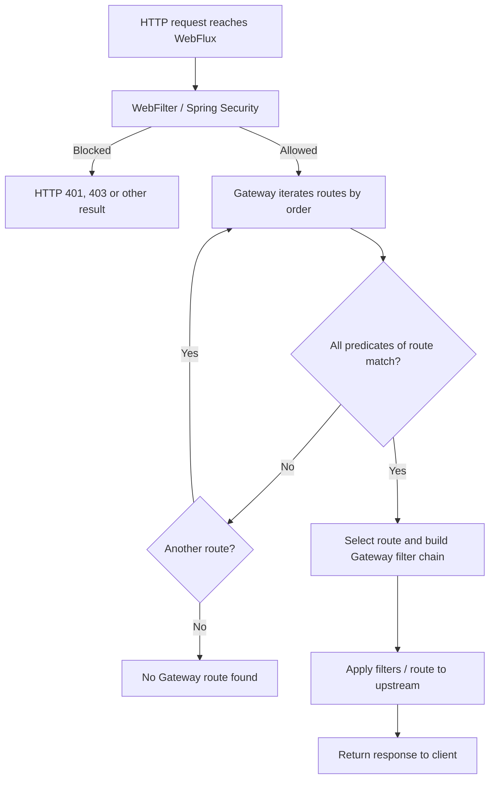
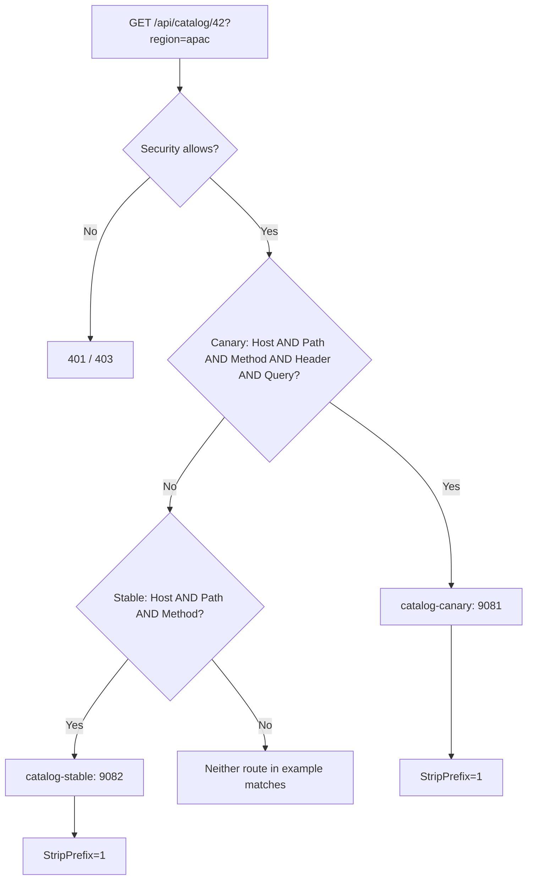
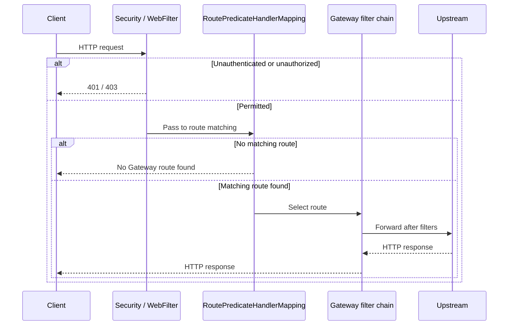

# Combining predicates and evaluating real request conditions

In **Spring Cloud Gateway**, Route Predicate Factories answer the question: *"Does the current request match this route?"* A real-world API Gateway rarely relies on the path alone. For example, for the same `/api/catalog/42`, a system may branch by HTTP method, domain name, deployment region, experiment headers, and canary policies before applying path/header rewrite filters, retries, circuit breakers, or calling services via service discovery.

This lesson belongs to the **Route Predicates** chapter, focusing on **how to combine multiple predicates** and **how to trace which route a specific request will enter**. The goal is to deduce routing outcomes from real HTTP data, spot overlapping routes, explain why a request falls through to a fallback or matches no route, and design tests that confirm the selected route.

> **Scope:** Examples use Spring Cloud Gateway **Server WebFlux**. Some configuration property names vary by version/starter. When deploying, check whether `spring.cloud.gateway.routes` or `spring.cloud.gateway.server.webflux.routes` matches your version; the principles of combining predicates remain unchanged. Gateway Server MVC has its own pipeline and configuration APIs.

## 1. How is a route selected?

Each route holds key properties:

| Component | Example | Role |
| --- | --- | --- |
| `id` | `catalog-canary` | Identifier used for observability and diagnostics |
| `uri` | `http://localhost:9081` or `lb://catalog-service` | Destination of the request once the route is selected |
| `predicates` | `Path`, `Method`, `Host`, `Header`, `Query` | Decides whether the route matches the request |
| `filters` | `StripPrefix`, `RewritePath`, `AddRequestHeader`, `Retry` | Executes after the route has been selected |
| `order` | `-10`, `100` | Priority order among candidate matching routes |

Spring Cloud Gateway WebFlux uses `RoutePredicateHandlerMapping` to evaluate routes; once a route is selected, `FilteringWebHandler` assembles the chain of `GlobalFilter`s and that route's `GatewayFilter`s. Normally, routes are evaluated by `order` (**lower** values have **higher** priority) and the first matching route is used.



There are two critical boundaries:

1. **Predicates are evaluated before the route's Gateway filters.** `StripPrefix` or `RewritePath` cannot make a non-matching route match "retroactively". `Path` inspects the request URL at route-matching time.
2. **Not every request reaches Gateway route evaluation.** Spring Security can block beforehand; WebFlux may handle CORS preflights or other handlers. Thus, a `401`/`403` response does not prove a `Path` or `Method` predicate was misconfigured.

## 2. Understanding AND, OR, and route precedence

### Different predicate types in the same route: AND

Example:

```yaml
predicates:
  - Host=api.example.test
  - Path=/api/catalog/**
  - Method=GET,HEAD
  - Header=X-Canary,enabled
  - Query=region,apac|eu
```

For **this route** to match, the request must satisfy **all** conditions:

- Host matches `api.example.test`.
- Path matches `/api/catalog/**`.
- HTTP method is in the set `GET` or `HEAD`.
- Header `X-Canary` has a value matching the regular expression `enabled`.
- Query parameter `region` has a value matching the regular expression `apac|eu`.

One false condition is enough to reject the route. Gateway does not add "points" per condition. Satisfying 4 out of 5 conditions is still **no match**.

### Multiple choices within a single predicate: depends on factory semantics

You cannot assume every comma means OR; **syntax is defined by each Route Predicate Factory**.

| Predicate | Syntax | Interpretation |
| --- | --- | --- |
| `Method=GET,HEAD` | Method list | GET **or** HEAD |
| `Path=/api/a/**,/api/b/**` | Path pattern list | Either path pattern |
| `Host=api.example.test,shop.example.test` | Host pattern list | One of the hosts |
| `Header=X-Canary,enabled` | Header name and regex | Has header `X-Canary` whose value matches `enabled` |
| `Query=region,apac|eu` | Query name and regex | Has `region` whose value matches `apac` or `eu` |
| `RemoteAddr=10.0.0.0/8,192.168.0.0/16` | CIDRs | Remote address belongs to at least one CIDR |

In `Header` and `Query`, the comma **separates factory parameters**, not two independent options. Within regexes, `|` expresses alternation in Java regular expressions. For example, `Header=X-Channel,web|mobile` requires `X-Channel` to match `web` or `mobile`.

Standard regular expressions are case-sensitive, so `ENABLED` will not automatically match `enabled`. For important rules, test uppercase values, whitespace, multiple values, and URL-encoded inputs.

### Multiple routes: first matching route wins

If you declare two routes with the same `Path` and disjoint methods, requests only match the appropriate route. If two routes **can both match**, `order` decides which is evaluated first; never assume there is an automatic "most specific route wins" rule.

Example:

```yaml
- id: catalog-special
  order: -10
  uri: http://localhost:9081
  predicates:
    - Path=/api/catalog/**
    - Method=GET

- id: api-general
  order: 100
  uri: http://localhost:9082
  predicates:
    - Path=/api/**
```

`GET /api/catalog/42` matches both, yet `catalog-special` takes precedence. `POST /api/catalog/42` fails the specialized route's method check, yet can enter `api-general`. Broad catch-all routes can cause unintended forwarding if not controlled.

If multiple overlapping routes share the same `order`, do not rely on YAML appearance order as a stable contract. **Make predicates mutually exclusive** or assign `order` explicitly and test.

### AND/OR/NOT in Java DSL

Java DSL can express more complex logic than YAML shortcuts. Example of a route matching paths and methods:

```java
@Bean
RouteLocator sampleRoutes(RouteLocatorBuilder builder) {
    return builder.routes()
        .route("catalog-lookup", r -> r
            .path("/api/catalog/**")
            .and()
            .method(HttpMethod.GET, HttpMethod.HEAD)
            .filters(f -> f.stripPrefix(1))
            .uri("http://localhost:9082"))
        .build();
}
```

In this example, `.and()` joins `Path` and `Method`. Java DSL also provides boolean combinators such as `or` and `negate` depending on your version's builder API; when complex multi-branch logic becomes hard to read, it is usually easier to test if split into **multiple clear routes** with explicit `order`. Do not confuse **OR within a Method list** with OR between two predicates of different kinds.

## 3. Case study: choosing canary vs. stable for a request

Suppose an organization runs a catalog API with two upstreams:

- `catalog-canary` at `http://localhost:9081`: experimental version, strictly for requests carrying experiment conditions.
- `catalog-stable` at `http://localhost:9082`: standard production version.

Both share the public API `/api/catalog/**`. Operations wants to run canary tests for read requests from certain regions while routing other requests to stable.

### Illustrative configuration

```yaml
spring:
  cloud:
    gateway:
      routes:
        - id: catalog-canary
          order: -10
          uri: http://localhost:9081
          predicates:
            - Host=api.example.test
            - Path=/api/catalog/**
            - Method=GET,HEAD
            - Header=X-Canary,enabled
            - Query=region,apac|eu
          filters:
            - StripPrefix=1
            - AddRequestHeader=X-Gateway-Route,catalog-canary

        - id: catalog-stable
          order: 100
          uri: http://localhost:9082
          predicates:
            - Host=api.example.test
            - Path=/api/catalog/**
            - Method=GET,HEAD
          filters:
            - StripPrefix=1
            - AddRequestHeader=X-Gateway-Route,catalog-stable
```

**Version note:** The `spring.cloud.gateway.routes` prefix was standard in earlier Spring Cloud Gateway WebFlux releases. For newer versions using `spring.cloud.gateway.server.webflux.routes`, switch to **the exact prefix in that version's docs**; never declare both simultaneously assuming the system picks one arbitrarily.

**Safety note:** Header `X-Canary` and parameter `region` come from client requests in this example, so **they can be spoofed**. Use them only as non-privileged experiment routing signals. If canary eligibility depends on authorized users or true regions, verify identity/attributes from a trusted source at the security layer or internal gateway first; never trust self-asserted client headers to unlock data access.

### Step-by-step evaluation

Given the request:

```http
GET /api/catalog/42?region=apac HTTP/1.1
Host: api.example.test
X-Canary: enabled
Authorization: Bearer <valid-token>
```

Assume Spring Security authenticated and allowed the request through. Gateway checks `catalog-canary` first because `order=-10`:

| Check | Actual request data | Predicate | Outcome |
| --- | --- | --- | --- |
| Host | `api.example.test` | `Host=api.example.test` | PASS |
| Path | `/api/catalog/42` | `Path=/api/catalog/**` | PASS |
| Method | `GET` | `Method=GET,HEAD` | PASS |
| Header | `X-Canary: enabled` | `Header=X-Canary,enabled` | PASS |
| Query | `region=apac` | `Query=region,apac|eu` | PASS |

Since all pass, Gateway picks `catalog-canary`. `StripPrefix=1` removes the `api` segment, yielding upstream URL `http://localhost:9081/catalog/42?region=apac`. The query string is preserved; `StripPrefix` only affects the path.

Conversely, if the request omits `X-Canary`, the canary route fails. Gateway proceeds to `catalog-stable`, checking only Host, Path, and Method; if all three match, the request forwards to `http://localhost:9082/catalog/42?region=apac`.



### Request matrix and expected outcomes

Assume no other routes exist, Security allows all cases below, and no CORS mechanism intercepts early.

| Request | Host | `X-Canary` | `region` | Matching route |
| --- | --- | --- | --- | --- |
| GET `/api/catalog/42` | `api.example.test` | `enabled` | `apac` | `catalog-canary` |
| GET `/api/catalog/42` | `api.example.test` | *absent* | `apac` | `catalog-stable` |
| GET `/api/catalog/42` | `api.example.test` | `enabled` | `us` | `catalog-stable` |
| GET `/api/catalog/42` | `api.example.test` | `ENABLED` | `eu` | `catalog-stable` |
| HEAD `/api/catalog/42` | `api.example.test` | `enabled` | `eu` | `catalog-canary` |
| POST `/api/catalog/42` | `api.example.test` | `enabled` | `apac` | Neither route |
| GET `/api/catalog/42` | `other.example.test` | `enabled` | `apac` | Neither route |
| GET `/api/users/42` | `api.example.test` | `enabled` | `apac` | Neither route |
| GET `/api/catalog/42` | `api.example.test` | `enabled` | *absent* | `catalog-stable` |

This table separates **"one route did not match"** from **"no route matched the request"**. When canary fails to match, stable remains a candidate. Only when no route matches does Gateway fail to find a route; the response is then typically `404`, though it depends on other handlers, Security, and error-handling layers.

## 4. Testing real requests with curl

To test, assume Gateway listens at `localhost:8080` and both upstreams `9081`/`9082` are running. In local HTTP tests, you can use the `Host` header to simulate the requested hostname:

```bash
# Satisfies all canary conditions
curl -i 'http://localhost:8080/api/catalog/42?region=apac' \
  -H 'Host: api.example.test' \
  -H 'X-Canary: enabled'

# Missing canary header -> stable
curl -i 'http://localhost:8080/api/catalog/42?region=apac' \
  -H 'Host: api.example.test'

# Region outside allowed regex -> stable
curl -i 'http://localhost:8080/api/catalog/42?region=us' \
  -H 'Host: api.example.test' \
  -H 'X-Canary: enabled'

# HTTP method not declared on either route
curl -i -X POST 'http://localhost:8080/api/catalog/42?region=apac' \
  -H 'Host: api.example.test' \
  -H 'X-Canary: enabled'

# Wrong Host -> matches neither example route
curl -i 'http://localhost:8080/api/catalog/42?region=apac' \
  -H 'Host: other.example.test' \
  -H 'X-Canary: enabled'
```

In PowerShell, use `curl.exe` if `curl` is mapped to a PowerShell command; `\` line continuations here are Bash-style shell syntax.

**When using HTTPS**, the host in an HTTP request also interacts with SNI and TLS certificate validation. Do not arbitrarily override `Host` as a substitute for real TLS/virtual-host tests. You can use `curl --resolve` with a hostname matching the certificate to point the test domain at the target IP.

### Avoid guessing routes from HTTP status codes alone

If both upstreams return `200`, looking solely at status tells you nothing about where the request went. In test environments, have mock upstreams return distinct markers:

```http
HTTP/1.1 200 OK
X-Test-Upstream: canary
```

or:

```http
HTTP/1.1 200 OK
X-Test-Upstream: stable
```

Then inspect `X-Test-Upstream` and **the actual method/path/query received by the upstream**. Never treat a client-sent header as proof the request hit the right route; test markers must be emitted by the upstream/test server. The `X-Gateway-Route` header in the YAML example is an **outbound request header** sent to the upstream; it does not automatically become a response header returned by Gateway to the client.

## 5. Breaking down the input read by each predicate

When a request enters the wrong route, record **the actual value** each predicate inspects rather than just looking at the URL shown in a browser.

### Path and URL encoding

`Path` inspects the request path using WebFlux/Gateway path matching; the query string **is not part of the path**. Example:

```text
GET /api/catalog/42?region=eu
    path   = /api/catalog/42
    query  = region=eu
    method = GET
```

Patterns `/api/catalog/**` and `/api/catalog/{id}` are not equivalent: the first is broader and matches multiple child segments; the second matches a single variable segment. For requests containing percent-encoded parts, special characters, or trailing `/`, test against **real HTTP requests** rather than concatenating strings by hand and guessing. Exact matching behavior can vary with Spring Framework versions and path-matcher options.

### Method and CORS preflight

`Method=POST` inspects the **HTTP method being sent**. A browser preflight like the following uses method `OPTIONS`:

```http
OPTIONS /api/catalog/42 HTTP/1.1
Host: api.example.test
Origin: https://store.example.test
Access-Control-Request-Method: POST
```

`Access-Control-Request-Method: POST` only describes the method the browser intends to send next; it **does not change** the actual method from `OPTIONS` to `POST`. Preflights may be handled by CORS/Spring Security before route selection. Otherwise, neither `Method=GET,HEAD` nor `Method=POST` matches `OPTIONS`.

Also do not assume `Method=GET` automatically includes `HEAD` simply because a backend controller supports HEAD. When a route should accept HEAD, declare `GET,HEAD` explicitly.

### Host and client-controlled headers

`Host` typically reads the HTTP request host. If Gateway sits behind a reverse proxy, the Host it sees depends on how the proxy forwards requests. Verify whether the proxy preserves or rewrites Host per design.

`Header` checks header presence/value with a regular expression. `X-Canary` in the example is solely a **routing signal**. Because clients can set arbitrary headers, it is unsuitable for proving a user belongs to a privileged group. JWT validation, scopes/roles, or API keys must be checked at a trusted security layer.

Some proxy environments normalize or strip headers. If requests through a proxy behave differently from direct Gateway calls, inspect the exact request data arriving at Gateway.

### Query parameters and regex

`Query=region,apac|eu` checks whether the `region` parameter matches the pattern. Missing `region` fails the predicate. `region=APAC` does not match the case-sensitive regex `apac|eu` by default.

When repeated query parameters appear such as `?region=apac&region=eu`, do not assume every version, library, or system component picks the same value. Establish a clear policy for multi-valued parameters and test against your actual Gateway/backend logic, especially if query params affect security or cache keys.

### Cookies, IP, and time conditions

Other predicates commonly combined:

| Predicate | Usage | What to check |
| --- | --- | --- |
| `Cookie=name,regexp` | Group clients by cookie | Cookies can be spoofed; never use alone to authorize |
| `RemoteAddr=10.0.0.0/8` | Select requests by remote IP | Behind a reverse proxy, remote IP may be the proxy's IP |
| `XForwardedRemoteAddr` | Evaluates address from forwarded info per config | Trust forwarded headers only from trusted proxies |
| `After`, `Before`, `Between` | Apply routes by time window | Check timezone/offset, boundary timestamps, and clock sync |
| `Weight` | Split traffic across routes in a group by weight | Weighted probabilistic choice; do not treat as plain AND logic when reasoning about ratios |

Example combining IP and path for an internal operations route:

```yaml
predicates:
  - Path=/internal/operations/**
  - RemoteAddr=10.0.0.0/8,192.168.0.0/16
```

This is still a **routing condition**, not a comprehensive security layer. A reverse proxy can make Gateway see the proxy IP instead of the client IP. Protect operations endpoints with Spring Security/mTLS/network policies per architecture and verify trusted IP sources. Never blindly trust `X-Forwarded-For` supplied by Internet clients.

## 6. Distinguishing predicates, filters, and Spring Security

A request can fail at several different layers:



| Observed symptom | Possibilities to investigate | Do not jump to conclusion |
| --- | --- | --- |
| `401 Unauthorized` | Unauthenticated, invalid token | Wrong `Method` predicate |
| `403 Forbidden` | Missing permissions or policy denial | Gateway route mismatch |
| `404 Not Found` | No handler/route or upstream returned `404` | Always a `Path` bug |
| `405 Method Not Allowed` | Upstream or another handler rejected the method | Gateway auto-generated `405` from `Method` |
| `429 Too Many Requests` | Post-selection rate limiter or another policy | `Query` predicate mismatch |
| `502`/`503`/`504` | Routing/upstream, load balancer, timeout/circuit breaker | Route definitely wasn't selected |

Not every 4xx/5xx HTTP status emits `onError` in Reactor. Gateway can proxy an upstream `503` response and complete the reactive pipeline normally; route matching was decided at an earlier step.

Filters like `StripPrefix`, `RewritePath`, and `AddRequestHeader` process the request only **after route selection**. `RequestRateLimiter`, `Retry`, `CircuitBreaker`, and related filters likewise cannot replace route matching or authentication. Retries should only be enabled for justified transient errors, with time bounds and idempotency checks for write operations.

## 7. Building a decision table before deployment

Instead of reading config top-to-bottom and guessing, build a **decision table** for critical scenarios. Example for catalog:

| Check axis | Valid canary value | Invalid canary value | Expectation |
| --- | --- | --- | --- |
| Host | `api.example.test` | `other.example.test` | Other host: matches neither route |
| Path | `/api/catalog/42` | `/api/users/42` | Other path: matches neither route |
| Method | `GET`/`HEAD` | `POST`/`DELETE` | Other method: matches neither route |
| Header | `X-Canary: enabled` | Missing/`disabled` | Falls back to stable if Host/Path/Method match |
| Query | `region=apac`/`region=eu` | Missing/`region=us` | Falls back to stable if Host/Path/Method match |
| Security | Valid JWT, proper permissions | Missing/invalid | Blocked early by security policy |
| Route order | Canary `-10`, stable `100` | Swapped order | Stable could intercept before canary |

Decision tables ensure you test both **positive conditions** (right route selected) and **negative conditions** (that route not selected). In particular, test near-miss cases: failing just one condition, same path with different method, broad route with higher priority, missing header, and different query casing.

### Tips to avoid mistakes with many routes

1. Map all routes in the same namespace, listing `Path`, `Method`, `Host`, headers/queries, and `order`.
2. Identify overlap regions: which pairs of routes could the same request satisfy?
3. If a broad route serves as a fallback, give it lower priority (**higher** numeric `order`) than specialized routes.
4. Check that a new route does not accidentally re-open an HTTP method disallowed on another route.
5. Verify version/config prefix and the routes **actually loaded**, especially when loading from profiles, discovery, or dynamic config.
6. Keep authentication/authorization independent in Spring Security and upstreams per the system trust model.

## 8. Integration tests to verify routing

A meaningful test must verify **which upstream received the request**, not just `HTTP 200`. Use `WebTestClient` with WireMock/MockWebServer or another mock upstream.

Example assuming test fixtures started both upstreams, where canary responses include `X-Test-Upstream: canary` and stable includes `X-Test-Upstream: stable`:

```java
@Test
void routesRequestToCanaryWhenEveryPredicateMatches() {
    webTestClient.get()
        .uri("/api/catalog/42?region=apac")
        .header(HttpHeaders.HOST, "api.example.test")
        .header("X-Canary", "enabled")
        .exchange()
        .expectStatus().isOk()
        .expectHeader().valueEquals("X-Test-Upstream", "canary");
}

@Test
void fallsBackToStableWithoutCanaryHeader() {
    webTestClient.get()
        .uri("/api/catalog/42?region=apac")
        .header(HttpHeaders.HOST, "api.example.test")
        .exchange()
        .expectStatus().isOk()
        .expectHeader().valueEquals("X-Test-Upstream", "stable");
}
```

These snippets illustrate **the assertion part**; you need to configure `WebTestClient`, test profiles, stub servers, and base URIs for your Gateway app. If Spring Security is active, tests must supply valid credentials or configure explicit test security policies; otherwise requests may get `401` before testing routing.

Beyond headers, assert what the upstream received:

- Method is `GET` or `HEAD` as expected.
- Path after `StripPrefix=1` is `/catalog/42`.
- Query `region=apac` is preserved.
- Header `X-Gateway-Route` reflects the chosen route.
- Non-matching requests were not sent to any upstream in the test set.
- Under overlap, the route with lower `order` wins.

For `lb://service-name` routes, test environments need a load balancer/discovery setup or fixed HTTP URI overrides. Never diagnose a missing service instance error as a `Path`/`Method` predicate bug when the route was actually selected.

## 9. Observing and debugging a running Gateway

There are three levels of evidence, from basic to deep:

**Level 1 — Inbound request.** Log method, host, path, safe query params, routing-relevant headers, and trace/correlation IDs. Never log `Authorization`, cookies, or sensitive personal data. Query strings can also carry tokens/PII, so apply allowlists/redaction.

**Level 2 — Routes actually loaded by the app.** If Actuator is installed and the Gateway endpoint is appropriately exposed, management endpoints like `/actuator/gateway/routes` let you inspect route IDs, predicates, URIs, and orders. Exact endpoint names/formats and enablement vary by version; restrict access with admin security rather than exposing publicly. For dynamic routes, check route-cache refresh behavior per your version's mechanism.

**Level 3 — Selected route and upstream-received request.** Observe the route ID via Gateway metrics, tracing, or structured logs right after route matching. If there is no route ID because Security returned `401`, investigate security first. If the route ID is right while the upstream fails, focus on URI/routing filters, load balancing, timeouts, and the backend.

You can temporarily raise log levels for Gateway and Reactor Netty packages in test environments:

```yaml
logging:
  level:
    org.springframework.cloud.gateway: DEBUG
    reactor.netty: INFO
```

Only enable deep logging temporarily during diagnostics; verbose logging adds overhead and risks leaking data if misconfigured. In production, rely on structured metrics/traces tagged with route ID, method, status, and latency.

## 10. Common predicate-combination mistakes

| Symptom | Possible causes | How to check/fix |
| --- | --- | --- |
| Request has "right URL" yet doesn't match route | Wrong Host, Method, Header, Query, or regex | Compare every condition against the **actual HTTP request** |
| Specialized route is never selected | Broad route gets evaluated first | Check `order` and overlapping predicate regions |
| `GET` enters route, `HEAD` does not | `Method` lists only GET | Add HEAD if contract supports it |
| `OPTIONS` fails when called by browser | CORS preflight not handled properly | Verify CORS/Security before altering `Method` |
| `Header` fails despite "having a value" | Wrong regex, case sensitivity, or proxy altered header | Inspect value Gateway received and test regex |
| Region unexpectedly misses | Missing/misspelled/wrong-case query param | Test `region` on real URLs and multi-valued queries |
| Test with `Host` passes over HTTP, fails over HTTPS in prod | Different SNI/certificate/virtual host in TLS layer | Test HTTPS with real hostname and certificate |
| `RemoteAddr` is always proxy IP | Reverse proxy sits in front of Gateway | Configure proxy trust and appropriate IP source |
| Route ID is right, still gets `503` | Upstream/discovery/load balancer unavailable | Check target URI, service instances, and connectivity |
| Edited YAML, yet routes don't change | Wrong config prefix, profile, config source, or missing refresh | Inspect loaded routes inside the running process |
| Cannot tell whether request hit canary or stable | Both return identical status/body | Add upstream-emitted markers, traces, and route IDs |

## 11. Practice exercise

A Gateway must route `/api/orders/**` according to this policy:

- `GET` or `HEAD` from domain `api.example.test` goes to `order-query`.
- `POST` from the same domain goes to `order-command`.
- `GET /api/orders/**` with header `X-Experiment: blue` should only experiment with `order-query-blue`; other GET requests still go to `order-query`.
- `DELETE` does not belong to these three routes.
- Requests with invalid tokens must be handled at the security layer before calling upstream.

**An illustrative YAML solution:**

```yaml
spring:
  cloud:
    gateway:
      routes:
        - id: order-query-blue
          order: -20
          uri: lb://order-query-blue
          predicates:
            - Host=api.example.test
            - Path=/api/orders/**
            - Method=GET
            - Header=X-Experiment,blue

        - id: order-query
          order: 0
          uri: lb://order-query
          predicates:
            - Host=api.example.test
            - Path=/api/orders/**
            - Method=GET,HEAD

        - id: order-command
          order: 0
          uri: lb://order-command
          predicates:
            - Host=api.example.test
            - Path=/api/orders/**
            - Method=POST
```

The `lb://` URIs require working service discovery/load balancer integration. If upstreams expect paths without the `/api` prefix, add `StripPrefix=1` on each route. Configure Spring Security for read/write permissions and never use `X-Experiment` as an authorization condition.

**Self-check:**

1. Request `GET /api/orders/42`, matching Host, `X-Experiment: blue`: which route is selected? Why?
2. Same request without the experiment header: why is a route still selected?
3. Does `HEAD /api/orders/42` enter `order-query-blue`?
4. If `order-query` is given order `-30`, how could GET routing change?
5. What response should `DELETE /api/orders/42` receive if no other route exists, and why shouldn't you assume it is automatically `405`?
6. If Spring Security returns `403`, why can't you use that outcome to conclude whether the `Method` predicate is right or wrong?

**Key takeaway:** Within a route, standard predicates combine with **AND**; choices inside a single factory—such as method/host/path lists or regexes—must be read according to **that factory's semantics**. Across multiple routes, Gateway evaluates precedence and picks the first matching route. To know where a real request will go, inspect **all of method, host, path, headers, queries, route order, security layers, and loaded routes**, then confirm using the request the upstream actually receives.
