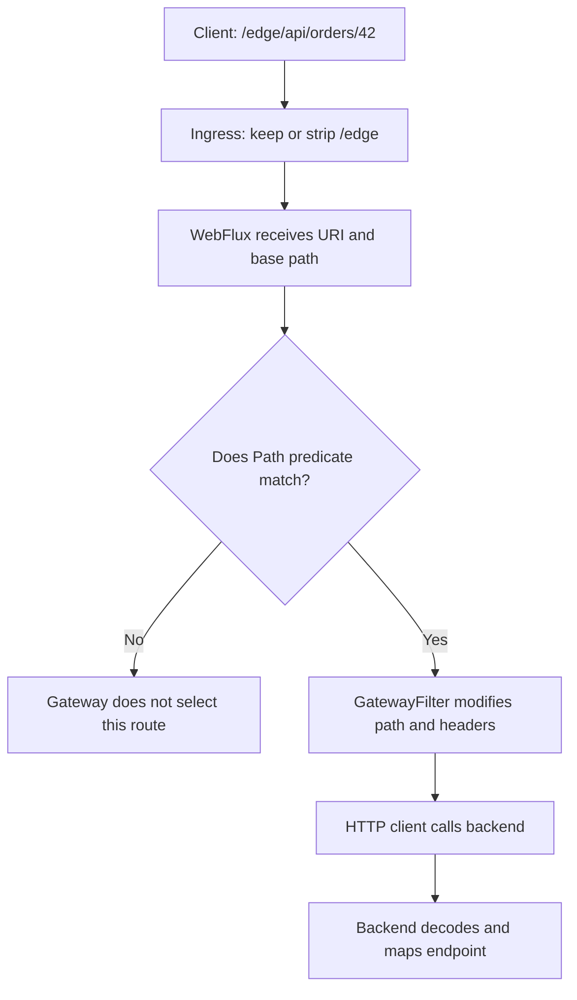

# Impact of base path, URL encoding, and path normalization in Spring Cloud Gateway

## 1. Why can the same URL match or fail to match a route?

In **Spring Cloud Gateway**, the `Path` route predicate is a condition that decides which microservice receives a request. A seemingly simple configuration like `Path=/api/orders/**` can behave unexpectedly when the system has a **base path**, a **reverse proxy** in front, or clients send URL forms such as `%2F`, `%2e`, trailing `/`, `//`, and `.`/`..` segments.

That happens because "the request path" is not always a single identical string from start to finish. Along the journey from client to backend, each layer may see a different representation of the path:

1. **Client** constructs the request-target containing path and query, possibly with percent encoding.
2. **Ingress/reverse proxy** may preserve, add, or strip a path prefix.
3. **Web server/WebFlux** parses the URI into path segments to determine the context/base path.
4. **Gateway `Path` predicate** matches its pattern against the path used by the routing layer.
5. **Gateway filters** such as `StripPrefix`, `RewritePath`, `SetPath`, and `PrefixPath` may modify the URI **after** the route has matched.
6. **Gateway's HTTP client and the backend** receive the resulting URI and may apply their own decoding or normalization rules.

Understanding these layers accurately is critical when deploying a Gateway with authentication, authorization, rate limiting, circuit breakers, retries, TLS, service discovery, and request observability. A discrepancy in path interpretation can cause `404` at the gateway, `404` at the backend, or—worse—skew the scope of an API protection policy.

**Lesson objective:** distinguish WebFlux *base path* from prefixes added by a reverse proxy; understand `/`, `%2F`, `.`/`..`, and repeated `/` characters; configure and test the `Path` predicate according to your exact Spring Cloud Gateway version.

> **Scope:** primary examples use **Gateway Server WebFlux**. In Gateway 4.3+, route config resides under `spring.cloud.gateway.server.webflux.routes`; in WebFlux 4.2 and earlier it is typically `spring.cloud.gateway.routes`. Gateway Server Web MVC has its own prefix and context-path handling; do not copy WebFlux examples verbatim to MVC.

## 2. Five path representations to distinguish

Suppose a user calls `https://edge.example.test/edge/api/orders/42?view=full`, where `/edge` is the API prefix exposed on the Internet.

| Representation | Example | Who determines it? | Impact |
|---|---|---|---|
| **External path** (seen by client) | `/edge/api/orders/42` | Public API, DNS, upstream proxy | Path the client must call |
| **Path forwarded to Gateway** | `/edge/api/orders/42` **or** `/api/orders/42` | Ingress/proxy rewrite rules | Actual data WebFlux receives and matches |
| **WebFlux base path** | `spring.webflux.base-path=/edge` | Gateway app configuration | Affects `Path` route predicate and WebFlux context |
| **Route path pattern** | `Path=/api/orders/**` | Spring Cloud Gateway config | Selects the route, before route filters |
| **Downstream path** | `/orders/42` (example) | Path-rewriting filters and target URI construction | Path the backend receives |

The `?view=full` part is a **query**, not part of the path pattern. `Path=/api/orders/**` does not check the `view` value; to decide based on query parameters, add a `Query` predicate. Fragments like `#detail` are not sent in the HTTP request-target, so the `Path` predicate cannot read them.



**Principle:** public URL layout, route matching logic, and URL rewriting for the backend are **three separate decisions**. Changing one layer must be re-verified across the other two.

## 3. How does `spring.webflux.base-path` affect the `Path` predicate?

### 3.1. WebFlux automatically prepends the base path to routing patterns

According to official **Spring Cloud Gateway Server WebFlux** documentation, when `spring.webflux.base-path=/edge` is set, Gateway automatically prepends `/edge` to the **pattern** of the `Path` route predicate. You still declare the pattern for the API path **after the base path**.

Example **purely to test route matching**, without path-rewriting filters yet:

```yaml
# application.yml — Gateway Server WebFlux 4.3+
server:
  port: 8080

spring:
  webflux:
    base-path: /edge
  cloud:
    gateway:
      server:
        webflux:
          routes:
            - id: orders-route
              uri: http://localhost:8081
              predicates:
                - Path=/api/orders/**
```

From the pattern's perspective, Gateway matches as if the full pattern were `/edge/api/orders/**`:

| Request path received by Gateway | Declared pattern | Expected selection of `orders-route` |
|---|---|---|
| `/edge/api/orders/42` | `/api/orders/**` | Yes, because framework prepends base path |
| `/api/orders/42` | `/api/orders/**` | Cannot be treated as the same URL while `/edge` base path is active; request may be rejected at WebFlux layer before reaching routes |
| `/edge/other/42` | `/api/orders/**` | No |
| `/edge/edge/api/orders/42` | `/api/orders/**` | Does not match expected API pattern |

**Do not write** `Path=/edge/api/orders/**` just to "compensate" for `spring.webflux.base-path=/edge`; that risks **prepending the prefix twice** in the routing pattern. If you do not want Gateway to have a base path and only want the public API to carry a prefix, let the reverse proxy or a route pattern handle that prefix per your architecture.

### 3.2. Base path is not the same as `StripPrefix`

`spring.webflux.base-path` tells WebFlux the application context part and influences how the `Path` predicate matches. It is **not** an instruction telling Gateway to strip `/edge` before proxying to the backend.

Path-modifying filters operate on the request URI after route selection. When a base path is configured, do not assume `StripPrefix=1` will always remove `/api`: it depends on whether the filter sees the full path or the path within the application, how different versions handle context paths, and filter ordering. In systems with a base path, **log the actual downstream path** and then decide how many segments to strip or use an explicit rewrite filter.

To provide a simple `StripPrefix` example with deterministic results without base-path complexity, section 6 uses a Gateway **without `spring.webflux.base-path`**.

### 3.3. WebFlux base path differs from Servlet context path

| Model | Relevant setting | Notes |
|---|---|---|
| Gateway Server **WebFlux** | `spring.webflux.base-path` | Affects `Path` predicate per WebFlux docs |
| Gateway Server **Web MVC** | `server.servlet.context-path` | Servlet context path and MVC route matching follow a different pipeline |
| Reverse proxy/Ingress | Proxy rewrite rules and `X-Forwarded-*` | Neither of the two app properties above |

In Server Web MVC, some versions include `StripContextPath` to strip the Servlet context path from the URI before path-rewriting filters; that example **does not apply automatically** to WebFlux. Always check the filters and version of your running stack.

## 4. Reverse-proxy base path differs from application base path

Consider two ways to deploy the public URL `https://edge.example.test/public/api/orders/42`:

**Option A — Proxy preserves the prefix:**

```text
Client                    Proxy                   Gateway
/public/api/orders/42  -> preserves path      -> /public/api/orders/42
```

Gateway must match the exact path it **actually receives**. Without `spring.webflux.base-path`, you can declare `Path=/public/api/orders/**` and design filters to build the expected downstream path. With `spring.webflux.base-path=/public`, you can declare `Path=/api/orders/**` as in section 3. Do not mix both approaches on one route unintentionally.

**Option B — Proxy strips the prefix:**

```text
Client                    Proxy                   Gateway
/public/api/orders/42  -> strips /public      -> /api/orders/42
```

In Option B, Gateway normally does not need `spring.webflux.base-path=/public`; the route can use `Path=/api/orders/**`. The `/public` prefix exists on the **external URL** but is gone from the **path Gateway receives**.

Headers like `X-Forwarded-Prefix: /public` may be added by the proxy so the app knows the external prefix when generating links/redirects. **It does not by itself guarantee** whether the request URI was rewritten as in Option A or Option B. Only trust forwarding headers controlled by a **trusted reverse proxy**; prevent clients from forging headers if the application relies on them for URLs or access decisions.

### 4.1. Quick decision table

| Path received by Gateway | Has `spring.webflux.base-path`? | Example declared `Path` predicate | Notes |
|---|---|---|---|
| `/api/orders/42` | No | `/api/orders/**` | Direct Gateway or proxy already stripped prefix |
| `/public/api/orders/42` | No | `/public/api/orders/**` | Public prefix sits inside route pattern |
| `/public/api/orders/42` | `/public` | `/api/orders/**` | Base path is prepended to pattern automatically |
| `/api/orders/42` | `/public` | `/api/orders/**` | Config/proxy likely inconsistent |

Pick **one owner for adding/stripping prefixes** and test through the real proxy. If multiple layers rewrite paths, client logs and Gateway logs should make each transformation clear.

## 5. `PathPattern`: special characters, wildcards, and path segments

Server WebFlux's `Path` predicate uses URL matching based on **Spring `PathPattern`**. This parses the path into segments instead of matching a fully decoded string as one blob. Common patterns:

| Pattern | Meaning | Matching example | Non-matching example |
|---|---|---|---|
| `/api/orders` | Fixed path | `/api/orders` | `/api/orders/42` |
| `/api/orders/*` | Any single segment | `/api/orders/42` | `/api/orders/42/items` |
| `/api/orders/{id}` | Single segment, captures `id` | `/api/orders/42` | `/api/orders/42/items` |
| `/api/orders/{id:[0-9]+}` | Digit-only `id` segment | `/api/orders/42` | `/api/orders/abc` |
| `/api/orders/**` | Zero or more trailing segments | `/api/orders/42/items` | `/api/catalog/42` |
| `/api/{*remaining}` | Remaining path (catch-all) | `/api/a/b` | `/other/a/b` |

**Note:** `**` and `{*remaining}` belong at the **end of the pattern** under `PathPattern` syntax. Do not write `/api/**/orders` as if configuring arbitrary globbing. Path casing usually matters when matching; never assume `/API/orders` and `/api/orders` are the same endpoint.

When a pattern has variables like `{id}`, Gateway can store URI template variables in `ServerWebExchange` for filters to reuse. Extracted segments are **not validated values**: if `id` participates in permission checks or building target URIs, enforce appropriate input constraints.

### 5.1. `Path` does not use the query string to pick routes

```yaml
predicates:
  - Path=/api/orders/{id}
  - Method=GET
```

With this route, `GET /api/orders/42?view=full` and `GET /api/orders/42?view=compact` share the same path `/api/orders/42`, so **both satisfy `Path`**; to branch by `view`, add a `Query` predicate. `POST /api/orders/42` fails `Method=GET`, even though the path matches.

## 6. Hands-on example: match first, rewrite path afterward

To clearly see the difference between route predicates and filters, let us set up a Gateway Server WebFlux 4.3+ **without a base path**. The backend at `http://localhost:8081` serves `/orders/**`.

```yaml
# application.yml
server:
  port: 8080

spring:
  application:
    name: api-gateway
  cloud:
    gateway:
      server:
        webflux:
          routes:
            - id: orders-route
              uri: http://localhost:8081
              predicates:
                - Path=/api/orders/**
                - Method=GET
              filters:
                - StripPrefix=1
                - AddRequestHeader=X-Route, orders-route
```

Execution sequence:

1. Client calls `GET /api/orders/42`.
2. Both `Path=/api/orders/**` and `Method=GET` match; Gateway selects `orders-route`.
3. `StripPrefix=1` drops the `api` segment from the current path.
4. Gateway calls `http://localhost:8081/orders/42` and adds `X-Route: orders-route`.
5. Backend returns a response, and Gateway relays it to the client (possibly with other filters for metrics, retries, headers...).

If the backend returns `404`, inspect the path sent to the backend. If Gateway found no route, `StripPrefix` **never ran**, so editing the filter will not fix a matching failure.

### 6.1. Switching to `RewritePath` when path changes are not just stripping segments

For example, if the backend expects `/v1/orders/42` instead of `/orders/42`, use `RewritePath` instead of `StripPrefix`:

```yaml
filters:
  - RewritePath=/api/orders/?(?<rest>.*), /v1/orders/$\{rest}
```

In Spring Cloud Gateway YAML files, the named regex group `rest` is referenced as `$\{rest}` so YAML/Spring does not misinterpret `$`. After the route pattern matches `GET /api/orders/42`, the filter constructs `/v1/orders/42`. This is a **downstream request-rewriting step**, not a change to the `Path` pattern used for initial route selection.

Do not apply both `StripPrefix` and `RewritePath` together in this example without verifying ordering; two filters can both mutate the URI and send an unintended path to the backend.

## 7. Percent encoding: `%2F` is not identical to a literal `/` on the wire

URLs can contain **percent encoding**: a byte represented as `%HH` where `HH` are two hex digits. Examples:

| Form in URL | Meaning after decoding | What to watch out for |
|---|---|---|
| `%20` | Space | May be valid inside a segment or normalized by proxies |
| `%2F` or `%2f` | `/` character | Encoded path delimiter; cannot be assumed equivalent to literal `/` |
| `%2E` or `%2e` | `.` character | Involves dot segments if decoded before normalization |
| `%25` | `%` character | Can lead to double-encoded forms like `%252F` |
| `%3B` | `;` character | May relate to matrix/path parameters depending on parser |

**Two important Java URI values:**

```java
// Example: incoming URI has path /api/files/a%2Fb
String rawPath = exchange.getRequest().getURI().getRawPath();
String decodedPath = exchange.getRequest().getURI().getPath();
// rawPath     = "/api/files/a%2Fb"
// decodedPath = "/api/files/a/b"
```

`getRawPath()` preserves the percent-encoded string, whereas `getPath()` returns the path already decoded by Java URI. **Never split `decodedPath` on `/` to perform security checks**, because `a%2Fb` was originally **one segment** while the decoded string looks like two segments.

In Spring WebFlux, **`PathPattern` and `PathContainer` parse the path structure first, then decode each segment individually**. This prevents a decoded `%2F` from turning into a segment delimiter during *matching*. However, what the backend receives still depends on **how filters build the URI, how proxies forward it, and how the backend decodes/normalizes**. Therefore:

- `/api/files/a%2Fb` and `/api/files/a/b` **must not be assumed equivalent** when designing routes.
- `{id}` is a **single-segment** variable; when values contain encoded special characters, verify whether the route matches and how the backend interprets `id`.
- Security filters, ACLs, or tenant-isolation logic should not rely on custom whole-string decoding if downstream applies different rules.
- If the business **does not need** encoded path separators, **rejecting ambiguous forms at a trusted boundary** usually reduces risk compared to supporting every URL variant.

### 7.1. Single encoding and double encoding are different problems

```text
Raw URL: /api/files/a%2Fb
  Single whole-string decode (illustrative): /api/files/a/b

Raw URL: /api/files/a%252Fb
  First decode:  /api/files/a%2Fb
  Second decode: /api/files/a/b
```

This **illustrates string decoding**, not a claim that Spring Cloud Gateway always decodes URLs twice. Problems arise when gateway, WAF, and backend **disagree** on the number of decoding passes, and one layer enforces permissions on a different string than the downstream layer uses to look up resources.

Do not write custom regex filters to "conveniently decode" before authorization. If encoded slashes must be allowed for business reasons, test end-to-end from client through reverse proxy → Gateway → backend, checking status codes, route ID, raw path, and actual path received by the backend.

## 8. Path normalization: `.`/`..`, `//`, casing, and trailing `/`

Path normalization can include removing dot segments, collapsing repeated slashes, transforming percent-encoded characters, or applying trailing-slash rules. **No single normalization rule is guaranteed to happen identically across every network layer and framework**.

### 8.1. Dot segments (`.` and `..`)

Examples:

```text
/api/orders/./42
/api/orders/v1/../42
/api/orders/%2E/42
/api/orders/%2e%2e/42
```

Per RFC 3986, `.` and `..` are special segments in URI reference resolution; many clients or proxies strip dot segments. `%2E` is an encoded dot, and normalization depends on the order of decoding vs. dot-removal passes. Consequently, a request may be **transformed before reaching Gateway**, or rejected by a URL-handling layer.

When designing prefix-based authorization boundaries, never assume `startsWith("/api/private/")` on raw paths guarantees the backend handles a resource inside `/api/private/`. Require the entry layer to establish **one consistent canonical path** and reject ambiguous forms unsupported by the app.

### 8.2. Double slashes (`//`) and trailing slashes

These URLs **should be tested individually**:

```text
/api//orders/42
/api/orders//42
/api/orders/42/
/API/orders/42
```

- Consecutive `/` characters may be preserved by one proxy, collapsed by another, or rejected by a security firewall; do not rely on implicit normalization.
- URLs with a trailing slash can match differently from those without. Across many Gateway 4.x releases, `Path` has a `matchTrailingSlash` option (defaulting to `true`) to relax trailing-slash matching. However, **Gateway 5.0.x running on Spring Framework 7.0** has been reported to no longer honor this option as older docs described due to framework API changes. Verify against **your exact patch version** and test both forms if your API needs to support them.
- Path casing is normally case-sensitive in `PathPattern`; converting `/API` to `/api` should be an explicit application or reverse-proxy decision, not an assumption.

**Maintenance tip:** if an API only publishes `/api/orders/{id}` and has no requirement to accept `/api/orders/{id}/`, standardize the public contract early; if both must be supported, declare/match explicitly and verify by version rather than trusting every framework to ignore trailing slashes.

### 8.3. Unusual path patterns and policy-drift risks

| Scenario | Operational risk | Control rule |
|---|---|---|
| Client sends `%2F` or `%252F` | Gateway and backend disagree on segment count/path | Agree on encoding support; test and reject unnecessary forms |
| Client sends `%2e%2e` or `../` | Layers resolve dot segments inconsistently | Normalize or reject at trust boundary; verify downstream path |
| Client sends `//` | Mismatch across CDN/proxy/Gateway/firewall/backend | Define one rule and test directly through the proxy |
| Proxy strips prefix while Gateway keeps base path | Route misses or request is rejected before Gateway handler | Designate a single layer owning prefixes |
| Gateway uses `StripPrefix`, backend uses a different mapping | Route matches at Gateway, yet backend returns `404` | Log post-filter path and verify backend API contract |
| ACL checks raw string while routing uses parsed path | Creates divergence between protected scope and actual resource | Enforce authorization on a unified path representation and re-check in backend |

These URL forms are not vulnerabilities by themselves. They are **test cases to verify there is no semantic gap** between the route selector, access control, and backend.

## 9. Testing with `curl --path-as-is`

`curl` may normalize some URL segments when building requests. The `--path-as-is` flag instructs `curl` not to collapse `.` or `..` dot segments in the path. This lets you send unusual path forms **to Gateway**, though intermediary reverse proxies/web servers may still normalize or reject them.

First, use the **no-base-path** config from section 6 with backend running on `8081`:

```bash
# Baseline check
curl -i http://localhost:8080/api/orders/42

# Path variants to observe individually
curl --path-as-is -i 'http://localhost:8080/api/orders/./42'
curl --path-as-is -i 'http://localhost:8080/api/orders/v1/../42'
curl --path-as-is -i 'http://localhost:8080/api/orders//42'
curl --path-as-is -i 'http://localhost:8080/api/orders/42/'
curl --path-as-is -i 'http://localhost:8080/api/orders/%2e%2e/42'
curl --path-as-is -i 'http://localhost:8080/api/orders/a%2Fb'
curl --path-as-is -i 'http://localhost:8080/api/orders/a%252Fb'
```

Here `Path=/api/orders/**` is a relatively broad pattern, so **several** variants may still match the route. However, the final HTTP status depends on the frontend server, filters, and backend; a test table should not pre-assume `200` or `404` for every odd URL. To see `Path`'s impact more clearly, test with a **narrow** route `Path=/api/orders/{id}` (dropping rewrite filters if needed) and re-run each variant.

When testing base paths, restart the app with `spring.webflux.base-path=/edge` and test:

```bash
curl -i http://localhost:8080/edge/api/orders/42
curl -i http://localhost:8080/api/orders/42
```

**Do not change only the URL while forgetting Gateway config**: this base-path test requires a route predicate like section 3 and must inspect the actual downstream path if path-mutating filters are present.

### 9.1. What should be recorded in the test matrix?

| Field to record | Example | Where to read the actual value? |
|---|---|---|
| URL sent by client | `/api/orders/a%2Fb` | Client tool or test |
| URI/raw path received by Gateway | `.../a%2Fb` | Safe logging at Gateway ingress |
| Path seen by WebFlux | `RequestPath`, context path, path within app | Parsed request info inside Gateway |
| Matched route ID | `orders-route` or none | Gateway logs/appropriate Actuator |
| URI/path after filters | `/orders/a%2Fb` or another value | Log before HTTP client/downstream test service |
| Path received and route chosen by backend | Depends on backend decoder | Echo backend or controlled access log |
| Status and layer producing response | `200`, `400`, `404`, `401`, `403`, `502`... | Traces/Gateway/backend response |

If a request is blocked at a reverse proxy or Spring Security before route selection, Gateway's `GlobalFilter` may **not execute**, so you need both **ingress access logs** and backend logs. Never log tokens, cookies, or query parameters holding sensitive data; also keep metric tags bounded by route ID rather than high-cardinality raw URLs.

## 10. Observing raw path and parsed path in Java (for diagnostics only)

The following `GlobalFilter` for **Gateway Server WebFlux** can be temporarily added to a test app to compare path representations. This filter runs **only after a route has been selected**; it never sees URLs that failed to match any route and does not replace ingress access logs.

```java
package com.example.gateway.filter;

import org.slf4j.Logger;
import org.slf4j.LoggerFactory;
import org.springframework.cloud.gateway.filter.GatewayFilterChain;
import org.springframework.cloud.gateway.filter.GlobalFilter;
import org.springframework.core.Ordered;
import org.springframework.stereotype.Component;
import org.springframework.web.server.ServerWebExchange;
import reactor.core.publisher.Mono;

@Component
public class PathDiagnosticFilter implements GlobalFilter, Ordered {
    private static final Logger log =
            LoggerFactory.getLogger(PathDiagnosticFilter.class);

    @Override
    public Mono<Void> filter(ServerWebExchange exchange, GatewayFilterChain chain) {
        var request = exchange.getRequest();

        log.debug("path raw={} parsed={} context={} withinApp={}",
                request.getURI().getRawPath(),
                request.getPath().value(),
                request.getPath().contextPath().value(),
                request.getPath().pathWithinApplication().value());

        return chain.filter(exchange);
    }

    @Override
    public int getOrder() {
        return -1000;
    }
}
```

`getRawPath()` shows the percent-encoded representation on the Gateway-layer URI. `getPath().value()` shows the `RequestPath` representation; `contextPath()` and `pathWithinApplication()` help separate the app prefix. **Do not infer the downstream path solely from this log**, because route filters running later can still modify the URI.

This code is meant for development environments. In production, avoid logging raw paths when paths might contain personal data/secrets, and prefer **Micrometer/observability** along with sanitized logs. When you need the final proxied URL, log at the routing step or use an echo backend test.

## 11. Troubleshooting workflow for path mismatches

When Gateway starts cleanly yet requests return `404` or reach the wrong service, go step by step:

1. **Identify version and stack:** Gateway Server WebFlux vs. Web MVC, routes namespace, `spring.webflux.base-path` or `server.servlet.context-path` config.
2. **Read the real URL at each layer:** what the client sends, what prefix the reverse proxy keeps/strips, what raw path Gateway receives. Never deduce internal paths from public URLs alone.
3. **Verify route matching:** `Path`, `Method`, `Host`, `Query`, and route orders. A request may never enter the Gateway chain if an earlier layer rejected it.
4. **Check encoding differences:** `%2F`, `%252F`, `%2E`, `.`/`..`, `//`, trailing slash; run controlled tests and compare decoding passes across layers.
5. **Inspect path-rewriting filters:** `StripPrefix`, `RewritePath`, `SetPath`, `PrefixPath`, especially alongside a base path. Observe the post-filter URI.
6. **Check the backend:** real backend endpoints, access logs, and web stack; a `404` from the backend differs from a `404` because Gateway had no route.
7. **Audit protection policies:** verify Spring Security/JWT, rate limiters, WAF, and gateway routes agree on canonical paths; never rely solely on custom string matching.
8. **Write regression tests:** cover valid URLs, prefixed URLs, encoded separators, dot segments, and trailing slashes through the same proxy setup as production.

### 11.1. Distinguishing failures by symptom

| Symptom | Area to check first | Explanation |
|---|---|---|
| `404` right at Gateway | `Path` predicate, base path, proxy rewrite, version | Likely no route matched |
| Route matched, yet backend returns `404` | `StripPrefix`/`RewritePath` and backend mappings | Gateway may be sending the wrong path |
| `400` before any route ID appears | Proxy/web server/security firewall | URL form may be rejected for disallowed characters/encoding |
| `401`/`403` on certain path variants | Security matchers, canonical path, token/permissions | Rule out decoding and matching discrepancies |
| `502`/`503` or connection failure | DNS, load balancer, service discovery, TLS, backend | Not automatically a `Path` predicate error |
| Trailing-slash URLs fail only after upgrade | `matchTrailingSlash`, Spring Framework version, API contract | 4.x docs and 5.0.x behavior can differ |

In systems using `lb://service-name`, service discovery chooses the downstream instance **after** route matching. A correct route match does not guarantee a right downstream path; conversely, failing to find a service instance does not mean the path pattern is wrong.

## 12. Exercises and answers

**Exercise 1 — Base path.** Gateway WebFlux has `spring.webflux.base-path=/edge` and `Path=/api/items/**`. A client calls `/edge/api/items/7`. Should you change the predicate to `Path=/edge/api/items/**`?

**Answer:** no. Gateway WebFlux docs state that the base path is automatically prepended to the predicate pattern. Keep `Path=/api/items/**`; adding `/edge` again can duplicate the prefix in the pattern. If a proxy already stripped `/edge` before reaching Gateway, align your architecture/config consistently.

**Exercise 2 — Encoded slash.** An API has `Path=/api/files/{id}`. Are `/api/files/a%2Fb` and `/api/files/a/b` guaranteed to behave identically?

**Answer:** no. With `PathPattern`, an encoded separator inside a segment does not become a segment delimiter during matching. Backends or proxies may still decode under different rules, so test both and decide whether the business permits `%2F` inside `id`.

**Exercise 3 — Path rewritten before or after match?** A client calls `/api/orders/42` on a route with `Path=/api/orders/**` and `StripPrefix=1`. What does the backend receive if there is no base path and no other path-modifying filter?

**Answer:** the route matches on `/api/orders/42` first; `StripPrefix=1` then removes `api`, so the backend receives `/orders/42`. Do not write `Path=/orders/**` expecting it to match the post-filter path.

**Exercise 4 — Prefix at ingress.** A client calls `/public/api/orders/42`; the proxy already stripped `/public` before forwarding to Gateway, yet the app still has `spring.webflux.base-path=/public`. What can go wrong?

**Answer:** Gateway sees `/api/orders/42` while WebFlux/base path expects `/public` at the front. Requests may fail to match routes or be rejected before the Gateway handler. Pick clearly whether the proxy or the app owns the public prefix and inspect the actual request arriving at Gateway.

**Exercise 5 — Dot segments.** Operations sets an ACL using `rawPath.startsWith("/api/private/")`, while the backend normalizes `..` before mapping endpoints. Does this ACL reliably guard the intended resources?

**Answer:** no. Perform checks/path validation on one canonical representation consistent across layers, block ambiguous paths, and enforce resource authorization at the backend as needed. Raw string prefix matching is insufficient as a security boundary.

**Exercise 6 — Trailing slash after upgrade.** Previously `GET /api/orders/42/` matched a route with pattern `/api/orders/{id}`; after upgrading to Gateway 5.0.x, it stopped matching. What should you check?

**Answer:** check the Spring Framework/Gateway patch version and `matchTrailingSlash` behavior. Framework 7.0 introduced changes causing the old option to no longer apply as expected in certain Gateway 5.0 releases. Write explicit tests for both URL forms and decide whether the API supports trailing slashes.

## 13. References

- [Spring Cloud Gateway Server WebFlux 5.0 — Route Predicate Factories, `Path`](https://docs.spring.io/spring-cloud-gateway/reference/5.0/spring-cloud-gateway-server-webflux/request-predicates-factories.html): configuring `Path`, URI template variables, `spring.webflux.base-path`, and `matchTrailingSlash`.
- [Spring Cloud Gateway Server WebFlux 4.2 — Route Predicate Factories](https://docs.spring.io/spring-cloud-gateway/reference/4.2/spring-cloud-gateway/request-predicates-factories.html): comparing legacy config prefixes and `Path` behavior in 4.x.
- [Spring Cloud Gateway — `StripPrefix` GatewayFilter](https://docs.spring.io/spring-cloud-gateway/reference/spring-cloud-gateway-server-webflux/gatewayfilter-factories/stripprefix-factory.html): number of segments stripped when proxying.
- [Spring Cloud Gateway — `RewritePath` GatewayFilter](https://docs.spring.io/spring-cloud-gateway/reference/spring-cloud-gateway-server-webflux/gatewayfilter-factories/rewritepath-factory.html): using regex to rewrite downstream paths.
- [Spring Framework — `PathContainer` API](https://docs.spring.io/spring-framework/docs/current/javadoc-api/org/springframework/http/server/PathContainer.html): parsing raw paths by segment, decoding per segment, and preserving path structure.
- [Spring Framework — URL Matching with `PathPattern`](https://spring.io/blog/2020/06/30/url-matching-with-pathpattern-in-spring-mvc/): why whole-string decoding before path matching should be avoided.
- [RFC 3986 — URI Generic Syntax](https://www.rfc-editor.org/rfc/rfc3986): percent encoding and dot-segment removal.
- [Spring Cloud Gateway issue #4212 — `matchTrailingSlash` on Framework 7.0](https://github.com/spring-cloud/spring-cloud-gateway/issues/4212): example of behavior differences requiring verification per patch version.

**Key takeaway:** The `Path` predicate selects routes based on **the request path Gateway actually sees** and `PathPattern` rules. `spring.webflux.base-path` can be prepended to the matching pattern, while proxy prefixes and path-rewriting filters are separate steps. **Never equate raw URLs, decoded URLs, matched paths, and downstream paths**; verify a consistent canonical path across every layer to achieve both accurate routing and secure Gateway operation.
