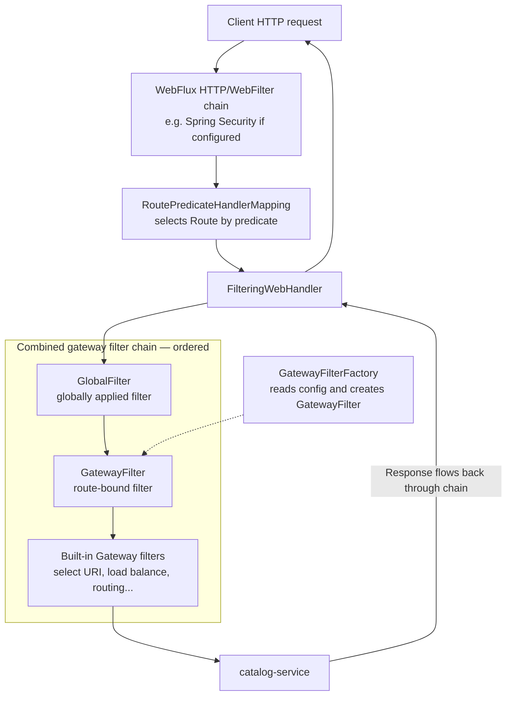
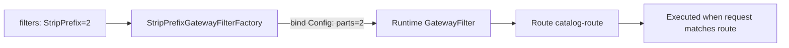
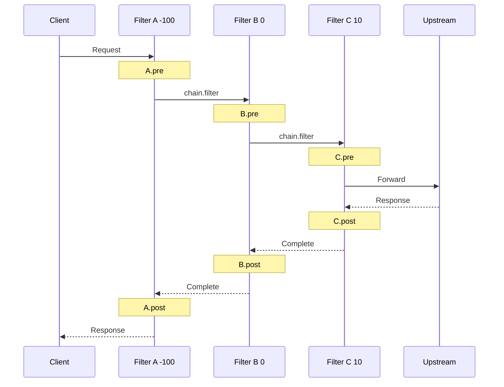
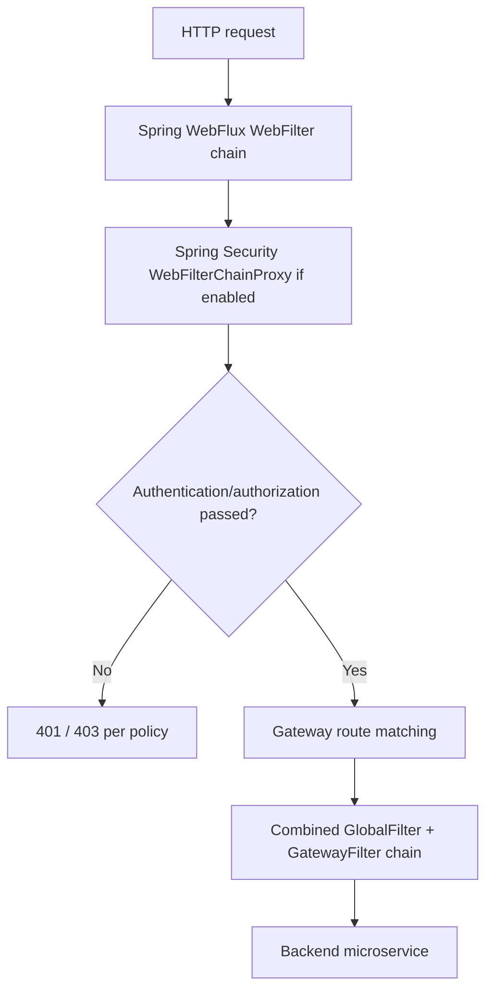

# Distinguishing GatewayFilter, GlobalFilter, and GatewayFilterFactory

In **Spring Cloud Gateway**, routing answers the question *“which service should this request go to?”*, while the **filter chain** answers the question *“how should the gateway process the request/response before and after forwarding?”*. A route may need to strip a URL prefix, add headers, or set a retry policy; at the same time, every forwarded route may need to measure processing time and attach tracing information.

Three names commonly appear in source code and documentation: **`GatewayFilter`**, **`GlobalFilter`**, and **`GatewayFilterFactory`**. They are related to one another, but they do not perform the same role:

- **`GatewayFilter`** is an **executable filter** scoped to a single route.
- **`GlobalFilter`** is a **shared executable filter** for the processing chain of requests that have been matched to a route by the gateway.
- **`GatewayFilterFactory`** is a **factory that creates a `GatewayFilter`** from configuration; the factory itself is not a processing step executed per request.

This lesson belongs to the **Filter Chain** chapter of the **SPRING_CLOUD_GATEWAY** module. The goal is to understand the scope, registration point, execution order, and how to write filters to properly use API Gateway capabilities: route predicates, path/header modification, service discovery, authentication, rate limiting, circuit breaker, retry, TLS, and request observability.

> **Version scope:** The interface names, method signatures, and Java examples in this lesson focus on **Spring Cloud Gateway Server WebFlux**. Spring Cloud Gateway Server Web MVC has its own pipeline and filter APIs based on Spring MVC/`HandlerFilterFunction`. Starter names, property prefixes, and some built-in filters may vary across releases; always check the documentation for your exact Spring Boot/Spring Cloud/Gateway version when implementing.

## 1. The Big Picture: Where Does a Request Go?

Suppose a client calls:

```http
GET /api/catalog/products/42 HTTP/1.1
Host: api.shop.example
X-Client-Version: 2
```

A `catalog-route` route has the predicate `Path=/api/catalog/**` and the filter `StripPrefix=2`. Before the request reaches the backend, the gateway also needs to run shared processing such as recording timing and a trace ID.



This diagram illustrates **logical roles**, not the exact fixed order among the three filter groups in an application. At runtime, the `GlobalFilter`s and the selected route's `GatewayFilter`s are **combined into a single chain** and sorted by `Ordered` or effective order. Being a global filter does not automatically guarantee that it always runs before every route filter.

### Conditions for a Filter to Run

1. The request must arrive at the gateway and be handled through the appropriate HTTP stack.
2. `RoutePredicateHandlerMapping` selects a `Route` whose predicate matches.
3. `FilteringWebHandler` builds the filter chain from the global filters and that route's filters.
4. The filter chain can continue to the upstream or **short-circuit early** with a response generated by a filter.
5. When the upstream or downstream step completes, the post-processing parts registered in the chain can run.

Therefore, a `GlobalFilter` **does not mean a filter for every HTTP request arriving at the process**: requests that do not match a route or requests to non-gateway endpoints, such as actuator, do not automatically pass through `FilteringWebHandler`.

## 2. Comparison Table of the Three Concepts

| Criterion | `GatewayFilter` | `GlobalFilter` | `GatewayFilterFactory` |
| --- | --- | --- | --- |
| Nature | Executable filter interface | Globally applied executable filter interface | Filter-creating interface/abstraction |
| Purpose | Process request/response for the route it is attached to | Shared processing for routes passing through the gateway handler | Convert configuration into a `GatewayFilter` |
| When is it invoked? | When a request matches the route and the filter is in the chain | When a matched request is processed through the gateway chain | When building/loading or refreshing a route definition that needs the filter |
| How it is attached | In the route DSL or route filter configuration | Registering a `GlobalFilter` bean | Registering the factory and referencing the filter name in configuration |
| Receives per-route configuration? | Can be created with custom parameters | Must read metadata/conditions itself if per-route behavior is desired | Yes: creates one filter from its corresponding `Config` |
| Can block a request? | Yes | Yes | Not directly; the filter it creates can block |
| Example | `StripPrefix` filter on the catalog route | Timing filter for gateway routes | `StripPrefixGatewayFilterFactory` |
| Primary objects | `ServerWebExchange` + `GatewayFilterChain` | `ServerWebExchange` + `GatewayFilterChain` | One `Config` → one `GatewayFilter` |

**Key relationship:** a `GatewayFilterFactory` produces a `GatewayFilter`, but not every `GatewayFilter` has to go through a factory. With the Java DSL, you can supply a `GatewayFilter` directly.

## 3. GatewayFilter: A Filter for a Single Route

In Server WebFlux, `GatewayFilter` has the conceptual signature:

```java
public interface GatewayFilter {
    Mono<Void> filter(ServerWebExchange exchange, GatewayFilterChain chain);
}
```

`ServerWebExchange` provides the HTTP request/response context; `GatewayFilterChain` allows passing control to the next filter. If a filter calls `chain.filter(exchange)`, the chain continues. If a filter returns a `Mono<Void>` that completes the response without calling the chain, subsequent steps in the chain will not run.

### 3.1. Example of a Route-Specific Filter

In the Java DSL, a route can combine built-in filters and custom-written filters:

```java
import org.springframework.cloud.gateway.filter.GatewayFilter;
import org.springframework.cloud.gateway.route.RouteLocator;
import org.springframework.cloud.gateway.route.builder.RouteLocatorBuilder;
import org.springframework.context.annotation.Bean;
import org.springframework.context.annotation.Configuration;

@Configuration
public class CatalogGatewayRoutes {

    @Bean
    RouteLocator catalogRoutes(RouteLocatorBuilder builder) {
        GatewayFilter annotateCatalogRoute = (exchange, chain) -> {
            exchange.getAttributes().put("app.routeFamily", "catalog");
            return chain.filter(exchange);
        };

        return builder.routes()
            .route("catalog-route", r -> r
                .path("/api/catalog/**")
                .filters(f -> f
                    .stripPrefix(2)
                    .setRequestHeader("X-Edge-Source", "gateway")
                    .filter(annotateCatalogRoute))
                .uri("lb://catalog-service"))
            .build();
    }
}
```

When `GET /api/catalog/products/42` matches `catalog-route`:

1. `StripPrefix=2` removes `api` and `catalog` so the upstream receives `/products/42`.
2. `SetRequestHeader` sets the `X-Edge-Source` value for the forwarded request.
3. The `annotateCatalogRoute` filter sets the internal `app.routeFamily` attribute on the **current request**.
4. The gateway continues through other ordered filters to resolve `lb://catalog-service` and send the request if the discovery/load-balancing infrastructure is ready.

`app.routeFamily` is an **exchange attribute**; it is not automatically added to HTTP headers or sent to the upstream. This is just an example of a route-specific filter; the application needs another component to read this value if it wants to use it.

> **Security note:** The `X-Edge-Source` header is not proof that the client has been authenticated. If identity is needed, use Spring Security and an appropriate token/mTLS verification mechanism; the backend must also check permissions on business resources.

### 3.2. What Does a GatewayFilter Typically Do?

| Task | Example | Caution |
| --- | --- | --- |
| URL transformation | `StripPrefix`, `RewritePath` | Verify query string, URL encoding, and backend contract. |
| Header modification | `AddRequestHeader`, `SetRequestHeader`, `RemoveResponseHeader` | Do not let clients spoof headers that the backend treats as trusted. |
| HTTP status alteration | Filter generates an error response before calling upstream | Distinguish gateway errors from business errors. |
| Resilience | `Retry`, `CircuitBreaker` | Timeouts and retry budgets, idempotency for write operations. |
| Traffic control | `RequestRateLimiter` | Requires an appropriate quota key and state store across multiple replicas. |
| Attaching custom metadata | Setting exchange attributes / internal metadata | Avoid leaking secrets and creating shared mutable state. |

These built-in filter names are examples from the corresponding supported WebFlux lines. Features like rate limiting or circuit breaking may require separate dependencies/configurations; do not assume a filter works automatically from its name alone.

## 4. GlobalFilter: A Shared Filter in the Gateway Chain

`GlobalFilter` has the same processing method signature as `GatewayFilter`:

```java
public interface GlobalFilter {
    Mono<Void> filter(ServerWebExchange exchange, GatewayFilterChain chain);
}
```

The difference is **registration scope**. Typically, a `GlobalFilter` bean is discovered by Spring and combined by Gateway into the filter chain for requests that have been matched to a route. It is suited for shared infrastructure concerns such as measuring latency, adding tracing information, or enforcing a rule across all gateway routes.

### 4.1. Example of a Route-Timing GlobalFilter

```java
import java.util.concurrent.TimeUnit;

import org.slf4j.Logger;
import org.slf4j.LoggerFactory;
import org.springframework.cloud.gateway.filter.GatewayFilterChain;
import org.springframework.cloud.gateway.filter.GlobalFilter;
import org.springframework.cloud.gateway.route.Route;
import org.springframework.cloud.gateway.support.ServerWebExchangeUtils;
import org.springframework.core.Ordered;
import org.springframework.stereotype.Component;
import org.springframework.web.server.ServerWebExchange;
import reactor.core.publisher.Mono;

@Component
public class RouteTimingGlobalFilter implements GlobalFilter, Ordered {

    private static final Logger log =
        LoggerFactory.getLogger(RouteTimingGlobalFilter.class);

    @Override
    public int getOrder() {
        return -100;
    }

    @Override
    public Mono<Void> filter(
            ServerWebExchange exchange,
            GatewayFilterChain chain) {

        long startedAt = System.nanoTime();

        return chain.filter(exchange).doFinally(signalType -> {
            Route route = exchange.getAttribute(
                ServerWebExchangeUtils.GATEWAY_ROUTE_ATTR);
            String routeId = route == null ? "unknown" : route.getId();
            long elapsedMs = TimeUnit.NANOSECONDS.toMillis(
                System.nanoTime() - startedAt);

            log.info(
                "route={} status={} elapsedMs={} signal={}",
                routeId,
                exchange.getResponse().getStatusCode(),
                elapsedMs,
                signalType);
        });
    }
}
```

Explanation:

- `@Component` lets Spring register the filter as a bean.
- `getOrder()` declares the relative order of the filter in the combined chain; `-100` is only an illustrative value and does not guarantee it runs before every other filter.
- `chain.filter(exchange)` allows the request to proceed.
- `doFinally` records when the stream completes, errors, or is canceled, including cases where connection cancellation needs to be observed.
- `GATEWAY_ROUTE_ATTR` reads the selected route. Measuring timing this way is illustrative only; in production systems, prefer supported metrics/tracing mechanisms such as Micrometer/Actuator and standardized route labels.

This filter runs for **requests that actually pass through the gateway filter chain**. If Spring Security rejects a request before route selection, or the request is not handled by gateway mapping, the filter will not log that request.

### 4.2. Why Not Put All Processing in GlobalFilter?

A GlobalFilter can read the selected route to make conditional decisions, but route-specific configuration is usually clearer when written as a `GatewayFilterFactory` and attached to individual routes.

| Requirement | Usually Appropriate Choice |
| --- | --- |
| Measuring timing/basic metrics across many routes | `GlobalFilter` or built-in observability |
| Applying a common header with the same value | `GlobalFilter` or `default-filters`, depending on requirements |
| Stripping a prefix only for catalog | `GatewayFilter` configured on `catalog-route` |
| Each route has different validation parameters | `GatewayFilterFactory` generating a `GatewayFilter` per `Config` |
| JWT/resource-server authentication | Spring Security (appropriate security filter chain), coordinating with Gateway filters when truly needed |
| Authorizing a user for a specific order | The service owning the order data, optionally with edge checks at the gateway |

Putting business logic into a GlobalFilter can make the gateway hard to maintain and cause a single-route change to impact the whole system. Shared filters should have concise responsibilities, be easy to test, and avoid blocking operations on the reactive thread.

## 5. GatewayFilterFactory: Creating Filters from Configuration

In route configuration, we often see:

```yaml
filters:
  - StripPrefix=2
  - AddRequestHeader=X-Client-Origin, gateway
```

These strings are **not pre-instantiated GatewayFilter classes**. Gateway Server WebFlux looks up the corresponding `GatewayFilterFactory`, binds parameters to the factory's configuration, and creates a `GatewayFilter` to attach to the route.

For example:



When a route is loaded or refreshed, the gateway may call the factory again to create a filter matching the new configuration. However, **the factory is not called as a request-processing step on every HTTP request**; it is the `GatewayFilter` returned by the factory that performs that work.

### 5.1. Shortcut Configuration vs. Named-Parameter Configuration

Two common forms:

```yaml
filters:
  - StripPrefix=2
```

```yaml
filters:
  - name: StripPrefix
    args:
      parts: 2
```

The factory defines how parameters are accepted, parameter names, and value conversion. The shortcut form only works properly if the factory supports the corresponding field order. For custom factories, explicitly declaring a schema helps prevent typos and makes debugging easier.

### 5.2. Distinguishing GatewayFilterFactory from RoutePredicateFactory

| Factory | Product Created | Purpose |
| --- | --- | --- |
| `RoutePredicateFactory` | Predicate used to **match routes** | E.g. `Path=/api/catalog/**`, `Method=GET` |
| `GatewayFilterFactory` | `GatewayFilter` used to **process request/response** | E.g. `StripPrefix=2`, `SetRequestHeader` |

If you want to check the HTTP method to select a route, use the `Method` predicate. If you want to reject a request based on a business condition after a route has been selected, you can use an appropriate GatewayFilter; the two differ in processing stage and how errors are recorded.

## 6. Writing a Parameterized GatewayFilterFactory

Suppose some routes require the client to send an `X-Client-Version` header for API compatibility checks. We want to configure:

```yaml
filters:
  - RequireClientHeader=X-Client-Version
```

You can create a WebFlux factory like this:

```java
import java.util.List;

import org.springframework.cloud.gateway.filter.GatewayFilter;
import org.springframework.cloud.gateway.filter.factory.AbstractGatewayFilterFactory;
import org.springframework.http.HttpStatus;
import org.springframework.stereotype.Component;
import org.springframework.util.Assert;

@Component
public class RequireClientHeaderGatewayFilterFactory
        extends AbstractGatewayFilterFactory<
            RequireClientHeaderGatewayFilterFactory.Config> {

    public RequireClientHeaderGatewayFilterFactory() {
        super(Config.class);
    }

    @Override
    public List<String> shortcutFieldOrder() {
        return List.of("headerName");
    }

    @Override
    public GatewayFilter apply(Config config) {
        Assert.hasText(config.getHeaderName(),
            "headerName must not be blank");

        return (exchange, chain) -> {
            boolean present = exchange.getRequest().getHeaders()
                .containsKey(config.getHeaderName());

            if (!present) {
                exchange.getResponse().setStatusCode(HttpStatus.BAD_REQUEST);
                return exchange.getResponse().setComplete();
            }
            return chain.filter(exchange);
        };
    }

    public static class Config {
        private String headerName;

        public String getHeaderName() {
            return headerName;
        }

        public void setHeaderName(String headerName) {
            this.headerName = headerName;
        }
    }
}
```

How it works:

1. Spring registers the `RequireClientHeaderGatewayFilterFactory` bean.
2. When loading a route with `RequireClientHeader=X-Client-Version`, the gateway recognizes the short factory name `RequireClientHeader` and binds the argument to `Config.headerName`.
3. The factory validates the parameter and returns a `GatewayFilter`.
4. When a request matches the route, the filter checks for the presence of the header; if missing, it returns `400 Bad Request` and **does not call `chain.filter(...)`**.
5. When the header is present, the request continues to subsequent filters and the backend.

In the WebFlux naming convention, the class typically ends with `GatewayFilterFactory` so the gateway can resolve its short name. Check the conventions and documentation of your Gateway version; do not name factories arbitrarily if you want to use YAML shortcuts.

> **This is not an authentication filter.** Clients can freely send `X-Client-Version` with any value. Checking header presence only serves client/API contract checks; it does not replace JWT validation, authorization, or trust verification.

### 6.1. Adding the Factory to a Route

The example below uses the Server WebFlux route configuration syntax from newer documentation lines:

```yaml
spring:
  cloud:
    gateway:
      server:
        webflux:
          routes:
            - id: catalog-route
              uri: http://localhost:8081
              predicates:
                - Path=/api/catalog/**
              filters:
                - StripPrefix=2
                - RequireClientHeader=X-Client-Version

            - id: orders-route
              uri: http://localhost:8082
              predicates:
                - Path=/api/orders/**
              filters:
                - StripPrefix=2
```

Expected results:

| Request | Route | Result from Custom Factory |
| --- | --- | --- |
| `GET /api/catalog/products` without `X-Client-Version` | `catalog-route` | Returns `400` before sending to backend. |
| `GET /api/catalog/products` with `X-Client-Version: 2` | `catalog-route` | Forwards request to backend. |
| `GET /api/orders/123` without that header | `orders-route` | This factory is not attached, so it does not block for a missing header. |
| `GET /api/unknown` | Matches neither route above | Neither route's filters run; may return `404` if no other handler exists. |

If you are using an older Gateway WebFlux line with the `spring.cloud.gateway.routes` configuration branch, **do not copy the new prefix verbatim** without checking. The two branches cannot be assumed to work interchangeably.

### 6.2. When Should You Use GatewayFilterFactory?

Create a factory when you have a **reusable type of processing** where each route is allowed to configure different parameters:

- The header to inspect differs per API.
- Route-specific rewrite/mapping rules, if built-in filters do not cover them.
- Choosing a per-route policy/threshold while sharing one common logic implementation.
- Integrating an internal component with a configuration schema that needs explicit validation.

If you only need to add a header or strip a prefix, prefer **built-in filters** instead of rewriting existing mechanisms. Custom code must be maintained across Gateway upgrades, especially when the framework changes APIs or reactive execution behavior.

## 7. Execution Order: pre, post, and Ordered

After the gateway merges `GlobalFilter`s and the route's `GatewayFilter`s, the filters are sorted by their `Ordered` value. **A smaller order value means higher priority**:

- In the **pre** phase, higher-priority filters are typically invoked first.
- In the **post** phase, the post-`chain.filter(...)` logic of higher-priority filters typically completes last.

Example of three ordered filters:

| Filter | Order | Pre Phase | Post Phase |
| --- | ---: | --- | --- |
| A – GlobalFilter recording timing | `-100` | Starts first | Completes last |
| B – GatewayFilter modifying header | `0` | Starts second | Completes second |
| C – GatewayFilter checking/writing response | `10` | Starts third | Completes first |

Nested illustration:

```text
Request
  A.pre
    B.pre
      C.pre
        Call next step / upstream
      C.post
    B.post
  A.post
Response
```



**This is an illustrative order**, assuming every filter continues the chain and has a post-processing step. The order and assignment of order values for built-in filters vary by filter type and version; a filter declared later in YAML does not necessarily have a higher order value than a custom GlobalFilter. Verify the actual chain whenever you need safe ordering guarantees.

### 7.1. Understanding “Post” Properly in a Reactive Chain

A WebFlux filter normally returns `Mono<Void>` rather than calling the upstream synchronously. For example:

```java
return chain.filter(exchange)
    .doOnSuccess(ignored -> {
        // Downstream chain completed successfully.
    })
    .doOnError(error -> {
        // Downstream chain encountered an error.
    })
    .doFinally(signal -> {
        // Completed, errored, or canceled.
    });
```

`doOnSuccess` does not cover every case: if the chain errors or is canceled, the success callback does not run. `doFinally` observes all termination signals, but it is not suitable for modifying a response that has already been committed. If you need to **modify response headers before sending**, you must register processing at the right hook—for example `beforeCommit` when appropriate—or use a built-in filter.

Do not force `block()`, perform blocking I/O, or sleep threads inside the WebFlux pipeline. Such operations can block event-loop threads and degrade throughput under concurrent requests.

### 7.2. Which Steps Does Short-Circuiting Change?

In the `RequireClientHeaderGatewayFilterFactory` example, a missing header causes the filter to return a `400` response without calling `chain.filter(exchange)`. Consequently:

- Filters **after it** in the chain will not be invoked.
- Filters **before it** in the chain can still execute their registered post-processing and observe the response.
- The backend will **not receive** that request.
- An observability filter placed too late may miss requests that were blocked early.

This matters when choosing where to measure errors, apply CORS, record traces, or add response headers. Never design security based on the assumption that every filter always runs even if an earlier filter terminates the chain.

## 8. How default-filters Differs from GlobalFilter

Spring Cloud Gateway WebFlux also has the concept of **`default-filters`**: a configured list of filters applied to routes, usually created through **GatewayFilterFactory**. For example:

```yaml
spring:
  cloud:
    gateway:
      server:
        webflux:
          default-filters:
            - AddRequestHeader=X-Edge-App, storefront
```

Comparison:

| Criterion | `default-filters` | `GlobalFilter` |
| --- | --- | --- |
| How it is defined | Configured list of filters using their corresponding factories | Java bean implementing `GlobalFilter` |
| How it enters the chain | Attached as default filters for routes | Added to the set of global filters |
| Parameters | Per the filter factory configuration | Handled in bean code or via dependencies |
| When to use | When you want to apply a built-in/configured filter uniformly to many routes | When you want to write custom shared processing logic |
| Risk | Accidentally applying config to an unintended route; conflicts with route filters | Logic spreading across many routes, ordering, and shared overhead |

Both mechanisms can affect many routes, but **they are not identical in object type, configuration style, or execution order**. Prefer `default-filters` when you just need to apply a built-in filter with the same arguments across all routes, and `GlobalFilter` when you have shared Java logic.

## 9. Gateway Filter Chain and Spring Security Are Two Different Layers

Spring WebFlux has `WebFilter` and `SecurityWebFilterChain`. When an application enables Spring Security, security processing occurs in the **security/web handler chain**, and does not automatically become a `GatewayFilter` or `GlobalFilter`.



Therefore:

1. A `GlobalFilter` that logs routes may **not see** requests rejected by Spring Security before route matching.
2. A `GatewayFilterFactory` used to create route filters **does not by itself provide secure JWT validation**. You can use Spring Security OAuth 2.0 Resource Server with appropriate configuration.
3. Fine-grained authorization such as “can this user view order 123?” usually still belongs to the service that owns the data.
4. With token relay or identity headers, forward only trusted information, and secure the connection between the gateway and the backend.

Do not write a `GlobalFilter` that only checks for the presence of an `Authorization` string and treat that as authentication. Having a token in the header does not prove a valid signature, issuer, audience, expiration, or access rights.

## 10. Impact on Routing, Discovery, Resilience, and TLS

Choosing the right filter type also matters for common gateway capabilities:

| Concern | Relation to the Filter Chain | Where to Control It |
| --- | --- | --- |
| **Route predicate** | Selects the route **before** executing the route's GatewayFilters. | Check path/method/host and route `order`; do not confuse with filter order. |
| **Rewrite path/header** | Filters can mutate the request before forwarding. | Transformation order and backend contract. |
| **Service discovery** | With `lb://service`, the load-balancing component selects an instance. | Requires a registry/instance source and the corresponding forwarding filters. |
| **Rate limiting** | A filter can short-circuit early with `429`. | Key resolver, shared store across replicas, policy when the store fails. |
| **Circuit breaker** | Filter protects upstream calls based on state/responses. | Compatible dependencies, timeouts, and fallbacks that do not leak data. |
| **Retry** | Filter can re-invoke the downstream chain according to policy. | Attempt limits, overall timeout, request body handling, and idempotency. |
| **TLS** | TLS handshake usually belongs to the HTTP server/client and infrastructure layers. | Do not treat a header-modifying GatewayFilter as a replacement for TLS/mTLS. |
| **Observability** | Measures latency, route ID, status codes, and trace context. | Avoid logging secrets and high-cardinality metric tags. |

### Example: Why Filter Order and Retry Can Have Major Consequences

Suppose a custom filter sends a request to a traffic-metering system on every invocation, while the route also has `Retry`. If the ordering causes the counting filter to re-run on retries, its execution count may differ from the original number of client requests. Similarly, placing a non-repeatable body transformation before/inside retry can cause subsequent attempts to use unexpected data.

For write requests such as `POST /api/orders` or `POST /api/payments`, do not enable retry indiscriminately: the backend may already have completed the transaction even if the gateway did not receive a response. You need idempotency keys, a safe retry policy, and a well-designed time budget.

### Route Order and Filter Order Are Not the Same

- **Route order** decides route selection priority when multiple predicates can match.
- **Filter order** decides the processing steps inside the chain of the **already selected route**.

Changing the `order` of `catalog-route` does not determine whether a logging GlobalFilter runs earlier or later. Conversely, adjusting `getOrder()` on a GlobalFilter does not make `/api/catalog/**` requests switch to `orders-route`.

## 11. Hands-On Exercise: Identifying Filter Types by Behavior

### Test Setup

Use a Spring Cloud Gateway **Server WebFlux** project compatible with your chosen Spring Boot/Spring Cloud versions. Assume:

- The gateway listens at `http://localhost:8080`.
- The catalog backend is at `http://localhost:8081` with endpoint `GET /products/42`.
- The orders backend is at `http://localhost:8082` with endpoint `GET /orders/123`.
- The gateway has the two routes from the example in section 6.1 and the `RouteTimingGlobalFilter` bean from section 4.1.

The backends can be simple mock servers returning plain JSON; you do not need service discovery for this exercise. When switching URIs to `lb://...`, you must add LoadBalancer and an appropriate instance source.

### Step 1 — Check the Selected Route

```bash
curl -i "http://localhost:8080/api/catalog/products/42"
```

Without `X-Client-Version`, the custom filter returns `400`. Verify that the backend receives no request, while the timing GlobalFilter logs `catalog-route`.

### Step 2 — Test with a Header Present

```bash
curl -i \
  -H "X-Client-Version: 2" \
  "http://localhost:8080/api/catalog/products/42"
```

The gateway proceeds to the backend `/products/42` after `StripPrefix=2`. Header presence only satisfies the custom filter's condition; the returned data/status code still depends on the backend.

### Step 3 — Demonstrate Route-Specific Scope

```bash
curl -i "http://localhost:8080/api/orders/123"
```

`orders-route` does not attach `RequireClientHeader`, so missing `X-Client-Version` does not cause a `400` from that filter. The GlobalFilter can still record timing for the orders route.

### Step 4 — Demonstrate GlobalFilter Scope

```bash
curl -i "http://localhost:8080/not-a-route"
```

If no other handler accepts this path, the client may see `404`; `RouteTimingGlobalFilter` typically does not run because the gateway selects no route. This is empirical proof that Gateway's global filter differs from a general WebFlux `WebFilter` across the entire application.

### Step 5 — Test Ordering and Short-Circuiting

Create two test filters that log `before`/`after` with different `Ordered` values, only in a test environment. Observe:

- In the success case, pre runs in priority order and post runs in reverse order when all filters call the chain.
- In the missing-header case, filters after `RequireClientHeader` are not invoked.
- The `doFinally` part of earlier filters can still record the completion signal.

Do not deduce execution order solely from the positions of two lines in a YAML file without checking `Ordered` or how the framework wraps filters.

### Step 6 — Test Operational Features

Attach a `RequestRateLimiter` or `Retry` filter configured for your version to a test route. Measure response codes, how many times the backend receives requests, processing time, and traces. If using distributed rate limiting, test across two replicas to confirm whether the quota store behaves consistently.

### Results Checklist

| Case | Request | Expected Result | What to Verify |
| --- | --- | --- | --- |
| F01 | Catalog missing required header | `400` from custom GatewayFilter | Not sent to backend. |
| F02 | Catalog with header | Forwarded to backend | Path properly modified by `StripPrefix`. |
| F03 | Orders missing header | Not blocked by catalog's custom filter | Same GlobalFilter still logs by route. |
| F04 | Path matching no route | `404` if no other handler exists | Gateway GlobalFilter does not run by default. |
| F05 | Filter short-circuits | Intentional error response | Later filters do not run; earlier filters can complete post. |
| F06 | Retry enabled | May produce multiple upstream calls | Requires attempt limits, retry conditions, and idempotency. |
| F07 | JWT authentication enabled | Invalid token rejected in security chain | Not confused with GatewayFilterFactory. |

## 12. Common Mistakes When Writing and Registering Filters

| Symptom | Possible Cause | How to Check |
| --- | --- | --- |
| Factory class exists, but route cannot find filter name | Wrong bean name/naming convention, component not scanned, or wrong variant | Check `@Component`, factory suffix, shortcut name, and route binding logs. |
| Shortcut configuration binds wrong arguments | `shortcutFieldOrder()` does not match field order or invalid input | Compare `Config`, binding logic, and switch to `name/args` form to inspect. |
| Only one route is affected | Filter is attached to that route, not a GlobalFilter | Inspect the filter list of each route. |
| All routes are modified unexpectedly | A GlobalFilter or `default-filters` is applied globally | Check scope, conditions, and filter ordering. |
| GlobalFilter does not see 401 requests | Security rejects in `SecurityWebFilterChain` before gateway route selection | Place metrics/auditing in the security layer if all requests must be covered. |
| Request “hangs” before reaching backend | Forgot to return `chain.filter(exchange)` or properly complete the response `Mono` | Check return flow, short-circuiting, and response commit. |
| Headers/response do not change as expected | Response already committed or filter ran after forwarding | Use the appropriate extension point, `beforeCommit` when suitable, and check order. |
| Latency spikes after adding a filter | Blocking I/O or heavy per-request work | Profile, measure the event loop, move blocking work elsewhere or remove it. |
| Retry causes backend to receive multiple requests | Retry filter is re-invoking the downstream chain | Review error conditions, filter order, request body, and idempotency. |
| Routes disappear after an upgrade | Incompatible property prefix/starter/filter API | Check the release train, configuration properties, and startup logs. |

### Safety Principles for WebFlux

**Do not share per-request mutable state in singleton beans.** `GlobalFilter`s and factory-created filters can be used concurrently by many requests; counters, client data, request bodies, or tokens must not be stored in mutable fields without proper synchronization/isolation. Use `ServerWebExchange` attributes for request-specific data.

**Do not log sensitive data.** `Authorization` headers, session cookies, passwords, and payment data should not appear in filter logs. For metrics, use bounded-cardinality tags such as route ID; avoid using URLs containing order IDs or user IDs as tags.

**Do not use filters to replace backend business logic.** The gateway can authenticate, rate-limit, and control ingress, but business services must still handle data processing, resource-level authorization, idempotency, and validation.

## 13. Check Version Compatibility Before Applying

A filter example can be conceptually sound while having the wrong API or property across Spring Cloud Gateway lines.

| Item to Lock Down | How to Verify |
| --- | --- |
| **Spring Boot and Spring Cloud release train** | Choose an officially supported version pair; manage dependencies via the corresponding BOM. |
| **Gateway Server WebFlux vs. Web MVC** | Use the starter and API for the right variant; WebFlux `GlobalFilter`/`GatewayFilterFactory` cannot be applied verbatim to MVC. |
| **routes/default-filters property branch** | Check `spring.cloud.gateway.server.webflux.*` for newer lines or the branch matching your version. |
| **Factory and configuration style** | Verify factory name, shortcut, binding, parameters, support status, and dependencies. |
| **Built-in filter order** | Verify `Ordered` and pre/post behavior when combined with custom filters. |
| **Security** | Distinguish WebFlux `SecurityWebFilterChain` from MVC servlet security chain. |
| **Actuator and observability** | Verify endpoints, exposure/permissions config, metrics/tracing, and logging. |
| **Resilience integrations** | Rate limit, circuit breaker, and retry should be tested on the exact version, backend, and topology. |

Reference documentation to cross-check for your deployed version:

- [Spring Cloud Gateway Server WebFlux — Global Filters](https://docs.spring.io/spring-cloud-gateway/reference/spring-cloud-gateway-server-webflux/global-filters.html)
- [Spring Cloud Gateway Server WebFlux — GatewayFilter Factories](https://docs.spring.io/spring-cloud-gateway/reference/spring-cloud-gateway-server-webflux/gatewayfilter-factories.html)
- [Spring Cloud Gateway Server WebFlux — How It Works](https://docs.spring.io/spring-cloud-gateway/reference/spring-cloud-gateway-server-webflux/how-it-works.html)
- [Spring Cloud Gateway — Configuration Properties](https://docs.spring.io/spring-cloud-gateway/reference/configprops.html)
- [Spring Cloud Gateway Server Web MVC — How It Works](https://docs.spring.io/spring-cloud-gateway/reference/spring-cloud-gateway-server-webmvc/how-it-works.html)

## 14. Self-Check Questions

1. Why does `StripPrefixGatewayFilterFactory` not run directly for every request, even though the route syntax says `StripPrefix=2`?
2. If you only want to measure timing for requests that matched a gateway route, should you choose a `GlobalFilter` or a separate `GatewayFilter` per route? Why?
3. What happens to downstream filters when a `GatewayFilter` returns a `400` response without calling `chain.filter(exchange)`?
4. With `A.order=-100` and `B.order=10`, in what order do pre and post run if both continue the chain?
5. Why do `default-filters` have a broad scope yet differ in kind from `GlobalFilter`?
6. Why cannot a `GlobalFilter` that checks the `Authorization` header be considered a reliable JWT authentication mechanism?
7. When migrating an application from Gateway Server WebFlux to Server Web MVC, which APIs and configurations must be re-evaluated?

**Remember:** **`GatewayFilter` processes requests/responses at the route scope; `GlobalFilter` participates in the shared processing chain across gateway routes; and `GatewayFilterFactory` converts configuration into executable `GatewayFilter`s**. Mastering these three roles and the pre/post order lets you build clear filter chains, enforce security policies, avoid retry/timeout bugs, and accurately observe traffic entering your microservices gateway.
