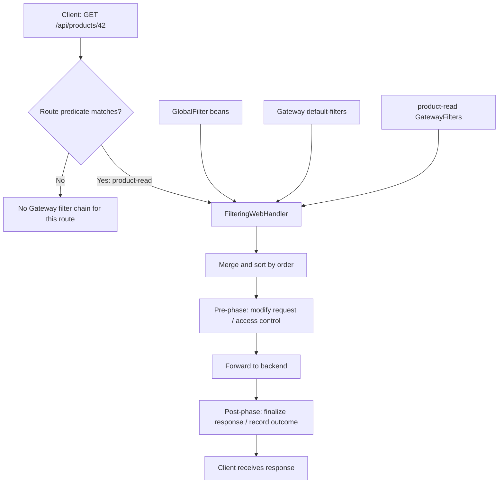
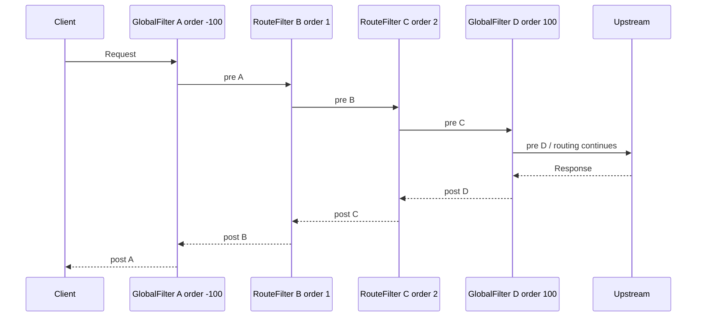

# Combining GlobalFilter with Route-Specific Filters in Spring Cloud Gateway

In a microservices architecture, an API Gateway often needs to apply **shared policies** across all routes while allowing each API to have **route-specific rules**. For example, every request passing through the gateway may need a trace ID, while only the order-management route needs a circuit breaker; the product route may need to strip the `/api` prefix, whereas the payment route needs strict retry control.

**Spring Cloud Gateway Server WebFlux** solves this by combining `GlobalFilter`s with the matched route's `GatewayFilter`s into **a single ordered execution chain**. Understanding how they combine helps build the API Gateway capabilities of the `SPRING_CLOUD_GATEWAY` module consistently: predicate-based route selection, path/header transformation, forwarding via service discovery, authentication, rate limiting, circuit breaking, retry, TLS, and request observability.

This lesson belongs to the **Filter Chain** chapter and focuses on three questions: **which filters participate in a request; in what order do they run; and how does that combination affect actual requests and responses?**

> The APIs and examples below are for **Spring Cloud Gateway Server WebFlux**. The Server MVC variant has its own pipeline and filter mechanism. Configuration namespaces depend on the Spring Cloud Gateway/Spring Boot version in use.

## 1. Three Easily Confused Processing Scopes: GlobalFilter, GatewayFilter, and WebFilter

These filter classes have similar-sounding names but belong to different stages.

| Component | Scope | Common Registration Mechanism | Example |
| --- | --- | --- | --- |
| **`GlobalFilter`** | Participates in **every Gateway chain** for requests that have been matched to a route in WebFlux Gateway. | Spring bean implementing `GlobalFilter`, often with `Ordered`. | Request tracing, per-route latency measurement, enforcing shared gateway policies. |
| **`GatewayFilter`** | Participates in the **matched route**; filters from `default-filters` are also attached to routes. | `GatewayFilterFactory` via YAML/Properties or Java DSL APIs. | `StripPrefix`, `SetPath`, `AddRequestHeader`, `RequestRateLimiter`. |
| **`WebFilter`** | Belongs to the **Spring WebFlux web filter chain**, outside the route-matching layer and Gateway filter chain. | Spring WebFlux / Spring Security bean. | Spring Security HTTP request authentication/authorization before entering the Gateway handler. |

Crucially, the word **global** in `GlobalFilter` does not mean “every HTTP request on the server runs through this filter.” It applies once a request is handled by Gateway's route-selection mechanism and enters `FilteringWebHandler`. A request with no matching route may receive a `404` before any Gateway filter runs. If you need to process requests at the WebFlux layer regardless of route, you should consider a `WebFilter` or an appropriate web mechanism.

Nor should you equate a `GlobalFilter` with a filter attached to every route via `default-filters`. Both approaches can achieve a similar scope of impact on matched requests, but **their programming APIs, configuration styles, and ordering participation** differ.

### 1.1. Visualizing a Real Request

Suppose a client calls:

```http
GET /api/products/42 HTTP/1.1
Host: gateway.example.com
```

The gateway has a `product-read` route with predicates `Path=/api/products/**` and `Method=GET`. Once the route is selected:

1. Spring Cloud Gateway retrieves the registered `GlobalFilter`s.
2. The gateway retrieves the `GatewayFilter`s attached to `product-read`, including any default filters applied to that route.
3. The two groups are **merged and sorted by order**.
4. The chain executes request-side operations (*pre-phase*), performs routing, and returns the response through response-side operations (*post-phase*).



**Architectural takeaway:** `GlobalFilter`s and a route's `GatewayFilter`s do not form two separate pipelines running sequentially. They are elements of **the exact same Gateway filter chain** after a route has matched.

## 2. Where Do Route-Specific Filters Come From?

A route can declare filters by listing `filters`:

```yaml
spring:
  cloud:
    gateway:
      server:
        webflux:
          routes:
            - id: product-read
              uri: http://localhost:8081
              predicates:
                - Path=/api/products/**
                - Method=GET
              filters:
                - StripPrefix=1
                - SetRequestHeader=X-Gateway-Route, product-read
```

Meaning:

- `StripPrefix=1`: turns `/api/products/42` into `/products/42` before sending to the backend.
- `SetRequestHeader=X-Gateway-Route, product-read`: sets a technical header on the upstream request.
- These two filters belong **only** to the `product-read` route in the configuration shown.
- The URI `http://localhost:8081` is a static target; if using `lb://product-service`, Gateway needs Spring Cloud LoadBalancer and a valid instance source to resolve it.

In Server WebFlux, declarations such as `StripPrefix` and `SetRequestHeader` map to **`GatewayFilterFactory`** implementations, which create `GatewayFilter`s for the route. Another route can have an entirely different set of filters.

Example order route:

```yaml
- id: order-api
  uri: http://localhost:8082
  predicates:
    - Path=/api/orders/**
  filters:
    - StripPrefix=1
    - AddRequestHeader=X-Request-Source, api-gateway
```

With these two routes, `GET /api/products/42` does not run `order-api`'s `AddRequestHeader=X-Request-Source`. Conversely, `GET /api/orders/7` does not run `product-read`'s `SetRequestHeader=X-Gateway-Route`. Registered `GlobalFilter`s are still included on both routes once matched.

> The example uses the `spring.cloud.gateway.server.webflux.routes` namespace of newer WebFlux versions. Earlier versions commonly used `spring.cloud.gateway.routes`. Verify the namespace and starter for your actual version, and do not declare both simultaneously assuming they are equivalent.

## 3. `default-filters`: Applying a GatewayFilter to Every Route

Alongside Java-written `GlobalFilter`s, Gateway provides `default-filters` to apply **GatewayFilter Factories** globally across routes.

Example:

```yaml
spring:
  cloud:
    gateway:
      server:
        webflux:
          default-filters:
            - AddResponseHeader=X-Gateway-Edge, spring-cloud-gateway
          routes:
            - id: product-read
              uri: http://localhost:8081
              predicates:
                - Path=/api/products/**
              filters:
                - StripPrefix=1

            - id: order-api
              uri: http://localhost:8082
              predicates:
                - Path=/api/orders/**
              filters:
                - StripPrefix=1
```

In this example, each route receives the default filter `AddResponseHeader` as well as its own `StripPrefix` filter. A response processed through a route can have the `X-Gateway-Edge` header added.

Comparison of the two approaches to shared policies:

| Criterion | `GlobalFilter` | `default-filters` |
| --- | --- | --- |
| Form | Write a Java bean implementing `GlobalFilter`. | Configure `GatewayFilterFactory` entries at the gateway level. |
| Scope | Every request entering the Gateway chain of a matched route. | Default filters attached to each route. |
| Best suited for | Custom logic, observability, request context, or logic combining reactive APIs. | Reusing built-in filters without writing Java code per route. |
| Order control | Typically uses `Ordered` / `@Order`. | Depends on how Gateway builds, orders route/default filters, and sorts the chain; verify version behavior. |
| Watch out for | A global bean can affect every backend routed through the gateway. | Duplicate headers/path edits or conflicts if a route also configures a similar filter. |

**Not every filter belongs at the global level.** For example, applying `StripPrefix=1` to all routes breaks a backend that expects `/api` preserved. Likewise, retry or circuit breaker rules depend on the nature of the operation and each service's semantics; they should not be applied uniformly without evaluation.

For simple shared rules, `default-filters` is usually easier to track in configuration. When logic genuinely requires custom reactive processing, `GlobalFilter` is an appropriate choice.

## 4. How Does Gateway Actually Combine Both Filter Groups?

After a route is selected, `FilteringWebHandler` takes the **global filters** and the route-bound **gateway filters** and builds **one unified list**. The filters are sorted using Spring's ordering mechanism, where `Ordered` and ordered wrappers determine placement.

This leads to three key observations:

1. **There is no fixed rule that “global always runs before route.”** A `GlobalFilter` with a low order value can run before route filters, while a `GlobalFilter` with a high order value can run after route filters in the pre-phase.
2. **Route filters also have an order.** Filters declared on a route and default filters are assigned order values when Gateway builds the chain; a custom `GatewayFilter` may need explicit ordering if it depends on another step.
3. **Gateway infrastructure filters also participate in the chain.** Components like `RouteToRequestUrlFilter`, `ReactiveLoadBalancerClientFilter`, and `NettyRoutingFilter` have their own order values. Custom filter ordering must account for these as well, not just the filters visible in YAML.

### 4.1. `Ordered` Ordering

As a general rule, **a smaller `order` value has higher priority**. Example:

| Filter | Illustrative `order` | Pre-phase |
| --- | ---: | --- |
| `GlobalFilter A` (adds trace ID) | `-100` | Earliest among the four illustrative filters |
| `GatewayFilter B` (modifies path) | `1` | After A |
| `GatewayFilter C` (adds header) | `2` | After B |
| `GlobalFilter D` (observes target) | `100` | After C |

As the response flows back through the filters wrapping `chain.filter(exchange)`, the completion order is typically **D → C → B → A**. The numbers for B/C here only **illustrate how an ordered chain is sorted**; there is no guarantee that every Gateway version assigns those exact numbers for any given configuration.



This diagram illustrates the **wrapping** nature of the filter chain. In practice, individual filters may not have post-processing code, a filter may reject a request without continuing the chain, and built-in routing/global filters also sit in the chain according to their own orders.

### 4.2. Route Order Differs from Filter Order

A route may specify:

```yaml
- id: product-read
  order: -10
  uri: http://localhost:8081
  predicates:
    - Path=/api/products/**
  filters:
    - StripPrefix=1
```

Here, `order: -10` on the **route** controls route selection priority when multiple routes match. It does **not** set the execution order of `StripPrefix` to `-10` in the combined filter chain.

When analyzing order, always distinguish:

- **Route selection order:** which route wins if multiple predicates match.
- **Filter execution order:** which filter runs before/after another within the selected route.

Both use the word `order`, yet they govern two different decisions.

## 5. What Are Pre-Phase and Post-Phase?

Each filter can perform work **before** and/or **after** `chain.filter(exchange)`. In Reactor, `chain.filter(exchange)` returns a `Mono<Void>` representing the remainder of the processing chain, rather than a synchronous HTTP result.

Conceptual example:

```java
@Override
public Mono<Void> filter(ServerWebExchange exchange, GatewayFilterChain chain) {
    // PRE: process before passing to the next filter.
    System.out.println("pre");

    return chain.filter(exchange)
        .doFinally(signal -> {
            // Observe terminal signal: complete, error, or cancel.
            System.out.println("finally: " + signal);
        });
}
```

**`doFinally`** only observes the terminal signal; it does not mean the response can still be edited before sending to the client. By the time the callback runs, the HTTP response may already be committed, or the client may have canceled the request.

Mental model:

- **Pre-phase:** read the route, add/remove request headers, rewrite the path, mark context, or decide to reject the request.
- **Routing:** infrastructure filters resolve the target/instance and perform the HTTP/WebSocket/forward call.
- **Post-phase:** record timing, status, errors/cancellations; modify the response only if hooked at the right time before commit.

Because the backend response is returned reactively, do not assume imperative-style code placed after `chain.filter(exchange)` will run after HTTP completes:

```java
// INCORRECT if you expect "done" to appear only after request processing finishes.
Mono<Void> result = chain.filter(exchange);
log.info("done");
return result;
```

That log statement runs immediately when the pipeline is assembled. To attach an action when the chain finishes, use a reactive operator like `doFinally` or `then(...)` depending on your goal; never call `block()` to wait.

### 5.1. Rejecting a Request Is Also a Filter Option

A filter is not required to call `chain.filter(exchange)`. When rejecting a request based on a valid policy:

```java
@Override
public Mono<Void> filter(ServerWebExchange exchange, GatewayFilterChain chain) {
    boolean allowed = isAllowed(exchange);

    if (!allowed) {
        exchange.getResponse().setStatusCode(HttpStatus.FORBIDDEN);
        return exchange.getResponse().setComplete();
    }

    return chain.filter(exchange);
}
```

This snippet illustrates structure only; `isAllowed` represents the result of a properly designed policy check. If this filter returns a response directly, filters **downstream of it** in the chain will not run, including calling the backend. Wrapping filters upstream can still receive completion/cancellation signals to record the outcome.

**Security note:** use `Spring Security` for consistent authentication/authorization where appropriate; never rely on a self-asserted client header such as `X-Role: admin` to determine `allowed`.

## 6. Example Combining a Java GlobalFilter and YAML-Configured GatewayFilters

Build a system with two services:

- `Product Service`: running at `http://localhost:8081`, exposing `GET /products/{id}`.
- `Order Service`: running at `http://localhost:8082`, exposing `GET /orders/{id}`.

Gateway runs at `http://localhost:8080`. Requirements: every request to a backend gets a gateway-generated trace ID; responses include a header identifying the gateway edge; and each route chooses its own path transformation and route-specific headers.

### 6.1. GlobalFilter Generating a Trace ID and Measuring Latency

```java
import java.util.UUID;
import java.util.concurrent.TimeUnit;

import org.slf4j.Logger;
import org.slf4j.LoggerFactory;
import org.springframework.cloud.gateway.filter.GatewayFilterChain;
import org.springframework.cloud.gateway.filter.GlobalFilter;
import org.springframework.cloud.gateway.route.Route;
import org.springframework.cloud.gateway.support.ServerWebExchangeUtils;
import org.springframework.core.Ordered;
import org.springframework.http.server.reactive.ServerHttpRequest;
import org.springframework.stereotype.Component;
import org.springframework.web.server.ServerWebExchange;

import reactor.core.publisher.Mono;

@Component
public class GatewayTraceGlobalFilter implements GlobalFilter, Ordered {
    private static final Logger log =
        LoggerFactory.getLogger(GatewayTraceGlobalFilter.class);

    @Override
    public int getOrder() {
        return -100;
    }

    @Override
    public Mono<Void> filter(ServerWebExchange exchange, GatewayFilterChain chain) {
        String requestId = UUID.randomUUID().toString();
        long startedAt = System.nanoTime();

        Route route = exchange.getAttribute(
            ServerWebExchangeUtils.GATEWAY_ROUTE_ATTR
        );
        String routeId = route != null ? route.getId() : "unknown";

        ServerHttpRequest request = exchange.getRequest()
            .mutate()
            .headers(headers ->
                headers.set("X-Gateway-Request-Id", requestId))
            .build();

        ServerWebExchange updated = exchange.mutate()
            .request(request)
            .build();

        // Execute right before the response is committed.
        updated.getResponse().beforeCommit(() -> {
            updated.getResponse().getHeaders()
                .set("X-Gateway-Request-Id", requestId);
            return Mono.empty();
        });

        return chain.filter(updated)
            .doFinally(signal -> {
                long elapsedMs = TimeUnit.NANOSECONDS.toMillis(
                    System.nanoTime() - startedAt
                );
                log.info(
                    "routeId={} requestId={} status={} elapsedMs={} signal={}",
                    routeId,
                    requestId,
                    updated.getResponse().getStatusCode(),
                    elapsedMs,
                    signal
                );
            });
    }
}
```

Explanation:

1. `@Component` registers the `GlobalFilter` bean; `Ordered` provides `order=-100` to place the filter early in the pre-phase.
2. Gateway **generates the request ID itself** and overwrites the `X-Gateway-Request-Id` header, rather than trusting a client-supplied value.
3. `request.mutate()` creates a new request, and `exchange.mutate().request(request).build()` passes the modified request to the rest of the chain.
4. `beforeCommit(...)` is the right place to set response headers before the response commits; avoid setting headers in `doFinally`.
5. `doFinally` observes completion, error, and cancellation. Do not call `subscribe()` or `block()`; WebFlux manages the subscription.
6. The log outputs `routeId` and the gateway-generated ID, without logging tokens, passwords, or full query strings.

This example is for learning purposes. In production systems, prefer **Micrometer Observation/Tracing**, a standardized correlation ID format, sampling, non-blocking logging, and controlled metric label cardinality. If a request ID is needed even for error cases before route matching, place the mechanism at an appropriate layer such as a WebFlux `WebFilter`.

### 6.2. Configuring Shared Filters and Per-Route Filters

```yaml
server:
  port: 8080

spring:
  application:
    name: edge-gateway
  cloud:
    gateway:
      server:
        webflux:
          default-filters:
            - AddResponseHeader=X-Gateway-Edge, edge-gateway
          routes:
            - id: product-read
              uri: http://localhost:8081
              predicates:
                - Path=/api/products/**
                - Method=GET
              filters:
                - StripPrefix=1
                - SetRequestHeader=X-Route-Name, product-read

            - id: order-api
              uri: http://localhost:8082
              predicates:
                - Path=/api/orders/**
              filters:
                - StripPrefix=1
                - SetRequestHeader=X-Route-Name, order-api
```

Now, every request matching one of the two routes gets:

- `GatewayTraceGlobalFilter` generating `X-Gateway-Request-Id` sent upstream and returned to the client.
- `AddResponseHeader=X-Gateway-Edge` attached to the route via `default-filters`.
- `StripPrefix=1` modifying the path sent to the backend.
- `SetRequestHeader=X-Route-Name` attaching a route-specific label before forwarding.

For `GET /api/products/42`, the product backend receives path `/products/42` and header `X-Route-Name: product-read`. For `GET /api/orders/7`, the order backend receives `/orders/7` and header `X-Route-Name: order-api`.

Depending on actual configuration, backend response headers and other filters may also affect the final output. Avoid applying the same header name through multiple `Add*Header` filters unless duplicate values are intended; `Set*Header` is appropriate when replacing a value.

### 6.3. Request Matrix

| Request | Matched Route | Route Filters | Global/default Filters |
| --- | --- | --- | --- |
| `GET /api/products/42` | `product-read` | `StripPrefix`, sets `X-Route-Name=product-read` | Yes; request ID, `X-Gateway-Edge` header. |
| `POST /api/products/42` | Does not match `product-read` due to `Method=GET` | Does not run this route's filters | If no other route exists, no Gateway filter chain is set up. |
| `GET /api/orders/7` | `order-api` | `StripPrefix`, sets `X-Route-Name=order-api` | Yes; request ID, `X-Gateway-Edge` header. |
| `GET /unknown` | No matching route in example | None | Does not run route-scoped Gateway filters, since no route matched. |

You can test with:

```bash
curl -i "http://localhost:8080/api/products/42"
curl -i "http://localhost:8080/api/orders/7"
curl -i -X POST "http://localhost:8080/api/products/42"
```

Testing requires both backends running on their respective ports. To confirm the filter rewrites the path correctly, inspect the **actual request received by the backend**, not just the HTTP status from Gateway.

## 7. Customizing a Route-Specific GatewayFilter

When built-in filters do not meet a requirement, you can write a `GatewayFilterFactory` and configure it only on the routes that need it. A lightweight example is adding a technical label determined by configuration, not intended for authentication.

```java
import org.springframework.cloud.gateway.filter.GatewayFilter;
import org.springframework.cloud.gateway.filter.factory.AbstractGatewayFilterFactory;
import org.springframework.http.server.reactive.ServerHttpRequest;
import org.springframework.stereotype.Component;

@Component
public class RouteLabelGatewayFilterFactory
    extends AbstractGatewayFilterFactory<RouteLabelGatewayFilterFactory.Config> {

    public RouteLabelGatewayFilterFactory() {
        super(Config.class);
    }

    @Override
    public GatewayFilter apply(Config config) {
        return (exchange, chain) -> {
            ServerHttpRequest request = exchange.getRequest()
                .mutate()
                .headers(headers ->
                    headers.set("X-Route-Label", config.getValue()))
                .build();

            return chain.filter(
                exchange.mutate().request(request).build()
            );
        };
    }

    public static class Config {
        private String value;

        public String getValue() {
            return value;
        }

        public void setValue(String value) {
            this.value = value;
        }
    }
}
```

Route-specific configuration:

```yaml
filters:
  - name: RouteLabel
    args:
      value: catalog-public
```

The `RouteLabelGatewayFilterFactory` naming convention allows using the filter name `RouteLabel` in the corresponding configuration. This custom factory creates a `GatewayFilter` for the declared route; it does **not** automatically become a `GlobalFilter`.

If the requirement is simply adding a header, prefer the built-in `SetRequestHeader` filter to minimize code maintenance. A custom filter is useful when you need more complex, controlled rules—such as deriving a header from a validated internal mapping.

### 7.1. Route Filters Written in the Java DSL

You can also configure routes with `RouteLocatorBuilder` instead of YAML:

```java
@Bean
public RouteLocator apiRoutes(RouteLocatorBuilder builder) {
    return builder.routes()
        .route("product-read", r -> r
            .path("/api/products/**")
            .and()
            .method("GET")
            .filters(f -> f
                .stripPrefix(1)
                .setRequestHeader("X-Route-Name", "product-read"))
            .uri("http://localhost:8081"))
        .build();
}
```

Java DSL configuration still creates a route with `GatewayFilter`s that are combined with `GlobalFilter`s inside `FilteringWebHandler`, just like declarative configuration. When using a custom factory or DSL filter, check how it exposes `order` and relates to the infrastructure filters of your running version.

## 8. Order When Combining with Infrastructure Filters

A request that matches a route is not sent to the backend immediately. In WebFlux Gateway, after pre-processing, infrastructure filters can:

1. Use `RouteToRequestUrlFilter` to construct the URL from the selected route and current path, storing it in `GATEWAY_REQUEST_URL_ATTR`.
2. If the URL uses `lb://`, run `ReactiveLoadBalancerClientFilter` to pick an instance and update the URL.
3. Use the appropriate routing filter such as `NettyRoutingFilter`, `WebsocketRoutingFilter`, or `ForwardRoutingFilter`.
4. Write the HTTP response back to the client via the corresponding filter.

This directly affects **where to place custom filters**:

| Goal | Appropriate Timing |
| --- | --- |
| Add a header for the backend to read. | Before the HTTP routing filter sends the request. |
| Modify the path with `StripPrefix`, `SetPath`. | Before the routing URL is built, or kept accurately in sync with the URL attribute. |
| Record the route name and trace ID. | An early filter right after route matching can do this; no need to wait for instance lookup. |
| Observe the final resolved instance URL. | After load balancing and before sending the request, or use an appropriate tracing tool. |
| Set a response header. | Before the response commits, e.g., registering `beforeCommit` in an early filter. |

`RouteToRequestUrlFilter` typically has order constant `ROUTE_TO_URL_FILTER_ORDER=10000` in widely used WebFlux branches. `ReactiveLoadBalancerClientFilter` typically has order `10150`. Exact values can vary across library versions, so only rely on them in design after verifying your deployed version.

If a custom filter modifies the path **after** `GATEWAY_REQUEST_URL_ATTR` is built, the backend may still receive the old URL. In normal scenarios, prefer built-in path filters in the pre-position before routing.

## 9. When Multiple Filters Modify the Same Header, Path, or Response

### 9.1. Conflicting Request Headers

Suppose a `GlobalFilter` sets `X-Channel: web`, while the route uses:

```yaml
filters:
  - SetRequestHeader=X-Channel, partner
```

The final value depends on **which filter runs later in the pre-phase** and how each filter updates headers. If both use `AddRequestHeader`, the upstream may receive multiple values under the same name. If `SetRequestHeader` is used, a later filter can overwrite an earlier value.

**Design rule:** assign a single owner layer for security-sensitive headers, such as post-authentication identity. If the gateway actively generates trusted headers for the backend, strip or overwrite any client-supplied versions and protect backend access paths. Never trust a header merely because its name starts with `X-Gateway-`.

### 9.2. Overlapping Path-Editing Filters

A route has:

```yaml
filters:
  - StripPrefix=1
  - PrefixPath=/internal
```

For `/api/products/42`, the intent is to strip `/api` to get `/products/42`, then prepend `/internal` to get `/internal/products/42`. However, if another filter also modifies the path at the default or global level, the outcome must be verified against **actual execution order**.

Avoid scattering multiple `StripPrefix` filters across different scopes and hoping the combined effect works out. Explicitly specify the public path and backend path, then test against a mock backend.

### 9.3. Modifying the Response Too Late

A response has a commit lifecycle. If a filter does:

```java
return chain.filter(exchange)
    .doFinally(signal -> {
        exchange.getResponse().getHeaders().set("X-Result", "done");
    });
```

there is **no guarantee the header will reach the client**, because `doFinally` runs after the completion/cancellation signal when the response may already be committed.

When you need to set a header before commit:

```java
exchange.getResponse().beforeCommit(() -> {
    exchange.getResponse().getHeaders().set("X-Result", "done");
    return Mono.empty();
});

return chain.filter(exchange);
```

This only works if the callback is registered before the response commits. When using filters like `AddResponseHeader`, `SetResponseHeader`, and `RemoveResponseHeader`, consider filter order and when the response is written to avoid overlapping side effects.

## 10. Errors, Short-Circuiting, Retry, and Circuit Breaker in the Filter Chain

A filter can produce a response directly or transform an error into another outcome. That is why **not every filter in the list always runs**.

For example, a rate-limiting filter rejects a request before calling the backend:

```text
Global tracing filter (pre)
  -> RequestRateLimiter filter
       -> Quota exhausted: return HTTP 429
       -> Do not call downstream filters / do not call backend
Global tracing filter receives terminal signal (post)
```

If the rate limiter sits before a route filter that adds a response header, that route header may **not be added** to the rejected response. If a shared header must appear even on early error responses, design the filter or error-handling layer accordingly.

### 10.1. Retry Can Re-Execute Downstream Processing

The `Retry` filter can repeat part of downstream operations according to its configuration. Therefore, side effects such as audit logging, incrementing counters, or mutating the request body must be designed to be **idempotent** or guaranteed to occur only the intended number of times.

In particular:

- Do not automatically retry `POST` requests that create orders or payments without mechanisms ensuring side effects do not repeat unexpectedly.
- For streaming request bodies, verify caching/replay capabilities and memory overhead before enabling retry.
- Do not apply retry broadly to all HTTP errors, as 4xx client errors are rarely resolved by resending the same request.

### 10.2. Circuit Breaker Alters Execution Branches

The `CircuitBreaker` filter can allow the upstream call, reject when the circuit is open, or switch to a fallback depending on configuration. When a fallback handles the request, the observed response stream and status can differ from a normal backend call.

A `GlobalFilter` measuring total latency may include fallback execution time; to distinguish root causes, combine route ID, circuit breaker outcome, and HTTP status in metrics/tracing.

### 10.3. HTTP Status Differs from Reactive Streams Error Signals

A `503` response from the backend does not always emit an `onError` signal in the filter chain. Gateway can forward a valid protocol-level `503` status and complete the pipeline normally. Thus, error monitoring must inspect **both HTTP status and reactive signals**. `doOnError` alone cannot accurately count all 5xx requests.

## 11. GlobalFilter and Spring Security: Where Does Authentication Belong?

A common misconception is that “all authentication logic belongs in a `GlobalFilter`.” In a Server WebFlux application, Spring Security typically uses **`WebFilter`**s in the WebFlux-layer security chain, before route-handling logic. Gateway filters can still apply route-specific policies, but they should not replace consistent authentication with homemade header checks.

| Need | Layer to Consider |
| --- | --- |
| Validating access tokens and managing principals. | Spring Security in WebFlux, combined with resource server configuration where appropriate. |
| Coarse URL-level authorization. | Spring Security policies; backends still enforce resource-level permissions. |
| Rate limiting per route/authenticated user. | `RequestRateLimiter` and a `KeyResolver` based on trusted identity context. |
| Adding correlation/trace IDs upstream. | `GlobalFilter` or built-in tracing, with clear trust rules. |
| Route-specific path/header transformations. | The route's `GatewayFilter`s. |
| CORS, TLS, request size limits, and web constraints. | Configure the appropriate layer rather than treating everything as a GatewayFilter. |

Establish a clear **trust boundary between the gateway and backends**. Backends must never assume that the presence of an `X-User-Id` header means the request was authenticated. Client-supplied headers must be stripped or sanitized before attaching trusted identity info, and backends should be protected from traffic bypassing the gateway if the security model requires it.

TLS for the client–gateway and gateway–backend hops is also configured at the respective HTTP/network layer, not automatically provided by adding a `GlobalFilter` or `GatewayFilter`.

## 12. Debugging Order and Effective Observability

When a request hits the wrong backend, a header is missing, or a response lacks an expected field, trace in this order:

1. **Route matching:** did the request match a route? What are its route ID and predicates?
2. **Merged filter list:** GlobalFilters, default-filters, route filters, and their actual order.
3. **Pre-phase:** in what order were paths/headers modified?
4. **Routing:** what is `GATEWAY_REQUEST_URL_ATTR` after `RouteToRequestUrlFilter` and after load balancing?
5. **Response:** status, pre-commit headers, network errors, fallbacks, cancellation conditions.
6. **Resources:** latency, connections, memory, blocking operations, and upstream pressure.

### 12.1. Do Not Deduce Order Simply from YAML Position

`filters` entries on a route have an ordering when converted to `GatewayFilter`s, but they are also **merged with global and default filters**. A route filter listed first in YAML is not necessarily the first filter to execute in the overall pipeline.

To inspect the real order, enable logging for the relevant package/classes or query Spring Cloud Gateway's Actuator endpoint **in a protected environment** if supported by your version. Never expose route configurations, internal URIs, sensitive headers, or sensitive actuator endpoints to the public Internet.

### 12.2. Controlled Logging

Do log:

- route ID, validated or gateway-generated request/correlation ID, HTTP method;
- HTTP status, latency, completion/error/cancellation signal;
- logical service name, load balancer status, and error category when needed;
- stable, low-cardinality attributes as metric labels.

Avoid logging:

- access tokens, session cookies, passwords;
- raw query strings containing personal data;
- request/response bodies in production unless strict redaction/protection is in place;
- full URLs with unique parameters as metric labels.

### 12.3. Common Troubleshooting Matrix

| Symptom | What to Check | Resolution |
| --- | --- | --- |
| GlobalFilter does not run for `GET /unknown`. | No route matched. | Confirm `GlobalFilter` scope; if pre-routing handling is needed, consider `WebFilter`. |
| One route is missing a shared header. | Filter not in the right scope, overwritten by another filter, or short-circuited early. | Check `default-filters`, order, and response commit timing. |
| Request header has two values. | `AddRequestHeader` used in both default and route filters. | Assign header ownership; use `SetRequestHeader` where appropriate. |
| Backend receives unexpected path. | Multiple path-rewriting filters or custom filter ran after URL builder. | Check order, path seen at backend, and `GATEWAY_REQUEST_URL_ATTR`. |
| Trace ID exists, but backend never sees it. | Filter generated ID after HTTP routing sent the request, or used wrong header name. | Place filter before routing and verify what upstream actually receives. |
| `doFinally` logs, but response lacks header. | Response already committed. | Use `beforeCommit` or a response filter at the proper stage. |
| Request returns `429` without running business filters. | `RequestRateLimiter` blocked early and skipped the rest of the chain. | Confirm this is intentional; place required observability in an earlier layer. |
| Same side effect happens multiple times. | Retry re-executed part of the downstream chain. | Review retry policy, idempotency, and where audit logic is placed. |
| `lb://` fails despite matching predicate. | Missing instances/discovery/load balancer. | Check instance list and ServiceInstance config rather than altering Path predicates. |
| Latency rises as connections grow. | Blocking call in a global/custom gateway filter. | Use non-blocking APIs or isolate bounded blocking workloads. |

## 13. Scenario Exercises with Answers

### Exercise 1 — Identify Which Filters Participate

Suppose a gateway has `GatewayTraceGlobalFilter`, `default-filters` containing `AddResponseHeader=X-Edge, 1`, route A with `StripPrefix=1`, and route B with `PrefixPath=/internal`.

**Question:** Will a request matching route A run route B's `PrefixPath`?

**Answer:** No. Gateway merges global filters with the default/route filters **of the selected route**. Route B's `PrefixPath` is not in route A's chain.

### Exercise 2 — Pre/Post Order

Four filters have orders `G1=-50`, `R1=1`, `R2=2`, `G2=40`; all call the chain and log before/after.

**Question:** What are the pre and post orders?

**Answer:** Pre: `G1 → R1 → R2 → G2`. Post (for logic properly attached to the completion phase): `G2 → R2 → R1 → G1`. Infrastructure filters may sit in between when looking at the full runtime pipeline.

### Exercise 3 — Route Order vs. Filter Order

Route A has `order=-10`, route B has `order=10`. A GlobalFilter has `getOrder()=-100`.

**Question:** Does `order=-10` mean route A's filters run before the GlobalFilter?

**Answer:** No. Route `order` is used during route selection. Once route A is selected, A's filters and global filters are sorted by their own execution order.

### Exercise 4 — Response Headers on Rejected Requests

`GlobalFilter` A registers `beforeCommit` to set `X-Gateway-Request-Id`. A route has `RequestRateLimiter` block with `429` before a later `AddResponseHeader` filter runs.

**Question:** Which header may be missing from the response?

**Answer:** The header from the downstream `AddResponseHeader` filter may be absent because that filter did not run. Filter A's `X-Gateway-Request-Id` registered its callback early and can still be written before commit, provided the response passes through the callback as expected.

### Exercise 5 — Mistake in a Reactive Filter

A developer writes:

```java
@Override
public Mono<Void> filter(ServerWebExchange exchange, GatewayFilterChain chain) {
    auditService.save(exchange).subscribe();
    return chain.filter(exchange);
}
```

**Question:** Where is the risk?

**Answer:** `subscribe()` creates an independent execution branch detached from the HTTP request lifecycle; errors, cancellation, and completion ordering are no longer tied to the gateway chain. If auditing is a required step that must finish before forwarding and `save` returns `Mono<Void>`, chain it directly:

```java
return auditService.save(exchange)
    .then(chain.filter(exchange));
```

If auditing must be independent, design a queue/audit system with explicit delivery guarantees; do not call `subscribe()` arbitrarily inside a filter.

### Exercise 6 — Choosing the Appropriate Layer

A system needs: (a) JWT authentication for all protected APIs; (b) adding a technical tag to responses of all routes; (c) rewriting `/api/products/42` to `/products/42` only on the product route.

**Answer:** (a) consider Spring Security `WebFilter` and backend authorization; (b) use `default-filters` with `AddResponseHeader`, or a `GlobalFilter` if extra logic is needed; (c) use `StripPrefix`/`SetPath` in the product route's `GatewayFilter`s.

## 14. Checklist Before Taking a Filter Chain to Production

- [ ] `GlobalFilter`s only implement logic meant for every request that **matched a route**.
- [ ] Filters such as `StripPrefix`, `CircuitBreaker`, and `Retry` are configured per route appropriately rather than applied too broadly by default.
- [ ] Actual `order` values of GlobalFilters, custom GatewayFilters, and infrastructure filters have been verified.
- [ ] Route selection `order` is clearly distinguished from filter execution `order`.
- [ ] Headers have clear owners; multiple filters do not inadvertently duplicate or overwrite the same header.
- [ ] Request paths are transformed properly **before** the forwarding URL is constructed.
- [ ] Response header logic executes before commit; `doFinally` is used only for final observation.
- [ ] Short-circuit branches return appropriate status codes without accidentally skipping required steps.
- [ ] Rate limiter, circuit breaker, retry/timeout, and body replay behavior have been tested independently.
- [ ] Custom filters contain no blocking calls or detached `subscribe()` calls outside the reactive chain.
- [ ] Spring Security and backends enforce identity/authorization rather than trusting self-asserted headers.
- [ ] Traces/logs/metrics are sufficient to track routes and latency without leaking sensitive information.
- [ ] Proper TLS/trust stores are configured per hop; `lb://` routing is tested against real upstream topologies.

## 15. Summary

In **Spring Cloud Gateway Server WebFlux**, `GlobalFilter`s and the selected route's `GatewayFilter`s **are merged into a single filter chain and sorted by order**. Higher-priority filters typically run **early in the pre-phase** and **late in the post-phase**. `default-filters` lets you apply built-in GatewayFilters across routes, while WebFlux/Spring Security `WebFilter`s operate at a different layer.

To operate Gateway safely and debug effectively, define **filter scope, order, request/response impact, and chain termination points** clearly. When those fundamentals are consistent, path/header transformations, service discovery routing, authentication, rate limiting, circuit breaking, retry, TLS, and request observability work reliably together at the microservices entry point.
