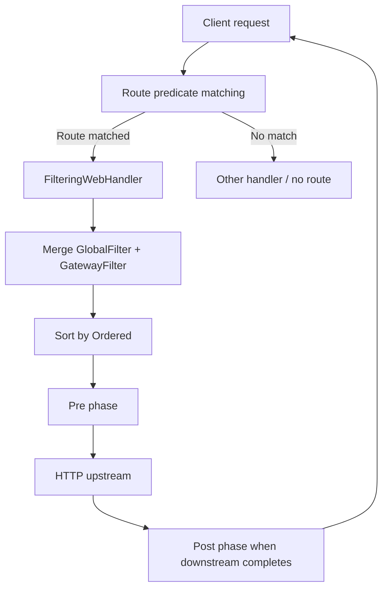
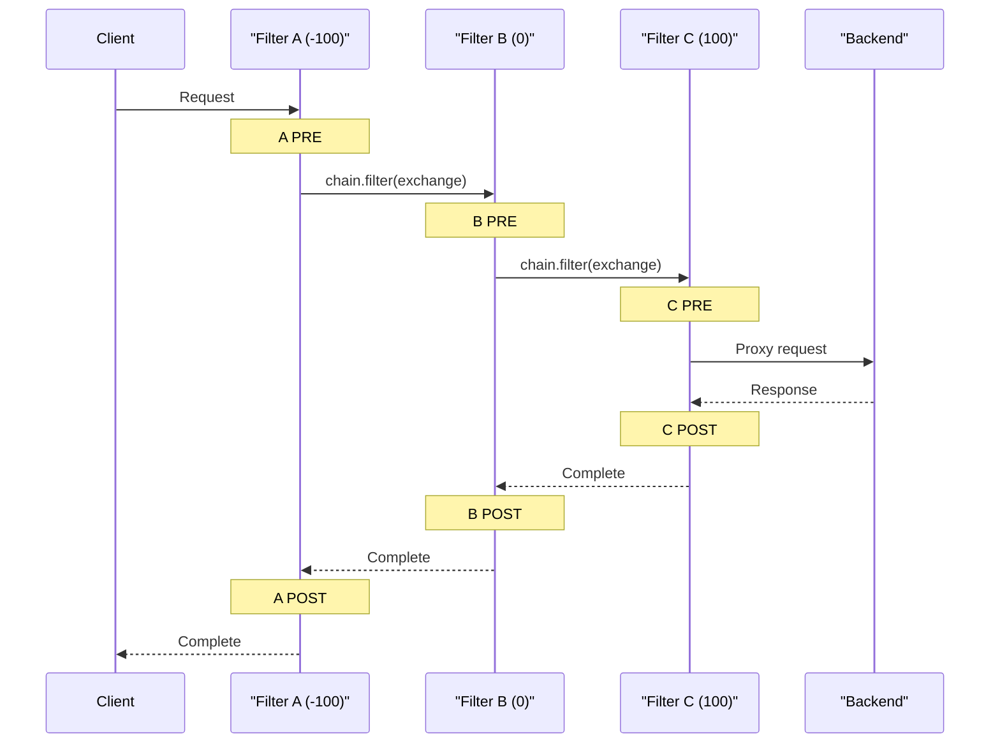

# `Ordered` and Reverse Pre/Post Execution Order in Spring Cloud Gateway

In **Spring Cloud Gateway**, a request does not pass through just a single filter. After finding a matching route via **route predicates**, the gateway combines the **`GlobalFilter`**s and the route's **`GatewayFilter`**s into a single chain, then sorts them before execution. Each filter has the opportunity to process the request in the **pre-phase** (*pre*) and the response in the **post-phase** (*post*).

The most important rule of the **Filter Chain** chapter is: **a filter with a smaller `order` value typically runs its `pre` part first, whereas that same filter's `post` part runs after the inner filters**. This behaves like nested middleware layers or nested `try/finally` blocks.

This article focuses on **Spring Cloud Gateway Server WebFlux**, using the `GlobalFilter`, `GatewayFilter`, `GatewayFilterChain`, and Reactor `Mono<Void>` APIs. Most YAML examples follow **Spring Cloud Gateway 5.0.x** (Spring Cloud 2025.1.x/Spring Boot 4.x) with the `spring.cloud.gateway.server.webflux` prefix. For older Gateway versions or the **Server Web MVC** variant, check the corresponding documentation: MVC uses the WebMvc.fn model and different filter APIs.

## 1. Learning Objectives

After this lesson, you will be able to:

1. Explain how `Ordered` determines a filter's position in the chain.
2. Trace the `pre` and `post` order when multiple filters have different `order` values.
3. Distinguish **route priority** from **filter priority**, as well as `GlobalFilter`, `GatewayFilter`, and default filters.
4. Write filters using `chain.filter(exchange)` together with Reactor `then`, `doOnError`, or `doFinally` with accurate semantics.
5. Use the Java DSL and Actuator to inspect actual execution order.
6. Avoid operational pitfalls related to modifying responses after commit, blocking calls, retries, authentication, rate limiting, and request observability.

## 2. When Is the Filter Chain Formed?

Consider the request:

```http
GET /api/orders/42 HTTP/1.1
Host: localhost:8080
Authorization: Bearer <token>
```

A route may be declared as:

```yaml
server:
  port: 8080

spring:
  cloud:
    gateway:
      server:
        webflux:
          routes:
            - id: orders-route
              uri: http://localhost:9001
              predicates:
                - Path=/api/orders/**
              filters:
                - StripPrefix=1
                - AddRequestHeader=X-Gateway-Route, orders-route
```

High-level sequence:

1. Gateway finds a route with a matching predicate: here `Path=/api/orders/**`.
2. `FilteringWebHandler` receives the route's list of `GatewayFilter`s and the application's registered `GlobalFilter`s.
3. Gateway merges them, adapts them to a compatible form, and **sorts them by `Ordered`**.
4. The filter chain is invoked sequentially: steps before `chain.filter(exchange)` are `pre`; processing chained onto the returned `Mono` is `post`.
5. Internal routing filters forward the request to the backend and process the response non-blockingly.



**Scope boundary:** `GlobalFilter` here belongs to **Spring Cloud Gateway**, which is not synonymous with every filter in Spring WebFlux or Spring Security. For example, Spring Security's `WebFilter` can run in a separate processing layer before reaching gateway routes. Therefore, do not use `GlobalFilter.getOrder()` to infer an absolute order relative to the entire security or Servlet/WebFlux stack of the application.

## 3. What Is `Ordered`?

`org.springframework.core.Ordered` is Spring's interface for prioritized objects:

```java
import org.springframework.core.Ordered;

public class ExamplePriority implements Ordered {
    @Override
    public int getOrder() {
        return -100;
    }
}
```

The return value of `getOrder()` is an **integer**. In the `Ordered` sorting mechanism:

- **Smaller numbers have higher priority**: `-100` comes before `0`, and `0` comes before `100`.
- `Ordered.HIGHEST_PRECEDENCE` corresponds to `Integer.MIN_VALUE`, the highest possible priority.
- `Ordered.LOWEST_PRECEDENCE` corresponds to `Integer.MAX_VALUE`, the lowest possible priority.
- Two components with the **same order** should not be designed assuming their relative order is always deterministic. If order matters, assign distinct values and verify in practice.

Example:

| Filter | `getOrder()` | Entry order into `pre` phase (among these three) |
|---|---:|---:|
| A — validation/correlation | `-100` | 1 |
| B — request transformation | `0` | 2 |
| C — upstream logging | `100` | 3 |

**The `order` value here is the filter order**, not the `order` field inside a route configuration. The `routes[*].order` field determines **which route is evaluated first** when multiple routes can match; it does not sort the filters inside a route.

### 3.1. `@Order` vs. `Ordered`

Spring also supports the `@Order` annotation on classes or bean configurations in many cases. However, when controlling a `GlobalFilter`, the clearest approach is to have the object **implement `Ordered` and return `getOrder()`**. For a `GatewayFilter` declared via the Java DSL, you can use `OrderedGatewayFilter` to attach a specific order. Do not assume that placing `@Order` arbitrarily on a route-builder method replaces assigning order to the actual filter.

### 3.2. When Should You Avoid Extreme Order Values?

Using `Integer.MIN_VALUE` or `Integer.MAX_VALUE` for every custom filter is rarely necessary: Gateway already has internal global filters for URL handling, load balancing, HTTP routing, and response writing. A custom filter should have an **explicit order serving a specific purpose** and be verified alongside the relevant internal filters.

For instance, a filter that rewrites the path before Gateway builds the upstream request needs to run before the relevant routing step; a filter that measures the *entire* chain may need a low order number, but choosing the exact number must be verified on your Gateway version. Internal values can differ between releases.

## 4. Why Does `pre` Go in Ascending Order While `post` Reverses?

The core of the model is calling `chain.filter(exchange)`. Filter A can perform work before calling the chain and hand off to B; B does pre-work before calling the chain and hands off to C; when C finishes, control returns to B and then to A.

Suppose three filters have:

| Filter | Order | Behavior |
|---|---:|---|
| A | `-100` | Log `A PRE`; await downstream; log `A POST` |
| B | `0` | Log `B PRE`; await downstream; log `B POST` |
| C | `100` | Log `C PRE`; await downstream; log `C POST` |

A successful request produces the following **relative log order across A, B, C**:

```text
A PRE
B PRE
C PRE
--- backend/downstream processing ---
C POST
B POST
A POST
```



Nested-structure explanation:

```text
A PRE
  B PRE
    C PRE
      downstream
    C POST
  B POST
A POST
```

**Consequence:** The filter with the highest priority (`order` smallest) **wraps around** the inner filters. It runs `pre` first, while its `post` runs after downstream completes.

More precisely, this reversed order applies to **continuations after `chain.filter(...)` along the successful completion path**. On errors, subscription cancellation, or short-circuiting, specific post-processing blocks may not run; those cases are explained in section 8.

## 5. Illustrating with Reactor `Mono<Void>`

### 5.1. Writing a Filter with Both `pre` and `post`

Basic pattern for a `GlobalFilter`:

```java
import org.slf4j.Logger;
import org.slf4j.LoggerFactory;
import org.springframework.cloud.gateway.filter.GatewayFilterChain;
import org.springframework.cloud.gateway.filter.GlobalFilter;
import org.springframework.core.Ordered;
import org.springframework.stereotype.Component;
import org.springframework.web.server.ServerWebExchange;
import reactor.core.publisher.Mono;

@Component
public class TraceGlobalFilter implements GlobalFilter, Ordered {
    private static final Logger log =
            LoggerFactory.getLogger(TraceGlobalFilter.class);

    @Override
    public int getOrder() {
        return -100;
    }

    @Override
    public Mono<Void> filter(
            ServerWebExchange exchange,
            GatewayFilterChain chain) {

        log.info("A PRE  {}", exchange.getRequest().getPath());

        return chain.filter(exchange)
                .then(Mono.fromRunnable(
                    () -> log.info("A POST {}", exchange.getResponse().getStatusCode())
                ));
    }
}
```

Read the code step by step:

1. When the filter is invoked, `log.info("A PRE ...")` executes.
2. `chain.filter(exchange)` returns a `Mono<Void>` representing downstream processing.
3. `then(Mono.fromRunnable(...))` chains the post-processing task to run **after downstream completes successfully**.
4. If the downstream chain emits an error signal, `then(...)` **does not run** `A POST`; the error propagates.
5. If the subscription is canceled, `A POST` is likewise not guaranteed to run.

This is **reactive asynchronous composition**, not a synchronous call blocking a thread until the backend returns a response. The `Mono` represents asynchronous work and is subscribed to by Spring WebFlux at the appropriate time.

Do not write:

```java
// WRONG if you expect this to be post-processing after the backend:
Mono<Void> result = chain.filter(exchange);
log.info("POST?"); // Runs immediately while building the Mono, before downstream finishes.
return result;
```

If the log truly needs to run after downstream, attach it with an operator such as `then` or `doOnSuccess`, depending on your needs.

### 5.2. `then`, `doOnSuccess`, `doOnError`, and `doFinally`

| Operator | When It Runs | When to Use |
|---|---|---|
| `then(Mono.fromRunnable(...))` | Downstream completes **successfully** | Side post-processing after downstream, forwarding the completion signal |
| `doOnSuccess(...)` | `Mono` completes successfully (for `Mono<Void>`, value is `null`) | Logging/metrics on successful completion |
| `doOnError(...)` | Stream emits an error signal | Error logging, incrementing error counters; does not recover from error |
| `doFinally(signal -> ...)` | Completes successfully, errors, **or is canceled** | Non-blocking resource cleanup, timing, or observing the terminal signal |
| `onErrorResume(...)` | On error when switching to a fallback publisher | Intentional fallback; avoid swallowing errors unintentionally |

Example measuring duration for both success and error/cancellation paths:

```java
@Override
public Mono<Void> filter(
        ServerWebExchange exchange,
        GatewayFilterChain chain) {

    return Mono.defer(() -> {
        long started = System.nanoTime();
        log.info("PRE request={}", exchange.getRequest().getId());

        return chain.filter(exchange)
                .doOnError(error ->
                    log.warn("Gateway downstream error", error))
                .doFinally(signal -> {
                    long millis =
                            (System.nanoTime() - started) / 1_000_000;
                    log.info("FINISH signal={} elapsedMs={}",
                            signal, millis);
                });
    });
}
```

Use `Mono.defer` to start the clock **at subscription time**, matching actual execution timing. `doFinally` observes terminal signals including `CANCEL`, but **does not mean the response is still unsent**. In addition, `doFinally` callbacks may appear in a different log order than expected due to operator placement and scheduling; when reasoning about `pre/post`, start from the successful `then` pattern above and analyze error/cancel paths separately.

**Never call `block()`, `Thread.sleep()`, or synchronous HTTP/JDBC directly on the Reactor event loop** inside a WebFlux filter. A single blocking operation on the event loop can stall many requests. When calling a blocking library is unavoidable, design a shift onto an appropriate scheduler and load-test it, though offloading threads does not create infinite capacity.

## 6. Runnable Example: Two `GlobalFilter`s and One `GatewayFilter`

We create three illustrative filters:

- **A**: `GlobalFilter`, order `-100`.
- **B**: `GatewayFilter` attached to a route, order `0`.
- **C**: `GlobalFilter`, order `100`.

All three log in both phases. This example **replaces** the YAML route configuration in section 2; do not register the same route ID via both approaches simultaneously.

### 6.1. Application and Dependencies

Create a Spring Boot project with **Spring Cloud Gateway Server WebFlux** matching your Spring Cloud BOM and Boot version. In Maven, the main dependency is:

```xml
<dependency>
    <groupId>org.springframework.cloud</groupId>
    <artifactId>spring-cloud-starter-gateway-server-webflux</artifactId>
</dependency>
```

The snippet above is not a complete `pom.xml`: the project still needs a compatible Spring Boot parent/plugin and Spring Cloud BOM. With Gateway WebFlux, use Reactor Netty and avoid accidentally adding `spring-boot-starter-web`.

Main class:

```java
import org.springframework.boot.SpringApplication;
import org.springframework.boot.autoconfigure.SpringBootApplication;

@SpringBootApplication
public class GatewayApplication {
    public static void main(String[] args) {
        SpringApplication.run(GatewayApplication.class, args);
    }
}
```

For the **Java DSL example in this section**, `application.yml` only needs:

```yaml
server:
  port: 8080

spring:
  application:
    name: gateway-filter-order-demo
```

### 6.2. Configuring Three Filters in Java

Place `FilterOrderConfiguration.java` in a package scanned by `@SpringBootApplication`:

```java
import org.slf4j.Logger;
import org.slf4j.LoggerFactory;
import org.springframework.cloud.gateway.filter.GatewayFilter;
import org.springframework.cloud.gateway.filter.GatewayFilterChain;
import org.springframework.cloud.gateway.filter.GlobalFilter;
import org.springframework.cloud.gateway.filter.OrderedGatewayFilter;
import org.springframework.cloud.gateway.route.RouteLocator;
import org.springframework.cloud.gateway.route.builder.RouteLocatorBuilder;
import org.springframework.context.annotation.Bean;
import org.springframework.context.annotation.Configuration;
import org.springframework.core.Ordered;
import org.springframework.web.server.ServerWebExchange;
import reactor.core.publisher.Mono;

@Configuration
public class FilterOrderConfiguration {
    private static final Logger log =
            LoggerFactory.getLogger(FilterOrderConfiguration.class);

    @Bean
    GlobalFilter traceFilterA() {
        return new TraceGlobal("A", -100);
    }

    @Bean
    GlobalFilter traceFilterC() {
        return new TraceGlobal("C", 100);
    }

    @Bean
    RouteLocator demoRoutes(RouteLocatorBuilder builder) {
        GatewayFilter filterB = (exchange, chain) ->
                trace("B", exchange, chain);

        return builder.routes()
                .route("orders-demo", r -> r
                        .path("/api/orders/**")
                        .filters(f -> f
                                .filter(new OrderedGatewayFilter(filterB, 0))
                                .stripPrefix(1))
                        .uri("http://localhost:9001"))
                .build();
    }

    private static Mono<Void> trace(
            String name,
            ServerWebExchange exchange,
            GatewayFilterChain chain) {

        log.info("{} PRE  path={}", name,
                exchange.getRequest().getURI().getRawPath());

        return chain.filter(exchange)
                .then(Mono.fromRunnable(() ->
                        log.info("{} POST status={}", name,
                                exchange.getResponse().getStatusCode())
                ));
    }

    private static final class TraceGlobal
            implements GlobalFilter, Ordered {
        private final String name;
        private final int order;

        private TraceGlobal(String name, int order) {
            this.name = name;
            this.order = order;
        }

        @Override
        public int getOrder() {
            return order;
        }

        @Override
        public Mono<Void> filter(
                ServerWebExchange exchange,
                GatewayFilterChain chain) {
            return trace(name, exchange, chain);
        }
    }
}
```

Technical details to observe:

- `TraceGlobal` implements both `GlobalFilter` **and** `Ordered`, so both A and C get the order returned by `getOrder()`.
- B is a `GatewayFilter` attached to the route via `OrderedGatewayFilter(filterB, 0)`; B applies only to the `orders-demo` route.
- `stripPrefix(1)` is an additional route filter that removes the `api` segment before sending to the backend.
- Among the three custom logging filters, entry order is **A (-100), B (0), C (100)**, and then their `POST` logs unwind in reverse along the **successful completion path**.
- Gateway also has **internal GlobalFilters**; their logs and response-writing events can interleave. The example does not claim these three filters are the entire filter chain.

### 6.3. Small Echo Backend for Testing

If you already have a service handling `GET /orders/42` at `localhost:9001`, you can use it. Otherwise, create `OrderEchoServer.java` in a practice directory:

```java
import com.sun.net.httpserver.HttpServer;
import java.net.InetSocketAddress;
import java.nio.charset.StandardCharsets;

public class OrderEchoServer {
    public static void main(String[] args) throws Exception {
        HttpServer server = HttpServer.create(
                new InetSocketAddress("127.0.0.1", 9001), 0);

        server.createContext("/", exchange -> {
            String bodyText = "method=" + exchange.getRequestMethod()
                    + "\npath=" + exchange.getRequestURI().getRawPath()
                    + "\n";

            byte[] bytes = bodyText.getBytes(StandardCharsets.UTF_8);
            exchange.getResponseHeaders().set(
                    "Content-Type", "text/plain; charset=utf-8");
            exchange.sendResponseHeaders(200, bytes.length);

            try (var output = exchange.getResponseBody()) {
                output.write(bytes);
            }
        });

        server.start();
        System.out.println("Backend listening on localhost:9001");
    }
}
```

Run the backend with JDK 17+ in the first terminal:

```bash
java --add-modules jdk.httpserver OrderEchoServer.java
```

Run the gateway with Maven wrapper in the second terminal:

```bash
# Linux/macOS
./mvnw spring-boot:run

# Windows PowerShell
.\mvnw.cmd spring-boot:run
```

Send a request in the third terminal:

```bash
curl -i http://localhost:8080/api/orders/42
```

The backend will return a body similar to:

```text
method=GET
path=/orders/42
```

In the gateway console, look for the lines printed by the three custom filters. Following the logical order of the three filters, the **success path** output will look like:

```text
A PRE  path=/api/orders/42
B PRE  path=/api/orders/42
C PRE  path=/api/orders/42
C POST status=200 OK
B POST status=200 OK
A POST status=200 OK
```

Notice that the path value in each log reflects when the filter runs: `StripPrefix=1` is another filter in the same chain. Because filter B has explicit order `0` and `StripPrefix` is declared next, the path at B may still be the original path, while C may see the rewritten path. When upgrading libraries or adding more filters, verify based on **actual order** rather than treating this sample path log as a universal contract.

If running `curl` produces no A/B/C logs, check that the configuration class is component-scanned, the `RouteLocator` bean is registered, and the request matches `/api/orders/**`. A request not matching that route will not execute filter B of `orders-demo`.

## 7. Distinguishing `GlobalFilter`, `GatewayFilter`, and `default-filters`

All three participate in request handling, yet differ in **registration scope**:

| Type | Typical Declaration | Scope | Order |
|---|---|---|---|
| `GlobalFilter` | Java bean implementing `GlobalFilter` | Requests that matched a route and pass through `FilteringWebHandler` | By `Ordered` or framework-applied order |
| `GatewayFilter` | `routes[*].filters` or Java DSL | Selected route | Merged and sorted together with global filters |
| Default filter | `spring.cloud.gateway.server.webflux.default-filters` | Added to routes | Becomes a filter in each route's list, then participates in sorting |

Example default filter configuration:

```yaml
spring:
  cloud:
    gateway:
      server:
        webflux:
          default-filters:
            - AddRequestHeader=X-Gateway-Platform, scg
          routes:
            - id: orders-route
              uri: http://localhost:9001
              predicates:
                - Path=/api/orders/**
              filters:
                - StripPrefix=1
```

When a request matches `orders-route`, both the default filter `AddRequestHeader` and the route filter `StripPrefix` participate. **A default filter is not a Java `GlobalFilter`**; it is a filter configuration applied across routes.

### 7.1. Does Line Order in YAML Determine Everything?

For filter factories configured within a route, Spring Cloud Gateway creates `GatewayFilter`s and has a mechanism to assign/sort order; declaration order is a meaningful signal in simple examples. In a real pipeline, however, the chain also includes global filters and filters carrying their own `Ordered` values, so **you cannot deduce the entire order from YAML line positions alone**.

In particular, `order` placed on a route:

```yaml
routes:
  - id: orders-route
    uri: http://localhost:9001
    order: -10
    predicates:
      - Path=/api/orders/**
    filters:
      - StripPrefix=1
```

Here `order: -10` governs **route selection priority**; it does not turn `StripPrefix` into a filter with `order = -10`.

### 7.2. When Should You Use a Global Filter?

Use `GlobalFilter` when processing truly **applies consistently across routes**, such as adding a trusted correlation ID, recording timing metrics, or enforcing a safe logging policy. Use per-route `GatewayFilter`s when logic depends on paths, backends, business domains, header/path transformations, or resilience rules specific to an API group.

A broadly applied filter is not necessarily the right home for every concern: **authentication and authorization** should integrate with Spring Security, **rate limiting** needs a trustworthy identity key, and **TLS** has its own server/client configuration. Never assume registering a global filter replaces those layers.

## 8. Cases That Alter or Skip `post`

The reverse-order rule is easiest to understand when every filter calls `chain.filter(exchange)` and downstream completes **successfully**. In reality, other branches occur.

### 8.1. A Filter Blocks the Request at the Gate

For example, a gateway filter checks a condition and returns an error **without calling the chain**:

```java
GatewayFilter rejectMissingKey = (exchange, chain) -> {
    String key = exchange.getRequest()
            .getHeaders().getFirst("X-Api-Key");

    if (key == null || key.isBlank()) {
        exchange.getResponse().setStatusCode(
                org.springframework.http.HttpStatus.UNAUTHORIZED);
        return exchange.getResponse().setComplete();
    }

    return chain.filter(exchange);
};
```

When the rejection condition triggers, filters **after the blocking point** are not invoked: they get neither `PRE` nor `POST`. Filters **before it** that already called the chain can still run their post-processing continuations once `setComplete()` completes, depending on how they are coded. This is *short-circuiting*.

The snippet above **only illustrates chain control**, not a production API key authentication mechanism. Production systems require proper credential verification, authorization, and safe logging via Spring Security or a fully designed security mechanism.

### 8.2. Downstream Emits an Error

With:

```java
return chain.filter(exchange)
        .then(Mono.fromRunnable(() -> log.info("POST SUCCESS")));
```

if downstream emits an `onError` signal, `POST SUCCESS` **does not run**. To record error logs or metrics, use `doOnError`:

```java
return chain.filter(exchange)
        .doOnError(error -> log.warn("Downstream failed", error))
        .then(Mono.fromRunnable(
                () -> log.info("POST after successful completion")));
```

An HTTP response with status `404` or `503` is **not synonymous** with Reactor `onError`. If the backend returns a valid HTTP `503` and the gateway forwards the response normally, the pipeline can still complete successfully; `then` can still run. To classify results by status, inspect the status code at the stage it is available rather than relying solely on `doOnError`.

### 8.3. Client Disconnects or Subscription Is Canceled

When a client closes the connection mid-flight, the reactive pipeline may receive a **cancel** signal. `doFinally` can observe `SignalType.CANCEL`, whereas `then` on the awaiting stream will not run as a successful `post` phase. This matters for metrics and resource cleanup.

Reliable logging, metrics, or auditing must not depend solely on successful `POST`. Instrumentation should handle both `onError` and cancel while avoiding blocking logging on the event loop.

### 8.4. Retry and Circuit Breaker

**Retry** can re-subscribe/re-execute downstream operations on matching error conditions; therefore `PRE`, `POST` logs, or metrics inside the retry boundary may fire **multiple times for a single client request**. A retry filter's position in the chain significantly affects which parts get re-executed.

**Circuit breaker** can short-circuit upstream calls and switch to a configured fallback. When a fallback returns a successful result, the outer chain can complete successfully even though the primary backend failed. When observing requests, distinguish the final client status from attempt counts, fallback triggers, and circuit state.

For non-idempotent APIs like `POST /payments`, blind retries can cause duplicate side effects. Coordinate timeouts, retry counts, backoff, idempotency keys, and per-route policies.

## 9. `post` and When the Response Is Committed

In WebFlux, **publisher completion** does not always mean every HTTP mutation is still allowed. Once a response is **committed** (headers/status have been flushed to be written over the network), changing the status or adding headers may have no effect or throw an error.

A common mistake:

```java
return chain.filter(exchange)
        .then(Mono.fromRunnable(() ->
                exchange.getResponse().getHeaders()
                        .add("X-Trace-Late", "1")));
```

At certain positions in the filter chain, the response may already be committed before that continuation runs; do not treat this as always safe for adding headers.

If you need to set a header **before the response is committed**, consider setting it in the `pre` phase:

```java
exchange.getResponse().getHeaders()
        .add("X-Gateway-Trace", "demo");
return chain.filter(exchange);
```

Or register a `beforeCommit` callback early:

```java
exchange.getResponse().beforeCommit(() ->
        Mono.fromRunnable(() ->
            exchange.getResponse().getHeaders()
                    .add("X-Response-Marker", "gateway")
        ));
return chain.filter(exchange);
```

`beforeCommit` registers an action to run before the response is committed; do not register it after the response has already committed. Whether response body, status, or headers can still be modified depends on the filter, processing phase, and response state. For modifying response bodies, use specialized filters designed for buffering/transforming while accounting for body size, streaming, content length, and encoding.

### 9.1. `NettyWriteResponseFilter` and Confusion Around "post"

In Server WebFlux with Reactor Netty, Gateway has internal filters such as **`NettyRoutingFilter`** to send requests and **`NettyWriteResponseFilter`** to write responses. `NettyWriteResponseFilter` typically performs its response-writing work in the **post phase** according to its order. Therefore, a post-processing filter placed outside or inside `NettyWriteResponseFilter` can run before or after the actual HTTP write step.

Practical takeaway: **the reversed `POST` order is a rule about callbacks in the chain, not a guarantee that every callback can still edit the HTTP response**. Choose the filter placement and API suited to the data you want to change, then verify on your specific version.

## 10. Observing Filter Order with Actuator and Logs

With the `spring-boot-starter-actuator` dependency, Spring Cloud Gateway provides endpoints to inspect routes, global filters, and route filters. On the Gateway 5.0.x branch, you can configure:

```yaml
management:
  endpoint:
    gateway:
      access: read-only
  endpoints:
    web:
      exposure:
        include: health,info,gateway
```

Place `management` at the root level of `application.yml` alongside existing config, restart the app, and run:

```bash
curl -i http://localhost:8080/actuator/gateway/routes
curl -i http://localhost:8080/actuator/gateway/routes/orders-demo
curl -i http://localhost:8080/actuator/gateway/globalfilters
curl -i http://localhost:8080/actuator/gateway/routefilters
```

These endpoints provide information on filters and order values. Note:

- `/actuator/gateway/globalfilters` shows many **global filters**, including Gateway's internal filters and yours.
- `/actuator/gateway/routefilters` primarily describes **route filter factories**; in some versions, order values here may be `null` or may not reflect the complete runtime order of a specific route.
- `/actuator/gateway/routes/orders-demo` shows the created route and its associated filters; exact output format depends on the version.
- **Actual callback order** should be verified with logs marking `A PRE/B PRE/C PRE/C POST/B POST/A POST`, or configured tracing/metrics tools.

Management endpoints must be access-restricted in environments with real users. Never let public endpoints expose internal network topology, service names, or route policies.

### 10.1. An Order-Verification Checklist

When the order behaves unexpectedly, check one by one:

1. Did the request **match the route** you think it did?
2. Is the `GlobalFilter` registered as a bean, and what does `getOrder()` return?
3. Is the `GatewayFilter` wrapped with `OrderedGatewayFilter`, or does the factory impose its own order?
4. Which **default filters** and internal global filters interleave on the route?
5. Does the `PRE` log run before `chain.filter`, and is the `POST` log actually attached via a Reactor operator?
6. Does any filter short-circuit, retry, fall back, error out, or cancel the request?
7. Was the response already committed before the filter tried to modify headers/status/body?
8. Is the test environment running the exact **Gateway Server WebFlux release** you expect?

For workflows requiring strict ordering, run a small test against a route backed by an echo server and verify actual logs and responses rather than relying on YAML alone.

## 11. Designing Filter Order for API Gateway Policies

Spring Cloud Gateway typically handles multiple responsibilities: predicate-based routing, path/header rewriting, service discovery, authentication, rate limiting, circuit breaking/retry, TLS, and request observability. Filter ordering affects all of these policies.

| Need | Ordering / Boundary Considerations |
|---|---|
| Correlation ID, tracing | Attach/extract IDs early at an appropriate step, propagate downstream, never log sensitive tokens/cookies |
| Access control | Authenticate and authorize via Spring Security at the right layer; never trust a client-supplied header |
| Rewrite path, headers | Run before HTTP routing reads the transformed request; preserve query/encoding requirements |
| Load balancing `lb://` | Know when the URI is rewritten and when the load-balancer filter reads it; verify order relative to URI/path filters |
| Rate limiting | Choose a key from an authenticated or trusted source, return `429` promptly, avoid unnecessary retries |
| Circuit breaker, retry | Understand which filter boundary gets re-invoked and when fallback completes; control overall timeout |
| Metrics/tracing | Measure success, error, and cancel paths; separate logical requests from retry attempts |
| Response header/body | Modify before commit or via dedicated filters; do not assume every `POST` can still mutate the response |
| TLS | Verify certificates for both inbound and outbound hops per deployment model; this is not simply a step in a route filter chain |

**Example:** A logging `GlobalFilter` with a low order can start a timer before calling downstream and stop it after downstream finishes. If `Retry` is in the chain, backend calls can exceed the request count seen by the outer filter. That is why you need both overall gateway-boundary metrics and per-attempt metrics during incident investigation.

In production, never change security/resilience filter order by intuition. Verify behavior under slow backends, `503` responses, large request bodies, mid-flight client cancellations, and already-committed responses.

## 12. Common Mistakes

| Symptom | Common Cause | How to Fix |
|---|---|---|
| `POST` prints before backend responds | `POST` log is called right after `chain.filter(exchange)` without chaining a Reactor operator | Use `then` / `doOnSuccess` to wait for downstream |
| Order among A/B/C changes | `getOrder()` value differs from expectation or shares the same order | Assign distinct, explicit orders and verify via logs/Actuator |
| Setting `route.order: -100` does not make filter run first | Confused **route** priority with **filter** priority | Use `Ordered` / `OrderedGatewayFilter` on the filter |
| A filter produces no `PRE` log | Route did not match or an earlier filter short-circuited | Check predicates, route ID, and return paths |
| `POST` does not run when backend errors | `then` only runs after successful publisher completion | Add `doOnError` / `doFinally` as needed |
| Multiple `PRE` logs for one request | `Retry` re-ran an inner sub-chain or client sent multiple requests | Attach request/correlation IDs and count attempts separately |
| Editing headers in `POST` has no effect | Response may already be committed | Set in pre, `beforeCommit`, or use an appropriate response filter |
| Entire gateway slows down | Blocking operation on Reactor event loop | Use non-blocking APIs, isolate blocking work properly, and load-test |
| Global filter skips a request | Request did not match a gateway route or bean was not registered | Check routes/handlers, component scan, and bean registration |
| Migrating from Server WebFlux to MVC using `GlobalFilter` as-is | Different runtimes and filter APIs | Rewrite using WebMvc.fn / Gateway MVC equivalents |
| Metrics miscount errors | Tracking only `onError` while missing HTTP `5xx` responses that succeed reactively | Record final status, reactive signal, and error origin |
| Tokens appear in logs | Logging all request headers/cookies | Redact `Authorization`, `Cookie`, and personal data |

## 13. Self-Check Knowledge Quiz

**Question 1.** Filter A has `order: -20`, B has `order: 0`, and C has `order: 10`. If all three call the chain and downstream succeeds, what is the `PRE` and `POST` log order?

**Answer:** `A PRE → B PRE → C PRE → C POST → B POST → A POST`.

**Question 2.** Why does the filter with the smallest order run `POST` last?

**Answer:** That filter wraps `chain.filter(exchange)` around the subsequent filters. Its post-processing continuation only executes after the downstream publisher completes.

**Question 3.** Does `order: -10` in a route's YAML make `StripPrefix` run before every `GlobalFilter`?

**Answer:** No. That is the **route selection** order. Filter order is sorted separately inside the merged filter chain.

**Question 4.** When does the following snippet print `POST`?

```java
Mono<Void> result = chain.filter(exchange);
log.info("POST");
return result;
```

**Answer:** The log runs immediately while the filter is assembling and returning the publisher, with no guarantee of waiting for the backend to finish. It does not implement reactive `post` behavior.

**Question 5.** With `return chain.filter(exchange).then(Mono.fromRunnable(...))`, does the callback run if downstream emits `onError`?

**Answer:** No. `then` only transitions to the next publisher after upstream completes successfully. Use `doOnError` to observe errors.

**Question 6.** If the backend returns HTTP `503`, does Reactor definitely emit `onError`?

**Answer:** No. HTTP `503` can be a normally forwarded response. Inspect the status code rather than equating HTTP error statuses with reactive `onError` signals.

**Question 7.** Why should you avoid adding arbitrary headers after `chain.filter(exchange)` in `POST`?

**Answer:** The response may already be committed. Modify headers earlier in pre or use `beforeCommit`/dedicated filters.

**Question 8.** What happens when a filter returns `exchange.getResponse().setComplete()` without calling `chain.filter(exchange)`?

**Answer:** The chain after that filter is cut off; those filters execute neither `PRE` nor `POST`. Outer filters that already called the chain can still execute continuations once the publisher completes.

**Practice task:** Change `traceFilterA()` from order `-100` to `200`, restart, send the same request, and predict the new A/B/C order. Next, change the backend to return a valid `503` and observe `POST`. Then stop the backend to trigger a connection error and compare with `doOnError` behavior. Explain why the three cases are not identical.

## 14. References

- [Spring Cloud Gateway Server WebFlux 5.0 — How It Works](https://docs.spring.io/spring-cloud-gateway/reference/5.0/spring-cloud-gateway-server-webflux/how-it-works.html): how routes are matched and the filter chain is ordered.
- [Spring Cloud Gateway Server WebFlux 5.0 — Global Filters](https://docs.spring.io/spring-cloud-gateway/reference/5.0/spring-cloud-gateway-server-webflux/global-filters.html): global filters and ordering.
- [Spring Cloud Gateway Server WebFlux 5.0 — GatewayFilter Factories](https://docs.spring.io/spring-cloud-gateway/reference/5.0/spring-cloud-gateway-server-webflux/gatewayfilter-factories.html): route filters and configuration.
- [Spring Cloud Gateway Server WebFlux 5.0 — Actuator API](https://docs.spring.io/spring-cloud-gateway/reference/5.0/spring-cloud-gateway-server-webflux/actuator-api.html): inspecting filters/routes.
- [Spring Framework — `Ordered` interface](https://docs.spring.io/spring-framework/docs/current/javadoc-api/org/springframework/core/Ordered.html).
- [Project Reactor — Reference Guide](https://projectreactor.io/docs/core/release/reference/): completion, error, cancellation semantics, and operators.

**Key takeaway:** `Ordered` determines **chain entry order**; higher-priority filters (smaller order values) execute `pre` first but typically execute `post` last because callbacks wrap around `chain.filter(exchange)`. The reverse-order rule holds on the successful completion path; when filters short-circuit, retry, error, or commit the response early, you must evaluate reactive behavior and response-write timing to build a safe, observable, and reliable API Gateway.
