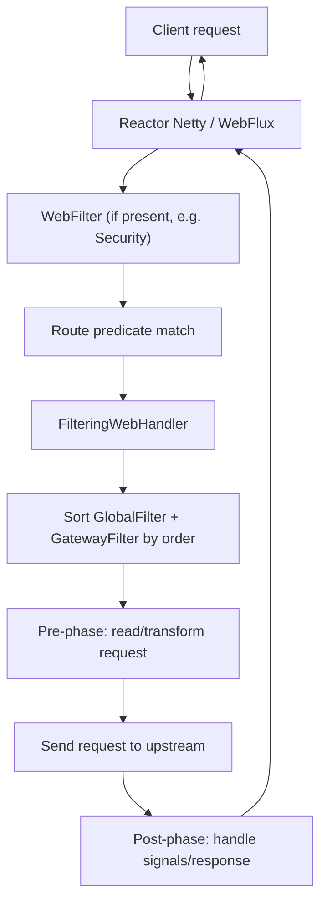
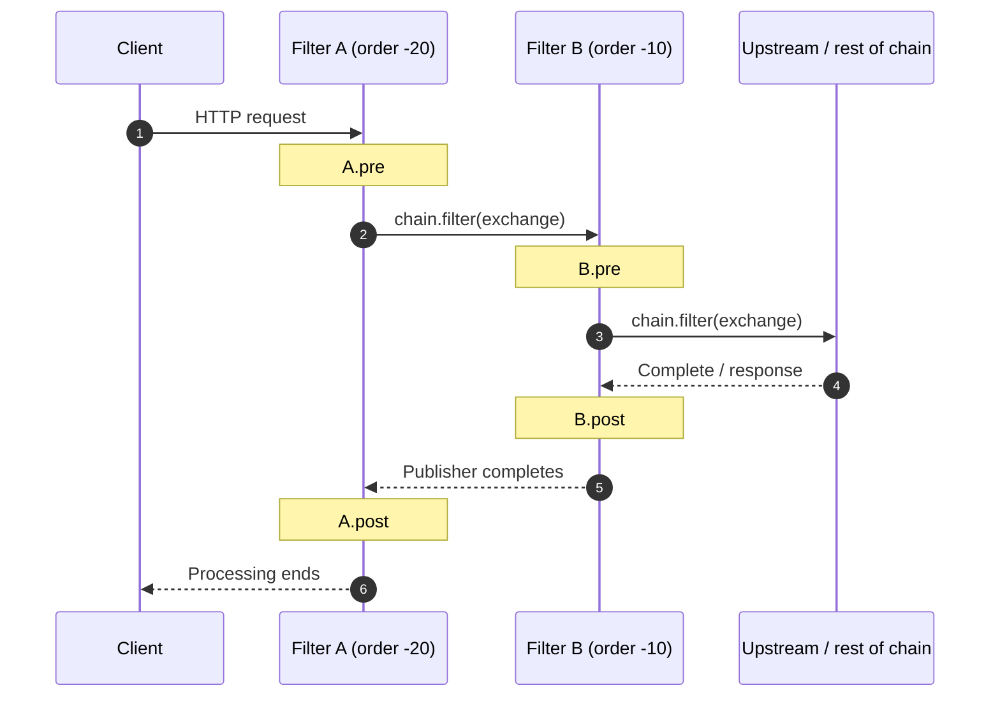

# OrderedGatewayFilter and Filter Order in the Java DSL

## 1. Why Does Filter Order Matter in Spring Cloud Gateway?

In **Spring Cloud Gateway**, after an HTTP request matches a route predicate, Gateway passes the request through a **filter chain** before forwarding it to the target microservice. Filters can rewrite paths, add/remove headers, enforce rate limits, record processing duration, or coordinate retries, circuit breakers, and configured security policies.

Execution order makes a noticeable difference. For instance, a header-inspecting filter sees the client's original value if it runs **before** a header-normalizing filter, whereas it sees the normalized value if it runs **after**. A filter measuring total request duration needs to wrap the remaining filters, while a filter editing response headers must run before the response is committed.

**`OrderedGatewayFilter`** is a way to assign an explicit order to a `GatewayFilter` when configuring routes with the **Java DSL**. It provides precise control over the relative order among filters participating in the same processing chain.

Objectives of this lesson in the **Filter Chain** chapter of the **SPRING_CLOUD_GATEWAY** module:

1. Understand `GatewayFilter`, `GlobalFilter`, `OrderedGatewayFilter`, and `GatewayFilterChain`.
2. Explain the rule: **smaller order runs earlier in the pre-phase and later in the post-phase**.
3. Write Java DSL routes using `RouteLocatorBuilder` and `OrderedGatewayFilter` to assign order.
4. Distinguish when to transform requests, observe responses, handle errors, and handle request cancellation.
5. Verify order using logs/curl while avoiding pitfalls affecting security and performance.

> This lesson applies to the **Spring Cloud Gateway Server WebFlux** variant using `RouteLocatorBuilder`. Spring Cloud Gateway Server MVC has a different filter organization and API. Verify API signatures, starters, and configuration namespaces against your running Spring Cloud Gateway version.

## 2. Which Types of Filters Does a Request Pass Through?

Three common component types in the Gateway processing flow are:

| Component | Scope | Responsibility |
| --- | --- | --- |
| `GatewayFilter` | The route to which the filter is attached | Process request/response when the corresponding route is selected |
| `GlobalFilter` | Routes passing through the Gateway filter chain | Shared processing, such as timing measurement or routing coordination |
| `GatewayFilterChain` | The chain of filters currently being executed | Invoke the next filter via `chain.filter(exchange)` |

In addition, Spring WebFlux has `WebFilter`, and reactive Spring Security typically uses a WebFilter chain for security processing. **WebFilter and GatewayFilter do not belong to the same ordering chain merely by setting the same order value.** A WebFilter wraps the WebFlux handler, whereas a GatewayFilter sits inside Spring Cloud Gateway's filter chain after a route has been selected.

Once Gateway determines the route, `FilteringWebHandler` gathers the **GlobalFilter**s and the route's **GatewayFilter**s, then sorts them by order before execution. Gateway system filters may also be in this chain: URL routing, load balancing, sending requests via an HTTP client, and writing responses.



This diagram illustrates the conceptual relationship. In practice, filters execute on a non-blocking reactive chain; there are no separate "pre" and "post" phases split into two independent lists. Each filter can do work before calling `chain.filter(exchange)`, then attach downstream continuation logic when the returned publisher completes, errors, or is canceled.

## 3. Pre/Post Mechanism and Ordered Priority

A typical WebFlux filter has the signature:

```java
Mono<Void> filter(
    ServerWebExchange exchange,
    GatewayFilterChain chain
);
```

`exchange` holds the HTTP request, response, and exchange attributes; `chain.filter(exchange)` returns a `Mono<Void>` representing the remaining processing. Do not call `.block()` or `.subscribe()` manually to drive this chain.

Example of two filters `A` and `B` with different orders:

```text
A: order = -20
B: order = -10

Inbound request:   A.pre -> B.pre -> remaining filters -> upstream
Outbound response: upstream -> remaining filters -> B.post -> A.post
```

Interpretation:

- `-20` is smaller than `-10`, so **A has higher priority than B** and runs before B in the pre-phase.
- Because B is nested inside A's `chain.filter` call, B's post-processing normally completes before A's post-processing.
- `order = 0` comes after `-10`; `order = 100` comes after `0` in the pre-phase.
- `Ordered.HIGHEST_PRECEDENCE` and `Ordered.LOWEST_PRECEDENCE` represent the two ends of the priority range; negative numbers do **not automatically** mean "system filter" or "security filter."



**Rule to remember:** the highest-priority filter executes **pre earliest** and **post latest** when post-processing is attached to the publisher returned by the chain.

Never infer that "post" can always modify the HTTP response: by the time the callback runs, the response may already be **committed** or the body already sent. When adjusting headers close to response write time, use the `beforeCommit` API at the right moment; section 7 illustrates this.

### When Does Post Not Run?

`chain.filter(exchange).then(Mono.fromRunnable(...))` only runs the callback after the chain **completes successfully**. If an error (`onError`) or subscription cancellation (`cancel`) occurs, the callback after `then` does not necessarily run. When you need resource cleanup or to observe all termination modes, use `doFinally` and check `SignalType`.

## 4. What Is OrderedGatewayFilter?

`OrderedGatewayFilter` belongs to the `org.springframework.cloud.gateway.filter` package. It is a **wrapper** around a `GatewayFilter` that also supplies an order per the `org.springframework.core.Ordered` contract.

A simple creation example:

```java
GatewayFilter audit = (exchange, chain) -> chain.filter(exchange);

GatewayFilter orderedAudit =
        new OrderedGatewayFilter(audit, -20);
```

Concept:

```text
OrderedGatewayFilter
├── Underlying GatewayFilter: audit
└── order: -20
```

The wrapper does not mutate requests, authenticate, or enable metrics on its own. Its primary role is to **attach ordering metadata** to an existing filter. If a route does not include this filter, the wrapper does not execute on that route.

### 4.1. Distinguishing Three Ways to Manage Order

| Approach | Usage Scope | Meaning |
| --- | --- | --- |
| `new OrderedGatewayFilter(filter, order)` | Filter attached to a route | Explicitly assign an order to a filter in Java |
| `GatewayFilter` implementing `Ordered` | Custom filter | The filter object itself provides `getOrder()` |
| `GlobalFilter` also implementing `Ordered` | Globally applied filter | Shared filter sorted alongside route filters in the Gateway chain |

For filters created by a `GatewayFilterFactory` or convenience methods on `GatewayFilterSpec`, Gateway may assign order when assembling route filters. **Do not rely on default declaration position to resolve complex interactions** between custom filters and global filters: if order matters, express order explicitly and verify after configuration.

An `@Order` annotation on a configuration class or a `RouteLocator` bean method does not automatically give that order to every `GatewayFilter` inside the route. When you want to pin the order of **a specific GatewayFilter**, attach the order directly to the filter as shown in this lesson.

### 4.2. Guidelines for Choosing Order Values

- Use small intentional integers, such as `-20` and `-10`, to express **relative ordering among application-written filters**.
- Document the intent in the filter name, comments, or docs; avoid scattered "magic numbers."
- Do not treat these example numbers as a range reserved by Spring: **framework global filters also participate in sorting** and may sit between custom filters.
- When inserting a filter before/after a specific system filter, know that system filter's order in your **exact version** and verify behavior.
- Avoid giving the same order to multiple interdependent filters; the tie-breaking order of equal filters should never be a design requirement.

## 5. Writing Java DSL with OrderedGatewayFilter

Suppose Gateway receives:

```http
GET /api/orders/42 HTTP/1.1
Host: localhost:8080
```

Upstream `order-service` is listening at `http://localhost:8081` and handles `GET /orders/42`. We want:

1. `trace-A` to log events when the request enters and when the chain finishes.
2. `trace-B` to do the same, nested inside `trace-A`.
3. `StripPrefix=1` to drop `/api` before forwarding.

### 5.1. RouteLocatorBuilder Configuration Example

```java
package example.gateway;

import org.slf4j.Logger;
import org.slf4j.LoggerFactory;
import org.springframework.cloud.gateway.filter.GatewayFilter;
import org.springframework.cloud.gateway.filter.OrderedGatewayFilter;
import org.springframework.cloud.gateway.route.RouteLocator;
import org.springframework.cloud.gateway.route.builder.RouteLocatorBuilder;
import org.springframework.context.annotation.Bean;
import org.springframework.context.annotation.Configuration;

@Configuration
public class GatewayRoutesConfig {

    private static final Logger log =
            LoggerFactory.getLogger(GatewayRoutesConfig.class);

    private static GatewayFilter trace(String label) {
        return (exchange, chain) -> {
            log.info("{} pre, path={}",
                    label, exchange.getRequest().getPath());

            return chain.filter(exchange)
                    .doOnSuccess(ignored ->
                            log.info("{} post-success", label))
                    .doOnError(error ->
                            log.warn("{} error: {}",
                                    label, error.toString()))
                    .doFinally(signal ->
                            log.debug("{} finished: {}",
                                    label, signal));
        };
    }

    @Bean
    RouteLocator apiRoutes(RouteLocatorBuilder builder) {
        GatewayFilter traceA = trace("trace-A");
        GatewayFilter traceB = trace("trace-B");

        return builder.routes()
                .route("order-route", r -> r
                        .path("/api/orders/**")
                        .filters(f -> f
                                .filter(new OrderedGatewayFilter(
                                        traceA, -20))
                                .filter(new OrderedGatewayFilter(
                                        traceB, -10))
                                .stripPrefix(1))
                        .uri("http://localhost:8081"))
                .build();
    }
}
```

This example uses the **Spring Cloud Gateway Server WebFlux** API. `log.info` here illustrates sequencing; production can use sampled logging or metrics/tracing to avoid excessive log lines per request.

Steps:

- Predicate `.path("/api/orders/**")` selects `order-route`.
- `.filter(new OrderedGatewayFilter(traceA, -20))` attaches filter A with order `-20`.
- `.filter(new OrderedGatewayFilter(traceB, -10))` attaches filter B with order `-10`.
- `.stripPrefix(1)` drops the `api` segment, turning `/api/orders/42` into `/orders/42`.
- `.uri("http://localhost:8081")` points to upstream; replace with `lb://ORDER-SERVICE` when the project has appropriate service discovery and load balancing.

**On actual order:** A runs pre before B, and B's `post-success` callback runs before A's success callback. GlobalFilters and system filters can still sit between A/B, StripPrefix, and the HTTP client. This example does not claim `StripPrefix` runs immediately after B.

If upstream returns `404` while the request was sent and the chain completed normally, `doOnSuccess` can still run because **HTTP 404 is an HTTP response**, not necessarily a reactive `onError`. Measure HTTP status codes separately from transport exceptions or filter exceptions.

### 5.2. Expected Log Sequence

Assuming no errors and `info` logging enabled:

```text
trace-A pre, path=/api/orders/42
trace-B pre, path=/api/orders/42
trace-B post-success
trace-A post-success
```

Both A and B in this example read the path in the pre-phase **before** `stripPrefix` under the expected order. If Gateway adds other filters or changes order, the result must be re-verified. `doFinally` lines depend on `DEBUG` level and may appear at varying points due to reactive callback chaining.

### 5.3. Notes When Combining with addRequestHeader/rewritePath

Suppose filter A wants to read a header normalized by filter B; A must read it at **the exact stage after B has applied its transformation**. Simply giving A a smaller order does not let A's pre-phase code see a result that B produces later.

Incorrect expectation example:

```java
// A runs before B in pre, so the header may not have been added by B yet:
log.info("value={}",
        exchange.getRequest().getHeaders().getFirst("X-Trusted-Id"));
return chain.filter(exchange);
```

If A strictly needs the normalized header during pre, order B to transform before A or move the read to the proper stage. Also, client-supplied headers are **untrusted data** unless validated; never treat `X-Trusted-Id` as an access credential merely because a filter forwarded it.

## 6. When Should You Use GlobalFilter Instead of GatewayFilter?

A policy applied to **all routes handled by Gateway** can live in a `GlobalFilter`. For example, measuring overall processing time or attaching per-route observability metadata—keeping in mind that error flows before route selection may bypass the Gateway filter chain.

```java
package example.gateway;

import org.slf4j.Logger;
import org.slf4j.LoggerFactory;
import org.springframework.cloud.gateway.filter.GlobalFilter;
import org.springframework.cloud.gateway.filter.GatewayFilterChain;
import org.springframework.core.Ordered;
import org.springframework.stereotype.Component;
import org.springframework.web.server.ServerWebExchange;
import reactor.core.publisher.Mono;

@Component
public class GatewayTimingFilter implements GlobalFilter, Ordered {

    private static final Logger log =
            LoggerFactory.getLogger(GatewayTimingFilter.class);

    @Override
    public int getOrder() {
        return -30;
    }

    @Override
    public Mono<Void> filter(
            ServerWebExchange exchange,
            GatewayFilterChain chain) {

        long started = System.nanoTime();

        return chain.filter(exchange)
                .doFinally(signal -> {
                    long elapsedMs =
                            (System.nanoTime() - started) / 1_000_000;
                    log.debug("gateway duration={}ms signal={}",
                            elapsedMs, signal);
                });
    }
}
```

Here, `getOrder() = -30` is the relative priority of the shared filter in the Gateway chain. It can run pre before route filters A/B (`-20`, `-10`) and run `doFinally` after them when participating in the same chain. `doFinally` receives completion, error, or cancellation signals, yet **does not automatically capture full client-side network time**, and start/end timing depends on the filter's position in the chain.

`GlobalFilter` must still be registered as a Spring bean. You do not wrap a `GlobalFilter` with `OrderedGatewayFilter` to make it global; it already has global scope through the interface and Spring registration.

### Scope Comparison

| Scenario | Appropriate Choice |
| --- | --- |
| Only `/api/orders/**` needs path rewriting or adding a header | `GatewayFilter` attached to the route |
| All routes need shared timing logging | `GlobalFilter` |
| JWT/authorization checks for all endpoints before handlers | Typically Spring Security reactive/`WebFilter` |
| Different rate-limit policies per route | `RequestRateLimiter` or dedicated per-route filter |
| Observing gateway access status | Depending on goal: metrics/tracing, Gateway filter, or WebFilter |

A regular `GatewayFilter` bean does **not automatically apply to every route** just by being a bean. You must attach it to the appropriate routes or use an explicit shared mechanism.

## 7. Transforming Headers in the Right Phase and Response Commit Timing

A practical task is **request ID normalization**: generating a trustworthy value at the gateway, passing it upstream, and returning it to the client. There are two distinct moments:

- The request header must be set **before the HTTP client sends upstream**.
- The response header must be set **before the response is committed**.

The following GatewayFilter example works inside a route. It generates a fresh ID so it does not have to trust an arbitrary client-supplied header:

```java
import java.util.UUID;
import org.springframework.cloud.gateway.filter.GatewayFilter;
import org.springframework.http.server.reactive.ServerHttpRequest;
import org.springframework.web.server.ServerWebExchange;
import reactor.core.publisher.Mono;

GatewayFilter correlationIdFilter = (exchange, chain) -> {
    String id = UUID.randomUUID().toString();

    ServerHttpRequest request = exchange.getRequest().mutate()
            .headers(headers -> headers.set("X-Request-Id", id))
            .build();

    ServerWebExchange updated = exchange.mutate()
            .request(request)
            .build();

    updated.getResponse().beforeCommit(() -> {
        updated.getResponse().getHeaders().set("X-Request-Id", id);
        return Mono.empty();
    });

    return chain.filter(updated);
};

// Attached in GatewayFilterSpec:
// .filter(new OrderedGatewayFilter(correlationIdFilter, -30))
```

When `beforeCommit` is registered before the response commits, the callback runs right before headers are written. In practice, use version-appropriate APIs, ensure error paths also construct responses, and enforce valid header write permissions. Do not use `.then(...)` after sending the response to try changing headers that are already committed.

**Security note:** this example always generates a new ID. If your product needs to preserve a client trace ID, validate its format, length, trust source, and propagation rules; never copy raw tokens or personal data into request IDs or logs.

### Do Not Confuse Post-Processing with Response Mutation

```java
return chain.filter(exchange)
        .then(Mono.fromRunnable(() -> {
            // Suitable for logging/cleanup on success.
            // May be too late to set response headers here.
        }));
```

`Mono.fromRunnable` inside `then` runs **after** downstream finishes normally. The underlying HTTP response may already have been sent. Operations that mutate the response must use the right hooks and order before commit.

## 8. Distinguishing Errors, HTTP Status Codes, and Cancellation

Filter order also matters for error-handling branches. For example:

```java
return chain.filter(exchange)
    .doOnSuccess(ignored -> log.info("chain completed"))
    .doOnError(error -> log.error("chain failed", error))
    .doFinally(signal -> log.debug("terminal signal={}", signal));
```

| Signal | Observable via | Meaning |
| --- | --- | --- |
| Normal completion | `doOnSuccess`, `doFinally(ON_COMPLETE)` | Publisher finished; HTTP status may still be 4xx/5xx |
| Terminated with exception | `doOnError`, `doFinally(ON_ERROR)` | An operation in the chain emitted a reactive error |
| Canceled | `doFinally(CANCEL)` | Subscriber no longer needs the publisher; upstream work might still be in flight |

Do not rely on `doOnSuccess` to conclude the response was `200 OK`. For upstream errors, Gateway can **forward HTTP 4xx/5xx verbatim to the client** without emitting `onError`. Conversely, an exception may be mapped by an outer handler to HTTP 5xx.

To measure error rates accurately, collect **HTTP status**, **route ID**, **response time**, and **exception type**, rather than counting every `doOnError` as HTTP 500.

**Cancellation does not mean rollback:** if a client disconnects after the upstream already processed a payment, canceling the Gateway subscriber does not guarantee the transaction is rolled back. Service-side retry/idempotency and transaction handling must still be designed independently.

## 9. Filter Order and Security / Resilience Features

Filters can directly affect safety and reliability. For example:

| Policy | Why Order Matters | What to Check |
| --- | --- | --- |
| Stripping/normalizing headers | Filters reading or forwarding headers must see controlled values | Never trust client-sent headers as proof of authority |
| JWT authentication | Security layer must protect APIs before sensitive actions | Distinguish Spring Security WebFilter from GatewayFilter |
| Rate limiting | User/API-key rate-limit keys must be authenticated or normalized first | Never derive keys from arbitrary unverified headers |
| Path rewrite | Upstream URI and path must be finalized before routing | `StripPrefix`/`RewritePath` run at the right time |
| Circuit breaker | Scope of filters wrapping the upstream call affects what counts as failure | Choose semantically sound timeouts/fallbacks |
| Retry | A filter wrapping inner operations may cause those operations to re-run | Prevent non-idempotent write requests from repeating |
| TLS | Transport config and trust boundaries govern encrypted hops | TLS does not magically appear just from `OrderedGatewayFilter` |
| Metrics/tracing | Earlier/later timing filters span different segments | Avoid high-cardinality route/path labels |

**Order does not replace policy.** Assigning `-100` to a header-checking filter does not make it robust authorization. In microservices systems, you need Spring Security and service-level authorization in addition to API Gateway policies.

### Pre/Post with Retry and Circuit Breaker

If a filter wraps processing that has retry enabled, determine whether the filter runs **once per Gateway request** or sits inside the publisher re-subscribed on each retry. This depends on order and how the filter is implemented. For instance, logging or mutations with improper side effects may repeat on retries.

For `POST /payments`, never retry automatically just because a 5xx or timeout occurred. If the request succeeded upstream but the response was lost, resending can create a duplicate transaction. Use idempotency keys, bounded retries, and explicitly designed error policies.

## 10. Verifying Order in a Running Environment

### 10.1. Setup

With the `GatewayRoutesConfig` example from section 5:

1. Gateway runs at `http://localhost:8080`.
2. A simple HTTP upstream runs at `http://localhost:8081`, handling `GET /orders/42`.
3. `INFO` logging is enabled for the configuration class.
4. No other route has overlapping predicates that alter route selection.

Test with curl:

```bash
curl -i http://localhost:8080/api/orders/42
```

Gateway is expected to match `order-route`, strip `/api`, and send `/orders/42` upstream. If upstream is not running yet, the request may fail to connect while still printing pre logs from the filters it entered.

### 10.2. Observing Three Outcome Types

| Case | Expected Signs | Interpretation |
| --- | --- | --- |
| Upstream returns 200 | A.pre, B.pre, B.post-success, A.post-success | Chain completed and post order reversed |
| Upstream returns normal 404 | Post-success may still appear | HTTP 404 differs from reactive `onError` |
| Transport error/exception | A/B may log `doOnError` and `doFinally(ON_ERROR)` | Exception unwinds through wrapping filters |
| Client cancels mid-flight | May see `doFinally(CANCEL)` | Inspect how actual transport/handler handles cancellation |

When running on Reactor Netty, callbacks do not necessarily run on the same thread. **Do not use timestamp ordering across different requests** to infer order within a single chain. Include a request ID/trace ID in logs to separate concurrent requests.

### 10.3. Inspecting Route and Filter Configuration

When Spring Boot Actuator and the corresponding Gateway endpoints are added, the app can expose routes/filters metadata for diagnostics, depending on version and management endpoint config. Never expose all management endpoints to the public Internet; enforce proper access controls and avoid logging/exposing secrets.

For thorough verification, use logging/tracing or write integration tests sending requests through Gateway and asserting **selected route, upstream URI/path, headers, and callback order**. Across dependency or version upgrades, such tests catch unexpected order shifts.

## 11. Common Mistakes When Writing OrderedGatewayFilter

| Issue | Consequence | Fix |
| --- | --- | --- |
| Assuming `-20` always runs before every global filter | System filters may have lower order values | Check the framework's actual orders in your running version |
| Assigning the same order to interdependent filters | Ordering becomes ambiguous across upgrades or list edits | Use distinct orders and test execution order |
| Accidentally calling `chain.filter(exchange)` twice | May duplicate requests or side effects | Return a single composed publisher and control retries |
| Forgetting to call `chain.filter(exchange)` | Chain stops without calling upstream unless completing response manually | Only short-circuit when intentionally returning a response |
| Calling `.block()`/`Thread.sleep` on the event loop | Starves other connections | Use non-blocking APIs; isolate unavoidable blocking work |
| Creating a `Mono` without `return` | Framework never subscribes to the publisher; chain misbehaves | `return chain.filter(exchange)` or the composed publisher |
| Setting response headers too late in a post callback | Headers unchanged because response already committed | Use `beforeCommit`/appropriate response API |
| Mutating `exchange.getRequest().getHeaders()` directly | Headers may be immutable or wrong request instance modified | Use `request.mutate()` and `exchange.mutate()` |
| Treating HTTP 5xx as `doOnError` by default | Miscounted error metrics and missing logs | Observe both HTTP status and reactive errors |
| Using unverified headers for authorization | Clients can spoof role/user | Use Spring Security + service-side permission checks |
| Logging sensitive bodies/headers for debugging | Leaks tokens, passwords, or personal data | Redact sensitive data; log only necessary metadata |

### 11.1. Forgetting to Return the Chain

```java
// Wrong: fails to return the publisher holding downstream processing.
GatewayFilter broken = (exchange, chain) -> {
    chain.filter(exchange);  // Publisher created but discarded.
    return Mono.empty();     // Framework only sees an empty Mono.
};
```

Correct pattern:

```java
GatewayFilter correct = (exchange, chain) -> {
    // Brief, non-blocking pre-processing.
    return chain.filter(exchange);
};
```

If a request must be blocked intentionally, the filter can set an error status on `exchange.getResponse()` and complete the response deliberately. In that case, **do not** call the chain further, and ensure status, headers, and body align with security policies.

### 11.2. Do Not Confuse Ordering with Synchronization Guarantees

Reactive filters do not automatically execute sequentially on a single thread. `subscribeOn`, `publishOn`, network callbacks, and upstream communication can affect execution threads. **Order defines the relationship of steps in the chain**, not single-thread pinning or race-freedom if your code creates shared mutable side effects.

Each filter should avoid shared mutable state across requests. Request-scoped metadata can be placed in `ServerWebExchange` attributes or Reactor Context via appropriate mechanisms, while paying attention to security context and tracing.

## 12. Hands-On Exercise: Designing a Filter Chain for order-service

Requirements: a `GET /api/orders/**` route forwards to `http://localhost:8081`. You need to:

- Generate a request ID and normalize the `X-Request-Id` header before calling upstream.
- Record total processing duration and terminal signal.
- Strip `/api` from the path.
- Return `X-Request-Id` to the client before the response commits.

You can arrange two custom filters:

```text
Order -30: correlationIdFilter (sets request ID, registers beforeCommit)
Order -20: timingFilter (doFinally to log duration)
Next: route/framework filters per effective order
Upstream: GET /orders/42
```

Illustrative route definition; `correlationIdFilter` as in section 7, and `timingFilter` is a `GatewayFilter` built similarly to `GatewayTimingFilter` in section 6:

```java
.route("orders", r -> r
    .path("/api/orders/**")
    .filters(f -> f
        .filter(new OrderedGatewayFilter(correlationIdFilter, -30))
        .filter(new OrderedGatewayFilter(timingFilter, -20))
        .stripPrefix(1))
    .uri("http://localhost:8081"))
```

**Expected output checks:**

| Condition | Expectation |
| --- | --- |
| Request without `X-Request-Id` | Gateway generates a new ID; upstream receives that ID |
| Request deliberately sending `X-Request-Id: fake` | Spoofed value is replaced with Gateway-generated ID |
| Upstream returns HTTP 200 | Client receives response with `X-Request-Id`; log records duration |
| Upstream returns HTTP 404 | Client still receives request ID if response commits through hook; not treated as an exception by default |
| Upstream connection error | `doFinally` log records terminal signal; actual status/headers depend on error handler |
| Client cancels request | Observe cancel signal if pipeline receives cancellation; do not assume upstream rollback |

Open question: if you change `timingFilter`'s order from `-20` to `-40`, what extra work might its measured duration include? When is `beforeCommit` still necessary even if a filter has a very small order?

## 13. Summary

**`OrderedGatewayFilter` is the tool for assigning order to a `GatewayFilter` in the Spring Cloud Gateway Server WebFlux Java DSL.** Ascending order determines how filters enter the pre-phase chain; post callbacks wrapping the publisher typically finish in reverse order. `GlobalFilter`s and framework filters also join this chain, so you must inspect the **entire effective order**, not merely the order in source code.

For route predicates, filter chains, path/header transformations, and service discovery, sound ordering ensures requests are shaped properly before reaching microservices. For authentication, rate limiting, circuit breakers, retry, TLS, and observability, filter order must work alongside security, transport, error/cancellation semantics, and the HTTP response lifecycle. A single order number cannot substitute for those mechanisms.

A solid workflow is **diagram the pre/post flow → pick explicit orders → write Java DSL → test with requests and terminal signals → observe at runtime**, especially before deploying custom filters to production.

Official documentation to consult by version:

- [Spring Cloud Gateway Server WebFlux — Global Filters](https://docs.spring.io/spring-cloud-gateway/reference/spring-cloud-gateway-server-webflux/global-filters.html).
- [Spring Cloud Gateway Server WebFlux — Fluent Java Routes API](https://docs.spring.io/spring-cloud-gateway/reference/spring-cloud-gateway-server-webflux/fluent-java-routes-api.html).
- [Spring Framework — Ordered](https://docs.spring.io/spring-framework/docs/current/javadoc-api/org/springframework/core/Ordered.html).
