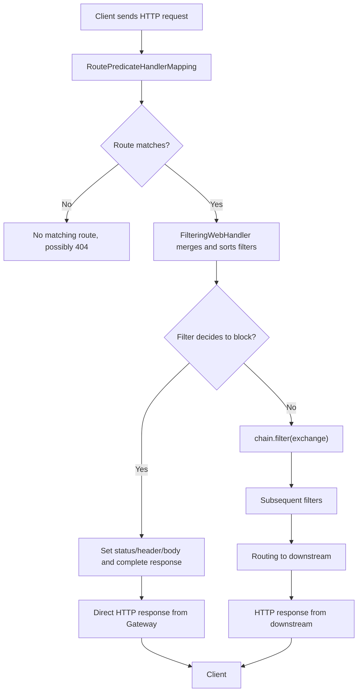

# Short-Circuiting with Direct Responses at the Gateway

## 1. What Is Short-Circuiting?

In **SPRING_CLOUD_GATEWAY**, after an HTTP request matches a route predicate, **Spring Cloud Gateway Server WebFlux** executes the chain of `GlobalFilter`s and the selected route's `GatewayFilter`s. Normally, each filter processes and calls `chain.filter(exchange)` to continue; routing filters then forward the request to the downstream service.

**Short-circuiting** (*short-circuit*) occurs when a filter decides to **complete the HTTP response at the Gateway without calling `chain.filter(exchange)`**. When the filter runs before the routing step, the downstream service does not receive that request.

For example: `GET /api/catalog/blocked` matches the route `Path=/api/catalog/**`, yet Gateway itself returns `503 Service Unavailable` because an endpoint is under maintenance. The backend is never called, while `GET /api/catalog/42` still forwards normally.



This lesson belongs to the **Filter Chain** chapter and dives into returning direct responses, pre/post ordering rules, response commit timing, and testing impact. This knowledge underpins authentication, rate limiting, circuit breakers, retry, TLS, and request observability when operating a microservices entry point safely.

### Objectives

After this lesson, you will be able to:

1. Write a `GlobalFilter` that returns `4xx` or `5xx` and JSON without calling downstream.
2. Explain when to use `response.setComplete()` vs. `response.writeWith(...)`.
3. Describe what happens to preceding and subsequent filters during a short-circuit.
4. Distinguish unmatched-route requests, Gateway-blocked requests, and upstream connection errors.
5. Test with a local backend to **verify no request reaches the backend**.
6. Avoid double-writing responses, mutating headers after commit, blocking the event loop, or building insecure homegrown auth mechanisms.

> **Illustrative versions:** Spring Boot 3.5.x with Spring Cloud 2025.0.x, Gateway Server WebFlux 4.3.x. The starter is `spring-cloud-starter-gateway-server-webflux`; route YAML uses the `spring.cloud.gateway.server.webflux` prefix. Use a compatible, supported version pair and patch release in real projects.

## 2. The Two Branches of `GatewayFilterChain`

The `GlobalFilter` and `GatewayFilter` interfaces share the same core method pattern:

```java
Mono<Void> filter(ServerWebExchange exchange, GatewayFilterChain chain);
```

Where:

- `ServerWebExchange` is the current HTTP request/response context, containing path, headers, attributes, and route metadata.
- `GatewayFilterChain` represents the remaining processing steps.
- Reactor's `Mono<Void>` describes asynchronous work that completes or fails; WebFlux subscribes to and coordinates this publisher.

**Allowing the request to proceed:**

```java
@Override
public Mono<Void> filter(
        ServerWebExchange exchange, GatewayFilterChain chain) {

    // Inspect and/or transform the request.
    return chain.filter(exchange);
}
```

**Terminating the request immediately at the Gateway:**

```java
@Override
public Mono<Void> filter(
        ServerWebExchange exchange, GatewayFilterChain chain) {

    exchange.getResponse().setStatusCode(HttpStatus.FORBIDDEN);
    return exchange.getResponse().setComplete();
}
```

The second example only illustrates completing without a body. Real applications need an **explicit blocking condition** and an HTTP status that accurately reflects the reason.

Note: if a filter returns a publisher that completes the response yet **still calls the chain**, the request may proceed or two components may both attempt to write the response. Conversely, calling `response.setComplete()` without returning or chaining the publisher into the pipeline means completion may never run.

### Short-Circuiting Does Not Stop the Entire Gateway

A short-circuit only interrupts **that single request's processing branch**:

- Gateway continues accepting other requests.
- Downstream filters after the blocking filter do not run in that branch.
- An **outer filter that already ran** may still run its post-processing (`doFinally`, `then`, or other callbacks) after the inner response finishes.
- Components outside the Gateway filter chain, such as Spring WebFlux `WebFilter`s or Spring Security, follow their own lifecycle.
- A Gateway `GlobalFilter` is not automatically invoked for HTTP requests that fail to match any route.

These points are vital when interpreting logs, metrics, and traces for rejected requests.

## 3. Filter Order and Pre/Post Phases

After route selection, `FilteringWebHandler` combines `GlobalFilter`s with the route's `GatewayFilter`s and sorts them by `Ordered`. **Smaller order numbers have higher priority**: logic before `chain.filter(exchange)` runs earlier, while wrapping post-processing logic typically runs later in reverse order.

Suppose an illustrative chain:

| Filter | Order | Role |
| --- | ---: | --- |
| `TraceFilter` | `-200` | Logs PRE, then `doFinally` logs END. |
| `DemoShortCircuitFilter` | `-100` | If an endpoint is paused, returns 503 at Gateway. |
| Other route filters | Ordered later in this illustration | Path/header transformations. |
| HTTP routing filter | Ordered later in this illustration | Proxies to upstream. |

**Non-blocking** flow:

```text
TraceFilter.PRE
  DemoShortCircuitFilter: allow
    Route filters
      HTTP proxy -> upstream
  Inner filters complete
TraceFilter.END
```

**Short-circuit** flow:

```text
TraceFilter.PRE
  DemoShortCircuitFilter: deny
    response.setStatusCode(503)
    response.writeWith(...)
    [chain.filter(exchange) not called]
TraceFilter.END
```

Seeing `TRACE END` **does not prove the backend was called**. It only indicates that the publisher observed by `TraceFilter` emitted a termination signal.

Do not assume every `GlobalFilter` always runs before every `GatewayFilter`: filters are sorted together. If order affects security, response writing, or routing, verify the actual order in your exact version and write integration tests.

## 4. Creating a Direct HTTP Response

A minimal HTTP response consists of a status code, optional headers, and a body.

### 4.1. Returning a Status Without a Body

```java
ServerHttpResponse response = exchange.getResponse();
response.setStatusCode(HttpStatus.TOO_MANY_REQUESTS);
response.getHeaders().set("Retry-After", "30");
return response.setComplete();
```

This returns `429 Too Many Requests` with a retry hint. **This is only a response example, not a complete rate limiter**. Real rate limiting requires quota policies, counters, and state coordination across multiple instances.

### 4.2. Returning a JSON Body

```java
ServerHttpResponse response = exchange.getResponse();
response.setStatusCode(HttpStatus.SERVICE_UNAVAILABLE);
response.getHeaders().setContentType(MediaType.APPLICATION_JSON);
response.getHeaders().setCacheControl("no-store");

byte[] payload = """
        {"code":"MAINTENANCE","message":"Temporarily unavailable"}
        """.getBytes(StandardCharsets.UTF_8);

response.getHeaders().setContentLength(payload.length);

return response.writeWith(
        Mono.just(response.bufferFactory().wrap(payload))
);
```

This code uses Java 17 (text blocks), lives inside a `filter(...)` method, and requires imports for `ServerHttpResponse`, `HttpStatus`, `MediaType`, `StandardCharsets`, and `Mono`. Once the body finishes writing, the response ends. Never call `setComplete()` again or continue the chain on that branch.

| API | Purpose | Caution |
| --- | --- | --- |
| `setStatusCode(...)` | Set HTTP status before commit. | Not guaranteed to work once the response starts sending. |
| `getHeaders().setContentType(...)` | Declare body media type. | Returned JSON should set the appropriate content type. |
| `setComplete()` | Complete a response with no body. | Returns `Mono<Void>`; must be returned or composed. |
| `writeWith(Publisher<DataBuffer>)` | Write body asynchronously. | Return the resulting publisher; avoid writing twice. |
| `beforeCommit(...)` | Register a callback before commit. | Useful for adding headers; does not replace blocking logic at the proper stage. |

**Commit boundary:** once a response is committed, changing status, headers, or body may no longer take effect. Therefore, a short-circuit filter should decide to block **before routing/response writing** and return a single publisher once. Never add response headers inside `doFinally` expecting it to succeed reliably, as the callback may run after commit or after subscription cancellation.

### 4.3. Choosing a Meaningful Status

| Status | When Appropriate | Things to Watch |
| --- | --- | --- |
| `400 Bad Request` | Gateway detects malformed syntax or invalid input. | Do not use it to mask upstream errors. |
| `401 Unauthorized` | Valid authentication credentials missing for a protected resource. | Needs proper `WWW-Authenticate` challenge; use Spring Security. |
| `403 Forbidden` | Request is identified but lacks sufficient permissions. | Never infer permissions solely from an arbitrary client header. |
| `404 Not Found` | No matching route/handler, or intentionally hiding resource existence. | Distinguish from a matched route blocked by a filter. |
| `429 Too Many Requests` | Exceeded rate-limit policy. | Can include `Retry-After` per policy. |
| `503 Service Unavailable` | Gateway temporarily unable to serve or feature under maintenance. | Can send `Retry-After` if an appropriate duration is known. |

A filter returning `200 OK` with JSON containing `"error":"forbidden"` misleads SDKs, HTTP clients, tracing, and metrics. Responses should follow HTTP semantics.

## 5. Practice: Blocking One Endpoint While Allowing Another Through

We use **one route** with two URLs:

- `GET /api/catalog/blocked` → Gateway returns `503` and JSON directly.
- `GET /api/catalog/42` → Gateway forwards the request to the Echo backend at `127.0.0.1:9001`.

The `blocked` condition is hardcoded solely to clarify short-circuiting. In production, real maintenance or blocking decisions must come from managed policies/configuration rather than this learning example.

### 5.1. Maven and Application Configuration

Use JDK 17+, Maven, and a compatible Spring Boot 3.5.x + Spring Cloud 2025.0.x pair. Illustrative `pom.xml` with starting versions:

```xml
<?xml version="1.0" encoding="UTF-8"?>
<project xmlns="http://maven.apache.org/POM/4.0.0"
         xmlns:xsi="http://www.w3.org/2001/XMLSchema-instance"
         xsi:schemaLocation="http://maven.apache.org/POM/4.0.0
                             https://maven.apache.org/xsd/maven-4.0.0.xsd">
    <modelVersion>4.0.0</modelVersion>

    <parent>
        <groupId>org.springframework.boot</groupId>
        <artifactId>spring-boot-starter-parent</artifactId>
        <version>3.5.0</version>
        <relativePath/>
    </parent>

    <groupId>com.example</groupId>
    <artifactId>short-circuit-gateway</artifactId>
    <version>0.0.1-SNAPSHOT</version>

    <properties>
        <java.version>17</java.version>
    </properties>

    <dependencyManagement>
        <dependencies>
            <dependency>
                <groupId>org.springframework.cloud</groupId>
                <artifactId>spring-cloud-dependencies</artifactId>
                <version>2025.0.0</version>
                <type>pom</type>
                <scope>import</scope>
            </dependency>
        </dependencies>
    </dependencyManagement>

    <dependencies>
        <dependency>
            <groupId>org.springframework.cloud</groupId>
            <artifactId>spring-cloud-starter-gateway-server-webflux</artifactId>
        </dependency>
    </dependencies>

    <build>
        <plugins>
            <plugin>
                <groupId>org.springframework.boot</groupId>
                <artifactId>spring-boot-maven-plugin</artifactId>
            </plugin>
        </plugins>
    </build>
</project>
```

The example uses Boot 3.5.0/Cloud 2025.0.0 for compatibility illustration; new projects should consult the compatibility matrix and choose a supported patch release. Do not pin a separate version on the Gateway starter and do not add `spring-boot-starter-web` to the WebFlux example.

Create `src/main/java/com/example/gateway/GatewayApplication.java`:

```java
package com.example.gateway;

import org.springframework.boot.SpringApplication;
import org.springframework.boot.autoconfigure.SpringBootApplication;

@SpringBootApplication
public class GatewayApplication {
    public static void main(String[] args) {
        SpringApplication.run(GatewayApplication.class, args);
    }
}
```

Configure `src/main/resources/application.yml`:

```yaml
server:
  port: 8080

spring:
  application:
    name: short-circuit-gateway
  cloud:
    gateway:
      server:
        webflux:
          routes:
            - id: catalog-route
              uri: http://127.0.0.1:9001
              predicates:
                - Path=/api/catalog/**
              filters:
                - StripPrefix=2
                - AddRequestHeader=X-Passed-Gateway, yes
```

The route matches both `blocked` and `42`. For normal requests, `StripPrefix=2` turns `/api/catalog/42` into `/42`; `AddRequestHeader` adds the header for downstream. For short-circuited requests, subsequent filters do not execute on that branch.

### 5.2. Creating `DemoShortCircuitFilter`

Create `src/main/java/com/example/gateway/DemoShortCircuitFilter.java`:

```java
package com.example.gateway;

import java.nio.charset.StandardCharsets;

import org.springframework.cloud.gateway.filter.GatewayFilterChain;
import org.springframework.cloud.gateway.filter.GlobalFilter;
import org.springframework.core.Ordered;
import org.springframework.http.HttpStatus;
import org.springframework.http.MediaType;
import org.springframework.http.server.reactive.ServerHttpResponse;
import org.springframework.stereotype.Component;
import org.springframework.web.server.ServerWebExchange;

import reactor.core.publisher.Mono;

@Component
public class DemoShortCircuitFilter implements GlobalFilter, Ordered {

    @Override
    public int getOrder() {
        return -100;
    }

    @Override
    public Mono<Void> filter(
            ServerWebExchange exchange, GatewayFilterChain chain) {

        String path = exchange.getRequest().getPath().value();

        if (!"/api/catalog/blocked".equals(path)) {
            // Normal request: continue the chain.
            return chain.filter(exchange);
        }

        // Blocked request: respond directly at Gateway.
        ServerHttpResponse response = exchange.getResponse();
        response.setStatusCode(HttpStatus.SERVICE_UNAVAILABLE);
        response.getHeaders().setContentType(MediaType.APPLICATION_JSON);
        response.getHeaders().setCacheControl("no-store");
        response.getHeaders().set("X-Gateway-Decision", "local-short-circuit");

        String json = """
                {"code":"CATALOG_PAUSED",
                 "message":"This catalog endpoint is temporarily unavailable"}
                """;

        byte[] payload = json.getBytes(StandardCharsets.UTF_8);
        response.getHeaders().setContentLength(payload.length);

        return response.writeWith(
                Mono.just(response.bufferFactory().wrap(payload))
        );

        // No chain.filter(exchange) on the blocked branch.
    }
}
```

Trace the code step by step:

1. `@Component` registers a `GlobalFilter` bean; it joins the Gateway chain when a route is selected.
2. `Ordered` gives the filter order `-100`; in this example that places it earlier than typical proxy steps. When combining multiple filters, verify the actual order.
3. For paths other than `/api/catalog/blocked`, the filter **returns** `chain.filter(exchange)` directly, allowing the route to continue.
4. For `/api/catalog/blocked`, the filter sets `503`, headers, JSON body, and returns the `Mono<Void>` created by `writeWith`.
5. There is no `chain.filter(exchange)` on the blocked branch, so downstream route/proxy steps are skipped on that branch.

The response includes `X-Gateway-Decision: local-short-circuit` for easy identification in the demo. This header is not a mandatory HTTP standard and must not be used externally as security proof.

### 5.3. Adding an Outer Observation Filter

To see that an earlier filter's callback still executes, add `src/main/java/com/example/gateway/TraceFilter.java`:

```java
package com.example.gateway;

import org.slf4j.Logger;
import org.slf4j.LoggerFactory;
import org.springframework.cloud.gateway.filter.GatewayFilterChain;
import org.springframework.cloud.gateway.filter.GlobalFilter;
import org.springframework.core.Ordered;
import org.springframework.stereotype.Component;
import org.springframework.web.server.ServerWebExchange;

import reactor.core.publisher.Mono;

@Component
public class TraceFilter implements GlobalFilter, Ordered {

    private static final Logger log =
            LoggerFactory.getLogger(TraceFilter.class);

    @Override
    public int getOrder() {
        return -200;
    }

    @Override
    public Mono<Void> filter(
            ServerWebExchange exchange, GatewayFilterChain chain) {

        String path = exchange.getRequest().getPath().value();
        log.info("TRACE PRE path={}", path);

        return chain.filter(exchange)
                .doFinally(signal ->
                        log.info("TRACE END path={} signal={}", path, signal));
    }
}
```

`-200` is smaller than `-100`, so `TraceFilter` wraps outside the blocking filter in this example. `doFinally` runs when the publisher finishes or is canceled, **without guaranteeing** that the response succeeded or that the backend was called.

### 5.4. Creating an Echo Backend to Verify Request Arrival/Absence

Create `EchoBackend.java` outside the Gateway source tree (JDK 17 includes `HttpServer`):

```java
import com.sun.net.httpserver.HttpServer;
import java.net.InetSocketAddress;
import java.nio.charset.StandardCharsets;

public class EchoBackend {
    public static void main(String[] args) throws Exception {
        HttpServer server = HttpServer.create(
                new InetSocketAddress("127.0.0.1", 9001), 0);

        server.createContext("/", exchange -> {
            String path = exchange.getRequestURI().getPath();
            System.out.println("UPSTREAM RECEIVED " + path);

            String passed = exchange.getRequestHeaders()
                    .getFirst("X-Passed-Gateway");

            byte[] body = ("upstream-path=" + path + "\n"
                    + "passed-gateway=" + passed + "\n")
                    .getBytes(StandardCharsets.UTF_8);

            exchange.getResponseHeaders().set(
                    "Content-Type", "text/plain; charset=UTF-8");
            exchange.sendResponseHeaders(200, body.length);

            try (var output = exchange.getResponseBody()) {
                output.write(body);
            }
        });

        server.start();
        System.out.println("Echo backend running at 127.0.0.1:9001");
    }
}
```

This backend is strictly for loopback testing. Do not use it as a production service: it has no authentication, rate limiting, or TLS.

Run in **terminal A**:

```bash
java EchoBackend.java
```

Run in **terminal B**, inside the project directory containing `pom.xml`:

```bash
mvn spring-boot:run
```

If the project uses the Maven Wrapper, run `./mvnw spring-boot:run` on Linux/macOS or `mvnw.cmd spring-boot:run` on Windows.

### 5.5. Sending an Allowed Request

In **terminal C**:

```bash
curl -i http://127.0.0.1:8080/api/catalog/42
```

Expected:

```http
HTTP/1.1 200 OK
Content-Type: text/plain; charset=UTF-8

upstream-path=/42
passed-gateway=yes
```

The backend prints `UPSTREAM RECEIVED /42`. This proves the route matched, path/header filters worked, and the request reached downstream.

### 5.6. Sending a Short-Circuited Request

```bash
curl -i http://127.0.0.1:8080/api/catalog/blocked
```

Expected (other HTTP headers may vary):

```http
HTTP/1.1 503 Service Unavailable
Content-Type: application/json
Cache-Control: no-store
X-Gateway-Decision: local-short-circuit

{"code":"CATALOG_PAUSED",
 "message":"This catalog endpoint is temporarily unavailable"}
```

At the Gateway, both `TRACE PRE` and `TRACE END` can still appear. At the backend, `UPSTREAM RECEIVED /blocked` **must not appear**.

You can stop backend `9001` with `Ctrl+C` and call the `blocked` request again: the local `503` response is still returned. For `/api/catalog/42`, Gateway now tries to proxy, encounters a connection failure, and typically returns a 5xx status. **Both errors can carry status 503 yet originate from different sources**; response markers and logs/traces help distinguish them.

Try a request matching no route:

```bash
curl -i http://127.0.0.1:8080/no-route
```

If no other handler exists, the request usually gets `404 Not Found`. This is the case where no route was selected, unlike a request that matched a route and was actively terminated by a filter.

## 6. What If Only One Route Needs Blocking?

A `GlobalFilter` is registered once and can affect many matched routes. When logic applies only to one route, you can create a **route-specific `GatewayFilter`** via the Java DSL or a `GatewayFilterFactory`.

Example inside a Spring configuration class with the corresponding imports:

```java
@Bean
RouteLocator demoRoutes(RouteLocatorBuilder builder) {

    GatewayFilter denyDisabled = (exchange, chain) -> {
        String path = exchange.getRequest().getPath().value();

        if (!path.endsWith("/disabled")) {
            return chain.filter(exchange);
        }

        ServerHttpResponse response = exchange.getResponse();
        response.setStatusCode(HttpStatus.FORBIDDEN);
        return response.setComplete();
    };

    return builder.routes()
            .route("limited-route", spec -> spec
                    .path("/limited/**")
                    .filters(f -> f.filter(denyDisabled))
                    .uri("http://127.0.0.1:9001"))
            .build();
}
```

This is a **structural illustration**, not a standalone compilable class without imports and `@Configuration`. When using the Java DSL route above, avoid registering an additional YAML route with an overlapping predicate and guessing route order.

| Characteristic | `GlobalFilter` | Route-Attached `GatewayFilter` |
| --- | --- | --- |
| Scope | Requests matching a Gateway route; code decides policy. | Only the route where the filter is attached. |
| Declaration | Spring bean, typically `@Component`. | `RouteLocatorBuilder` or a filter factory in the route. |
| Can short-circuit? | Yes. | Yes. |
| Order | `Ordered` and Gateway's sorting mechanism. | Joins the combined chain; can be assigned an order. |
| Risk | Overly broad condition affecting many routes. | Forgetting to attach the filter to a route that needs protection. |

Do not use a custom-written `GatewayFilter` checking a simple header as a substitute for a proper security system.

## 7. Applying the Mechanism Properly Across Gateway Features

### Authentication and Authorization

In WebFlux, Spring Security typically uses `WebFilter`s at the WebFlux layer. A request lacking a valid token may be rejected before entering the Gateway filter chain. Use OAuth2 Resource Server/JWT or a supported mechanism to validate signature, issuer, audience, token expiration, and permissions. **Checking that an `Authorization` header exists does not mean the caller is authenticated**.

When returning `401`, comply with `WWW-Authenticate` requirements; `403` normally expresses that the caller was identified but lacks sufficient permissions. Control forwarding of tokens/headers downstream and never log tokens.

### Rate Limiting

`RequestRateLimiter` is a built-in Spring Cloud Gateway filter that typically returns `429 Too Many Requests` when a policy is exceeded. The limiter requires a `KeyResolver`, appropriate counters/state store, and a policy when no key can be resolved. With multiple Gateway instances, account for distributed state coordination. The `return response.setComplete()` example only shows **how to return a response**, not a complete rate-limiting system.

### Circuit Breaker and Fallback

A circuit breaker can reject downstream calls while open or switch to a configured fallback. A fallback can return a Gateway-generated response, but breaker state and upstream error handling must be configured and measured properly. Returning `200` from a fallback does not prove the original request succeeded on the backend.

### Retry

A retry filter can re-execute part of the downstream chain; know your filter's position to avoid miscounting attempts in logs or amplifying side effects. For state-mutating `POST`/`PATCH` calls, blind retries can cause duplicate operations. A short-circuit before retry normally prevents downstream retry from triggering, whereas a filter in a different position can behave differently.

### TLS, Headers, and Observability

TLS on client–Gateway and Gateway–upstream connections is configured separately. A response short-circuited at Gateway may never perform a TLS handshake with upstream. When using `Forwarded`, `X-Forwarded-*`, or `Host` in policy decisions, explicitly define trusted proxies; client headers can be spoofed.

For request observability, log route ID, HTTP status, latency, trace ID, and a safe label indicating the response came from Gateway. Avoid logging tokens, cookies, or sensitive bodies. A `TRACE END` line does not prove upstream was called, and status 503 alone does not identify the error source.

## 8. Common Mistakes and Fixes

| Symptom | Common Cause | How to Fix |
| --- | --- | --- |
| Intended to block, yet backend still receives request | Filter still calls `chain.filter(exchange)`. | Return one branch exclusively: local response or chain. |
| `response.setComplete()` has no effect | Called and discarded its `Mono<Void>`. | `return response.setComplete();`. |
| `response already committed` | Status/header/body edited after response write, or two writers collided. | Decide before commit; ensure only one publisher writes the response. |
| JSON body is empty or wrong Content-Type | Returned `setComplete` instead of `writeWith`, omitted headers, or mishandled DataBuffer. | Use `writeWith`, set status/headers first, verify byte length. |
| `TRACE END` logged, yet backend saw no request | An inner filter short-circuited. | Check route/markers and backend logs; do not infer from END. |
| Blocking filter does not apply | Path did not match, request bypassed Gateway routes, or order ran too late. | Inspect route predicate, mapping, chain order, and preconditions. |
| Valid requests are also blocked | `GlobalFilter` condition is too broad. | Scope by route ID/path/policy and test other routes. |
| Gateway slows under concurrency | Calling `block()`, synchronous I/O, or `Thread.sleep` in a reactive filter. | Use reactive APIs and proper timeouts. |
| Client receives 200 with an error body | Wrong status code set or another handler wrote the response. | Return proper 4xx/5xx matching the situation. |
| 503 does not distinguish maintenance from upstream error | Looking only at status code. | Use safe markers, tracing, metrics, and backend logs. |

**Wrong:**

```java
response.setStatusCode(HttpStatus.FORBIDDEN);
response.setComplete();       // Mono is discarded.
return chain.filter(exchange); // Request still continues!
```

**Right:**

```java
response.setStatusCode(HttpStatus.FORBIDDEN);
return response.setComplete();
```

**Avoid:**

```java
response.writeWith(Mono.just(dataBuffer));
return chain.filter(exchange); // Two processing paths may both try writing the response.
```

Never call `subscribe()` or `block()` to force immediate response flushing: let Spring WebFlux subscribe to the returned `Mono<Void>`.

## 9. Testing Checklist

| Scenario | Input | Verification Result |
| --- | --- | --- |
| Blocked request | `GET /api/catalog/blocked` | 503/JSON/marker; backend **receives no** request. |
| Allowed request | `GET /api/catalog/42` | 200; backend receives `/42` and added header. |
| No route | `GET /no-route` | Typically 404, does not traverse the catalog route chain. |
| Backend down while blocking | `GET /api/catalog/blocked` | Still returns local response. |
| Backend down while allowing | `GET /api/catalog/42` | Connection/proxy error, distinct from local response. |
| Pre/post logs | Routed requests | Outer filter still logs END on short-circuit. |
| Response commit | Filters editing headers/body together | No double-write; correct status/headers. |
| Concurrent load | Many allowed and blocked requests | No shared mutable state or blocking I/O. |

For automated tests, use an HTTP test server with a request counter. Asserting the counter **does not increment** when Gateway short-circuits is stronger proof than checking status 503 alone. For production readiness, add tests for HEAD, streaming bodies, client disconnects, timeouts, retries, and multi-route setups.

## 10. Self-Check Questions

**1. Why is calling `response.setStatusCode(403)` alone not enough to stop the chain?**

Because you must return the response-completing publisher, such as `return response.setComplete();`, and avoid calling `chain.filter(exchange)` on the blocked branch.

**2. If `TraceFilter` has order `-200` and the blocking filter has order `-100`, why does `TRACE END` still log when the backend received no request?**

Because `TraceFilter` already entered the chain first, and its callback fires when the inner reactive branch terminates.

**3. When do `setComplete()` and `writeWith(...)` differ?**

`setComplete()` finishes a response with no body; `writeWith` streams a body from a data publisher. Both return `Mono<Void>`.

**4. Can an arbitrary client-sent header be used to assert that the caller is authenticated?**

No. You need standard authentication/authorization such as Spring Security WebFlux/OAuth2; raw header values can be spoofed.

**5. Why does a 503 response not prove that Gateway short-circuited?**

A 503 can come from a local response, a backend failure, a LoadBalancer failure, or another infrastructure layer. You need logs/traces/metrics and verification of whether the backend received the request.

**6. Should you call `block()` or `subscribe()` in a filter to write JSON immediately?**

No. Filters must return a reactive publisher so Spring WebFlux can orchestrate execution.

**7. Does a `GlobalFilter` always run for requests that match no route?**

No. A `GlobalFilter` runs inside the selected Gateway route's chain; a WebFlux-layer `WebFilter` has a different scope.

**8. Can short-circuiting filters be used for circuit breakers or rate limiters?**

They can produce the same outcome of not calling the backend, but breaker/limiter policies must be implemented with proper mechanisms, instrumentation, and testing; the path-blocking example here only demonstrates the mechanics.

## Conclusion

In Spring Cloud Gateway Server WebFlux, **short-circuiting** is when a filter returns a `Mono<Void>` to complete Gateway's HTTP response **without calling `chain.filter(exchange)`**. It is a core mechanism for rejecting requests, returning maintenance responses, enforcing rate limits, or serving fallbacks before hitting upstream. Correctness relies on proper status/headers/body, commit boundaries, filter order, and ensuring only a single branch writes the response. When operating Gateway safely, pair this with standard authentication, sound rate-limit/circuit-breaker policies, and tests confirming blocked requests never reach downstream microservices.

### References

- [Spring Cloud Gateway Server WebFlux 4.3 — How It Works](https://docs.spring.io/spring-cloud-gateway/reference/4.3/spring-cloud-gateway-server-webflux/how-it-works.html)
- [Spring Cloud Gateway Server WebFlux 4.3 — Global Filters](https://docs.spring.io/spring-cloud-gateway/reference/4.3/spring-cloud-gateway-server-webflux/global-filters.html)
- [Spring Cloud Gateway Server WebFlux 4.3 — GatewayFilter Factories](https://docs.spring.io/spring-cloud-gateway/reference/4.3/spring-cloud-gateway-server-webflux/gatewayfilter-factories.html)
- [Spring Cloud Gateway Server WebFlux 4.3 — RequestRateLimiter](https://docs.spring.io/spring-cloud-gateway/reference/4.3/spring-cloud-gateway-server-webflux/gatewayfilter-factories/requestratelimiter-factory.html)
- [Spring Framework — ServerHttpResponse](https://docs.spring.io/spring-framework/docs/current/javadoc-api/org/springframework/http/server/reactive/ServerHttpResponse.html)
- [Spring Security — WebFlux Security](https://docs.spring.io/spring-security/reference/reactive/configuration/webflux.html)
- [Spring Cloud — Versions and Release Trains](https://spring.io/projects/spring-cloud/)
