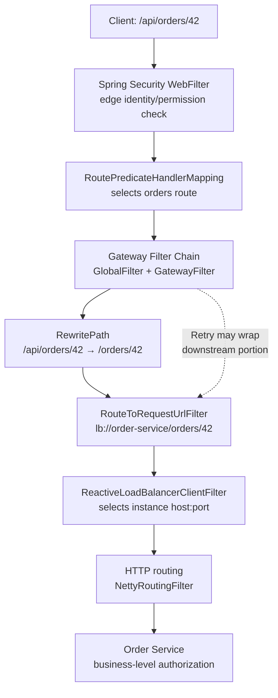
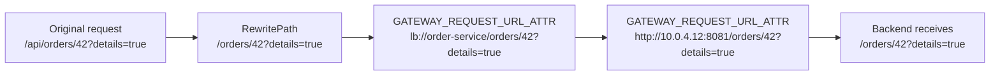
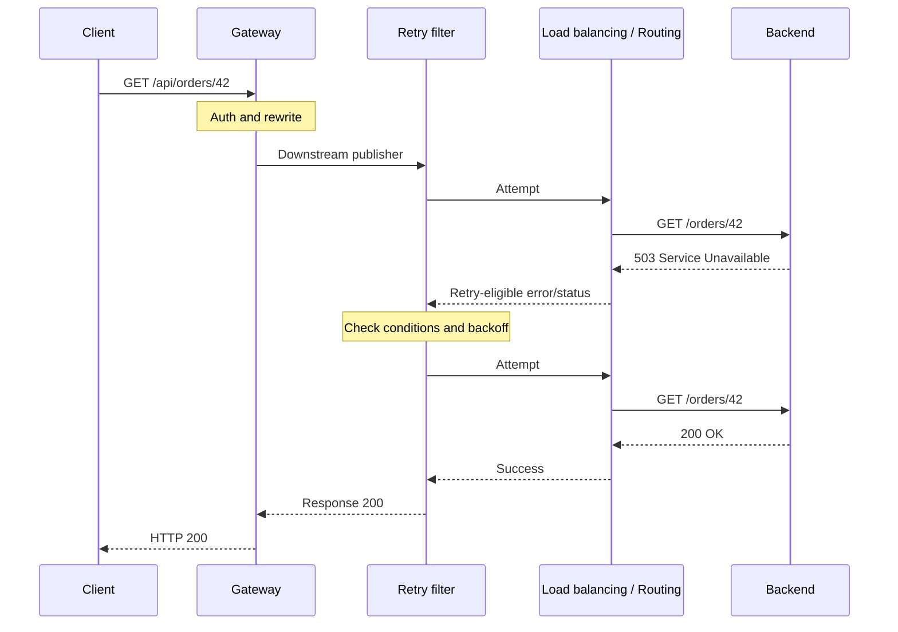

# Order Interactions Between Rewrite, Load Balancing, Retry, and Security

## Lesson Objectives

In the **Filter Chain** chapter, we examine an error-prone area in **Spring Cloud Gateway**: the same request may pass through **authentication**, **path/header rewriting**, **load balancing**, **retry**, and **circuit breaking** before finally reaching a microservice. These features look independent, yet the outcome depends on **execution order** and **the publisher scope wrapped by each filter**.

After this lesson, you will be able to:

- Explain how Spring Cloud Gateway Server WebFlux merges `GlobalFilter`s with `GatewayFilter`s, orders them, and runs **pre/post** phases.
- Identify why path rewriting must happen before target URL construction and before routing.
- Trace URIs across `GATEWAY_ROUTE_ATTR`, `GATEWAY_REQUEST_URL_ATTR`, `lb://` resolution, and HTTP routing.
- Analyze which filters retry wraps, and its impact on security check counts, rate limits, load balancing, and request bodies.
- Place authentication/authorization at the proper layer and avoid trusting client-supplied headers.
- Read logs, run end-to-end tests, and troubleshoot ordering bugs in microservices environments.

> This lesson focuses on **Spring Cloud Gateway Server WebFlux** using `GlobalFilter`, `GatewayFilterChain`, and `ServerWebExchange`. Filter organization in **Spring Cloud Gateway Server MVC** differs. Order constants and factory details must be checked against your deployed dependency versions.

## 1. The Big Picture of a Request

Suppose a client sends:

```http
GET /api/orders/42?details=true HTTP/1.1
Host: api.example.com
Authorization: Bearer <access-token>
```

Gateway needs to authenticate the request, select the `orders` route, rewrite `/api/orders/42` to `/orders/42`, resolve an instance of `order-service`, send the HTTP request to that instance, and optionally retry on transient errors.



This is a **logical model**, not a guarantee that every application has these exact filters. For instance, a system using a static URI `https://backend.example.com` needs no `lb://` step; a project without retry configured makes only a single normal send attempt.

Notable point: in WebFlux, Spring Security normally runs via a **WebFlux `WebFilter`** before Gateway's route matching stage. A custom `GlobalFilter` is only invoked once a request enters the Gateway chain for a matched route. Therefore, you cannot lump authentication, rewriting, retry, and routing into one flat list and assume one comparator orders everything together.

## 2. Two Filter Levels and the Pre/Post Principle

### 2.1. `GlobalFilter` and `GatewayFilter`

Spring Cloud Gateway Server WebFlux uses two primary filter types in the **Gateway filter chain**:

| Component | Scope | Example |
| --- | --- | --- |
| `GlobalFilter` | Applies broadly to requests handled by the Gateway filter chain | Timing filter, `RouteToRequestUrlFilter`, load-balancing filter, routing |
| `GatewayFilter` | Bound to a route, usually created by a `GatewayFilterFactory` | `RewritePath`, `StripPrefix`, `SetRequestHeader`, `Retry`, `RequestRateLimiter` |
| WebFlux `WebFilter` | Belongs to the WebFlux server chain; can run before route mapping | `SecurityWebFilterChain`, CORS/web exchange concerns per config |

After a route matches, `FilteringWebHandler` combines **`GlobalFilter`**s with that route's **`GatewayFilter`**s into a single chain, then sorts by `Ordered`. A filter with a **smaller** `order` has **earlier priority in the pre-phase**. When filters nest via `chain.filter(exchange)`, the post phase runs in reverse direction.

Hypothetical example:

| Filter | `order` | Pre Phase | Post Phase |
| --- | ---: | ---: | ---: |
| A: Inbound audit | `-100` | 1 | 3 |
| B: Rewrite | `1` | 2 | 2 |
| C: Retry | `2` | 3 | 1 |

The order numbers in the table illustrate only these three filters, omitting all default filters sitting between them. If filter A wraps B and C, the flow looks like:

```text
A.pre
  B.pre
    C.pre
      ... downstream ...
    C.post
  B.post
A.post
```

Technically, the *post* part is usually expressed using Reactor operators such as `then`, `doOnSuccess`, `doOnError`, or `doFinally`. Not every filter has a distinct post step, and callback signal order can depend on the operator. Still, the key principle is that **outer filters wrap inner processing**.

> When orders match or when mixing `default-filters`, route filters, and custom filters with their own `Ordered` values, do not assume YAML declaration order is the whole story. Inspect the effective filter chain and set explicit orders whenever behavior depends on order.

### 2.2. Pre Order Is Not Simply a "Run-Once List"

A `GatewayFilter` typically returns `Mono<Void>` from `chain.filter(exchange)`. A filter **wrapping the returned publisher** can affect when downstream is subscribed to, signal counts, errors, and cancellation. Specifically, `Retry` can **re-subscribe to the downstream publisher** when retry conditions match.

Therefore, distinguish:

- **Filter invocation order:** which filter creates/wraps the publisher first.
- **Subscription-time effect order:** which step actually executes before sending HTTP.
- **Retry scope:** which processing steps get re-created or re-subscribed on the next attempt.
- **Response signal order:** outer wrapping filters normally receive completion/error signals after deeper steps.

Never call `subscribe()` manually inside a filter to "run earlier" or "wait for completion"; doing so detaches the subscription from the HTTP exchange and breaks error handling.

## 3. Rewriting Must Align with Target URL Construction

A route may be configured as:

```yaml
spring:
  cloud:
    gateway:
      routes:
        - id: orders
          uri: lb://order-service
          predicates:
            - Path=/api/orders/**
          filters:
            - name: RewritePath
              args:
                regexp: '^/api/(?<remaining>.*)$'
                replacement: '/$\{remaining}'
```

For request `/api/orders/42?details=true`, `RewritePath` rewrites the path to `/orders/42`. The `$` in `replacement` is escaped as `$\{remaining}` following the placeholder escaping convention common in Gateway YAML config so Spring does not misinterpret `${...}`; verify the syntax for your exact version.

**Data sequence to understand:**

1. **Route matching** evaluates `Path=/api/orders/**` against the incoming request. Only after selecting a route do route filters run.
2. **RewritePath** updates the request URI inside the `ServerWebExchange` passed along the chain.
3. **`RouteToRequestUrlFilter`** builds the routing URI from the current request URI and the route's configured URI, storing it in `GATEWAY_REQUEST_URL_ATTR`.
4. If the route uses `lb://`, **load balancing** uses the service name to select an instance and updates the target URI.
5. **HTTP routing** uses that target URI to send the request to the backend.



The IP and port in the diagram are **illustrative values**, not real instances. The query string is preserved in this example because `RewritePath` modifies only the path; other filters can intentionally modify the query.

### 3.1. Useful Attributes for Inspection

| Attribute / API | Meaning |
| --- | --- |
| `exchange.getRequest().getURI()` | Request URI **at read time**, possibly already rewritten |
| `GATEWAY_ROUTE_ATTR` | Selected `Route` object; `route.getUri()` may still be `lb://order-service` |
| `GATEWAY_REQUEST_URL_ATTR` | Gateway's **current target URI**, which may change from `lb://` to an HTTP instance |
| `GATEWAY_ORIGINAL_REQUEST_URL_ATTR` | `Set<URI>` recording prior URIs saved by certain filters; not guaranteed to exist or preserve chronological order |

The `GATEWAY_*` constants are declared in `org.springframework.cloud.gateway.support.ServerWebExchangeUtils`. Read them only after the corresponding component has populated them; reading `GATEWAY_REQUEST_URL_ATTR` too early can return `null`.

### 3.2. When Rewrite Runs Too Late

Common Spring Cloud Gateway Server WebFlux releases have internal orders:

- `RouteToRequestUrlFilter`: `ROUTE_TO_URL_FILTER_ORDER = 10000`.
- `ReactiveLoadBalancerClientFilter`: typically at order `10150`.
- HTTP routing runs after the required target URI has been constructed.

These are **reference points in the WebFlux pipeline** that must be verified against your version and other configured filters. Standard route filters like `RewritePath` apply before target URL construction.

If a custom filter modifies `exchange.getRequest().getURI()` **after** `GATEWAY_REQUEST_URL_ATTR` has already been computed, HTTP routing may still use the **old target URI**. The typical symptom is a backend 404 or requests hitting the wrong path even though a custom filter's log shows the request URI changed.

**How to handle:** prefer `RewritePath`, `SetPath`, or `StripPrefix` per contract; place custom path rewrites before `RouteToRequestUrlFilter`. Never patch ordering issues by overwriting `GATEWAY_REQUEST_URL_ATTR` with unvalidated client input: that can bypass routing policies, introduce SSRF, or break load balancing.

## 4. Load Balancing: Selecting an Instance After Knowing the Logical URI

A route URI:

```yaml
uri: lb://order-service
```

is not a backend IP/port address. It instructs Spring Cloud Gateway to use an appropriate load-balancing mechanism, typically via **Spring Cloud LoadBalancer** and a configured service instance source.

Given logical URI `lb://order-service/orders/42`, load balancing can resolve an instance, e.g.:

```text
Service name: order-service
Selected instance: 10.0.4.12:8081
Gateway target: http://10.0.4.12:8081/orders/42
```

These components have distinct responsibilities:

| Step | What It Decides | What It Does Not Do Automatically |
| --- | --- | --- |
| Route predicate | Selects route `orders` by `Path`, `Method`, `Host`, etc. | Does not pick a specific HTTP instance |
| Rewrite | Transforms URI/path per backend contract | Does not validate tokens or choose servers |
| `RouteToRequestUrlFilter` | Builds target URL from route URI and current request URI | Does not resolve `lb://` into a real instance |
| Load balancing | Resolves service name to an instance, sets target HTTP(S) URI | Does not guarantee the instance succeeds |
| HTTP routing | Sends request to resolved URI | Does not replace backend business authorization |

If no instance is found, Gateway may return **503** or **404** depending on fail-on-empty settings; if connecting to an instance fails, other errors can occur. A successful route match does not prove upstream is healthy.

### 4.1. Retry Does Not Automatically Mean Switching to Another Node

This is a very easy pitfall: **retry** repeats downstream execution under configured conditions, while **load balancing** selects instances via its own mechanism. They can work together, but you must not assume every retry necessarily picks a new node.

A retry attempt may still target the same instance due to caching, filter implementation, an already-resolved URI, exchange state, or instance-selection strategy. To guarantee retries try a different instance, evaluate the active mechanism, load-balancer/retry compatibility, and verify against multiple stub backends. Never treat the presence of `Retry` plus `lb://` as proof of cross-node failover.

## 5. Retry Is a Filter Wrapping Downstream

Suppose `GET /api/orders/42` is authenticated, rewritten, and routed to Order Service, yet upstream returns a transient `502` or `503`. `Retry` can perform additional attempts based on HTTP method, status, status series, or exception conditions.



This diagram illustrates the idea of **retrying downstream**; it does not assert that attempt #2 must use a different instance. In real code, retry reacts to reactive signals and status/exception results; exact policies depend on configuration/version.

### 5.1. Bounded, Explicit Retry Configuration

Example for idempotent read requests:

```yaml
spring:
  cloud:
    gateway:
      routes:
        - id: orders-read
          order: 0
          uri: lb://order-service
          predicates:
            - Path=/api/orders/**
            - Method=GET
          filters:
            - name: RewritePath
              args:
                regexp: '^/api/(?<remaining>.*)$'
                replacement: '/$\{remaining}'
            - name: Retry
              args:
                retries: 2
                methods:
                  - GET
                statuses:
                  - BAD_GATEWAY
                  - SERVICE_UNAVAILABLE
                backoff:
                  firstBackoff: 100ms
                  maxBackoff: 400ms
                  factor: 2
                  basedOnPreviousValue: false
```

Points to read carefully:

- `retries: 2` normally means **at most two retries beyond the initial call** (up to three attempts total if conditions continue to match).
- `methods: GET` restricts retryable methods in this design. The route also specifies `Method=GET` so other methods do not enter this read route.
- `statuses` specifies the two target statuses; **default status series and exceptions** may still trigger retries in other cases. If you need to retry strictly on those two statuses alone, check and configure `series`/`exceptions` as supported by your version.
- Backoff prevents immediate re-sending; total retry duration must fit the latency budget and Gateway/backend/client timeouts.
- If you add routes for `POST`/`PATCH`, never blindly copy the GET retry settings.

Even though `RewritePath` appears before `Retry` in this example, effective order still depends on global/default filters carrying their own `Ordered` values. In a typical WebFlux route, route filters are ordered sequentially so rewrite applies before retry and before URL construction.

### 5.2. Where Should Retry Sit Relative to Rewrite?

Consider two logical structures:

```text
Option A:
  RewritePath
    └─ Retry
         └─ RouteToRequestUrl → LoadBalance → Routing

Option B:
  Retry
    └─ RewritePath
         └─ RouteToRequestUrl → LoadBalance → Routing
```

In **A**, retry wraps the downstream publisher **after the rewrite step**. This is usually preferable to keep the target path stable across attempts.

In **B**, retry sits outside rewrite. When downstream is re-subscribed/re-executed, rewrite logic could run again on an already-mutated exchange; a non-idempotent custom rewrite easily produces broken paths. Because re-execution behavior depends on how filters build publishers, never assume YAML order alone tells you the exact per-attempt effect. Measure the request the backend receives on every attempt.

For repeatable transformations, design them to be **idempotent**: applying them multiple times yields the same result. For example, an anchored replacement that does not prepend `/api` repeatedly is safer than unconditional path concatenation.

### 5.3. Request Bodies and HTTP Response Boundaries

Retrying requests with a body such as `POST /payments` is far riskier than GET:

1. The backend may have already created the transaction even though Gateway did not receive a response.
2. Retrying can create **duplicate transactions** if the backend lacks idempotency support.
3. To replay the body, Gateway may have to **buffer the body in memory**, increasing resource usage and overload risk for large payloads.
4. Once a response is committed / bytes have been sent to the client, it cannot arbitrarily be recalled to send a different HTTP response.

If a write operation must be retried, design **idempotency keys** or backend deduplication, evaluate request body safety, and test response commit behavior. Retry never turns a non-idempotent operation into an idempotent one.

### 5.4. Retry and Circuit Breaker

A circuit breaker is another filter/mechanism that can wrap retry or be wrapped by retry depending on placement:

```text
CircuitBreaker → Retry → Routing
```

Can treat the whole group of attempts as a single outcome for the circuit breaker, depending on measurement and error signaling.

```text
Retry → CircuitBreaker → Routing
```

Can allow individual attempts to encounter changing circuit-breaker states and count failures differently.

No single order fits every application. Decide based on **attempt budget**, timeouts, failure counting, fallback policy, and amplification load while the backend is unhealthy. For payments, a fallback returning fake "success" is dangerous.

## 6. Where Does Security Sit Relative to Retry?

### 6.1. Separate Ingress Authentication from Business Authorization

An Internet-facing request typically needs three layers of thinking:

1. **System edge:** TLS, reverse proxy/ingress, network policies, and trusted headers.
2. **Gateway:** shared API authentication/authorization, rejecting unauthorized requests, and optional traffic throttling.
3. **Backend:** checking access permissions on **specific resources** and business invariants; never relying solely on the fact that a request came through Gateway.

For example, Gateway knows a JWT is valid and carries scope `orders.read`, but only the backend knows whether order `42` belongs to that user. Gateway must never treat query parameter `?role=admin` as authorization proof.

In Server WebFlux, a Spring Security configuration can process requests **before Gateway route matching**:

```java
import org.springframework.context.annotation.Bean;
import org.springframework.http.HttpMethod;
import org.springframework.security.config.Customizer;
import org.springframework.security.config.web.server.ServerHttpSecurity;
import org.springframework.security.web.server.SecurityWebFilterChain;

@Bean
SecurityWebFilterChain securityWebFilterChain(ServerHttpSecurity http) {
    return http
        .authorizeExchange(exchanges -> exchanges
            .pathMatchers(HttpMethod.GET, "/api/orders/**")
                .hasAuthority("SCOPE_orders.read")
            .pathMatchers("/api/orders/**")
                .hasAuthority("SCOPE_orders.write")
            .anyExchange().authenticated()
        )
        .oauth2ResourceServer(oauth -> oauth.jwt(Customizer.withDefaults()))
        .build();
}
```

This snippet only illustrates **Spring Security WebFlux** access control rules; to run for real, the app needs dependencies, issuer/JWK or JWT verification config, HTTPS, and client-appropriate CSRF/CORS settings. Never disable other protections by default.

The path matchers above inspect the **inbound request path** before Gateway's route rewrite. `RewritePath` transforming `/api/orders/42` into `/orders/42` during forwarding **does not retroactively alter** the condition Spring Security already evaluated earlier.

### 6.2. Safe Order When Using a Custom Gateway Security Filter

If a project has a custom `GlobalFilter` checking API keys or shared policies, order it **before the retry section** so external requests are evaluated under a clear contract:

```text
Gateway Security/Policy Filter (pre, small order)
    │
    └─ RewritePath
         │
         └─ Retry
              │
              └─ Routing to backend
```

When the security filter sits **outside** Retry, it is not automatically re-run each time an upstream HTTP attempt fails. If Retry sits outside the security filter, parts of the filter could repeat across attempts—potentially increasing identity-provider calls, skewing logs, or altering quota counting.

**Intentional exception:** occasionally a per-attempt check is wanted, such as refreshing an upstream credential when needed. Design a dedicated step for that requirement rather than putting all client authentication inside the retry boundary accidentally.

A custom `GlobalFilter` runs only after route matching and therefore does not protect requests hitting other handlers in the same app. For HTTP boundary security, also review `SecurityWebFilterChain`, actuator/management endpoint controls, and direct backend access paths.

### 6.3. Headers and Tokens Across Transformation Steps

Filters like `SetRequestHeader`, `AddRequestHeader`, `RemoveRequestHeader`, or `TokenRelay` (when required dependencies and config are present) alter what the backend receives. Distinguish:

- **Client-sent request:** may include `Authorization`, `Cookie`, `X-Forwarded-*`, or arbitrary headers.
- **Authenticated info in security context:** framework-verified result, not equivalent to an arbitrary client header.
- **Headers Gateway forwards to backend:** must respect the trust boundary; transmit only verified identity per defined protocol and policy.

Never let clients send `X-User-Id` and trust that header as an authenticated identity. If Gateway must pass internal identity, strip/overwrite untrusted inbound values, secure the backend connection, and prevent direct backend access bypassing Gateway.

If the backend uses bearer tokens, decide explicitly between **token forwarding**, **token exchange**, or service-to-service authentication; enforce proper audience/scopes and never log tokens. Client-to-Gateway TLS and Gateway-to-backend TLS/mTLS are two separate connection legs.

## 7. Rate Limiting and Retry: Counting Requests or Attempts?

A client sending **one request** can trigger **multiple HTTP attempts** to the backend because of Retry. Therefore, rate limits and metrics must explicitly define which one they count.

| Logical Order | Possible Impact | When Appropriate |
| --- | --- | --- |
| `RateLimiter → Retry → Routing` | Rate limiter sits outside retry, typically charging quota **once per client request** | Quotas per external user/API key/request |
| `Retry → RateLimiter → Routing` | Limiter sits inside the retryable section; one request can consume multiple quota tokens | Only when intentionally enforcing per-attempt limits |

Usually you enforce **client auth + client quota** before retry, while still protecting backend capacity against real downstream load. For instance, with 1,000 requests/sec entering Gateway and up to two retries each, backend calls **could** surge far above 1,000/sec during failures; client quotas alone do not prevent request amplification.

Policies should consider:

- Bounded retries, backoff, and overall timeout.
- Separate metrics for **incoming requests** and **outbound attempts**.
- Circuit breakers and concurrency limits to prevent cascading failures.
- Distributed rate limiting when multiple Gateway replicas share a limit, e.g. Redis when using a filter requiring shared state.

Do not estimate attempt counts from `GATEWAY_ORIGINAL_REQUEST_URL_ATTR`: that records URI history from filters, **not a retry counter**.

## 8. A Transparently Ordered Gateway Structure

Consider an example architecture for GET Order:

```text
Client
  │
  ▼
TLS ingress / trusted reverse proxy
  │
  ▼
SecurityWebFilterChain (authentication and policy on original path)
  │
  ▼
Route matching: Path=/api/orders/**, Method=GET
  │
  ▼
GlobalFilter audit (order -100)
  │
  ▼
RewritePath: /api/orders/42 → /orders/42
  │
  ▼
Retry (GET; max 2 retries)
  │
  ▼
RouteToRequestUrlFilter: lb://order-service/orders/42
  │
  ▼
ReactiveLoadBalancerClientFilter: concrete HTTP/HTTPS instance
  │
  ▼
NettyRoutingFilter: send request
  │
  ▼
Order Service (per-order authorization)
```

On the response side, **post** steps run according to the publisher/filter chain unwinding toward the client. For instance, an early audit filter can measure total duration across downstream steps, including backoff/retry time when wrapping the publisher appropriately.

### 8.1. Observing Order with a `GlobalFilter`

```java
import java.net.URI;
import org.slf4j.Logger;
import org.slf4j.LoggerFactory;
import org.springframework.cloud.gateway.filter.GatewayFilterChain;
import org.springframework.cloud.gateway.filter.GlobalFilter;
import org.springframework.cloud.gateway.route.Route;
import org.springframework.core.Ordered;
import org.springframework.stereotype.Component;
import org.springframework.web.server.ServerWebExchange;
import reactor.core.publisher.Mono;

import static org.springframework.cloud.gateway.support.ServerWebExchangeUtils
    .GATEWAY_ROUTE_ATTR;
import static org.springframework.cloud.gateway.support.ServerWebExchangeUtils
    .GATEWAY_REQUEST_URL_ATTR;

@Component
public class GatewayFlowAuditFilter implements GlobalFilter, Ordered {
    private static final Logger log =
        LoggerFactory.getLogger(GatewayFlowAuditFilter.class);

    @Override
    public int getOrder() {
        return -100;
    }

    @Override
    public Mono<Void> filter(ServerWebExchange exchange,
                             GatewayFilterChain chain) {
        Route route = exchange.getAttribute(GATEWAY_ROUTE_ATTR);
        String routeId = route == null ? "unknown" : route.getId();
        long startedAt = System.nanoTime();

        return chain.filter(exchange)
            .doOnSubscribe(subscription ->
                log.info("gateway.start route={}", routeId)
            )
            .doFinally(signal -> {
                URI target =
                    exchange.getAttribute(GATEWAY_REQUEST_URL_ATTR);
                long elapsedMs =
                    (System.nanoTime() - startedAt) / 1_000_000;

                log.info(
                    "gateway.end route={} targetScheme={} "
                      + "durationMs={} terminal={}",
                    routeId,
                    target == null ? "unknown" : target.getScheme(),
                    elapsedMs,
                    signal
                );
            });
    }
}
```

This filter illustrates wrapping downstream with reactive operators:

- `getOrder() == -100` audits near the start of a normal Gateway chain, before most route filters.
- `GATEWAY_ROUTE_ATTR` is already populated once a request reaches the Gateway filter chain after route matching.
- `GATEWAY_REQUEST_URL_ATTR` is usually not set **at the start of the filter**, yet gets populated once routing filters run. That is why the example reads it inside `doFinally`.
- `signal` from `doFinally` is the termination signal type (`ON_COMPLETE`, `ON_ERROR`, `CANCEL`, ...), **not the HTTP status**.
- Do not log raw `Authorization` headers, full URIs, or query strings.

In production, standardize metrics/tracing; to separate per-attempt latency from total latency, instrument at the routing/client layer or via proper instrumentation rather than solely in a filter outside Retry. Distributed tracing must also propagate trace context over HTTP to link Gateway with backends.

### 8.2. Why One Log "Before Retry" Is Not Enough

If `GatewayFlowAuditFilter` wraps `Retry`, start/end logs may appear **once per client request**, even if multiple backend attempts occurred. That works for measuring end-to-end latency, yet does not reveal how many times `Retry` fired or which instances were chosen. Outbound attempt-level telemetry is needed when investigating incidents.

## 9. Real Incidents Caused by Filter Order

### Case A — Route Matches, Yet Backend Returns 404

Client calls `/api/orders/42`, while backend only serves `/orders/42`. Gateway logs show route `orders` matched. A custom rewrite ran after `GATEWAY_REQUEST_URL_ATTR` was constructed, so the actual forwarded request remained `/api/orders/42`.

**Diagnosis:** inspect the request URI after rewrite, `GATEWAY_REQUEST_URL_ATTR` before routing, and the path at the backend; check your custom filter's order against `RouteToRequestUrlFilter`. Fix the order or use standard rewrite filters.

### Case B — `lb://` Configured, Yet Response Is 503

Route URI is `lb://order-service`, yet service discovery provides no healthy instances or the upstream connection fails.

**Diagnosis:** verify route match, logical URI, instance list, resolution result, timeouts, and actual connectivity. Do not tweak rewrite order to fix an unproven discovery failure; if retrying, inspect attempts and do not assume each attempt hits a different node.

### Case C — Quota Deducted Multiple Times for One Request

A `RequestRateLimiter` sits inside the publisher segment retried by Retry. When the backend errors, one external HTTP request decrements the quota counter multiple times.

**Diagnosis:** inspect rate limiter position relative to Retry in the effective chain, quota metrics, and attempts. If policy intends one deduction per request, place the limiter outside the retry boundary while still monitoring real backend load.

### Case D — Valid Token, Yet Backend Returns 401

Gateway validates the token successfully, yet a header filter strips `Authorization`; or the backend expects a different audience; or Gateway only keeps the principal in Reactor Context without propagating identity over the protocol.

**Diagnosis:** check Gateway auth outcome, downstream identity contract, header filter order, and **sanitized** headers arriving at the backend. Never enable unconditional token forwarding just to silence a 401; pick a service-to-service auth policy matching your trust boundary.

### Case E — Retry Causes Duplicate Orders/Payments

Gateway retries a `POST` after a timeout, even though the backend may have committed the transaction before the client received a response.

**Diagnosis:** check which methods are retried, `methods`, `series`, `statuses`, `exceptions`, attempt counts, and idempotency policies. For write operations, implement backend idempotency before enabling retry.

### Case F — Audit Filter Sees No Target URL

An early GlobalFilter reads `GATEWAY_REQUEST_URL_ATTR` right before `chain.filter(exchange)` and gets `null`.

**Diagnosis:** this can be normal behavior: the route was selected, but `RouteToRequestUrlFilter` has not computed the target URL yet. Read at the right phase, place a probe after URL construction in filter order, or observe in `doFinally`. Handle requests rejected prior to routing.

## 10. Testing Strategy for Order, Retry, and Safety

A test checking only status 200 **is not enough**. Run real Gateway in integration tests with a stub backend capable of recording method, path, headers, request count, instance ID, and scripted failures.

| Test Case | Input / State | What to Verify |
| --- | --- | --- |
| Auth failure | Missing token or invalid JWT | Blocked at security layer; backend not called |
| Route authorization | Insufficient scope for endpoint | Rejected per policy; rewrite/retry do not bypass permissions |
| Correct rewrite | `GET /api/orders/42?details=true` | Backend receives `/orders/42?details=true` |
| Load balancing | Two instances of `order-service` | Logical URI resolves; verify exact instance receiving request |
| Successful retry | GET returns 503 first, 200 next | Client sees final response; count actual outbound attempts |
| Bounded retry | Backend keeps returning eligible error | Total calls never exceed configured retry policy |
| Non-retryable method | POST fails, no idempotency policy | POST is not retried under GET-only configuration |
| Quota and retry | Valid request, transient upstream error | Verify quota charges per request or per attempt as intended |
| No instance available | Registry/load balancer finds no backend | Controlled error response; tracing/logs identify cause clearly |
| Swapped filter order | Reorder rewrite vs. URL builder or retry | Test catches wrong path or wrong filter invocation count |
| Token/header safety | Client sends spoofed identity header | Backend does not treat spoofed header as verified identity |
| Timeout and cancellation | Slow upstream or client disconnect | No infinite retries; resources are released |

### 10.1. Reasoning About Attempt Counts

With `retries: 2`, when retry conditions match:

```text
Attempt 1: GET /orders/42 → 503
Backoff
Attempt 2: GET /orders/42 → 503
Backoff
Attempt 3: GET /orders/42 → 200
Final result to client: 200
```

If attempt 1 returns 200, there is **no reason to retry**—only one outbound attempt occurs. If the response already committed or conditions fall outside policy, execution can also stop early. Never test by counting executions of a filter outside Retry; count actual requests received by the backend.

### 10.2. Production Observability

Include:

- **Client request** metrics by route ID, status, p50/p95/p99 latency, and saturation.
- **Outbound attempt** metrics, retry counts, load-balancing errors, timeouts, open circuit breakers, and backend error rates.
- Distributed traces linking Gateway to downstream via HTTP trace context; logs with controlled correlation/trace IDs.
- Alerts based on end-to-end request SLOs, not merely Gateway process CPU or liveness.
- Review and rollback procedures for route config and filter ordering when adding rewrites, retries, or security policies.

When logging, use stable route IDs and policy names; avoid full URLs with tokens/queries, auth headers, or internal IPs as high-cardinality metric labels. Sensitive data must be handled per trust boundaries.

## 11. Practice Exercise

Given the processing chain:

```text
Security WebFilter
  → Route orders [Path=/api/orders/**, Method=GET]
  → Audit GlobalFilter (-100)
  → RewritePath (route filter)
  → Retry(retries=2; GET; eligible on 503)
  → RouteToRequestUrl
  → LoadBalancer
  → Netty routing
```

Client sends:

```http
GET /api/orders/42?details=true HTTP/1.1
Host: api.example.com
Authorization: Bearer <valid-token>
```

Assume:

- Rewrite removes `/api`, producing `/orders/42`.
- Route URI is `lb://order-service`.
- Load balancer has instance `10.0.4.12:8081`.
- Backend returns 503 first, then 200 on the next attempt, while all other conditions are valid.

Answer:

1. Which path does Spring Security evaluate before rewrite?
2. What kind of information does `GATEWAY_ROUTE_ATTR` hold?
3. How does `GATEWAY_REQUEST_URL_ATTR` right after `RouteToRequestUrlFilter` differ from after load balancing?
4. With `retries: 2`, what is the maximum number of attempts to the backend if no other limit intervenes?
5. Is the second attempt guaranteed to hit a different instance?
6. If a limiter is placed inside the retry boundary, how might quota be counted?
7. If GET is changed to a payment-creating POST, what should be checked before allowing retries?

**Explanatory Answers:**

1. Spring Security evaluates the initial request `/api/orders/42` before the route filter rewrites it to `/orders/42`.
2. It holds the selected `Route`, including route ID, configured URI, and routing metadata—not proof that the backend finished processing.
3. Initially it can be `lb://order-service/orders/42?details=true`; after load balancing it can become `http://10.0.4.12:8081/orders/42?details=true`.
4. Up to **3 attempts**: one initial call plus two retries, when status/exception/method and lifecycle allow.
5. **No.** You must verify the retry/load-balancer policy and which instance actually received each request.
6. If the limiter re-executes on every attempt, a single client request can consume multiple quota units; choose order per policy intent.
7. You must evaluate idempotency, request body replay, committed transaction state, timeouts/response commit, and backend deduplication.

## Summary

In **Spring Cloud Gateway Server WebFlux**, filters are assembled into a pipeline with **ordered pre phases and corresponding post structures**. Ordering determines which request path feeds target URL construction, when `lb://` resolves, which filters fall inside retry scope, and which security policies might repeat per attempt.

To design safely: **authenticate before routing sensitive data, rewrite before building the target URL, restrict retries by explicit methods/conditions, never assume retry switches instances, and enforce business authorization at the backend**. Measure client requests and outbound attempts separately, test against an observable backend, and tune order to match your API contracts and system SLOs.
