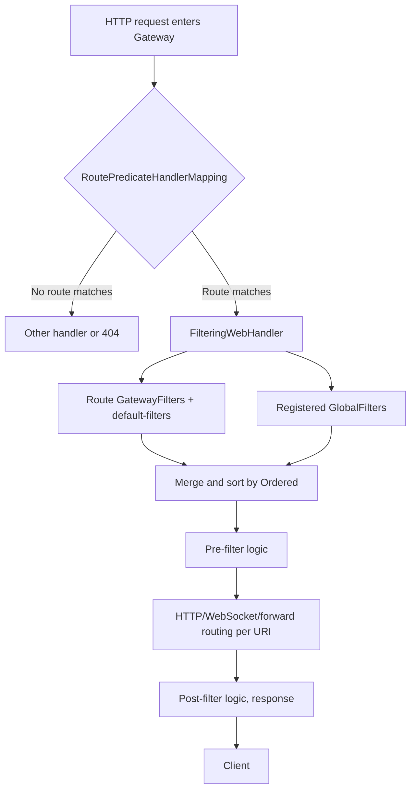
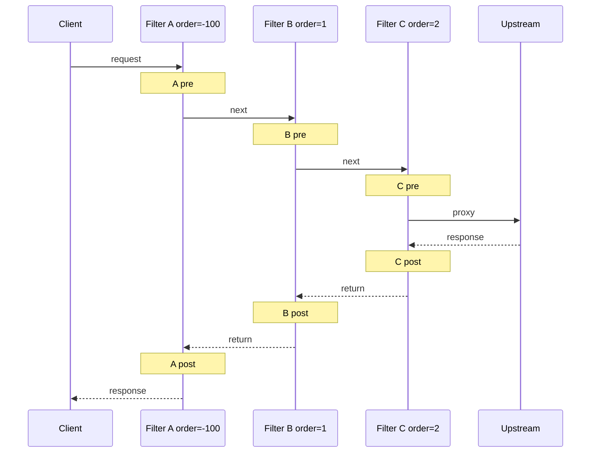

# Reconciling the Running Filter Chain with Declarative Configuration

## 1. The Problem: Configuration Has a Filter, Yet Does the Request Actually Go Through It?

An API Gateway in a microservices system typically has many processing layers: predicate-based route selection, path and header modification, service discovery, authentication, rate limiting, retry, circuit breaking, TLS, and request observability. With **Spring Cloud Gateway**, when a header fails to appear, a request is unexpectedly rejected, or a backend receives the wrong path, simply opening `application.yml` to read `filters` is not enough.

What must be verified is **which route was selected and which filter chain was constructed for that request**, the order in which they are invoked, which filter actually performs the work, and whether another component later alters the request or response.

This lesson belongs to the **Filter Chain** chapter of the **SPRING_CLOUD_GATEWAY** module and focuses on **reconciling the running filter chain with declarative configuration**. After this lesson, you will be able to:

1. Distinguish **route-specific `GatewayFilter`s**, **`default-filters`**, and **`GlobalFilter`s** in Gateway Server WebFlux.
2. Explain the difference between **route selection order**, **filter execution order**, and the *pre/post* phases.
3. Read Actuator endpoints to inspect routes, route-attached filters, global filters, and available factories.
4. Prove filter behavior using test requests and logs from Gateway and the backend itself.
5. Diagnose root causes when configuration, the assembled filter chain, and observed behavior disagree.

> **Scope:** Examples run on **Spring Cloud Gateway Server WebFlux 5.0.x**, using the `spring.cloud.gateway.server.webflux` namespace. On 4.x lines, several properties use the older `spring.cloud.gateway.*` prefix. **Gateway Server Web MVC** uses Servlet/WebMvc.fn and `HandlerFilterFunction`, `BeforeFilterFunctions`, and `AfterFilterFunctions`; do not use WebFlux `GlobalFilter`/Actuator endpoints directly to draw conclusions about MVC. Choose compatible Spring Boot, Spring Cloud BOM, and Gateway starter versions per your locked release train.

## 2. Declarative Filters and Running Filters Are Two Different Views

### 2.1. Three Filter Sources in Gateway Server WebFlux

| Source | Where Declared | Scope | How to Inspect |
|---|---|---|---|
| **Route-specific `GatewayFilter`** | Each route's `filters` in YAML/properties, or `filters(...)` in Java `RouteLocatorBuilder` | Only the selected route | `GET /actuator/gateway/routes/{id}` |
| **Default filters** | `spring.cloud.gateway.server.webflux.default-filters` | Added to **each route**; does not apply if no route matches | Appears inside the `filters` list of assembled routes |
| **`GlobalFilter`** | Spring bean implementing `org.springframework.cloud.gateway.filter.GlobalFilter`; includes infrastructure filters registered by Gateway | Added to the chain when a route matches; may only act when internal conditions match | `GET /actuator/gateway/globalfilters`, plus logs and tests |

**Important point:** `default-filters`, despite the name "default," are converted into **route filters**, not `GlobalFilter` beans. Conversely, `GlobalFilter`s may not appear in the `filters` array of `/actuator/gateway/routes/{id}`. For a complete view, you must cross-check **multiple sources**.

### 2.2. Pipeline and Chain Assembly Timing



A request that **matches no route** does not run any route's filter chain. For matched requests, `FilteringWebHandler` merges `GlobalFilter`s and `GatewayFilter`s and sorts them by `org.springframework.core.Ordered`. Some filters **short-circuit early** without calling `chain.filter(exchange)`, such as a quota-exceeded limiter; therefore, **"present in the chain" does not mean "every subsequent filter ran."**

Outside the Gateway chain sit independent layers, such as **Spring Security `WebFilter`s**, general WebFlux `WebFilter`s, `HttpHeadersFilter` processors, and ingress/reverse proxies before or after Gateway. Never infer the order or behavior of these layers solely from the `GatewayFilter` list.

## 3. Creating a Declarative Configuration for Comparison

Suppose there are two applications:

- **Gateway WebFlux** listening on `localhost:8080`, using dependency `spring-cloud-starter-gateway-server-webflux`.
- **Catalog backend** listening on `localhost:8081`, serving `GET /products/{id}`.

To clearly observe filter sources, the Gateway application uses the following **dedicated** configuration:

```yaml
# gateway-demo/src/main/resources/application.yml
spring:
  application:
    name: gateway-demo
  cloud:
    gateway:
      server:
        webflux:
          default-filters:
            - AddResponseHeader=X-Default-Filter, enabled
            - RemoveRequestHeader=X-Debug-Secret
          routes:
            - id: catalog-route
              uri: http://localhost:8081
              predicates:
                - Path=/api/catalog/**
                - Method=GET
              filters:
                - StripPrefix=2
                - AddRequestHeader=X-Edge-Route, catalog-route
                - AddResponseHeader=X-Route-Filter, enabled

server:
  port: 8080
```

Read the configuration in two layers:

**Default filters:** `AddResponseHeader` adds `X-Default-Filter` to responses of every matched route; `RemoveRequestHeader` removes `X-Debug-Secret` before proxying requests downstream.

**Route filters:** `StripPrefix=2` transforms `/api/catalog/products/42` into `/products/42`; `AddRequestHeader` adds `X-Edge-Route` to the backend request; `AddResponseHeader` adds `X-Route-Filter` to the client response.

Both `Path` and `Method` predicates must match simultaneously. `POST /api/catalog/products/42` does **not** run `catalog-route`'s filter chain because `Method=GET` does not match. Never conclude a "filter is broken" from a request that never entered the expected route.

**What cannot yet be deduced from YAML:** Gateway also has `GlobalFilter`s registered by the framework or application; there may also be routes declared in Java, `RouteDefinitionRepository`, service discovery, or overrides from profiles/environment variables. Always inspect the live state of the **exact instance serving traffic**.

## 4. How to Determine Actual Filter Order

### 4.1. Route `order` Is Not Filter `order`

In a route definition, the route's `order` property (e.g. `order: -10`) controls **route priority when multiple routes can match**. It does **not** mean that the route's `GatewayFilter`s run at order `-10`.

Filters have their own ordering via `Ordered` or the order assigned by Gateway when converting filter definitions into `GatewayFilter`s. In Gateway Server WebFlux:

- **Smaller** numbers correspond to **higher priority**.
- In the **pre** phase, higher-priority filters enter first.
- When a filter has **post** logic wrapping `chain.filter(exchange)`, a filter that enters earlier typically finishes post **after** filters that entered later.
- `GlobalFilter`s and `GatewayFilter`s participate in one **jointly sorted** chain; there is no hard rule that "every global always runs before every route."



The diagram models **filters having both pre and post**. A filter that only does pre-processing or only post-processing will not have both steps. If a filter returns a response immediately, downstream branches may **not be called**. Reading the `order` number alone is therefore insufficient to know when headers or bodies are modified.

### 4.2. Why Declaration Order Is Not Necessarily Sorted Order

For filters that **do not implement `Ordered` themselves**, Gateway assigns order numbers based on list position, starting at `1`. Default filters and route filters are numbered **independently**, then sorted together using a stable sort; on ties, default filters are added before route filters of the same order.

Thus, for the configuration in section 3, **the declarative filters portion** looks like this:

| Relative Order After Merge (Illustrative) | Source | Filter | Order of Filter Without Explicit `Ordered` |
|---:|---|---|---:|
| 1 | Default | `AddResponseHeader=X-Default-Filter,...` | 1 |
| 2 | Route | `StripPrefix=2` | 1 |
| 3 | Default | `RemoveRequestHeader=X-Debug-Secret` | 2 |
| 4 | Route | `AddRequestHeader=X-Edge-Route,...` | 2 |
| 5 | Route | `AddResponseHeader=X-Route-Filter,...` | 3 |

**This comparison covers only declarative filters**, excluding Gateway's `GlobalFilter`s and without imposing these numbers on custom filters that set their own order. **Fetch orders from Actuator on your running instance** to verify. If your version, Java DSL, or filter factory provides its own `Ordered` value, actual order may differ from this illustrative table.

## 5. Using Actuator to Inspect Assembled Route State

### 5.1. Enabling Gateway Configuration Inspection

Add `spring-boot-starter-actuator` to the Gateway application. In the **same project's `application.yml`**, add:

```yaml
management:
  endpoint:
    gateway:
      access: read-only
  endpoints:
    web:
      exposure:
        include: health,info,gateway
```

In Gateway 5.0.x, the Gateway Actuator endpoint **is not accessible by default**; the config above enables read-only access and exposes it over HTTP. `read-only` is suitable for inspection because it does not open APIs to create, delete, or refresh routes. In production environments, restrict operator access via authentication, network policies, or a dedicated management port; even route/URI details can reveal internal topology.

### 5.2. Minimal Inspection Commands

While Gateway is running at `localhost:8080`, run these read commands:

```bash
# List routes currently held by Gateway.
curl -sS 'http://localhost:8080/actuator/gateway/routes'

# Inspect one assembled route: predicates, filters, URI, order.
curl -sS 'http://localhost:8080/actuator/gateway/routes/catalog-route'

# View RouteDefinitions supplied by configuration sources.
curl -sS 'http://localhost:8080/actuator/gateway/routedefinitions'

# View registered GlobalFilter beans and their orders.
curl -sS 'http://localhost:8080/actuator/gateway/globalfilters'

# View GatewayFilterFactories available on the instance.
curl -sS 'http://localhost:8080/actuator/gateway/routefilters'
```

If your Gateway version supports `/actuator/gateway/routes/{id}/combinedfilters` as listed in the Actuator documentation, you can also try:

```bash
curl -i 'http://localhost:8080/actuator/gateway/routes/catalog-route/combinedfilters'
```

**Do not rely on this auxiliary endpoint as your sole proof**: support level and format can vary across releases. When unavailable, use `/routes/{id}`, `/globalfilters`, and live request testing.

### 5.3. Interpreting Each Endpoint Accurately

| Endpoint | Question It Answers | What It Does **Not** Prove |
|---|---|---|
| `/gateway/routes` | Which routes does this instance have after `Route` assembly? | Does not show which route a specific request matched |
| `/gateway/routes/{id}` | Route ID, predicate, URI, `GatewayFilter`s on the route, and their orders? | Not all `GlobalFilter`s, nor proof that every filter executed |
| `/gateway/routedefinitions` | Which route definitions come from observable `RouteDefinition` sources? | May omit routes built directly with Java `RouteLocator` |
| `/gateway/globalfilters` | Which `GlobalFilter` beans are registered and their orders? | Does not prove each filter processed a request, as filters have internal conditions |
| `/gateway/routefilters` | Which `GatewayFilterFactory` beans exist on this instance? | Does not prove a factory is attached to **this route** or ran for a request |
| `/gateway/routes/{id}/combinedfilters` *(if available)* | Helps view the combined per-route chain in some releases | Cannot replace request testing; not guaranteed present in all releases |

**Note when reading `/routefilters`:** Spring docs explain that values may be `null` because the endpoint cannot determine an `order` for a **factory object**. `null` there **does not mean the filter is broken or disabled**. Inspect the `filters` array on a **specific route** to confirm the factory actually created a filter for that route.

### 5.4. Example Output from `/routes/{id}`

This is an **illustrative structure**, not live captured output. Predicate/filter string formatting and field order vary by version:

```json
{
  "route_id": "catalog-route",
  "predicate": "(Paths: [/api/catalog/**] && Methods: [GET])",
  "filters": [
    "[[AddResponseHeader X-Default-Filter = 'enabled'], order = 1]",
    "[[StripPrefix parts = 2], order = 1]",
    "[[RemoveRequestHeader name = 'X-Debug-Secret'], order = 2]",
    "[[AddRequestHeader X-Edge-Route = 'catalog-route'], order = 2]",
    "[[AddResponseHeader X-Route-Filter = 'enabled'], order = 3]"
  ],
  "uri": "http://localhost:8081",
  "order": 0
}
```

The `filters` strings are typically the `toString()` of instantiated filters, **not raw YAML strings**. When reconciling, normalize to **filter name, arguments, order, and source** rather than matching descriptive text character by character. Verbose mode in Gateway Server WebFlux can be configured with `spring.cloud.gateway.server.webflux.actuator.verbose.enabled` (enabled by default in 5.0 docs).

## 6. From Route State to Proof That Filters Actually Ran

Actuator answers "**Which routes/filters does Gateway know about?**". Answering "**How was request X processed?**" requires observing actual inputs and outputs.

### 6.1. A Small Echo Backend to Prove Request Mutation

Create a **catalog backend** app using `spring-boot-starter-web` running on port `8081` with this controller:

```java
package com.example.catalog;

import java.util.Map;
import org.springframework.boot.SpringApplication;
import org.springframework.boot.autoconfigure.SpringBootApplication;
import org.springframework.web.bind.annotation.GetMapping;
import org.springframework.web.bind.annotation.PathVariable;
import org.springframework.web.bind.annotation.RequestHeader;
import org.springframework.web.bind.annotation.RequestParam;
import org.springframework.web.bind.annotation.RestController;

@SpringBootApplication
@RestController
public class CatalogApplication {

    public static void main(String[] args) {
        SpringApplication.run(CatalogApplication.class, args);
    }

    @GetMapping("/products/{id}")
    public Map<String, String> product(
            @PathVariable String id,
            @RequestParam(name = "lang", defaultValue = "default") String lang,
            @RequestHeader(name = "X-Edge-Route", defaultValue = "absent") String route,
            @RequestHeader(name = "X-Debug-Secret", defaultValue = "absent") String secret) {
        return Map.of(
            "id", id,
            "lang", lang,
            "edgeRoute", route,
            "debugSecret", secret
        );
    }
}
```

The backend needs `server.port=8081`; Gateway runs on `8080`. Run **two separate processes** locally and confirm `GET http://localhost:8081/products/42` responds before testing proxying.

### 6.2. Sending a Request with Observable Markers

```bash
curl -i \
  -H 'X-Debug-Secret: should-not-reach-backend' \
  'http://localhost:8080/api/catalog/products/42?lang=vi'
```

With the YAML from section 3 and the backend running, the response matches:

```http
HTTP/1.1 200 OK
X-Default-Filter: enabled
X-Route-Filter: enabled
Content-Type: application/json

{"id":"42","lang":"vi","edgeRoute":"catalog-route","debugSecret":"absent"}
```

**Reading results by source:**

| Signal | What It Proves | Component to Reconcile |
|---|---|---|
| Backend returns `id=42` | Path `/api/catalog/products/42` became `/products/42` | `StripPrefix=2` |
| Backend returns `lang=vi` | Query `lang=vi` still reached the backend | Path filter does not strip query parameters |
| Backend returns `edgeRoute=catalog-route` | `X-Edge-Route` header was present on downstream request | Route's `AddRequestHeader` |
| Backend returns `debugSecret=absent` | Test header was removed from downstream request | `RemoveRequestHeader` in default filters |
| Client receives `X-Default-Filter: enabled` | Response received default header | `AddResponseHeader` in default filters |
| Client receives `X-Route-Filter: enabled` | Response received route header | `AddResponseHeader` on route |

The two response headers prove the transformations happened, yet **do not by themselves prove the exact order of all filters**. To know order, combine Actuator order info, logs, and tests covering interactions that could alter the outcome.

### 6.3. Control Tests to Rule Out False Conclusions

```bash
# Call backend directly: X-Edge-Route header is not added by Gateway.
curl -i 'http://localhost:8081/products/42?lang=vi'

# Path mismatch; without another route, usually returns 404.
curl -i 'http://localhost:8080/api/orders/42'

# Method=GET mismatch; without another route, usually returns 404.
curl -i -X POST 'http://localhost:8080/api/catalog/products/42'

# Route matches, yet backend has no mapping; usually returns 404 from backend.
curl -i 'http://localhost:8080/api/catalog/not-found'
```

These control tests separate **unmatched routes**, **inactive filters**, and **backend errors after filters already ran**. These are **self-guided commands to run**, not pre-executed output.

## 7. Logging Pre/Post Order with a Diagnostic GlobalFilter

When you need to see where *a request* entered the filter chain, temporarily add a small `GlobalFilter` to the **Gateway Server WebFlux application**:

```java
package com.example.gateway;

import org.slf4j.Logger;
import org.slf4j.LoggerFactory;
import org.springframework.cloud.gateway.filter.GatewayFilterChain;
import org.springframework.cloud.gateway.filter.GlobalFilter;
import org.springframework.cloud.gateway.route.Route;
import org.springframework.cloud.gateway.support.ServerWebExchangeUtils;
import org.springframework.core.Ordered;
import org.springframework.stereotype.Component;
import org.springframework.web.server.ServerWebExchange;
import reactor.core.publisher.Mono;

@Component
public class ChainTraceGlobalFilter implements GlobalFilter, Ordered {

    private static final Logger log =
        LoggerFactory.getLogger(ChainTraceGlobalFilter.class);

    @Override
    public int getOrder() {
        return -100;
    }

    @Override
    public Mono<Void> filter(ServerWebExchange exchange, GatewayFilterChain chain) {
        Route route = exchange.getAttribute(
            ServerWebExchangeUtils.GATEWAY_ROUTE_ATTR);
        String routeId = (route == null) ? "unknown" : route.getId();
        String requestId = exchange.getRequest().getId();
        String path = exchange.getRequest().getURI().getRawPath();

        log.debug("ENTER req={} route={} path={}", requestId, routeId, path);

        return chain.filter(exchange)
            .doFinally(signal -> log.debug(
                "EXIT req={} route={} status={} signal={}",
                requestId, routeId,
                exchange.getResponse().getStatusCode(), signal));
    }
}
```

Enable logging **only for the demo class** (use your exact package):

```yaml
logging:
  level:
    com.example.gateway.ChainTraceGlobalFilter: DEBUG
```

What this test reveals:

- Because `-100` has higher priority than filters with orders `1`, `2`, and `3` in the example, the diagnostic filter's `ENTER` line appears before **those filters** run. However, other `GlobalFilter`s with even smaller order numbers can still enter earlier.
- The `EXIT` line runs on the terminal signal of the publisher returned by `chain.filter(exchange)`, showing the **final status and complete/error/cancel signal**; it is not a log proving the order of every inner filter.
- Only when a route is selected does `FilteringWebHandler` run the Gateway chain. Requests matching no route do not necessarily emit `ChainTraceGlobalFilter` logs.
- When a filter **does not continue the chain** to reject early, later filters do not run. An outer filter with higher priority can still log `EXIT`.

To clearly observe ordering **among custom filters**, place `ENTER/EXIT` logs inside each filter using the same request ID. Never rely on log ordering across distinct requests when Gateway serves concurrent traffic. Avoid inserting `Thread.sleep` or blocking work on the Reactor event loop; keep DEBUG logging targeted and turn it off once diagnosis finishes.

### 7.1. Framework Logs and Metrics Help, but Do Not Replace Tests

When tracking route matching and upstream calls:

```yaml
logging:
  level:
    org.springframework.cloud.gateway: DEBUG
    org.springframework.web.reactive: INFO
```

Spring can provide extra logs at `TRACE` and in `reactor.netty`, yet enabling wiretap or full header/body logging can leak tokens, cookies, and sensitive data. Enable only in controlled environments with bounded duration and volume.

If Actuator/Micrometer is integrated, Gateway metrics (such as the `spring.cloud.gateway.requests` timer in supported versions) help track `routeId`, `routeUri`, HTTP status, latency, and error rates. Metrics prove that a **route** handled requests in aggregate, but do not reveal what `StripPrefix` or `RemoveRequestHeader` individually changed. Supplement with distributed tracing/request IDs and downstream tests.

## 8. Reconciliation Workflow Across Three Evidence Layers

When investigating a bug like "filter is configured, yet it doesn't run," proceed step by step:

| Step | Check | Evidence Source | Expected Outcome |
|---:|---|---|---|
| 1 | Confirm the exact **instance** serving traffic, image/version, profile, and config from env/Config Server | Runtime config, deployment, startup logs | Avoid comparing the wrong file or instance |
| 2 | Send a request with explicit `Host`, method, path, and headers | `curl -i` and request ID | Know the exact request under test |
| 3 | Verify the **selected route** | `/routes`, `/routes/{id}`, route logs | Accurate route ID, predicate, URI, route order |
| 4 | Compare **declared filters** against filters attached to the route | YAML/properties/Java, `/routes/{id}` | Matching names, arguments, count, and orders |
| 5 | Reconcile **`GlobalFilter`s** independently | `/globalfilters`, bean code | Know which infrastructure and custom filters participate |
| 6 | Check **execution path and short-circuits** | Logs by request ID, status, upstream access logs | Know whether the request reached the backend and where it stopped |
| 7 | Confirm **actual behavior** | Backend echo, response headers, traces | Path/headers/status match expectations |
| 8 | Check **layers outside the Gateway chain** | Spring Security, ingress, `HttpHeadersFilter`, backend | Avoid blaming GatewayFilter for changes made by another layer |

### 8.1. Discrepancy Sheet Template for a Route

| Property | Expected Declaration | Runtime Observation | Conclusion |
|---|---|---|---|
| Route ID | `catalog-route` | Present in `/routes`? | Right instance and route? |
| Predicate | `Path`, `Method=GET` | `/routes/{id}` and request match? | Why did request enter or miss? |
| Default filters | Add response header, remove request header | Present in route output? | Were default filters applied to route? |
| Route filters | StripPrefix, add request/response headers | Present in route output? | Wrong name/args/order? |
| Global filters | Built-in and custom filters | Present in `/globalfilters`? | Any filter affecting response? |
| Downstream path | `/products/42` | Which path did backend receive? | Did rewrite happen? |
| Request headers | Has `X-Edge-Route`, lacks `X-Debug-Secret` | What did backend report? | Did request filters work? |
| Response headers | Has `X-Default-Filter`, `X-Route-Filter` | What did `curl -i` report? | Did response filters work? |

A table like this is valuable during PR reviews or incident investigations: it ties each expectation to **a verifiable piece of evidence**, avoiding debates based solely on YAML line positions.

## 9. Common Causes When Runtime Differs from Configuration

| Symptom | Possible Cause | How to Verify / Fix |
|---|---|---|
| Route missing in Actuator | Wrong namespace, profile, bad YAML indentation, invalid route definition, or config not loaded | Check version, `spring.cloud.gateway.server.webflux.routes`, startup logs, active profile |
| Route exists, yet request skips filters | `Path`/`Method`/`Host` predicate fails to match, or another route has higher priority | Check actual request, `/routes`, route order, and route match logs |
| Unexpected filter appears even though not declared on route | `default-filters`, `GlobalFilter`, or Java/discovery-created filter | Compare `/routes/{id}`, `/globalfilters`, and other route sources |
| Filter is configured, yet shows no effect | Request misses route; filter sits after a rejecting filter; change overwritten by another filter | Log request ID and status; inspect order and test upstream |
| Runtime order differs from YAML order | Default filters/route filters numbered independently, custom `Ordered`, shared global sort | Inspect actual `order` in Actuator; check Java filter `getOrder()` |
| `/routefilters` shows `null` | Endpoint reports factory objects, which have no per-factory order | Inspect `/routes/{id}`; do not treat `null` as an error |
| `/routedefinitions` omits routes | Some routes are created directly via Java `RouteLocator` or other sources | Use `/routes` to view assembled `Route`s; check `RouteLocator` beans |
| Header added at Gateway is missing at client | Stripped/overwritten by another filter, security, backend, or reverse proxy | Measure at backend, Gateway, and outside ingress; separate request vs. response directions |
| Backend receives wrong path | `StripPrefix`/`RewritePath` missing or transformation order unexpected | Echo downstream path; inspect route filters and route URI |
| Rate-limit filter present, yet no `429` in tests | Quota not exceeded, or key resolver/quota differs from expectation | Load-test per key; check Redis/Bucket4j dependencies and logs |
| Circuit breaker/retry does not behave as expected | Error/timeout conditions not triggered, missing dependency, or different filter order | Inject controlled failures; measure upstream call count and responses |
| Actuator returns `404` or `403` | Endpoint disabled/unexposed, blocked by Spring Security, wrong management base path/port | Check Actuator config and user permissions; never open publicly |
| Config changed, yet behavior unchanged | Not restarted/reloaded, route cache not refreshed, multiple instances running stale config | Verify config version on each instance; use a valid reload mechanism |

### 9.1. When Routes Are Created Dynamically or Across Multiple Instances

In systems using **DiscoveryClient**, `RouteDefinitionRepository`, or distributed config, runtime routes can come from **multiple sources**, not just `application.yml`. One Gateway instance may pick up an update while another has not refreshed yet. Therefore:

1. Identify the exact **instance ID/pod** handling the request and query Actuator on **that same instance**.
2. Compare `route_id`, URI, predicates/filters, config load timestamp, and application version.
3. If dynamic updates were pushed via the route management API, inspect state **after a valid cache refresh**. With `management.endpoint.gateway.access=read-only`, `POST /actuator/gateway/refresh` cannot be called; that restriction is **intentional**.
4. Never mutate/delete routes via Actuator while diagnosing. Routes from YAML or `@Bean` are not meant to be deleted arbitrarily through dynamic management APIs.

An unapplied hot-reload change **differs** from a broken filter; distinguish them by comparing the pre-change route snapshot with the current snapshot.

### 9.2. Security and Layers Outside the Gateway Filter Chain

In Gateway Server WebFlux, Spring Security uses WebFlux's **`SecurityWebFilterChain`**. Security filters can block requests **before Gateway selects a route**, in which case neither the route's `GatewayFilter`s nor `GlobalFilter`s inside `FilteringWebHandler` need to run. Headers can also be stripped or added by **`HttpHeadersFilter`** during HTTP proxying, or by proxies in front of or behind Gateway.

When authentication, rate limiting, retry, circuit breaking, and TLS are enabled, build a responsibility matrix: **who returns `401/403`, who returns `429`, who retries, who terminates TLS, and who emits tracing headers**. Never look at a single response and immediately blame `AddResponseHeader` or `RewritePath`.

## 10. Practice Exercises

**Exercise 1 — Predict Order:** With default filters `A, B, C` and route filters `X, Y`, none implementing `Ordered` themselves, predict the merged and sorted chain. Then compare against the orders returned by Actuator.

**Exercise 2 — Filter Not Running:** `POST /api/catalog/products/42` does not receive `X-Route-Filter` while a GET request does. Explain this using predicates before touching the filter.

**Exercise 3 — Spotting Default Filters:** YAML only lists `StripPrefix=2` in the route, yet `/routes/{id}` also shows `RemoveRequestHeader`. Which configuration will you check?

**Exercise 4 — `null` in Actuator:** `/routefilters` shows `AddResponseHeaderGatewayFilterFactory: null`. Does that prove the filter does not run? Which endpoint should you call to confirm it is attached to a route?

**Exercise 5 — Short-Circuit:** A rate-limiter filter returns `429` before proxying. Why does the backend receive no request, and why does `NettyRoutingFilter` appearing in `/globalfilters` not contradict that result?

**Exercise 6 — Debugging on Kubernetes:** Two Gateway pods running the same code version return different headers after a config update. Outline the exact sequence for checking instances, config sources, route cache, and request IDs to verify.

### Suggested Answers

1. Standard filters are numbered independently starting from `1`: default `A(1), B(2), C(3)`; route `X(1), Y(2)`. After stable sorting, the order is typically **`A, X, B, Y, C`**, excluding custom `Ordered` and global filters.
2. `Method=GET` does not match POST; this route/filter is not selected. The missing header completely matches the configuration.
3. Inspect `spring.cloud.gateway.server.webflux.default-filters`, other route sources, and any custom filters.
4. No. That is how Actuator represents **factories**; check `/routes/{id}` and verify the runtime effect.
5. A filter is allowed to terminate the chain early. The global list shows **registered filters**, not proof that every request reached the upstream connection step.
6. Compare `/routes/{id}` and `/globalfilters` directly on each pod, verify profile/environment/revision, refresh mechanism, and trace requests through each specific instance.

## 11. Operator Checklist

- [ ] Querying the **exact instance**, version, and profile serving the request.
- [ ] Route ID, predicate, URI, and **route order** match expectations.
- [ ] Route filters and default filters have **complete names/arguments** with no unintended duplicates.
- [ ] Registered `GlobalFilter`s and **filter orders** were reconciled separately.
- [ ] Early-termination points are known: Security, rate limit, redirect, circuit breaker, or custom filters.
- [ ] Matched-route, unmatched-route, and backend-error test cases all have verified evidence.
- [ ] Path/query/request headers verified at the **backend**, and response headers/status at the **client**.
- [ ] Logs include request ID/route ID alongside proper metrics/tracing; no sensitive data is exposed.
- [ ] Actuator management APIs are secured with least-privilege access.

## Official References

- [Spring Cloud Gateway Server WebFlux 5.0 — How It Works](https://docs.spring.io/spring-cloud-gateway/reference/5.0/spring-cloud-gateway-server-webflux/how-it-works.html) — route matching, pre/post filters, and proxying.
- [Server WebFlux 5.0 — Global Filters](https://docs.spring.io/spring-cloud-gateway/reference/5.0/spring-cloud-gateway-server-webflux/global-filters.html) — merging/sorting `GlobalFilter`s and `GatewayFilter`s, metrics.
- [Server WebFlux 5.0 — Default Filters](https://docs.spring.io/spring-cloud-gateway/reference/5.0/spring-cloud-gateway-server-webflux/gatewayfilter-factories/default-filters.html) — filters applied per route and ordering interaction with route filters.
- [Server WebFlux 5.0 — Actuator API](https://docs.spring.io/spring-cloud-gateway/reference/5.0/spring-cloud-gateway-server-webflux/actuator-api.html) — `/routes`, `/routes/{id}`, `/globalfilters`, `/routefilters`, and access controls.
- [Server WebFlux 5.0 — Configuration Properties](https://docs.spring.io/spring-cloud-gateway/reference/5.0/configprops.html) — `spring.cloud.gateway.server.webflux.default-filters`, `routes`, and runtime settings.
- [Server WebFlux 5.0 — GatewayFilter Factories](https://docs.spring.io/spring-cloud-gateway/reference/5.0/spring-cloud-gateway-server-webflux/gatewayfilter-factories.html) — factories and arguments.
- [Server WebFlux 5.0 — Troubleshooting](https://docs.spring.io/spring-cloud-gateway/reference/5.0/spring-cloud-gateway-server-webflux/troubleshooting.html) — logging and diagnostics.
- [Server Web MVC 5.0 — Gateway Handler Filter Functions](https://docs.spring.io/spring-cloud-gateway/reference/5.0/spring-cloud-gateway-server-webmvc/gateway-handler-filter-functions.html) — comparing filter APIs between Servlet and reactive variants.
