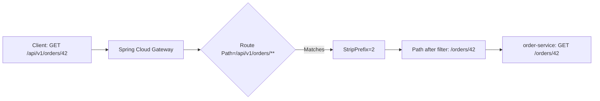
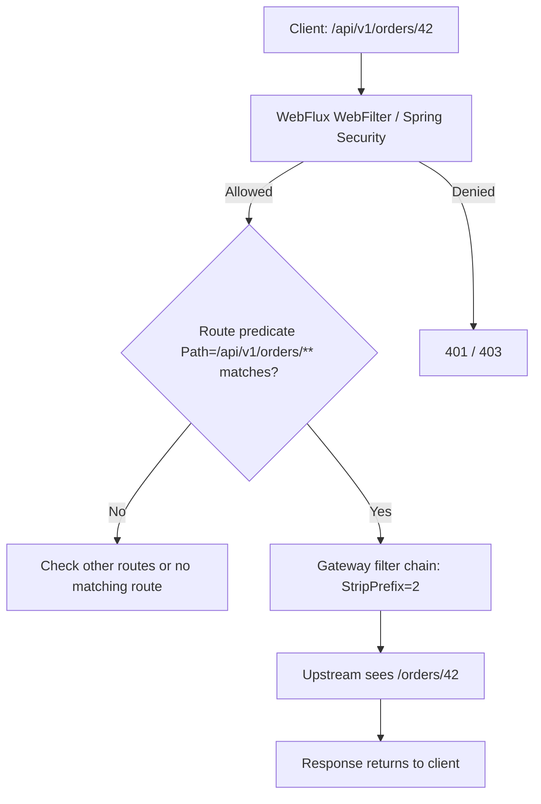
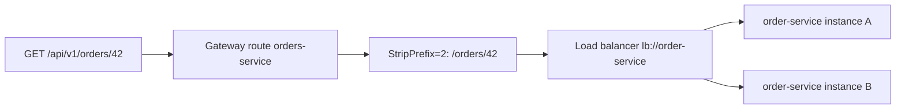

# StripPrefix: Stripping Leading Path Segments

When building **Spring Cloud Gateway**, URLs called by clients are often organized by public API domains, such as `/api/v1/orders/42`, whereas the backend microservice only exposes the `/orders/42` endpoint. The **`StripPrefix` GatewayFilter Factory** resolves this difference by **stripping a number of leading path segments** before the Gateway forwards the request to the upstream service.

This is a filter for handling **path rewriting and redirects**, commonly combined with the `Path` route predicate, header-processing filters, `lb://` for service discovery, and safety policies such as authentication, rate limiting, retry, circuit breaker, and TLS. This lesson covers in detail how the number of stripped segments is calculated, how to configure it, the filter's position in the pipeline, its impact on the upstream URL, common pitfalls, and how to test real requests.

> **Scope:** Examples use **Spring Cloud Gateway Server WebFlux**. Gateway Server MVC has its own filter mechanism and configuration API; do not apply WebFlux Java DSL snippets verbatim to MVC.

## 1. The Problem: Public Paths and Microservice Paths Differ

Suppose a system has three microservices:

| Gateway public API | Backend endpoint | Service |
| --- | --- | --- |
| `GET /api/v1/orders/42` | `GET /orders/42` | `order-service` |
| `GET /api/v1/products/sku-01` | `GET /products/sku-01` | `product-service` |
| `GET /api/v1/customers/7` | `GET /customers/7` | `customer-service` |

Clients need a consistent `/api/v1` prefix for easy API versioning, while the backend does not want to repeat that prefix in every controller. In that case, the Gateway can:

1. Receive the request at the public URL.
2. Use a **route predicate** to select the right service.
3. Use **`StripPrefix=2`** to strip `api` and `v1`.
4. Forward the request with the modified path to the upstream service.



**Key point:** `StripPrefix` operates on the request **path**. It does not select routes, identify upstream services, change the HTTP method, or perform authorization.

## 2. `parts` Is the Number of Path Segments, Not Characters

Shortcut syntax:

```yaml
filters:
  - StripPrefix=2
```

The number `2` is the value of the `parts` parameter: the number of **leading path segments** to remove. A path is interpreted as segments separated by `/`. For example:

```text
Initial path:   /api/v1/orders/42
                └┬┘ └┬┘ └─┬─┘ └┬┘
                 1   2    3   4

StripPrefix=2: strip first 2 segments (api, v1)
Remaining path: /orders/42
```

Comparison table illustrating requests that have entered the filter:

| Initial path | Configuration | Forwarded path |
| --- | --- | --- |
| `/api/orders/42` | `StripPrefix=1` | `/orders/42` |
| `/api/v1/orders/42` | `StripPrefix=2` | `/orders/42` |
| `/edge/api/v1/orders/42` | `StripPrefix=3` | `/orders/42` |
| `/api/v1/orders/42` | `StripPrefix=1` | `/v1/orders/42` |
| `/api/v1` | `StripPrefix=2` | `/` |
| `/api/v1/orders/42?expand=items` | `StripPrefix=2` | `/orders/42?expand=items` |

The last two rows highlight important points:

- When all existing segments are stripped, the path may leave **`/`**. The upstream receives the root endpoint, not an empty path.
- `?expand=items` is a **query string**, not a path segment. `StripPrefix` does not remove the query string; the filter focuses on modifying the path.

This number does **not** mean "remove the first two characters" or "remove two slashes". `StripPrefix=2` on `/api/v1/orders/42` does not produce `i/v1/orders/42`.

### Edge cases to test

- If `parts` equals the number of segments in the path, the backend may receive `/` — verify that the backend has a suitable root endpoint.
- If `parts` is greater than the number of existing segments, nothing useful remains; you should not configure it this way to "block" requests. **Blocking requests must be handled by route predicates and security.**
- Consecutive `/` characters, trailing slashes, percent-encoding such as `%2F`, Unicode characters, and normalization rules can interact with HTTP/proxy layers. Do not extrapolate from simple path examples alone; send real requests and verify the observed upstream URI.
- Choose `parts` based on a **stable public API structure**. If the API has multiple prefix formats, consider splitting routes or using `RewritePath` with a specific rule.

Do not use `StripPrefix` as a dangerous-URL filtering tool or as a substitute for authentication: it is solely a path transformation applied after a request matches a route.

## 3. YAML Configuration for a Specific Route

Suppose the order management backend listens at `http://localhost:8081` and serves the `/orders/{id}` endpoint:

```yaml
spring:
  cloud:
    gateway:
      routes:
        - id: orders-route
          uri: http://localhost:8081
          predicates:
            - Path=/api/v1/orders/**
          filters:
            - StripPrefix=2
            - AddRequestHeader=X-Edge-Source,gateway
```

With the request:

```http
GET /api/v1/orders/42?expand=items HTTP/1.1
Host: localhost:8080
Accept: application/json
```

The Gateway selects the `orders-route` route if the `Path` predicate matches, then executes `StripPrefix=2` before sending the HTTP request to the upstream:

```http
GET /orders/42?expand=items HTTP/1.1
Host: localhost:8081
Accept: application/json
X-Edge-Source: gateway
```

**Note:** The upstream request above is an illustration of the path and headers. The actual HTTP `Host` also depends on routing filters, the target URI, and the Gateway's host-preservation settings. `StripPrefix` **does not arbitrarily alter Host**, though the HTTP routing layer may still construct a Host appropriate for the target.

### Explanation of each configuration element

| Component | Meaning |
| --- | --- |
| `id: orders-route` | Route name used in metrics, logs, and testing |
| `uri: http://localhost:8081` | Upstream receiving the request after filtering |
| `Path=/api/v1/orders/**` | Matches requests by the **public path at the Gateway** |
| `StripPrefix=2` | Strips the two segments `api` and `v1` before proxying |
| `AddRequestHeader=...` | Adds a request header for the upstream to use per the integration contract |

The `spring.cloud.gateway.routes` configuration prefix is common in earlier versions. Some newer Spring Cloud Gateway Server WebFlux versions/starters use `spring.cloud.gateway.server.webflux.routes`. Choose the right prefix for your application version and verify that routes are loaded; **changing the configuration prefix does not change the meaning of `StripPrefix`**.

### If you only want to strip `/api`

Suppose the public endpoint is `/api/orders/42` and the backend expects `/orders/42`:

```yaml
predicates:
  - Path=/api/orders/**
filters:
  - StripPrefix=1
```

If you mistakenly use `StripPrefix=2`, the Gateway will strip both `api` and `orders`, causing the upstream to receive `/42` — easily resulting in a `404` even though the Gateway selected the right route.

## 4. Position of StripPrefix in the Pipeline

The easiest thing to confuse is the order between **route predicates** and **Gateway filters**:



**The `Path` predicate is evaluated before `StripPrefix`.** Therefore:

- The route predicate must match the URL **sent by the client** (`/api/v1/orders/**`), not the URL after prefix stripping (`/orders/**`).
- `StripPrefix` only runs **after a Gateway route is selected**. A request that does not match any route cannot be "rescued" by that route's `StripPrefix`.
- `GlobalFilter` and `GatewayFilter` instances in the chain are ordered by their order value; if multiple filters modify the path, **execution order** can change the outcome.
- Spring Security WebFlux typically handles authentication/authorization in the `WebFilter` chain **before** a Gateway route is selected. Path-based authorization rules must target the **public path**, unless the application is specifically designed otherwise.

### What does StripPrefix not change on its own?

| Request attribute | `StripPrefix` |
| --- | --- |
| Path | **Yes**: removes the first `parts` segments |
| Query parameters | Not actively transformed |
| HTTP method | Unchanged (`GET` stays `GET`, `POST` stays `POST`) |
| Request body | Not read or modified |
| Cookies, Authorization, other headers | Not actively modified |
| Upstream URI / service instance | Not changed by itself |
| Access control | Does not authenticate or authorize |

Other layers of the Gateway can still process headers, host, method (if dedicated filters are configured), body, target URI, or response according to configuration. The table above only describes the **specific responsibility of `StripPrefix`**.

## 5. Configuration with Java RouteLocator DSL

Instead of YAML, you can declare WebFlux routes using the Java DSL:

```java
@Configuration
public class OrderGatewayRoutes {

    @Bean
    RouteLocator orderRoutes(RouteLocatorBuilder builder) {
        return builder.routes()
            .route("orders-route", route -> route
                .path("/api/v1/orders/**")
                .filters(filters -> filters
                    .stripPrefix(2)
                    .addRequestHeader("X-Edge-Source", "gateway"))
                .uri("http://localhost:8081"))
            .build();
    }
}
```

You need to import the corresponding types from Spring Framework and Spring Cloud Gateway, such as `Configuration`, `Bean`, `RouteLocator`, and `RouteLocatorBuilder`. The routing behavior is equivalent to the YAML section:

```text
GET /api/v1/orders/42
    ├─ Path predicate: /api/v1/orders/** -> match
    ├─ StripPrefix(2): /api/v1/orders/42 -> /orders/42
    └─ Upstream: http://localhost:8081/orders/42
```

For multiple routes with different prefixes, you can declare `stripPrefix(1)` or `stripPrefix(2)` individually per route. When applying a rule globally via `default-filters`, be careful because it will affect many routes that may have different URL structures.

## 6. Combining StripPrefix with Service Discovery and Load Balancing

In a microservices architecture, the target URI is usually not pinned to a single host:port. For example:

```yaml
spring:
  cloud:
    gateway:
      routes:
        - id: orders-service
          uri: lb://order-service
          predicates:
            - Path=/api/v1/orders/**
          filters:
            - StripPrefix=2
```

When the Gateway receives `GET /api/v1/orders/42`:

1. The `Path` predicate selects the `orders-service` route.
2. `StripPrefix=2` transforms the path into `/orders/42`.
3. The load balancer/service discovery mechanism finds a suitable instance for `order-service`.
4. HTTP routing sends the request to that instance with the transformed path.
5. The Gateway returns the response to the client through the filter chain.

For `lb://order-service` to work, Spring Cloud LoadBalancer and an appropriate instance discovery mechanism (a service registry or a static instance list, depending on the system) must be configured. If the service name cannot resolve an instance, the issue usually lies in **service discovery/load balancing**, not necessarily in `StripPrefix`. Therefore, observe the **route ID, upstream path, and target instance** together when debugging.



## 7. Distinguishing StripPrefix, PrefixPath, RewritePath, and SetPath

All four filters deal with paths, but they solve different problems.

| Filter | Primary use case | Illustrative example |
| --- | --- | --- |
| `StripPrefix=2` | Strip **N leading segments** | `/api/v1/orders/42` → `/orders/42` |
| `PrefixPath=/internal` | Prepend a prefix to the path | `/orders/42` → `/internal/orders/42` |
| `RewritePath` | Rewrite path using **regular expressions**, often keeping/rearranging capture groups | Can rewrite `/api/v1/orders/42` → `/orders/42` |
| `SetPath` | Set a new path, optionally using template variables from the route | Can set `/orders/{id}` from matched variables |

**Choose `StripPrefix` when the number of segments to remove is fixed and clear.** If you need deeper structural changes, segment reordering, resource renaming, or regex-based partial path preservation, `RewritePath` or `SetPath` may be a better fit.

For example, suppose a public API has two structures:

```text
/api/v1/orders/42      -> /orders/42
/api/legacy/orders/42  -> /orders/42
```

You can use two routes, each with `StripPrefix=2`. However, if you need to transform `/api/v1/customers/7/orders` into `/orders/by-customer/7`, stripping prefixes alone is **not enough**: you need additional rewrite logic matching the desired structure.

### Why does filter order matter?

Suppose a route has two transformations:

1. `StripPrefix=1` turns `/api/v1/orders/42` into `/v1/orders/42`.
2. `PrefixPath=/internal` turns that path into `/internal/v1/orders/42`.

If executed in the reverse order:

1. `PrefixPath=/internal` produces `/internal/api/v1/orders/42`.
2. `StripPrefix=1` removes `internal`, returning `/api/v1/orders/42`.

```text
StripPrefix(1) -> PrefixPath(/internal)
    /api/v1/orders/42 -> /v1/orders/42 -> /internal/v1/orders/42

PrefixPath(/internal) -> StripPrefix(1)
    /api/v1/orders/42 -> /internal/api/v1/orders/42 -> /api/v1/orders/42
```

The two chains yield **different results**, even though they contain the exact same two filters. When combining with `RewritePath`, `SetPath`, certain `GlobalFilter`s, or custom application filters, verify the order and actual result of each step. Never assume all filters operate independently.

## 8. StripPrefix and Redirect Responses

The chapter title "Path Rewriting and Redirects" can easily cause two mechanisms to be confused:

- **Path rewriting:** The Gateway **changes the path of the request sent to the backend**, e.g., `/api/v1/orders/42` → `/orders/42`.
- **HTTP redirect:** The server returns a `301`, `302`, `303`, `307`, or `308` response with a `Location` header; the **client** decides whether to send a new request to the indicated URL.

`StripPrefix` only performs the first task. It **does not automatically rewrite the `Location` header** in responses from the backend.

For example:

```http
GET /api/v1/account/login HTTP/1.1
Host: api.example.test
```

The Gateway strips `api/v1` and calls the upstream:

```http
GET /account/login HTTP/1.1
Host: internal-account-service
```

If the backend returns:

```http
HTTP/1.1 302 Found
Location: /account/profile
```

then the client may follow up by requesting `/account/profile` on the public host, **without** the `/api/v1` prefix. That path might not match any Gateway route. Similarly, if the backend generates an absolute redirect to an internal hostname, the client could receive an unreachable URL or have internal infrastructure details exposed.

**How to handle this:** Design the backend to be aware of the public base path, or configure a mechanism at the Gateway to rewrite response `Location` headers when needed, such as an appropriate `Location`-handling filter or a tested custom filter. Do not expect `StripPrefix` to solve redirects, absolute URLs in HTML/JSON, cookie `Path` attributes, or WebSocket URLs generated by the backend.

Clearly establish the public path as the source of truth; responses containing `Location`, `Set-Cookie`, or absolute linked resources must also conform to the public API contract.

## 9. StripPrefix Behind a Reverse Proxy or Ingress

Many systems run in a chain like:

```text
Client -> Load Balancer / Ingress -> Spring Cloud Gateway -> Microservice
```

Suppose a client calls:

```text
https://shop.example.com/edge/api/v1/orders/42
```

If the ingress has **already stripped** `/edge` before the request reaches the Gateway, the path seen by the Gateway is:

```text
/api/v1/orders/42
```

In this case, `StripPrefix=2` will produce `/orders/42`. If the Gateway instead uses `StripPrefix=3` because you counted `edge` from the original public URL, it could strip the `orders` segment as well and cause the upstream to receive `/42`.

**Rule:** Count segments from the **path the Gateway actually receives at route-matching time**, not necessarily from the original URL before upstream proxies.

Some infrastructures use `Forwarded`, `X-Forwarded-Host`, `X-Forwarded-Proto`, or `X-Forwarded-Prefix` to pass public URL metadata. These headers have their own trust and configuration rules; **the mere presence of `X-Forwarded-Prefix` does not mean `StripPrefix` automatically changes how many segments it strips**. Do not trust forwarded headers set by untrusted clients.

For TLS, distinguish the public scheme/host `https://shop.example.com` from internal connections, which may be HTTP or HTTPS. `StripPrefix` does not configure certificates, SNI, TLS verification, or scheme conversion; those belong to the proxy/Gateway HTTP client configuration.

## 10. Interaction with Security, CORS, Rate Limiting, and Retry

### Spring Security evaluates the public path

In Gateway Server WebFlux, reactive Spring Security typically runs in the `WebFilter` chain **before** `RoutePredicateHandlerMapping` selects a route and `StripPrefix` executes. For example, when the public API is `/api/v1/orders/**`, security rules should target that public path:

```java
@Bean
SecurityWebFilterChain securityWebFilterChain(ServerHttpSecurity http) {
    return http
        .csrf(ServerHttpSecurity.CsrfSpec::disable)
        .authorizeExchange(exchanges -> exchanges
            .pathMatchers(HttpMethod.GET, "/api/v1/orders/**")
                .hasAuthority("SCOPE_orders.read")
            .pathMatchers(HttpMethod.POST, "/api/v1/orders/**")
                .hasAuthority("SCOPE_orders.write")
            .anyExchange().authenticated())
        .oauth2ResourceServer(oauth2 ->
            oauth2.jwt(Customizer.withDefaults()))
        .build();
}
```

This example assumes the Gateway is an OAuth2 Resource Server using JWT and that scopes are mapped to illustrative authorities. Only disable CSRF when appropriate for stateless APIs using Bearer tokens instead of browser cookies/sessions; for cookie/session-based authentication, configure CSRF according to your actual model.

**Do not** write authorization rules only for `/orders/**` expecting `StripPrefix` to make security see that path. Security usually processes the request before route filters transform it.

### Rate limiting and circuit breaker

`RequestRateLimiter`, `CircuitBreaker`, `Retry`, and other Gateway route filters can be declared on the same route alongside `StripPrefix`. These are separate responsibilities:

| Mechanism | Responsibility |
| --- | --- |
| `StripPrefix` | Modifies the path sent to the upstream |
| `RequestRateLimiter` | Rejects requests exceeding quota by key/bucket |
| `CircuitBreaker` | Limits impact when upstream fails/slows down and can provide fallback |
| `Retry` | Retries failed requests according to policy |
| Spring Security | Authenticates and authorizes at the entry point |
| TLS/HTTP client | Establishes secure connections to the upstream |

If retrying requests with a body, check body replayability and buffer memory usage. For transactional `POST` requests, retries can cause duplicate effects when the upstream has already processed the request but the client/Gateway timed out. `StripPrefix` does not make a request idempotent. Use idempotency keys and restrict retries when side effects exist.

### CORS preflight

A browser may send `OPTIONS /api/v1/orders` with `Access-Control-Request-Method: POST`. If the route predicate only accepts `Method=POST`, the `OPTIONS` preflight itself may **fail to match the route**. CORS is typically handled separately in WebFlux/Gateway/Spring Security configuration. Adding `StripPrefix` does not resolve CORS rules and does not automatically ensure preflight requests are forwarded.

## 11. Hands-on Practice with curl and a Mock Upstream

Suppose:

- Gateway at `http://localhost:8080`.
- Backend at `http://localhost:8081`.
- Route `Path=/api/v1/orders/**` and `StripPrefix=2` as in Section 3.
- Mock backend has endpoint `GET /orders/42` and returns marker header `X-Test-Upstream: orders`.

### Sending the main request

```bash
curl -i 'http://localhost:8080/api/v1/orders/42?expand=items'
```

Expected: The Gateway calls the backend at `/orders/42`, preserving the `expand=items` query. The HTTP status can be `200` if the mock backend returns success.

### Comparing prefix counts

```bash
# Route configured with StripPrefix=2:
curl -i 'http://localhost:8080/api/v1/orders/42'

# Does not match Path=/api/v1/orders/** of the route above:
curl -i 'http://localhost:8080/orders/42'
```

The second request may return `404` if no other route/handler matches. It does **not** automatically enter the first route and have a prefix added back.

### Testing a request with a body

```bash
curl -i -X POST 'http://localhost:8080/api/v1/orders' \
  -H 'Content-Type: application/json' \
  -d '{"customerId":7,"quantity":2}'
```

If the Gateway route/predicate allows POST and the backend supports creating orders at `/orders`, `StripPrefix=2` only changes the path while proxying the body like a normal POST request. If you receive `401`/`403`, check Spring Security first; if the backend receives the right path but returns `405`, check the backend's HTTP method/API contract.

**Windows PowerShell:** When `curl` is a PowerShell alias, use `curl.exe`. The `\` line continuation in examples uses Bash syntax; in PowerShell, put it on a single line or use the appropriate line-continuation syntax.

### Integration test snippet with WebTestClient

Suppose the test fixture starts a WireMock backend on `localhost:8081`, connects `WebTestClient` to the Gateway, and configures test security to allow valid requests:

```java
@Test
void stripsTwoLeadingSegmentsAndPreservesQuery() {
    wireMockServer.stubFor(
        get(urlPathEqualTo("/orders/42"))
            .withQueryParam("expand", equalTo("items"))
            .willReturn(okJson("{\"id\":42}")));

    webTestClient.get()
        .uri("/api/v1/orders/42?expand=items")
        .exchange()
        .expectStatus().isOk()
        .expectBody()
        .jsonPath("$.id").isEqualTo(42);

    wireMockServer.verify(1,
        getRequestedFor(urlPathEqualTo("/orders/42"))
            .withQueryParam("expand", equalTo("items")));
}
```

This is an **illustrative test snippet**: the project needs the appropriate test dependencies, declarations for `wireMockServer`, `webTestClient`, the test Gateway route, and static imports from WireMock. Verifying the request that the mock backend **actually received** is more reliable than checking only the response status, since both right and wrong paths can return `200` depending on the backend.

### Minimal test matrix

| Client request | Configuration | Key expectation |
| --- | --- | --- |
| `GET /api/v1/orders/42` | `StripPrefix=2` | Upstream receives `/orders/42` |
| `GET /api/v1/orders/42?x=1` | `StripPrefix=2` | Upstream receives `/orders/42?x=1` |
| `POST /api/v1/orders` | `StripPrefix=2` | Upstream receives `POST /orders` and valid body |
| `GET /api/v1/orders/42` | `StripPrefix=1` | Upstream receives `/v1/orders/42` |
| `GET /orders/42` | `Path=/api/v1/orders/**` | Above route does not match |
| `OPTIONS /api/v1/orders` | Route has `Method=POST` | May enter CORS handling; does not run POST route filters by default |
| `GET /api/v1/orders/42` with invalid JWT | Security protects route | May be rejected before `StripPrefix` |

## 12. Debugging When the Upstream Receives the Wrong Path

Some common symptoms:

| Symptom | Possible cause | Resolution |
| --- | --- | --- |
| Backend receives `/v1/orders/42` instead of `/orders/42` | `StripPrefix=1` when `2` is needed | Count segments from the path received by the Gateway |
| Backend receives `/42` | Stripped too many segments | Reduce `parts`; check if ingress already rewrote the path |
| Request does not hit the route | `Path` predicate doesn't match public path, wrong method/host/headers, or blocked by Security | Check predicates and security before filters |
| Gateway picks right route, upstream returns `404` | Backend lacks endpoint for rewritten path | Check backend logs/mock for the actual URI received |
| `lb://` route returns `503` | No service instance available or load-balancing issue | Check discovery, health, and service name |
| Backend returns `302` but client goes to wrong URL | `Location` lacks public prefix | Handle redirect/public base URL separately |
| Path works locally but fails behind ingress | Ingress modified the path or forwarded headers | Inspect incoming request at Gateway and review proxy config |
| Unexpected result when combined with `PrefixPath`/`RewritePath` | Filter order is not as expected | Verify order and path after each filter |
| Valid YAML has no effect | Wrong config prefix, profile, or route not loaded | Inspect loaded routes in the application |
| URL with `%2F`/trailing slash gives unpredictable results | URL encoding/normalization differs across layers | Test real URIs through the actual proxy and backend |

### Observing properly using route ID and request path

When diagnosing issues, record:

1. **Method, host, path, and query** received by the Gateway (with sensitive data masked).
2. **Route ID** selected by `RoutePredicateHandlerMapping`.
3. **Modified path** sent to the upstream.
4. **Target service instance/host**, HTTP status, and latency.
5. **Response `Location`** if redirected, plus timeout/retry signals.

Spring Cloud Gateway can integrate with Actuator to inspect loaded routes when the Gateway endpoint is enabled and properly authorized, such as `/actuator/gateway/routes` in supported versions. Administrative endpoints must not be exposed publicly. In test environments, you can selectively increase logging for `org.springframework.cloud.gateway` and check upstream access logs; avoid logging `Authorization`, cookies, or personal data.

**Distinguishing two kinds of `404`:** If no route matches, the Gateway itself may return `404` before proxying. If a route matches and the upstream receives `/orders/42` without having that endpoint, the upstream itself may return `404`. These are two different situations and must be addressed at different stages.

## 13. Practice Exercise

Design a Gateway for three API groups:

| Public API | Upstream should receive | Route |
| --- | --- | --- |
| `/api/v2/orders/**` | `/orders/**` | `order-service` |
| `/api/v2/products/**` | `/products/**` | `product-service` |
| `/public/assets/**` | `/assets/**` | `asset-service` |

Use `lb://` for services if your environment already has discovery/load balancing. The goal is non-overlapping routes where each route strips the exact prefix needed.

**YAML solution hint:**

```yaml
spring:
  cloud:
    gateway:
      routes:
        - id: orders-v2
          uri: lb://order-service
          predicates:
            - Path=/api/v2/orders/**
          filters:
            - StripPrefix=2

        - id: products-v2
          uri: lb://product-service
          predicates:
            - Path=/api/v2/products/**
          filters:
            - StripPrefix=2

        - id: public-assets
          uri: lb://asset-service
          predicates:
            - Path=/public/assets/**
          filters:
            - StripPrefix=1
```

For `GET /public/assets/logo.svg`, only `public` is stripped because the backend needs to keep `/assets/logo.svg`. If mistakenly configured with `StripPrefix=2`, the backend could receive `/logo.svg` and return `404`.

### Self-check

1. What path does `StripPrefix=2` turn `/api/v2/orders/42` into? Is the query `?detail=full` lost?
2. Why does `Path=/orders/**` not match `GET /api/v2/orders/42` even if the route has `StripPrefix=2`?
3. If an ingress in front of the Gateway already stripped `/api`, which URL should you count `parts` from?
4. Does `StripPrefix` automatically rewrite a `Location: /orders/42` response header into `/api/v2/orders/42`?
5. When `POST /api/v2/orders` fails after retries, can you conclude no order was created just because the client received a timeout?
6. Why is it important to verify the **path the backend actually received** instead of relying only on the HTTP status?

**Key takeaway:** `StripPrefix` removes **a number of leading path segments** after a route is selected, helping decouple the API Gateway's public URLs from internal microservice URLs. Counting `parts` accurately, knowing the actual path entering the Gateway, checking filter order, and testing the URI sent to the upstream are the keys to avoiding misrouting; redirects, authentication, TLS, rate limiting, and retries still require their own dedicated mechanisms.
