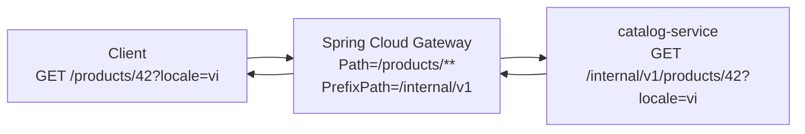
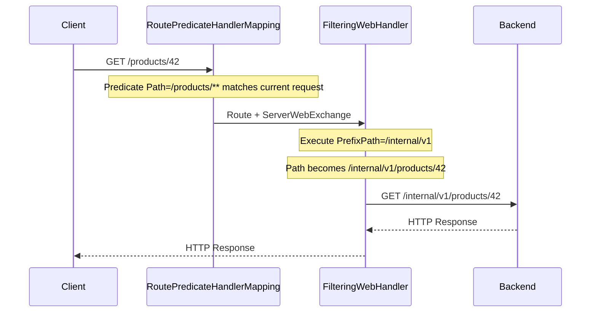
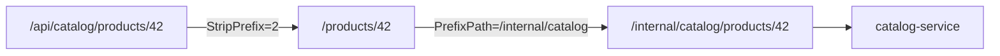
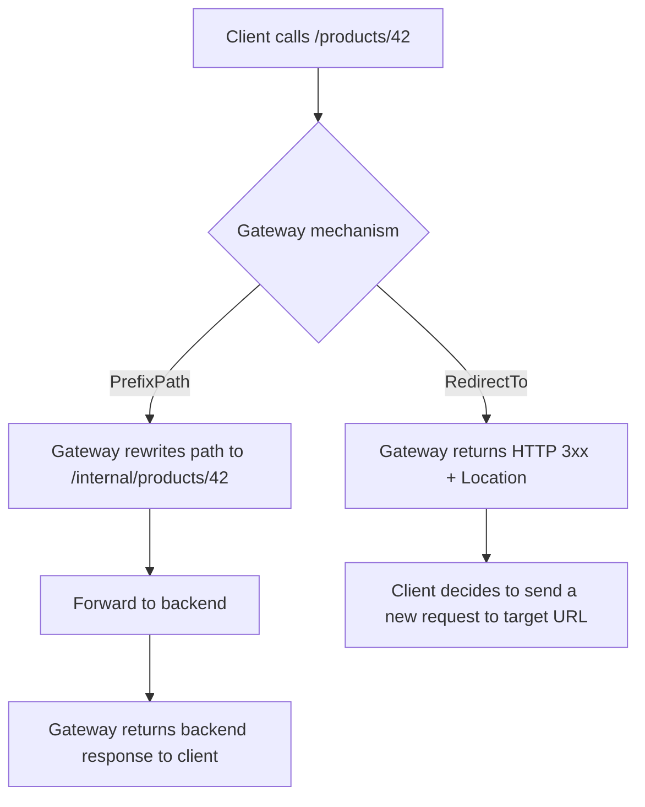
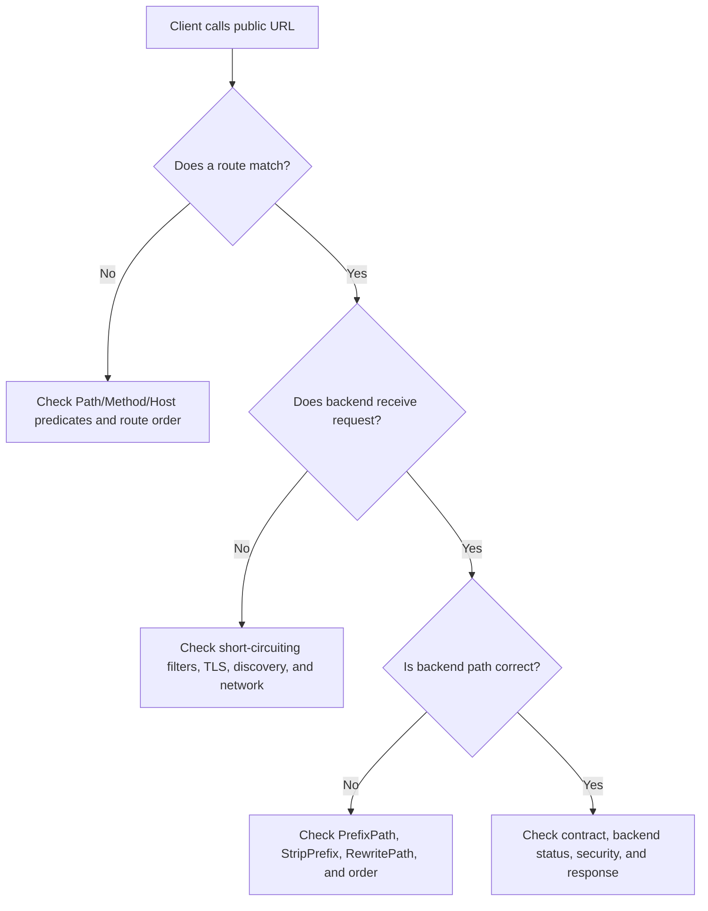

# PrefixPath: Adding a Prefix to Downstream Requests

Suppose a retail application exposes the API `GET /products/42` to clients, while the catalog service behind Spring Cloud Gateway only handles the URL `GET /internal/v1/products/42`. You want to keep the public URL clean and stable while forwarding requests to the path the backend actually understands. **`PrefixPath`** is a gateway filter designed for this problem: it **prepends a prefix to the request path** before sending it to the upstream service.

This is an **internal path transformation technique inside the API Gateway**, not a browser redirect instruction. The client still sends requests to the public URL; the gateway modifies the forwarded request path. In microservices architectures, `PrefixPath` is useful when a backend has a base path, context path, or version prefix that differs from the public API contract.

This lesson belongs to the **Path Rewriting and Redirects** chapter of the **SPRING_CLOUD_GATEWAY** module. We will go from how `PrefixPath` works to YAML/Java DSL configuration, combining it with route predicates and other filters, verifying queries/headers, security, discovery, retries, TLS, and observability.

> **Scope:** The `PrefixPathGatewayFilterFactory` and `RouteLocatorBuilder` configuration examples below target **Spring Cloud Gateway Server WebFlux**. Spring Cloud Gateway Server Web MVC has its own route/filter system and documentation. When implementing, select the starter and property paths matching your Spring Boot/Spring Cloud/Gateway version.

## 1. What Problem Does PrefixPath Solve?

A URL typically consists of the following parts:

```text
https://api.example.com/products/42?locale=vi
|------- authority ----|-- path ---|-- query --|
```

`PrefixPath` acts on the **path** of the forwarded request. When configured with the prefix `/internal/v1`:

| Component | Value |
| --- | --- |
| Public URL called by client | `https://api.example.com/products/42?locale=vi` |
| Initial path | `/products/42` |
| Configured prefix | `/internal/v1` |
| Path after `PrefixPath` | `/internal/v1/products/42` |
| Query string | `locale=vi` |
| Example upstream | `http://catalog-service:8080/internal/v1/products/42?locale=vi` |

In this example, the gateway needs a route matching `/products/**` with the filter `PrefixPath=/internal/v1`. The upstream URL is the **expected** result when the route points to `catalog-service` and no other filter further transforms the path.



Key point: the client **does not need to know** the `/internal/v1` path. When the backend changes its context path, operations teams can update the route/filter in the gateway to keep the public contract stable, provided that change does not break API semantics.

### Common use cases

1. **Adding an internal context path:** public `/products/**` → backend `/app/products/**`.
2. **Adding a version prefix for the backend:** public `/catalog/**` → backend `/v2/catalog/**`.
3. **Combining public prefix removal and internal prefix addition:** public `/api/catalog/products` → backend `/internal/catalog/products`.
4. **Preserving the client contract during backend migration:** the new backend requires paths starting with `/service-a`, while clients still call the legacy URL.

`PrefixPath` only resolves **path** differences. If the backend also requires authentication, TLS, special headers, service discovery, or rate limiting, those responsibilities must be configured and tested separately.

## 2. Understanding "Prepending a Prefix" Precisely

With `PrefixPath=/internal`, the basic idea is:

```text
filtered path = prefix + current path

/internal + /products/42 = /internal/products/42
```

The filter operates on the **current request path at the moment it executes**, so the outcome also depends on any other path transformation steps in the filter chain.

### Basic path transformation table

| Path entering `PrefixPath` | Prefix | Desired path after filter |
| --- | --- | --- |
| `/products` | `/internal` | `/internal/products` |
| `/products/42` | `/internal/v1` | `/internal/v1/products/42` |
| `/orders/123/items` | `/backend` | `/backend/orders/123/items` |
| `/` | `/internal` | `/internal/` |

The examples use a prefix that **starts with `/` and does not end with `/`** to avoid ambiguity in path concatenation. In a real environment, test double slashes, trailing slashes, and root paths with your exact library version.

**This is not a path "replacement" operation.** With `PrefixPath=/v1`, the request `/catalog/products` becomes `/v1/catalog/products`, not `/v1/products`. To remove the `/catalog` segment, you need an additional filter such as `StripPrefix` or `RewritePath` according to the backend contract.

### What about query strings, methods, bodies, and headers?

`PrefixPath` is designed to change the **path**. It is not responsible for altering:

- HTTP methods (`GET`, `POST`, `PATCH`, ...).
- Query strings, such as `?page=2&sort=price`.
- JSON or binary request bodies.
- Authentication credentials in `Authorization` or cookies.
- Backend HTTP status codes and response bodies.

For example, `POST /orders?source=mobile` with a JSON body retains its POST/body semantics when only `PrefixPath` is used, while the forwarded path can become `/internal/orders`. You still need to test encoding, query strings, and headers because other filters, proxies in front of the gateway, or the backend may further transform the request.

## 3. Where Does PrefixPath Sit in the Request-Processing Pipeline?

Spring Cloud Gateway Server WebFlux follows these main steps:



**Predicates select the route first; `PrefixPath` runs after the route has been selected.** Therefore, in a route configuration with:

```yaml
predicates:
  - Path=/products/**
filters:
  - PrefixPath=/internal/v1
```

The `Path` predicate matches against the path the request carries at the route-matching step, such as `/products/42`. Do not write `Path=/internal/v1/products/**` just because that is the path the backend needs to receive, unless clients actually call that path or a preprocessing component alters the path before route matching.

### Why does step order matter?

In the Gateway WebFlux filter chain, `GlobalFilter` instances and route-specific `GatewayFilter` instances are combined and sorted by order of application. `PrefixPath` is a route-attached filter created from configuration via `PrefixPathGatewayFilterFactory`.

Consequently:

- Filters running **before `PrefixPath`** observe the public path.
- Filters running **after `PrefixPath`** observe the path with the prefix added.
- If `StripPrefix`, `RewritePath`, or custom filters are also present, the resulting path depends on their **actual execution order**.
- After route selection, built-in routing filters use the processed request/URI to forward to the backend.

Do not confuse **route order** with **filter order**: route order determines the priority for evaluating routes, whereas filter order determines the processing sequence once a route has been chosen.

## 4. Configuring PrefixPath in YAML

### 4.1. Shortcut syntax

Example for **Server WebFlux using the `spring.cloud.gateway.server.webflux.routes` configuration branch** in supported versions:

```yaml
spring:
  cloud:
    gateway:
      server:
        webflux:
          routes:
            - id: catalog-prefix-route
              uri: http://localhost:8081
              predicates:
                - Path=/products/**
              filters:
                - PrefixPath=/internal/v1
```

With a test backend running at `http://localhost:8081` exposing `GET /internal/v1/products/42`, the result is:

```text
Client:
  GET http://localhost:8080/products/42

Gateway:
  route  = catalog-prefix-route
  filter = PrefixPath=/internal/v1

Backend:
  GET http://localhost:8081/internal/v1/products/42
```

For this example to work, a real Spring Cloud Gateway Server WebFlux application must be running on port 8080 and a backend on port 8081. This is a **route configuration example**; it does not create a backend or HTTP endpoint on its own.

### 4.2. Full `name/args` syntax

`PrefixPath` can also be declared with the factory name and arguments:

```yaml
filters:
  - name: PrefixPath
    args:
      prefix: /internal/v1
```

The meaning is equivalent to `- PrefixPath=/internal/v1` in the same factory context. The full form is useful when a team wants explicit configuration fields or uses a YAML linter.

Keep these distinctions in mind:

| Configuration | Meaning |
| --- | --- |
| `PrefixPath=/internal` | Prepends `/internal` to the path. |
| `StripPrefix=2` | Removes the first two path segments. |
| `SetPath=/internal/products` | Sets the path according to the configured template. |
| `RewritePath=...` | Rewrites the path using a regular expression/replacement pattern. |

The filter names above belong to **Gateway Server WebFlux** in the corresponding supported release line. Do not assume they all share identical argument names or binding behavior in the Web MVC variant.

### 4.3. Property differences across versions

Many docs and projects using older Spring Cloud Gateway WebFlux releases declare routes under:

```yaml
spring:
  cloud:
    gateway:
      routes:
        - id: catalog-prefix-route
          uri: http://localhost:8081
          predicates:
            - Path=/products/**
          filters:
            - PrefixPath=/internal/v1
```

Newer Gateway documentation clearly separates Server WebFlux from Server Web MVC in property prefixes. **Do not mix both forms in a single project.** Before copying configuration, verify the Gateway version resolved by the Spring Cloud BOM, the active starter, and the corresponding Configuration Properties documentation.

If the application starts up but routes do not appear, check **whether the configuration binds to the right properties for that version** before concluding the filter does not work.

## 5. Configuring PrefixPath with Java DSL

In Gateway Server WebFlux, routes can be created directly using `RouteLocatorBuilder`:

```java
import org.springframework.cloud.gateway.route.RouteLocator;
import org.springframework.cloud.gateway.route.builder.RouteLocatorBuilder;
import org.springframework.context.annotation.Bean;
import org.springframework.context.annotation.Configuration;

@Configuration
public class GatewayRouteConfiguration {

    @Bean
    RouteLocator catalogRoutes(RouteLocatorBuilder builder) {
        return builder.routes()
            .route("catalog-prefix-route", route -> route
                .path("/products/**")
                .filters(filters -> filters
                    .prefixPath("/internal/v1"))
                .uri("http://localhost:8081"))
            .build();
    }
}
```

`prefixPath("/internal/v1")` expresses the same transformation in the DSL. If the Java DSL already defines the `catalog-prefix-route` route, do not duplicate the same route ID and path in YAML. Duplicate routes across multiple sources can lead to unpredictable behavior when tracking or editing configuration.

### Java DSL or YAML?

| Aspect | YAML/Properties | Java DSL |
| --- | --- | --- |
| Best suited for | Routes that can be described concisely with little custom logic | Routes with code-dependent configuration and tests |
| Updates | Change config source; requires appropriate reload/refresh/deploy mechanism | Code changes typically require rebuilding and redeploying |
| Review | Easy to spot path/URI/filters in config | Easy to structure typed logic and reuse helpers |
| Verification | Verify property binding, runtime routes, and filter factories | Verify `RouteLocator` bean, route IDs, and route order |

Both approaches create routes for HTTP request processing. What must always be verified is that **the runtime route has loaded the exact expected filters**, not just that the configuration file looks right.

## 6. Combining StripPrefix with PrefixPath

In practice, public paths often have an `/api/{service}` prefix while the backend uses a different prefix. `PrefixPath` **does not automatically remove** the public prefix.

Suppose the contract is:

```text
Client:  GET /api/catalog/products/42
Backend: GET /internal/catalog/products/42
```

Two transformations are needed:

1. `StripPrefix=2` strips the first two segments `api` and `catalog`.
2. `PrefixPath=/internal/catalog` prepends the backend prefix to the remaining path.

### Route declaration

```yaml
spring:
  cloud:
    gateway:
      server:
        webflux:
          routes:
            - id: catalog-api-route
              uri: http://localhost:8081
              predicates:
                - Path=/api/catalog/**
              filters:
                - StripPrefix=2
                - PrefixPath=/internal/catalog
```

Logical flow:



| Input | After StripPrefix | After PrefixPath |
| --- | --- | --- |
| `/api/catalog/products` | `/products` | `/internal/catalog/products` |
| `/api/catalog/products/42` | `/products/42` | `/internal/catalog/products/42` |
| `/api/catalog/categories/7` | `/categories/7` | `/internal/catalog/categories/7` |

This is the **intended behavior** of the filter order declared above. With custom filters or when filter ordering affects the result, verify the filter chain on your exact version. Never assume every filter type executes strictly in textual order without checking runtime order.

### Can you use PrefixPath then StripPrefix?

Do not treat swapping the two steps as equivalent.

Theoretical example with `/api/catalog/products/42`:

```text
Intended order:
  StripPrefix=2
  /api/catalog/products/42 -> /products/42
  PrefixPath=/internal/catalog
  /products/42 -> /internal/catalog/products/42

If order is reversed:
  PrefixPath=/internal/catalog
  /api/catalog/products/42 -> /internal/catalog/api/catalog/products/42
  StripPrefix=2
  ... -> /api/catalog/products/42
```

In the swapped case, `StripPrefix=2` removes the `internal` and `catalog` segments that were just added, yielding the wrong path. This shows why a **path transformation pipeline** must be designed with clear inputs and outputs at each step.

### When is a single RewritePath enough?

If the rule is "from `/api/catalog/{remaining}` to `/internal/catalog/{remaining}`", you can consider a single `RewritePath` using regex to achieve the equivalent result. However, regex syntax, capture group variables, and escaping in YAML/properties are easier to get wrong; combining `StripPrefix` + `PrefixPath` is often more readable when you simply need to remove a fixed number of leading segments and prepend a fixed prefix.

## 7. Distinguishing PrefixPath from Other URL-Modifying Filters

| Technique | Primary effect | Example with `/api/products/42` |
| --- | --- | --- |
| **`PrefixPath=/v2`** | Prepends a fixed prefix to the path | `/v2/api/products/42` |
| **`StripPrefix=1`** | Strips one leading segment | `/products/42` |
| **`SetPath=/products/current`** | Sets the path from a template | `/products/current` |
| **`RewritePath`** | Modifies the path using a regex rule | Can replace `/api` with `/internal` |
| **`RedirectTo`** | Generates an HTTP 3xx response with a `Location` header | Client is instructed to call another URL |

### PrefixPath is not RedirectTo

The two behaviors differ in where the URL changes:



| Criterion | PrefixPath | RedirectTo |
| --- | --- | --- |
| Does the Gateway call upstream? | Yes, through subsequent routing steps. | Typically returns a redirect instead of proxying the request like a normal route. |
| Does the client see the internal path? | Not solely because of the `PrefixPath` filter. | May see the URL in `Location`. |
| HTTP status 301/302/307/308? | Not generated by simply adding a path prefix. | Determined by redirect configuration. |
| When to use | Backend needs a different base path | Client needs to be sent to an external or canonical URL |

A `3xx` response **returned by the backend itself** can still pass through the gateway when a route uses `PrefixPath`. `PrefixPath` **does not automatically rewrite the `Location` header** generated by the backend. If the backend returns `Location: http://internal-host/...`, inspect your public URL configuration, reverse proxy headers, or a dedicated response-header rewrite mechanism, while ensuring internal hostnames are not leaked.

## 8. Application Variants: Fixed URI vs. Service Discovery

### Fixed URI for local development

```yaml
routes:
  - id: catalog-local
    uri: http://localhost:8081
    predicates:
      - Path=/products/**
    filters:
      - PrefixPath=/internal/v1
```

This is an **abbreviated route snippet** that must be placed under the WebFlux property prefix appropriate for your version. It is convenient when the backend runs directly on your local machine.

### Service-name URI for microservices deployments

```yaml
routes:
  - id: catalog-discovered
    uri: lb://catalog-service
    predicates:
      - Path=/products/**
    filters:
      - PrefixPath=/internal/v1
```

The two parts handle two independent responsibilities:

- **`PrefixPath=/internal/v1`** modifies the path before forwarding.
- **`lb://catalog-service`** specifies a logical service name target, requiring Spring Cloud LoadBalancer and an appropriate instance source.

If the gateway cannot find a backend instance, the issue lies in service discovery/load balancing or infrastructure. `PrefixPath` cannot fix a missing instance, nor does it alter the hostname, port, protocol, or TLS settings.

### Should you put a path directly in the backend URI?

Do not assume `uri: http://localhost:8081/internal/v1` is an equivalent substitute for `PrefixPath=/internal/v1` across all versions. Spring Cloud Gateway processes route URIs, request URLs, and forwarding filters according to its own rules; **a base path on the target URI may not behave the way naive string concatenation suggests**.

To keep the forwarding contract explicit, prefer setting the route URI to the host/port and using intentional path filters, then verify the exact URL the backend receives. When using `lb://`, this approach also cleanly separates instance resolution from path transformation.

## 9. Edge Cases to Test

Adding a path prefix looks simple, yet the following issues frequently appear in real deployments:

### 9.1. Leading and trailing slashes

If the prefix is written as `/internal/` and the path is `/products`, verify how the gateway constructs the path and whether the backend accepts `//`. A safe, clear convention is to configure the prefix as `/internal` (leading `/`, no trailing `/`), then test request paths ending in `/`.

Avoid relying on the assumption that "the gateway automatically normalizes all slashes" because path normalization can affect security rules and route matching.

### 9.2. Query strings and URL encoding

Example:

```http
GET /products/search?q=coffee%20machine&sort=price HTTP/1.1
```

After `PrefixPath=/internal/v1`, the logical path is `/internal/v1/products/search` and the query still represents `q=coffee%20machine&sort=price`. However, run real tests with percent-encoding, Unicode characters, `%2F`, and multiple `?`/`&` characters to confirm the entire proxy chain preserves semantics.

**Do not use differently decoded or normalized paths at the gateway and backend to make security decisions.** For example, paths containing special segment forms or encoded slashes may be interpreted differently across layers. Validate policies from the edge to the backend using a consistent path standard.

### 9.3. Empty paths, root paths, and trailing slashes

Test URLs such as:

```text
/
/products
/products/
/products/42
```

When using `Path=/products/**`, whether `/products` matches depends on predicate behavior and the version's trailing separator option. Do not test only multi-segment paths; document the path contract clearly and test each route against real requirements.

### 9.4. Path predicates and already-transformed requests

The gateway selects the route before running `PrefixPath`. If a request arrives at `/admin/orders` while the route predicate only matches `/orders/**`, having `PrefixPath=/admin` will not make that request match the route. Prefixing is a **post-route-selection** operation, not a way to broaden predicate matching.

### 9.5. WebSocket, streaming, and protocol upgrades

If your application needs WebSocket or streaming, do not assume every HTTP filter behaves identically across all route types and versions. Verify the route URI scheme, handshake, actual backend path, timeouts, and support in your active Gateway variant.

## 10. Impact on Authentication, Authorization, and API Protection

Adding a prefix is a technical operation, yet it can affect the system's **security boundary**.

### Gateway policies typically evaluate the public path

A public API call:

```text
GET /api/orders/123
```

may be forwarded as:

```text
GET /internal/order-service/orders/123
```

If Spring Security protects `/api/orders/**` at the gateway, that policy is usually evaluated against the request in the security layer before route `GatewayFilter`s change the path. Do not assume that protecting `/internal/order-service/**` at the gateway is equivalent; know precisely **which layer reads the path at which point**.

At the backend, verifying whether a user is allowed to view order 123 remains the responsibility of the order service. Token validation or API-level authorization at the gateway does not replace resource ownership checks.

### Avoiding accidental exposure of internal endpoints

Suppose a backend exposes both:

```text
/internal/catalog/products
/internal/catalog/admin/reindex
```

If a gateway route has `Path=/catalog/**` plus `PrefixPath=/internal` without restricting the exposed endpoints, a client could guess a public URL that maps onto an internal administrative endpoint behind it.

Countermeasures to consider:

1. Expose only the paths and HTTP methods actually needed using predicates and security policies.
2. Keep administrative APIs on a separate port/network or block them from public gateway access.
3. Have the backend protect sensitive endpoints itself; never rely on a path "looking internal".
4. Test ambiguous paths, encoded slashes, and URL normalization differences.
5. Restrict permissions to edit routes/filters, as a bad prefix change can route traffic to unintended resources.

### Identity headers and trusted sources

`PrefixPath` does not validate `Authorization`, generate user identities, or sanitize trusted proxy headers. If the backend relies on headers like `X-Forwarded-*` or `X-User-Id`, establish trusted header sources, lock down proxies in front of the gateway, and strip forged client-supplied headers where appropriate.

## 11. PrefixPath in a Filter Chain with Retry, CircuitBreaker, and Rate Limiting

An e-commerce route may require:

| Requirement | Related mechanism | Role of PrefixPath |
| --- | --- | --- |
| Select catalog API | `Path` predicate | Not involved in route matching; runs after selection. |
| Add internal path | `PrefixPath` | Transforms the request path sent to the backend. |
| Limit traffic | `RequestRateLimiter` | Does not enforce quotas; requires limiter and key resolver config. |
| Prevent backend overload | `CircuitBreaker`, timeout | Does not manage breaker state; requires resilience policies. |
| Retry on failure | `Retry` | Path output must remain consistent on every attempt. |
| Discover instances | `lb://...`, LoadBalancer | Does not alter service name or instance selection strategy. |
| Connect over HTTPS to backend | HTTP client TLS | Does not modify TLS, certificates, or hostname verification. |
| Measure latency per route | Micrometer/Actuator/tracing | Does not emit metrics itself; may affect logged paths if recorded after rewrite. |

### Retry and path transformation

When retries are enabled, a request may traverse parts of the downstream filter chain multiple times depending on filter placement. If a custom filter prepends a prefix via naive string concatenation without idempotency guards, a retried request could receive the prefix multiple times.

Even with the built-in `PrefixPath`, verify the **actual filter order** when combining retries and custom filters to ensure the backend receives the expected path on every attempt. Observe how many times the upstream receives the request, the path, overall timeouts, and error responses.

In particular, avoid blindly enabling retries for `POST /orders` or `POST /payments` when the backend lacks idempotency keys and deduplication safeguards. Path rewriting does not make those operations safe to retry.

### Circuit breakers and timeouts

If `PrefixPath` routes requests to an endpoint with a completely different latency profile from the old API, review route timeouts and circuit breaker thresholds. Timeouts at the gateway, ingress, and backend can differ. Do not treat a successful path prefix rewrite as proof of operational stability; measure latency, error rates, and recovery under load.

## 12. Observing Requests Before and After Adding a Prefix

A gateway typically needs to answer:

- Which **public path** did the client call?
- Which route ID was selected?
- Which **downstream path** did the gateway forward to?
- Which upstream instance responded, with what HTTP status and latency?
- Did an error occur in route matching, the filter chain, TLS/discovery, or the backend?

In WebFlux, processing steps can access `ServerWebExchange`. Once a route is selected, `GATEWAY_ROUTE_ATTR` can provide the route ID. A custom filter can observe the path before and after transformation, but you must pay attention to its position in the filter chain and to the fact that the request may be mutated via a `ServerWebExchange` wrapper.

### Desired trace template

```text
traceId:     [correlation id]
routeId:     catalog-api-route
clientPath:  /api/catalog/products/42
backendPath: /internal/catalog/products/42
upstream:    catalog-service
status:      200
elapsedMs:   [actual measurement]
```

This is an **observability template**, not a log format automatically emitted by `PrefixPath`. To capture both path fields, the application needs proper instrumentation and must retain the original path before mutating the request. Never log `Authorization` headers, cookies, tokens, or payment bodies. Avoid using paths containing user or order IDs as high-cardinality metric labels; prefer route IDs or path templates.

### Commonly misdiagnosed errors

A `404` on `/products/42` is not necessarily caused by the route predicate:

1. The gateway may have matched the route successfully.
2. `PrefixPath` may have transformed the path into `/internal/v1/products/42`.
3. The backend may actually only handle `/internal/products/42`.
4. The backend returns `404` and the gateway relays that response to the client.

Inspect both the **route ID and the path the backend actually received** instead of blindly refreshing routes on every `404`.

## 13. Hands-on Practice: Adding a Prefix and Verifying the Full HTTP Request

### 13.1. Setup

Suppose you have:

- Spring Cloud Gateway Server WebFlux at `http://localhost:8080`.
- A mock backend at `http://localhost:8081` that echoes the request method, path, query, and safe headers.
- Route configured as in Section 4: `Path=/products/**`, `PrefixPath=/internal/v1`.

The backend must actually expose a test endpoint such as `GET /internal/v1/products/42`. If your backend uses a different path, adjust the backend or prefix so both sides agree.

### 13.2. Testing GET

```bash
curl -i "http://localhost:8080/products/42?locale=vi&page=2"
```

**Expected:** The backend receives `GET /internal/v1/products/42?locale=vi&page=2`. The status code and body depend on the backend; `PrefixPath` does not fabricate product JSON or a `200` status.

### 13.3. Testing method and body

If the test backend supports POST at the prefixed path:

```bash
curl -i -X POST \
  -H "Content-Type: application/json" \
  -d '{"name":"Notebook"}' \
  "http://localhost:8080/products"
```

**Expected:** The backend receives method POST, path `/internal/v1/products`, and the corresponding JSON body, assuming the route does not restrict the method via a predicate. In a real application, enforce write permissions and endpoint idempotency.

### 13.4. Testing a non-matching route

```bash
curl -i "http://localhost:8080/orders/123"
```

This request does not match `Path=/products/**` on the sample route. If no other route/handler exists, the gateway may return `404`; the `products` route's `PrefixPath` does not run.

### 13.5. Testing StripPrefix + PrefixPath together

Switch to the route from Section 6 (or deploy a new non-overlapping route) and call:

```bash
curl -i "http://localhost:8080/api/catalog/products/42?locale=vi"
```

**Expected:** The backend receives `/internal/catalog/products/42?locale=vi`, not `/internal/catalog/api/catalog/products/42`.

### 13.6. Testing a backend redirect response

Configure the backend to return `302` with a `Location` header. Inspect which URL the client receives:

- If the backend returns a `Location` containing an internal address, `PrefixPath` does not automatically prevent that address from leaking.
- If the backend generates a relative URL, verify whether it aligns with the public URL structure.
- When `Location` needs rewriting, use a public base path/URL strategy in the backend or an appropriate response-header filter and test on your exact version.

### 13.7. Verification matrix

| Test | Client request | Expected backend path | What to observe |
| --- | --- | --- | --- |
| P01 | `GET /products/42` | `/internal/v1/products/42` | Route ID, path, status |
| P02 | `GET /products/42?page=2` | `/internal/v1/products/42?page=2` | Query preserved |
| P03 | `POST /products` | `/internal/v1/products` | Method/body preserved |
| P04 | `GET /orders/123` | Not sent via products route | Predicate enforced |
| P05 | `GET /api/catalog/products/42` with both filters | `/internal/catalog/products/42` | StripPrefix/PrefixPath order |
| P06 | Backend returns 302 | Based on called upstream path | Whether `Location` is safe/public |
| P07 | Path with trailing `/` or encoded slash | Per confirmed contract | Normalization and security |
| P08 | Upstream down/no instance | No normal response | Distinguish routing error vs. backend error |

## 14. Troubleshooting PrefixPath

| Symptom | Possible cause | What to check |
| --- | --- | --- |
| Prefix does not appear at backend | Route did not match, filter not attached, or route not loaded | Check predicates, route ID, YAML/DSL config, and runtime routes. |
| Backend receives path still containing public prefix | Only `PrefixPath` is configured, missing `StripPrefix` | Verify target path; add prefix removal if needed. |
| Backend receives wrong path after adding two filters | Wrong transformation order or another filter modifies path | Observe path after each step and check actual filter order. |
| Backend returns 404 despite gateway matching route | Backend does not expose the prefixed endpoint | Use a mock/echo server to verify the path received by the backend. |
| URL contains `//` | Inconsistent leading/trailing slashes in prefix or path | Standardize configuration conventions and test edge cases. |
| YAML changed but behavior did not | Wrong property prefix, config not reloaded, or route cache not refreshed | Check version, runtime routes, restart/refresh mechanism, and every replica. |
| Only some gateway instances work properly | Replicas loaded different configurations | Compare revisions and runtime routes across instances. |
| `lb://service` fails to forward | LoadBalancer/discovery missing instances | Check registry, health, and dependencies; do not blame PrefixPath. |
| Client sees internal hostname in redirect | Backend returns internal `Location` and gateway does not rewrite response | Adjust public URL/response headers using a tested policy. |
| Public API reaches backend admin endpoint | Route and policies are overly broad | Narrow paths/methods, protect backend, and verify auth. |
| Valid token returns 401/403 | Security chain/backend rejects credentials | Check token, audience/scope, and authorization; do not blindly change prefix. |

### Recommended debugging flow



## 15. Production Readiness Checklist

- [ ] Public URLs and **expected backend paths** are finalized for every endpoint.
- [ ] **Server WebFlux vs. Server Web MVC** and compatible Spring Boot/Spring Cloud/Gateway versions are accurately chosen.
- [ ] Route predicates match the right client-facing path/method/host.
- [ ] Prefixes start with `/`, have no unintended trailing slash, and are tested with root/trailing-slash paths.
- [ ] `StripPrefix`, `PrefixPath`, and `RewritePath` transformations are declared and tested in the exact required order.
- [ ] Query strings, URL encoding, methods, headers, and bodies are preserved per the API contract.
- [ ] Administrative or sensitive internal backend endpoints are not accidentally exposed.
- [ ] Gateway and backend enforce authentication/authorization at the appropriate layers.
- [ ] `lb://` URIs have matching LoadBalancer/discovery setup; TLS and upstream hostnames are verified separately.
- [ ] If retries/circuit breakers are used, path consistency across attempts, timeouts, and idempotency are verified.
- [ ] Logs/metrics/tracing allow tracing route ID, public path, and backend path without leaking secrets.
- [ ] Backend `3xx` responses have been tested, checking `Location` headers and client redirect handling.
- [ ] Configuration refresh/deployment and rollback procedures apply consistently across all gateway instances.

## 16. Self-Check Questions

1. With `PrefixPath=/internal/v2`, what will the backend path be for `GET /products/42?currency=VND`? Does the query string change automatically?
2. Why does `PrefixPath=/internal` not make the predicate `Path=/internal/products/**` match a client calling `/products/42`?
3. How do you transform `/api/catalog/products/42` into `/internal/catalog/products/42` using `StripPrefix` and `PrefixPath`?
4. If you reverse the order of the two filters in question 3, is the resulting path still correct? Explain.
5. When a backend returns `302 Location: http://internal-host/login`, does `PrefixPath` automatically rewrite `Location` to a public URL?
6. Why should you not blame path rewriting when `lb://catalog-service` fails to find an instance?
7. When upgrading Gateway WebFlux or migrating to Server Web MVC, which configuration parts and tests must be reviewed?
8. A route adds a prefix that reaches a backend administrative endpoint: what controls do you need at the gateway and the backend?

## 17. Version-Specific References

To implement and verify syntax for your exact dependency set, consult:

- [Spring Cloud Gateway — PrefixPath GatewayFilter Factory (Server WebFlux)](https://docs.spring.io/spring-cloud-gateway/reference/spring-cloud-gateway-server-webflux/gatewayfilter-factories/prefixpath-factory.html)
- [Spring Cloud Gateway — StripPrefix GatewayFilter Factory](https://docs.spring.io/spring-cloud-gateway/reference/spring-cloud-gateway-server-webflux/gatewayfilter-factories/stripprefix-factory.html)
- [Spring Cloud Gateway — RewritePath GatewayFilter Factory](https://docs.spring.io/spring-cloud-gateway/reference/spring-cloud-gateway-server-webflux/gatewayfilter-factories/rewritepath-factory.html)
- [Spring Cloud Gateway — Route Predicate Factories](https://docs.spring.io/spring-cloud-gateway/reference/spring-cloud-gateway-server-webflux/route-predicate-factories.html)
- [Spring Cloud Gateway — Configuration Properties](https://docs.spring.io/spring-cloud-gateway/reference/configprops.html)
- [Spring Cloud Gateway Server Web MVC — How It Works](https://docs.spring.io/spring-cloud-gateway/reference/spring-cloud-gateway-server-webmvc/how-it-works.html)

**Key takeaway:** `PrefixPath` is **a filter that prepends a prefix to the path of a matched request before forwarding it to the backend**. It does not strip leading segments, alter the host, or generate HTTP redirects. When combining it with `StripPrefix`, `RewritePath`, discovery, security, and operational filters, clearly define input/output paths, test execution order, and use version-accurate configuration to keep your microservices entry point stable and secure.
