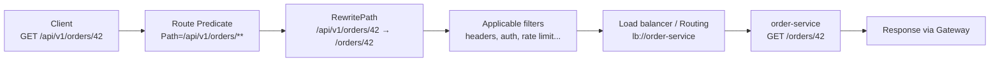

# RewritePath: Replacing Paths Using Regular Expressions

In a microservices architecture, the URL called by clients typically needs to stay stable, while the path received by internal services may vary based on deployment structure. For example, clients call `GET /api/v1/orders/42` on `api.example.com`, whereas `order-service` only exposes the `GET /orders/42` endpoint. Spring Cloud Gateway's **`RewritePath` GatewayFilter Factory** transforms the **path** before a request is sent to the backend using a **regular expression (regex)** and a **replacement string**.

This lesson belongs to the **Path Rewriting and Redirects** chapter of the **SPRING_CLOUD_GATEWAY** module. When building an API Gateway with route predicates, filter chains, path/header transformations, and service discovery, `RewritePath` solves URL normalization at the edge. In production deployments, it must work properly alongside authentication, rate limiting, circuit breakers, retries, TLS, and request observability so that API contracts are not broken and routing vulnerabilities are not introduced.

Learning objectives:

1. Write a `RewritePath=regexp, replacement` filter to transform paths using Java regex.
2. Use named **capture groups** and understand why the `$` character must be escaped in Spring Cloud Gateway YAML configuration.
3. Accurately predict outcomes for paths with/without trailing slashes, query parameters, and matching vs. non-matching regexes.
4. Distinguish `RewritePath` from `StripPrefix`, `PrefixPath`, `SetPath`, `RedirectTo`, and response `Location` modification.
5. Test paths before/after the gateway, diagnose common errors, and control proxy-layer security risks.

> **Scope:** This content focuses on **Spring Cloud Gateway Server WebFlux** using Spring WebFlux and Reactor Netty. The `spring.cloud.gateway.routes` configuration form is common in Gateway 4.x; in Gateway Server WebFlux 5.x, official examples use `spring.cloud.gateway.server.webflux.routes`. Both branches provide `RewritePath`, but you must use the starter, version, and prefix matching your application. Spring Cloud Gateway Server MVC has its own filter mechanism; do not mechanically apply WebFlux internal explanations to MVC.

## 1. Where Does RewritePath Fit in the Request Lifecycle?

A Gateway route consists of **predicates** to select the route and **filters** to modify requests/responses for the chosen route. `RewritePath` is a **GatewayFilter** attached to a route. In typical route configurations, it mutates the request path **after the route has matched** and **before HTTP proxying to the upstream**.



A request has two **distinct perspectives to distinguish**:

| Perspective | Example | Role |
| --- | --- | --- |
| Client-side URL | `https://api.example.com/api/v1/orders/42` | Public contract used by client requests |
| Path checked by predicate | `/api/v1/orders/42` | Used to decide whether to select the route |
| Path after `RewritePath` | `/orders/42` | HTTP path sent to the upstream |
| Route backend URI | `lb://order-service` | Identifies target service via discovery/load balancer |
| Final HTTP URL | `http://10.0.0.15:8080/orders/42` (illustrative) | Instance and path called by the Gateway's HTTP client |

`RewritePath` is **not an HTTP redirect**. The client does not receive `301`/`302` merely because the filter changed the path, and the browser address bar does not change. The Gateway transparently proxies the transformed request. If you need the browser to navigate to a new URL, use a redirect mechanism such as `RedirectTo` on an appropriate route.

## 2. Structure of RewritePath and Its Two Required Parameters

Short form of the filter:

```yaml
filters:
  - RewritePath=<regexp>, <replacement>
```

Where:

- **`regexp`** is a Java regular expression matching the portion of the request path to replace.
- **`replacement`** is the replacement string using `java.util.regex.Matcher` syntax, which can reference capture groups like `$1` or `${segment}`.
- A route can contain multiple filters; filter order and route matching determine the actual transformation pipeline.

A simple example following the Spring Cloud Gateway documentation style:

```yaml
spring:
  cloud:
    gateway:
      routes:
        - id: rewrite-red
          uri: http://localhost:8081
          predicates:
            - Path=/red/**
          filters:
            - RewritePath=/red/?(?<segment>.*), /$\{segment}
```

When a client calls `/red/blue`, the backend receives the path `/blue`.

Breaking down the regex `/red/?(?<segment>.*)`:

| Component | Meaning |
| --- | --- |
| `/red` | Literal substring to match |
| `/?` | Optional `/` character (present or absent) |
| `(?<segment>.*)` | Named capture group `segment`, matching 0 or more characters |
| `/$\{segment}` in YAML | Replacement creating a path starting with `/` followed by the `segment` group contents |

This example follows the official documentation pattern. In systems requiring strict prefix matching, consider adding anchors `^`, `$` (end of regex) and explicit path segment boundaries, as shown in Section 5.

## 3. Capture Groups and Replacement Syntax in Java Regex

Java regex supports **numbered capture groups** and **named capture groups**:

```text
Pattern:     ^/api/v1/orders/(?<remaining>.*)$
Request:     /api/v1/orders/42/items
Group name:  remaining
Group value: 42/items
Replacement: /orders/${remaining}
Result:      /orders/42/items
```

In regex:

- `^` denotes start of string, `$` denotes end of string.
- `(?<remaining>.*)` captures the remainder of the path under the name `remaining`.
- `.` matches any single character in standard regex mode except line terminators (unless enabled); `*` repeats **0 or more times**.
- `+` repeats **1 or more times**; `.*` can match an empty string, whereas `.+` cannot.
- `(?:...)` is a **non-capturing** group, useful for grouping alternatives without creating a new capture group.
- `$1` references capture group 1; `${remaining}` references a named capture group inside the replacement string actually received by Java `Matcher`.

**Note:** `RewritePath` uses **Java** regular expressions, not the glob syntax of the `Path` predicate. For example, `Path=/api/**` is a Spring Path pattern; the `**` token does not mean the same thing in Java regex. Do not copy glob patterns directly into `regexp`.

### Named groups vs. numbered groups

The following two approaches can yield the same result:

```text
Regex:       ^/legacy/(.*)$
Replacement: /$1

Regex:       ^/legacy/(?<tail>.*)$
Replacement: /${tail}
```

Named groups are generally easier to read when an expression has multiple parts. Numbered groups `$1`, `$2` can be handy for short expressions, but break easily if another capture group is inserted earlier.

**In Java source code**, a direct example with `Pattern` and `Matcher` without a YAML/Spring property-binding layer:

```java
import java.util.regex.Pattern;

Pattern p = Pattern.compile("^/legacy/(?<tail>.*)$");

String result = p.matcher("/legacy/orders/42")
    .replaceAll("/${tail}");

System.out.println(result);  // /orders/42
```

This snippet illustrates **Java regex semantics**: the replacement `/${tail}` pulls the value of the named group. Writing this in Gateway's `application.yml` requires an extra escaping rule.

## 4. The $ Character, Backslashes, and Escaping in application.yml

This is the most frequent mistake when starting with `RewritePath`. In a Java regex **replacement**, `${segment}` means "insert the group named `segment`." However, in Spring Cloud Gateway's `application.yml`, the value can pass through Spring's **property placeholder** resolution before reaching regex replacement.

Therefore, the Spring Cloud Gateway documentation instructs writing:

```yaml
filters:
  - RewritePath=/red/?(?<segment>.*), /$\{segment}
```

The backslash between `$` and `{` is escape syntax **for configuration loading**:

| Context | Value to write |
| --- | --- |
| Direct Java regex replacement | `/${segment}` |
| Short form in Gateway `application.yml` | `/$\{segment}` |
| Result when group is `blue` | `/blue` |

**Do not confuse** `/$\{segment}` with a path containing a literal `\` character. The escape character is for the configuration-loading phase; it does not send an extra backslash to the backend. Nor should you assume that merely wrapping the value in quotes bypasses all Spring placeholder resolution.

The named-argument form can make configuration easier to read:

```yaml
filters:
  - name: RewritePath
    args:
      regexp: "^/red/(?<segment>.*)$"
      replacement: '/$\{segment}'
```

Here, YAML **single quotes** preserve the `\` character inside the scalar string. With **double quotes**, YAML's escape rules differ; for example, `\{` is not a valid YAML double-quoted escape sequence. If you choose double-quoted strings, escape the `\` according to YAML rules and verify the actual loaded property value.

**Do not confuse the three syntax layers:**

1. **Java regex**: `^`, `$`, `(?<segment>.*)`, `(.*)`.
2. **Regex replacement**: `$1`, `${segment}`.
3. **Spring/YAML configuration**: must preserve the replacement across property loading, which is why Gateway examples use `$\{segment}`.

If you switch configuration to Java DSL, escaping differs because there is no YAML layer:

```java
// Example when declaring RouteLocator using Java DSL:
.route("rewrite-red-java", r -> r
    .path("/red/**")
    .filters(f -> f.rewritePath(
        "^/red/(?<segment>.*)$",
        "/${segment}"))
    .uri("http://localhost:8081"))
```

The Java snippet above is a **configuration fragment** inside a `RouteLocatorBuilder.Builder`; it must be placed inside a bean with the appropriate imports. It illustrates the core idea: Java source uses `/${segment}`, while YAML in the examples above uses `/$\{segment}`.

## 5. Safe Regex Patterns for Prefix Changes

Common scenario: Clients call `/api/v1/orders/...` while the backend expects `/orders/...`.

### Configuration with explicit path boundaries

```yaml
spring:
  cloud:
    gateway:
      routes:
        - id: orders-public
          uri: lb://order-service
          predicates:
            - Path=/api/v1/orders,/api/v1/orders/**
          filters:
            - name: RewritePath
              args:
                regexp: "^/api/v1(?<rest>/orders(?:/.*)?)$"
              replacement: '$\{rest}'
```

Meaning:

- The route matches `/api/v1/orders` or paths underneath `/api/v1/orders/...`.
- `regexp` only accepts paths prefixed by `/api/v1`, then captures the remainder starting with `/orders`.
- `replacement` constructs the path from the entire `rest` group.
- The `lb://order-service` URI is resolved by Spring Cloud LoadBalancer to a service instance if the dependencies and instance source are properly configured.

Prediction table:

| Client path | Group `rest` | Backend path |
| --- | --- | --- |
| `/api/v1/orders` | `/orders` | `/orders` |
| `/api/v1/orders/` | `/orders/` | `/orders/` |
| `/api/v1/orders/42` | `/orders/42` | `/orders/42` |
| `/api/v1/orders/42/items` | `/orders/42/items` | `/orders/42/items` |
| `/api/v1/products/8` | Does not match route | Not forwarded by this route |

The pattern above intentionally preserves a trailing `/` if present in the original request. If the backend differentiates `/orders` from `/orders/`, decide whether to preserve or normalize it in your API contract and tests.

### General pattern for stripping a /public prefix

To strip `/public` while also allowing the `/public` root itself, you can use a boundary:

```yaml
predicates:
  - Path=/public,/public/**
filters:
  - RewritePath=^/public(?:/|$)(?<tail>.*)$, /$\{tail}
```

| Input | Output |
| --- | --- |
| `/public` | `/` |
| `/public/` | `/` |
| `/public/catalog/42` | `/catalog/42` |
| `/publicish/catalog` | Does not match pattern; also does not match above route |

The `(?:/|$)` group forces a slash or end-of-path right after `public`, preventing accidental rewriting of a `/publicish` prefix. Even so, once the route predicate matches, the regex is not required to match; `RewritePath` **does not return a 404 by itself** when the pattern does not match (see Section 7).

### Short form when regex is unnecessary

If the goal is simply to strip **a single leading path segment**, `StripPrefix=1` is usually more readable:

```yaml
filters:
  - StripPrefix=1
```

With `/api/orders/42`, the result is normally `/orders/42`. Reserve `RewritePath` for when you genuinely need alternation, capture groups, or complex URL restructuring.

## 6. Advanced: Renaming Resources and Restructuring URLs

`RewritePath` can migrate a legacy API onto a new internal path contract without requiring every client to switch URLs simultaneously.

### 6.1. Rewriting /legacy/order/{id} to /orders/{id}

```yaml
predicates:
  - Path=/legacy/order/**
filters:
  - RewritePath=^/legacy/order/(?<id>[^/]+)$, /orders/$\{id}
```

In regex, `[^/]+` means one or more characters **other than** `/`. That keeps the `id` group from accidentally swallowing another path level.

| Request | Expected result |
| --- | --- |
| `/legacy/order/42` | `/orders/42` |
| `/legacy/order/abc-123` | `/orders/abc-123` |
| `/legacy/order/42/items` | Does not match full regex; filter leaves path unchanged |

**Key point:** The `Path=/legacy/order/**` route predicate will still let `/legacy/order/42/items` pass through. When the regex does not match, the filter normally leaves the path intact, so the backend may receive an unexpected URL. Therefore, when only one segment should be allowed, also **tighten the predicate** or add rules/tests handling requests with extra segments.

### 6.2. Swapping two groups into a different order

Example: public `/tenant/acme/order/42`, internal `/orders/42/tenants/acme`:

```yaml
predicates:
  - Path=/tenant/{tenant}/order/{id}
filters:
  - name: RewritePath
    args:
      regexp: "^/tenant/(?<tenant>[^/]+)/order/(?<id>[^/]+)$"
      replacement: '/orders/$\{id}/tenants/$\{tenant}'
```

Capturing multiple groups lets you reorder path segments. However, **the tenant from the URL is client-chosen input**. The backend must verify that this tenant belongs to the authenticated user's permissions and that the order actually belongs to that tenant. Rewriting the URL cleanly does not grant read authorization.

### 6.3. Rewriting using alternation groups

When multiple legacy aliases point to the same resource:

```yaml
predicates:
  - Path=/old-products/**,/legacy-products/**
filters:
  - RewritePath=^/(?:old-products|legacy-products)/(?<tail>.*)$, /products/$\{tail}
```

Here `(?:A|B)` picks either prefix without adding an extra capture group. You still must test empty paths after the prefix, such as `/old-products/`, and decide whether the backend exposes `/products/`.

## 7. What Happens If regexp Does Not Match?

A critical detail: the `Path` predicate and `RewritePath` can use **two different pattern languages**. The route predicate decides whether a request enters the route; the rewrite filter then attempts the regex against the path.

In the standard implementation, `RewritePath` uses Java regex replacement. **If the regex finds no match, the path remains unchanged**; the request can still proceed down the filter chain to the backend. RewritePath is not a validator, firewall, or `404` generator.

Example of an inconsistent configuration:

```yaml
predicates:
  - Path=/api/orders/**
filters:
  - RewritePath=^/internal/(?<tail>.*)$, /$\{tail}
```

Client calls `/api/orders/42`:

1. The `Path` predicate matches.
2. The regex `^/internal/...` does not match `/api/orders/42`.
3. The path remains `/api/orders/42`.
4. The Gateway may forward that unchanged path, causing the backend to return `404` if it only supports `/orders/42`.

To avoid this, build an **input/output table** for each route and test against a backend that records the URI it receives.

### Matching characteristics of Java regex

`RewritePath` performs *regex replacement*, so do not implicitly treat it as a pure "strip prefix" operation. Patterns missing `^` and `$` can match partway through a path; greedy quantifiers like `.*` can consume more than intended. Use:

- Anchors `^` and `$` when validating the full path.
- Segment boundaries `/` and non-capturing groups `(?:...)`.
- `[^/]+` to capture a single segment.
- `.*` when the suffix may span multiple segments or be empty; `.+` when non-empty is required.

Do not make regexes more complicated than the problem warrants. For a few fixed prefixes, `StripPrefix` or `SetPath` can be easier to maintain.

## 8. How Does RewritePath Differ from Related Filters?

| Filter | What does it change? | Example | When appropriate |
| --- | --- | --- | --- |
| **`RewritePath`** | Request path using Java regex and replacement | `/old/42` → `/orders/42` | Restructuring URLs with capture groups |
| **`StripPrefix`** | Removes N leading segments of the request path | `/api/orders/42` → `/orders/42` | Simple prefix removal |
| **`PrefixPath`** | Prepends a prefix to the path | `/orders/42` → `/internal/orders/42` | Adding a fixed internal base segment |
| **`SetPath`** | Sets request path from a new template, typically with predicate variables | `/service/{id}` → `/orders/{id}` | Using matched template variables without Java regex |
| **`RedirectTo`** | Returns a `3xx` redirect response with `Location` | `/old` → `https://.../new` | Want the **client to make a new request** |
| **`RewriteLocationResponseHeader`** | Adjusts `Location` returned by upstream | `Location` pointing to internal host → public host | Backend emits redirects to internal URLs |
| **`RewriteResponseHeader`** | Modifies a response header value using regex | Adjusting a response header | Modifying a header rather than the request path |

Specifically, **`RewritePath` only modifies the request path**. It **does not automatically change**:

- HTTP methods such as `GET` or `POST`.
- Query parameters, e.g., `?sort=desc`, during standard path rewriting.
- Request bodies or JSON formatting.
- Upstream host/port URI chosen by the route, load balancer, and routing mechanism.
- The `Host` header received by the backend under proxy policy.
- Response `Location` headers, absolute URLs inside HTML/JSON, cookie paths, or client-side JavaScript URLs.

If the backend returns:

```http
HTTP/1.1 302 Found
Location: http://order-service:8080/orders/42
```

`RewritePath` does not automatically convert `Location` into the public URL `https://api.example.com/api/v1/orders/42`. You need to configure response-header filters and proxy/forwarded headers according to your topology to handle that scenario.

## 9. Interaction with Other Filters and Execution Order

A route's filters are merged into an ordered chain alongside Gateway Server WebFlux `GlobalFilter`s. Rewriting needs to occur **before the Gateway's HTTP client dispatches the request**. Sequential path transformations mutate each other's inputs.

Example:

```yaml
filters:
  - StripPrefix=1
  - RewritePath=^/orders/(?<id>[^/]+)$, /api/orders/$\{id}
```

With `/public/orders/42`, after `StripPrefix=1` the path becomes `/orders/42`; `RewritePath` then changes it to `/api/orders/42`. If the two filters are swapped:

1. Regex `^/orders/...` does not match the initial path `/public/orders/42`.
2. `StripPrefix=1` removes `public`.
3. The backend may receive `/orders/42`, unlike the previous result.

Never assume "you can place route filters in any order." Prefer clean configurations with minimal overlapping filters, test against live traffic, and inspect filter order when mixing `GlobalFilter`s or custom filters.

### Which path do filters and predicates see?

- **`Path` route predicates** normally match the request path **before route filters run**. Thus, to match `/api/v1/orders/**`, the predicate must use the public path, not the post-rewrite `/orders/**`.
- **`GatewayFilter`s** placed before or after `RewritePath` may observe different paths if they inspect the request path.
- **Spring Security WebFlux `WebFilter`s** usually run in the dedicated WebFlux security layer; edge security matchers must be configured for the actual public request. Do not assume the rewritten path is always the path security uses to evaluate rules.
- **The backend** receives the rewritten path, yet must still enforce its own authentication, authorization, and API contract.

With circuit breakers, retries, and timeouts, knowing which filters wrap HTTP routing helps diagnose failures. Retries can turn **one client request into multiple upstream calls**, which is especially risky for write operations such as payments or order creation. RewritePath does not guarantee idempotency; that responsibility must be handled at the service and request protocol levels.

## 10. Query Strings, Character Encoding, and Trailing Slashes

Consider the request:

```http
GET /api/v1/orders/42?include=items&sort=desc HTTP/1.1
Host: api.example.com
```

If the filter transforms `/api/v1/orders/42` into `/orders/42`, the query `?include=items&sort=desc` is normally **preserved** in the outbound URI because `RewritePath` focuses on the path portion.

Expected outcome:

```text
Client:  /api/v1/orders/42?include=items&sort=desc
Backend: /orders/42?include=items&sort=desc
```

However, handle the following cases carefully:

| Case | Why does it matter? | How to test |
| --- | --- | --- |
| `/api/v1/orders` vs. `/api/v1/orders/` | Backend may differentiate presence/absence of trailing slash | Test both; do not test only `/42` |
| `/api/v1/orders/42/items` | `.*` regex can greedily consume multiple segments | Test nested resources |
| `/api/v1/orders/42?x=1&x=2` | Query has repeated parameters | Have backend echo query and compare |
| `/api/v1/orders/a%20b` | URI encoding and space handling | Test URL-encoded inputs; check backend does not double-encode |
| `/api/v1/orders/a%2Fb` | Encoded slash may be handled/decoded differently across infra layers | Test ingress, Gateway, and backend; never guess |
| `/api/v1/orders/../admin` | Normalization and segment traversal can produce unexpected results | Verify consistent reject/normalize across all layers |
| Very long path / many special chars | Regex or server limits could be abused | Test size limits and latency |

**Do not assume a single universal URL-encoding rule across all systems.** Reverse proxies, WebFlux, and backends may process raw, decoded, and normalized paths at different points. What matters is testing the **path the backend actually receives** for every edge input your system permits.

## 11. RewritePath, Security, and Trust Boundaries

RewritePath alters URLs, yet **provides neither authentication nor authorization**. A URL rule that looks valid can still expose internal APIs if the filter is too permissive.

### 11.1. Avoid allowing arbitrary rewrites into administrative endpoints

Risky example:

```yaml
predicates:
  - Path=/public/**
filters:
  - RewritePath=^/public/(?<rest>.*)$, /internal/$\{rest}
```

Every request to `/public/...` gets forwarded to `/internal/...`. If the backend assumes `/internal/*` can only arrive from a trusted network and skips authentication, external clients can inadvertently reach administrative endpoints.

Secure design requires:

1. Allowing public routes only to intentional endpoints.
2. Enforcing authentication/authorization at the gateway on public paths and at the backend on actual resources.
3. Applying network policies / service-to-service authentication where needed; the backend must never trust requests solely because the path starts with `/internal`.
4. Testing paths such as `/public/admin`, `/public/%2e%2e/admin`, duplicate slashes, and encoded slashes on your actual stack.

### 11.2. Do not use regex groups to construct arbitrary hosts

`RewritePath` **only changes the path**; it does not turn a request into an open proxy to arbitrary hosts. However, if you add a custom filter that builds target URIs from regex groups or client-supplied query parameters, **SSRF / open proxy** risks arise. Restrict backends to approved routes/discovery entries and validate all inputs.

### 11.3. Avoid CPU-intensive regexes

Regexes with nested quantifiers or heavy backtracking can spike CPU on long client-controlled paths. WebFlux's event loop must stay lightweight; never deploy complex unbenchmarked regexes in route filters.

Use `^`, `$`, explicit segment counts, `[^/]+`, and clear alternations wherever possible. Configure reasonable request-target length limits at ingress/server and benchmark complex regexes.

### 11.4. Identity and tenant headers must be validated separately

When rewriting `/tenants/acme/orders/42` to `/orders/42`, the backend might require tenant metadata. A path variable is **not proof** that the user has access to tenant `acme`. The gateway must authenticate, and the service must verify the principal against the actual tenant and order. Never blindly trust client-supplied `X-User-Id` or `X-Tenant-Id` headers.

## 12. Practice: Building a Prefix-Rewriting Route for order-service

**Context:** The public API uses `/api/v1/orders/**`. Backend `order-service` exposes `/orders/**`. Gateway runs at `http://localhost:8080`, test backend at `http://localhost:8081`. Once service discovery is ready, you can switch the URI to `lb://order-service` after configuring instances and LoadBalancer; this first lab uses static HTTP for easy inspection.

### 12.1. application.yml configuration

Example for **Gateway Server WebFlux 4.x**:

```yaml
spring:
  cloud:
    gateway:
      routes:
        - id: orders-rewrite
          uri: http://localhost:8081
          predicates:
            - Path=/api/v1/orders,/api/v1/orders/**
          filters:
            - name: RewritePath
              args:
                regexp: "^/api/v1(?<rest>/orders(?:/.*)?)$"
                replacement: '$\{rest}'
```

If using Gateway WebFlux 5.x, keep the same route definition but place the `routes` list under `spring.cloud.gateway.server.webflux.routes` per that version's namespace.

### 12.2. Echo backend for observation

Use a test backend with an endpoint that accepts any path and returns the received path + query. For a quick setup, a Spring WebFlux controller can log/echo the request URI:

```java
@RestController
class EchoController {

    @RequestMapping("/**")
    Mono<Map<String, String>> echo(ServerHttpRequest request) {
        URI uri = request.getURI();
        return Mono.just(Map.of(
            "path", uri.getRawPath(),
            "query", uri.getRawQuery() == null ? "" : uri.getRawQuery()
        ));
    }
}
```

This is an illustrative snippet requiring imports such as `URI`, `Map`, `Mono`, `RestController`, `RequestMapping`, and `ServerHttpRequest`. Create this backend **only in development/test environments**; never expose an endpoint echoing full request data in production.

### 12.3. Running the test cases

```bash
# Path rewritten; query preserved
curl -i "http://localhost:8080/api/v1/orders/42?include=items"

# Path without id
curl -i "http://localhost:8080/api/v1/orders"

# Trailing slash
curl -i "http://localhost:8080/api/v1/orders/"

# Nested resource
curl -i "http://localhost:8080/api/v1/orders/42/items"

# Does not match orders route
curl -i "http://localhost:8080/api/v1/catalog/1"
```

Expected backend observations:

| Public request | Backend path | Backend query |
| --- | --- | --- |
| `/api/v1/orders/42?include=items` | `/orders/42` | `include=items` |
| `/api/v1/orders` | `/orders` | Empty |
| `/api/v1/orders/` | `/orders/` | Empty |
| `/api/v1/orders/42/items` | `/orders/42/items` | Empty |
| `/api/v1/catalog/1` | Not forwarded by route `orders-rewrite` | Not applicable |

In the final case, the resulting status depends on other routes/handlers in the application. Do not definitively assume `404` solely because this single route did not match.

### 12.4. Verifying when adding service discovery

Update:

```yaml
uri: lb://order-service
```

Then verify that Spring Cloud LoadBalancer and the service instance source are configured; the gateway should resolve backend `order-service`. `RewritePath` does not perform service discovery, and `lb://` does not work automatically from the URI alone.

If you get `503`, check for available instances, connectivity/timeouts, and circuit breaker state before blaming the regex. If the backend returns `404`, inspect the **actual path** received by the backend and the matched route ID.

## 13. Diagnosing Common Errors

| Symptom | Possible cause | How to check / fix |
| --- | --- | --- |
| Route matches but backend receives old prefix | Regex did not match, missing `^`, or wrong pattern | Safely log public/backend paths; unit-test regex |
| No route selected | `Path` predicate mismatches public path; route not loaded | Check config, route ID, predicates, and namespace |
| Backend receives literal `${segment}` or config fails placeholder resolution | Improper replacement escaping in YAML | Use documented `/$\{segment}` form; verify actual loaded value |
| Path loses or duplicates slashes | Capture group already contains `/` while replacement also adds `/`, or vice versa | Check `rest` group and test matrix with/without slashes |
| `/api/orders/42` becomes `/orders/42` yet endpoint still returns 404 | Backend endpoint differs from contract or method unsupported | Check backend path, HTTP method, and base path |
| Query parameters disappear unexpectedly | Another filter or custom URI mutation altered query | Inspect entire filter chain; echo raw query at backend |
| `RedirectTo` and `RewritePath` confused | One returns a 3xx redirect, the other proxies a new path | Choose based on whether client or upstream should see change |
| Client receives internal `Location` | RewritePath does not modify response headers | Use appropriate response header/location mechanism |
| Requests fail after enabling `lb://` | Missing service instances/LoadBalancer or upstream TLS error | Check discovery, service ID, connectivity |
| Certain encoded paths access wrong resource | Normalization/decoding differences across layers | Test at ingress, gateway, and backend; reject anomalous input |
| p99 latency spikes during rewrites | Regex backtracking/CPU or another blocking filter | Profile, simplify regex, and monitor event loop |
| Custom filter applies before/after rewrite unexpectedly | Filter ordering or overlapping filters | Check order, route config, and backend path tests |

### Short debugging procedure

1. Confirm which **path, method, and query** the client sent.
2. Identify the selected **route ID** via metrics, traces, logs, or a secured admin endpoint in test environments.
3. Inspect the resolved `regexp` and `replacement` values **after** `application.yml` is loaded.
4. Compare the path received by the backend against your expected input/output table.
5. Once the path is correct, investigate backend responses, discovery, TLS, header forwarding, and security policies if failures persist.

Avoid logging request bodies, tokens, cookies, sensitive identifiers, or raw URLs containing secret query parameters; use trace IDs, route IDs, and masked fields for diagnostics.

## 14. Practice Exercises

### Exercise 1: Renaming a resource

Clients call `/old/customers/99`. The backend expects `/customers/99`. Use a regex with a named capture group.

**One solution:**

```yaml
predicates:
  - Path=/old/customers/**
filters:
  - RewritePath=^/old/customers/(?<id>[^/]+)$, /customers/$\{id}
```

For paths with an extra `/orders` after `99`, the broad route predicate still matches while the `$`-anchored regex does not; therefore, narrow the predicate or add an appropriate error rule if extra segments are disallowed.

### Exercise 2: Preserving multi-level paths

For `/external/products/a/b`, the backend needs `/catalog/products/a/b`. Replace `/external/` with `/catalog/` while preserving all trailing segments.

**One solution:**

```yaml
predicates:
  - Path=/external/**
filters:
  - RewritePath=^/external/(?<rest>.*)$, /catalog/$\{rest}
```

### Exercise 3: Distinguishing rewrite from redirect

- Client visits `/old-docs`, and the browser **must change its address** to the new documentation site: choose `RedirectTo`.
- Client calls API `/api/v2/orders/42` while backend only has `/orders/42`, **without asking the client to change URL**: choose `RewritePath`.
- Backend returns `Location` containing an internal address: handle the **`Location` response header**, not just `RewritePath`.

### Quick self-check

**Question 1.** Why shouldn't `RewritePath` be used as an authorization layer?

> It only modifies the request path. Clients still choose the incoming URL; authentication, authorization, and resource ownership checks must happen at the proper layers.

**Question 2.** In YAML, why write `/$\{segment}` instead of `/${segment}`?

> To preserve the named group reference across Spring's property/placeholder loading step, per Spring Cloud Gateway documentation. In direct Java regex replacement, it is `/${segment}`.

**Question 3.** A route matches `Path=/api/**` but its filter regex `^/admin/.*$` does not match. Does the filter automatically return `404`?

> No. A non-matching regex typically leaves the path unchanged and lets the request continue down the chain. Fix the pattern or add explicit request-restriction rules.

**Question 4.** Will `/api/v1/orders/42?sort=desc` lose the `sort` parameter after `RewritePath`?

> When modifying only the path with `RewritePath` in the standard way, the query is preserved. Still test if other filters or custom URI rewrites are present.

**Question 5.** Why isn't rewriting `/tenants/acme/orders/42` accurately enough to authorize reading the order?

> The tenant and ID in the path are client-supplied inputs. The backend must verify that the authenticated principal has access to that tenant and order.

## 15. Production Readiness Checklist for RewritePath

- [ ] Correct **Gateway Server WebFlux** module, dependencies/starter, and version-appropriate configuration prefix.
- [ ] `Path` predicate uses the **public URL before rewriting**; regex uses Java regex syntax, not predicate `**` globs.
- [ ] `regexp` and `replacement` have accurate capture groups, explicit segment boundaries, and proper `$\{name}` YAML escaping.
- [ ] Tests cover root path, with/without trailing slash, nested resources, extra segments, queries, and non-matching paths.
- [ ] If multiple filters transform the path, execution order is documented and tested via the path the **backend actually receives**.
- [ ] Prefer `StripPrefix`, `PrefixPath`, or `SetPath` for simple transformations; avoid complex CPU-heavy regexes.
- [ ] Proxy rewrites are distinguished from `RedirectTo` and response `Location`; do not expect browsers to update the URL on internal rewrites.
- [ ] URL encoding, encoded slashes, and path traversal/normalization are tested across ingress, gateway, and backend.
- [ ] Authorization never relies on the rewritten URL; authenticate and validate business ownership at the service.
- [ ] `lb://` routes have proper discovery/load balancing and instances; outbound TLS is configured when using HTTPS.
- [ ] Timeouts, rate limits, retries, and circuit breakers have sound policies; write operations enforce idempotency and are not blindly retried.
- [ ] Metrics/traces track route ID, latency, and upstream errors; logs aid debugging without exposing sensitive data.

## Conclusion

**`RewritePath`** is a GatewayFilter allowing Spring Cloud Gateway to **rewrite request paths using Java regex** before forwarding to microservices. At its core are a `regexp` to match the target portion and a `replacement` that can reference capture groups such as `(?<segment>.*)` and `${segment}`. When writing it in Spring Cloud Gateway's `application.yml`, follow the group reference escaping rule such as `$\{segment}`.

Understanding the **predicates-before-rewrites** execution order, the boundary between public URLs and backend paths, and the difference between **internal rewriting** and **3xx redirects** makes API path transformations safer. Combining edge-case testing, authentication/authorization, request observability, discovery, and resilience policies enables the gateway to maintain a stable client contract while backend services continue to evolve.

## References

- [Spring Cloud Gateway Server WebFlux 5.x — RewritePath GatewayFilter Factory](https://docs.spring.io/spring-cloud-gateway/reference/spring-cloud-gateway-server-webflux/gatewayfilter-factories/rewritepath-factory.html)
- [Spring Cloud Gateway Server WebFlux 4.3.x — RewritePath GatewayFilter Factory](https://docs.spring.io/spring-cloud-gateway/reference/4.3/spring-cloud-gateway-server-webflux/gatewayfilter-factories/rewritepath-factory.html)
- [Spring Cloud Gateway Server WebFlux — GatewayFilter Factories](https://docs.spring.io/spring-cloud-gateway/reference/spring-cloud-gateway-server-webflux/gatewayfilter-factories.html)
