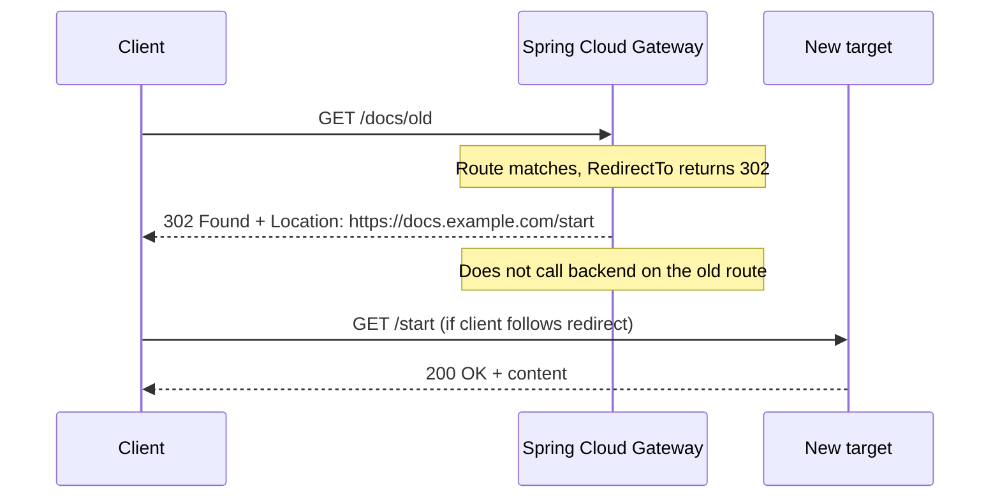
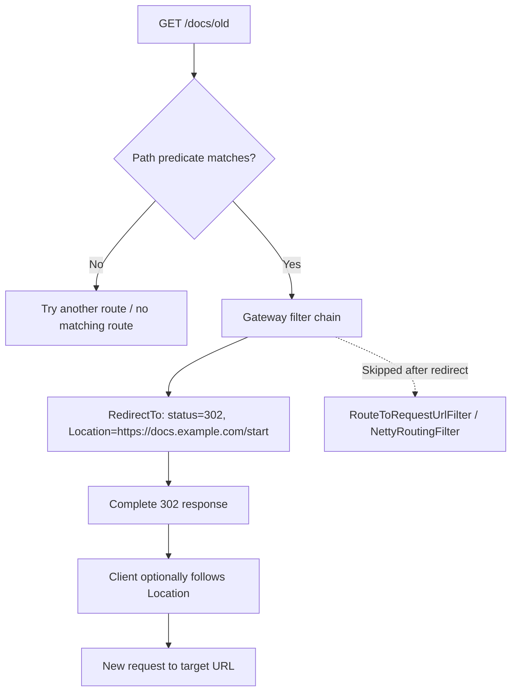

# RedirectTo in Spring Cloud Gateway: Redirecting Clients and Choosing HTTP Status Codes

In microservices systems, an API sometimes moves to a new address while clients still call the old path, a documentation site migrates to a new hostname, or an endpoint simply needs to instruct clients to use a different URL. In these cases, an **HTTP redirect** is an option alongside having the Gateway rewrite paths internally before forwarding.

In **Spring Cloud Gateway Server WebFlux**, `RedirectTo` is a **GatewayFilter Factory** that lets a route return an HTTP **3xx** status code along with a **`Location`** header. The client sees the redirect response and can issue a **new request** to the indicated URL. Understanding this mechanism is especially important when choosing among **301, 302, 303, 307, and 308**, because each status code carries distinct semantics for permanence, HTTP method, and request body handling.

This lesson belongs to the **Path Rewriting and Redirects** chapter of the `SPRING_CLOUD_GATEWAY` module. Knowledge of `RedirectTo` complements route predicates, filter chains, path/header rewriting, and service discovery; it also helps you design a safe microservices entry point when combined with authentication, rate limiting, circuit breakers, retries, TLS, and request observability.

> **Scope:** This content applies to **Spring Cloud Gateway Server WebFlux**. Configuration namespaces and APIs must match your actual Spring Boot/Spring Cloud version. Never assume Spring Cloud Gateway Server MVC and Server WebFlux behave identically.

## 1. What Is an HTTP Redirect?

A redirect response tells the client that it should visit another URL. The response typically includes:

- **3xx status:** e.g., `302 Found` or `308 Permanent Redirect`.
- **`Location`:** target URI/URL where the client can send a new request.
- **Other headers:** such as `Cache-Control`, depending on caching and security requirements.

For example, a client requests an old documentation page:

```http
GET /docs/old HTTP/1.1
Host: gateway.example.com
```

The Gateway replies:

```http
HTTP/1.1 302 Found
Location: https://docs.example.com/start
```

A browser usually navigates to `https://docs.example.com/start` automatically. Some HTTP clients, scripts, SDKs, or testing tools simply return the 302 response **without following redirects automatically**; behavior depends on client configuration.



**Key point:** The Gateway terminates the first request with a 3xx response. The **client** decides whether to send a second request. Those two requests may hit two different servers and generate two separate observability traces.

## 2. Where Does `RedirectTo` Sit in the Gateway Pipeline?

Spring Cloud Gateway processes requests through these main steps:

1. `RoutePredicateHandlerMapping` evaluates `Path`, `Method`, and other predicates to select a route.
2. `FilteringWebHandler` merges `GlobalFilter`s with the selected route's `GatewayFilter`s and orders them.
3. `RedirectTo` executes as a `GatewayFilter` on the configured route.
4. The filter sets the HTTP status and `Location` header on `ServerHttpResponse`, then completes the response.
5. Because it does not invoke the remainder of the chain, the request is **not forwarded to the upstream** through downstream routing filters.



A filter can terminate processing early (*short-circuit*). Therefore:

- `RedirectTo` **does not connect to the target URL itself** and does not call the backend before returning 3xx.
- `uri` remains part of the route configuration per Gateway structure, yet is **not used to send a request** if `RedirectTo` short-circuits before the routing step.
- `GlobalFilter`s running **before** the redirect can record metrics/logs and receive completion signals; filters ordered **after** the redirect may not run.
- When the client sends a new request to the target URL, that request goes through the receiver's own route matching, security, rate limiting, and filter chain.

Do not confuse redirects with circuit breakers, retries, or load balancing. A redirect is a decision to **hand a different URL back to the client**.

## 3. Basic `RedirectTo` Configuration

### 3.1. Shortcut syntax

Example using the Spring Cloud Gateway Server WebFlux configuration style in newer version branches:

```yaml
spring:
  cloud:
    gateway:
      server:
        webflux:
          routes:
            - id: docs-redirect
              uri: http://localhost:8081
              predicates:
                - Path=/docs/old
                - Method=GET,HEAD
              filters:
                - RedirectTo=302, https://docs.example.com/start
```

Reading the configuration:

| Declaration | Role |
| --- | --- |
| `id: docs-redirect` | Route name for management and tracking. |
| `uri: http://localhost:8081` | Route URI required by Gateway structure; not called in this example because the filter redirects. |
| `Path=/docs/old` | Matches the route only on this path. |
| `Method=GET,HEAD` | Restricts route methods so the redirect behavior is intentional. |
| `RedirectTo=302, https://docs.example.com/start` | Returns status 302 and a `Location` header containing the target URL. |

In older WebFlux versions, the route configuration namespace is typically `spring.cloud.gateway.routes`. Choose **exactly one namespace** matching your version. Mismatching starter and namespace names can prevent routes from loading even when YAML syntax is valid.

### 3.2. Full argument syntax

The same filter can be declared with separated name and arguments:

```yaml
filters:
  - name: RedirectTo
    args:
      status: "302"
      url: https://docs.example.com/start
```

Two core arguments:

- `status`: a 3xx HTTP status supported by the Gateway, e.g., `301`, `302`, `303`, `307`, or `308`.
- `url`: the URL placed in the `Location` header. For introductory examples, use an **absolute URL** with explicit scheme and host.

A static configuration like this **does not automatically copy paths or query parameters from the request onto the target URL**. If multiple legacy paths match the same route, a simple `RedirectTo` declaration typically returns the **exact same `Location`** for all of them.

### 3.3. Inspecting with curl

With the Gateway running on port `8080`:

```bash
# View only the 302 response returned by the gateway.
curl -i "http://localhost:8080/docs/old"

# View headers only without requesting body download.
curl -I "http://localhost:8080/docs/old"

# Test following the redirect (only when target URL is safe to visit).
curl -i -L --max-redirs 3 "http://localhost:8080/docs/old"
```

Expected output for the first command:

```http
HTTP/1.1 302 Found
Location: https://docs.example.com/start
```

Plain `curl -i` does not follow redirects automatically. `curl -L` instructs it to follow redirects and may issue multiple requests; `--max-redirs` caps redirect hops to detect loops. For `HEAD` endpoints, verify how both clients and backends handle that method.

## 4. Which HTTP Code to Choose: 301, 302, 303, 307, or 308?

Not all 3xx codes produce the same behavior. Two questions must be answered first:

1. **Is the redirect temporary or permanent?**
2. **Must the client preserve the HTTP method and body, or switch to a retrieval request (typically GET)?**

| Status | Common name | Permanence | Method/body behavior when following | When to consider |
| --- | --- | --- | --- | --- |
| **301** | `Moved Permanently` | Permanent | For `POST`, many user agents **may switch to GET** for historical compatibility. | Permanent relocation of a page or GET API where method preservation is not required. |
| **302** | `Found` | Temporary | For `POST`, many user agents **may switch to GET**. | Temporary move of a page or GET endpoint. |
| **303** | `See Other` | Redirects to another resource to retrieve a result | Client typically sends **GET** (or appropriate retrieval request) to `Location`. | *Post/Redirect/Get* pattern after a create/write operation completes. |
| **307** | `Temporary Redirect` | Temporary | **Preserves method and body** if client follows redirect. | Temporary endpoint move when requests must retain exact method and payload. |
| **308** | `Permanent Redirect` | Permanent | **Preserves method and body** if client follows redirect. | Permanent endpoint move where method semantics must be preserved. |

### 4.1. `301` and `308`: permanent redirects

Both `301` and `308` signal that the new target is **permanent**. Key difference: `308` preserves method/body on the follow-up request; `301` can still cause clients to rewrite `POST` to `GET`.

Be extra cautious when testing 301/308 on public addresses: browsers, proxies, and caches may store the redirect. When you later revert configuration to the old address, some clients may continue hitting the cached URL.

Until you are certain a migration is permanent, start with temporary codes (302/307) to test and observe behavior.

### 4.2. `302` and `307`: temporary redirects

Suppose you need to relocate an API only during a maintenance window:

- If the request is `GET`, `302` is usually fine for temporary redirection.
- If you must preserve `POST`, `PUT`, `PATCH`, or the request body, consider `307` and verify that clients can replay the body to the target URL.

Do not assume "every HTTP client converts POST to GET on 302": behavior varies across clients and methods. When an API contract needs clarity, choose the status code that explicitly states your intent.

### 4.3. `303` and Post/Redirect/Get

After the backend **has finished processing** a `POST` that creates data, the backend can return:

```http
HTTP/1.1 303 See Other
Location: /orders/9001
```

The client follows `Location` with a read request (typically `GET /orders/9001`). This is the **Post/Redirect/Get (PRG)** pattern, preventing browser reloads from accidentally re-submitting a form.

However, if you put `RedirectTo=303, ...` **directly on the Gateway's POST route**, the filter returns the redirect **before calling the backend**, meaning **no creation operation is executed** on that route. Therefore:

- `RedirectTo` can be used to intentionally direct requests from a retired POST endpoint to a guidance resource or another URL.
- For PRG after creating a transaction, the **backend handling the transaction** is normally responsible for returning status 303 and a dynamic `Location` for the newly created resource.
- Never use `RedirectTo` assuming the Gateway sent the POST to the backend, waited for order creation, and then emitted the redirect.

### 4.4. Other 3xx codes

The 3xx family also includes `300 Multiple Choices` and `304 Not Modified`. **`304` is for conditional caching**, not for telling clients to move to another URL via `Location`. When directing clients to a target URL, stick to explicit redirect statuses like 301/302/303/307/308.

## 5. Comparing RedirectTo with RewritePath, SetPath, and StripPrefix

All of these deal with paths, yet **redirecting clients** and **rewriting paths inside the Gateway** solve different problems.

| Criterion | `RedirectTo` | `RewritePath` / `SetPath` / `StripPrefix` |
| --- | --- | --- |
| What does the client see? | Receives a **3xx response + Location**, and may send a new request. | Usually sees the backend response under the public URL it called. |
| Who accesses the new URL? | **Client**, if it chooses to follow the redirect. | **Gateway** forwards to the backend after transforming the request. |
| HTTP round-trips from client perspective | May incur an **extra request**. | Typically one client request to the Gateway. |
| Browser address bar | May change when the browser follows the redirect. | Normally unchanged during internal rewrites. |
| Method/body | Depends on 301/302/303/307/308 and client behavior. | Gateway does not ask the client to resend the request just for a path change. |
| Discovery and load balancing | Not used for the immediate redirect response if the chain stops. | Can use `lb://service-id` in the routing step. |
| Typical goal | Announcing a new URL, domain migration, canonical URLs. | Mapping public `/api/**` routes to internal backend endpoints. |

Example request:

```text
GET /api/products/42
```

**Internal rewrite**:

```yaml
uri: lb://product-service
predicates:
  - Path=/api/products/**
filters:
  - StripPrefix=1
```

The Gateway sends `GET /products/42` to a `product-service` instance; the client never receives a 3xx just because of `StripPrefix`.

**Redirect**:

```yaml
uri: http://localhost:8081
predicates:
  - Path=/api/products/42
filters:
  - RedirectTo=308, https://api.example.com/v2/products/42
```

The client receives `308` and `Location`; the target URL may go through another Gateway or directly to another service depending on domain and infrastructure.

**Selection rule:** If you want to preserve the public URL contract and change only internal microservice paths, prefer rewriting. If you want to **formally notify the client of a new URL**, consider redirecting with the appropriate status code.

## 6. Complete Example: Migrating from an Old Endpoint to a New Endpoint

Suppose you are migrating a catalog page from `/v1/catalog` to `/v2/catalog`. Gateway runs on `localhost:8080`; Catalog Service runs on `localhost:8081` with internal endpoint `GET /catalog`.

Illustrative configuration:

```yaml
server:
  port: 8080

spring:
  application:
    name: edge-gateway
  cloud:
    gateway:
      server:
        webflux:
          routes:
            - id: catalog-v1-redirect
              order: -10
              uri: http://localhost:8081
              predicates:
                - Path=/v1/catalog
                - Method=GET,HEAD
              filters:
                - RedirectTo=302, http://localhost:8080/v2/catalog

            - id: catalog-v2
              order: 0
              uri: http://localhost:8081
              predicates:
                - Path=/v2/catalog
                - Method=GET,HEAD
              filters:
                - SetPath=/catalog
```

Processing flow:

```mermaid
sequenceDiagram
    participant C as Client
    participant G as Gateway :8080
    participant B as Catalog Service :8081
    C->>G: GET /v1/catalog
    Note over G: catalog-v1-redirect matches
    G-->>C: 302 Location: http://localhost:8080/v2/catalog
    C->>G: GET /v2/catalog (client follows redirect)
    Note over G: catalog-v2 matches; SetPath=/catalog
    G->>B: GET /catalog
    B-->>G: 200 + catalog
    G-->>C: 200 + catalog
```

Run tests once both applications are up:

```bash
# First call: only shows HTTP 302 and Location.
curl -i "http://localhost:8080/v1/catalog"

# Follow up to three redirect hops: expected to return Catalog Service response.
curl -i -L --max-redirs 3 "http://localhost:8080/v1/catalog"

# Verify new URL directly: second route forwards straight through.
curl -i "http://localhost:8080/v2/catalog"
```

Using `localhost` in the `Location` header is only for **same-machine** testing. If the client is on another machine, `localhost:8080` points back to the client's own machine. In production, use an externally reachable public domain, such as `https://api.example.com/v2/catalog`.

Once the migration is confirmed permanent, you can consider switching `302` to `301` or `308`. For GET/HEAD, both typically serve the purpose, though `308` explicitly expresses method preservation; evaluate caching and client support before switching.

### 6.1. Why must a route exist for the new URL?

`RedirectTo` only returns `Location`; it **does not create a route or endpoint** at the target URL. In the example, after the client follows the redirect to `/v2/catalog`, the Gateway still needs the `catalog-v2` route to forward the request to the backend.

If `/v1/catalog` redirects to `/v1/catalog` itself, or if the new route redirects back to the old one, clients can get stuck in a **redirect loop**. `curl -L --max-redirs 3` helps catch some cases; browsers display a "too many redirects" error.

### 6.2. Is the query string carried along automatically?

Suppose the client calls:

```text
GET /v1/catalog?lang=vi&sort=name
```

In the example with `RedirectTo=302, http://localhost:8080/v2/catalog`, the `Location` header still contains only:

```http
Location: http://localhost:8080/v2/catalog
```

**Do not assume the Gateway automatically appends `?lang=vi&sort=name` to `Location`.** The target URL is the configured value. If business requirements demand preserving query parameters, use a controlled dynamic redirect solution or adjust the endpoint contract; do not rely on a single static `RedirectTo` for all requests.

In particular, never blindly copy raw query strings across to another domain if queries might contain tokens, access codes, or sensitive data.

## 7. Redirecting POST/PUT and Method/Body Risks

For GET or HEAD, following redirects is relatively straightforward. For requests carrying bodies and side effects, status selection impacts business semantics.

Suppose a client sends:

```http
POST /api/v1/events HTTP/1.1
Host: gateway.example.com
Content-Type: application/json

{"type":"inventory_updated","itemId":42}
```

Temporary route:

```yaml
- id: events-temporary-redirect
  uri: http://localhost:8081
  predicates:
    - Path=/api/v1/events
    - Method=POST
  filters:
    - RedirectTo=307, https://api.example.com/api/v2/events
```

If the client supports following `307` and its request body is replayable, it must **keep `POST`** along with the payload when calling the new URL. The Gateway does not push the JSON to the target endpoint during the initial request.

Comparison:

| Status for POST | What to expect / watch out for |
| --- | --- |
| `301` / `302` | Some clients may downgrade POST to GET, easily breaking write API contracts. |
| `303` | Directs clients to a retrieval resource after an action; does not mean "replay POST to target." |
| `307` / `308` | Preserves method/body when following; still verify HTTP client body replayability and target safety. |

**Three safety precautions:**

1. **There is no guarantee every client follows 307/308 automatically.** SDKs, legacy clients, or streaming request bodies may fail to resend. Test with the exact HTTP library used by real clients.
2. **Never blindly redirect a sensitive POST to another origin.** Client policies for `Authorization`, cookies, CORS, proxies, and bodies across host changes vary. Establish trust relationships and security requirements for the target URL.
3. **Do not confuse redirects with retries.** A client following `307` creates a request to a new URL; a Gateway `Retry` filter can create multiple upstream attempts within the same processing cycle. Both can cause duplicate side effects if operations are not designed for idempotency.

For order creation, payments, or critical state updates, clearly define idempotency keys, timeouts, and handling when clients are unsure whether an earlier request reached the backend.

## 8. Route Predicates and Route Order Decide When RedirectTo Runs

A `RedirectTo` filter applies only if **the route containing it matches**. Predicates can therefore scope redirects by path, method, or host.

For example, redirect only GET calls on the old API version:

```yaml
- id: legacy-read-redirect
  order: -20
  uri: http://localhost:8081
  predicates:
    - Path=/api/v1/catalog
    - Method=GET
  filters:
    - RedirectTo=302, https://api.example.com/api/v2/catalog
```

If a client sends `POST /api/v1/catalog`, the route above **does not match** because of `Method=GET`. The request may match another route or receive 404 if none fits.

### 8.1. Overlapping routes

Suppose two routes exist:

- `Path=/api/v1/**`: redirects to migration documentation.
- `Path=/api/v1/orders/**`: continues serving a group of order endpoints during the transition period.

A `GET /api/v1/orders/7` request could match both. Use explicit predicates and intentional `order` values. **Route order** governs which route gets picked; it is distinct from **filter order** inside the chosen route's chain.

Never assume a route with a longer path always wins when both match. Ambiguous ordering can cause active APIs to unexpectedly return 3xx responses.

### 8.2. Broad patterns and a static Location

Configuration:

```yaml
predicates:
  - Path=/legacy/**
filters:
  - RedirectTo=301, https://api.example.com/new
```

will send the **exact same `Location`** for paths like `/legacy/products/1`, `/legacy/orders/2`, and `/legacy/users/3`. It **does not preserve** the path suffix after `/legacy/`.

If you need mappings like:

```text
/legacy/products/1 -> /v2/products/1
/legacy/products/2 -> /v2/products/2
```

then you need a dynamic `Location` generation solution or individually specified routes. `RewritePath` can handle internal transformations, yet does not turn into an HTTP redirect by itself. Avoid promising clients path-preserving redirects when the configuration only holds a static URL.

## 9. Dynamic Redirects: When Is RedirectTo Not Enough?

The built-in `RedirectTo` filter is convenient when multiple requests can go to **one fixed target**. When the target URL depends on `{id}`, query parameters, tenant, or business logic results, clearly assign responsibilities.

Example:

```text
GET /old/products/42  ->  Location: https://api.example.com/v2/products/42
GET /old/products/99  ->  Location: https://api.example.com/v2/products/99
```

Do not assume `RedirectTo=308, https://api.example.com/v2/products/{id}` expands `{id}` like `SetPath`. Template variable support in **other filters** does not mean `RedirectTo` performs identical variable substitution automatically.

Solutions:

1. **Internal path rewrite:** if clients do not need to see the new URL, use `RewritePath` or `SetPath` with the appropriate target route URI.
2. **Backend/application issues dynamic redirects:** the handler determines the target resource and returns a 3xx status and `Location` based on validated data. Suitable when the new URL is known only after business processing.
3. **Controlled custom filter:** only when redirect logic truly belongs at the Gateway; validate templates, URL encoding, allowed schemes/hosts, and reactive lifecycle handling.

If writing a custom filter that emits a redirect, in principle you set the status and `Location` on `ServerHttpResponse`, then return the completion publisher:

```java
import java.net.URI;

import org.springframework.http.HttpHeaders;
import org.springframework.http.HttpStatus;
import org.springframework.web.server.ServerWebExchange;
import reactor.core.publisher.Mono;

// Snippet illustrating the final step of a GatewayFilter after validating target URL.
private Mono<Void> redirect(ServerWebExchange exchange, URI trustedTarget) {
    exchange.getResponse().setStatusCode(HttpStatus.TEMPORARY_REDIRECT);
    exchange.getResponse().getHeaders()
        .setLocation(trustedTarget);
    return exchange.getResponse().setComplete();
}
```

`trustedTarget` must be built from **trusted configuration or an allowlist**; the snippet only illustrates writing the response after validation. It is not yet a complete `GlobalFilter` or `GatewayFilterFactory`. Never take a `url` string from query parameters and pass it directly into `Location`, as that creates an **open redirect** vulnerability.

## 10. Security When Returning Location

Redirects are a security-sensitive mechanism: the client may send its next request outside the Gateway to a different domain. Several issues are particularly important:

### 10.1. Open redirect

A dangerous design is:

```text
GET /login?next=https://attacker.example/collect
-> 302 Location: https://attacker.example/collect
```

If an application blindly uses client-supplied `next` as `Location`, attackers can abuse a trusted hostname to lure users onto malicious sites, potentially compromising login flows or URL-borne data.

Recommendations:

- Prefer **static** target URLs vetted in configuration.
- If dynamic URLs are required, validate **scheme, host, port, path, and an allowlist**; reject URLs with embedded credentials.
- Watch out for leading `//`, percent-encoding, Unicode domains, userinfo (`user@host`), and URL normalization discrepancies.
- Never copy access tokens, session IDs, or security codes into `Location`, especially when redirecting to another domain.

### 10.2. HTTPS, proxies, and redirect loops

A common scenario: clients hit `https://api.example.com` through a TLS-terminating reverse proxy, while traffic from the proxy to the Gateway uses internal HTTP. If redirect logic mistakenly relies on the internal scheme, the system may loop redirecting to the same public URL.

To deploy HTTPS safely:

- Configure TLS, certificates, and HTTP→HTTPS policies at the proper layer (load balancer, ingress, reverse proxy, web server, or appropriate config).
- When using `Forwarded` / `X-Forwarded-Proto`, trust only headers injected by **trusted proxies**; never let clients dictate public scheme/host.
- Avoid hardcoding `http://localhost` or internal hostnames in `Location` in production environments.
- Test direct access, proxied access, HTTP, and HTTPS to catch loops.

`RedirectTo` does not provision TLS certificates, verify trust stores, or replace mTLS between the Gateway and backends.

### 10.3. Authorization, cookies, and CORS

When redirecting to another origin:

- Whether clients retain or strip the `Authorization` header depends on HTTP library and browser security policies; **do not expect credentials to forward automatically**.
- Cookies depend on domain, path, `Secure`, `SameSite`, and browser policies.
- `fetch`/XHR requests may encounter **CORS** and redirect/preflight restrictions; successful browser page navigation does not prove AJAX API calls will succeed.
- When method/body are preserved under `307`/`308`, payloads may be sent to the target server; make sure that server is authorized to receive the data.

**A redirect does not grant authorization.** At the new URL, the Gateway or backend must still enforce authentication, business authorization, and rate limiting.

## 11. Caching, Compatibility, and Operational Impact

### 11.1. Permanent redirects are harder to roll back

`301` and `308` can be cached by browsers, CDNs, and intermediaries under HTTP caching rules. That is helpful for permanent resource moves, yet risky if you point to the wrong target.

During testing or progressive rollouts:

1. Use `302`/`307` while the change is genuinely temporary.
2. Verify status, `Location`, method/body, and the request received by the new backend.
3. Confirm the new URL works, has valid TLS, and enforces equivalent security policies.
4. Only once committed permanently should you consider `301`/`308`.

If a wrong permanent redirect is emitted, updating Gateway configuration alone may not suffice because some clients stop calling the old path. Rollback plans must account for client and CDN caches.

### 11.2. Observing two requests

For a redirect back to the **same Gateway**:

```text
Request #1: /v1/catalog -> 302 Location: /v2/catalog
Request #2: /v2/catalog -> 200 from Catalog Service
```

You may see **one 3xx metric on the old route** and **one 2xx metric on the new route**, if the client follows the redirect. Do not count Request #1 as a successful backend call; it only proves the Gateway issued the new URL.

If the target sits outside your infrastructure, cross-domain distributed tracing does not propagate automatically; whether trace headers are forwarded depends on the client and security rules. Observe at minimum route ID, HTTP status, redirect counts, latency, allowed targets, and loop indicators, while avoiding logging full queries or tokens.

### 11.3. Rate limiting and circuit breakers

`RedirectTo` responds **before the backend is called** on the old route, so:

- A circuit breaker protecting the old backend normally does not evaluate backend calls if the chain short-circuits before routing.
- The new post-redirect request is evaluated against the new target's rate limiter and policies.
- If clients follow multiple redirects, total HTTP requests across the system can increase; factor this into quotas and monitoring.
- Gateway `Retry` and client redirect-following are two separate mechanisms; do not treat them as interchangeable.

This matters even more when a legacy endpoint still receives heavy traffic during an API migration.

## 12. Practical Test Matrix

Suppose the configuration is:

```yaml
- id: legacy-docs
  uri: http://localhost:8081
  predicates:
    - Path=/docs/old
    - Method=GET,HEAD
  filters:
    - RedirectTo=302, https://docs.example.com/start
```

Verify the following cases:

| Request | Route `legacy-docs` matches? | Filter output |
| --- | --- | --- |
| `GET /docs/old` | Yes | `302` + `Location: https://docs.example.com/start`. |
| `HEAD /docs/old` | Yes | `302` + `Location`; body is normally omitted for HEAD. |
| `POST /docs/old` | No | Not handled by this filter; may match another route. |
| `GET /docs/new` | No | Not handled by this filter; may match another route. |
| `GET /docs/old?lang=vi` | Yes | `Location` remains the static configured URL; query is not appended automatically. |
| `GET /docs/old/` | Depends on specific pattern/trailing-slash policy | Do not guess; test or explicitly configure trailing-slash handling. |

For any non-matching case, if **no other route** matches, the Gateway typically returns 404. If another route also matches, route order can lead to a different outcome.

### 12.1. Checking status and Location

```bash
curl -sS -D - -o /dev/null "http://localhost:8080/docs/old"
```

In test environments, confirm **both the 3xx status code and the `Location` header**. Returning 302 with a missing or wrong `Location` fails the redirect contract.

### 12.2. Testing bounded redirect following

```bash
curl -i -L --max-redirs 3 "http://localhost:8080/docs/old"
```

Use test URLs you control so you do not accidentally send credentials or cookies to external domains. When testing POST with 307/308, use a side-effect-free test endpoint and verify method/body at the destination rather than checking only the final status.

### 12.3. Testing loops and caching

Test at least three scenarios:

- Target URL points back to the old route or another route that redirects back.
- Switching from temporary to permanent redirect in a test environment with caching.
- Browser or client that cached an old redirect revisiting after configuration changes.

For critical APIs, add integration tests with a mock backend and an HTTP client matching production behavior to verify call counts, route ID, `Location`, and that the upstream is not called on the redirect route.

## 13. Common Pitfalls

| Symptom | Possible cause | Resolution |
| --- | --- | --- |
| Gateway returns 404 instead of 302. | `Path`/`Method` mismatch or route not loaded due to wrong namespace. | Check route/predicates, config version, and route order. |
| Client receives 302 but browser fails to reach target. | Wrong `Location`, target DNS/TLS failure, or client blocks redirect. | Inspect header and test target URL independently. |
| `curl -i` only prints 302. | `curl` does not follow redirects by default. | Add `-L` when intentionally following; cap with `--max-redirs`. |
| POST gets converted to GET. | Used 301/302 or 303 when method preservation was needed. | Evaluate 307/308, test client, and verify idempotency contract. |
| Order creation endpoint is never called. | `RedirectTo` short-circuited before reaching backend. | Move business execution to backend; have backend return 303 if PRG is needed. |
| Old and new URLs bounce infinitely. | Redirect routes form a loop. | Check `Location`/route matching and limit redirect hops during tests. |
| All `/legacy/{id}` paths go to one URL. | `RedirectTo` configured with static `Location`. | Use safe dynamic redirects or specific per-resource routes. |
| Query parameters disappear. | Not automatically appended to `Location`. | Design explicit query-forwarding rules without copying tokens. |
| Remote clients attempt to reach `localhost`. | `Location` uses local development hostname. | Switch to environment-appropriate public hostname. |
| Reverted route config yet clients still hit new URL. | 301/308 was cached. | Review cache policy and rollback/URL migration plan. |
| HTTP-to-HTTPS redirect loops behind reverse proxy. | Misdetected public scheme or untrusted forwarded headers. | Configure proxy/TLS/trust properly; test both hops. |
| Direct page load works but `fetch` fails. | CORS, preflight, or credential policy on cross-origin redirect. | Verify CORS and auth policies at the target origin. |
| 302 observed with zero backend metrics. | Gateway returned response before routing step. | Track 3xx by route and observe the second request if client follows. |

## 14. Practice Exercises with Answers

### Exercise 1 — Choosing a status code for documentation changing domains

A GET-only documentation page is permanently moved from `https://old.example.com/guide` to `https://docs.example.com/guide`. The team has confirmed the new URL is permanent.

**Hint:** `301` or `308` may be appropriate. `308` guarantees no method change; `301` is broadly supported and very common for documentation URLs. Prepare for caching, TLS, link updates, and legacy client behavior.

### Exercise 2 — Temporarily redirecting POST while preserving JSON

Clients send `POST /api/v1/events` with JSON. The new endpoint is temporarily at `/api/v2/events`; the contract requires preserving method and body.

**Answer:** Consider `307 Temporary Redirect`. Verify client libraries can replay the body and safely call the new target, while protecting side effects with idempotency.

### Exercise 3 — Redirecting after the backend creates an order

The backend just created order `9001` from `POST /orders`. The client should now open `GET /orders/9001`.

**Answer:** The backend can return `303 See Other` and `Location: /orders/9001` after succeeding. Do not place `RedirectTo=303` on the POST route expecting the Gateway to call the backend first, because the filter returns 3xx before processing the transaction.

### Exercise 4 — Comparing rewrite and redirect

The Gateway exposes `GET /api/products/42` while Product Service only has `GET /products/42`. You do not want to change the client's URL.

**Answer:** Use `StripPrefix=1` or `SetPath` to transform the path before routing; do not use `RedirectTo`. The client continues using the original public URL.

### Exercise 5 — Checking query strings

A route has `RedirectTo=302, https://docs.example.com/start`. A client calls `GET /docs/old?lang=vi`. Which `Location` is returned in this example?

**Answer:** `https://docs.example.com/start`. The `lang=vi` query is not appended automatically. If query preservation is required, use a validated, properly encoded `Location` construction mechanism.

### Exercise 6 — Distinguishing route matching from redirects

A route has `Path=/old`, `Method=GET`, `RedirectTo=302, ...`. A client sends `POST /old`. Does the Gateway convert POST to GET and redirect?

**Answer:** No. The route does not match `Method=GET`, so that route's redirect filter does not execute. Method conversion is something a **client may do after receiving a redirect response**, not how the Gateway matches routes.

### Exercise 7 — Spotting an open redirect

A filter builds `Location` directly from a `next` query parameter without validating the host. Why is this dangerous?

**Answer:** Clients can supply a URL pointing to an attacker site, redirecting users away from a trusted domain. Use pre-configured target URLs or an allowlist with strict URI validation rules.

## 15. Safe Deployment Checklist

- [ ] Redirect route matches only intended path, method, and host; not shadowed by higher-priority routes.
- [ ] Status code matches permanence: **301/308** vs. **302/307**.
- [ ] Method/body preservation of **307/308**, GET switch of **303**, and legacy behavior of 301/302 are clearly understood.
- [ ] `Location` is an authorized, valid URL using the right public hostname and TLS.
- [ ] Target URL exists and has its own route/endpoint, auth, and rate-limit policies.
- [ ] Redirects cannot form loops and are tested with bounded redirect hops.
- [ ] Query parameters, dynamic paths, trailing slashes, and URL encoding are tested.
- [ ] No open redirects; no tokens or sensitive data placed in `Location`.
- [ ] For POST/PUT/PATCH, client body replayability and idempotency boundaries are verified.
- [ ] For 301/308, browser/CDN caching and rollback plans are evaluated.
- [ ] Behind a reverse proxy, public scheme/host are derived only from trusted proxies.
- [ ] Metrics/logs record 3xx responses per route without miscounting them as backend successes.
- [ ] Tested with both redirect-following clients and clients that inspect status/`Location` directly.

## 16. Summary

**`RedirectTo` in Spring Cloud Gateway** lets a route return **HTTP 3xx and a `Location` header** so the **client** accesses a new URL. The filter can terminate the request directly at the Gateway; the redirect target is called only if the client chooses to issue a follow-up request.

When selecting a status code, consider both **temporary vs. permanent** and **preserve method/body vs. switch to a read request**: `301/302` carry historical compatibility behavior, `303` fits Post/Redirect/Get after processing, and `307/308` preserve method/body when clients follow the redirect. Distinguish redirects from `RewritePath`/`SetPath`/`StripPrefix`, and pay attention to caching, dynamic queries/paths, TLS, CORS, and open redirects.

A clear design for status codes, `Location`, route predicates, and client responsibilities makes API migrations safer, reduces integration bugs across microservices, and preserves observability at the `SPRING_CLOUD_GATEWAY` edge.
