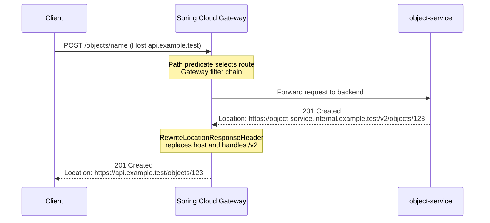

# RewriteLocationResponseHeader: Rewriting Location Headers from Downstream Services

An API Gateway can hide the internal domains and ports of microservices in **requests**, yet still accidentally leak them in **responses**. For example, a client calls `https://api.example.test/objects/name` to create a resource, and the downstream service finishes processing and returns the header:

```http
HTTP/1.1 201 Created
Location: https://object-service.internal.example.test/v2/objects/123
```

Client applications may read the URL in `Location` to open the newly created resource or navigate to it. However, that address contains an **internal hostname** and a `/v2` version prefix that the public API does not expose. That URL might be unreachable from the Internet, causing client failures or exposing deployment details.

**`RewriteLocationResponseHeader`** is a **Spring Cloud Gateway Server WebFlux** **GatewayFilter Factory** that adjusts the `Location` response header value—specifically its **host:port** and URL version segment handling. In the illustrative example, the goal is to return an address matching the domain the client is using:

```http
HTTP/1.1 201 Created
Location: https://api.example.test/objects/123
```

This lesson belongs to the **Path Rewriting and Redirects** chapter of the **SPRING_CLOUD_GATEWAY** module. It connects directly with route predicates, filter chains, path/header rewriting, and service discovery, while helping prevent security or operational bugs when the gateway incorporates authentication, rate limiting, circuit breakers, retries, TLS, and request observability.

> **Version scope:** Content uses **Spring Cloud Gateway Server WebFlux**. Primary YAML examples follow the `spring.cloud.gateway.server.webflux.routes` namespace from newer documentation. Earlier 4.x versions may use `spring.cloud.gateway.routes`, and some long-form argument names have changed. Always verify against your actual Spring Cloud Gateway and Spring Boot BOM before applying configuration to an application.

## 1. What Role Does the Location Header Play?

`Location` is an HTTP response header specifying a URI associated with the response:

- With **`201 Created`** responses, it typically indicates the URL of the newly created resource.
- With **`3xx` redirect** responses such as `301`, `302`, `303`, `307`, or `308`, it typically specifies the target URL a browser/HTTP client may follow depending on the status code and client policy.
- Some applications use `Location` in other scenarios; its meaning must follow HTTP semantics for the response code and the API contract.

Examples of two separate flows:

```http
POST /objects/name HTTP/1.1
Host: api.example.test
Content-Type: application/json

{"name":"example"}

HTTP/1.1 201 Created
Location: https://api.example.test/objects/123
```

```http
GET /old-path HTTP/1.1
Host: api.example.test

HTTP/1.1 302 Found
Location: https://api.example.test/new-path
```

**Do not confuse:** `201 Created` does not instruct clients to navigate automatically, whereas browsers or HTTP clients may **follow** `Location` on 3xx status codes. The Gateway only modifies the header; it **does not generate `301`/`302` statuses by itself** and does not tell the client to issue another request.

### 1.1. Why does Location from the backend often turn out wrong?

A microservices system usually has at least two perspectives on URLs:

| Perspective | Example | Who needs it? |
| --- | --- | --- |
| **Public URL** | `https://api.example.test/objects/123` | Web/mobile/partner client apps |
| **Internal service URL** | `https://object-service.internal.example.test/v2/objects/123` | Components inside the private network |
| **Logical service discovery target** | `lb://object-service` | Gateway to resolve backend instances |
| **Actual instance URI** | `https://10.0.4.15:8443` | Gateway's HTTP client, after load balancing |

A backend might construct URLs from the `Host` it receives, from its internal hostname, or with a hardcoded `/v2` version prefix. Thus, even though the request entered the gateway via a public URL, the response may contain a URI unsuitable for the client.

This is a **response URL normalization** problem. It differs from the gateway **selecting a route** or **transforming request paths** on the inbound leg.

## 2. Position of RewriteLocationResponseHeader in the Processing Flow

In Server WebFlux, `RoutePredicateHandlerMapping` selects a route from `RouteLocator` based on predicates. Then `FilteringWebHandler` executes `GlobalFilter`s and the selected route's `GatewayFilter`s. `RewriteLocationResponseHeader` sits in that filter chain and processes the **response header** as data returns from downstream.



**Order of responsibilities to distinguish:**

1. **Route predicates** decide which route a request belongs to.
2. **Request filters** such as `StripPrefix`, `SetPath`, `RewritePath`, or `AddRequestHeader` can alter the request before sending it downstream.
3. **Load balancing/service discovery**, if the route uses `lb://...`, selects an actual instance.
4. **Backend** returns a response with its status and `Location`.
5. **`RewriteLocationResponseHeader`** adjusts the response header before the client receives the response.

Executing filters in a reactive lifecycle does not mean each step runs on a separate thread. What matters is that the final `Location` must be processed before the HTTP response is committed and sent to the client.

## 3. Basic Configuration

The following example uses the shortcut form documented by Spring Cloud Gateway Server WebFlux:

```yaml
spring:
  cloud:
    gateway:
      server:
        webflux:
          routes:
            - id: objects-api
              uri: https://object-service.internal.example.test
              predicates:
                - Path=/objects/**
              filters:
                - RewriteLocationResponseHeader=AS_IN_REQUEST, Location, ,
```

In this illustrative setup:

- Public request: `POST https://api.example.test/objects/name`.
- Backend returns: `Location: https://object-service.internal.example.test/v2/objects/123`.
- The filter with `AS_IN_REQUEST` and `Location` yields the public response: `Location: https://api.example.test/objects/123`.

The commas in:

```yaml
- RewriteLocationResponseHeader=AS_IN_REQUEST, Location, ,
```

mark **four parameter positions**: version-stripping mode, header name, optional replacement host value, and optional protocol regex. Leaving the last two positions empty uses the default behavior. This is the official syntax in Spring Cloud Gateway docs; do not delete trailing commas, or arguments will be parsed in the wrong positions.

**Testing note:** The hostnames in this example are illustrative placeholders, not live running backends. To execute it, replace them with a reachable backend, configure appropriate TLS/truststore settings, and verify the response path.

### 3.1. Namespaces across versions

In many Spring Cloud Gateway Server WebFlux 4.x releases, you may see:

```yaml
spring:
  cloud:
    gateway:
      routes:
        - id: objects-api
          uri: https://object-service.internal.example.test
          predicates:
            - Path=/objects/**
          filters:
            - RewriteLocationResponseHeader=AS_IN_REQUEST, Location, ,
```

Newer examples use `spring.cloud.gateway.server.webflux.routes`. Choose **one** namespace matching your version and starter; do not declare both lists simultaneously "just to be safe." **Server MVC** documentation uses a different route/filter mechanism even when providing similar features.

## 4. The Four Key Parameters

`RewriteLocationResponseHeader` accepts arguments in the following order:

```text
RewriteLocationResponseHeader=
  <mode>, <locationHeaderName>, <hostValue>, <protocolsRegex>
```

| Parameter | Purpose | Example |
| --- | --- | --- |
| **Version handling mode** | Determines whether to strip a version segment in `Location`. | `AS_IN_REQUEST`, `NEVER_STRIP`, `ALWAYS_STRIP` |
| **Header name** | Response header containing the URI to rewrite; usually `Location`. | `Location` |
| **`hostValue`** | When provided, replaces the `host:port` portion of the URI in `Location`. | `api.example.test` or `api.example.test:8443` |
| **Protocol regex** | Matches URI schemes eligible for rewriting; non-matching schemes are skipped. | `https?` |

In older docs/APIs, parameter names may appear as `stripVersionMode` and `protocolsRegex`; newer docs may shorten them to `Mode` and `protocols`. The **positional argument order in shortcut syntax** in official documentation remains the core concept to know; if configuring via `name/args`, use the exact keys defined by your framework version.

### 4.1. Version mode parameter

Three values:

| Mode | Rule |
| --- | --- |
| **`NEVER_STRIP`** | Keeps the version in `Location`, even if the original request had no version segment. |
| **`AS_IN_REQUEST`** | Default. Strips the version in `Location` only when the original request path had no version. |
| **`ALWAYS_STRIP`** | Always strips the version recognized by the factory in `Location`, even if the original request had a version. |

Conceptual comparison assuming the backend returns a URI with a `/v2` version segment recognized by the factory:

| Request to gateway | Backend `Location` | `NEVER_STRIP` | `AS_IN_REQUEST` | `ALWAYS_STRIP` |
| --- | --- | --- | --- | --- |
| `POST /objects/name` | `https://internal.example.test/v2/objects/123` | `/v2/objects/123` | `/objects/123` | `/objects/123` |
| `POST /v2/objects/name` | `https://internal.example.test/v2/objects/123` | `/v2/objects/123` | `/v2/objects/123` | `/objects/123` |

This compact table **only shows the resulting path** for easy comparison. For matching absolute URIs, the host portion is also replaced according to the other parameters.

**Choose the mode based on your public API contract**, not personal preference:

- If the public API **never** contains a version segment, `ALWAYS_STRIP` may fit when the backend always adds a technical version.
- If the public API supports both versioned and unversioned URLs, `AS_IN_REQUEST` is usually convenient because it follows the original request.
- If the version is part of the public URL, `NEVER_STRIP` prevents stripping it just because the current request used a different path.

The concept of "version" here is tied to the **factory's built-in version detection rule**, not an arbitrary regex for deleting any path segment. Do not expect it to strip `/internal/`, `/backend/`, or arbitrary prefixes. For paths outside that convention, design an appropriate rewrite solution.

### 4.2. `locationHeaderName`: which header is rewritten?

The standard value is `Location`. If the response does not contain the configured header, the filter has no URI in that header to rewrite.

Do not confuse `Location` with `Content-Location`, cookies, the `Refresh` header, or URLs embedded inside JSON/HTML. The factory targets **the specified header** only; it does not scan and rewrite all URLs inside a response.

When an application uses a custom location header, change the header name only if the API contract genuinely requires it. For standard HTTP redirects, keep `Location`.

### 4.3. `hostValue`: fixed host or taken from the request?

Per Spring Cloud Gateway documentation:

- If **`hostValue` is provided**, the filter uses that value to replace the **`host:port`** portion of the URI in `Location`.
- If **left blank**, the filter uses the HTTP `Host` header from the **incoming request**.

Explicit host configuration example:

```yaml
- RewriteLocationResponseHeader=AS_IN_REQUEST, Location, api.example.test, https?
```

Suppose the backend returns:

```http
Location: https://object-service.internal.example.test/v2/objects/123
```

and the public request has no version; the expected address will use hostname `api.example.test` and path `/objects/123`.

If the public service runs on a non-default port, such as `8443`, the public host may need to include `host:port` appropriately; verify the actual URL the client receives.

**Critical security warning:** `Host` can be controlled by the client if the gateway or upstream proxy does not restrict allowed hostnames. If using the incoming `Host` value to construct a public `Location`, configure **trusted proxy/host validation** so an untrusted hostname is not reflected into the response. With a single fixed public hostname, an explicit `hostValue` is usually more predictable. With multiple valid public hostnames, design proper origin validation and hostname mapping policies.

**`hostValue` replaces `host:port`, not the entire URI.** Do not assume this parameter automatically:

- Changes `http` to `https`.
- Restores an `/api` path prefix that the gateway stripped from the request.
- Modifies arbitrary query parameters.
- Turns a malicious URL into a safe URL in every case.

### 4.4. Protocol regex: which URIs are processed?

The final parameter is a **regular expression** matched against the **scheme/protocol** of the response URI. Spring Cloud Gateway docs describe the default as matching HTTP/HTTPS and FTP/FTPS schemes, equivalent to:

```text
https?|ftps?
```

Example allowing only HTTP or HTTPS schemes:

```yaml
- RewriteLocationResponseHeader=AS_IN_REQUEST, Location, api.example.test, https?
```

Meaning:

- `https?` matches `http` or `https`.
- URIs with a scheme not matching the regex are **not rewritten by this filter**.
- This regex is a **protocol selection condition**, not a new protocol name to "force scheme conversion."

Avoid overly broad regexes like `.*` without a clear reason. URIs with `javascript:`, `data:`, or special schemes must be governed by backend/security policies under your contract; a hostname-rewriting filter is not a general-purpose URL sanitizer.

## 5. Practice with the Three Version Modes

Suppose the public API uses `/objects/**` and the internal backend uses `/v2/objects/**`. The backend responds:

```http
HTTP/1.1 201 Created
Location: https://object-service.internal.example.test/v2/objects/123
```

### Case 1 — Unversioned public API

Client calls `POST https://api.example.test/objects/name`. To satisfy a public API without `/v2`:

```yaml
- RewriteLocationResponseHeader=AS_IN_REQUEST, Location, api.example.test, https?
```

Expected result:

```http
Location: https://api.example.test/objects/123
```

### Case 2 — Preserving the version in the public URL

Client calls `POST https://api.example.test/v2/objects/name`. If clients must keep accessing the versioned URL:

```yaml
- RewriteLocationResponseHeader=NEVER_STRIP, Location, api.example.test, https?
```

Expected result:

```http
Location: https://api.example.test/v2/objects/123
```

### Case 3 — Always hiding the internal version

Even when the current request includes a version, you want the response `Location` **without** the version segment:

```yaml
- RewriteLocationResponseHeader=ALWAYS_STRIP, Location, api.example.test, https?
```

Expected result:

```http
Location: https://api.example.test/objects/123
```

Use `ALWAYS_STRIP` only if that URL **actually exists and routes to the right backend**. Removing the version from `Location` can send clients to an unsupported path. Verify the route predicates for the URL the client will call next.

## 6. Interaction with StripPrefix, SetPath, and RewritePath

This is an important distinction that often causes subtle bugs:

| Filter | Direction of effect | Example |
| --- | --- | --- |
| **`StripPrefix`** | Changes the **request path** before backend. | `/api/objects/name` → `/objects/name` |
| **`SetPath`** | Sets a new request path from a template. | Backend receives a target path. |
| **`RewritePath`** | Rewrites the **request path** via regex. | `/legacy/objects/name` → `/objects/name` |
| **`RewriteLocationResponseHeader`** | Changes the **response `Location` header**. | Internal host → public host; handles version segment. |
| **`RewriteResponseHeader`** | Rewrites a **response header** value using general regex. | Customizes a header when specialized factories do not fit. |

### 6.1. Common mistake: thinking RewriteLocation automatically restores public prefixes

Suppose the gateway exposes `/api/objects/**` while using `StripPrefix=1` to send `/objects/**` to the backend:

```yaml
spring:
  cloud:
    gateway:
      server:
        webflux:
          routes:
            - id: objects-api
              uri: https://object-service.internal.example.test
              predicates:
                - Path=/api/objects/**
              filters:
                - StripPrefix=1
                - RewriteLocationResponseHeader=AS_IN_REQUEST, Location, api.example.test, https?
```

Backend receives:

```http
POST /objects/name HTTP/1.1
```

and returns:

```http
Location: https://object-service.internal.example.test/v2/objects/123
```

The filter may transform that value to:

```http
Location: https://api.example.test/objects/123
```

**However, the valid public URL matching the route is `https://api.example.test/api/objects/123`.** The factory only knows how to replace `host:port` and strip version segments; it has no general mechanism to re-add `/api` that `StripPrefix` removed.

If a client follows the URL missing `/api`, it may hit `404` or accidentally match another route. Solutions include:

1. **Design the backend to emit accurate public URLs**, using trusted gateway/proxy metadata or an external base URL configuration.
2. **Align public and backend paths** where possible so no prefix needs to be re-added in responses.
3. **Use `RewriteResponseHeader` or a dedicated response filter** to map the path under a tested rule, carefully handling escaping, query strings, encoding, and unexpected domains.
4. **Test the two-step journey**: resource creation returns `Location`, then the client calls that exact URL and confirms the gateway routes to the newly created resource.

That is why you should never declare success merely because the hostname in the response looks right.

### 6.2. Filter order and response commit

Gateway filters can execute actions on both the inbound and outbound legs. A response-header-modifying filter must run **before the response is committed**; if multiple filters modify `Location`, execution order can determine the final value.

When filters like `RedirectTo`, `RewriteResponseHeader`, or early responses from security/rate limiters are present, verify whether the response actually passes through the route's `RewriteLocationResponseHeader`. A response rejected in a `WebFilter` before route selection will not pass through a route-specific filter.

## 7. RewriteLocationResponseHeader Does Not Replace RedirectTo

Both filters deal with URLs, yet serve different purposes:

**`RewriteLocationResponseHeader`**:

- Processes a `Location` already present in the backend's **response**.
- Does not generate `302` or `301` responses itself.
- Does not alter route predicates or backend selection.

**`RedirectTo`**:

- Configured so the gateway returns a **redirect response** with a 3xx status and target URL.
- Can terminate the request at the gateway without the backend generating a `Location`.
- Fits when the gateway actively moves clients from an old URL to a new URL per routing policy.

General example:

```yaml
filters:
  - RedirectTo=302, https://api.example.test/new-path
```

Do not use `RedirectTo` to fix a backend emitting a wrong `Location` on a `201 Created` response: the two cases have completely different HTTP semantics. Likewise, `RewriteLocationResponseHeader` does not replace `RewriteResponseHeader` when complex URI pattern rewrites are needed.

## 8. Testing with HTTP Requests and Responses

To test behavior, you need a backend/stub that **actively returns a `Location` header**. Simply calling GET on an endpoint returning `200 OK` without `Location` will not prove the filter works.

### 8.1. Minimal test

In a test environment, configure the backend so `POST /objects/name` returns:

```http
HTTP/1.1 201 Created
Location: https://object-service.internal.example.test/v2/objects/123
Content-Length: 0
```

Then call through the Gateway:

```bash
curl -i -X POST https://api.example.test/objects/name \
  -H 'Content-Type: application/json' \
  -d '{"name":"example"}'
```

On Windows PowerShell, Bash `\` line continuations do not work verbatim. Put the command on one line or use an appropriate HTTP client tool. This command is for test environments only; POST can create real data if pointed at production.

Verify **all of the following together**:

- Response has status `201` as provided by the backend.
- The `Location` header **no longer contains the internal host**.
- The public path **does not contain an unintended version**.
- Protocol, port, and final URL align with public configuration.
- When a client subsequently calls that `Location`, the gateway selects a route and the backend returns the created resource.

For a `302` redirect, call **without `-L`** to inspect the initial `Location` header; `curl -L` may follow it immediately, hiding the URL initially returned by the backend/gateway.

### 8.2. Test matrix

| Input / scenario | Expectation | Testing tip |
| --- | --- | --- |
| Backend returns absolute HTTP/HTTPS URI with internal host | Host rewritten per `hostValue` or request `Host` | Compare verbatim `Location` before/after gateway |
| Unversioned request, backend `Location` has `/v2`, mode `AS_IN_REQUEST` | Version stripped per factory rules | Compare response path against public API contract |
| Versioned request, backend `Location` has `/v2`, mode `AS_IN_REQUEST` | Version preserved | Cross-check request URI entering gateway |
| Mode `NEVER_STRIP` | Version not stripped | Test both versioned and unversioned requests |
| Mode `ALWAYS_STRIP` | Factory-recognized version stripped | Verify client can still call the resulting URL |
| Backend response **has no `Location`** | No `Location` value to rewrite | Confirm status/other headers are unaffected |
| `Location` scheme does not match protocol regex | Rewrite not applied | Test an excluded scheme and observe actual behavior |
| `Location` is a relative URI | Do not assume absolute-URI handling | Test separately; design explicit rule if needed |
| Backend `Location` path lacks public `/api` prefix | Public prefix may be missing after rewrite | Issue GET to the returned `Location` URL |
| Response generated before route filters run | Route-specific filter may not run | Test security/`WebFilter`, CORS, rate limiter |
| Upstream proxy alters `Host` or scheme | `Location` may not reflect public URL | Verify trusted proxies/`hostValue`/TLS |

### 8.3. Integration testing with WebTestClient

An integration test can boot the gateway alongside a mock HTTP backend returning `201 Created` and a fake `Location`. The assertion snippet below illustrates only the **response verification step**, assuming the test context loads the route and starts the backend stub:

```java
webTestClient.post()
    .uri("/objects/name")
    .header("Host", "api.example.test")
    .bodyValue("{\"name\":\"example\"}")
    .exchange()
    .expectStatus().isCreated()
    .expectHeader()
    .valueEquals(
        "Location",
        "https://api.example.test/objects/123"
    );
```

For the test to be meaningful, the backend stub must **return the real internal header** and the test must verify the backend was called at the expected path. Do not mock the final response directly at the gateway, as that would not prove the filter chain rewrote the header.

### 8.4. Testing behind a reverse proxy / TLS termination

If client → load balancer (HTTPS) → gateway (HTTP) → backend, verify:

1. Which `Host` header does the gateway actually receive?
2. Does the proxy protect/sanitize `Forwarded` and `X-Forwarded-*` headers?
3. Does the rewritten `Location` use the **public hostname and port**?
4. Is the scheme in `Location` properly HTTPS? `hostValue` only replaces `host:port`, so if the scheme is wrong, fix the root cause via URL configuration, proxy settings, or explicit header rewriting.
5. Can the client reach that URL over public TLS and routing?

Never allow clients to inject an arbitrary `Host` and cause the gateway to emit a `Location` pointing to an attacker's domain. Enforce valid hostnames at a trusted boundary.

## 9. Common Errors and Remedies

### Error 1 — Filter attached to the wrong route

If requests do not match the route carrying `RewriteLocationResponseHeader`, that filter never runs. Confirm route predicates, route priority, and selected route ID before concluding the factory is broken.

### Error 2 — Confusing response `Location` with a request header

`Location` here is a **response header**. `AddRequestHeader` or `SetRequestHeader` only modifies outbound requests, having no direct effect on the `Location` returned by the backend. Conversely, `RewriteLocationResponseHeader` does not change the path sent to the backend.

### Error 3 — Choosing the wrong mode

If the backend always adds `/v2` while the public URL must retain the version, `ALWAYS_STRIP` can yield a URL with no valid route. If the public API is unversioned yet `NEVER_STRIP` is used, clients may receive `/v2` unexpectedly. Clarify the public URL contract and test every variant.

### Error 4 — Assuming the filter always converts HTTP to HTTPS

`hostValue` specifies **host:port**. If the backend emits `http://...` while clients can only reach `https://...`, inspect how the backend constructs URLs or apply an appropriate rewrite solution. Do not rely on this factory to enforce TLS schemes.

### Error 5 — Protocol regex does not match the response scheme

If you restrict the regex to `https?`, URIs using another scheme will not be rewritten. Choose permitted schemes according to the API contract. Do not widen the regex unconditionally to force processing on every URI type.

### Error 6 — `Location` is not in the expected URL format

Backends may return relative URIs, malformed URIs, or varying formats per response type. Some forms are not handled by the factory the same way as absolute HTTP/HTTPS URIs. Inspect the raw header, URI format, and exact behavior of your running version before adding another filter.

### Error 7 — Fixing hostname only, forgetting public path prefixes

If clients hit `/api/objects/**` while the backend serves `/objects/**`, replacing the host and stripping `/v2` will not restore `/api`. Test the returned URL end-to-end instead of checking only the hostname.

### Error 8 — Rewriting Host from untrusted input

If a client-controlled `Host` value is used to build `Location`, responses can redirect to unintended hostnames. Trust forwarded host/proto headers only from authorized proxies and restrict valid public hostnames; never build internal URLs from arbitrary client input.

### Error 9 — Two filters rewriting Location without verified order

If both `RewriteResponseHeader` and `RewriteLocationResponseHeader` modify `Location`, the final value depends on filter ordering and response commit timing. Designate one clear normalizer or test actual execution order to avoid double rewrites.

### Error 10 — Checking only 2xx and ignoring other responses

`Location` appears in `201` and `3xx` responses; auth filters or backends can also emit other responses. Test by **response type and route**, not only `200 OK`. Avoid auto-following redirects while diagnosing headers.

## 10. Safe Operations and Observability

A secure gateway treats response URLs as part of the **public API contract**:

| Concern | Approach |
| --- | --- |
| **Correct route** | Observe route ID and target backend to confirm the filter applied to the right requests. |
| **Host security** | Use controlled public hostnames; validate forwarded headers from trusted proxies. |
| **TLS** | Verify both client–gateway and gateway–backend connections, plus the URI scheme clients actually use. |
| **Service discovery** | Resolve instances via `lb://...` and load balancer; never return internal instance hostnames to clients. |
| **Rate limiting/auth** | Enforce on routes/appropriate layers; rewriting `Location` does not replace access control. |
| **Retry/circuit breaker** | Handle downstream failures cleanly; never use redirects to mask errors or retry unsafe POSTs. |
| **Observability** | Track route ID, status, latency, 201/3xx rates, and mismatched-domain `Location`s without logging sensitive data. |

**Do not log full `Location` headers unconditionally in production.** URLs may contain resource IDs, query parameters, one-time tokens, or sensitive data. When detecting host mismatches, log a **normalized hostname** or a "public/internal" indicator tied to a correlation ID instead of recording full paths and queries.

If a service mesh or another reverse proxy sits between layers, define **which hop owns generating or rewriting `Location`**. Multiple layers rewriting simultaneously can cause redirect loops, wrong schemes, or double prefixes. A clear contract across backend, gateway, and proxy minimizes these failures.

## 11. Scenario Exercises

### Scenario A — Resource creation where backend leaks hostname

Client calls `POST https://api.example.test/objects/name`; backend returns `Location: https://internal.example.test/v2/objects/7`. The public API is unversioned.

**Question:** Which filter fits, and which mode can be used?

**Hint:** `RewriteLocationResponseHeader` with `AS_IN_REQUEST` and `Location`. Set `hostValue` explicitly if the public hostname is fixed; verify the actual received URL. With this mode, the original request path has no version, so the version segment in `Location` is stripped per factory rules.

### Scenario B — Public version must be preserved

Client calls `POST https://api.example.test/v2/objects/name`; backend returns `Location: https://internal.example.test/v2/objects/7`.

**Question:** Which mode guarantees the version is not stripped?

**Hint:** `NEVER_STRIP`; `AS_IN_REQUEST` can also preserve it if the request carries a factory-recognized version, but `NEVER_STRIP` explicitly declares the intent to always retain it.

### Scenario C — With StripPrefix=1

Client calls `/api/objects/name`, gateway sends `/objects/name` to the backend, and backend returns `/v2/objects/7` with an internal host.

**Question:** Why might the response after the filter still be `https://api.example.test/objects/7` instead of `https://api.example.test/api/objects/7`?

**Hint:** `RewriteLocationResponseHeader` is not a general inverse of `StripPrefix`. You need additional public path mapping or to have the backend generate `Location` from the public base URL.

### Scenario D — Redirect pointing to an unfamiliar hostname

The gateway does not configure `hostValue`, and the proxy allows clients to send an arbitrary `Host`.

**Question:** What is the risk?

**Hint:** The filter may use the untrusted `Host` to replace `host:port` in `Location`, causing the response URL to point to an unintended hostname. Restrict incoming hostnames or configure a controlled public host.

### Scenario E — Backend returns a relative URI

Backend returns `Location: /v2/objects/7`, with no scheme or hostname.

**Question:** Can you assume the filter will output `https://api.example.test/objects/7`?

**Hint:** No. Verify how the factory handles relative URIs in your exact version and clarify API normalization requirements. Never extrapolate from absolute-URI examples.

### Scenario F — Filter appears inactive on 302

Client receives a redirect without any hostname change. The request actually matched a different route from the one carrying the filter.

**Question:** What is the first diagnostic step?

**Hint:** Verify the selected route, original `Location` header, scheme, and that route's filter chain; do not tweak regexes before confirming the filter actually executed.

## 12. Key Takeaways

1. **`RewriteLocationResponseHeader` modifies the URI in the backend's `Location` response header**, typically to remove internal host details and handle version paths.
2. **The four parameters** in order are mode, header name, optional replacement host, and optional protocol regex.
3. **`NEVER_STRIP`** keeps the version; **`AS_IN_REQUEST`** strips the version when the original request lacked one; **`ALWAYS_STRIP`** strips the version even when the original request had one.
4. **`hostValue` affects `host:port`**; when left empty, the filter uses the request's `Host`. Handle hostnames and forwarded headers strictly at trust boundaries.
5. **The filter does not modify request paths, re-add stripped public prefixes, or upgrade HTTP to HTTPS.** Do not confuse it with `StripPrefix`, `RewritePath`, or `RedirectTo`.
6. **Test both `Location` and follow-up reachability.** Verify `201`, `3xx`, missing-header responses, URL versions, relative URIs, and proxy/TLS flows.

**Practical rule:** A valid `Location` must point to a **public URL that clients can actually reach**. Use `RewriteLocationResponseHeader` when the problem is downstream hostnames and version segments in `Location`; if path prefixes or schemes still differ, design explicit normalization rules and test the follow-up request. This lets Spring Cloud Gateway preserve a stable API contract even as microservices change addresses, versions, and deployment infrastructure.

### References

- [Spring Cloud Gateway — RewriteLocationResponseHeader GatewayFilter Factory (Server WebFlux)](https://docs.spring.io/spring-cloud-gateway/reference/spring-cloud-gateway-server-webflux/gatewayfilter-factories/rewritelocationresponseheader-factory.html): factory syntax, three version modes, `hostValue`, and protocol regex.
- [Spring Cloud Gateway 4.2 — RewriteLocationResponseHeader GatewayFilter Factory](https://docs.spring.io/spring-cloud-gateway/reference/4.2/spring-cloud-gateway/gatewayfilter-factories/rewritelocationresponseheader-factory.html): configuration namespace examples in the 4.2 line.
