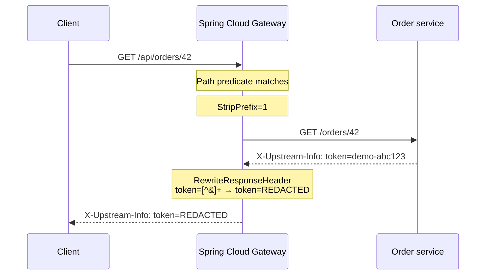

# RewriteResponseHeader: Modifying Header Values with Regular Expressions in Spring Cloud Gateway

In **Spring Cloud Gateway**, gateway filters can modify requests before proxying to microservices and modify responses before returning them to clients. **`RewriteResponseHeader`** is a filter that uses a **regular expression (regex)** to replace part or all of **a specified response header's value**. It is useful when a backend returns a header in a legacy format, includes an internal URL that needs normalization, or exposes a segment that must be transformed to match the public API contract.

This lesson belongs to the **Path Rewriting and Redirects** chapter of the `SPRING_CLOUD_GATEWAY` module. Although placed alongside path-rewriting and redirect topics, `RewriteResponseHeader` operates on **response headers**, not the request path, target URI, or response body. Understanding **route predicates**, the **filter chain**, and response-processing order helps you place the filter on the right route, preserve important headers, and operate a stable microservices gateway.

> **Scope:** Primary examples use **Spring Cloud Gateway Server WebFlux 5.0.x**, with prefix `spring.cloud.gateway.server.webflux.routes` on the Spring Cloud 2025.1.x / Spring Boot 4.x line. Older branches, such as Gateway 4.2, use a different configuration prefix; **Server Web MVC** has its own filter API. Always verify against the starter, BOM, and reference docs for your exact version before copying.

## 1. Learning Objectives

After this lesson, you will be able to:

1. Distinguish **modifying a response header value**, **modifying a request header**, **path rewriting**, and **HTTP redirects**.
2. Configure `RewriteResponseHeader` using its three arguments `name`, `regexp`, and `replacement`, in both shortcut and `name`/`args` forms.
3. Explain how Java regex matches substrings, how replacements are applied, and when a header is left unchanged.
4. Practice with Spring Cloud Gateway, a small HTTP backend, and `curl` to inspect headers **before and after**.
5. Understand advanced topics such as capture groups, `$` escaping in YAML, multi-value headers, and filter order.
6. Avoid using regex to mask security design flaws, introduce unsafe redirects, or corrupt header syntax.

## 2. An HTTP Response Through the Gateway

Suppose a client calls:

```http
GET /api/orders/42 HTTP/1.1
Host: localhost:8080
```

The Gateway selects the orders route and proxies to `http://localhost:9001/orders/42`. The backend returns:

```http
HTTP/1.1 200 OK
Content-Type: text/plain; charset=utf-8
X-Upstream-Info: /orders/42?user=an&token=demo-abc123&trace=ok

order=42
```

We want the client to still receive status `200`, body `order=42`, and the unrelated parts of the header, while replacing `token=demo-abc123` with `token=REDACTED`:

```http
HTTP/1.1 200 OK
Content-Type: text/plain; charset=utf-8
X-Upstream-Info: /orders/42?user=an&token=REDACTED&trace=ok

order=42
```

A route configured with `RewriteResponseHeader` performs that transformation.



Because the replacement happens **on the response path**, what the backend received on the request **is not altered by this filter**. In the example, `StripPrefix` is a **separate** filter responsible for changing the request path.

> The value `token=demo-abc123` is strictly dummy data for hands-on practice. In a real system, the backend should **stop emitting secrets at the source**; regex header rewriting is not a comprehensive secret-protection mechanism.

## 3. The Three Parameters of `RewriteResponseHeader`

The filter accepts these parameters:

| Parameter | Role | Example |
|---|---|---|
| `name` | Name of the **response header** to modify | `X-Upstream-Info` |
| `regexp` | Java regex matching the value portion to replace | `token=[^&]+` |
| `replacement` | String replacing the matched regex portion | `token=REDACTED` |

To understand the expression `token=[^&]+`, break it down:

- `token=`: matches that exact character sequence.
- `[^&]`: matches any single character **other than `&`**.
- `+`: repeats that character class **one or more times**.

Therefore, for the value:

```text
/orders/42?user=an&token=demo-abc123&trace=ok
```

the regex matches only:

```text
token=demo-abc123
```

and replaces it with `token=REDACTED`, preserving `/orders/42?user=an&` and `&trace=ok`.

### 3.1. What happens if the header is absent or the regex does not match?

Two distinct scenarios:

- **Response lacks a header named `X-Upstream-Info`:** the filter has no corresponding value to rewrite; it does not create a header from `replacement`.
- **Response has `X-Upstream-Info` but its value has no substring matching `token=[^&]+`:** the replacement finds nothing to substitute; that header value stays untouched.

`name` is an HTTP header name, which is matched case-insensitively per HTTP semantics; regex matching against the **value**, by contrast, is typically case-sensitive unless you enable another mode. For instance, `token` does not automatically match `TOKEN`.

This filter does not change the HTTP status code, strip the body, touch differently named headers, or issue a second request. Behaviors such as retries, circuit breaking, URL rewriting, and authentication belong to other components.

## 4. Complete Route Configuration in `application.yml`

Suppose the gateway runs on port `8080` and the backend on port `9001`. Server WebFlux 5.0.x example:

```yaml
server:
  port: 8080

spring:
  application:
    name: response-header-gateway
  cloud:
    gateway:
      server:
        webflux:
          routes:
            - id: orders-sanitized-header
              uri: http://localhost:9001
              predicates:
                - Path=/api/orders/**
                - Method=GET
              filters:
                - StripPrefix=1
                - name: RewriteResponseHeader
                  args:
                    name: X-Upstream-Info
                    regexp: 'token=[^&]+'
                    replacement: 'token=REDACTED'
```

**Reading the configuration top to bottom:**

1. `Path=/api/orders/**` and `Method=GET` are **route predicates**. Requests not satisfying both do not enter this route.
2. `uri: http://localhost:9001` is the backend address.
3. `StripPrefix=1` removes the leading `api` segment, turning `/api/orders/42` into `/orders/42` sent to the backend.
4. `RewriteResponseHeader` is registered **on the selected route**. When the backend responds, the filter replaces the regex-matching portion of `X-Upstream-Info`.
5. The response sent to the client retains the backend's status/body unless another filter intervenes.

The `name` keys sit at **two different levels** in this example: `- name: RewriteResponseHeader` specifies the **filter factory name**, while `args.name: X-Upstream-Info` specifies the **target header name**.

### 4.1. Shortcut form

The `filters` block above can also be written concisely:

```yaml
filters:
  - StripPrefix=1
  - RewriteResponseHeader=X-Upstream-Info, token=[^&]+, token=REDACTED
```

The shortcut uses the comma-separated order `name, regexp, replacement`. For complex regexes or replacements containing commas, special whitespace, or `$`, prefer the **`name`/`args` form** to avoid argument-splitting mistakes and improve readability.

The two forms are **alternatives**. Do not declare the same filter twice unless you intentionally want multiple passes.

### 4.2. Version and web stack boundaries

On Gateway Server WebFlux 5.0.x, route properties live under `spring.cloud.gateway.server.webflux.routes`. Some older docs use `spring.cloud.gateway.routes`; using a prefix that mismatches your version can prevent routes from loading as expected.

With **Server Web MVC**, the filter name and three arguments are similar, yet the Servlet runtime and WebMvc.fn extension APIs differ from WebFlux. Never port a custom reactive `GatewayFilter` directly to MVC without code changes.

## 5. Regex: Partial Match or Full Value Replacement?

Java regex lets you match **a substring** inside a header value and replace just that part, rather than rewriting the entire header.

| Input header | `regexp` | `replacement` | Output header |
|---|---|---|---|
| `user=an&token=abc&mode=full` | `token=[^&]+` | `token=REDACTED` | `user=an&token=REDACTED&mode=full` |
| `version=v1; region=ap` | `version=v[0-9]+` | `version=v2` | `version=v2; region=ap` |
| `env=internal` | `internal` | `public` | `env=public` |
| `env=internal` | `^internal$` | `public` | Unchanged because the full value is not `internal` |
| `token=; trace=ok` | `token=[^&;]+` | `token=REDACTED` | Unchanged when there are no chars between `=` and `;` |
| `TOKEN=abc&mode=full` | `token=[^&]+` | `token=REDACTED` | Unchanged because regex is case-sensitive |

Use `^` and `$` when you **want to match the entire header value**, for example:

```yaml
filters:
  - name: RewriteResponseHeader
    args:
      name: X-Service-Tier
      regexp: '^(legacy|old)$'
      replacement: 'standard'
```

Header `X-Service-Tier: legacy` is changed to `standard`, whereas `X-Service-Tier: legacy-extra` stays unchanged.

### 5.1. Delimiters must match the header format

The regex `[^&]+` in the example assumes key-value parts separated by `&`, like a query string. Do not apply it blindly to strings delimited by `;`, commas, JSON, or encoded URIs.

If the backend sends:

```text
token=abc; version=v1
```

`token=[^&]+` would match `; version=v1` too because the string **contains no `&`**. When data is semicolon-delimited, you might choose `token=[^;]+`. If real header values involve escaping or multiple variants, test thoroughly or use a structured parser instead of regex.

**Do not use overly broad regexes like `.*` or `.+` on a header when you only intend to edit one subfield.** Overwriting the entire header can wipe out information the client depends on.

### 5.2. Capture groups and `replacement`

Java regex can preserve part of a value via capture groups:

```text
Header: X-Release: version=7; region=apac
regexp: version=([0-9]+)
replacement: release-$1
Result: X-Release: release-7; region=apac
```

In Java, `$1` in the replacement refers to the **first group**; `$2` refers to the second group, if present. Named groups are typically referenced as `$\{groupName}` in regex replacement syntax.

**Very important note when writing `application.yml`:** Spring uses `$\{...}` placeholder syntax, so Gateway documentation instructs escaping `$` with `$\` when writing replacements with this syntax. Example with named group `id`:

```yaml
filters:
  - name: RewriteResponseHeader
    args:
      name: X-Next-Path
      regexp: '^/old/(?<id>[0-9]+)$'
      replacement: '/new/$\{id}'
```

If the backend returns `X-Next-Path: /old/42`, the expected output is `X-Next-Path: /new/42`. Use **YAML single quotes** to preserve the backslash literally in the string; do not casually turn `'/new/$\{id}'` into `"/new/$\{id}"`, because double-quoted YAML has its own escape rules.

During deployment, test against the running Gateway version to confirm placeholder/capture handling works as intended. For introductory exercises, a **fixed string** replacement like `token=REDACTED` is simpler and less error-prone.

### 5.3. When should regex be avoided?

- Complex structured headers: `Set-Cookie`, `Content-Security-Policy`, `Cache-Control`, or `Link` have multiple directives and dedicated syntax rules.
- Encrypted or signed headers: altering contents can invalidate signatures or integrity checks.
- Protocol-critical headers: `Content-Length`, `Transfer-Encoding`, `Content-Encoding`, `Content-Range`, `ETag`, etc.—arbitrary edits break body framing, caching, or streaming.

For those cases, choose dedicated filters/codecs or fix the backend directly; it is safer and far easier to maintain.

## 6. End-to-End Hands-on Practice

This lab uses a small backend that intentionally emits a response header, routed through the gateway to observe the transformed header. No service registry, Redis, or distributed setup is needed.

### 6.1. Preparing the Spring Cloud Gateway application

Create a Spring Boot project compatible with the Spring Cloud release train, selecting **Spring Cloud Gateway Server WebFlux** and required dependencies via [Spring Initializr](https://start.spring.io/). If editing Maven manually, the core starter is:

```xml
<dependency>
    <groupId>org.springframework.cloud</groupId>
    <artifactId>spring-cloud-starter-gateway-server-webflux</artifactId>
</dependency>
```

The project also needs a Spring Boot parent/plugin and a **compatible Spring Cloud BOM**; the snippet above is not a complete `pom.xml`. Gateway Server WebFlux runs on the Reactor Netty model. Avoid accidentally adding the Servlet MVC starter.

Main class:

```java
import org.springframework.boot.SpringApplication;
import org.springframework.boot.autoconfigure.SpringBootApplication;

@SpringBootApplication
public class GatewayApplication {
    public static void main(String[] args) {
        SpringApplication.run(GatewayApplication.class, args);
    }
}
```

Place the full YAML configuration from **Section 4** into `src/main/resources/application.yml`.

### 6.2. Test backend returning headers

If you do not yet have an order service on `localhost:9001`, create `ResponseHeaderBackend.java` in a practice folder:

```java
import com.sun.net.httpserver.HttpServer;
import java.net.InetSocketAddress;
import java.nio.charset.StandardCharsets;

public class ResponseHeaderBackend {
    public static void main(String[] args) throws Exception {
        HttpServer server = HttpServer.create(
                new InetSocketAddress("127.0.0.1", 9001), 0);

        server.createContext("/", exchange -> {
            String path = exchange.getRequestURI().getRawPath();

            if (!"/orders/no-header".equals(path)) {
                String info = "/orders/42?user=an&token=demo-abc123&trace=ok";
                if ("/orders/no-match".equals(path)) {
                    info = "region=apac&version=v1";
                }
                exchange.getResponseHeaders().set("X-Upstream-Info", info);
            }

            exchange.getResponseHeaders().set(
                    "Content-Type", "text/plain; charset=utf-8");

            String content = "backend-path=" + path + "\n";
            byte[] body = content.getBytes(StandardCharsets.UTF_8);
            exchange.sendResponseHeaders(200, body.length);
            try (var output = exchange.getResponseBody()) {
                output.write(body);
            }
        });

        server.start();
        System.out.println("Backend listening at http://localhost:9001");
    }
}
```

Run in Java single-file source mode with JDK 17+:

```bash
java --add-modules jdk.httpserver ResponseHeaderBackend.java
```

This backend intentionally returns `200` for every path with no real business logic; it produces three scenarios:

| Backend path | Response header `X-Upstream-Info` |
|---|---|
| `/orders/42` | `/orders/42?user=an&token=demo-abc123&trace=ok` |
| `/orders/no-match` | `region=apac&version=v1` |
| `/orders/no-header` | Does not emit this header |

In another terminal, verify the backend returns the **original** header:

```bash
curl -i http://localhost:9001/orders/42
```

Excerpt of the response:

```http
HTTP/1.1 200 OK
X-Upstream-Info: /orders/42?user=an&token=demo-abc123&trace=ok
Content-Type: text/plain; charset=utf-8

backend-path=/orders/42
```

### 6.3. Starting the Gateway and observing the rewritten header

Run the Gateway inside the Spring Boot project directory:

```bash
# Linux/macOS
./mvnw spring-boot:run

# Windows PowerShell
.\mvnw.cmd spring-boot:run
```

Call **through the Gateway**:

```bash
curl -i http://localhost:8080/api/orders/42
```

Expected response:

```http
HTTP/1.1 200 OK
X-Upstream-Info: /orders/42?user=an&token=REDACTED&trace=ok
Content-Type: text/plain; charset=utf-8

backend-path=/orders/42
```

Points to compare:

- Direct backend calls (`9001`) still return the original `token=demo-abc123`.
- Client calls to the Gateway (`8080`) see `token=REDACTED`.
- `StripPrefix=1` changed the request path from `/api/orders/42` to `/orders/42`; that is **not done by `RewriteResponseHeader`**.
- Status and body remain unchanged in this test because the filter only rewrites the header. Other headers and header ordering may vary across environments.

### 6.4. Testing a non-matching regex

```bash
curl -i http://localhost:8080/api/orders/no-match
```

The backend returns `X-Upstream-Info: region=apac&version=v1`. There is no `token=...` segment, so the filter finds nothing to replace; the client still receives `region=apac&version=v1`.

### 6.5. Testing a response without the header

```bash
curl -i http://localhost:8080/api/orders/no-header
```

The backend emits no `X-Upstream-Info` header, so `RewriteResponseHeader` **does not add a new header**. If you need to add a required header, consider `AddResponseHeader` or `SetResponseHeader` depending on your intent.

### 6.6. Testing commands on Windows

In PowerShell 5.1, `curl` may be an alias for `Invoke-WebRequest`. Use `curl.exe -i ...` to match the syntax in these examples. Inspect headers from both the backend and the gateway so you do not confuse route, filter, and backend issues.

## 7. Modifying Response Headers During HTTP Redirects

HTTP redirects are signaled by **3xx status codes** (e.g., `301`, `302`, `307`, `308`) and typically carry a `Location` header. `RewriteResponseHeader` can modify the **value of `Location`** because it is also a response header.

For example, an internal backend returns:

```http
HTTP/1.1 302 Found
Location: https://internal.example.test/orders/42
```

An application may need to expose a public URL to clients:

```http
HTTP/1.1 302 Found
Location: https://api.example.com/orders/42
```

Illustrative filter configuration:

```yaml
filters:
  - name: RewriteResponseHeader
    args:
      name: Location
      regexp: '^https://internal\.example\.test'
      replacement: 'https://api.example.com'
```

`^` anchors the start of the string, and `\.` matches literal dots in the hostname. The trailing path remains intact. **The filter does not convert status `302` to another status code**, nor does it decide which backend gets called.

### 7.1. When should you use `RewriteLocationResponseHeader`?

If your goal is handling backend `Location` headers behind a reverse proxy—especially replacing host/port, scheme, and stripping path version segments by policy—Spring Cloud Gateway also provides **`RewriteLocationResponseHeader`** specifically for that use case. It offers dedicated parameters/policies and usually expresses redirect-handling intent more cleanly than a generic regex.

In particular, check these issues before modifying `Location` in production:

- Allow only intended hostnames and schemes. Unconstrained rewrites can cause **open redirects** or send clients to the wrong host.
- Do not derive public hosts from untrusted `X-Forwarded-Host` headers without configuring trusted proxies.
- Distinguish relative URLs (`/orders/42`) from absolute URLs (`https://...`): a regex anchored to `https://internal.example.test` leaves relative URLs untouched.
- Verify `301`/`302`/`303`/`307`/`308` codes and HTTP method semantics, especially when redirecting `POST`; a header-rewriting filter does not manage client redirect rules.
- If the Gateway uses TLS termination, the public hostname and HTTPS protocol must match the actual topology.

In this lesson, the `X-Upstream-Info` examples remain the safest way to learn the filter: they let you observe regex behavior without triggering live redirects.

## 8. Distinguishing from Easily Confused Filters

| Filter | Target modified | Example use case |
|---|---|---|
| **`RewriteResponseHeader`** | Value of a named response header via regex | `X-Upstream-Info: token=abc` → `token=REDACTED` |
| `SetResponseHeader` | Replaces the entire value of a named header with a configured string | Enforce `X-Env: production` |
| `AddResponseHeader` | Appends a response header value | Add `X-Gateway: scg` |
| `RemoveResponseHeader` | Deletes a named response header | Strip `X-Internal-Debug` |
| `RewriteLocationResponseHeader` | Specialized handling for `Location` headers | Replace internal URL with public URL on redirects |
| `RewritePath` | **Request path** before forwarding to backend | `/api/orders/42` → `/orders/42` |
| `SetPath` / `StripPrefix` | **Request path** before proxying | Set path via template or drop leading segments |
| `RewriteRequestParameter` | Value of a **request** query parameter | `campaign=old` → `campaign=new` |
| `ModifyResponseBody` | **Response body** via corresponding API/codec | Transform structured body payloads |

**Decision guide:**

- Need to edit part of an existing header while keeping the rest → `RewriteResponseHeader`.
- Need to force a header to a fixed string → `SetResponseHeader`.
- Need to remove an unnecessary or sensitive header → `RemoveResponseHeader`.
- Need to alter the path the backend receives → `RewritePath`, `StripPrefix`, or `SetPath`.
- Need to rewrite host/port in redirects behind a reverse proxy → evaluate `RewriteLocationResponseHeader` first.

## 9. Filter Order and When the Response Is Written

Gateway Server WebFlux builds its **filter chain** by combining route filters and global filters and sorting them by `Ordered`. On the normal path, a filter with higher priority in the **pre** phase generally executes its **post** phase after inner filters. `RewriteResponseHeader` runs on the response path once headers are available to process.

Keep in mind:

1. A filter declared **on a specific route** affects only responses for requests routed through that route.
2. If other filters also edit `X-Upstream-Info`—such as `SetResponseHeader` or a custom `GlobalFilter`—**actual execution order** determines the final value the client sees.
3. Response headers must be modified **before the response is committed**. A custom filter trying to write headers too late may have no effect; built-in Gateway filters handle this timing within the pipeline.
4. Short-circuits, fallbacks, timeouts, connection errors, or an independent global filter can prevent requests from reaching the steps you expect. Verify the **selected route** and loaded filter chain.

An easily confused example:

```yaml
filters:
  - name: RewriteResponseHeader
    args:
      name: X-Upstream-Info
      regexp: 'token=[^&]+'
      replacement: 'token=REDACTED'
  - SetResponseHeader=X-Upstream-Info, forced-value
```

Two filters modify the same header. Do not casually assume "RewriteResponseHeader definitely runs last" just from top-to-bottom reading or because it processes responses. If both are needed, design the order explicitly, observe real output, and avoid overlapping responsibilities.

### 9.1. Inspecting routes with Actuator

If your application includes `spring-boot-starter-actuator`, in Gateway 5.0.x you can enable read-only mode:

```yaml
management:
  endpoint:
    gateway:
      access: read-only
  endpoints:
    web:
      exposure:
        include: health,info,gateway
```

Add `management` at the root level of the **same** `application.yml`, restart, and run:

```bash
curl -i http://localhost:8080/actuator/gateway/routes
curl -i http://localhost:8080/actuator/gateway/routes/orders-sanitized-header
```

Check the loaded route ID, URI, predicates, and filters. Actuator shows **runtime route configuration**; it does not replace live request testing. Never expose management endpoints publicly without access control; backend, filter, and policy details can be sensitive.

## 10. Security and Integrity of Response Headers

Headers can carry operational metadata, caching directives, or security-sensitive data. Regex on headers is a **contract-based** transformation tool that requires exact targeting and testing. Specifically:

### 10.1. Do not use regex as the sole secret-protection layer

For instance, `token=[^&]+` only catches strings resembling `token=...` inside the exact named header. It does **not** redact tokens appearing in:

- Differently named headers, response bodies, or logs.
- Uppercase variants like `TOKEN=...` or alternative encodings.
- Values delimited by characters the regex does not expect.
- Error messages from other backends or routes missing the filter.

Therefore, the best practice is for backends **never to emit secrets**, for the Gateway never to indiscriminately log `Authorization`/`Cookie`/`Set-Cookie`, and for every API to enforce proper authentication and authorization. `RewriteResponseHeader` does not replace Spring Security, TLS, or access control.

### 10.2. `Set-Cookie` and multi-value headers

A response can carry **multiple header lines with the same name**. `Set-Cookie` is especially critical: each cookie typically uses its own `Set-Cookie` header with attributes like `Path`, `Domain`, `Secure`, `HttpOnly`, `SameSite`, and expiration.

Never flatten multiple `Set-Cookie` headers into a single string and apply ad-hoc regexes; that can cause browsers to misparse cookies. If you need to adjust cookie domains or paths, prefer dedicated gateway or backend mechanisms and test across real browsers. For other multi-value headers, test all values to verify how your deployed version handles them.

### 10.3. Preserving HTTP semantics

- Do not alter `Content-Length` without changing the body and recalculating the exact byte length.
- Do not strip `Content-Encoding` while the body remains compressed.
- Do not arbitrarily edit `ETag`, `Cache-Control`, or `Vary`, as that can break caching.
- Do not add or rewrite `Access-Control-Allow-Origin` via arbitrary regexes without checking CORS logic and credentials.
- For redirect `Location` headers, ensure valid public hostnames and prevent open redirects.

When applying filters across all routes via `default-filters`, the blast radius may be wider than expected. Start on a single specific route, test thoroughly, and only then broaden scope.

## 11. Common Pitfalls and Troubleshooting

| Symptom | Potential cause | How to check / fix |
|---|---|---|
| Gateway starts but header does not change | Route does not match or wrong config prefix used | Check `Path`/`Method`, route ID, and Actuator |
| Header retains original value | `regexp` does not match actual value | `curl -i` backend directly; compare exact delimiters and casing |
| Expected header is missing | Backend did not emit the header | `curl -i` backend directly; `RewriteResponseHeader` does not create headers |
| Trailing part of value disappears | Overly greedy regex such as `token=.*` | Narrow pattern like `token=[^&;]+` to match actual format |
| `$` character breaks configuration | Placeholder/capture group improperly escaped | Use YAML single quotes, `$\` rule for `$\{name}`, and test |
| Shortcut splits arguments incorrectly | Regex or replacement contains commas | Switch to `name`/`args` syntax |
| Header gets overwritten again | Multiple filters or global filter edit the same header | Inspect filter chain and output; remove duplicate config |
| Redirect points to internal hostname | `Location` not rewritten properly | Evaluate `RewriteLocationResponseHeader` or tightly scoped regex |
| Standard HTTP headers break | Arbitrary edits to `Set-Cookie`/`Content-Length`/`ETag` | Use dedicated mechanisms; preserve protocol semantics |
| Backend returns `5xx` with no header rewrite seen | Failure occurred before backend emitted header, or fallback/short-circuit triggered | Inspect status, logs/traces, and matched route |
| Containerized app cannot reach `localhost:9001` | `localhost` inside container refers to gateway container itself | Use reachable service DNS/hostname |
| Secrets still leak in body/logs | Rewrite only targets one response header | Eliminate secrets at source; lock down logs and access |

**Troubleshooting workflow:** (1) call the backend directly; (2) confirm the original header; (3) call the exact path/method through the Gateway; (4) verify loaded routes and filters; (5) test the regex against a sample value; (6) check if other filters modify the same header or if the response was already committed.

## 12. Applying to a Microservices API Gateway

In a system with `identity-service`, `catalog-service`, and `order-service`, the Gateway can standardize certain **public headers** returned by backends. For example:

| Need | Implementation approach | Boundary to remember |
|---|---|---|
| Normalize `X-Service-Version` from legacy format | `RewriteResponseHeader` with version-format regex | Constrain allowed values; avoid stripping compatibility metadata |
| Replace internal domain in `Location` | `RewriteLocationResponseHeader` or targeted regex rewrite | Strictly configure public host and trusted proxies |
| Strip `X-Internal-Trace-Details` | `RemoveResponseHeader` | Never leak sensitive upstream internals |
| Add route identifier for local debugging | `AddResponseHeader` | Avoid exposing internal network topology in production |
| Keep certain response headers consistent | Default filters or dedicated policy | Test all routes and multi-value headers |
| Throttle requests and prevent overload | Appropriate RateLimiter / CircuitBreaker / Retry | Not the job of response header rewriting |
| Trace requests across services | Actuator, Micrometer, tracing/correlation ID | Avoid logging raw tokens, cookies, or PII |

Routing, path/header transformations, `lb://` discovery, authentication, rate limiting, circuit breakers/retries, and TLS must all work together in a Gateway architecture. `RewriteResponseHeader` solves one focused step: **transforming the value of a known response header**. Keeping responsibilities cleanly separated reduces side effects and simplifies debugging when distributed systems fail.

## 13. Self-Check Exercises

**Question 1.** Which direction of the request/response flow does `RewriteResponseHeader` read from?

**Answer:** It processes **headers in the response** after the backend produces a response; it does not directly modify request headers or the request path.

**Question 2.** What are the three arguments that must be declared?

**Answer:** `name` (header name), `regexp` (Java regex pattern), and `replacement` (replacement string).

**Question 3.** With header `X-Info: user=an&token=abc&mode=full`, regex `token=[^&]+`, and replacement `token=REDACTED`, what is the final value?

**Answer:** `user=an&token=REDACTED&mode=full`.

**Question 4.** If the backend does not return `X-Info`, yet the route has `RewriteResponseHeader=X-Info, token=[^&]+, token=REDACTED`, will the client receive that header?

**Answer:** Not automatically. The filter only rewrites an existing header; to add a header, use another filter.

**Question 5.** Why does `regexp: 'token=.*'` easily cause bugs on `token=abc&trace=ok`?

**Answer:** `.*` can match through the end of the string, erasing `&trace=ok` as well. Constrain the regex to the actual delimiter format.

**Question 6.** To rewrite the request path `/api/orders/42` to `/orders/42`, should you use `RewriteResponseHeader`?

**Answer:** No. Use `StripPrefix`, `RewritePath`, or `SetPath` on the request path.

**Question 7.** Does `RewriteResponseHeader` automatically turn `302` into `200` when rewriting `Location`?

**Answer:** No. It only modifies header values, never the HTTP status code.

**Question 8.** Should you apply a simple regex across `Set-Cookie` to rewrite cookies in bulk?

**Answer:** No. Cookies use multiple headers and specific attributes; use dedicated mechanisms or fix them at the backend.

**Extended practice:** Change the route's `regexp` to `'version=v[0-9]+'` and `replacement: 'version=v2'`. Call `/api/orders/no-match` to observe `region=apac&version=v1` change to `region=apac&version=v2`; then call `/api/orders/42` and explain why the updated filter no longer masks `token=demo-abc123`. Restore the configuration before promoting to another environment.

## 14. Official Documentation

- [Spring Cloud Gateway Server WebFlux 5.0 — RewriteResponseHeader GatewayFilter Factory](https://docs.spring.io/spring-cloud-gateway/reference/5.0/spring-cloud-gateway-server-webflux/gatewayfilter-factories/rewriteresponseheader-factory.html).
- [Spring Cloud Gateway Server WebFlux 5.0 — Configuring Route Predicate Factories and Gateway Filter Factories](https://docs.spring.io/spring-cloud-gateway/reference/5.0/spring-cloud-gateway-server-webflux/configuring-route-predicate-factories-and-filter-factories.html).
- [Spring Cloud Gateway Server WebFlux 5.0 — How It Works](https://docs.spring.io/spring-cloud-gateway/reference/5.0/spring-cloud-gateway-server-webflux/how-it-works.html).
- [Spring Cloud Gateway Server WebFlux 5.0 — RewriteLocationResponseHeader](https://docs.spring.io/spring-cloud-gateway/reference/5.0/spring-cloud-gateway-server-webflux/gatewayfilter-factories/rewritelocationresponseheader-factory.html).
- [Spring Cloud Gateway Server WebFlux 5.0 — Actuator API](https://docs.spring.io/spring-cloud-gateway/reference/5.0/spring-cloud-gateway-server-webflux/actuator-api.html).
- [Java SE — `Pattern` (regex)](https://docs.oracle.com/en/java/javase/21/docs/api/java.base/java/util/regex/Pattern.html).
- [Java SE — `Matcher` (replaceAll, replacement groups)](https://docs.oracle.com/en/java/javase/21/docs/api/java.base/java/util/regex/Matcher.html).
- [MDN — HTTP response headers](https://developer.mozilla.org/en-US/docs/Glossary/Response_header).

**Key takeaway:** `RewriteResponseHeader` targets **a specific named response header** and applies **regex + replacement** to its value. Write narrow regexes, handle YAML syntax properly, and verify with `curl` against both the backend and the Gateway. For redirects, security, multi-value headers, and HTTP protocol semantics, pair it with dedicated policies and tools to prevent unintended modifications.
