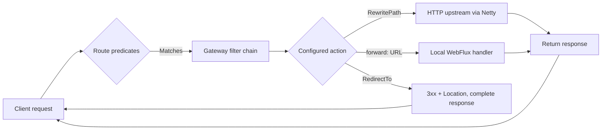
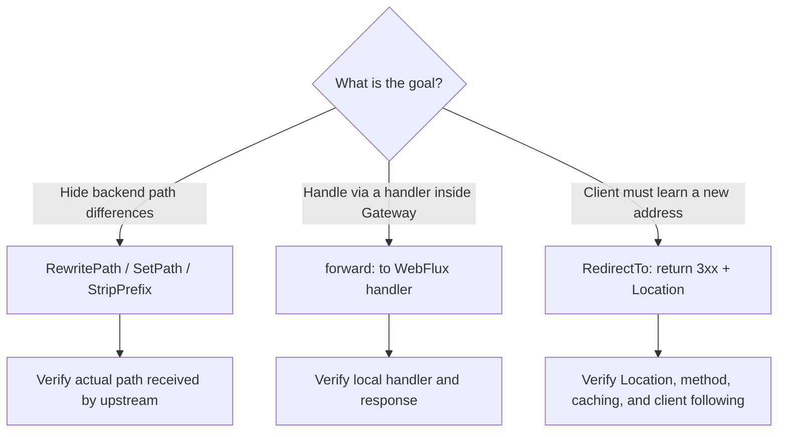

# Distinguishing Internal Rewrite, Internal Forward, and Client Redirect

## 1. Context: All Change Routing Paths, Yet Differ Completely in Mechanism

In a microservices architecture, **Spring Cloud Gateway** is the shared entry point for HTTP requests. The Gateway selects a route using predicates, applies a filter chain, can modify paths/headers, and dispatches requests to the appropriate service. When APIs change versions or handle errors, three requirements frequently arise with deceptively similar names:

1. Clients call `/api/v1/orders/42`, while `order-service` only exposes `/orders/42`. The Gateway must perform an **internal path rewrite**.
2. Clients call a URL accepted by the Gateway, yet the request needs to be handled by a **handler inside the Gateway application itself**. We need an **internal forward**.
3. Clients call an old URL `/docs-old` and must be instructed to visit the new URL `https://docs.example.test/gateway`. We need an **HTTP redirect to the client**.

All three can change where a request is handled, yet they differ in **who sends the next request**, **whether the client learns the new URL**, **whether an HTTP 3xx response is returned**, and **whether an additional HTTP round-trip is initiated by the client**.

This lesson belongs to the **Path Rewriting and Redirects** chapter of the **SPRING_CLOUD_GATEWAY** module. Mastering these three mechanisms is essential for configuring route predicates, filters, service discovery, authentication, rate limiting, retries, circuit breakers, TLS, and request observability without misrouting traffic or creating redirect loops.

> **Scope:** Examples focus on **Spring Cloud Gateway Server WebFlux**, using `spring.cloud.gateway.routes` configuration common in the 4.x line. Namespaces, starters, APIs, and exact behaviors may change in newer Spring Cloud Gateway releases or when using the Server MVC variant. Consult the documentation for your project's exact version before promoting configuration to production.

## 2. High-Level Comparison

| Criterion | Internal path rewrite | Forward to internal handler | Redirect to client |
| --- | --- | --- | --- |
| Typical Gateway mechanism | `RewritePath`, `SetPath`, `StripPrefix` | URI with `forward:` scheme | `RedirectTo` filter |
| Purpose | Modifies the **path** used for forwarding | Dispatches processing to a handler **within the same application** | Instructs the **client** to use a different URL |
| Does the client change the URL it calls? | No | No | Potentially yes, if client follows `Location` |
| Produces HTTP 3xx by default? | No | No | Yes; e.g., 302, 307, 308 |
| Must the client send a second request? | No | No | Yes, if client chooses to follow the redirect |
| Next processing component | Typically an HTTP upstream or configured route | Local `DispatcherHandler`/WebFlux handler | Client, browser, or HTTP client library |
| Can it target a remote service? | Yes, via route URIs like `http://`, `https://`, `lb://` | `forward:` itself targets a local handler; that handler can explicitly call another service in code | The URL in `Location` may belong to another host |
| Latency | Usually within the same client request round-trip | Internal handling within the same request | May add RTT, DNS/TLS, and a new connection for the follow-up call |
| Use cases | API aliases, prefix stripping, backend path restructuring | Fallbacks, endpoints handled directly at the Gateway | Canonical URLs, page/doc migrations, permanently moved endpoints |

**Most common confusion:** In everyday speech, "the gateway forwards the request to order-service" usually refers to normal **reverse proxying**. However, **`forward:` in Spring Cloud Gateway is a special routing scheme for dispatching inside the current WebFlux application**, not for sending an HTTP request to a microservice running on another network address.

### Diagram: Who initiates the next HTTP request?

```mermaid
flowchart TB
    subgraph R["Rewrite: same client HTTP request"]
      RC["Client GET /api/v1/orders/42"] --> RG["Gateway: RewritePath"]
      RG --> RU["Upstream GET /orders/42"]
      RU --> RG2["Gateway: upstream response"]
      RG2 --> RC2["Client receives response; initial request URL unchanged"]
    end
    subgraph F["Forward: dispatch to handler in same app"]
      FC["Client GET /status"] --> FG["Gateway: forward:///internal/status"]
      FG --> FH["Internal WebFlux handler"]
      FH --> FC2["Client receives response; no redirect"]
    end
    subgraph D["Redirect: client chooses whether to follow Location"]
      DC["Client GET /docs-old"] --> DG["Gateway: RedirectTo"]
      DG --> DR["HTTP 308 + Location"]
      DR --> DC2["Client decides to send GET to new URL"]
      DC2 --> DS["Server at new URL"]
    end
```



In practice, clients are **not required** to follow redirects; many HTTP libraries only follow redirects automatically when explicitly enabled. Some browsers cache permanent redirects, so keep that in mind during testing.

## 3. At Which Stage Does a Request Traverse the Gateway?

A request in Spring Cloud Gateway Server WebFlux typically passes through these main stages:

1. Reactor Netty/WebFlux receives the request and selects a route using **route predicates** such as `Path`, `Host`, and `Method`.
2. `FilteringWebHandler` runs the `GlobalFilter`s and the route's `GatewayFilter`s in effective order.
3. Request-transforming filters can modify the path, headers, or routing attributes.
4. An appropriate routing filter or handler processes the request further; the response flows back through the filter chain.



**Predicates are evaluated to choose the route before that route's filters execute.** Thus, if the incoming request is `/api/v1/orders/42`, the predicate matches that path, while `RewritePath` subsequently causes the upstream to receive `/orders/42`. Changing the path inside a filter does not automatically re-run all predicates to select a different route.

Features such as `RequestRateLimiter`, Spring Security authentication, circuit breakers, retries, and timeouts only operate if the application has the required dependencies and policies configured. Rewrite, forward, and redirect **do not provide** authentication or resilience on their own.

## 4. Internal Rewrite: Changing the Path While Preserving Client Communication

### 4.1. How RewritePath works

`RewritePath` is a GatewayFilter that uses a **regular expression** to alter the path before the request reaches the upstream. It is particularly helpful when the public API URL differs from the URL expected by the target service.

Suppose:

```text
Client calls:     GET /api/v1/orders/42?include=items
Gateway route:    order-v1
RewritePath:      /api/v1/orders/42 -> /orders/42
Upstream receives: GET /orders/42?include=items
```

Example `application.yml` (declaring the route in Gateway Server WebFlux):

```yaml
spring:
  cloud:
    gateway:
      routes:
        - id: order-v1
          uri: http://localhost:8081
          predicates:
            - Path=/api/v1/orders/*
            - Method=GET
          filters:
            - 'RewritePath=^/api/v1/orders/(?<orderId>[^/]+)$, /orders/$\{orderId}'
```

Detailed breakdown:

- `Path=/api/v1/orders/*` matches requests with one segment after `/api/v1/orders/`; `Method=GET` restricts the HTTP method.
- `^/api/v1/orders/(?<orderId>[^/]+)$` matches only the corresponding path, capturing `42` into named group `orderId`.
- `/orders/$\{orderId}` is the replacement string in YAML config; the **backslash before the curly brace** protects the regex replacement placeholder from configuration property placeholder resolution.
- `uri: http://localhost:8081` is where the Gateway sends the request after rewriting the path. In production, this URI is usually externalized per profile, or uses `lb://ORDER-SERVICE` with service discovery and load balancing.
- `include=items` belongs to the query string; standard `RewritePath` modifies the **path**, not the query or headers. Other filters can alter those if configured.

For replacement expressions in **Java code**, `${orderId}` in Java regular-expression replacement does not require YAML-style escaping. Never mix Java string literal syntax, Spring placeholders, and regex replacement rules: they are interpreted at separate layers.

> The example above only matches paths with a single `orderId`. `/api/v1/orders/42/items` will not match the same pattern; if multiple segments are needed, redesign both the `Path` predicate and the regex replacement, and test URL-encoded segments.

### 4.2. Are StripPrefix and SetPath also rewrites?

In a broad sense, **both `StripPrefix` and `SetPath` are forms of internal path transformation**. They suit simpler cases than `RewritePath`.

| Filter | Example | Result |
| --- | --- | --- |
| `StripPrefix=2` | `/api/v1/orders/42` | `/orders/42` |
| `SetPath=/orders/{id}` with `Path=/api/v1/orders/{id}` | `/api/v1/orders/42` | `/orders/42` |
| `RewritePath` with regex | `/api/v1/orders/42` | `/orders/42` |

If every endpoint simply needs `/api/v1` removed, a shorter config is:

```yaml
spring:
  cloud:
    gateway:
      routes:
        - id: orders-strip
          uri: http://localhost:8081
          predicates:
            - Path=/api/v1/orders/**
          filters:
            - StripPrefix=2
```

If you want explicit template mapping:

```yaml
spring:
  cloud:
    gateway:
      routes:
        - id: order-by-id
          uri: http://localhost:8081
          predicates:
            - Path=/api/v1/orders/{id}
          filters:
            - SetPath=/orders/{id}
```

These are **alternative configurations**, not three routes to declare simultaneously in a single sample app: their predicates would overlap and obscure which route gets selected. Pick the simplest form that accurately expresses the API contract.

### 4.3. Rewrite is not redirect

After rewriting, if the upstream returns `200 OK`, the Gateway normally relays `200 OK`; **no `301/302/307/308` response is emitted just because the path changed**. The client remains on its original URL `/api/v1/orders/42` throughout the transaction.

If you need the browser to change its displayed URL, or want clients to adopt a new canonical URL on subsequent calls, a rewrite filter **will not accomplish that**. You need a client redirect or an API contract change instead.

## 5. Internal Forward: Dispatching Requests to a Handler Inside the Gateway

### 5.1. What does the `forward:` scheme do?

When a route's URI begins with `forward:`, **`ForwardRoutingFilter`** uses Spring WebFlux's handler mechanism (via `DispatcherHandler`) to continue processing the request **within the same application**. It does not open a new HTTP connection from the client and does not emit `Location` by default.

For example, the Gateway exposes `GET /status` served by an internal controller at `/internal/status`:

```yaml
spring:
  cloud:
    gateway:
      routes:
        - id: local-status
          uri: forward:///internal/status
          predicates:
            - Path=/status
            - Method=GET
```

Sample handler living inside **the Gateway application itself**:

```java
import java.util.Map;
import org.springframework.web.bind.annotation.GetMapping;
import org.springframework.web.bind.annotation.RestController;
import reactor.core.publisher.Mono;

@RestController
class GatewayStatusController {

    @GetMapping("/internal/status")
    Mono<Map<String, String>> status() {
        return Mono.just(Map.of("source", "gateway", "state", "ok"));
    }
}
```

Processing flow:

```text
Client       GET /status
Gateway      Matches route local-status
Forward      forward:///internal/status
WebFlux      Invokes GatewayStatusController at /internal/status
Client       Receives 200 + JSON (assuming handler succeeds)
```

The path in `forward:///internal/status` is used to dispatch to the internal handler. **The address the client called remains `/status`**, with no new HTTP request to `/internal/status` from the browser.

**Boundary:** `forward:` only works if the Gateway application itself actually has a handler matching that target. If `/internal/status` lives in another microservice, `forward:` will not locate that service; use `http(s)://...` or `lb://SERVICE-ID` to proxy to an upstream.

### 5.2. Using forward for circuit breaker fallbacks

A common use case for `forward:` is an **internal fallback handler** when an upstream request fails under a circuit breaker policy:

```yaml
spring:
  cloud:
    gateway:
      routes:
        - id: inventory
          uri: http://localhost:8082
          predicates:
            - Path=/api/inventory/**
          filters:
            - name: CircuitBreaker
              args:
                name: inventoryBreaker
                fallbackUri: forward:/internal/inventory-fallback
```

When the `CircuitBreaker` filter triggers fallback, it can dispatch execution to the WebFlux handler `/internal/inventory-fallback`. **There is no 3xx redirect to the client**; the final HTTP status and body depend on the fallback handler and Gateway error handling.

For this example to work, the project must include the **Spring Cloud CircuitBreaker** integration/dependency and matching configuration, along with an actual internal handler. If you want fallbacks only for specific HTTP errors or exception types, configure the corresponding policy. Declaring `fallbackUri` does not automatically turn every 4xx response into a fallback.

Avoid misusing `forward:` to cram business logic into the Gateway. Ownership checks on orders, payments, and inventory updates belong in their respective microservices.

### 5.3. Forward vs. normal "request proxying"

Compare these two route URIs:

```yaml
# Proxy HTTP request to a real backend:
uri: http://localhost:8081

# Dispatch to a handler inside the same WebFlux application:
uri: forward:///internal/status
```

In the first line, Spring Cloud Gateway uses its HTTP client/transport to call a backend. In the second line, `forward:` is a **local dispatch** directive. If that local handler subsequently calls a microservice with `WebClient`, that is an **explicit call written in the handler**, not an automatic effect of `forward:`.

## 6. Client Redirect: 3xx Responses and Location

### 6.1. What does RedirectTo send?

`RedirectTo` is a GatewayFilter that sends a response with a **redirect HTTP status** and a **`Location`** header. The Gateway ends response processing for the current request; the client can independently make a new request to the URL in `Location`.

For example, old documentation has moved to a new address:

```yaml
spring:
  cloud:
    gateway:
      routes:
        - id: docs-redirect
          uri: http://localhost:8081
          predicates:
            - Path=/docs-old
          filters:
            - RedirectTo=308, https://docs.example.test/gateway
```

Assuming the filter runs normally, the expected response is:

```http
HTTP/1.1 308 Permanent Redirect
Location: https://docs.example.test/gateway
```

In this route, `uri` is a required route configuration field in the example, yet **`RedirectTo` completes the response before proxying HTTP to that address**. Do not build an upstream expecting redirected requests to still hit that backend. Only requests matching `Path=/docs-old` are redirected by the route above.

The `Location` value can point to the same host or another host. "Redirecting to the client" means **the decision to visit the new URL lies with the client**, not necessarily that the target URL is external to your organization.

### 6.2. How do 301, 302, 303, 307, and 308 differ?

| HTTP status | Common meaning | Key rule regarding method |
| --- | --- | --- |
| `301 Moved Permanently` | Permanent relocation | Legacy clients may change `POST` to `GET` |
| `302 Found` | Temporary relocation | Legacy clients may change `POST` to `GET` |
| `303 See Other` | Directs to another resource, often after a write action | Clients typically use `GET` for the next request (except `HEAD`) |
| `307 Temporary Redirect` | Temporary relocation preserving method semantics | Compliant clients keep method and body when following |
| `308 Permanent Redirect` | Permanent relocation preserving method semantics | Compliant clients keep method and body when following |

For APIs with `POST`, `PUT`, or large payloads, choosing a 3xx code is not just about URLs. If the client retries the request at the new target, **method, body, and authentication credentials** must be handled safely without repeating side effects or leaking tokens across domains. `307` and `308` preserve method/body when followed, yet do not make re-sending idempotent.

**Avoid permanent redirects until you are certain the new endpoint is a long-term contract:** clients and proxies can cache `301`/`308`, making rollback difficult. During testing, consider `302`/`307` paired with appropriate caching policies.

### 6.3. Static RedirectTo does not automatically append paths or queries

Example:

```yaml
predicates:
  - Path=/old/**
filters:
  - RedirectTo=308, https://new.example.test/
```

Do not assume:

```text
GET /old/orders/42?view=full
-> Location: https://new.example.test/orders/42?view=full
```

`RedirectTo` with a static URL returns the **configured `Location` value**; it does not copy the original path or query into a dynamic URL. To preserve or migrate paths and queries to a new address, use an appropriate tested mechanism (such as a controlled custom redirect handler) and validate targets. Never splice untrusted input directly into `Location`.

## 7. Three Behaviors on the Same Input URL: Step-by-Step Comparison

Suppose a client sends:

```http
GET /api/v1/orders/42 HTTP/1.1
Host: api.example.test
```

Depending on policy, the three approaches yield three different outcomes:

| Step | Rewrite | Forward | Redirect |
| --- | --- | --- | --- |
| 1. Route selection | Predicate matches original URL | Predicate matches original URL | Predicate matches original URL |
| 2. Transformation | Modifies path in Gateway request | Uses `forward:` URI to dispatch handler | Produces 3xx status and `Location` |
| 3. Next handler | Upstream `order-service` over HTTP | Handler inside Gateway process | Client decides on follow-up request |
| 4. URL client uses | `/api/v1/orders/42` | `/api/v1/orders/42` | May switch to target URL |
| 5. Default status solely from mechanism | Not necessarily 3xx | Not necessarily 3xx | 3xx |
| 6. Additional dependencies | Service URI and filters, optionally discovery | Local handler and handler logic | Client redirect behavior, target DNS/TLS |

**Note:** For rewrite and forward, the final HTTP status is determined by the upstream or handler, as well as error handlers/filters. `RewritePath` does not guarantee `200`, and `forward:` does not guarantee a valid handler exists.

### Quick selection guide



## 8. Java DSL and Combining Them in One Application

To illustrate declaring routes in Java DSL, the following example defines two routes: a rewrite route to an upstream and a redirect route, each with its own predicates and filters:

```java
import org.springframework.cloud.gateway.route.RouteLocator;
import org.springframework.cloud.gateway.route.builder.RouteLocatorBuilder;
import org.springframework.context.annotation.Bean;
import org.springframework.context.annotation.Configuration;
import org.springframework.http.HttpMethod;

@Configuration
class GatewayRoutesConfig {

    @Bean
    RouteLocator routes(RouteLocatorBuilder builder) {
        return builder.routes()
            .route("orders-rewrite", r -> r
                .path("/api/v1/orders/*")
                .and().method(HttpMethod.GET)
                .filters(f -> f.rewritePath(
                    "^/api/v1/orders/(?<orderId>[^/]+)$",
                    "/orders/${orderId}"))
                .uri("http://localhost:8081"))

            .route("docs-redirect", r -> r
                .path("/docs-old")
                .filters(f -> f.redirectTo(
                    308, "https://docs.example.test/gateway"))
                .uri("http://localhost:8081"))
            .build();
    }
}
```

In Java code, the regex replacement `"/orders/${orderId}"` refers to Java regex named group `orderId`; **no backslash escape is needed before `${orderId}` as in YAML**. In Spring Cloud Gateway versions with different Java DSL APIs, check the signatures of `GatewayFilterSpec.rewritePath(...)` and `GatewayFilterSpec.redirectTo(...)`.

`forward:` can also be configured as a route URI in Java DSL if needed:

```java
.route("local-status", r -> r
    .path("/status")
    .uri("forward:///internal/status"))
```

These examples are **alternatives for learning syntax**. Do not duplicate the same route ID or path across both YAML and Java in one application without actively managing duplicates and route ordering.

## 9. Interactions with Filter Order, Route Predicates, and Errors

### 9.1. Filter order can change outcomes

For example, `RewritePath` must execute before the HTTP routing filter dispatches the request to the upstream. Spring Cloud Gateway maintains internal filter orders for this; when writing custom `GlobalFilter`s or `OrderedGatewayFilter`s, watch where you read/write the path:

- A filter reading the path **before rewrite** sees `/api/v1/orders/42`.
- A filter reading the path **after rewrite** sees `/orders/42`, provided it is ordered appropriately and reads the mutated `ServerWebExchange`.
- **Post-processing** logic runs as the chain unwinds; the response may already be committed, so avoid arbitrarily modifying headers there.
- Distinguish the incoming request URI, the rewritten request path, and the Gateway routing URL attribute.

A common mistake is writing a custom filter that tries to change the target host or path by editing headers in the post phase: by then the upstream has already received the request, so edits have no effect on the outbound call.

### 9.2. Do not combine forward and redirect under false assumptions

`forward:` does not send `Location` by itself. If an internal handler wants to return a redirect, **that handler** must explicitly construct the 3xx response and `Location` header. Conversely, a route with `RedirectTo` usually completes the response without issuing an HTTP request to an upstream.

A request can pass through multiple filters, yet you should not put both redirect and rewrite on the same route without a clear reason: redirect returns early, so path rewriting will not be used to call a backend the way you might expect. When a new URL is needed, pick the mechanism matching whichever side should execute the next request.

### 9.3. Overlapping routes and loops

Watch out for these scenarios:

- Route `/api/**` and route `/api/v1/orders/**` can both match one request; assign explicit `order` values and verify which route actually wins.
- Redirecting `/old` to `/new` while the proxy/app at `/new` redirects back to `/old` traps clients in a **redirect loop**.
- Forwarding from a handler to a path that triggers the same forward rule again creates an **internal dispatch loop** to avoid.
- A custom filter rewriting to a path absent on the backend causes an upstream `404` even though the Gateway predicate matched.
- Behind a TLS-terminating load balancer, redirects built from misdetected scheme/host values can cause `http -> https` loops or leak internal addresses. Configure proxy header handling strictly at trust boundaries.

Never use `Host` or arbitrary client-supplied headers to build redirect targets without validation. Doing so enables **open redirects**, letting attackers abuse your trusted API domain to send users to phishing sites.

## 10. Security, TLS, CORS, and Correctness Controls

### 10.1. Rewrite and forward do not bypass authorization

Because clients still call public URLs during rewrites and forwards, Spring Security policies must guard the public APIs and access to the corresponding handlers/endpoints. Key points:

- The Gateway may validate JWTs, yet the service must still verify order ownership.
- Forwarding to an internal endpoint can expose that handler to direct access unless path and network access policies protect it.
- Rewriting to an "internal" backend path does not make that endpoint safe on its own; the service must still enforce authorization and access limits.
- Client-supplied headers like `X-User-Id` or `X-Role` cannot be trusted as identity merely because they passed through the Gateway.

Configure rate limiting, circuit breakers, retries, and timeouts at the right positions in the filter chain. For write requests like `POST /payments`, retries can repeat side effects regardless of path rewriting. Canceling an internal forward does not roll back work already executed downstream.

### 10.2. Redirects introduce a new HTTP boundary

Redirecting to another host typically initiates a new connection, with several consequences:

- Browsers re-evaluate **CORS** rules, cookie domains, `SameSite`, and credential handling for the target URL.
- HTTP clients decide **whether to keep or drop `Authorization` headers or cookies across host changes** per their security policies.
- Redirecting from an `https://` API to `http://` downgrades transport security; stick to HTTPS targets.
- Static redirects may be cached; verify 3xx codes, `Cache-Control`, and URL longevity.
- Redirecting to another host changes authentication, rate limiting, and observability boundaries for the subsequent request.

Never embed secrets in redirect URLs, especially in query strings, because URLs can show up in browser history, access logs, or `Referer` headers depending on browser policies.

### 10.3. Parsing encoded URLs and queries

When using regex rewrites, test:

- Trailing slashes: does `/api/v1/orders/42/` match the same regex?
- Paths with Unicode, URL-encoded slashes, dots, or special characters.
- Path vs. query separation: `/orders/42?format=csv` has path `/orders/42` and query `format=csv`.
- Overly broad regexes accidentally rewriting unrelated endpoints.
- `StripPrefix` removes **segments**, not arbitrary character counts.

A regex anchored with `^...\$` helps constrain the exact path structure; if nested paths or optional trailing slashes should match, declare them explicitly. Never assemble unvalidated input paths into URLs pointing to arbitrary hosts.

## 11. Hands-on Verification with curl

Assume the Gateway runs on `http://localhost:8080`; the examples below are **independent**, so enable the specific configuration for the case you are testing. Start the upstream or handler to inspect actual responses.

### 11.1. Rewrite: confirm the upstream receives the new path

Using the `order-v1` route from Section 4:

```bash
curl -i "http://localhost:8080/api/v1/orders/42?include=items"
```

Expected:

```text
Client calls Gateway:   /api/v1/orders/42?include=items
Gateway sends upstream: /orders/42?include=items
HTTP response:          depends on order-service, not inherently 3xx
```

To verify accurately, use a mock/echo HTTP upstream server that logs the received path and query. A `200 OK` at the client is **not enough proof of a correct rewrite** if the service has similar endpoints; check upstream logs or request recordings.

### 11.2. Forward: confirm the Gateway handler processes the request

Using the `local-status` route and `GatewayStatusController` from Section 5:

```bash
curl -i "http://localhost:8080/status"
```

When the handler works normally, the response can look like:

```http
HTTP/1.1 200 OK
Content-Type: application/json

{"source":"gateway","state":"ok"}
```

No `Location` header appears just from using `forward:`. If `/internal/status` lacks a handler, or the forward route does not apply as expected, you may receive 404 or another error depending on config. Testing `GET /internal/status` directly also checks whether the internal endpoint is directly reachable and needs access restrictions.

### 11.3. Redirect: inspect 3xx before the client follows the new URL

Using the `docs-redirect` route:

```bash
# Show status + Location without automatically following redirects:
curl -i "http://localhost:8080/docs-old"

# Use only with target URLs you control:
curl -v -L --max-redirs 3 "http://localhost:8080/docs-old"
```

The first command should show status `308` and `Location: https://docs.example.test/gateway`. The second command (`-L`) **tells curl to follow the redirect**, letting you observe the second HTTP request; replace the illustrative domain with a valid, trusted target address during real tests.

Using `curl -I` sends **HEAD**, which may not match a `GET`-only route; to compare route behaviors, prefer `curl -i` unless specifically testing HEAD.

### 11.4. Expected test matrix

| Test case | Input | Expectation |
| --- | --- | --- |
| R1 | GET `/api/v1/orders/42` | Rewrites to upstream `/orders/42`, no automatic redirect |
| R2 | GET `/api/v1/orders/42?include=items` | Path rewritten, query preserved unless modified by another filter |
| R3 | GET `/api/v1/orders/42/items` | Does not match the single-segment sample route |
| F1 | GET `/status` | WebFlux handler at `/internal/status` handles inside Gateway |
| F2 | Missing forward handler | Expected response not returned; check mappings |
| D1 | GET `/docs-old` | `308` + static `Location` |
| D2 | Client does not follow redirect | No second request sent to the new URL |
| D3 | Client follows redirect | Next request goes to `Location` URL per client policy |
| D4 | Redirect target points back to old URL | Loop risk; must block/test |

## 12. Troubleshooting: Reading Status Codes to Pinpoint the Failing Layer

| Symptom | Possible cause | How to verify |
| --- | --- | --- |
| Gateway returns `404`, no upstream request seen | Route predicate did not match; forward handler missing | Check route ID, path/method, and WebFlux mappings |
| Upstream returns `404` after rewrite | Regex did not match or backend path does not exist | Log original and upstream paths; check `StripPrefix` |
| `RewritePath` keeps literal `$\{orderId}` or throws placeholder error | Incorrect replacement escaping in YAML | Use version-appropriate replacement syntax; inspect effective config |
| Client receives `308` instead of backend data | `RedirectTo` is active rather than rewrite | Inspect status/`Location` and route filters |
| Client URL does not change even though backend got new path | It is a rewrite/forward, not a redirect | Clarify whether the client should see a new URL |
| `forward:` does not call microservice as expected | Forward only dispatches local handlers | Use `http(s)://` or `lb://SERVICE` to proxy to a service |
| Infinite redirects | Redirect target bounces back or proxy mishandles scheme | Run `curl -v -L --max-redirs`; trace `Location` chain |
| Redirect falls back to HTTP after TLS termination | Proxy headers/scheme misinterpreted | Check `Forwarded`/`X-Forwarded` trust boundaries |
| `401/403` after rewrite | Gateway or upstream auth/authorization policy | Inspect Spring Security rules and resource permissions |
| `503` when using `lb://` | No available instances, or discovery/load balancing unconfigured | Check registry, load balancer, health, and service ID |
| Redirect URL contains arbitrary client-controlled host | Open redirect vulnerability | Enforce allowlists/fixed target URLs; never reflect raw input |

For observability, record route ID, trace/request ID, HTTP status, and latency; when debugging rewrites, log **paths scrubbed of sensitive data**. Never log access tokens, private data, or queries containing credentials.

## 13. Design Scenario: Migrating API v1 to v2

A team wants to evolve its public API from `/api/v1/orders/{id}` to `/api/v2/orders/{id}`. Three approaches exist depending on the objective:

**Option A — preserve backward compatibility via rewrite.** The Gateway accepts `/api/v1/orders/42` and rewrites it to the path supported by backend v2. Clients keep calling v1 URLs while the backend team refactors internal routes without forcing immediate client upgrades. Validate schemas and semantics carefully, because path rewriting does not convert JSON payloads, error formats, or API permissions.

**Option B — special handling inside the Gateway via forward.** Choose this only when a genuine local handler must take the request, such as a purpose-built fallback. `forward:` is not a general replacement for a remote microservice running on another host.

**Option C — announce the new URL via redirect.** The Gateway returns `308 Location: https://api.example.test/api/v2/orders/42` to move clients to the new API, after verifying clients support redirects and preserve method/body/auth safely. For machine-to-machine APIs and write requests, many systems prefer communicating contract changes via docs/SDKs and maintaining compatibility routes instead of relying solely on automatic redirects.

A practical migration plan often **combines phases**: keep rewriting v1 for legacy clients, add per-route metrics to track remaining v1 traffic, update API docs, and publish a deprecation timeline. Redirects are an option to consider when they fit the resource type and client behavior.

## 14. Self-Check Questions

1. The Gateway receives `GET /api/v1/orders/42`, while the backend only knows `/orders/42`; the client should not change its URL. Which filter do you choose, and why?
2. Why does `forward:///internal/fallback` not automatically send requests to a `fallback-service` running in another container?
3. How do `RewritePath` and `RedirectTo=308` differ in terms of HTTP request count and the `Location` header?
4. Why does `RedirectTo` with a static URL not automatically carry `{id}` or query strings from the original request?
5. Why is method preservation in `307`/`308` not enough by itself to guarantee safety when retrying or redirecting payment requests?
6. A route matched its predicate, yet the upstream returned 404 after a rewrite; what details should you inspect?
7. What details must be verified when redirecting from an old domain to a new domain that uses JWT/cookie authentication and TLS?

**Try it yourself:** create three independent routes in a test environment using one mock HTTP upstream and one local WebFlux handler. Send `curl -i` to each URL and record the **original URL**, **upstream or handler path**, **status**, **`Location`**, and **number of HTTP requests sent by the client**. Comparing those outcomes will keep the three mechanisms crystal clear.

## 15. Summary

In **Spring Cloud Gateway Server WebFlux**:

- **Rewrite** via `RewritePath`, `SetPath`, or `StripPrefix` changes the path **within the current request execution**; the client receives no new URL solely from rewriting.
- **Forward** via the `forward:` scheme dispatches processing to a **WebFlux handler inside the same application**; it does not emit an HTTP redirect or call remote microservices by itself.
- **Redirect** via `RedirectTo` returns **HTTP 3xx + `Location`** so the client decides whether to issue a **new request**; redirect following depends on the HTTP client or browser.

When designing a Gateway for microservices, start with the question: **"Who should execute the next step: the Gateway, an internal handler, or the client?"** The answer tells you which mechanism to pick, how to structure the filter chain, and how to test authentication, rate limiting, circuit breakers, retries, TLS, and observability boundaries separately.

Version reference documentation:

- [Spring Cloud Gateway Server WebFlux — GatewayFilter Factories](https://docs.spring.io/spring-cloud-gateway/reference/spring-cloud-gateway-server-webflux/gatewayfilter-factories.html).
- [Spring Cloud Gateway Server WebFlux — Global Filters and Forward Routing](https://docs.spring.io/spring-cloud-gateway/reference/spring-cloud-gateway-server-webflux/global-filters.html).
- [MDN — HTTP Redirections](https://developer.mozilla.org/en-US/docs/Web/HTTP/Redirections).
