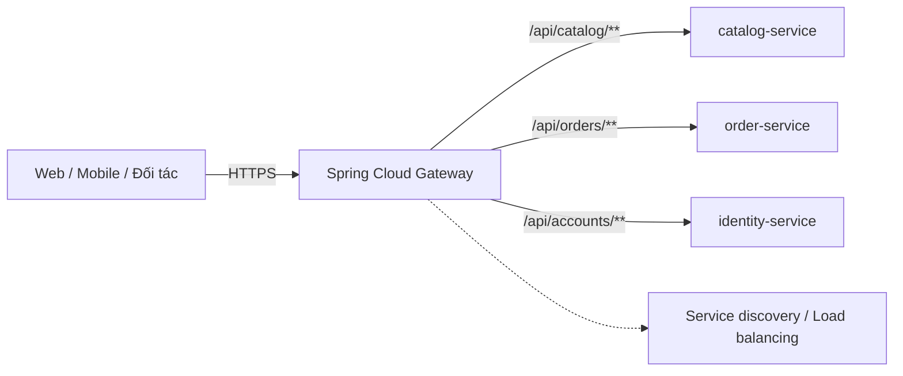
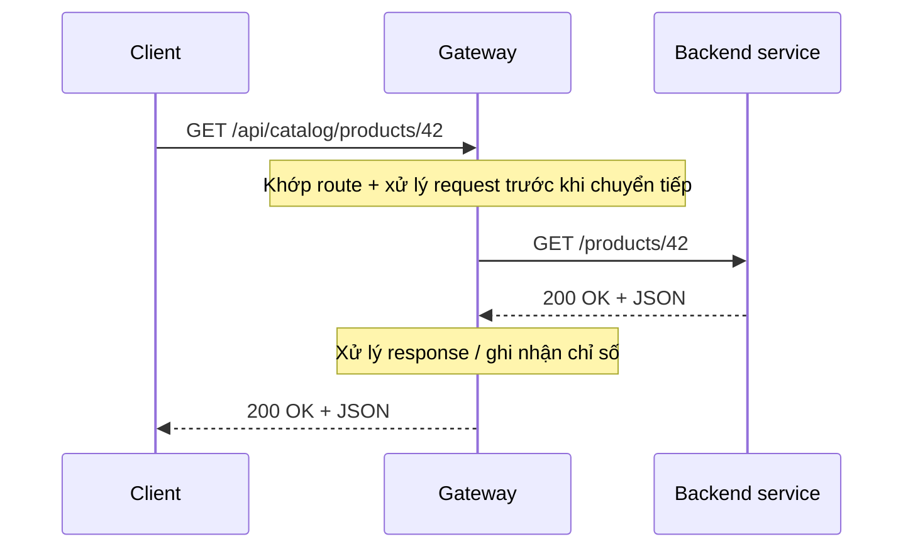

# Spring Cloud Gateway là gì và bài toán cổng vào API

Khi một ứng dụng chuyển từ kiến trúc nguyên khối sang microservices, một yêu cầu từ trình duyệt hoặc ứng dụng di động có thể cần đi qua nhiều dịch vụ: danh mục sản phẩm, giỏ hàng, đơn hàng, tài khoản và thanh toán. Nếu client phải biết địa chỉ của từng dịch vụ, mọi thay đổi trong hệ thống phía sau đều có nguy cơ ảnh hưởng đến client. **API Gateway** tạo ra một cổng vào thống nhất, tiếp nhận yêu cầu từ bên ngoài rồi định tuyến đến dịch vụ phù hợp.

**Spring Cloud Gateway** là thành phần trong hệ sinh thái Spring để xây dựng cổng vào đó. Nó cho phép mô tả quy tắc định tuyến bằng **route predicate**, xử lý yêu cầu và phản hồi bằng **filter chain**, thay đổi đường dẫn/header, kết hợp **service discovery**, đồng thời tích hợp các cơ chế bảo vệ và vận hành như xác thực, giới hạn lưu lượng, circuit breaker, retry, TLS và quan sát request.

Đây là bài mở đầu của chương **Tổng quan**: tập trung vào vấn đề mà gateway giải quyết, các khái niệm nền tảng và cách nhận diện trách nhiệm của gateway trong một kiến trúc microservices.

## 1. Vì sao hệ thống microservices cần một cổng vào?

Giả sử một ứng dụng bán hàng có các dịch vụ độc lập:

| Dịch vụ | Trách nhiệm chính | Địa chỉ nội bộ ví dụ |
| --- | --- | --- |
| `catalog-service` | Tra cứu sản phẩm, danh mục | `catalog-service:8080` |
| `order-service` | Tạo và tra cứu đơn hàng | `order-service:8080` |
| `identity-service` | Đăng nhập, thông tin tài khoản | `identity-service:8080` |

Nếu client kết nối trực tiếp đến từng dịch vụ, nó phải quản lý nhiều URL, cách xác thực, cách báo lỗi và phiên bản API. Khi `order-service` được nhân bản thành nhiều instance hoặc chuyển địa chỉ, client cũng phải có cách tìm được instance đang hoạt động. Ngoài ra, mỗi dịch vụ có thể phải tự triển khai các quy tắc kỹ thuật giống nhau như CORS, giới hạn yêu cầu và ghi log truy cập.

Các vấn đề thường gặp gồm:

1. **Phụ thuộc vào hạ tầng nội bộ:** client biết quá nhiều về tên dịch vụ, địa chỉ, cổng và cách triển khai.
2. **Chính sách không đồng nhất:** một API kiểm tra token hoặc giới hạn lưu lượng, API khác lại thiếu các bước đó.
3. **Bề mặt truy cập rộng:** nhiều dịch vụ phải mở endpoint trực tiếp ra bên ngoài, làm phức tạp việc kiểm soát truy cập.
4. **Khó theo dõi yêu cầu:** một lỗi ở phía client có thể liên quan đến nhiều dịch vụ nhưng thiếu điểm chung để ghi nhận độ trễ, mã trạng thái và mã tương quan.
5. **Thay đổi khó kiểm soát:** di chuyển dịch vụ, đổi đường dẫn hoặc tái cấu trúc backend có thể buộc nhiều client cập nhật.

API Gateway giải quyết phần lớn những vấn đề tại **ranh giới giữa client và backend** bằng cách công bố một địa chỉ API ổn định, ví dụ `https://api.example.com`, rồi áp dụng chính sách và chuyển tiếp yêu cầu đến đúng dịch vụ.



Trong sơ đồ, gateway là **điểm vào logic**; khi triển khai thực tế, có thể chạy nhiều instance gateway sau một load balancer để tránh một điểm lỗi duy nhất.

## 2. Spring Cloud Gateway thực chất là gì?

Spring Cloud Gateway là một **API gateway kiêm reverse proxy có khả năng lập trình**. Nó nhận HTTP request, tìm route phù hợp, chạy những bước xử lý được cấu hình và chuyển tiếp request đến upstream service. Sau khi upstream phản hồi, gateway có thể tiếp tục xử lý response trước khi trả về client.

Ba câu hỏi cốt lõi mà gateway trả lời:

- **Request này đi đâu?** Route và predicate quyết định dịch vụ đích.
- **Request/response cần đi qua những bước nào?** Filter áp dụng các xử lý như đổi path, sửa header, kiểm tra điều kiện hoặc ghi thông tin theo dõi.
- **Làm sao chuyển tiếp ổn định và an toàn?** Gateway tích hợp cơ chế tìm instance dịch vụ, bảo mật, kiểm soát lưu lượng và khả năng phục hồi khi upstream gặp sự cố.

Spring Cloud Gateway có các lựa chọn triển khai theo **Spring WebFlux** và **Spring Web MVC** trong những dòng phiên bản hỗ trợ tương ứng. WebFlux thường dùng mô hình xử lý bất đồng bộ, không chặn luồng để phục vụ nhiều request I/O; biến thể MVC vận hành trên ngăn xếp servlet. Vì API cấu hình, tên dependency và một số khả năng khác nhau giữa các dòng phiên bản, khi tạo dự án cần đối chiếu tài liệu đúng phiên bản Spring Boot/Spring Cloud đang sử dụng.

Gateway **không thay thế nghiệp vụ** của từng microservice: dịch vụ đơn hàng vẫn quyết định có thể đặt hàng hay không; dịch vụ thanh toán vẫn kiểm tra tính hợp lệ của giao dịch. Gateway chỉ nên xử lý các mối quan tâm tại ranh giới API và các quy tắc định tuyến, điều phối phù hợp.

### Gateway khác những thành phần dễ nhầm lẫn thế nào?

| Thành phần | Vai trò thường gặp | Quan hệ với Spring Cloud Gateway |
| --- | --- | --- |
| **Reverse proxy** | Nhận request và chuyển tiếp tới máy chủ phía sau | Gateway là một reverse proxy có thêm quy tắc route/filter và tích hợp hệ sinh thái Spring. |
| **Load balancer** | Phân phối lưu lượng giữa nhiều instance | Có thể đặt phía trước gateway; gateway cũng có thể chọn instance backend thông qua Spring Cloud LoadBalancer. |
| **Service discovery** | Đăng ký, tra cứu instance dịch vụ đang hoạt động | Gateway có thể dùng kết quả khám phá dịch vụ để giải quyết tên như `lb://catalog-service`. |
| **Ingress trong Kubernetes** | Công bố và điều hướng lưu lượng HTTP(S) vào cluster | Có thể đứng trước gateway; chức năng có phần giao nhau, cần phân định trách nhiệm để tránh cấu hình lặp. |
| **Service mesh** | Quản lý giao tiếp giữa các dịch vụ, thường gồm chính sách mạng và quan sát lưu lượng nội bộ | Gateway chủ yếu phục vụ lưu lượng đi vào và API dành cho client; mesh tập trung nhiều hơn vào giao tiếp service-to-service. |

Không phải dự án nào cũng cần tất cả các thành phần trên. Một hệ thống nhỏ có ít API có thể chỉ cần reverse proxy đơn giản; gateway phát huy lợi ích khi số dịch vụ, chính sách chung và yêu cầu thay đổi tăng lên.

## 3. Các khối xây dựng cốt lõi

Một route của Spring Cloud Gateway được tạo từ những thành phần sau:

| Khái niệm | Ý nghĩa | Ví dụ |
| --- | --- | --- |
| **Route** | Định nghĩa một tuyến: ID, địa chỉ đích, các predicate và filter liên quan. | `catalog-route` chuyển đến `catalog-service`. |
| **Route predicate** | Điều kiện để một request khớp route. Nhiều predicate trên cùng route thường phải đồng thời thỏa mãn. | Đường dẫn bắt đầu bằng `/api/catalog/`, phương thức `GET`. |
| **GatewayFilter** | Xử lý request/response trong phạm vi một route. | Bỏ prefix `/api/catalog`, thêm hoặc sửa header. |
| **GlobalFilter** | Filter áp dụng cho các route qua chuỗi lọc toàn cục của gateway. | Ghi nhận thông tin theo dõi chung, khi được cấu hình phù hợp. |
| **URI đích** | Địa chỉ upstream mà route chuyển tiếp đến. | `http://localhost:8081` hoặc `lb://catalog-service`. |
| **Filter chain** | Chuỗi filter thực thi trước và sau bước chuyển tiếp, theo thứ tự áp dụng. | Tiền xử lý request → gọi upstream → hậu xử lý response. |

### 3.1. Route predicate: yêu cầu nào được chọn?

Predicate có thể dựa trên path, host, HTTP method, header, query parameter hoặc các điều kiện khác. Ví dụ:

- `Path=/api/catalog/**`: nhận các yêu cầu thuộc API danh mục.
- `Method=GET`: chỉ khớp yêu cầu GET.
- `Header=X-Client-Type, mobile`: khớp khi header có giá trị phù hợp với biểu thức được cấu hình.

Khi kết hợp `Path` và `Method` trên cùng một route, một yêu cầu `POST /api/catalog/products` sẽ không khớp route chỉ dành cho `GET`. Nếu nhiều route có thể cùng khớp, **thứ tự/độ ưu tiên route** cần được thiết kế rõ ràng để tránh chuyển tiếp nhầm dịch vụ.

Không khớp route thường dẫn đến `404 Not Found` nếu không có handler khác nhận request. Nhưng khi đã khớp route mà backend gặp sự cố, mã lỗi sẽ phụ thuộc vào kết quả chuyển tiếp và các filter đang bật; không nên mặc định mọi lỗi đều là 404.

### 3.2. Filter chain: gateway xử lý những gì?

Filter có thể can thiệp cả trước và sau khi gọi upstream:



Ví dụ những việc filter có thể thực hiện:

- **`StripPrefix`:** cắt một số phân đoạn đầu tiên của path.
- **`RewritePath`:** viết lại path theo biểu thức và quy tắc thay thế.
- **`SetRequestHeader` / `AddRequestHeader`:** đặt hoặc bổ sung header gửi tới upstream.
- **`RemoveRequestHeader` / `RemoveResponseHeader`:** loại bỏ header không nên truyền tiếp hoặc công bố.
- **`RequestRateLimiter`, `CircuitBreaker`, `Retry`:** áp dụng chính sách kiểm soát lưu lượng và khả năng phục hồi khi đã cài các tích hợp cần thiết.

Trong filter chain, việc xử lý trước và sau khi gọi backend có thứ tự riêng. Nếu tự viết filter, phải hiểu thứ tự này và không làm nghẽn luồng xử lý bằng công việc blocking, đặc biệt trong biến thể WebFlux.

## 4. Ví dụ định tuyến đầu tiên

Giả sử client gọi:

```http
GET https://api.example.com/api/catalog/products/42
```

Ta muốn dịch vụ danh mục nhận path ngắn hơn:

```http
GET http://catalog-service:8080/products/42
```

Một cách định nghĩa route trong ứng dụng gateway dùng Spring Cloud Gateway Server WebFlux là khai báo bằng Java DSL:

```java
import org.springframework.cloud.gateway.route.RouteLocator;
import org.springframework.cloud.gateway.route.builder.RouteLocatorBuilder;
import org.springframework.context.annotation.Bean;
import org.springframework.context.annotation.Configuration;

@Configuration
public class GatewayRoutes {
    @Bean
    RouteLocator apiRoutes(RouteLocatorBuilder builder) {
        return builder.routes()
            .route("catalog-route", route -> route
                .path("/api/catalog/**")
                .filters(filters -> filters
                    .stripPrefix(2)
                    .setRequestHeader("X-Edge-Source", "gateway"))
                .uri("lb://catalog-service"))
            .build();
    }
}
```

Giải thích từng phần:

1. `catalog-route` là ID dùng để nhận biết route.
2. `path("/api/catalog/**")` chọn request có path tương ứng.
3. `stripPrefix(2)` loại bỏ **hai phân đoạn** đầu: `api` và `catalog`; vì vậy `/api/catalog/products/42` trở thành `/products/42`.
4. `setRequestHeader(...)` đặt header `X-Edge-Source` trước khi chuyển tiếp. Header tùy biến này chỉ hỗ trợ quan sát/ngữ cảnh; **không dùng nó làm bằng chứng xác thực** vì cần có cơ chế tin cậy giữa gateway và backend.
5. `lb://catalog-service` yêu cầu gateway chọn instance của dịch vụ theo tên logic. Cần có Spring Cloud LoadBalancer cùng nguồn thông tin instance phù hợp, chẳng hạn cơ chế service discovery; chỉ viết `lb://` không tự động tạo được registry.

| Request từ client | Path backend nhận sau `stripPrefix(2)` |
| --- | --- |
| `GET /api/catalog/products` | `GET /products` |
| `GET /api/catalog/products/42` | `GET /products/42` |
| `GET /api/catalog/categories?active=true` | `GET /categories?active=true` |

Nếu chưa cấu hình service discovery/load balancing, trong môi trường thực hành có thể dùng URI cố định như `http://localhost:8081` để thử route, với điều kiện backend thật sự đang chạy ở địa chỉ đó. URL và cổng trong ví dụ chỉ có tính minh họa.

Ví dụ kiểm tra thủ công khi gateway phát triển chạy ở `localhost:8080`:

```bash
curl -i http://localhost:8080/api/catalog/products/42
```

Kết quả mong đợi là request được chuyển đến endpoint `/products/42` của backend. Mã trạng thái và body thực tế tùy thuộc backend, không phải do đoạn route tự sinh ra.

> **Lưu ý về phiên bản:** Những bản Spring Cloud Gateway khác nhau có thể dùng tên starter và tiền tố cấu hình YAML khác nhau. Java DSL ở đây minh họa khái niệm định tuyến của biến thể WebFlux; khi triển khai cần chọn các dependency tương thích với phiên bản Spring Boot và Spring Cloud của dự án.

## 5. Luồng đi của một HTTP request

Xét request `GET /api/catalog/products/42` khi hệ thống đã được cấu hình hoàn chỉnh:

1. **Client kết nối đến địa chỉ công khai.** Kết nối HTTPS thường được kết thúc ở load balancer, ingress hoặc tại gateway, tùy topology TLS.
2. **Lớp bảo mật kiểm tra request.** Ví dụ, Spring Security có thể xác thực JWT trước khi yêu cầu được phép đi tiếp; request không hợp lệ có thể bị từ chối ngay tại đây.
3. **Gateway tìm route phù hợp.** Các predicate xác định request thuộc `catalog-route`.
4. **Các filter xử lý request.** Gateway có thể giới hạn tốc độ, chuẩn hóa header hoặc chuyển `/api/catalog/products/42` thành `/products/42`.
5. **Gateway xác định instance upstream.** Với `lb://catalog-service`, cơ chế load balancing lấy danh sách instance khả dụng từ nguồn cấu hình hoặc discovery rồi chọn một instance.
6. **Request được chuyển tiếp.** Backend nhận request với method, path, body và các header đã qua xử lý.
7. **Response quay về qua gateway.** Những bước hậu xử lý có thể cập nhật header, hoàn thành trace/metric và trả response cho client.

Các bước trên mô tả luồng logic; thứ tự chi tiết phụ thuộc vào security chain, filter order, giao thức và cách triển khai. Chẳng hạn, kiểm tra bảo mật bằng Spring Security không đồng nghĩa với một `GatewayFilter` của route.

## 6. Những bài toán gateway thường đảm nhiệm

### 6.1. Ẩn topology và khám phá dịch vụ

Client gọi `api.example.com` thay vì phụ thuộc trực tiếp vào hostname hoặc IP backend. Khi một dịch vụ tăng từ một lên nhiều instance, backend discovery/load balancer có thể cập nhật nơi chuyển tiếp mà client không phải đổi endpoint công khai. Nếu discovery không tìm thấy instance, gateway cần báo lỗi phù hợp và hệ thống theo dõi phải phát hiện tình trạng này.

### 6.2. Chuẩn hóa URL, header và quy ước API

Gateway có thể gộp các API theo tiền tố dễ hiểu:

| API công khai | Dịch vụ đích | Ví dụ xử lý |
| --- | --- | --- |
| `/api/catalog/**` | `catalog-service` | Bỏ `/api/catalog`. |
| `/api/orders/**` | `order-service` | Bỏ `/api/orders`. |
| `/api/accounts/**` | `identity-service` | Viết lại path theo contract được công bố. |

Điều này giúp backend thay đổi cấu trúc nội bộ mà không buộc client biết chi tiết. Tuy nhiên, **hợp đồng API công khai** vẫn cần quản lý phiên bản và tính tương thích; gateway không tự làm cho một thay đổi phá vỡ API trở nên an toàn.

### 6.3. Xác thực và phân quyền

Gateway là vị trí thuận tiện để từ chối sớm những request thiếu thông tin xác thực hoặc token không hợp lệ. Với hệ Spring, có thể dùng Spring Security và OAuth 2.0 Resource Server để xác minh JWT bằng issuer, chữ ký, thời hạn và những claim cần thiết. CORS, chính sách truy cập theo route và loại bỏ header nhạy cảm cũng thường được đặt tại ranh giới này.

**Không dồn toàn bộ phân quyền vào gateway.** Ví dụ: gateway có thể biết user đã đăng nhập và có quyền gọi `/api/orders/**`, nhưng chỉ `order-service` mới có đủ ngữ cảnh để quyết định user được xem **đơn hàng cụ thể nào**. Backend vẫn phải kiểm tra quyền theo tài nguyên và không được mặc định tin dữ liệu danh tính do client tự gửi qua header.

### 6.4. Rate limiting và bảo vệ trước lưu lượng tăng đột biến

Gateway có thể áp dụng hạn mức request theo user, API key, IP hoặc đối tượng khác tùy cách xác định khóa. Trong Spring Cloud Gateway, `RequestRateLimiter` có thể kết hợp một bộ giới hạn như RedisRateLimiter cùng `KeyResolver` phù hợp. Khi vượt hạn mức, hệ thống thường trả về `429 Too Many Requests`.

Giới hạn lưu lượng giúp bảo vệ backend khỏi truy cập quá mức; nó không thay thế cơ chế chống DDoS ở tầng mạng, CDN hay dịch vụ bảo vệ ngoài biên. Cần lưu ý địa chỉ IP thực của client khi có proxy đứng trước và chỉ tin header chuyển tiếp từ các proxy được kiểm soát.

### 6.5. Circuit breaker, timeout và retry

Khi backend chậm hoặc mất kết nối, gateway cần ngừng giữ tài nguyên quá lâu và hạn chế khuếch đại lỗi:

| Cơ chế | Mục đích | Điều cần chú ý |
| --- | --- | --- |
| **Timeout** | Chặn thời gian chờ kết nối/đọc response vượt ngưỡng. | Xác định ngân sách thời gian theo đường đi của request. |
| **Circuit breaker** | Tạm ngừng gọi upstream có tỷ lệ lỗi cao và có thể trả fallback phù hợp. | Cần tích hợp/cấu hình triển khai tương ứng, chẳng hạn Resilience4j qua Spring Cloud CircuitBreaker. |
| **Retry** | Thử lại khi gặp điều kiện lỗi đã chọn. | Chỉ retry khi an toàn về ngữ nghĩa, có giới hạn số lần và kiểm soát tổng thời gian. |

Đặc biệt, **không retry tùy tiện các request thay đổi trạng thái** như `POST /payments` hoặc tạo đơn hàng: lần gọi đầu có thể đã thành công ở backend dù phản hồi bị mất, khiến retry tạo giao dịch trùng. Với những thao tác này cần thiết kế idempotency key và cơ chế xử lý phù hợp ở backend trước khi xem xét retry.

### 6.6. TLS và bảo vệ biên mạng

Gateway có thể tham gia tiếp nhận HTTPS, chuyển tiếp HTTPS tới upstream, chuẩn hóa redirect và cấu hình chứng chỉ. Có hệ thống kết thúc TLS ở ingress/load balancer rồi dùng kênh riêng đến gateway; hệ thống khác duy trì TLS ở nhiều chặng. Phải biết rõ TLS được kết thúc ở đâu và đâu là mạng đáng tin cậy.

Không chuyển tiếp nguyên trạng các header mang ý nghĩa bảo mật từ client chưa được xác thực. Những header như `Forwarded`, `X-Forwarded-For`, `X-Forwarded-Proto` cần được xử lý theo cấu hình proxy đáng tin cậy; nếu không, client có thể giả mạo thông tin nguồn.

### 6.7. Quan sát request và truy vết lỗi

Tại gateway, đội vận hành thường muốn quan sát:

- Số request, tỷ lệ lỗi, mã trạng thái và độ trễ theo route.
- Request bị từ chối do xác thực, phân quyền hoặc giới hạn lưu lượng.
- Tỷ lệ timeout, lần retry, circuit breaker mở và lỗi kết nối upstream.
- Mã trace/correlation để lần theo một request từ gateway sang các dịch vụ.

Có thể kết hợp Micrometer, hệ thống metrics và tracing của Spring cùng nền tảng quan sát như Prometheus, Grafana hoặc OpenTelemetry tùy kiến trúc. Nên ghi route ID và metadata an toàn, **không log token, mật khẩu, dữ liệu thanh toán hoặc toàn bộ body nhạy cảm**. Khi chọn nhãn metrics, hạn chế các giá trị có số lượng biến thể rất lớn như từng user ID hoặc URL chứa ID ngẫu nhiên.

## 7. Gateway nên làm gì và không nên làm gì?

| Nên đặt tại gateway | Nên đặt tại microservice |
| --- | --- |
| Công bố và định tuyến các endpoint công khai. | Xử lý nghiệp vụ và kiểm tra quy tắc miền dữ liệu. |
| Xác thực đầu vào chung, chính sách truy cập ở ranh giới. | Kiểm tra quyền sở hữu tài nguyên và phân quyền chi tiết. |
| Thay đổi path/header phục vụ contract API. | Quản lý dữ liệu, giao dịch và tính nhất quán nghiệp vụ. |
| Rate limit, timeout, bảo vệ và theo dõi ở điểm vào. | Bảo vệ tài nguyên, idempotency và cơ chế phục hồi bên trong. |
| Chuyển tiếp request tới instance phù hợp. | Quyết định kết quả nghiệp vụ và trả lỗi miền rõ nghĩa. |

Tránh đưa hàng loạt xử lý phức tạp như truy vấn dữ liệu khách hàng, tính giá hoặc cập nhật đơn hàng vào filter. Điều đó khiến gateway phụ thuộc vào nhiều miền nghiệp vụ, khó mở rộng độc lập và khó kiểm thử. Khi client cần một endpoint tổng hợp nhiều dịch vụ, có thể cân nhắc một lớp **Backend for Frontend (BFF)** hoặc dịch vụ tổng hợp API chuyên trách.

## 8. Ví dụ thiết kế cho một ứng dụng thương mại điện tử

Giả sử hệ thống có web, mobile, ba dịch vụ nghiệp vụ và một gateway. Một thiết kế ban đầu có thể như sau:

1. Client chỉ gọi domain API công khai `https://api.shop.example`.
2. Gateway phân tuyến `/api/catalog/**` sang `catalog-service`, `/api/orders/**` sang `order-service`, `/api/accounts/**` sang `identity-service`.
3. Endpoint xem sản phẩm có thể cho phép truy cập công khai nhưng áp dụng rate limit phù hợp; endpoint xem đơn hàng yêu cầu access token hợp lệ.
4. `order-service` tiếp tục xác minh người gọi có quyền truy cập từng đơn hàng và xử lý idempotency khi tạo đơn.
5. Gateway đặt timeout, chỉ retry những tình huống có thể retry an toàn và xuất metrics/trace cho từng route.
6. Gateway được chạy nhiều instance; phía trước có load balancer hoặc ingress với TLS và kiểm tra sức khỏe.

Thiết kế này giúp frontend có một contract tương đối ổn định và tập trung chính sách bảo vệ chung. Giao tiếp nội bộ giữa các microservice vẫn có thể đi theo đường riêng trong mạng tin cậy nếu kiến trúc yêu cầu, thay vì buộc mọi cuộc gọi nội bộ đi vòng qua gateway công khai.

### Các tình huống cần xử lý trước khi đưa vào production

| Tình huống | Mong muốn vận hành |
| --- | --- |
| Client gọi path không được công bố | Không chuyển tiếp nhầm; trả lỗi route phù hợp. |
| Token sai hoặc hết hạn | Từ chối trước khi request chạm đến API được bảo vệ. |
| Lượt gọi vượt quota | Giới hạn request theo khóa và chính sách đã định; trả phản hồi rõ ràng. |
| Một instance backend chết | Chọn instance còn hoạt động nếu có; theo dõi lỗi và sức khỏe upstream. |
| Backend chậm hoặc quá tải | Timeout/circuit breaker phù hợp; tránh retry làm quá tải thêm. |
| Gateway instance bị lỗi | Còn instance khác để nhận traffic; giám sát khả năng sẵn sàng của gateway. |
| Trace đi qua nhiều dịch vụ | Mang theo trace context và liên kết dữ liệu quan sát trên toàn chuỗi. |

## 9. Những hiểu nhầm thường gặp

**“Có gateway thì backend không cần bảo mật nữa.”** Sai. Gateway giúp kiểm tra tập trung ở biên, nhưng backend phải duy trì phân quyền nghiệp vụ, kiểm soát đầu vào và bảo vệ các đường truy cập nội bộ.

**“Route được đến dịch vụ là đã có service discovery.”** Sai. Route dùng URI cố định không cần registry; URI `lb://...` lại đòi hỏi hạ tầng load balancing và nguồn instance tương thích.

**“Bật retry luôn giúp hệ thống ổn định hơn.”** Sai. Retry không giới hạn có thể nhân tải lên và tạo tác dụng phụ cho các lệnh ghi. Cần xem xét tính idempotent, timeout và ngân sách retry.

**“API Gateway giúp microservices tự động nhanh hơn.”** Sai. Nó tạo thêm một chặng mạng và chi phí xử lý. Lợi ích là khả năng quản lý tập trung và tách biệt client/backend; tốc độ phụ thuộc cấu hình, hạ tầng và tải thực tế.

**“Dùng gateway thì không cần ingress, load balancer hay service mesh.”** Không nhất thiết. Các thành phần có thể bổ sung cho nhau; trách nhiệm cần được phân định rõ để tránh lặp việc và tạo cấu hình khó bảo trì.

## 10. Kiểm tra mức hiểu bài

Hãy tự trả lời ba câu sau trước khi học sâu về từng predicate/filter:

1. Vì sao một ứng dụng có nhiều microservice thường muốn cung cấp một domain API chung cho client?
2. Trong route `/api/catalog/**`, predicate quyết định điều gì, `stripPrefix(2)` thay đổi điều gì và `lb://catalog-service` thực hiện vai trò gì?
3. Vì sao xác thực token tại gateway không đủ để đảm bảo một người dùng chỉ xem được đơn hàng của chính họ?

Nếu giải thích được **điều kiện chọn route**, **các bước xử lý qua filter** và **ranh giới trách nhiệm giữa gateway với backend**, bạn đã có nền tảng để đi tiếp đến cấu hình route predicate, biến đổi path/header, service discovery và các chính sách vận hành nâng cao của Spring Cloud Gateway.
