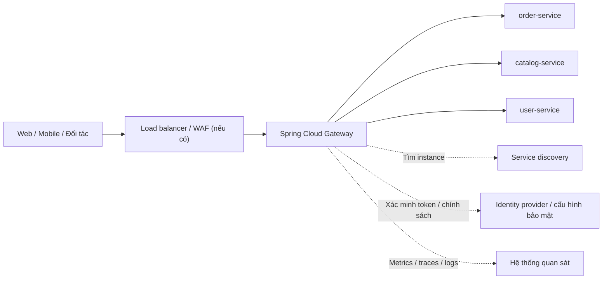
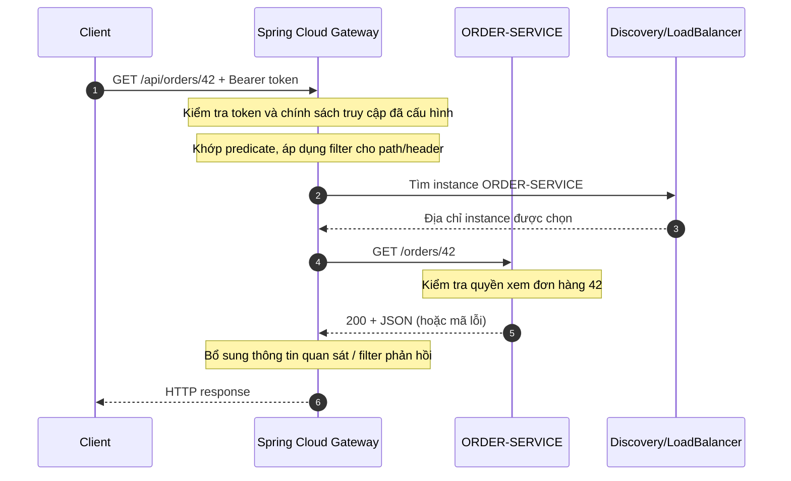

# Vai trò của gateway trong kiến trúc microservices

## 1. Bối cảnh: Vì sao microservices cần một điểm vào chung?

Trong kiến trúc microservices, một ứng dụng được chia thành nhiều dịch vụ có trách nhiệm riêng, chẳng hạn `catalog-service`, `order-service`, `payment-service` và `user-service`. Mỗi dịch vụ có thể được triển khai, mở rộng và thay đổi địa chỉ mạng độc lập. Nếu ứng dụng web hoặc mobile gọi trực tiếp từng dịch vụ, phía client phải biết nhiều địa chỉ, xử lý nhiều cơ chế xác thực, tự theo dõi thay đổi hạ tầng và phụ thuộc vào cấu trúc nội bộ của hệ thống.

**API Gateway** là thành phần nằm ở ranh giới tiếp nhận request của hệ thống, cung cấp một điểm truy cập thống nhất và chuyển request đến dịch vụ thích hợp. Trong hệ sinh thái Spring, **Spring Cloud Gateway** giúp hiện thực mô hình này thông qua **route**, **predicate** (điều kiện khớp route), **filter** (xử lý request/response) và tích hợp với khám phá dịch vụ, bảo mật, khả năng chịu lỗi, đo lường.

Ví dụ, client chỉ biết `https://api.example.com`:

| Request từ client | Dịch vụ đích | Ý nghĩa |
| --- | --- | --- |
| `GET /api/products/18` | `catalog-service` | Lấy thông tin sản phẩm |
| `GET /api/orders/42` | `order-service` | Xem đơn hàng |
| `POST /api/payments` | `payment-service` | Khởi tạo thanh toán |

Client không cần biết `order-service` hiện có bao nhiêu instance hoặc đang chạy trên máy nào. Gateway tiếp nhận URL công khai, chọn route và chuyển tiếp tới địa chỉ phù hợp.

### Sơ đồ vị trí của gateway



Trong sơ đồ, gateway là điểm vào **cho những luồng API đi qua nó**, không nhất thiết là thành phần duy nhất ở biên mạng: hệ thống thực tế còn có thể dùng DNS, CDN, WAF, ingress hoặc load balancer ở phía trước. Giao tiếp nội bộ giữa các service cũng không bắt buộc phải đi vòng qua gateway.

## 2. Các vai trò cốt lõi của API Gateway

### 2.1. Định tuyến request và che giấu topology nội bộ

Gateway phân tích request theo các điều kiện như đường dẫn, HTTP method, host hoặc header, rồi chọn dịch vụ đích. Ví dụ:

- `/api/orders/**` được chuyển tới dịch vụ đơn hàng.
- `/api/products/**` được chuyển tới dịch vụ danh mục.
- Một route có thể chỉ chấp nhận `GET` hoặc `POST`.

Khi kết hợp **service discovery** và **Spring Cloud LoadBalancer**, URI có dạng `lb://ORDER-SERVICE` có thể được phân giải thành một instance khả dụng của `ORDER-SERVICE`. Nhờ vậy, client không phụ thuộc trực tiếp vào IP/port của từng instance; gateway vẫn cần được cấu hình phù hợp để tra cứu và cân bằng tải.

**Giới hạn cần hiểu:** gateway có thể ẩn vị trí dịch vụ, nhưng API công khai vẫn là hợp đồng với client. Thay đổi tên trường, mã lỗi hoặc ý nghĩa endpoint vẫn cần quản lý phiên bản và tương thích.

### 2.2. Áp dụng chính sách chung tại điểm vào

Gateway là nơi thuận tiện để tập trung những chính sách dùng chung:

| Nhu cầu | Xử lý thường gặp tại gateway | Điều cần lưu ý |
| --- | --- | --- |
| Xác thực | Kiểm tra access token trước khi chuyển request | Phải cấu hình bảo mật thực sự; định tuyến đơn thuần không tự xác thực |
| Giới hạn lưu lượng | Giới hạn số request theo client, tài khoản hoặc API key | Xác định khóa giới hạn từ nguồn danh tính đáng tin cậy |
| TLS | Cung cấp HTTPS ở phía client và cấu hình kết nối an toàn đến upstream khi cần | Kết thúc TLS ở gateway không mặc nhiên mã hóa mọi chặng nội bộ |
| CORS | Phản hồi chính sách cross-origin cho ứng dụng trình duyệt | CORS không thay thế xác thực và phân quyền |
| Chỉnh sửa request | Thêm/xóa header, viết lại hoặc rút gọn path | Tránh dựa vào header do client tự gửi như một bằng chứng danh tính |
| Khả năng chịu lỗi | Timeout, circuit breaker, retry có kiểm soát | Retry có thể nhân tải và tạo tác dụng phụ ở request ghi dữ liệu |
| Quan sát | Ghi metrics, trace ID, log phù hợp | Tránh ghi token, mật khẩu hay dữ liệu cá nhân nhạy cảm |

Tập trung chính sách tại gateway giúp giảm lặp lại ở nhiều service và mang lại hành vi nhất quán cho người dùng. Tuy nhiên, **service đích vẫn cần kiểm tra quyền nghiệp vụ**. Ví dụ, gateway có thể xác thực người dùng đã đăng nhập nhưng `order-service` vẫn phải kiểm tra người đó có quyền xem đơn hàng số 42 hay không.

### 2.3. Biến đổi giao diện công khai và giao diện nội bộ

Đường dẫn công khai có thể được thiết kế ổn định, dễ sử dụng hơn địa chỉ nội bộ:

```text
Client:   GET /api/orders/42
Gateway:  StripPrefix=1
Upstream: GET /orders/42  -> order-service
```

Gateway cũng có thể chuẩn hóa một số header, gắn request ID hoặc bổ sung header phục vụ vận hành. Những thao tác này hữu ích khi di chuyển hệ thống hoặc chuẩn hóa API. Dù vậy, gateway không nên chứa các quy tắc nghiệp vụ phức tạp hoặc biến thành nơi gom toàn bộ logic của các service.

### 2.4. Tạo một điểm quan sát lưu lượng API

Vì đi qua các luồng request từ client, gateway có góc nhìn phù hợp để đo:

- Lưu lượng theo route, HTTP status và nhóm client.
- Độ trễ ở gateway và thời gian chuyển tiếp tới upstream.
- Tỷ lệ lỗi `4xx`/`5xx`, request bị rate limit và timeout.
- Trace xuyên qua gateway và dịch vụ đích nhờ correlation/trace ID.

Metrics, logs và distributed tracing giúp phân biệt lỗi do định tuyến, giới hạn lưu lượng, kết nối tới upstream hay chính service đích. Cần giới hạn nhãn có độ phân biệt quá cao: thay vì gắn metric cho từng `/orders/42`, hãy dùng tên route hoặc mẫu `/orders/{id}`.

## 3. Spring Cloud Gateway hiện thực vai trò này như thế nào?

Ba khái niệm là nền tảng khi đọc cấu hình gateway:

| Khái niệm | Trả lời câu hỏi | Ví dụ |
| --- | --- | --- |
| **Route** | Request sẽ được chuyển đến đâu? | `uri: lb://ORDER-SERVICE` |
| **Predicate** | Request nào được chọn vào route? | `Path=/api/orders/**`, `Method=GET,POST` |
| **Filter** | Request/response sẽ được xử lý như thế nào? | `StripPrefix=1`, thêm header, xác thực/rate limit thông qua các cơ chế cấu hình tương ứng |

Ở biến thể **Spring Cloud Gateway Server WebFlux**, đường đi tổng quát là:

1. Gateway nhận HTTP request; hệ thống xác định route có các predicate phù hợp.
2. Chuỗi filter được áp dụng cho request đã khớp route. Filter có thể chỉnh path/header, kiểm tra điều kiện hoặc dừng request với response phù hợp.
3. Gateway chuyển tiếp request đến upstream đã xác định, có thể qua cơ chế load balancing.
4. Response từ upstream đi ngược qua phần xử lý sau của filter rồi trả về client.

Filter cấp route và global filter cùng tham gia chuỗi xử lý, có thứ tự thực thi; phần xử lý sau (post) chạy theo chiều ngược với các phần xử lý trước (pre) khi filter thiết kế theo mô hình này. Cấu hình thứ tự filter ảnh hưởng đến việc một header, một bản ghi log hoặc một chính sách nhìn thấy request ở trạng thái nào.

Spring Cloud Gateway cũng có biến thể **Server MVC**; dependency, cách cấu hình và cơ chế xử lý của biến thể này khác WebFlux. Khi triển khai, hãy chọn đúng biến thể và đối chiếu tài liệu theo phiên bản Spring Cloud đang sử dụng.

### Ví dụ cấu hình route cơ bản

Đoạn dưới minh họa kiểu cấu hình `spring.cloud.gateway.routes` thường gặp với **Spring Cloud Gateway Server WebFlux 4.x**:

```yaml
spring:
  cloud:
    gateway:
      routes:
        - id: order-route
          uri: lb://ORDER-SERVICE
          predicates:
            - Path=/api/orders/**
            - Method=GET,POST
          filters:
            - StripPrefix=1
            - AddRequestHeader=X-Gateway-Source, spring-cloud-gateway
```

Giả sử service `ORDER-SERVICE` có endpoint `GET /orders/42`, khi gửi:

```http
GET /api/orders/42 HTTP/1.1
Host: api.example.com
```

Gateway sẽ khớp `Path` và `Method`, bỏ một thành phần đầu của đường dẫn (`/api`), rồi chuyển `GET /orders/42` đến một instance của `ORDER-SERVICE`. Với URI `lb://...`, ứng dụng cần có thành phần load balancing và nguồn instance phù hợp (service registry/discovery hoặc cấu hình instance).

Ví dụ trên chỉ minh họa **routing và filter biến đổi request**. Nó **chưa** tự cấu hình xác thực JWT, phân quyền, rate limit, circuit breaker hoặc TLS. Header `X-Gateway-Source` chỉ dùng để minh họa biến đổi; nếu dùng header làm dấu hiệu tin cậy giữa các service, phải loại bỏ giá trị giả mạo từ client và thiết lập ranh giới tin cậy rõ ràng.

> **Lưu ý về phiên bản:** khóa cấu hình, starter và API có thể thay đổi giữa các thế hệ Spring Cloud Gateway (đặc biệt khi chuyển giữa WebFlux và Server MVC). Kiểm tra tài liệu chính thức phù hợp với phiên bản dự án trước khi sao chép cấu hình vào môi trường thật.

## 4. Dòng chảy request thực tế: Xem một đơn hàng

Giả sử người dùng truy cập `GET https://api.example.com/api/orders/42` với access token. Một thiết kế gateway đầy đủ có thể xử lý theo luồng sau:



Cần phân biệt **các bước có thể được cấu hình** và **hành vi mặc định**: việc kiểm tra token, giới hạn lưu lượng, thiết lập timeout hoặc ghi trace chỉ xảy ra khi các thành phần và chính sách liên quan được bật. Route cơ bản trong mục 3 không thực hiện tất cả các bước trên.

Một số kết quả có thể gặp:

| Tình huống | Phản hồi thường thấy | Nơi cần kiểm tra |
| --- | --- | --- |
| Không có route phù hợp | `404 Not Found` | Predicate, path, method |
| Thiếu hoặc token không hợp lệ khi bảo mật đã bật | `401 Unauthorized` | Cấu hình xác thực, issuer/JWK, token |
| Người dùng không đủ quyền | `403 Forbidden` | Chính sách phân quyền ở gateway/service |
| Vượt quota của bộ giới hạn lưu lượng | `429 Too Many Requests` | Rate limiter, key resolver, quota |
| Không tìm được upstream khả dụng | Có thể `503 Service Unavailable` | Discovery, health, LoadBalancer |
| Upstream chậm hoặc không phản hồi | Lỗi timeout/`5xx` tùy cấu hình | Timeout, kết nối, circuit breaker |

Các mã trạng thái ở bảng mang tính minh họa phổ biến. Mã thực tế phụ thuộc cấu hình, ngoại lệ, handler và hệ thống phía trước gateway.

## 5. Gateway hỗ trợ an toàn và khả năng chịu lỗi ra sao?

### Xác thực và phân quyền

Với API yêu cầu đăng nhập, Gateway có thể tích hợp **Spring Security** để kiểm tra JWT theo mô hình OAuth2 Resource Server, hoặc sử dụng cơ chế xác thực thích hợp khác. Việc kiểm tra thường bao gồm chữ ký, thời hạn, issuer và các claim cần thiết theo chính sách. Nếu có nhiều loại endpoint, route công khai và route bảo vệ cần được quy định rõ.

Tuy nhiên, một token hợp lệ không chứng minh người dùng có quyền thao tác mọi tài nguyên. Ví dụ `GET /orders/42` cần kiểm tra đơn hàng 42 thuộc người gọi hoặc họ có quyền quản trị phù hợp. Không nên xem việc đi qua gateway là bằng chứng rằng mọi request nội bộ đều đáng tin; service cần xác thực/phân quyền phù hợp với mô hình bảo mật đã chọn.

### Giới hạn lưu lượng

Rate limiting bảo vệ hệ thống khi client gọi quá nhiều request hoặc lưu lượng tăng đột biến. Spring Cloud Gateway có filter `RequestRateLimiter`; một cách triển khai phổ biến là Redis rate limiter, kết hợp `KeyResolver` để chọn khóa theo người dùng hoặc client. Một khóa lấy trực tiếp từ header tùy ý của client có thể bị giả mạo và làm vô hiệu chính sách. Quota nên phân biệt endpoint nhạy cảm, client thường và client có cam kết SLA nếu sản phẩm yêu cầu.

### Circuit breaker, timeout và retry

- **Timeout** giới hạn thời gian chờ để request không giữ tài nguyên vô hạn.
- **Circuit breaker** tạm ngừng gửi request đến upstream lỗi liên tục, giúp giảm lỗi dây chuyền và có thể trả fallback được thiết kế trước.
- **Retry** thử lại một số lỗi tạm thời, nhưng phải được giới hạn số lần và thời gian; nên cân nhắc backoff và khả năng quá tải.

Retry đặc biệt cần thận trọng với `POST /payments` hoặc thao tác tạo đơn hàng: request có thể đã thành công ở upstream dù gateway chưa nhận được response. Lặp lại request mà không có cơ chế idempotency có thể tạo giao dịch trùng. Ngay cả với `GET`, retry quá nhiều khi upstream quá tải có thể làm tình hình xấu hơn.

### TLS và ranh giới tin cậy

HTTPS giữa client và gateway bảo vệ kết nối ngoài. Ở các hệ thống có yêu cầu an toàn cao, xem xét HTTPS/mTLS giữa gateway và upstream hoặc kiểm soát lưu lượng qua hạ tầng nội bộ. Cần xác định rõ nơi kết thúc TLS, ai được phép gọi trực tiếp service và header chuyển tiếp nào được coi là đáng tin. Các header liên quan IP gốc hoặc định danh, như `X-Forwarded-For`, không nên được tin tưởng mù quáng khi có thể bị client tự tạo.

## 6. Gateway khác gì với các thành phần gần nó?

| Thành phần | Nhiệm vụ điển hình | Quan hệ với API Gateway |
| --- | --- | --- |
| **Load balancer L4/L7** | Phân phối kết nối/request đến các instance | Có thể đứng trước gateway hoặc được gateway sử dụng để chọn instance service |
| **Ingress controller** | Đưa HTTP(S) từ bên ngoài vào workload trong Kubernetes | Có thể đáp ứng routing cơ bản; gateway bổ sung các chính sách API tùy nhu cầu |
| **API Gateway** | Định tuyến API, chính sách tại điểm vào, biến đổi và quan sát request | Là điểm vào được thiết kế theo hợp đồng API công khai |
| **Service mesh** | Quản trị giao tiếp service-to-service như mTLS, traffic policy, telemetry | Bổ trợ gateway; thường xử lý lưu lượng nội bộ sâu hơn |
| **Backend for Frontend (BFF)** | Tạo API tối ưu cho một loại giao diện, có thể tổng hợp dữ liệu | Có thể đặt sau gateway hoặc hợp nhất một số vai trò trong ứng dụng nhỏ |

Không phải hệ thống nào cũng cần đủ tất cả thành phần. Với vài service và ít chính sách, ingress hoặc reverse proxy có thể đã phù hợp. Khi có nhiều client, nhiều service và nhu cầu kiểm soát API tập trung, gateway mang lại lợi ích rõ hơn.

## 7. Các đánh đổi và nguyên tắc thiết kế

Một gateway chung cũng trở thành điểm tập trung tải và rủi ro. Cần chuẩn bị kiến trúc vận hành tương xứng:

1. **Tránh điểm lỗi đơn:** chạy nhiều replica gateway sau load balancer, có health check và chiến lược triển khai an toàn; theo dõi giới hạn kết nối và tài nguyên.
2. **Không đưa nghiệp vụ vào gateway:** route, chính sách kỹ thuật và biến đổi đơn giản nên ở gateway; quy tắc tính giá, kiểm tra quyền sở hữu, cập nhật trạng thái đơn hàng nên ở service tương ứng.
3. **Quản lý hợp đồng API:** tổ chức tiền tố đường dẫn, tài liệu API, khả năng tương thích và chiến lược versioning; thay đổi route không đồng nghĩa service chấp nhận được schema mới.
4. **Cấu hình timeout và retry có chủ đích:** có ngân sách thời gian toàn request; fallback phải giữ đúng ngữ nghĩa nghiệp vụ, tránh che giấu lỗi nguy hiểm.
5. **Bảo vệ dữ liệu và danh tính:** hạn chế route nội bộ bị phơi ra ngoài, quản lý secrets, làm sạch header không tin cậy, kiểm soát CORS và không log credential.
6. **Theo dõi theo route:** đo p95/p99 latency, tỷ lệ `4xx`/`5xx`, lượng request bị rate limit, lỗi kết nối và circuit breaker; liên kết trace từ gateway đến service đích.
7. **Kiểm thử từ bên ngoài:** kiểm thử path rewrite, method, token hợp lệ/không hợp lệ, CORS preflight, giới hạn lưu lượng, mất service discovery và upstream chậm trước khi đưa vào production.

### Tình huống áp dụng

**Tình huống A — Scale dịch vụ đơn hàng:** vào giờ cao điểm, `order-service` tăng từ 2 lên 6 instance. Nếu gateway dùng discovery và LoadBalancer phù hợp, client vẫn gọi `/api/orders/**` mà không phải cập nhật địa chỉ. Team cần giám sát khả năng cân bằng tải, timeout và sức khỏe từng instance.

**Tình huống B — Tấn công gọi API dồn dập:** một client gửi nhiều request đến `/api/login`. Chính sách rate limit tại gateway có thể giảm lưu lượng đi tới service. Tuy nhiên phải chọn khóa giới hạn phù hợp, phối hợp bảo vệ ở tầng hạ tầng và xử lý tình huống nhiều IP/client dùng chung một định danh.

**Tình huống C — Payment service lỗi chập chờn:** gateway có thể dùng timeout hoặc circuit breaker để ngăn request chờ quá lâu. Với lệnh thanh toán, tự động retry chỉ nên áp dụng khi đã có thiết kế idempotency và xác định được lỗi nào an toàn để thử lại.

## 8. Tổng kết

Vai trò chính của gateway trong microservices là **tạo một điểm vào API ổn định**, **định tuyến đến service phù hợp** và **áp dụng nhất quán các chính sách kỹ thuật ở biên hệ thống**. Spring Cloud Gateway cung cấp route, predicate và filter để xây dựng luồng này, đồng thời có thể kết hợp khám phá dịch vụ, load balancing, Spring Security, rate limiter, circuit breaker, TLS và observability.

Khi thiết kế, hãy trả lời ba câu hỏi: **request được chọn vào route nào**, **những filter/chính sách nào thật sự đang được áp dụng**, và **service đích còn chịu trách nhiệm kiểm tra điều gì**. Phân biệt rõ ba tầng trách nhiệm đó giúp gateway dễ vận hành, bảo vệ hệ thống tốt hơn và không trở thành nơi chứa logic nghiệp vụ ngoài ý muốn.
