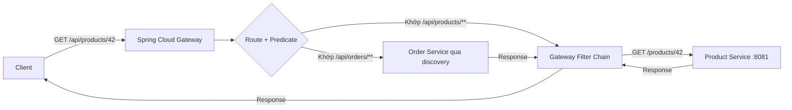
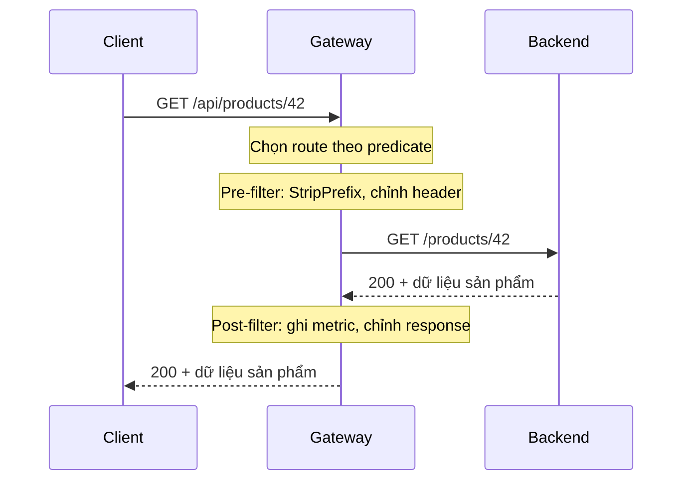

# Route, Predicate, Filter và dịch vụ phía sau trong Spring Cloud Gateway

Trong kiến trúc microservices, ứng dụng khách có thể cần gọi nhiều dịch vụ như sản phẩm, đơn hàng và tài khoản. **Spring Cloud Gateway** cung cấp một điểm vào để tiếp nhận request, xác định dịch vụ đích, biến đổi request/response và áp dụng các chính sách dùng chung. Để cấu hình cổng vào chính xác, cần phân biệt bốn khái niệm: **route**, **predicate**, **filter** và **dịch vụ phía sau (backend/upstream service)**.

Đây là nền tảng để tiếp tục triển khai xác thực, giới hạn lưu lượng, circuit breaker, retry, TLS và quan sát request khi vận hành API Gateway an toàn.

## 1. Bức tranh tổng thể

Hãy hình dung hệ thống có một gateway tại `http://localhost:8080`, dịch vụ sản phẩm ở `http://localhost:8081` và dịch vụ đơn hàng được đăng ký với tên `order-service`:



Ở mức khái niệm:

| Thành phần | Trả lời câu hỏi | Vai trò |
| --- | --- | --- |
| **Route** | Request này sẽ đi về đâu? | Gắn một định danh route với URI đích, các predicate, các filter và thứ tự ưu tiên. |
| **Predicate** | Request có thuộc route này không? | Kiểm tra các điều kiện như path, HTTP method, host, header hoặc query parameter. |
| **Filter** | Request/response cần được xử lý như thế nào? | Chỉnh đường dẫn, header, áp dụng chính sách, đo thời gian hoặc xử lý lỗi trong chuỗi xử lý. |
| **Backend service** | Ai thực thi nghiệp vụ? | Nhận request đã được gateway chuyển tiếp, xử lý nghiệp vụ và trả kết quả. |

**Quy tắc ghi nhớ:** predicate **chọn** route; filter **xử lý** dữ liệu đi qua route; URI của route **chỉ ra đích**; backend **thực thi nghiệp vụ**. Một route có thể có nhiều predicate và nhiều filter, trong khi nhiều route có thể cùng trỏ đến một backend.

## 2. Route: đơn vị cấu hình định tuyến

Một route mô tả **điều kiện chọn đường đi** và **cách chuyển tiếp** một nhóm request. Các thành phần thường gặp gồm:

- `id`: tên duy nhất để nhận diện route, ví dụ `product-read`.
- `uri`: địa chỉ hoặc tên dịch vụ đích, ví dụ `http://localhost:8081` hay `lb://order-service`.
- `predicates`: danh sách điều kiện để route được chọn.
- `filters`: các thao tác chạy với request và response khi route đã được chọn.
- `order` (tùy chọn): thứ tự ưu tiên khi có khả năng nhiều route cùng khớp; giá trị nhỏ hơn được ưu tiên trước.

Ví dụ một route có ý nghĩa: “Các request `GET` với đường dẫn bắt đầu bằng `/api/products/` sẽ được chuyển đến dịch vụ sản phẩm; trước khi chuyển tiếp, bỏ đoạn `/api` khỏi đường dẫn”. Route này không tự định nghĩa endpoint, dữ liệu sản phẩm hay quy tắc nghiệp vụ của backend.

### URI đích tĩnh và URI qua khám phá dịch vụ

| URI ví dụ | Cách định tuyến | Khi nào phù hợp |
| --- | --- | --- |
| `http://localhost:8081` | Chuyển tiếp trực tiếp đến host và cổng được khai báo. | Phát triển cục bộ, thử nghiệm hoặc backend có địa chỉ cố định. |
| `https://catalog.internal.example` | Chuyển tiếp qua HTTPS đến một upstream cụ thể. | Backend có DNS ổn định và cần kết nối mã hóa. |
| `lb://order-service` | Tra cứu các instance mang tên `order-service` và chọn instance qua cơ chế load balancing. | Microservices có nhiều instance hoặc địa chỉ thay đổi. |

Với `lb://`, gateway phải được tích hợp **Spring Cloud LoadBalancer** và có nguồn danh sách instance thích hợp, chẳng hạn một `DiscoveryClient` kết nối registry hoặc danh sách instance cấu hình sẵn. Chỉ viết `lb://order-service` không khiến dịch vụ tự xuất hiện; nếu không tìm thấy instance, quá trình chuyển tiếp thất bại.

**Route không đồng nghĩa với microservice.** Có thể tạo `product-read` và `product-write` với predicate khác nhau nhưng cùng trỏ đến dịch vụ sản phẩm. Ngược lại, một ứng dụng gateway thường quản lý nhiều route tương ứng nhiều backend.

## 3. Predicate: quyết định request nào khớp route

Predicate là một phép kiểm tra trả về *đúng/sai* trên thông tin của request. Spring Cloud Gateway cung cấp các **Route Predicate Factory** để biểu diễn những điều kiện thường dùng:

| Predicate | Ví dụ | Ý nghĩa |
| --- | --- | --- |
| `Path` | `Path=/api/products/**` | Path của request nằm trong mẫu đã khai báo. |
| `Method` | `Method=GET,HEAD` | Chỉ chấp nhận các HTTP method được liệt kê. |
| `Host` | `Host=**.example.com` | Host của request khớp mẫu miền. |
| `Header` | `Header=X-Client-Type, mobile` | Header tồn tại và giá trị khớp biểu thức được cấu hình. |
| `Query` | `Query=version, v2` | Query parameter `version` có giá trị phù hợp. |
| `Cookie` | `Cookie=region, vn` | Cookie thỏa điều kiện. |
| `RemoteAddr` | `RemoteAddr=192.0.2.0/24` | Địa chỉ remote nằm trong dải CIDR được cho phép. |

**Các predicate cùng nằm trong một route được kết hợp theo logic AND.** Chẳng hạn:

```yaml
predicates:
  - Path=/api/products/**
  - Method=GET
```

Route chỉ khớp khi **cả path lẫn method** thỏa điều kiện. Với `GET /api/products/42`, hai điều kiện đều đúng. Với `POST /api/products/42`, điều kiện `Method=GET` sai, nên gateway phải tìm một route khác phù hợp. Nếu không có route nào khớp, request thường nhận `404 Not Found` từ gateway.

Predicate không phải là cơ chế phân quyền. `Header=X-Role, admin` chỉ kiểm tra giá trị header do request mang đến, không chứng minh người gọi thật sự là quản trị viên. Kiểm tra danh tính và quyền cần đặt trong lớp bảo mật thích hợp, ví dụ Spring Security kết hợp với xác thực token.

### Khi nhiều route cùng khớp

Ví dụ `Path=/api/**` và `Path=/api/products/**` đều có thể khớp `/api/products/42`. Nếu hai route trỏ đến backend khác nhau, cần thiết kế predicate rõ ràng hoặc cấu hình `order` có chủ đích. Không nên mặc định rằng route có đường dẫn “cụ thể hơn” luôn thắng khi không có quy tắc ưu tiên rõ ràng.

## 4. Filter: xử lý trước và sau khi chuyển tiếp

Khi route đã được chọn, gateway chạy **filter chain**. Filter có thể quan sát, biến đổi hoặc từ chối request; một số filter cũng xử lý response từ backend trước khi gửi cho client.

Có hai nhóm filter cần phân biệt trong biến thể **Spring Cloud Gateway Server WebFlux**:

- **`GatewayFilter`**: gắn với một route cụ thể. Ví dụ route sản phẩm cần `StripPrefix`, còn route tài khoản cần một thao tác header riêng.
- **`GlobalFilter`**: áp dụng ở cấp gateway đối với các request đã được route xử lý; thường dùng cho correlation ID, logging có kiểm soát hoặc chính sách thống nhất.

Các filter toàn cục và filter của route được kết hợp, sau đó sắp theo thứ tự thực thi. Với thứ tự ưu tiên của `Ordered`, filter có độ ưu tiên cao hơn chạy sớm trong giai đoạn **pre** và muộn hơn trong giai đoạn **post**. Trong mô hình WebFlux, chúng làm việc với `ServerWebExchange` và chuỗi reactive; việc biến đổi request thường thông qua cơ chế `mutate()` thay vì chỉnh trực tiếp một đối tượng bất biến.



### Một số filter thường gặp

| Filter | Tác dụng | Điểm cần chú ý |
| --- | --- | --- |
| `StripPrefix` | Bỏ một số phân đoạn đầu của path. | `StripPrefix=1`: `/api/products/42` thành `/products/42`. |
| `PrefixPath` | Thêm một tiền tố vào path. | Phù hợp khi backend yêu cầu prefix nội bộ khác với API công khai. |
| `RewritePath` | Viết lại đường dẫn theo biểu thức chính quy. | Chú ý nhóm bắt regex và cách escape placeholder trong YAML. |
| `SetRequestHeader` | Đặt/thay giá trị header gửi đến backend. | Không sử dụng header tự đặt làm bằng chứng xác thực nếu thiếu ranh giới tin cậy. |
| `AddResponseHeader` | Thêm header vào response. | Có thể dùng để bổ sung thông tin kỹ thuật được phép công khai. |
| `RemoveRequestHeader` | Xóa header trước khi chuyển tiếp. | Cần biết backend có cần header đó cho nghiệp vụ hay không. |
| `RequestRateLimiter` | Giới hạn tốc độ gọi theo khóa nhận diện. | Cần chiến lược xác định khóa và cấu hình rate limiter tương ứng. |
| `CircuitBreaker` / `Retry` | Giới hạn tác động khi upstream lỗi hoặc thử lại request. | Cần dependency/cấu hình bổ sung; retry chỉ an toàn khi hiểu tính idempotent. |

**Không phải mọi xử lý ở gateway đều là GatewayFilter.** Ví dụ, một `WebFilter` thuộc Spring Security có thể xử lý xác thực trước giai đoạn chọn route; còn `GatewayFilter` hoạt động trong chuỗi filter của route đã khớp. Tách hai lớp này giúp tránh nhầm lẫn khi thiết kế bảo mật và chẩn đoán request bị từ chối.

## 5. Backend service: nơi thực thi nghiệp vụ

Backend (upstream) là dịch vụ thực sự xử lý request sau khi gateway định tuyến. Ví dụ, dịch vụ sản phẩm trả thông tin sản phẩm, dịch vụ đơn hàng thực hiện logic đặt hàng. Gateway có thể biến đổi path hoặc header, nhưng backend vẫn chịu trách nhiệm về hợp lệ dữ liệu, quyền nghiệp vụ, giao dịch và trạng thái tài nguyên.

Giữa client và backend có thể tồn tại hai đường dẫn khác nhau:

```text
Client -> Gateway: GET /api/products/42
Gateway -> Backend: GET /products/42
```

Sự khác biệt đến từ filter `StripPrefix=1`, không phải vì backend tự biết đường dẫn công khai `/api/products/42`. Vì vậy phải thống nhất **API public của gateway** với **API nội bộ của từng backend**. Nếu filter viết lại path sai, gateway vẫn chọn đúng route nhưng backend có thể trả `404` vì endpoint không tồn tại.

Backend có thể triển khai nhiều instance. Trong trường hợp dùng `lb://`, chọn instance là trách nhiệm của cơ chế load balancing được tích hợp với gateway; registry chỉ cung cấp thông tin khám phá dịch vụ, không thay thế logic định tuyến, filter hay xử lý nghiệp vụ.

## 6. Ví dụ cấu hình hoàn chỉnh ở mức nhập môn

Xét mô hình:

- Gateway nghe trên cổng `8080`.
- Product Service nghe trên cổng `8081`, có endpoint `GET /products/{id}`.
- Order Service công bố tên dịch vụ `order-service`, có endpoint `/orders/{id}` và có thể có nhiều instance.

Ví dụ `application.yml` sau minh họa cấu hình **Spring Cloud Gateway Server WebFlux** theo kiểu cấu hình `spring.cloud.gateway.routes` thường gặp ở các nhánh phiên bản trước:

```yaml
server:
  port: 8080

spring:
  application:
    name: edge-gateway
  cloud:
    gateway:
      routes:
        - id: product-read
          uri: http://localhost:8081
          predicates:
            - Path=/api/products/**
            - Method=GET
          filters:
            - StripPrefix=1
            - SetRequestHeader=X-Gateway-Source, edge-gateway
          order: 0

        - id: order-api
          uri: lb://order-service
          predicates:
            - Path=/api/orders/**
          filters:
            - StripPrefix=1
          order: 10
```

**Lưu ý tương thích phiên bản:** một số phiên bản Spring Cloud Gateway Server WebFlux mới tổ chức cấu hình route dưới `spring.cloud.gateway.server.webflux.routes`. Cần dùng **đúng namespace cấu hình và starter** của phiên bản Spring Boot/Spring Cloud đang chạy. Ví dụ này chỉ áp dụng cho biến thể WebFlux; Spring Cloud Gateway Server MVC có mô hình cấu hình và API lập trình riêng. Không khai báo đồng thời hai namespace với hy vọng chúng hoạt động như nhau.

### Đọc cấu hình theo từng request

| Request tới gateway | Route khớp | Filter tác động | Đích sau xử lý |
| --- | --- | --- | --- |
| `GET /api/products/42` | `product-read` | Bỏ `/api`, đặt header `X-Gateway-Source` | `http://localhost:8081/products/42` |
| `POST /api/products/42` | Không có route phù hợp trong ví dụ | Không chạy filter của `product-read` | Gateway không chuyển tiếp; thường trả 404. |
| `GET /api/orders/7` | `order-api` | Bỏ `/api` | `/orders/7` tại một instance được chọn của `order-service`. |
| `GET /unknown` | Không có route phù hợp | Không có filter theo route | Gateway không chuyển tiếp; thường trả 404. |

Hai lệnh kiểm tra ở client:

```bash
curl -i http://localhost:8080/api/products/42
curl -i http://localhost:8080/api/orders/7
```

Các lệnh chỉ trả về dữ liệu thành công khi backend tương ứng đang chạy; riêng route `order-api` còn cần cấu hình khám phá dịch vụ và load balancer. Muốn thử ví dụ hoàn toàn cục bộ mà chưa có registry, có thể tạm thay URI `lb://order-service` bằng `http://localhost:8082`, với giả định Order Service nghe trên cổng `8082`.

Lần theo request đầu tiên:

1. Gateway nhận `GET /api/products/42` tại cổng `8080`.
2. Predicate `Path` và `Method` cùng đúng, vì thế route `product-read` được chọn.
3. `StripPrefix=1` bỏ phân đoạn `api`; `SetRequestHeader` đặt header `X-Gateway-Source`.
4. Gateway chuyển tiếp `GET /products/42` tới `localhost:8081`.
5. Product Service tạo response; gateway tiếp tục các xử lý thuộc pha response rồi trả kết quả cho client.

Một điểm dễ nhầm là header `X-Gateway-Source` trong ví dụ chỉ mang tính **minh họa biến đổi header**, không phải chứng cứ rằng request đã được xác thực. Nếu backend dựa vào header để đưa ra quyết định bảo mật, hệ thống phải có cơ chế xác lập và bảo vệ ranh giới tin cậy phù hợp.

## 7. Những quyết định thiết kế quan trọng

### 7.1. Phân biệt route matching và authorization

`Path=/api/orders/**` chỉ có nghĩa “request này thuộc nhóm API đơn hàng”. Nó không có nghĩa “người gọi được xem đơn hàng”. Với API yêu cầu đăng nhập, gateway có thể xác thực token và áp dụng kiểm soát truy cập đầu vào; backend vẫn cần kiểm tra quyền nghiệp vụ, chẳng hạn người dùng có được đọc đơn hàng `7` hay không. Tránh dùng header do client tự gửi để thay cho kiểm tra danh tính.

### 7.2. Phân biệt lỗi chọn route và lỗi backend

- **Không có route khớp:** request không được chuyển tiếp; thường thấy lỗi `404` ở gateway.
- **Route khớp nhưng không có instance cho `lb://`:** chuyển tiếp thất bại ở bước tìm đích; mã lỗi phụ thuộc cấu hình (thường là `503`).
- **Có backend nhưng path sau biến đổi sai:** backend có thể trả `404` dù gateway đã định tuyến đúng.
- **Backend timeout hoặc không sẵn sàng:** kết quả phụ thuộc cấu hình timeout, retry, circuit breaker và xử lý lỗi; không thể mặc định mọi lỗi đều là lỗi của predicate.

Khi điều tra, hãy kiểm tra theo thứ tự: **request ban đầu → predicate/route được chọn → path và header sau filter → URI/instance đích → response backend**.

### 7.3. Biến đổi path cần có hợp đồng rõ ràng

Giả sử gateway công bố `/api/products/42` còn backend mong `/internal/catalog/42`. `StripPrefix=1` chỉ tạo `/products/42`, chưa đáp ứng hợp đồng này. Khi đó phải dùng phương án viết lại path phù hợp và kiểm thử với nhiều tình huống: path gốc, path có tham số, dấu `/` cuối, query string và phương thức HTTP.

### 7.4. Filter dùng chung phải được thiết kế thận trọng

Global filter giúp dùng chung logic nhưng cũng có thể ảnh hưởng mọi route được xử lý. Việc đọc body, ghi log quá chi tiết hoặc thêm thao tác blocking vào chuỗi WebFlux dễ gây tăng độ trễ và tiêu thụ tài nguyên. Chỉ ghi các thông tin cần thiết cho vận hành; tránh log token, mật khẩu và dữ liệu nhạy cảm.

## 8. Liên hệ với các năng lực vận hành API Gateway

Bốn khái niệm trên là điểm xuất phát cho những năng lực thường gặp của Spring Cloud Gateway:

| Nhu cầu | Vị trí trong luồng | Câu hỏi cần trả lời trước khi triển khai |
| --- | --- | --- |
| Xác thực và phân quyền | Lớp bảo mật và/hoặc filter phù hợp | Token do ai cấp, kiểm tra ở đâu, backend tin vào thông tin nào? |
| Rate limiting | Filter trước khi gọi backend | Giới hạn theo IP, API key hay định danh người dùng; xử lý khi vượt ngưỡng ra sao? |
| Circuit breaker | Filter bảo vệ lời gọi upstream | Khi backend lỗi liên tục, khi nào dừng thử và phản hồi fallback thế nào? |
| Retry | Filter điều khiển lần gọi lại | HTTP method và nghiệp vụ có an toàn khi lặp lại hay không? |
| TLS | Kết nối client–gateway và gateway–backend | Mã hóa ở từng chặng ra sao, có yêu cầu mTLS nội bộ không? |
| Quan sát request | Metrics, trace và logging quanh chuỗi xử lý | Làm sao truy vết cùng một request qua gateway và các backend? |

Ví dụ, retry tự động cho `GET /products/42` thường dễ kiểm soát hơn retry cho thao tác tạo thanh toán. Nếu backend đã thực hiện nghiệp vụ nhưng gateway mất response, retry một request không có cơ chế idempotency có thể tạo tác dụng phụ lặp lại. Tương tự, circuit breaker và rate limiter chỉ hữu ích khi chọn được khóa, ngưỡng và hành vi lỗi phù hợp với từng route.

Để quan sát, nên dùng correlation ID/trace ID thống nhất giữa gateway và backend, kết hợp độ trễ, mã trạng thái và tên route trong metrics hoặc log. Khi bật các actuator endpoint để xem route, cần cấu hình và bảo vệ quyền truy cập phù hợp với môi trường vận hành.

## 9. Tự kiểm tra hiểu biết

**Tình huống A.** Gateway có route `Path=/api/users/**`, `Method=GET`, URI `http://localhost:8083`, filter `StripPrefix=1`. Request `GET /api/users/15` được gửi tới backend theo path nào?

**Đáp án:** `/users/15`. Predicate chọn route; filter bỏ phân đoạn `api`; backend nhận path đã biến đổi.

**Tình huống B.** Client gửi `POST /api/users/15` nhưng không có route khác. Vì sao backend không nhận request?

**Đáp án:** Predicate `Method=GET` không khớp. Các filter của route này cũng không được chạy đối với request đó.

**Tình huống C.** Route `lb://inventory-service` khớp nhưng gateway không tìm thấy instance nào. Có phải cần đổi `Path` predicate?

**Đáp án:** Chưa có căn cứ. Predicate đã khớp; cần kiểm tra registry, tên dịch vụ, danh sách instance và tích hợp load balancer trước.

**Tình huống D.** Backend nhận header `X-User-Id: 123` từ client và cho phép đọc đơn hàng `123`. Điều này có an toàn không?

**Đáp án:** Không thể kết luận an toàn chỉ từ header. Backend phải dựa trên danh tính đã xác thực và kiểm tra quyền truy cập; gateway và backend phải thống nhất cách truyền ngữ cảnh tin cậy.

## 10. Tổng kết khái niệm

Khi thiết kế một API Gateway với Spring Cloud Gateway, hãy tự hỏi theo đúng trình tự: **request nào cần được xử lý (`predicate`), cấu hình định tuyến nào sẽ nhận request đó (`route`), cần biến đổi hoặc bảo vệ request/response như thế nào (`filter`), và dịch vụ nào thực hiện nghiệp vụ (`backend`)**. Việc phân biệt rõ bốn lớp này giúp đọc cấu hình, xử lý lỗi định tuyến và từng bước bổ sung các chính sách bảo mật, độ tin cậy và quan sát cho cổng vào microservices.
