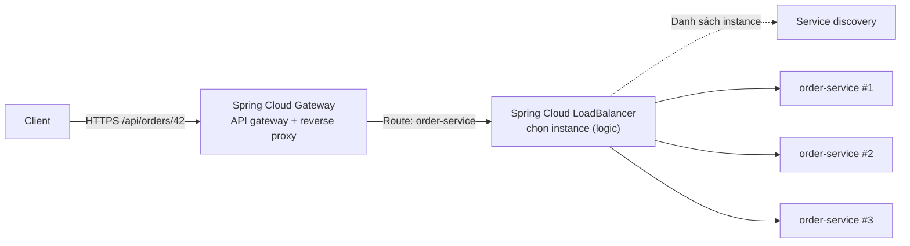
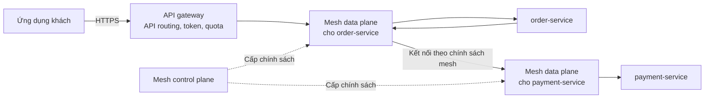

# Phân biệt API gateway, reverse proxy, load balancer và service mesh

Khi xây dựng microservices, một yêu cầu từ ứng dụng di động có thể đi qua nhiều thành phần trước khi đến dịch vụ xử lý nghiệp vụ. **API gateway**, **reverse proxy**, **load balancer** và **service mesh** đều có thể chuyển tiếp lưu lượng, nhưng chúng giải quyết những vấn đề ở các phạm vi khác nhau. Hiểu đúng sự khác biệt giúp chọn kiến trúc vừa đủ và tránh đặt trùng các chính sách mạng.

Trong module **SPRING_CLOUD_GATEWAY**, trọng tâm là dùng **Spring Cloud Gateway** làm điểm vào API: định tuyến theo route predicate, áp dụng filter chain để sửa đường dẫn/header, kết hợp khám phá dịch vụ, xác thực, giới hạn lưu lượng, circuit breaker, retry, TLS và theo dõi request. Bài này đặt Spring Cloud Gateway vào bức tranh rộng hơn để phân biệt vai trò của nó với ba khái niệm còn lại.

## 1. Bắt đầu từ một tình huống thực tế

Giả sử hệ thống bán hàng có ba dịch vụ `order-service`, `payment-service` và `catalog-service`. Mỗi dịch vụ có thể có nhiều instance, ví dụ `order-service` đang chạy trên ba máy hoặc container khác nhau.

Một request `GET /api/orders/42` đặt ra các câu hỏi độc lập:

1. **Khách hàng nên gọi địa chỉ công khai nào?** Trình duyệt không cần biết mọi hostname nội bộ của các microservice.
2. **Request thuộc dịch vụ nào?** Đường dẫn `/api/orders/**` phải được chuyển đến `order-service`, còn `/api/payments/**` chuyển đến `payment-service`.
3. **Nên chọn instance nào của `order-service`?** Nếu có nhiều bản sao, cần chọn một instance còn khỏe và phân phối tải hợp lý.
4. **Ai kiểm tra token, hạn mức request và chính sách API dùng chung?** Các chính sách tại biên cần được thực hiện nhất quán, trong khi dịch vụ vẫn chịu trách nhiệm cho quyền truy cập dữ liệu của mình.
5. **Các dịch vụ trao đổi với nhau thế nào?** Lời gọi từ `order-service` sang `payment-service` có thể cần mTLS, timeout, retry và telemetry thống nhất.

Những câu hỏi này giải thích vì sao có nhiều lớp thành phần. Chúng **có thể phối hợp hoặc chồng lấn chức năng**, không nhất thiết là bốn sản phẩm phải cài riêng.

## 2. Bốn khái niệm cốt lõi

### 2.1. Reverse proxy: máy chủ đại diện cho hệ thống phía sau

**Reverse proxy** nhận request từ client rồi chuyển tiếp tới một hoặc nhiều backend. Client chỉ giao tiếp với địa chỉ của proxy, còn proxy thực hiện kết nối tới dịch vụ đích và chuyển response trở lại.

Một reverse proxy có thể cung cấp:

- Chấm dứt TLS tại biên (TLS termination), quản lý certificate cho tên miền công khai.
- Chuyển tiếp request theo host hoặc path; viết lại URL và header.
- Cân bằng tải, cache, nén dữ liệu hoặc giới hạn kết nối, tùy sản phẩm và cấu hình.
- Ẩn địa chỉ máy chủ backend khỏi client; điều này tự thân **không** thay thế kiểm soát truy cập mạng.

Ví dụ: `https://api.example.test/orders/42` đi vào Nginx hoặc Envoy, rồi được proxy đến một backend HTTP nội bộ. Trên chiều về, response cũng đi qua proxy.

Điểm nhận diện chính là **vị trí trong đường đi của request**: reverse proxy đứng phía trước server và đại diện cho server. Một reverse proxy HTTP thường làm việc ở tầng ứng dụng (L7); một số sản phẩm còn proxy được luồng TCP (L4).

### 2.2. Load balancer: chọn nơi nhận request hoặc kết nối

**Load balancer** chịu trách nhiệm phân phối request hoặc kết nối đến các instance có thể phục vụ cùng một công việc. Mục tiêu thường là phân tải, mở rộng ngang và tránh gửi lưu lượng đến instance không sẵn sàng.

Có hai cách phân loại quen thuộc:

| Loại | Cơ sở quyết định | Minh họa |
| --- | --- | --- |
| **L4 load balancing** | Thông tin kết nối như IP, cổng, TCP/UDP; không cần hiểu HTTP path. | Phân phối kết nối TCP đến nhiều server. |
| **L7 load balancing** | Thông tin ứng dụng như HTTP host, path, header hoặc cookie. | Chuyển `/images/**` đến nhóm máy chủ ảnh. |

Thuật toán lựa chọn có thể là round robin, weighted routing, least connections hoặc chiến lược khác, tùy hệ thống. Health check, timeout và cơ chế loại bỏ instance lỗi cũng tùy theo cách triển khai.

Load balancing có thể diễn ra ở hai vị trí:

- **Server-side load balancing:** một proxy hoặc thiết bị mạng nhận lưu lượng rồi chọn backend, ví dụ một HTTP load balancer trước các service instance.
- **Client-side load balancing:** thành phần gọi dịch vụ nhận danh sách instance và chọn đích. Trong Spring Cloud Gateway, URI `lb://order-service` có thể sử dụng **Spring Cloud LoadBalancer** để chọn một instance của tên dịch vụ logic đó.

**Service discovery** và load balancing liên quan nhưng khác nhau: discovery giúp tìm **những instance nào đang có**, còn load balancing quyết định **dùng instance nào**. Danh sách instance có thể đến từ registry, Kubernetes hoặc nguồn cấu hình khác. URI `lb://...` cần tích hợp load balancer và cơ chế phân giải instance phù hợp; chỉ viết URI này không tự tạo ra registry.

### 2.3. API gateway: điểm vào và lớp chính sách dành cho API

**API gateway** là một điểm vào có hiểu biết về API và nhu cầu của các client. Nó thường được xây trên khả năng reverse proxy L7, nhưng bổ sung các quy tắc dành riêng cho việc công bố và quản trị API.

Những việc thường đặt tại API gateway gồm:

- **API routing:** ghép request với route bằng path, method, host, header hoặc predicate khác.
- **Biến đổi request/response:** thêm, xóa, sửa header; thay đổi path; áp dụng các filter theo thứ tự định nghĩa.
- **Bảo vệ biên API:** tích hợp xác thực token, rate limiting, kiểm soát CORS, hạn mức và chính sách truy cập ở cấp API.
- **Kiểm soát lỗi:** timeout, circuit breaker, retry có điều kiện và trả lỗi hoặc fallback phù hợp.
- **Vận hành:** phát sinh hoặc truyền correlation ID, xuất metrics, logs và distributed traces.

**Spring Cloud Gateway** thuộc nhóm này. Một route được ghép từ **predicate** (khi nào khớp), **filters** (xử lý trước/sau khi gọi downstream) và **URI đích** (chuyển đến đâu). Ngoài định tuyến HTTP, nó có thể tích hợp Spring Security, Spring Cloud LoadBalancer, Resilience4j hoặc các thành phần tương ứng để thực thi chính sách; **các khả năng như xác thực và circuit breaker cần được cấu hình/tích hợp**, không xuất hiện tự động chỉ vì đã cài gateway.

Gateway hữu ích tại ranh giới giữa ứng dụng khách và hệ thống backend (*north–south traffic*), nhưng cũng có thể được dùng làm một lớp vào API nội bộ. Gateway không có nghĩa là mọi request nội bộ giữa microservices đều phải quay ra gateway.

### 2.4. Service mesh: quản lý giao tiếp giữa các dịch vụ

**Service mesh** là lớp hạ tầng quản lý lưu lượng *service-to-service*, thường gọi là *east–west traffic*. Thay vì để từng nhóm ứng dụng tự cài đặt tất cả chính sách kết nối, mesh cung cấp cách áp dụng tập trung các cơ chế như:

- Mã hóa và xác thực danh tính kết nối giữa các workload, thường bằng **mutual TLS (mTLS)**.
- Chọn đích, chia lưu lượng giữa các phiên bản, timeout, retry và circuit breaking theo khả năng triển khai.
- Quan sát lưu lượng: metrics, tracing, dữ liệu về lỗi, độ trễ và kết nối.
- Chính sách giao tiếp giữa các workload theo danh tính hoặc namespace.

Một mesh thường có **data plane** (proxy hoặc cơ chế chuyển tiếp thực thi chính sách) và **control plane** (phân phối cấu hình/chính sách). Mô hình sidecar đặt proxy cạnh workload; các kiến trúc khác có thể vận hành không cần một sidecar cho mỗi pod. Istio và Linkerd là ví dụ về những nền tảng service mesh.

Mesh **không mặc nhiên** là điểm vào API công khai. Một hệ thống có mesh vẫn có thể cần API gateway hoặc ingress gateway để kiểm tra token của người dùng, áp dụng quota theo API và công bố endpoint cho bên ngoài. Ngược lại, có API gateway không đồng nghĩa các lời gọi nội bộ đã có mTLS hay chính sách mesh.

## 3. Bảng so sánh nhanh

| Tiêu chí | Reverse proxy | Load balancer | API gateway | Service mesh |
| --- | --- | --- | --- | --- |
| **Bài toán chính** | Đại diện backend, tiếp nhận và chuyển tiếp lưu lượng | Chọn instance hoặc endpoint đích | Công bố, định tuyến và áp dụng chính sách cho API | Quản lý giao tiếp và chính sách giữa các workload |
| **Vị trí thường thấy** | Trước một hay nhiều backend | Trước pool instance hoặc ở phía client gọi dịch vụ | Biên hệ thống API, đôi khi ở nội bộ | Phân tán giữa các dịch vụ; có thể có ingress/egress |
| **Đơn vị quan tâm** | Request/kết nối đến backend | Kết nối, request và danh sách instance | Route, API, consumer, token, quota | Workload identity, service-to-service traffic, policy |
| **Khả năng tiêu biểu** | TLS termination, proxying, rewrite, cache | Health check, thuật toán phân tải, failover | Predicate, filters, auth, rate limit, biến đổi và quan sát API | mTLS, traffic policy, telemetry, chia lưu lượng nội bộ |
| **Ví dụ** | Nginx, Envoy khi làm reverse proxy | L4/L7 load balancer, Spring Cloud LoadBalancer | Spring Cloud Gateway, Kong | Istio, Linkerd |

**Cách nhớ:** reverse proxy trả lời *“ai đứng ra nhận và chuyển request?”*; load balancer trả lời *“instance nào nhận?”*; API gateway trả lời *“request API này được phép đi đâu và chịu chính sách gì?”*; service mesh trả lời *“các workload giao tiếp với nhau theo chính sách nào?”*.

Các cột mô tả **vai trò**, không phải những tập chức năng tách biệt tuyệt đối. Một instance Envoy có thể vừa làm reverse proxy vừa cân bằng tải. Spring Cloud Gateway là một API gateway đồng thời thực thi reverse proxy và có thể chọn instance bằng Spring Cloud LoadBalancer. Proxy trong service mesh cũng có thể cân bằng tải hoặc áp dụng retry.

## 4. Theo dấu một request đi qua Spring Cloud Gateway

Xét request từ ứng dụng khách đến `order-service`:

```http
GET /api/orders/42 HTTP/1.1
Host: api.example.test
Authorization: Bearer <access-token>
```

Sơ đồ sau minh họa một triển khai có gateway và nhiều instance dịch vụ:



Hộp **Spring Cloud LoadBalancer** biểu thị chức năng chọn đích trong luồng xử lý, **không nhất thiết là một server/proxy riêng**. Khi request đã được xử lý, response trở về qua gateway đến client.

Diễn biến khái quát:

1. **Kết nối vào:** client thiết lập HTTPS với gateway hoặc một tầng proxy/TLS termination đặt trước gateway. Điểm chấm dứt TLS phụ thuộc kiến trúc thực tế.
2. **Khớp route:** gateway đánh giá các predicate; chẳng hạn đường dẫn `/api/orders/**` khớp route của đơn hàng.
3. **Áp dụng chính sách và filters:** nếu đã tích hợp, hệ thống kiểm tra token, hạn mức; route filters có thể xóa tiền tố `/api`, thay header hoặc thêm thông tin chẩn đoán. Thứ tự thực thi cụ thể phụ thuộc filter và cấu hình.
4. **Phân giải đích:** `lb://order-service` được resolve thành một instance thông qua load balancer và nguồn danh sách instance đang cấu hình.
5. **Chuyển tiếp và nhận kết quả:** gateway gọi backend, nhận response rồi thực thi xử lý response cần thiết trước khi trả về client.
6. **Quan sát:** logs/metrics/traces, nếu được bật và kết nối hệ thống thu thập, cho biết route nào được chọn, độ trễ và lỗi ở từng chặng.

### 4.1. Ví dụ cấu hình route

Ví dụ YAML dưới đây sử dụng **kiểu khóa cấu hình thường gặp trong Spring Cloud Gateway Server WebFlux 4.x**. Tên starter và tiền tố thuộc tính có thể khác ở những phiên bản lớn khác; khi triển khai cần đối chiếu tài liệu đúng phiên bản đang sử dụng.

```yaml
spring:
  cloud:
    gateway:
      routes:
        - id: orders-route
          uri: lb://order-service
          predicates:
            - Path=/api/orders/**
          filters:
            - StripPrefix=1
```

Với route này:

- `Path=/api/orders/**` là **route predicate**: nó quyết định request có thuộc route hay không.
- `StripPrefix=1` là **gateway filter**: request `/api/orders/42` được chuyển xuống backend với path `/orders/42`.
- `lb://order-service` là **đích logic**: load balancer chọn một instance đã được phân giải cho `order-service`.

Phân biệt từng trách nhiệm giúp tránh nhầm lẫn: **predicate không chọn instance**, **filter không phải registry**, và **service discovery không tự áp dụng quyền truy cập API**.

Đoạn cấu hình chỉ minh họa **định tuyến và biến đổi đường dẫn**. Để chạy được cần có service đích cùng cơ chế phân giải instance và dependency phù hợp; để kiểm tra JWT, rate limit, TLS hay circuit breaker phải bổ sung cấu hình/tích hợp tương ứng. Gateway không tự thay thế việc xác thực và phân quyền nghiệp vụ của `order-service`.

## 5. Khi nào các thành phần phối hợp với nhau?

### Kiến trúc chỉ có reverse proxy và load balancer

Một hệ thống website hoặc API nhỏ có thể dùng một reverse proxy làm TLS termination và cân bằng tải cho vài backend. Nếu chưa cần token policy tập trung, định tuyến theo nhiều nhóm API hay quản lý consumer, chưa chắc cần bổ sung một API gateway riêng.

### Kiến trúc có Spring Cloud Gateway

Khi ứng dụng có nhiều API cho web/mobile/đối tác, Spring Cloud Gateway có thể cung cấp một hostname công khai, khai báo route bằng predicate, biến đổi request với filter, kiểm tra token ở biên và giới hạn tốc độ. Spring Cloud LoadBalancer chọn instance khi dùng `lb://`; phía dưới có thể là Kubernetes service discovery, registry hoặc nguồn instance tương ứng. Một L4 load balancer ở phía trước gateway vẫn có thể cần thiết để phân phối lưu lượng giữa **các replica của chính gateway**.

### Kiến trúc có API gateway và service mesh

Với nhiều microservice và nhu cầu chính sách kết nối nội bộ thống nhất, hai lớp thường bổ trợ nhau:



Sơ đồ giản lược: đường giữa các thành phần có thể do sidecar, ambient data plane hoặc hạ tầng tương ứng đảm nhận. **Gateway xử lý chính sách của API/consumer**, còn **mesh chủ yếu xử lý chính sách kết nối giữa workload**. Mesh có thể bao gồm ingress gateway, nhưng vai trò ingress vẫn phải được thiết kế rõ nếu cần quản lý API công khai.

### Chọn giải pháp theo nhu cầu

| Nhu cầu nổi bật | Thành phần nên xem xét đầu tiên | Lý do |
| --- | --- | --- |
| Đặt một hostname trước vài backend, TLS termination, rewrite | Reverse proxy | Giải quyết trực tiếp chuyển tiếp ở biên. |
| Chia tải giữa nhiều bản sao của cùng dịch vụ | Load balancer | Quyết định instance đích; có thể tích hợp sẵn trong proxy/gateway. |
| Nhiều API cần routing theo path, auth, rate limit, filter | API gateway, ví dụ Spring Cloud Gateway | Gom chính sách API tại điểm vào và chuẩn hóa bề mặt API. |
| Nhiều lời gọi nội bộ cần mTLS, telemetry và traffic policy đồng nhất | Service mesh | Áp dụng chính sách giao tiếp giữa workload ở tầng hạ tầng. |
| Gateway nhiều replica, backend nhiều replica | Kết hợp load balancing ở các chặng phù hợp | Phân tải vào gateway và từ gateway đến backend là hai quyết định khác nhau. |

## 6. Những nhầm lẫn hay gây lỗi kiến trúc

### “Đã có gateway thì không cần load balancer”

Gateway là một vai trò; **load balancing là một khả năng chọn đích**. Một gateway có thể sử dụng load balancing nội bộ, nhưng khi gateway chạy nhiều replica vẫn có thể cần cân bằng tải ở trước nó. Ngược lại, `lb://` giúp chọn instance backend, không tự xử lý việc client tìm được một gateway replica khỏe mạnh.

### “Reverse proxy và API gateway là hai loại máy chủ hoàn toàn khác nhau”

Một API gateway thường thực hiện reverse proxy. Phần khác biệt nằm ở **mức độ hiểu API và chính sách đi kèm**. Nginx hoặc Envoy có thể cung cấp nhiều chức năng thường thấy ở gateway khi cấu hình thích hợp; tên sản phẩm không tự quyết định toàn bộ vai trò.

### “Dùng service mesh sẽ thay thế hết API gateway”

Mesh có thể thực hiện HTTP routing và có ingress/egress, nhưng nhu cầu công bố API, kiểm tra danh tính người dùng cuối, quản lý quota của client và quản trị phiên bản API vẫn cần được thiết kế. Ngược lại, Spring Cloud Gateway không tự mã hóa và xác thực mọi kết nối giữa hai backend mà gateway không tham gia.

### “Kiểm tra JWT ở gateway là đủ để bảo vệ mọi dữ liệu”

Gateway có thể xác minh chữ ký, issuer, audience hoặc scope theo cấu hình bảo mật, nhưng **dịch vụ nghiệp vụ phải bảo vệ tài nguyên của chính nó**. Ví dụ, token hợp lệ không đồng nghĩa người dùng có quyền xem đơn hàng `42`. Cần ngăn đường truy cập trực tiếp trái phép vào backend và kiểm soát header danh tính do client tự gửi. Các header như `X-Forwarded-*` chỉ nên được tin cậy khi đến từ hop đáng tin cậy và được xử lý đúng.

### “Thêm retry ở mọi lớp thì hệ thống bền hơn”

Nếu gateway, service client và mesh đều tự retry, một request lỗi có thể nhân thành nhiều lời gọi backend, làm sự cố nặng hơn. Retry nên có **timeout tổng, giới hạn số lần, backoff/jitter** và chỉ áp dụng khi thao tác an toàn hoặc có cơ chế **idempotency**. Đặc biệt thận trọng với thao tác thanh toán và các request ghi dữ liệu. Circuit breaker giúp ngừng đẩy thêm lưu lượng trong một số tình huống lỗi, nhưng không thay thế timeout hay thiết kế phục hồi ở tầng ứng dụng.

### “Có TLS ở gateway nghĩa là mọi chặng đều được mã hóa”

HTTPS từ client đến gateway chỉ bảo vệ chặng đó. Kết nối từ gateway đến backend có thể là HTTP, HTTPS hoặc mTLS tùy cấu hình và ranh giới tin cậy. Nếu dùng mesh, mTLS nội bộ cần được bật và xác minh theo chính sách mesh; nó không tự xuất hiện nhờ HTTPS ở điểm vào.

## 7. Cách quan sát và kiểm chứng kiến trúc

Khi vận hành một hệ thống sử dụng Spring Cloud Gateway, nên xác định rõ **điểm bắt đầu và điểm kết thúc** của từng chặng. Một số câu hỏi thực tế:

1. **Routing:** request `/api/orders/42` khớp route nào? Predicate nào quyết định? Sau filters backend nhìn thấy path và header gì?
2. **Discovery/load balancing:** route dùng URI cố định hay `lb://`? Danh sách instance đến từ đâu? Khi một instance không khỏe, thành phần nào loại nó khỏi lựa chọn?
3. **Bảo mật:** TLS được kết thúc tại đâu, kiểm tra token ở đâu, quyền truy cập vào đơn hàng được kiểm tra ở đâu? Backend có bị gọi trực tiếp từ bên ngoài hay không?
4. **Resilience:** timeout, retry và circuit breaker nằm ở gateway, service client hay mesh? Có nguy cơ retry lặp giữa các lớp không?
5. **Observability:** logs và metrics của gateway có chứa route ID, trạng thái HTTP, độ trễ không? Trace context có được truyền từ gateway sang backend để nối các span không?

Ví dụ khi ghi nhận request lỗi, hãy nhìn theo đường đi **client → gateway route/filter → instance đã chọn → backend**. Nếu có mesh, thêm các proxy hoặc hop do mesh quản lý vào trace. Cách nhìn này giúp phân biệt lỗi `404` do không khớp route với `404` do backend trả về, lỗi `503` do không có instance khả dụng với lỗi timeout tại downstream, và lỗi `401` từ chính sách auth ở gateway với `403` từ kiểm tra quyền nghiệp vụ.

## 8. Tự kiểm tra kiến thức

**Tình huống A:** `order-service` có bốn replica, mọi request vẫn được gửi đến một replica cố định. Thiếu khả năng nào? **Gợi ý:** kiểm tra phần chọn instance và cấu hình discovery/load balancing; thêm một API gateway mới chưa chắc giải quyết lỗi chọn đích.

**Tình huống B:** người dùng gọi `/api/orders/42`, gateway đã xác minh JWT nhưng vẫn xem được đơn hàng của người khác. Chính sách nào thiếu? **Gợi ý:** kiểm tra phân quyền theo tài nguyên ở `order-service`, không chỉ xác thực token ở biên.

**Tình huống C:** các microservice cần mTLS và telemetry thống nhất cho lời gọi nội bộ; hiện Spring Cloud Gateway chỉ nhận request từ mobile. Nên nghiên cứu lớp nào? **Gợi ý:** service mesh hoặc một giải pháp chính sách kết nối nội bộ tương đương, tùy quy mô và chi phí vận hành.

**Tình huống D:** cả gateway và mesh đều retry ba lần một thao tác ghi dữ liệu. Rủi ro gì xuất hiện? **Gợi ý:** số lần thực thi backend bị nhân lên và có thể tạo tác dụng phụ lặp; cần phân định nơi retry và áp dụng idempotency, timeout và retry budget.

**Điểm cần ghi nhớ:** Trong kiến trúc Spring Cloud Gateway, route predicate quyết định **request khớp route nào**, gateway filter quyết định **request/response được xử lý thế nào**, load balancer quyết định **instance nào nhận**, còn service mesh (nếu sử dụng) quản lý **chính sách kết nối giữa các workload**. Reverse proxy là nền tảng chuyển tiếp lưu lượng mà API gateway thường dựa vào; bốn khái niệm mô tả các trách nhiệm có thể cùng tồn tại trong một hệ thống.
