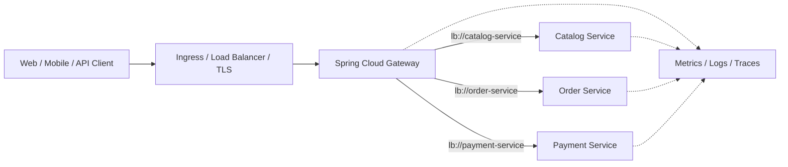

# Các trách nhiệm dùng chung và ranh giới nghiệp vụ tại gateway

Trong kiến trúc microservices, một yêu cầu từ ứng dụng web hoặc mobile có thể cần đi đến nhiều dịch vụ như `catalog-service`, `order-service` và `payment-service`. Nếu mỗi dịch vụ tự triển khai toàn bộ việc tiếp nhận request từ Internet, xác thực đầu vào, giới hạn lưu lượng, ghi log và quản lý đường dẫn công khai, các chính sách dễ bị lặp lại và thiếu nhất quán.

**Spring Cloud Gateway** cung cấp một điểm vào tập trung để áp dụng các chính sách kỹ thuật dùng chung. Tuy vậy, gateway không phải nơi quyết định mọi quy tắc nghiệp vụ. Chẳng hạn, gateway có thể xác minh token hợp lệ trước khi chuyển yêu cầu lấy đơn hàng, nhưng việc người dùng có **sở hữu đơn hàng đó hay không** phải do dịch vụ đơn hàng kiểm tra.

Trong phạm vi xây dựng API Gateway với Spring Cloud Gateway, cần phân biệt rõ **trách nhiệm ở lớp biên** (routing, predicate, filter chain, biến đổi URL/header, khám phá dịch vụ, bảo mật, kiểm soát lưu lượng, khả năng chịu lỗi và quan sát) với **trách nhiệm của từng miền nghiệp vụ** (quyền truy cập tài nguyên cụ thể, kiểm tra dữ liệu, giao dịch và tính đúng đắn của trạng thái).

## 1. Gateway nằm ở đâu trong luồng request?



Client biết địa chỉ công khai của gateway, ví dụ `https://api.example.com`, thay vì phải biết địa chỉ triển khai của từng service. Gateway đối chiếu **route predicate** như đường dẫn, phương thức HTTP hoặc header để chọn route. Các **filter** của route và filter toàn cục xử lý request trước khi chuyển tiếp; sau khi backend trả response, filter có thể tiếp tục xử lý ở chiều phản hồi.

Một luồng tiêu biểu khi gọi `GET /api/orders/42`:

1. Lớp biên nhận kết nối HTTPS, thực thi cấu hình TLS ở nơi được triển khai (ingress/load balancer hoặc chính gateway).
2. Spring Security tại gateway kiểm tra yêu cầu có phải xác thực không; nếu có, xác minh token theo cấu hình.
3. Gateway tìm route có predicate phù hợp với `GET /api/orders/42`.
4. Các filter thích hợp áp dụng giới hạn lưu lượng, chuẩn hóa hoặc loại bỏ header không tin cậy, biến đổi đường dẫn và tạo dữ liệu quan sát.
5. Gateway dùng địa chỉ tĩnh hoặc cơ chế `lb://` cùng discovery/load balancer để chọn instance của `order-service`.
6. `order-service` xác minh quyền đối với **đơn hàng số 42**, thực hiện nghiệp vụ và trả kết quả; response quay lại qua gateway.

Thứ tự thực tế phụ thuộc loại filter và cấu hình `Ordered`. Trong Spring Cloud Gateway Server WebFlux, filter của gateway được sắp xếp trong một chain; filter có độ ưu tiên cao chạy sớm ở chiều trước khi gọi backend và muộn ở chiều xử lý response. Spring Security WebFilter hoạt động ở lớp WebFlux, không nên coi là một `GatewayFilter` thông thường.

## 2. Những trách nhiệm nên tập trung tại gateway

| Nhóm trách nhiệm | Gateway nên làm gì? | Giới hạn cần nhớ |
| --- | --- | --- |
| **Định tuyến và khám phá dịch vụ** | Ghép path/method/header bằng predicate, chuyển tới URI tương ứng, dùng `lb://service-name` để chọn instance khi có discovery và load balancer. | Predicate chỉ chọn đích, không chứng minh client có quyền trên dữ liệu. |
| **Biến đổi giao thức HTTP** | `StripPrefix`, `RewritePath`, thêm/xóa header, chuẩn hóa đường dẫn công khai và đường dẫn nội bộ. | Tránh biến gateway thành nơi chuyển đổi mô hình dữ liệu nghiệp vụ phức tạp. |
| **Xác thực ở lớp biên** | Xác minh JWT/OAuth2 access token hoặc kết nối an toàn theo yêu cầu, từ chối request không hợp lệ sớm. | Dịch vụ vẫn phải áp dụng kiểm soát quyền phù hợp với tài nguyên nó sở hữu. |
| **Phân quyền mức khái quát** | Ví dụ chỉ người đã đăng nhập được gọi `/api/orders/**`, chỉ vai trò vận hành được vào `/internal/**`. | Quy tắc như “chỉ được sửa đơn hàng của chính mình” thuộc `order-service`. |
| **Kiểm soát lưu lượng** | Rate limit theo người dùng, client hoặc API key; giới hạn kích thước request; chặn quá tải sớm. | Hạn mức phụ thuộc gói dịch vụ, số dư, quyền lợi trả phí cần nguồn dữ liệu nghiệp vụ đáng tin cậy. |
| **Khả năng chịu lỗi ở lớp mạng** | Timeout, circuit breaker, retry có điều kiện, fallback phù hợp khi backend gián đoạn. | Không tự đoán kết quả một giao dịch thanh toán hoặc retry thao tác gây tác dụng phụ tùy ý. |
| **Bảo vệ biên và chuẩn hóa chính sách** | TLS, CORS, bảo vệ header, chính sách truy cập các endpoint công khai, phối hợp với WAF/ingress nếu có. | CORS không thay thế xác thực; TLS ngoài gateway không đồng nghĩa mọi hop nội bộ đều được mã hóa. |
| **Quan sát và chẩn đoán** | Ghi route ID, trạng thái HTTP, độ trễ, correlation/trace ID, xuất metrics và trace. | Không ghi token, cookie nhạy cảm, toàn bộ body hoặc dữ liệu cá nhân vào log. |

Các trách nhiệm này có đặc điểm chung: chúng chủ yếu dựa trên **metadata của request, identity đã được xác minh và chính sách hạ tầng**. Chúng nên nhất quán giữa nhiều dịch vụ, có thể thay đổi mà không cần sửa từng service và thường có ích khi xử lý sớm trước khi backend tiêu tốn tài nguyên.

## 3. Ranh giới nghiệp vụ: điều gì phải nằm ở service?

Một cách xác định ranh giới là hỏi: **quyết định này có cần hiểu trạng thái hoặc quy tắc của một miền nghiệp vụ cụ thể không?** Nếu có, service sở hữu miền đó thường phải đưa ra quyết định cuối cùng.

| Tình huống | Gateway quyết định | Service quyết định |
| --- | --- | --- |
| `GET /api/orders/42` | Token có hợp lệ không? Route nào nhận yêu cầu? Client đã vượt rate limit chưa? | Người gọi có được xem đơn hàng 42 không? Đơn hàng có tồn tại không? |
| `POST /api/orders` | Cho phép truy cập endpoint, giới hạn kích thước/lưu lượng request. | Giỏ hàng hợp lệ không? Giá, tồn kho, khuyến mãi và điều kiện đặt hàng có đúng không? |
| `POST /api/payments` | Xác thực client, route tới dịch vụ thanh toán, timeout và giám sát. | Thanh toán có thể thực hiện không? Có giao dịch trùng không? Trạng thái thanh toán cuối cùng là gì? |
| `GET /api/catalog/products` | Có thể cho truy cập công khai, cache HTTP nếu chính sách phù hợp. | Sản phẩm nào được phép hiển thị, mức giá và tồn kho hiện hành. |
| Truy cập dữ liệu theo tenant | Nhận diện tenant từ thông tin đã xác thực và áp dụng chính sách biên chung. | Bảo đảm mọi truy vấn, cập nhật và quyền truy cập bản ghi đều bị giới hạn đúng tenant. |

Ví dụ phản diện: gateway kiểm tra `userId` trong JWT và so sánh với tham số `userId` trên URL rồi cho phép truy cập đơn hàng. Cách này **không đủ an toàn**: quan hệ sở hữu thực tế nằm trong dữ liệu của `order-service`, không phải trong tên tham số do client cung cấp. Service phải kiểm tra quyền dựa trên người dùng đã xác thực và bản ghi thực tế.

Gateway cũng không nên tự tính giá, điều phối nhiều bước ghi dữ liệu có giao dịch, cập nhật tồn kho, giữ trạng thái giỏ hàng hay xác nhận thành công thanh toán khi chưa có kết quả đáng tin cậy từ miền sở hữu. Các nhu cầu tổng hợp dữ liệu dành riêng cho giao diện có thể được xử lý ở một BFF hoặc dịch vụ tổng hợp được thiết kế rõ ràng, thay vì dồn toàn bộ vào các gateway filter.

### Quy tắc thực hành để đặt logic

- **Cần biết request đi đâu và áp dụng chính sách HTTP chung?** Đưa về gateway.
- **Cần biết ai đang gọi?** Gateway có thể xác thực; service nhận thông tin định danh đáng tin và tiếp tục kiểm tra quyền khi cần.
- **Cần biết một tài nguyên thuộc ai, có được cập nhật không, hay giao dịch có thành công không?** Đưa vào service sở hữu dữ liệu/quy tắc đó.
- **Cần xử lý dữ liệu liên quan nhiều miền với tính nhất quán nghiệp vụ?** Thiết kế workflow/orchestration ở lớp ứng dụng phù hợp; không giấu nghiệp vụ trong filter.

## 4. Ví dụ định tuyến và filter cho dịch vụ đơn hàng

Ví dụ dưới đây minh họa cú pháp cấu hình route thường gặp ở **Spring Cloud Gateway Server WebFlux 4.x**. Tùy phiên bản Spring Cloud Gateway, tiền tố cấu hình có thể là `spring.cloud.gateway.routes` hoặc `spring.cloud.gateway.server.webflux.routes`; cần đối chiếu với phiên bản và starter đang sử dụng.

```yaml
spring:
  cloud:
    gateway:
      routes:
        - id: orders-route
          uri: lb://order-service
          predicates:
            - Path=/api/orders/**
          filters:
            - StripPrefix=1
            - RemoveRequestHeader=X-User-Id
            - RemoveRequestHeader=X-Tenant-Id
```

Với cấu hình này:

| Bước | Giá trị |
| --- | --- |
| Client gửi | `GET /api/orders/42` tới gateway |
| Predicate | `Path=/api/orders/**` khớp route `orders-route` |
| `StripPrefix=1` | Xóa một đoạn đầu (`api`) để backend nhận `/orders/42` |
| `RemoveRequestHeader` | Xóa `X-User-Id` và `X-Tenant-Id` do client có thể tự đặt |
| `lb://order-service` | Yêu cầu tích hợp discovery và Spring Cloud LoadBalancer để phân giải instance của service |
| Backend trả | Kết quả nghiệp vụ và HTTP status được chuyển về qua gateway |

Việc loại bỏ các header chứa danh tính do client gửi là quan trọng: backend **không được tin** một header `X-User-Id: admin` chỉ vì nó đi qua gateway. Nếu cần chuyển tiếp danh tính, ưu tiên dùng token đã được ký và kiểm chứng, hoặc một cơ chế header nội bộ được bảo vệ chặt chẽ: gateway xóa header đầu vào, tự thiết lập giá trị từ identity đã xác thực và chỉ service trong vùng tin cậy có thể nhận các header này. Backend vẫn cần chính sách bảo mật tương ứng.

`lb://order-service` không tự hoạt động chỉ nhờ chuỗi URI. Ứng dụng phải có các dependency tương ứng và nguồn instance khả dụng (ví dụ discovery client hoặc cấu hình service instance). Khi không dùng service discovery, route có thể trỏ tới URI HTTP/HTTPS cụ thể; không nên hard-code danh sách instance nếu hệ thống triển khai động mà đã có cơ chế discovery thích hợp.

### Phân biệt các loại điểm mở rộng

- **Route predicate** quyết định route có khớp không, dựa trên đặc tính request như `Path`, `Method`, `Header` hoặc `Host`.
- **`GatewayFilter`** gắn với một route và biến đổi request/response hoặc áp dụng chính sách cho route đó; ví dụ `StripPrefix` và `RequestRateLimiter`.
- **`GlobalFilter`** tham gia chuỗi xử lý gateway với các route được khớp, phù hợp cho logic kỹ thuật chung như đánh dấu thời gian hoặc correlation ID; nó không nhất thiết được chạy cho mọi request bị từ chối trước giai đoạn routing.
- **Spring Security `WebFilter`** tích hợp bảo mật ở tầng WebFlux, thích hợp cho authentication và authorization tại lớp biên.

Chỉ viết custom filter khi các filter dựng sẵn không đáp ứng được yêu cầu. Với Gateway WebFlux, tránh gọi JDBC đồng bộ, `Thread.sleep()` hoặc HTTP client blocking trong filter, vì các thao tác này có thể chặn event loop và làm giảm thông lượng toàn cổng.

## 5. Xác thực tập trung không có nghĩa là phân quyền tập trung hoàn toàn

Giả sử policy yêu cầu người dùng đăng nhập để truy cập `/api/orders/**`. Gateway có thể cấu hình Spring Security Reactive Resource Server để xác minh chữ ký JWT, thời hạn, issuer/audience theo chính sách hệ thống và từ chối yêu cầu thiếu token hợp lệ. Ví dụ minh họa cho API sử dụng Bearer token:

```java
@Bean
SecurityWebFilterChain securityWebFilterChain(ServerHttpSecurity http) {
    return http
        .csrf(ServerHttpSecurity.CsrfSpec::disable)
        .authorizeExchange(exchange -> exchange
            .pathMatchers("/actuator/health").permitAll()
            .pathMatchers("/api/orders/**").authenticated()
            .anyExchange().denyAll())
        .oauth2ResourceServer(oauth2 -> oauth2.jwt(Customizer.withDefaults()))
        .build();
}
```

Đoạn mã giả định đã khai báo các bean/dependency Spring Security phù hợp và cấu hình nguồn khóa công khai/issuer cho JWT. `csrf(...disable)` chỉ phù hợp với API Bearer token không dùng cookie phiên trình duyệt để xác thực; ứng dụng dùng cookie cần đánh giá CSRF riêng. Các endpoint công khai khác phải được cấp phép rõ trong rule nếu cần.

Gateway xử lý phần chung: “JWT có hợp lệ?”, “endpoint này có yêu cầu đăng nhập?”, “scope/role mức tuyến có được phép?”. Sau đó `order-service` vẫn phải xử lý: “principal này có quyền xem **order 42**?” và “trạng thái order 42 có cho phép hủy hay không?”. Nếu backend có thể được gọi trực tiếp từ mạng khác hoặc từ một service đã bị xâm nhập, chỉ dựa vào việc gateway xác thực là không đủ. Cần kiểm soát đường truy cập nội bộ và áp dụng xác thực/phân quyền ở service theo mức độ tin cậy của hệ thống.

**Không nên** coi URL, `X-Forwarded-*`, `X-User-Id` hay `X-Tenant-Id` do client gửi là bằng chứng danh tính. Khi gateway đứng sau reverse proxy, phải xác định proxy nào được tin cậy trước khi dựa vào forwarded headers để suy ra địa chỉ client, scheme hoặc host.

## 6. Giới hạn lưu lượng: bảo vệ tài nguyên chung, không thay thế hạn mức nghiệp vụ

Gateway là vị trí thích hợp để chặn request vượt ngưỡng trước khi gửi đến backend. Spring Cloud Gateway hỗ trợ `RequestRateLimiter`; một triển khai phổ biến là Redis rate limiter theo token bucket. Ví dụ thêm filter vào route ở mục trước:

```yaml
filters:
  - StripPrefix=1
  - name: RequestRateLimiter
    args:
      redis-rate-limiter.replenishRate: 20
      redis-rate-limiter.burstCapacity: 40
      redis-rate-limiter.requestedTokens: 1
      key-resolver: "#{@principalKeyResolver}"
```

`replenishRate: 20` bổ sung 20 token mỗi giây cho mỗi key; `burstCapacity: 40` cho phép tích lũy tối đa 40 token; mỗi request cần một token. Đây là ví dụ minh họa, không phải mức mặc định phù hợp cho mọi hệ thống. Cần Redis, các dependency reactive tương ứng và bean `KeyResolver` được khai báo. Một resolver theo principal đã xác thực có thể viết như sau:

```java
@Bean
KeyResolver principalKeyResolver() {
    return exchange -> exchange.getPrincipal()
        .map(Principal::getName);
}
```

Đoạn Java giả định đã import `java.security.Principal`, `org.springframework.context.annotation.Bean` và `org.springframework.cloud.gateway.filter.ratelimit.KeyResolver`. Khi key không xác định, `RequestRateLimiter` mặc định từ chối request (thường trả `403` theo cấu hình mặc định của bộ lọc); với route cần xác thực, nên xác thực trước và xác định rõ chính sách cho request không có principal. Khi vượt hạn mức, response thường là `429 Too Many Requests`.

Cần lựa chọn key hợp lý. Hạn mức theo IP có thể gom nhiều người dùng sau NAT thành một nhóm và dễ bị sai nếu tin địa chỉ từ header do client giả mạo. Hạn mức theo user/API key chỉ tốt khi identity đã được xác minh. Mức giới hạn cấp gateway có thể bảo vệ hạ tầng trước lưu lượng đột biến; còn chính sách như “gói Basic được phép 1.000 lượt xử lý nghiệp vụ mỗi tháng” cần được quản lý bởi miền nghiệp vụ hoặc một dịch vụ quota chuyên trách có dữ liệu và giao dịch nhất quán.

## 7. Timeout, circuit breaker và retry: chịu lỗi trong giới hạn an toàn

Gateway có thể giảm ảnh hưởng của backend gặp sự cố thông qua timeout và circuit breaker. Khi backend chậm hoặc liên tục lỗi, circuit breaker có thể ngừng gọi tạm thời để giảm tải; fallback có thể trả một phản hồi được thiết kế trước nếu thực sự có phương án an toàn.

Retry cần được xem xét dựa trên **ngữ nghĩa của thao tác**, không chỉ HTTP status. `GET` đọc dữ liệu thường dễ retry hơn, nhưng vẫn cần giới hạn số lần retry và tổng thời gian chờ. `POST /api/payments` có thể đã được backend xử lý thành công trước khi gateway bị mất kết nối: retry mù quáng sẽ gây trùng giao dịch nếu hệ thống không có cơ chế idempotency và trạng thái giao dịch đáng tin cậy.

| Cơ chế | Giá trị tại gateway | Rủi ro nếu dùng sai |
| --- | --- | --- |
| Timeout | Giới hạn thời gian chờ backend, tránh giữ kết nối vô hạn. | Timeout không có nghĩa thao tác phía backend chắc chắn thất bại hoặc đã bị hủy. |
| Circuit breaker | Hạn chế gọi backend đang lỗi kéo dài, hỗ trợ phục hồi. | Fallback trả thành công giả có thể che giấu lỗi nghiệp vụ nghiêm trọng. |
| Retry | Có thể khắc phục lỗi mạng thoáng qua cho thao tác an toàn. | Retry thao tác ghi có thể tạo bản ghi/giao dịch trùng hoặc nhân tải khi sự cố lan rộng. |
| Rate limit | Bảo vệ backend và gateway khi quá tải. | Giới hạn quá thấp hoặc chọn key sai có thể chặn người dùng hợp lệ. |

Với hệ thống có giao dịch tài chính, đặt timeout và circuit breaker là vấn đề vận hành; **xác định trạng thái thanh toán, chống trùng giao dịch và hoàn tiền** vẫn thuộc miền thanh toán. Không nên để một filter quyết định “đã thanh toán” chỉ vì response network thành công hoặc không thành công.

## 8. Header, TLS, CORS và thông tin tin cậy

Những chính sách giao thức nên được xác định rõ tại biên:

1. **TLS:** dùng HTTPS ở đường public; nếu ingress terminate TLS trước gateway, xác định cơ chế bảo vệ hop ingress → gateway và gateway → service (HTTPS/mTLS nếu kiến trúc yêu cầu). Chỉ bật `trust` cho chứng chỉ phù hợp môi trường, không vô hiệu hóa kiểm tra chứng chỉ để khắc phục lỗi kết nối.
2. **Header:** loại bỏ header identity do bên ngoài tự khai báo; quản lý `Host`, `Forwarded`, `X-Forwarded-*` theo topology và proxy tin cậy. Cân nhắc chặn CRLF/header bất thường tại lớp ingress/hạ tầng tương ứng.
3. **CORS:** quản lý origin, method và header được cho phép với ứng dụng trình duyệt; `Access-Control-Allow-Origin` không cấp quyền truy cập dữ liệu cho người chưa xác thực.
4. **Kích thước và dữ liệu:** cấu hình giới hạn request body theo nhu cầu; tránh đọc, cache hoặc log nguyên body lớn trong reactive filter vì tốn bộ nhớ và có nguy cơ lộ dữ liệu.
5. **Endpoint hạ tầng:** phân biệt route public với `/actuator/**`, trang quản trị và endpoint nội bộ. Chỉ công khai các endpoint cần thiết, kiểm soát quyền riêng cho thông tin quản trị.

Gateway là một **điểm thực thi chính sách**, nhưng không phải lớp phòng thủ duy nhất. Hệ thống cần cấu hình network policy, quyền service-to-service và kiểm tra quyền ở nơi dữ liệu thực sự được sở hữu để hạn chế nguy cơ đi vòng qua gateway.

## 9. Quan sát request mà không lộ dữ liệu nhạy cảm

Vì đi qua nhiều backend, gateway là điểm thuận lợi để tạo góc nhìn tổng quan về traffic. Với Micrometer/observability và cấu hình trace phù hợp, có thể theo dõi:

- **Tuyến và kết quả:** route ID, method, status code, số request, tỷ lệ `4xx/5xx`.
- **Độ trễ:** thời gian tổng tại gateway và độ trễ upstream, phân biệt quá tải gateway với backend chậm.
- **Khả năng chịu lỗi:** số lần bị rate limit, timeout, retry và trạng thái circuit breaker.
- **Liên kết request:** trace ID/correlation ID được đưa qua gateway và các service để truy lần request trong hệ thống phân tán.

Trường log và label metrics nên có cardinality thấp, ví dụ **route ID** hoặc path template thay vì URL thô chứa mã đơn hàng. Không dùng raw `Authorization`, cookie, token, số thẻ hoặc payload cá nhân làm log/metric label. Chỉ tin trace/forwarded header đầu vào sau khi đã đặt quy tắc nhận và chuẩn hóa tại biên.

Một request `503` ở gateway có thể có nhiều nguyên nhân: không có instance từ discovery, backend không kết nối được, circuit breaker mở hoặc lỗi mạng. Vì vậy, muốn phân tích sự cố cần ghép **route ID + trace ID + metric backend**, không chỉ nhìn HTTP status ở client. Status `404` cũng có thể do không có route khớp tại gateway hoặc backend trả “không tìm thấy tài nguyên”; thông tin trace giúp phân biệt.

## 10. Thực hành phân chia trách nhiệm cho một hệ thống mẫu

Giả sử một sản phẩm có ba API:

| API public | Chính sách tại gateway | Chính sách tại service |
| --- | --- | --- |
| `GET /api/catalog/products` | Định tuyến `catalog-service`, CORS phù hợp, giới hạn lưu lượng public, quan sát latency. | Lọc sản phẩm được công khai và trả dữ liệu giá/tồn kho đúng nghiệp vụ. |
| `GET /api/orders/{id}` | Bắt buộc token hợp lệ, rate limit theo principal, đổi path và route `order-service`. | Kiểm tra người dùng được xem `{id}` hay không; không rò rỉ đơn hàng của user/tenant khác. |
| `POST /api/payments` | Bắt buộc xác thực, giới hạn kích thước và lưu lượng, timeout; cấu hình retry cực kỳ thận trọng. | Kiểm tra idempotency key, trạng thái đơn, tính đúng số tiền, giao dịch, và lưu kết quả thanh toán. |

**Bài tập thiết kế:** Client cố gửi `X-User-Id: another-user` khi gọi `GET /api/orders/42`; đồng thời service nhận được một access token hợp lệ của `user-a`.

- Gateway phải xử lý header tùy ý từ client theo chính sách tin cậy, xác minh token và chuyển request đúng tuyến.
- `order-service` phải dùng identity đã xác thực và dữ liệu sở hữu đơn hàng để quyết định cho phép hay từ chối. Nếu đơn hàng thuộc `user-b`, request của `user-a` phải bị từ chối bất kể header giả mạo.

### Danh sách kiểm tra trước khi đưa gateway vào vận hành

- Route predicate và phép biến đổi path có đúng với contract nội bộ, bao gồm các trường hợp `404`, dấu `/` và method khác nhau?
- Gateway có xác thực sớm, loại bỏ header identity không tin cậy, giới hạn quyền endpoint quản trị và áp dụng cấu hình TLS/forwarded headers đúng topology?
- Gateway và backend có phân chia rõ phân quyền mức endpoint và phân quyền trên tài nguyên thực tế? Backend có thể bị gọi vòng qua gateway không?
- Rate limit có key đáng tin và được thử nghiệm cả người dùng sau NAT lẫn request không có principal?
- Retry, timeout và circuit breaker có phù hợp ngữ nghĩa của thao tác ghi/đọc và tổng ngân sách latency?
- Log, metrics và trace có đủ chẩn đoán mà không lộ token, dữ liệu cá nhân hoặc tạo nhãn cardinality cao?
- Có kiểm thử tích hợp cho route không tồn tại, token thiếu/hết hạn, người dùng không có quyền, vượt rate limit và backend bị ngắt kết nối?

## Kết luận

Spring Cloud Gateway phù hợp để thống nhất **các chính sách kỹ thuật ở điểm vào**: định tuyến theo predicate, filter chain, biến đổi đường dẫn/header, discovery, xác thực ban đầu, giới hạn lưu lượng, bảo vệ kết nối, chịu lỗi và quan sát request. Ranh giới quan trọng là **gateway kiểm soát cách request đi vào hệ thống, còn service sở hữu quy tắc và trạng thái nghiệp vụ kiểm soát request được phép làm gì với dữ liệu cụ thể**. Giữ ranh giới này giúp một thay đổi về giao thức hoặc hạ tầng không buộc các service lặp lại chính sách, đồng thời tránh tạo ra một gateway quá tải logic và khó bảo trì.
