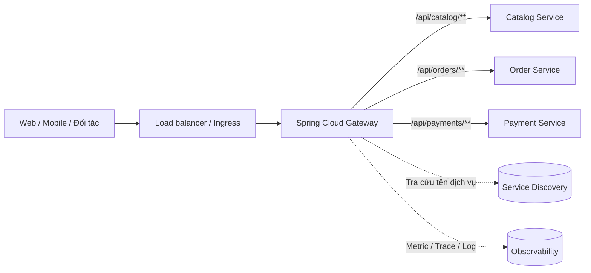
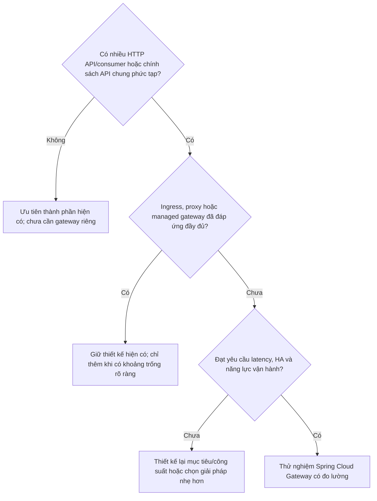

# Lợi ích, chi phí vận hành và trường hợp không cần gateway

## Mục tiêu bài học

Sau bài này, bạn có thể:

- Giải thích giá trị của **API Gateway** đối với một hệ thống microservices và phân biệt giá trị đó với những gì từng dịch vụ tự làm được.
- Chỉ ra các chi phí phát sinh khi đưa **Spring Cloud Gateway** vào đường đi của request: độ trễ, tài nguyên, độ sẵn sàng, bảo mật và công việc vận hành.
- Nhận diện trường hợp **không cần gateway riêng**, hoặc đã có thành phần hạ tầng đáp ứng đủ nhu cầu.
- Đưa ra quyết định có căn cứ bằng các tiêu chí cụ thể, thay vì mặc định rằng mọi hệ thống microservices đều phải có API Gateway.

## 1. Gateway giải quyết vấn đề gì?

Trong hệ thống chỉ có một ứng dụng backend, client thường gọi trực tiếp vào một địa chỉ API. Khi hệ thống tách thành nhiều dịch vụ — ví dụ `catalog-service`, `order-service`, `payment-service` — client có thể phải biết nhiều địa chỉ, nhiều quy tắc xác thực và nhiều phiên bản API. Mỗi thay đổi về cách triển khai dịch vụ có nguy cơ lan tới web, ứng dụng di động hoặc đối tác tích hợp.

**Spring Cloud Gateway** đặt một cổng xử lý HTTP ở phía trước các dịch vụ. Một request đi qua gateway, được chọn **route** dựa trên các **predicate** (điều kiện như đường dẫn, host, method), xử lý bởi **filter chain** và sau đó được chuyển tới dịch vụ đích. Gateway có thể sửa đường dẫn/header, tích hợp khám phá dịch vụ, xác thực, giới hạn lưu lượng, circuit breaker, retry, TLS và công cụ quan sát request.



Sơ đồ chỉ minh họa một kiến trúc khả dĩ: không phải hệ thống nào cũng cần đồng thời load balancer, ingress, service discovery và gateway. Những thành phần này có thể cùng tồn tại khi trách nhiệm của chúng thực sự khác nhau.

Vì gateway nằm trên đường đi của nhiều request, **mỗi lợi ích tập trung tại gateway đều đi kèm trách nhiệm vận hành tập trung**. Cần đánh giá cả hai mặt trước khi thêm thành phần này.

## 2. Các lợi ích chính

### 2.1. Một điểm vào ổn định, tách client khỏi cấu trúc nội bộ

Client chỉ cần biết một miền API công khai, chẳng hạn `api.example.com`, thay vì phải biết địa chỉ từng container hoặc từng dịch vụ. Gateway ánh xạ request bên ngoài vào dịch vụ bên trong.

| Request công khai | Quy tắc ở gateway | Request backend nhận được |
| --- | --- | --- |
| `GET /api/catalog/items/42` | Khớp đường dẫn `/api/catalog/**`, bỏ hai đoạn tiền tố `api/catalog` | `GET /items/42` tại Catalog Service |
| `POST /api/orders` | Khớp đường dẫn `/api/orders/**`, chọn Order Service | `POST /` nếu dùng cùng quy tắc bỏ hai đoạn tiền tố; cần thiết kế lại ánh xạ nếu backend kỳ vọng `/orders` |
| `GET /api/catalog/items?sort=price` | Chọn Catalog Service, giữ query string | `GET /items?sort=price` |

Ví dụ cho thấy việc biến đổi đường dẫn có thể hữu ích, nhưng phải thống nhất **contract** với backend. Đừng áp dụng một filter đổi đường dẫn cho mọi route khi các dịch vụ có cấu trúc endpoint khác nhau.

Khi dịch vụ đổi host, cổng hoặc số bản sao, cấu hình route và cơ chế khám phá dịch vụ có thể che giấu thay đổi khỏi client. Với Spring Cloud Gateway, URI dạng `lb://catalog-service` có thể dùng Spring Cloud LoadBalancer để chọn instance từ nguồn thông tin dịch vụ phù hợp. Cách này cần thành phần khám phá dịch vụ hoặc nguồn danh sách instance đã cấu hình; chỉ viết `lb://` không tự tạo ra service registry.

**Giá trị thực tế:** giảm sự phụ thuộc của client vào topology triển khai, đơn giản hóa cách công bố API và hỗ trợ di chuyển dịch vụ dần dần.

### 2.2. Tập trung chính sách chung cho request từ bên ngoài

Các nhu cầu như kiểm tra token, giới hạn kích thước request, chuẩn hóa một số header, kiểm soát CORS hay rate limiting thường xuất hiện ở nhiều dịch vụ. Đưa những quy tắc **chung và ổn định** lên gateway giúp tránh việc mỗi nhóm phát triển triển khai một cách.

Ví dụ, một ứng dụng có ba dịch vụ có thể thống nhất rằng:

- Request từ Internet phải đi qua TLS và có cơ chế xác thực phù hợp.
- Client được giới hạn số request theo user, API key hoặc một định danh tin cậy khác.
- Request có payload vượt ngưỡng sẽ bị từ chối ở rìa hệ thống, trước khi chiếm tài nguyên của backend.
- Một số route dành cho quản trị được chặn khỏi mạng công khai.

Tuy vậy, **gateway không thay thế kiểm tra quyền ở dịch vụ**. Gateway có thể xác thực danh tính và từ chối request thiếu quyền truy cập chung; Order Service vẫn phải xác định người gọi có được đọc **đơn hàng cụ thể** hay không. Đây là kiểm tra quyền gắn với dữ liệu và nghiệp vụ, không nên chuyển hết lên gateway.

Tương tự, khi gateway xử lý JWT, cần xác minh chữ ký, issuer, audience và thời hạn theo hợp đồng bảo mật; không được coi một header do client tự gửi là bằng chứng xác thực. Nếu backend có đường truy cập khác ngoài gateway, cần bảo vệ đường đó và xác thực phù hợp tại backend.

### 2.3. Bảo vệ hệ thống bằng điều tiết lưu lượng và khả năng phục hồi

Gateway là nơi phù hợp để xử lý một phần sự cố **trước khi request tạo áp lực lên nhiều backend**:

| Cơ chế | Lợi ích | Điểm cần thận trọng |
| --- | --- | --- |
| **Rate limiting** | Hạn chế một client chiếm dụng tài nguyên, có thể trả HTTP `429 Too Many Requests` | Giới hạn theo IP dễ bất công với người dùng chung NAT; nên cân nhắc user hoặc API key. Nhiều gateway replica thường cần bộ đếm dùng chung nếu muốn hạn mức toàn cụm. |
| **Timeout** | Chặn request treo quá lâu, giải phóng tài nguyên | Timeout quá ngắn tạo lỗi giả; phải tương thích timeout của load balancer, gateway và backend. |
| **Circuit breaker** | Ngừng đẩy request đến backend đang lỗi theo ngưỡng cấu hình | Chính sách fallback không được trả dữ liệu gây hiểu lầm, nhất là với thanh toán hoặc nghiệp vụ cần tính chính xác. |
| **Retry** | Khắc phục một số lỗi mạng hoặc lỗi tạm thời | Retry có thể nhân tải và tạo thao tác trùng lặp; cần xét tính idempotent, retry budget và backoff. |

Ví dụ: request `GET /catalog/items/42` có thể được thử lại một lần khi gặp lỗi kết nối tạm thời, nếu backend có hành vi đọc an toàn. Nhưng tự động retry `POST /payments` khi không biết lần gọi trước đã ghi nhận thanh toán hay chưa có thể gây thanh toán lặp. Đối với thao tác ghi, phải có hợp đồng idempotency rõ ràng và cân nhắc liệu retry ở gateway có đúng nơi thực hiện hay không.

Một circuit breaker ở gateway cũng chỉ bảo vệ **luồng qua gateway**. Giao tiếp trực tiếp giữa các dịch vụ, job nền và message consumer cần chiến lược phục hồi riêng.

### 2.4. Quan sát luồng truy cập thống nhất

Gateway có thể ghi nhận các chỉ số như lượng request theo route, mã trạng thái, thời gian đáp ứng, số kết nối đang hoạt động, số request bị từ chối hoặc timeout. Khi phối hợp với trace ID và distributed tracing, nhóm vận hành dễ biết request nào chậm ở gateway và request nào chậm ở downstream.

Ví dụ, tăng đột biến HTTP `502` trên route `orders` có thể là do lỗi kết nối đến Order Service, cấu hình route sai hoặc backend quá tải. Metrics theo route và trace xuyên dịch vụ giúp phân biệt các nguyên nhân này.

**Giới hạn:** log ở gateway thường chỉ cho biết request tới đâu và kết quả trả về; nó không giải thích được toàn bộ logic nghiệp vụ của backend. Không ghi nguyên token, cookie nhạy cảm, thông tin thanh toán hay nội dung cá nhân vào access log. Việc truyền trace ID và thông tin địa chỉ client qua proxy cũng phải tuân theo chính sách tin cậy header.

### 2.5. Thay đổi API có kiểm soát

Với route predicate và filter chain, nhóm phát triển có thể chuyển dần một phần lưu lượng, điều chỉnh đường dẫn/header hoặc duy trì entry point cũ khi thay đổi kiến trúc. Đây là lợi ích đáng kể khi nhiều client được phát hành với chu kỳ khác nhau, đặc biệt là ứng dụng di động khó cập nhật đồng loạt.

Không nên biến gateway thành nơi chứa logic nghiệp vụ phức tạp, truy vấn cơ sở dữ liệu của nhiều dịch vụ hoặc thực hiện chuỗi giao dịch. Nếu một yêu cầu cần tổng hợp dữ liệu theo nhu cầu giao diện, **Backend for Frontend (BFF)** hoặc một API composition service có thể là vị trí thích hợp hơn.

## 3. Chi phí vận hành: gateway tạo thêm điều gì?

### 3.1. Thêm một bước mạng và thời gian xử lý

Luồng trực tiếp có thể là:

```text
Client → Load Balancer → Backend
```

Khi thêm gateway, đường đi có thể thành:

```text
Client → Load Balancer → Gateway → Backend
```

Gateway tốn thời gian để nhận request, kiểm tra predicate, chạy filter, xác thực, chọn upstream, chuyển tiếp dữ liệu và trả response. TLS, truy cập kho khóa xác thực, bộ đếm rate limit từ xa hoặc các filter có I/O có thể làm tăng thêm độ trễ. Số mili giây thực tế phụ thuộc phần cứng, vị trí mạng, traffic, cấu hình và phiên bản phần mềm; **không có một giá trị overhead cố định đúng cho mọi ứng dụng**.

Ví dụ *giả định* khi đo cùng tải và cùng backend:

| Chỉ số | Đi trực tiếp | Qua gateway | Độ tăng quan sát |
| --- | ---: | ---: | ---: |
| Latency p50 | 40 ms | 44 ms | +4 ms |
| Latency p99 | 180 ms | 202 ms | +22 ms |

Những số trên chỉ minh họa cách so sánh, **không phải benchmark của Spring Cloud Gateway**. Sự khác biệt ở p99 thường quan trọng với trải nghiệm thực tế hơn mức trung bình. Cần đo cả latency, throughput, tỷ lệ lỗi và tài nguyên tiêu thụ trong tải bình thường lẫn tải đột biến.

### 3.2. Thêm tài nguyên và giới hạn công suất

Gateway tiêu thụ CPU, bộ nhớ, kết nối mạng và băng thông. Tùy thiết kế, một request có thể giữ kết nối trong lúc chờ backend trả lời. Số request đồng thời vì thế phụ thuộc vào lưu lượng và thời gian request tồn tại trong gateway.

Ước lượng sơ bộ theo định luật Little khi hệ thống tương đối ổn định:

```text
Số request đang xử lý ≈ request/giây × thời gian tồn tại trung bình (giây)
```

Nếu giờ cao điểm có **2.000 request/giây**, một request ở trong gateway trung bình **0,05 giây**, số request đồng thời xấp xỉ **100**. Đây là điểm bắt đầu để lập kế hoạch; chưa tính peak burst, request lâu, streaming, connection pool, retry hoặc giới hạn của từng loại filter. Cần thử tải để xác định ngưỡng thực tế và cấu hình autoscaling.

Gateway cũng có thể trở thành **nút nghẽn chung**: một filter chặn luồng xử lý, một kết nối Redis chậm, pool kết nối upstream cạn hoặc cấu hình giới hạn quá chặt có thể ảnh hưởng nhiều route cùng lúc. Nếu dùng biến thể Spring Cloud Gateway chạy trên WebFlux, cần đặc biệt tránh đưa tác vụ blocking dài vào luồng xử lý phản ứng. Spring Cloud Gateway cũng có biến thể dành cho Spring Web MVC; cách cấu hình và mô hình thực thi phải được xem theo biến thể và phiên bản đang dùng.

### 3.3. Tăng số thành phần phải duy trì và giám sát

Một gateway dùng trong production thường đòi hỏi:

- **High availability:** nhiều replica, health check, phân bổ tải, lịch nâng cấp và rollback.
- **Cấu hình:** quản lý route/filter theo môi trường, kiểm tra thay đổi, tránh các route chồng lấn hoặc vô tình công khai endpoint nội bộ.
- **Bảo mật:** chứng chỉ TLS, trust store, chính sách CORS, xác thực, vòng đời key/JWKS, bảo vệ actuator/admin endpoint và quản lý dependency có lỗ hổng.
- **Phụ thuộc ngoài:** service discovery, bộ nhớ đếm hạn mức (ví dụ Redis nếu cấu hình giới hạn phân tán), hệ thống cấu hình hoặc identity provider.
- **Observability:** dashboard, cảnh báo, log, trace, phân biệt lỗi của gateway với lỗi từ upstream.
- **Vận hành sự cố:** on-call, quy trình bỏ qua route lỗi, rollback cấu hình, thử nghiệm khả năng chịu lỗi và kế hoạch khi dependency không khả dụng.

Với rate limiter dùng kho trạng thái chung, còn phải chọn hành vi khi kho đó lỗi: **fail-open** tiếp tục phục vụ nhưng có nguy cơ vượt hạn mức, hoặc **fail-closed** bảo vệ tài nguyên nhưng có thể từ chối khách hợp lệ. Quyết định tùy rủi ro của API, không nên phó mặc cho một giá trị mặc định chưa kiểm tra.

Gateway là một bề mặt tấn công quan trọng. Các header như `X-Forwarded-For`, `X-Forwarded-Proto` hay `Forwarded` chỉ nên được tin cậy khi đến từ proxy được kiểm soát; client có thể tự giả mạo nếu hạ tầng không lọc. Cần đặt giới hạn kích thước header/body, xử lý đúng CORS, tránh lộ chi tiết upstream và kiểm soát các endpoint quản trị.

### 3.4. Tác động đến độ sẵn sàng

Khi mọi request phải qua gateway, sự cố gateway có thể khiến nhiều backend vẫn khỏe nhưng API bên ngoài không truy cập được. Thêm replica và load balancer giúp giảm rủi ro một máy lỗi, nhưng không tự giải quyết được lỗi cấu hình chung, lỗi dependency hoặc triển khai một phiên bản filter sai cho toàn cụm.

Để hình dung rủi ro, nếu gateway và backend đều có mức sẵn sàng **99,95%** và giả định sự cố của hai thành phần độc lập, mức sẵn sàng của chuỗi bắt buộc đi qua cả hai xấp xỉ:

```text
A_chuỗi ≈ A_gateway × A_backend
        ≈ 0,9995 × 0,9995
        ≈ 99,90%
```

Phép tính chỉ mang tính minh họa: hệ thống thực còn chịu lỗi tương quan, load balancer, mạng, vùng triển khai và khả năng phục hồi. Điều cần nhớ là **thêm một thành phần bắt buộc vào đường request tạo thêm một nguồn lỗi**, nên phải thiết kế availability và SLO cho toàn đường đi.

### 3.5. Chi phí tiền bạc và chi phí tổ chức

Tổng chi phí sở hữu một gateway không chỉ là số pod hoặc máy ảo. Có thể lập bảng ngân sách bằng công thức khái quát:

```text
TCO_gateway ≈ compute + bộ nhớ + network/load balancing
            + dependency ngoài (nếu có)
            + monitoring/logging/tracing
            + bảo trì, nâng cấp, trực sự cố
```

Cần tính cả lưu lượng mạng đi qua thêm tầng, chi phí lưu log theo request, băng thông giữa zone nếu đặt sai vị trí, và thời gian nhóm phải hỗ trợ phát hành thay đổi route. Ngược lại, gateway có thể **tiết kiệm** chi phí trùng lặp khi chính sách bảo vệ và đo lường trước đây nằm trong nhiều backend. Quyết định hợp lý dựa trên *chi phí ròng và mức rủi ro giảm được*, không chỉ chi phí triển khai ban đầu.

| Giá trị nhận được | Giá phải trả tương ứng | Cách kiểm chứng |
| --- | --- | --- |
| Một địa chỉ API ổn định | Cấu hình route, quy trình quản lý thay đổi | Số lần phải sửa client khi đổi backend |
| Xác thực và giới hạn lưu lượng tập trung | Tài nguyên chạy filter, dependency xác thực/đếm hạn mức | Tỷ lệ bị chặn đúng, false positive, độ trễ filter |
| Circuit breaker và retry | Cấu hình phức tạp, nguy cơ tăng tải khi retry | Tỷ lệ lỗi, số retry, khả năng phục hồi dưới tải |
| Thống nhất logging/tracing | Chi phí lưu trữ, kiểm soát dữ liệu nhạy cảm | Tỷ lệ trace nối được gateway với backend, thời gian tìm nguyên nhân lỗi |
| Giảm sự phụ thuộc của client | Một điểm vào có phạm vi ảnh hưởng rộng | Độ sẵn sàng end-to-end, khả năng rollback |

## 4. Khi nào không cần thêm Spring Cloud Gateway?

**Không dùng gateway riêng cũng là một lựa chọn kiến trúc hợp lệ.** Câu hỏi quan trọng là: có nhu cầu cụ thể nào chưa được thành phần hiện tại giải quyết đủ tốt không?

### 4.1. Monolith hoặc một backend duy nhất

Nếu sản phẩm chỉ có một backend và một nhóm client, một reverse proxy hoặc load balancer có thể đủ để kết thúc TLS, chuyển tiếp request và giới hạn lưu lượng cơ bản. Đặt thêm Spring Cloud Gateway chỉ để proxy toàn bộ request sang cùng một ứng dụng có thể tạo thêm độ trễ và gánh nặng triển khai mà chưa đem lại lợi ích tương xứng.

Khi hệ thống dần tách nhiều backend, có nhiều client độc lập hoặc xuất hiện chính sách liên dịch vụ cần quản lý, có thể xem lại quyết định.

### 4.2. Đã có ingress hoặc reverse proxy đáp ứng đủ nhu cầu

Ví dụ, một hệ thống Kubernetes nội bộ chỉ cần định tuyến theo host/path và TLS ở cạnh cụm; ingress controller đang vận hành ổn định và xử lý được các yêu cầu đó. Khi chưa cần filter tùy biến hoặc chính sách API đặc thù, thêm một gateway ứng dụng có thể trùng chức năng.

Điều này **không có nghĩa ingress và API Gateway luôn tương đương**. Ingress chủ yếu giải quyết cách công bố traffic vào cụm; gateway có thể thêm logic xử lý API, xác thực, rate limiting và các chính sách theo route. Phải kiểm tra khả năng của sản phẩm ingress thực tế thay vì suy luận từ tên gọi.

### 4.3. Chủ yếu giao tiếp bất đồng bộ, không có nhiều HTTP API công khai

Nếu các dịch vụ trao đổi qua message broker hoặc event streaming và chỉ có một API quản trị nhỏ, gateway HTTP có thể không giải quyết điểm nghẽn chính. Nên đầu tư vào xác thực broker, quyền publish/subscribe, retry/dead-letter, khả năng quan sát consumer và quản lý schema phù hợp. Gateway chỉ cần thiết nếu có các API HTTP thực sự cần bảo vệ hoặc định tuyến.

### 4.4. Lưu lượng rất ít, hệ thống đơn giản và đội vận hành nhỏ

Với một sản phẩm thử nghiệm hoặc ứng dụng nội bộ ít người dùng, chi phí triển khai, theo dõi và gỡ lỗi gateway có thể lớn hơn lợi ích. Cách tiếp cận hợp lý là tối giản số thành phần, chuẩn hóa đường API và chuẩn bị ranh giới đủ rõ để bổ sung gateway khi phát sinh nhu cầu.

Không nên lấy lý do "traffic ít" để bỏ yêu cầu bảo mật. Dù không có Spring Cloud Gateway, ứng dụng vẫn phải có xác thực, phân quyền, TLS và kiểm soát truy cập phù hợp ở các lớp khác.

### 4.5. Đã có API management hoặc managed gateway đáp ứng yêu cầu

Nếu tổ chức đã sử dụng một dịch vụ API Gateway được quản lý với đầy đủ route, xác thực, quota, chính sách API và theo dõi, việc dựng thêm Spring Cloud Gateway cần có lý do rõ ràng — chẳng hạn tính năng đặc biệt, yêu cầu triển khai tại chỗ hoặc lọc request không được nền tảng hiện hữu hỗ trợ.

Hai lớp gateway xếp chồng đôi khi có chủ đích, nhưng cần chỉ định lớp nào chịu trách nhiệm TLS, xác thực, rate limit, timeout, logging và cách truyền định danh. Nếu không có phân công, chính sách có thể xung đột hoặc bị áp dụng lặp.

### 4.6. Đường xử lý đòi hỏi độ trễ cực thấp

Với một đường xử lý mà từng mili giây đều quan trọng, hãy đo xem một tầng gateway thêm vào có phù hợp với latency budget hay không. Một reverse proxy nhẹ hoặc đường kết nối trực tiếp có thể thích hợp hơn; ngược lại, gateway vẫn đáng dùng nếu khả năng kiểm soát và bảo vệ traffic đem lại lợi ích lớn hơn chi phí đo được. Không kết luận chỉ dựa trên tên công nghệ.

## 5. Phân biệt gateway với các thành phần thường bị nhầm

| Thành phần | Trách nhiệm điển hình | Khi phù hợp |
| --- | --- | --- |
| **Load balancer / reverse proxy** | Phân tải, chuyển tiếp HTTP/TCP, có thể xử lý TLS và một số chính sách đơn giản | Cần một điểm vào và chuyển tiếp cơ bản |
| **Kubernetes Ingress / Gateway API implementation** | Khai báo và vận hành định tuyến traffic vào các workload trong cụm theo khả năng controller | Đã triển khai trên Kubernetes, cần quy tắc mạng/HTTP tại rìa cụm |
| **Spring Cloud Gateway** | Route predicate, filter chain, biến đổi request/response và áp dụng chính sách API theo route | Có nhiều HTTP API và nhu cầu kiểm soát luồng request theo ứng dụng |
| **API management / managed API gateway** | Xuất bản, bảo vệ, theo dõi, quota và đôi khi có portal/đăng ký API | Có nhiều consumer hoặc yêu cầu quản trị vòng đời API |
| **Service mesh** | Quản lý traffic giữa các dịch vụ, mTLS, retry, telemetry tùy triển khai | Cần chính sách nhất quán cho giao tiếp service-to-service |
| **Backend for Frontend (BFF)** | Gom/chuyển đổi dữ liệu theo nhu cầu riêng của web, mobile hoặc kênh khác | Client cần một API tổng hợp tối ưu cho trải nghiệm riêng |

Các thành phần có thể **bổ sung** nhau. Ví dụ ingress định tuyến traffic từ Internet tới Spring Cloud Gateway; gateway áp dụng chính sách API; service mesh áp dụng mTLS giữa các dịch vụ. Tuy nhiên, nếu yêu cầu hiện tại đã được một lớp giải quyết đầy đủ, việc thêm lớp mới cần chứng minh lợi ích.

## 6. Khung quyết định: thêm gateway khi nào?

Trước khi chọn công nghệ, ghi rõ các **yêu cầu quan sát được**:

1. **Có bao nhiêu HTTP API và loại client?** Nhiều backend/consumer độc lập làm giá trị một entry point ổn định tăng lên.
2. **Đang có thành phần nào đảm nhiệm route, TLS, xác thực và rate limiting?** Chỉ nêu chức năng thực sự còn thiếu.
3. **Có cần chính sách khác nhau theo route hoặc consumer?** Ví dụ đối tác được quota riêng, endpoint nhạy cảm cần xác thực nghiêm ngặt.
4. **Có đủ ngân sách latency và năng lực vận hành?** Xác định SLO, peak traffic, ngân sách tài nguyên, nhân sự trực sự cố.
5. **Một sự cố gateway sẽ ảnh hưởng bao nhiêu luồng nghiệp vụ?** Lên kế hoạch nhiều replica, kiểm thử failover và rollback.
6. **Chính sách nào thuộc về gateway, chính sách nào bắt buộc ở backend?** Đừng chuyển kiểm tra quyền theo dữ liệu hoặc giao dịch vào filter.
7. **Lợi ích đo lường được có lớn hơn chi phí thêm thành phần?** So sánh với phương án chỉ dùng ingress/reverse proxy/managed gateway hiện có.

Có thể tóm tắt quyết định bằng một cây hỏi đáp:



Sơ đồ giúp **sàng lọc** lựa chọn; nó không thay thế thử tải, đánh giá rủi ro và so sánh chi phí thực tế.

## 7. Ba tình huống áp dụng

### Tình huống A — Nền tảng thương mại điện tử có nhiều client

Một hệ thống có web, mobile và đối tác bán hàng; backend tách thành catalog, order, payment và account. Các nhóm đang lặp lại xác thực token, quota đối tác và log truy cập. Một thay đổi địa chỉ dịch vụ buộc nhiều client sửa cấu hình.

**Đánh giá:** gateway có giá trị rõ rệt. Có thể đặt route theo prefix, dùng service discovery, thống nhất kiểm soát request đầu vào, rate limiting và tracing. Tuy nhiên, quyền đọc đơn hàng và việc tạo thanh toán vẫn phải kiểm tra ở backend. Cần kiểm thử retry, chọn timeout riêng cho route thanh toán và thiết kế nhiều replica gateway.

**Tiêu chí thành công:** giảm số lần client phải thay đổi khi backend đổi địa chỉ; chính sách quota nhất quán; theo dõi được lỗi theo route; đạt mục tiêu latency p95/p99 và availability sau khi thêm gateway.

### Tình huống B — Ứng dụng nội bộ một backend

Một ứng dụng quản trị nhỏ có một service Spring Boot, người dùng qua mạng riêng, reverse proxy hiện tại đã làm TLS và phân quyền được thực hiện tại backend. Không có nhu cầu route phức tạp, thay header hay áp quota theo đối tác.

**Đánh giá:** chưa cần Spring Cloud Gateway. Tiếp tục dùng proxy hiện có, giám sát ứng dụng và quản lý xác thực/ủy quyền tại backend. Xem xét lại khi hệ thống mở rộng thành nhiều API hoặc có yêu cầu rìa hệ thống chưa đáp ứng được.

### Tình huống C — Microservices đã có Kubernetes ingress và service mesh

Một công ty có nhiều service, nhưng traffic công khai chỉ gồm vài endpoint. Ingress đã xử lý route và TLS; service mesh thực hiện mTLS, telemetry nội bộ và một số chính sách phục hồi.

**Đánh giá:** không mặc định phải bổ sung Spring Cloud Gateway chỉ vì đang dùng microservices. Hãy xác định có thiếu quota theo API key, filter tùy biến theo route hoặc cơ chế công bố API riêng hay không. Nếu có nhu cầu này, gateway có thể bổ sung; nếu không, chỉ tạo thêm một lớp cấu hình và một điểm lỗi.

## 8. Nếu quyết định dùng gateway: tối thiểu cần đo và vận hành

Trước khi phát hành production, nên có một bản thử nghiệm với route thật và tải đại diện, ghi nhận ít nhất:

| Nhóm kiểm tra | Cần chứng minh |
| --- | --- |
| **Định tuyến** | Predicate chọn đúng route; biến đổi path/header đúng hợp đồng; route mặc định và route nội bộ không bị lộ |
| **Hiệu năng** | Throughput, latency p50/p95/p99, CPU, memory, connection pool ở tải thường, peak và burst |
| **Sự cố** | Gateway replica chết, backend timeout, discovery không sẵn sàng, rate-limit store lỗi: hệ thống phản ứng thế nào |
| **Bảo mật** | TLS, JWT/token validation khi áp dụng, giới hạn header/body, CORS, trusted proxy headers và bảo vệ endpoint quản trị |
| **Kiểm soát tải** | Quota đúng theo consumer; không để retry gây bùng tải hoặc lặp thao tác ghi |
| **Quan sát** | Có trace ID end-to-end, metric theo route, alert trên error rate/latency/saturation; log không rò thông tin nhạy cảm |
| **Thay đổi** | Cấu hình được review, thử trên môi trường phù hợp, triển khai tăng dần và rollback nhanh |

Nên xác định **ngân sách độ trễ** cho toàn request, chẳng hạn một endpoint có SLO p99 dưới một ngưỡng đã thống nhất. Phân bổ ngân sách cho kết nối ngoài, gateway và backend dựa trên phép đo; đừng đặt timeout hoặc retry ở từng lớp độc lập khiến tổng thời gian chờ vượt SLO.

Về trách nhiệm, nhóm sở hữu gateway cần công bố rõ contract cho các nhóm backend: quy tắc route và path rewrite, header nào được thêm/bỏ, cách chuyển thông tin identity và trace, giới hạn request, mã lỗi khi bị chặn, chính sách timeout/retry. Mỗi dịch vụ vẫn sở hữu schema API, phân quyền theo dữ liệu, idempotency và logic nghiệp vụ.

## 9. Những ngộ nhận cần tránh

- **“Có gateway là backend đã an toàn.”** Sai: gateway chỉ là một lớp bảo vệ; backend vẫn cần phân quyền và kiểm soát đường truy cập khác.
- **“Càng nhiều filter càng tốt.”** Sai: mỗi filter thêm độ phức tạp, chi phí xử lý và khả năng tạo lỗi.
- **“Gateway tự giải quyết lỗi dây chuyền.”** Sai: timeout, circuit breaker và retry cấu hình sai có thể làm tình hình xấu hơn; giao tiếp không đi qua gateway vẫn cần bảo vệ.
- **“Gateway thay thế service mesh hoặc ingress.”** Không phải lúc nào cũng vậy: ranh giới trách nhiệm và khả năng thực tế của từng thành phần quyết định việc thay thế hay bổ sung.
- **“Hệ thống microservices bắt buộc có gateway.”** Sai: quyết định phụ thuộc yêu cầu tiếp nhận traffic, mức độ trùng lặp chính sách, hạ tầng đã có và chi phí vận hành.

## Kết luận

Spring Cloud Gateway hữu ích nhất khi hệ thống cần **một điểm vào API ổn định**, **route/filter linh hoạt**, **chính sách bảo vệ request dùng chung** và **quan sát traffic tập trung**. Đổi lại, gateway bổ sung một chặng mạng, sử dụng tài nguyên, phụ thuộc vận hành và có thể trở thành điểm lỗi ảnh hưởng rộng.

Hãy chọn gateway khi có **nhu cầu cụ thể, lợi ích kiểm chứng được và năng lực vận hành tương xứng**. Khi chỉ có một backend, ingress/reverse proxy đã đủ, hoặc API HTTP không phải trọng tâm, thiết kế đơn giản thường là lựa chọn tốt hơn. Quyết định nên được rà soát lại khi số dịch vụ, số consumer, yêu cầu bảo mật hoặc mức tải thay đổi.
