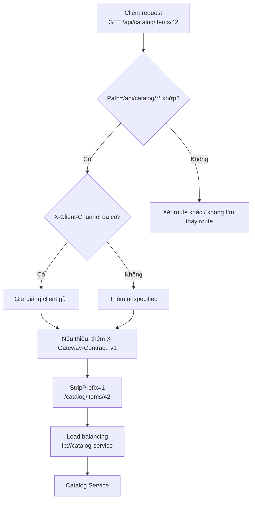

# AddRequestHeadersIfNotPresent và điều kiện bổ sung header

## Mục tiêu bài học

Trong chương **Header yêu cầu** của **Spring Cloud Gateway**, bài này trình bày cách thêm **giá trị mặc định cho HTTP request header khi header đó chưa xuất hiện** bằng `AddRequestHeadersIfNotPresent` GatewayFilter Factory. Đây là một thao tác nhỏ nhưng quan trọng trong thiết kế API Gateway: nhiều microservice cần một header để biết client đang dùng chế độ nào, trong khi không phải client nào cũng gửi header đó.

Sau bài học, bạn sẽ:

- Hiểu chính xác sự khác nhau giữa **header chưa có** và **header đã có nhưng mang giá trị rỗng, không hợp lệ hoặc do client tự khai báo**.
- Cấu hình `AddRequestHeadersIfNotPresent` cho một hoặc nhiều cặp tên–giá trị, kể cả nhiều giá trị của cùng một tên header.
- Sử dụng biến URI bắt được từ `Path` hoặc `Host` predicate trong giá trị header.
- Phân biệt `AddRequestHeadersIfNotPresent` với `AddRequestHeader`, `SetRequestHeader` và `RemoveRequestHeader`.
- Dự đoán kết quả khi kết hợp nhiều filters, khi dùng route-specific/default filters và khi request đi qua load balancing.
- Kiểm thử header mà backend thực nhận, đồng thời không biến header từ client thành dữ liệu xác thực đáng tin.

> Phạm vi ví dụ là **Spring Cloud Gateway Server WebFlux**. Những dòng Spring Cloud Gateway khác nhau có thể thay đổi namespace cấu hình và API; bài viết nêu rõ cách kiểm tra phiên bản ở phần cấu hình.

## 1. Bài toán: bổ sung mặc định mà không thay lựa chọn của client

Giả sử Catalog Service cần header `X-Client-Channel` để chọn định dạng phản hồi mặc định. Web client gửi `X-Client-Channel: web`, mobile client gửi `X-Client-Channel: mobile`, còn một số client cũ không gửi header.

Ta muốn Gateway áp dụng quy tắc:

```text
Nếu request đã có X-Client-Channel:
    giữ giá trị đang có
Nếu request chưa có X-Client-Channel:
    thêm X-Client-Channel: unspecified
```

Ví dụ:

| Header client gửi | Header chuyển tới backend sau filter |
| --- | --- |
| Không có `X-Client-Channel` | `X-Client-Channel: unspecified` |
| `X-Client-Channel: web` | `X-Client-Channel: web` |
| `X-Client-Channel: mobile` | `X-Client-Channel: mobile` |
| `x-client-channel: partner` | Giữ `partner`; tên HTTP header không phân biệt chữ hoa/thường |

Đây chính là mục đích của **`AddRequestHeadersIfNotPresent`**: tạo **giá trị mặc định khi thiếu header**. Filter này không kiểm tra xem giá trị do client gửi có hợp lệ về mặt nghiệp vụ, không xác thực ai đã gửi và không bảo đảm giá trị được giữ lại là đáng tin.

Tên filter có chữ **`Headers` số nhiều**: `AddRequestHeadersIfNotPresent`. Cần phân biệt tên đó với `AddRequestHeader`, một filter khác có cách xử lý khi header đã tồn tại.

## 2. Cú pháp cấu hình căn bản

`AddRequestHeadersIfNotPresent` nhận một **tập các cặp `tên:giá-trị`**, ngăn cách các cặp bằng dấu phẩy.

### 2.1. Thêm một header khi thiếu

Trong kiểu cấu hình Spring Cloud Gateway Server WebFlux truyền thống:

```yaml
spring:
  cloud:
    gateway:
      routes:
        - id: catalog
          uri: http://localhost:9001
          predicates:
            - Path=/api/catalog/**
          filters:
            - AddRequestHeadersIfNotPresent=X-Client-Channel:unspecified
```

Điều kiện áp dụng:

1. Request phải khớp predicate `Path=/api/catalog/**` để route `catalog` được chọn.
2. Trong filter chain của route, `AddRequestHeadersIfNotPresent` kiểm tra sự **hiện diện** của tên `X-Client-Channel` trên request tại thời điểm filter chạy.
3. Nếu không có header đó, Gateway thêm `X-Client-Channel: unspecified` vào **request gửi về backend**.
4. Nếu đã có, giá trị hiện tại được giữ; filter không dùng giá trị mặc định để ghi đè.

Trong ví dụ, `localhost:9001` là một backend giả lập cần tự chạy. Nếu muốn backend chỉ nhận `/catalog/...` thay cho `/api/catalog/...`, phải bổ sung filter như `StripPrefix=1`; việc thêm header **không tự thay đổi path**.

### 2.2. Thêm nhiều header độc lập

Một route có thể bổ sung nhiều giá trị mặc định trong **một dòng**:

```yaml
filters:
  - AddRequestHeadersIfNotPresent=X-Client-Channel:unspecified,X-Gateway-Contract:v1
```

Khi request chưa có hai header, backend nhận:

```http
X-Client-Channel: unspecified
X-Gateway-Contract: v1
```

Khi request chỉ có `X-Client-Channel: mobile`, Gateway **giữ `mobile`** và vẫn thêm `X-Gateway-Contract: v1` nếu header này còn thiếu. Các cặp hoạt động theo kiểm tra của **từng tên header**, không phải điều kiện “hoặc thêm cả nhóm, hoặc không thêm gì”.

| Trạng thái trước filter | Kết quả |
| --- | --- |
| Thiếu cả hai | Thêm cả `X-Client-Channel` và `X-Gateway-Contract` |
| Có `X-Client-Channel`, thiếu `X-Gateway-Contract` | Chỉ thêm `X-Gateway-Contract` |
| Thiếu `X-Client-Channel`, có `X-Gateway-Contract` | Chỉ thêm `X-Client-Channel` |
| Đã có cả hai | Không thêm hai mặc định đó |

Giá trị có dấu phẩy hoặc dấu hai chấm phức tạp có thể gây nhập nhằng trong cú pháp rút gọn. Khi cần cấu trúc đặc biệt, hãy kiểm tra cú pháp mà phiên bản factory hỗ trợ và kiểm thử request thực tế; đừng tự suy luận rằng mọi chuỗi chứa dấu phân tách đều được giữ nguyên.

### 2.3. Cung cấp nhiều giá trị cho cùng một header

HTTP có thể biểu diễn một header bằng **nhiều giá trị**. Spring Cloud Gateway hỗ trợ lặp lại cùng tên trong cấu hình:

```yaml
filters:
  - AddRequestHeadersIfNotPresent=X-Accepted-Mode:json,X-Accepted-Mode:csv
```

Nếu request **chưa có** `X-Accepted-Mode`, filter bổ sung hai giá trị `json` và `csv` cho cùng tên header. Nếu client đã gửi `X-Accepted-Mode: xml`, giá trị client gửi được giữ lại, thay vì tự động nối thêm hai giá trị mặc định.

| Request ban đầu | Giá trị `X-Accepted-Mode` mà backend có thể đọc |
| --- | --- |
| Không có header | Danh sách `["json", "csv"]` |
| `X-Accepted-Mode: xml` | Giá trị đã có: `["xml"]` |
| `x-accepted-mode: json` | Giá trị đã có: `["json"]` |

Tùy proxy/HTTP library, nhiều giá trị có thể được biểu diễn trên wire bằng nhiều dòng header hoặc theo cách tương thích với loại header; ứng dụng nên đọc đúng semantics của header thay vì giả định luôn chỉ có một chuỗi. Các header có ngữ nghĩa đặc biệt như `Set-Cookie` hoặc `Authorization` không nên được xử lý như một danh sách chuỗi tùy ý.

## 3. Điều kiện “if not present” thực sự kiểm tra điều gì?

Điều kiện cốt lõi là **có tồn tại tên header trong bộ HTTP headers hiện tại không**. Đây là kiểm tra sự hiện diện, không phải điều kiện nghiệp vụ do người viết tự đặt.

### 3.1. Phân biệt thiếu, rỗng và không hợp lệ

Giả sử filter cấu hình:

```yaml
- AddRequestHeadersIfNotPresent=X-Client-Channel:unspecified
```

| Đầu vào | Cách hiểu | Có bổ sung `unspecified`? |
| --- | --- | --- |
| Không có tên header | Thiếu header | Có |
| `X-Client-Channel: mobile` | Header đã có | Không |
| `X-Client-Channel: UNKNOWN` | Header đã có dù giá trị không thuộc tập mong muốn | Không |
| `X-Client-Channel:` với giá trị rỗng thực sự được HTTP stack giữ lại | Header vẫn hiện diện | Không |
| `x-client-channel: web` | Cùng tên header theo quy tắc không phân biệt hoa/thường | Không |
| Hai giá trị cùng tên | Header đã có nhiều giá trị | Không thêm mặc định |

Không nên đặt kỳ vọng “giá trị rỗng sẽ được sửa thành mặc định”. Nếu yêu cầu nghiệp vụ là **thiếu hoặc blank đều phải trở thành `unspecified`**, cần một chính sách khác: ví dụ một custom filter kiểm tra dữ liệu và chủ động chuẩn hóa, hoặc từ chối request không hợp lệ. Có thể phân biệt bằng Java:

```java
HttpHeaders headers = exchange.getRequest().getHeaders();

boolean absent = !headers.containsKey("X-Client-Channel");
String firstValue = headers.getFirst("X-Client-Channel");
boolean blank = firstValue == null || firstValue.isBlank();
```

`absent` và `blank` không cùng nghĩa. Đoạn code cần `org.springframework.http.HttpHeaders` và chỉ dùng để **minh họa điều kiện**, chưa phải một custom `GatewayFilter` hoàn chỉnh. Với header nhiều giá trị, nên xét tất cả giá trị theo contract thay vì chỉ dựa vào `getFirst`.

### 3.2. Tên header không phân biệt chữ hoa/thường

Theo semantics HTTP, `X-Client-Channel`, `x-client-channel` và `X-CLIENT-CHANNEL` cùng chỉ một **header field name**. Vì vậy không dùng sự khác biệt chữ hoa để cố tạo hai header nghiệp vụ độc lập.

Ngược lại, **giá trị** có thể phân biệt hoa/thường tùy định nghĩa từng header. `web` và `WEB` có thể mang hai ý nghĩa khác nhau nếu contract của API yêu cầu. `AddRequestHeadersIfNotPresent` không chuẩn hóa case hoặc validate giá trị.

### 3.3. Header được kiểm tra ở thời điểm filter chạy

Hãy coi các filters như chuỗi phép biến đổi:

```text
Request ban đầu
  ↓
Filter 1 thay request header
  ↓
Filter 2: AddRequestHeadersIfNotPresent
  ↓
Filter 3 có thể sửa hoặc xóa header
  ↓
HTTP routing đến backend
```

`AddRequestHeadersIfNotPresent` không “khóa” header ở trạng thái sau khi nó chạy. **Filter chạy sau vẫn có thể ghi đè hoặc xóa**; filter chạy trước có thể làm header xuất hiện hoặc biến mất. Vì vậy kết quả ở backend cần được kiểm tra sau **toàn bộ filter chain**.

## 4. So sánh với những filter thường bị nhầm

Giả sử client gửi:

```http
X-Client-Channel: mobile
```

Và Gateway định đặt giá trị `unspecified`.

| Filter | Khi header **chưa có** | Khi header **đã có** | Mục đích |
| --- | --- | --- | --- |
| `AddRequestHeadersIfNotPresent` | Thêm mặc định | Giữ nguyên giá trị hiện có | Cung cấp giá trị dự phòng |
| `AddRequestHeader` | Thêm giá trị | Thêm một giá trị nữa, có thể tạo header nhiều giá trị | Bổ sung header theo route |
| `SetRequestHeader` | Đặt giá trị | Thay các giá trị của cùng tên bằng giá trị mới | Chuẩn hóa/ghi đè header |
| `RemoveRequestHeader` | Không có gì cần xóa | Bỏ header khỏi request gửi tiếp | Loại bỏ header không nên được chuyển tiếp |

Ví dụ:

```yaml
filters:
  - AddRequestHeader=X-Client-Channel, from-gateway
```

Nếu client có `mobile`, downstream có thể nhận **cả `mobile` và `from-gateway`**. Đây khác với `AddRequestHeadersIfNotPresent`, vốn giữ nguyên `mobile` mà không thêm mặc định.

```yaml
filters:
  - SetRequestHeader=X-Client-Channel, from-gateway
```

Trong trường hợp cần giá trị chắc chắn được thiết lập bởi Gateway, `SetRequestHeader` thích hợp hơn **về thao tác thay thế**, nhưng vẫn phải thiết kế nguồn dữ liệu tin cậy và chính sách bảo mật tổng thể.

```yaml
filters:
  - RemoveRequestHeader=X-Client-Channel
```

Filter này phù hợp khi cần ngăn một header được chuyển tiếp, ví dụ header chứa dữ liệu thừa hoặc header nội bộ mà client không được tự cung cấp. Nó khác với việc tạo mặc định.

**Quy tắc chọn nhanh:** muốn **giữ giá trị nếu có** thì dùng `AddRequestHeadersIfNotPresent`; muốn **luôn thêm** thì dùng `AddRequestHeader`; muốn **thay giá trị** thì dùng `SetRequestHeader`; muốn **loại bỏ** thì dùng `RemoveRequestHeader`.

## 5. Thứ tự giữa các filter có thể thay đổi kết quả

Trong Spring Cloud Gateway Server WebFlux, sau route matching, `FilteringWebHandler` kết hợp các `GlobalFilter` với các `GatewayFilter` của route rồi sắp xếp theo cơ chế `Ordered`. Những route filters khai báo theo thứ tự có thể tác động lẫn nhau; `GlobalFilter`, `default-filters` hoặc custom order cũng có thể can thiệp.

### 5.1. Thêm mặc định trước rồi ghi đè

```yaml
filters:
  - AddRequestHeadersIfNotPresent=X-Client-Channel:unspecified
  - SetRequestHeader=X-Client-Channel, internal
```

Giả sử thứ tự thực thi đúng như trên, sau bước đầu `X-Client-Channel` có giá trị cũ hoặc `unspecified`; bước `SetRequestHeader` sau đó **thay bằng `internal`**. Như vậy backend luôn nhận `internal`, kể cả khi client đã gửi `mobile`.

Nếu mục tiêu chỉ là default, bước `SetRequestHeader` khiến ý định ban đầu không còn đúng.

### 5.2. Ghi đè trước rồi “nếu thiếu mới thêm”

```yaml
filters:
  - SetRequestHeader=X-Client-Channel, internal
  - AddRequestHeadersIfNotPresent=X-Client-Channel:unspecified
```

Filter sau nhìn thấy `X-Client-Channel` đã tồn tại nên **không thêm `unspecified`**. Kết quả vẫn là `internal`.

### 5.3. Xóa trước rồi thêm mặc định

```yaml
filters:
  - RemoveRequestHeader=X-Client-Channel
  - AddRequestHeadersIfNotPresent=X-Client-Channel:unspecified
```

Nếu không có filter khác can thiệp, header client gửi bị xóa trước; `AddRequestHeadersIfNotPresent` thấy tên header thiếu và thêm `unspecified`. Điều này có thể hữu ích khi **cố tình bỏ dữ liệu không tin cậy** rồi đặt giá trị tĩnh đã được kiểm soát.

Nhưng nếu mục tiêu là xác thực người dùng hoặc gắn role thực, **một giá trị tĩnh không chứng minh được danh tính/quyền**. Cần tạo thông tin từ kết quả xác thực đáng tin, truyền theo cơ chế bảo mật phù hợp và bảo vệ đường đến backend.

### 5.4. Thêm giá trị trước khiến mặc định bị bỏ qua

```yaml
filters:
  - AddRequestHeader=X-Client-Channel, mobile
  - AddRequestHeadersIfNotPresent=X-Client-Channel:unspecified
```

Sau `AddRequestHeader`, tên header đã xuất hiện. Bước `AddRequestHeadersIfNotPresent` không thêm `unspecified`, kể cả client ban đầu không gửi header đó.

| Chuỗi logic | Request ban đầu không có header | Request ban đầu có `web` |
| --- | --- | --- |
| Add-if-absent → Set `internal` | `internal` | `internal` |
| Set `internal` → Add-if-absent | `internal` | `internal` |
| Remove → Add-if-absent `unspecified` | `unspecified` | `unspecified` |
| Add `mobile` → Add-if-absent | `mobile` | Thường có thêm giá trị `mobile` vào `web` |

Đây là mô hình logic khi các filters chạy theo thứ tự nêu ở bảng. Với custom `Ordered`, những route filters từ `default-filters` hoặc nhiều lớp reverse proxy, phải kiểm tra **thứ tự hiệu lực thực tế** thay vì chỉ đọc một đoạn YAML cô lập.

## 6. Thêm giá trị từ URI variables

`AddRequestHeadersIfNotPresent` hỗ trợ **URI variables** do predicate như `Path` hoặc `Host` bắt được. Biến được mở rộng khi filter chạy.

Ví dụ:

```yaml
spring:
  cloud:
    gateway:
      routes:
        - id: item-detail
          uri: http://localhost:9001
          predicates:
            - Path=/api/items/{itemId}
          filters:
            - AddRequestHeadersIfNotPresent=X-Requested-Item:item-{itemId}
```

Giả sử client gửi:

```http
GET /api/items/42 HTTP/1.1
Host: api.example.com
```

Nếu request không có `X-Requested-Item`, backend có thể nhận:

```http
X-Requested-Item: item-42
```

Nếu client đã có `X-Requested-Item: custom`, filter giữ `custom` vì header **đã hiện diện**. Biến `{itemId}` không có nghĩa Gateway sẽ bắt buộc thay dữ liệu do client cung cấp.

**Lưu ý quan trọng:**

- Biến phải được predicate tương ứng bắt được; tên biến trong value cần trùng tên trong mẫu route.
- Nếu route không match, các route filters của nó không chạy.
- Giá trị bắt từ path/host bắt nguồn từ request; **không phải dữ liệu đáng tin để xác thực danh tính, tổ chức hay quyền truy cập**.
- Nếu muốn truyền ID nghiệp vụ đáng tin, backend phải kiểm tra quyền truy cập và tính hợp lệ của ID đó.
- URI variables khác với `${...}` của Spring property placeholders. Khi dùng cùng các bộ phân giải placeholder, cần chú ý cú pháp/escape và kiểm thử cấu hình.

Tùy nhu cầu, có thể dùng Host predicate:

```yaml
predicates:
  - Host={region}.api.example.com
filters:
  - AddRequestHeadersIfNotPresent=X-Requested-Region:region-{region}
```

Ví dụ với host `apac.api.example.com`, nếu header thiếu thì giá trị mặc định có thể là `region-apac`. Host cũng do luồng HTTP cung cấp và có thể chịu ảnh hưởng của proxy; không dùng `region` từ Host như bằng chứng quyền truy cập tenant.

## 7. Ví dụ tổng hợp với route, rewrite và service discovery

Giả sử một API Catalog công khai nhận:

```http
GET /api/catalog/items/42?currency=VND HTTP/1.1
Host: api.example.com
X-Client-Channel: mobile
```

Gateway cần:

1. Chọn route theo `Path=/api/catalog/**`.
2. Bổ sung `X-Client-Channel: unspecified` **chỉ khi thiếu**.
3. Bổ sung `X-Gateway-Contract: v1` **chỉ khi thiếu**.
4. Bỏ tiền tố `/api`, giữ path `/catalog/items/42`.
5. Dùng tên dịch vụ `catalog-service` để tìm instance, nếu đã cấu hình Spring Cloud LoadBalancer/service discovery.

```yaml
spring:
  cloud:
    gateway:
      routes:
        - id: catalog-api
          uri: lb://catalog-service
          predicates:
            - Path=/api/catalog/**
          filters:
            - AddRequestHeadersIfNotPresent=X-Client-Channel:unspecified,X-Gateway-Contract:v1
            - StripPrefix=1
```

Luồng xử lý khái quát:



Ở ví dụ này:

| Header từ client | Header cuối dự kiến tại backend |
| --- | --- |
| Không có `X-Client-Channel` | `X-Client-Channel: unspecified` |
| `X-Client-Channel: mobile` | `X-Client-Channel: mobile` |
| Không có `X-Gateway-Contract` | `X-Gateway-Contract: v1` |
| `X-Gateway-Contract: experimental` | Giữ `experimental` |

**Cẩn thận với tên `X-Gateway-Contract`:** nếu backend dùng header đó làm tín hiệu tin cậy rằng request thật sự đến từ Gateway, cấu hình add-if-absent là **không đủ an toàn** vì client có thể gửi sẵn `experimental`. Nên xem header này chỉ là metadata mặc định; nếu muốn đánh dấu nguồn đáng tin, phải chủ động xóa/ghi lại header từ nguồn đã được kiểm soát và bảo vệ tuyến mạng tới backend. Tốt hơn, dùng cơ chế nhận diện service và xác thực được thiết kế riêng.

### 7.1. Header sống qua các giai đoạn nào?

```text
Client
  │  request headers
  ▼
Ingress / Reverse proxy (nếu có)
  ▼
Route predicate matching
  ▼
GatewayFilter: AddRequestHeadersIfNotPresent
  ▼
GatewayFilter: StripPrefix
  ▼
RouteToRequestUrlFilter: tạo URI đích
  ▼
ReactiveLoadBalancerClientFilter: resolve lb:// nếu dùng
  ▼
HTTP routing tới upstream
  ▼
Backend đọc request header
```

Một filter thêm header vào **HTTP request**; nó không tự đưa giá trị vào `GATEWAY_REQUEST_URL_ATTR` và không tác động tới cách chọn instance của `lb://`. Tương tự, `StripPrefix` thay path chứ không tự ghi đè `X-Client-Channel`. Những bước này có thể kết hợp mà không cần can thiệp vào nghiệp vụ của backend.

Trong thực tế, proxy, cấu hình route và các filter khác có thể xóa hoặc thay đổi header về sau. Muốn biết backend nhận gì, phải **quan sát ở backend hoặc HTTP stub**, không chỉ đọc cấu hình filter.

## 8. Route-specific filters và `default-filters`

Khi chỉ một API cần giá trị mặc định, nên khai báo tại **route đó** để trách nhiệm rõ ràng:

```yaml
routes:
  - id: catalog-api
    uri: http://localhost:9001
    predicates:
      - Path=/api/catalog/**
    filters:
      - AddRequestHeadersIfNotPresent=X-Client-Channel:unspecified
```

Nếu nhiều route cùng có một quy ước header, Spring Cloud Gateway còn cung cấp cơ chế **`default-filters`** áp dụng mặc định cho các route trong phạm vi cấu hình:

```yaml
spring:
  cloud:
    gateway:
      default-filters:
        - AddRequestHeadersIfNotPresent=X-Client-Channel:unspecified
      routes:
        - id: catalog-api
          uri: http://localhost:9001
          predicates:
            - Path=/api/catalog/**

        - id: orders-api
          uri: http://localhost:9002
          predicates:
            - Path=/api/orders/**
```

Ví dụ trên dùng namespace truyền thống của Server WebFlux. Không nên áp dụng một default header cho toàn bộ Gateway nếu một số route (ví dụ API quản trị hoặc API đối tác) có hợp đồng khác nhau. Khi có thêm `GatewayFilter` của route và custom `GlobalFilter`, hãy xác nhận thứ tự được ghép trong filter chain hiệu lực.

### 8.1. Chọn đúng namespace theo phiên bản

Trong các dòng Spring Cloud Gateway Server WebFlux, namespace cấu hình có thể khác:

| Dòng cấu hình ví dụ | Prefix route | Ghi chú |
| --- | --- | --- |
| Một số phiên bản 4.x | `spring.cloud.gateway.routes` | Xuất hiện trong tài liệu chính thức của các dòng 4.x |
| Dòng 5.x Server WebFlux | `spring.cloud.gateway.server.webflux.routes` | Namespace cụ thể cho Server WebFlux |

Ví dụ cấu hình ở namespace Server WebFlux mới:

```yaml
spring:
  cloud:
    gateway:
      server:
        webflux:
          routes:
            - id: catalog-api
              uri: http://localhost:9001
              predicates:
                - Path=/api/catalog/**
              filters:
                - AddRequestHeadersIfNotPresent=X-Client-Channel:unspecified
```

**Không trộn namespace giữa các phiên bản** và không tự phỏng đoán đường dẫn cấu hình từ tên dependency. Kiểm tra tài liệu của phiên bản Spring Cloud Gateway mà dự án đang chạy và xem route đã thực sự được nạp chưa. Nếu một cấu hình không có hiệu lực, nguyên nhân có thể là prefix sai chứ không phải filter xử lý header sai.

## 9. Kiểm thử header thực nhận bằng HTTP

Một bài kiểm thử tốt cần chạy Gateway trỏ đến backend giả lập có khả năng trả về hoặc ghi lại header nhận được. Đừng chỉ khẳng định cấu hình YAML chứa `AddRequestHeadersIfNotPresent`.

Ví dụ với route `catalog-api` ở mục 7, giả sử Gateway chạy tại `localhost:8080` và backend hỗ trợ `GET /catalog/items/42`:

```bash
# Không gửi X-Client-Channel:
curl -i "http://localhost:8080/api/catalog/items/42"

# Client đã gửi giá trị riêng:
curl -i \
  -H "X-Client-Channel: mobile" \
  "http://localhost:8080/api/catalog/items/42"

# Khác chữ hoa/thường ở tên:
curl -i \
  -H "x-client-channel: web" \
  "http://localhost:8080/api/catalog/items/42"

# Client đã gửi giá trị khác với mặc định:
curl -i \
  -H "X-Gateway-Contract: experimental" \
  "http://localhost:8080/api/catalog/items/42"
```

Các lệnh này **không tự hiển thị request headers mà backend nhận**. Cần một HTTP stub/backend log phần header an toàn, hoặc cho backend trả một response thử nghiệm chứa các giá trị cần kiểm tra.

### 9.1. Backend stub chỉ dành cho môi trường thử nghiệm

Ví dụ một controller Spring Boot phục vụ test:

```java
import java.util.LinkedHashMap;
import java.util.Map;

import org.springframework.http.HttpHeaders;
import org.springframework.web.bind.annotation.GetMapping;
import org.springframework.web.bind.annotation.RequestHeader;
import org.springframework.web.bind.annotation.RestController;

@RestController
class HeaderEchoController {

    @GetMapping("/catalog/items/42")
    Map<String, Object> inspect(@RequestHeader HttpHeaders headers) {
        Map<String, Object> result = new LinkedHashMap<>();
        result.put("channel", headers.getFirst("X-Client-Channel"));
        result.put("contract", headers.getFirst("X-Gateway-Contract"));
        return result;
    }
}
```

Backend thử nghiệm có thể trả JSON:

```json
{
  "channel": "mobile",
  "contract": "v1"
}
```

Kết quả trên chỉ tương ứng với request có `X-Client-Channel: mobile` nhưng không có `X-Gateway-Contract`. **Không triển khai một endpoint tùy ý echo mọi header ra Internet**, nhất là khi request chứa `Authorization`, `Cookie`, token hoặc dữ liệu cá nhân.

### 9.2. Ma trận kiểm thử tối thiểu

| Trường hợp | Request client | Điều cần thấy ở backend |
| --- | --- | --- |
| Thiếu header | Không gửi `X-Client-Channel` | Có `unspecified` |
| Đã có header | Gửi `X-Client-Channel: mobile` | Vẫn là `mobile` |
| Khác chữ hoa | Gửi `x-client-channel: web` | Vẫn là `web`, không thêm giá trị mặc định |
| Giá trị lạ | Gửi `X-Client-Channel: anything` | Giữ `anything`; filter không validate |
| Giá trị rỗng | Gửi header rỗng bằng HTTP client có hỗ trợ | Header hiện diện thì không tự đổi thành mặc định |
| Header khác thiếu | Có channel nhưng không có contract | Chỉ bổ sung contract |
| Hai giá trị mặc định | Dùng cùng tên hai lần trong cấu hình, client không gửi | Backend đọc được hai giá trị |
| Header nhiều giá trị đã có | Client gửi cùng tên nhiều giá trị | Không thêm mặc định cho tên đó |
| Không match route | Request tới path ngoài `/api/catalog/**` | Không áp dụng filter của route này |
| Xung đột filter | `SetRequestHeader` chạy sau | Kết quả theo filter ghi đè sau cùng |
| Có path variable | `/api/items/42`, header thiếu | Header được mở rộng thành `item-42` |
| Có reverse proxy | Proxy thêm/xóa header | Quan sát giá trị **sau toàn bộ chuỗi** |

### 9.3. Ví dụ assertion với `WebTestClient`

Khi một integration test đã chạy Gateway và backend stub trả lại trường `channel`, có thể kiểm thử:

```java
// WebTestClient đã trỏ tới Gateway test server.
webTestClient.get()
    .uri("/api/catalog/items/42")
    .exchange()
    .expectStatus().isOk()
    .expectBody()
    .jsonPath("$.channel").isEqualTo("unspecified");

webTestClient.get()
    .uri("/api/catalog/items/42")
    .header("X-Client-Channel", "mobile")
    .exchange()
    .expectStatus().isOk()
    .expectBody()
    .jsonPath("$.channel").isEqualTo("mobile");
```

Đây là ví dụ các assertion, chưa phải lớp test độc lập: cần cấu hình route, backend test server, dependency và dữ liệu trả về JSON phù hợp. Mục tiêu quan trọng là xác minh **hành vi tại downstream**. Nếu dùng `lb://`, cần dựng nguồn service instances trong môi trường test hoặc cấu hình một đích thử nghiệm tương đương.

## 10. An toàn: header có sẵn không đồng nghĩa đáng tin

Đây là giới hạn quan trọng nhất của `AddRequestHeadersIfNotPresent`. Filter cố tình **không ghi đè** khi header đã có, kể cả khi giá trị do client tự gửi.

### 10.1. Không dùng cho identity hoặc role do Gateway xác thực

Cấu hình sau có thể gây hiểu lầm:

```yaml
# Ví dụ rủi ro: không dùng để xác nhận danh tính.
filters:
  - AddRequestHeadersIfNotPresent=X-User-Role:guest
```

Client có thể gửi:

```http
X-User-Role: admin
```

Vì header đã có, filter **không thay `admin` bằng `guest`**. Nếu backend tin `X-User-Role` là vai trò đã xác thực, kẻ gọi có thể vượt qua bước kiểm tra quyền.

Nguyên tắc an toàn:

1. Xác thực danh tính bằng một cơ chế thực sự đáng tin (ví dụ JWT hợp lệ qua Spring Security, OAuth2 hoặc mTLS tùy kiến trúc).
2. Phân quyền route hoặc scope tại Gateway khi phù hợp; backend vẫn kiểm tra quyền theo **tài nguyên và nghiệp vụ**.
3. Không tin các identity headers do client cung cấp. Nếu cần header nội bộ, hãy loại bỏ giá trị đến từ vùng không tin cậy, tạo giá trị từ security context đã được xác thực và bảo vệ kết nối tới backend.
4. Không để backend công khai lối vào khác làm vô hiệu chính sách bảo vệ Gateway.

`AddRequestHeadersIfNotPresent` nên dùng cho **metadata mặc định không nhạy cảm**, không phải để tạo sự bảo đảm về xuất xứ request.

### 10.2. Không xử lý tùy tiện header nhạy cảm hoặc header giao thức

Tránh tự đặt các header sau bằng một quy tắc mặc định đơn giản khi chưa hiểu đầy đủ semantics của chúng:

| Header/nhóm | Rủi ro nếu thao tác sai |
| --- | --- |
| `Authorization`, `Proxy-Authorization`, `Cookie` | Có thể chuyển tiếp credential sai đích hoặc làm mờ ranh giới xác thực |
| `Host`, `:authority` (HTTP/2) | Có thể ảnh hưởng virtual hosting, định tuyến và TLS |
| `Content-Length`, `Transfer-Encoding` | Có thể mâu thuẫn với framing/body, gây lỗi giao thức hoặc rủi ro bảo mật |
| `Forwarded`, `X-Forwarded-*` | Có thể bị spoof từ client nếu không có trusted proxy policy |
| `X-User-*`, `X-Role-*`, `X-Tenant-*` | Không phải bằng chứng danh tính/quyền nếu client có thể tự gửi |
| `X-Request-Id`, `traceparent` | Có chuẩn/hợp đồng propagation riêng; tự đặt một giá trị tĩnh không tạo trace hợp lệ |

Ví dụ, không dùng giá trị tĩnh chung làm correlation ID cho mọi request. Correlation ID nên được **tạo hoặc chuẩn hóa theo từng request** ở filter/observability phù hợp và được chuyển qua HTTP header sau khi xác minh nguồn, định dạng, độ dài và chính sách tin cậy. Tracing phân tán nên dùng instrumentation và các chuẩn propagation thích hợp.

### 10.3. URI variables là dữ liệu đầu vào, không phải dữ liệu đã xác thực

Một giá trị như `{tenant}` lấy từ URL hoặc host có thể thuận tiện để gắn metadata, nhưng client có thể yêu cầu tenant khác. Backend phải xác thực quyền truy cập tenant, và Gateway không được coi việc có `X-Tenant: foo` là bằng chứng user được phép làm việc với tenant `foo`.

Khi ghi log, tránh in nguyên header chứa token, cookie hoặc thông tin cá nhân. Những header mặc định tĩnh cũng cần giới hạn độ dài và tập ký tự theo contract; input từ URL phải qua các ranh giới validation phù hợp.

## 11. Quan sát và xử lý sự cố

### 11.1. Khi backend không nhận header mặc định

Hãy điều tra theo thứ tự:

1. **Route có khớp không?** Kiểm tra route ID thực tế, predicate `Path`/`Host` và `order`. Route khác được chọn thì filter này có thể không chạy.
2. **Header đã có trước khi filter chạy?** Client, ingress hoặc một filter trước đó có thể đã thêm header; đó là lý do mặc định bị bỏ qua.
3. **Filter sau có thay hoặc xóa không?** Tìm `SetRequestHeader`, `RemoveRequestHeader`, custom `GlobalFilter` hoặc chính sách reverse proxy.
4. **Namespace cấu hình đúng phiên bản?** Một YAML sai prefix có thể khiến route/filter không được nạp.
5. **Backend hoặc một proxy nội bộ có lọc header không?** Quan sát tại backend để phân biệt lỗi Gateway với lỗi downstream.
6. **Giá trị có biến URI không?** Nếu dùng `{itemId}` hoặc `{region}`, bảo đảm predicate đã bắt đúng biến và tuyến tương ứng đang match.

Không mặc định rằng một header vắng mặt ở backend chứng minh `AddRequestHeadersIfNotPresent` bị lỗi; sự kiện có thể xảy ra ở các bước khác của đường đi.

### 11.2. Khi header mặc định xuất hiện sai giá trị

| Triệu chứng | Nguyên nhân có thể | Cách kiểm chứng |
| --- | --- | --- |
| Giá trị từ client luôn thắng | Filter hoạt động đúng theo điều kiện “if not present” | Gửi thử request không có header |
| Header rỗng không được thay | Header có mặt, chỉ rỗng về giá trị | Kiểm tra header map sau khi HTTP parser nhận request |
| Backend thấy nhiều giá trị | Có `AddRequestHeader` hoặc config multi-value | Ghi lại danh sách `getAll`/`headers.get(name)` tại backend |
| Giá trị bị ghi đè | `SetRequestHeader`/custom filter phía sau | Kiểm tra effective filter chain và thứ tự |
| Giá trị không mở rộng `{var}` | Không match predicate chứa biến, cấu hình/escape sai | Dùng một test route có path/host variable rõ ràng |
| Chỉ một số route có header | Filter khai báo route-specific hoặc route khác match | Kiểm tra route ID trong log/metrics |
| Route không thấy cấu hình mới | Prefix chưa phù hợp hoặc ứng dụng chưa tải lại config | Đối chiếu phiên bản, config nguồn và route runtime |

### 11.3. Metrics và log nên ghi gì?

Đối với Gateway có rate limiting, retry, circuit breaker, TLS và service discovery, nên giám sát:

- Số request theo **route ID**, status và latency; không đưa giá trị header của từng client vào nhãn metric cardinality cao.
- Tỷ lệ request thiếu header bắt buộc theo chính sách API, nếu tổ chức có nhu cầu đo.
- Các lỗi downstream sau khi filter chạy; một header được thêm thành công không chứng minh upstream đã nhận và xử lý thành công request.
- Trace ID/correlation ID đã được kiểm soát để liên kết Gateway với backend.

Chỉ nên log **tên header và trạng thái có/thiếu** hoặc các giá trị đã được phân loại an toàn. Không ghi nguyên `Authorization`, `Cookie`, bearer token hoặc toàn bộ request headers để debug ở production.

## 12. Bài luyện tập

Cho route:

```yaml
spring:
  cloud:
    gateway:
      routes:
        - id: books
          uri: http://localhost:9100
          predicates:
            - Path=/api/books/{bookId}
          filters:
            - AddRequestHeadersIfNotPresent=X-Client-Channel:unspecified,X-Book-Key:book-{bookId}
            - StripPrefix=1
```

Giả sử backend nhận GET `/books/7` và không có filter khác chỉnh headers. Hãy xác định header backend nhìn thấy trong các request sau:

1. `GET /api/books/7` không có hai header.
2. `GET /api/books/7` với `X-Client-Channel: mobile`.
3. `GET /api/books/7` với `X-Book-Key: custom`.
4. `GET /api/books/7` với `x-client-channel: web` và `X-Book-Key: custom`.
5. `GET /api/magazines/7` không có header.

**Đáp án:**

| Ca | `X-Client-Channel` | `X-Book-Key` | Route |
| --- | --- | --- | --- |
| 1 | `unspecified` | `book-7` | `books` |
| 2 | `mobile` | `book-7` | `books` |
| 3 | `unspecified` | `custom` | `books` |
| 4 | `web` | `custom` | `books` |
| 5 | Không áp dụng filter của route này | Không áp dụng | Không match `books` |

**Bài mở rộng:** thêm `RemoveRequestHeader=X-Client-Channel` trước `AddRequestHeadersIfNotPresent`. Dự đoán vì sao các ca 2 và 4 sẽ đổi thành `unspecified`, rồi kiểm chứng bằng một backend stub có khả năng ghi lại headers. Tiếp đó đảo thứ tự hai filters và giải thích vì sao kết quả khác nhau khi client gửi header.

## Tổng kết

`AddRequestHeadersIfNotPresent` trong Spring Cloud Gateway là filter tạo **request header mặc định theo từng tên** nếu header đó chưa hiện diện trong request tại thời điểm filter chạy:

```yaml
- AddRequestHeadersIfNotPresent=X-Client-Channel:unspecified
- AddRequestHeadersIfNotPresent=X-Accepted-Mode:json,X-Accepted-Mode:csv
```

Filter hỗ trợ nhiều cặp tên–giá trị, nhiều giá trị cho cùng tên và URI variables từ route predicates. Kết quả cuối có thể chịu ảnh hưởng bởi `AddRequestHeader`, `SetRequestHeader`, `RemoveRequestHeader`, `default-filters`, custom filters và các proxy sau Gateway.

Hãy dùng tính năng này cho **metadata dự phòng không nhạy cảm**, kiểm thử ở downstream và luôn nhớ rằng **header client đã gửi không được mặc nhiên coi là đáng tin**. Việc xác thực, phân quyền, TLS, giới hạn lưu lượng, retry, circuit breaker và tracing cần những cơ chế riêng, phối hợp theo đúng thứ tự của filter chain.

## Tài liệu tham khảo

- [Spring Cloud Gateway 4.3 — AddRequestHeadersIfNotPresent GatewayFilter Factory](https://docs.spring.io/spring-cloud-gateway/reference/4.3/spring-cloud-gateway-server-webflux/gatewayfilter-factories/addrequestheadersifnotpresent-factory.html): cú pháp cặp `name:value`, nhiều giá trị và URI variables.
- [Spring Cloud Gateway — AddRequestHeader GatewayFilter Factory](https://docs.spring.io/spring-cloud-gateway/reference/spring-cloud-gateway-server-webflux/gatewayfilter-factories/addrequestheader-factory.html): so sánh với filter thêm header không có điều kiện.
