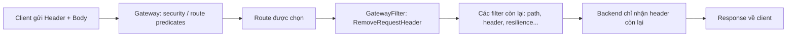

# RemoveRequestHeader và loại bỏ dữ liệu không được chuyển tiếp

**Chương:** Header yêu cầu  
**Module:** `SPRING_CLOUD_GATEWAY` — Spring Cloud Gateway

Trong kiến trúc microservices, Spring Cloud Gateway nhận request, chọn tuyến bằng **route predicate**, thực thi **filter chain** rồi chuyển tiếp đến dịch vụ phía sau. Các HTTP header có thể chứa thông tin định tuyến, xác thực, dấu vết request, cấu hình debug hoặc dữ liệu chỉ dành cho lớp biên. Nếu chuyển tất cả chúng xuống backend mà không có chủ đích, một dịch vụ có thể nhận thông tin không cần thiết, tin nhầm một danh tính do client tự khai hoặc làm lộ dữ liệu trong log.

**`RemoveRequestHeader`** là một *GatewayFilter factory* dùng để **xóa một header theo tên khỏi request sẽ gửi xuống downstream**. Đây là công cụ đơn giản nhưng quan trọng để thiết lập ranh giới tin cậy giữa client, API Gateway và các microservice. Bài học tập trung vào cách khai báo, thứ tự xử lý, thực hành quan sát bằng backend echo và giới hạn bảo mật của việc xóa header; từ đó kết nối với xác thực, rate limiting, service discovery, retry, TLS và quan sát request.

Các ví dụ chính dành cho **Spring Cloud Gateway Server WebFlux**. Gateway Server Web MVC và Proxy Exchange sử dụng API/cơ chế khác; cần đối chiếu tài liệu của flavor và phiên bản trước khi dùng lại cấu hình.

## 1. Mục tiêu học tập

Sau bài học, bạn có thể:

1. Giải thích chính xác `RemoveRequestHeader` tác động lên **request gửi downstream**, khác với việc xóa header khỏi request mà client ban đầu đã gửi.
2. Khai báo nhiều lần `RemoveRequestHeader` trên route YAML, dùng Java DSL và áp dụng quy tắc mặc định theo route khi cần.
3. Phân biệt header bí mật, header nội bộ, header hop-by-hop và header dùng trong cơ chế proxy.
4. Kiểm chứng header được loại bỏ bằng backend echo, log an toàn và `curl`.
5. Hiểu tương tác với `Path`/`Header` predicates, Spring Security, `AddRequestHeader`, HTTP/HTTPS và WebSocket.
6. Thiết kế chính sách forward header theo nguyên tắc chỉ gửi đúng dữ liệu mà downstream cần.

## 2. HTTP header nào cần quan tâm?

Header là cặp tên/giá trị đi kèm HTTP request, ví dụ:

```http
GET /api/catalog/products/42 HTTP/1.1
Host: gateway.example.test
Authorization: Bearer demo-placeholder
X-Internal-Debug: enabled
X-Lab-Trace: request-042
Accept: application/json
```

Trong một API Gateway, cần phân loại header **theo mục đích và nguồn tin cậy**, không chỉ dựa vào tiền tố tên:

| Nhóm header | Ví dụ | Cách cân nhắc |
|---|---|---|
| Dữ liệu client cần downstream xử lý | `Accept`, `Content-Type`, `If-None-Match` | Giữ nếu hợp đồng API/backend cần |
| Credential/phiên ở lớp biên | `Authorization`, `Cookie` | Có thể loại trước backend nếu Gateway đã xác thực và backend không cần; phải hiểu cơ chế ủy quyền |
| Header chỉ dành cho debug hoặc quản trị | `X-Internal-Debug`, `X-Client-Secret` | Không forward nếu backend không có nhu cầu rõ ràng |
| Header định danh nội bộ do hạ tầng đặt | `X-Authenticated-User`, `X-Internal-Role` | Xóa giá trị client tự khai trước khi **tạo lại từ danh tính đã xác thực**, nếu mô hình tin cậy cho phép |
| Header proxy/địa chỉ gốc | `Forwarded`, `X-Forwarded-For`, `X-Forwarded-Proto` | Chỉ tin từ proxy đáng tin; cần chính sách trust và tái tạo đúng |
| Header điều khiển kết nối | `Connection`, `Keep-Alive`, `Transfer-Encoding`, `Upgrade` | Thuộc cơ chế HTTP/proxy; thường được framework xử lý theo quy tắc hop-by-hop |
| Header quan sát | `traceparent`, `tracestate`, `X-Request-Id` | Cân nhắc chính sách tracing, mức tin cậy và hạn chế lộ thông tin |

**Không có danh sách “xóa mọi nơi” đúng cho tất cả ứng dụng.** Ví dụ: xóa `Authorization` khi backend là Resource Server tự kiểm tra JWT sẽ làm hỏng xác thực. Giữ `Authorization` khi backend không cần token có thể làm tăng bề mặt rò rỉ. Quyết định dựa trên **hợp đồng giữa Gateway và service đích**, thay vì áp dụng một bộ tên header tùy tiện.

## 3. RemoveRequestHeader nằm ở đâu trong request pipeline?



Một request tới `/api/catalog/products/42` có header `X-Internal-Debug: enabled` sẽ được xử lý như sau:

1. Gateway tiếp nhận request gốc và tìm route khớp `Path`, `Method`, `Header`... (các bộ lọc bảo mật chạy theo pipeline tương ứng).
2. Khi route được chọn, `RemoveRequestHeader=X-Internal-Debug` loại header đó khỏi **request đang được xây dựng cho downstream**.
3. Các filter tiếp theo và routing filter làm việc với request đã được thay đổi, có thể tiếp tục bổ sung/loại bỏ các header khác.
4. Backend nhận request mà `X-Internal-Debug` đã bị xóa, trừ khi một bước **sau đó** chủ động gắn lại header.

**Phân biệt thời điểm:**

- `Header` **Route Predicate** xét dữ liệu request khi chọn route. Xóa header ở **GatewayFilter của route** không làm thay đổi điều kiện khớp đã được đánh giá.
- `RemoveRequestHeader` không sửa request lịch sử mà client đã gửi, không thu hồi token đã được Spring Security xử lý và không tự ngăn client gọi thẳng backend nếu backend có thể truy cập ngoài Gateway.
- `RemoveRequestHeader` tác động lên **request headers**, không xóa cookie trong body, query string, response header hoặc dữ liệu đã bị ghi vào log trước đó.
- Tên HTTP header **không phân biệt chữ hoa/chữ thường**. Một quy tắc xóa `X-Internal-Debug` cần loại được cả `x-internal-debug` khi HTTP stack tuân thủ chuẩn.

### 3.1. Pipeline khác gì giữa predicate và filter?

| Thành phần | Cấu hình ví dụ | Vai trò |
|---|---|---|
| `Header` predicate | `Header=X-API-Version, v2` | Chọn route dựa trên request header |
| `RemoveRequestHeader` filter | `RemoveRequestHeader=X-Internal-Debug` | Xóa request header **trước khi gửi backend** |
| `AddRequestHeader` filter | `AddRequestHeader=X-Edge-Lab, gateway` | Thêm header vào request downstream |
| `SetRequestHeader` filter | `SetRequestHeader=X-Env, lab` | Đặt/ghi đè giá trị header theo cấu hình |
| `RemoveResponseHeader` filter | `RemoveResponseHeader=Server` | Xóa header ở **response**, hướng backend/Gateway về client |

Nếu dùng `Header=X-Internal-Debug, enabled` để chọn route rồi gắn `RemoveRequestHeader=X-Internal-Debug` vào route ấy, predicate **vẫn có thể khớp** theo header gốc. Điều đó không có nghĩa backend sẽ nhận header.

## 4. Cú pháp YAML cho Gateway Server WebFlux

Ví dụ dưới dùng cách đặt prefix cấu hình của các dòng Spring Cloud Gateway Server WebFlux hiện đại, như Spring Cloud 2025.0+/Gateway 4.3+:

```yaml
server:
  port: 8080

spring:
  cloud:
    gateway:
      server:
        webflux:
          routes:
            - id: catalog-public
              uri: http://localhost:8081
              predicates:
                - Path=/api/catalog/**
              filters:
                - StripPrefix=2
                - RemoveRequestHeader=X-Internal-Debug
                - RemoveRequestHeader=X-Client-Secret
                - RemoveRequestHeader=Authorization
                - AddRequestHeader=X-Edge-Lab, gateway
```

Đọc cấu hình:

1. `Path=/api/catalog/**` chọn request đến Gateway có tiền tố `/api/catalog`.
2. `StripPrefix=2` biến `/api/catalog/inspect/headers` thành `/inspect/headers`.
3. Ba lần `RemoveRequestHeader` xóa ba **tên header cụ thể**. Mỗi lần khai báo một tên; `RemoveRequestHeader` không phải bộ lọc quy tắc wildcard.
4. `AddRequestHeader` đặt một dấu hiệu thí nghiệm `X-Edge-Lab` trên request downstream. Header này **không được dùng để xác thực** danh tính Gateway.
5. `uri` gửi request đến backend HTTP ở `8081`; với `https://...`, cùng chính sách header vẫn cần kết hợp TLS tin cậy.

Tài liệu có thể biểu diễn filter bằng dạng đầy đủ:

```yaml
filters:
  - name: RemoveRequestHeader
    args:
      name: X-Internal-Debug
  - name: RemoveRequestHeader
    args:
      name: X-Client-Secret
```

**Không dùng** `RemoveRequestHeader=X-Internal-*` rồi cho rằng Gateway sẽ xóa cả nhóm header bắt đầu bằng `X-Internal-`. Factory nhận **tên header**, không phải biểu thức glob/regular expression. Nếu có tập header cần kiểm soát, hãy liệt kê tên rõ ràng hoặc thiết kế một filter bảo mật có kiểm thử đầy đủ.

> **Chú ý tương thích:** ở các bản Server WebFlux cũ, cấu hình route có thể nằm dưới `spring.cloud.gateway.routes` và starter từng mang tên `spring-cloud-starter-gateway`. Không ghép prefix của release train mới với dependency/phiên bản cũ mà chưa kiểm tra tài liệu tương ứng.

### 4.1. Có thể đặt thành default filter

Khi **mọi route** trong cùng ứng dụng Gateway Server WebFlux đều cần loại header debug, có thể khai báo default filter (đúng prefix theo phiên bản):

```yaml
spring:
  cloud:
    gateway:
      server:
        webflux:
          default-filters:
            - RemoveRequestHeader=X-Internal-Debug
          routes:
            - id: catalog
              uri: http://localhost:8081
              predicates:
                - Path=/api/catalog/**
              filters:
                - StripPrefix=2
            - id: orders
              uri: http://localhost:8082
              predicates:
                - Path=/api/orders/**
              filters:
                - StripPrefix=2
```

Default filter được gắn vào các route do Gateway quản lý; cần kiểm tra hành vi của flavor/phiên bản và route definitions đang dùng. **Không coi default filter là quy tắc network-level**: nó không bảo vệ request không đi qua Gateway hoặc route/handler khác ngoài pipeline đó.

Nếu chính sách xóa header khác nhau giữa `catalog` và `orders`, ưu tiên khai báo rõ trên từng route thay vì đặt một default filter có thể phá hợp đồng backend.

### 4.2. Java DSL

Nếu khai báo route bằng `RouteLocatorBuilder`:

```java
import org.springframework.cloud.gateway.route.RouteLocator;
import org.springframework.cloud.gateway.route.builder.RouteLocatorBuilder;
import org.springframework.context.annotation.Bean;
import org.springframework.context.annotation.Configuration;

@Configuration
public class GatewayRoutes {

    @Bean
    RouteLocator catalogRoutes(RouteLocatorBuilder builder) {
        return builder.routes()
            .route("catalog-public", r -> r
                .path("/api/catalog/**")
                .filters(f -> f
                    .stripPrefix(2)
                    .removeRequestHeader("X-Internal-Debug")
                    .removeRequestHeader("X-Client-Secret")
                    .removeRequestHeader("Authorization")
                    .addRequestHeader("X-Edge-Lab", "gateway"))
                .uri("http://localhost:8081"))
            .build();
    }
}
```

Đây là **Java DSL của Gateway Server WebFlux**: method `removeRequestHeader(...)` thuộc fluent `GatewayFilterSpec`. Chỉ sử dụng **một trong hai** định nghĩa route minh họa cho cùng path và ID khi thử nghiệm; nếu khai báo cả Java và YAML với cùng ID, khó xác định route thực được sử dụng và có thể gây xung đột.

## 5. Dựng backend Echo để kiểm tra header thực nhận

Để kiểm chứng chính xác việc loại bỏ header, dùng một backend Spring Boot nhỏ tại `8081`. Backend trả **sự có mặt của một số header** thay vì trả giá trị credential; nhờ vậy quan sát được hoạt động filter mà không lộ bí mật trong JSON.

Trên [Spring Initializr](https://start.spring.io/), tạo ứng dụng Java/Spring Boot với dependency **Spring Web**, package `com.example.headerecho`. Với Spring Boot 3.x, Java 17+ và Spring Web servlet là đủ; nếu dùng Boot 4.x, chọn starter tương ứng do Initializr cung cấp.

Tạo `application.yml` cho backend:

```yaml
server:
  port: 8081
spring:
  application:
    name: header-echo
```

Tạo lớp `HeaderEchoApplication.java` trong package `com.example.headerecho`:

```java
package com.example.headerecho;

import jakarta.servlet.http.HttpServletRequest;
import java.util.LinkedHashMap;
import java.util.Map;
import org.springframework.boot.SpringApplication;
import org.springframework.boot.autoconfigure.SpringBootApplication;
import org.springframework.web.bind.annotation.GetMapping;
import org.springframework.web.bind.annotation.RestController;

@SpringBootApplication
public class HeaderEchoApplication {
    public static void main(String[] args) {
        SpringApplication.run(HeaderEchoApplication.class, args);
    }
}

@RestController
class HeaderEchoController {

    @GetMapping("/inspect/headers")
    public Map<String, Object> headers(HttpServletRequest request) {
        Map<String, Object> result = new LinkedHashMap<>();
        result.put("backend", "header-echo");
        result.put("method", request.getMethod());
        result.put("requestUri", request.getRequestURI());
        result.put("debugPresent",
                request.getHeader("X-Internal-Debug") != null);
        result.put("clientSecretPresent",
                request.getHeader("X-Client-Secret") != null);
        result.put("authorizationPresent",
                request.getHeader("Authorization") != null);
        result.put("cookiePresent",
                request.getHeader("Cookie") != null);
        result.put("labTrace", request.getHeader("X-Lab-Trace"));
        result.put("edgeMarker", request.getHeader("X-Edge-Lab"));
        return result;
    }
}
```

**Vì sao kiểm tra boolean?** Response chỉ biểu diễn header có tồn tại hay không. Nó không ghi `Authorization`, `Cookie` hay bất kỳ secret nào thành chuỗi trong JSON. Khi kiểm tra các hệ thống thực tế, còn phải kiểm soát query/body, access logs, tracing và log của reverse proxy; ví dụ này chưa phải bộ lọc log production đầy đủ.

### 5.1. Khởi động và thử gọi backend trực tiếp

Trong thư mục backend, dùng Maven Wrapper:

```bash
./mvnw spring-boot:run
```

Trên Windows:

```powershell
.\mvnw.cmd spring-boot:run
```

Khi ứng dụng khởi động thành công tại `8081`, thử với các giá trị **giả lập**, không phải credential thật:

```bash
curl -i "http://localhost:8081/inspect/headers" \
  -H "X-Internal-Debug: demo" \
  -H "X-Client-Secret: placeholder" \
  -H "Authorization: Bearer not-a-real-token" \
  -H "X-Lab-Trace: direct-001"
```

Phản hồi JSON rút gọn:

```json
{
  "backend": "header-echo",
  "method": "GET",
  "requestUri": "/inspect/headers",
  "debugPresent": true,
  "clientSecretPresent": true,
  "authorizationPresent": true,
  "cookiePresent": false,
  "labTrace": "direct-001",
  "edgeMarker": null
}
```

Điều này xác minh backend hoạt động và các header thử đã đến được. Nếu request trực tiếp thất bại, hãy sửa backend trước khi gỡ lỗi Gateway.

## 6. Gửi request qua Gateway và đối chiếu kết quả

Trong **ứng dụng Gateway riêng** chạy ở cổng `8080`, thêm starter `spring-cloud-starter-gateway-server-webflux` do Spring Cloud BOM tương thích Spring Boot quản lý. Sử dụng route ở phần 4 và khởi động Gateway sau khi backend `8081` đã sẵn sàng.

Gọi Gateway với dữ liệu thử **không phải credential thật**:

```bash
curl -i "http://localhost:8080/api/catalog/inspect/headers" \
  -H "X-Internal-Debug: demo" \
  -H "X-Client-Secret: placeholder" \
  -H "Authorization: Bearer not-a-real-token" \
  -H "X-Lab-Trace: gateway-001"
```

Phản hồi backend kỳ vọng (rút gọn):

```json
{
  "backend": "header-echo",
  "method": "GET",
  "requestUri": "/inspect/headers",
  "debugPresent": false,
  "clientSecretPresent": false,
  "authorizationPresent": false,
  "cookiePresent": false,
  "labTrace": "gateway-001",
  "edgeMarker": "gateway"
}
```

| Trường | Gọi trực tiếp `8081` | Qua Gateway `8080` |
|---|---|---|
| `requestUri` ở backend | `/inspect/headers` | `/inspect/headers` sau `StripPrefix` |
| `debugPresent` | `true` | `false` |
| `clientSecretPresent` | `true` | `false` |
| `authorizationPresent` | `true` | `false` |
| `labTrace` | `direct-001` | `gateway-001` |
| `edgeMarker` | `null` | `gateway` |

**Bằng chứng quan trọng:** client vẫn gửi các header thử cho Gateway, nhưng backend không nhìn thấy các header đã bị `RemoveRequestHeader` loại bỏ. `X-Lab-Trace` còn nguyên vì route không xóa; `X-Edge-Lab` xuất hiện do filter thêm vào.

Nếu Gateway đã bật Spring Security, request giả lập token có thể bị chặn bằng HTTP `401`/`403` trước khi vào route. Bài lab giả định endpoint thử không có yêu cầu auth; không tắt bảo mật hệ thống thật chỉ để thấy phản hồi như trên.

### 6.1. Windows PowerShell

Trong Windows PowerShell, `curl` đôi khi là alias của `Invoke-WebRequest`. Dùng `curl.exe`:

```powershell
curl.exe -i "http://localhost:8080/api/catalog/inspect/headers" `
  -H "X-Internal-Debug: demo" `
  -H "X-Client-Secret: placeholder" `
  -H "Authorization: Bearer not-a-real-token" `
  -H "X-Lab-Trace: gateway-001"
```

### 6.2. Tên header không phân biệt hoa/thường

```bash
curl -i "http://localhost:8080/api/catalog/inspect/headers" \
  -H "x-internal-debug: first" \
  -H "X-Internal-Debug: second" \
  -H "X-Lab-Trace: case-check-002"
```

Với `RemoveRequestHeader=X-Internal-Debug`, `debugPresent` vẫn phải là `false`. Quy tắc loại theo tên cần loại được mọi giá trị có tên tương ứng, không chỉ một cách viết hoa. HTTP/2 và các proxy có thể chuẩn hóa tên thành chữ thường; không dùng trường hợp chữ hoa/chữ thường làm điều kiện bảo mật.

### 6.3. Phân biệt route không khớp và filter không chạy

```bash
# Đúng tiền tố, có thể chọn route:
curl -i http://localhost:8080/api/catalog/inspect/headers

# Sai tiền tố, không khớp route catalog:
curl -i http://localhost:8080/api/unknown/inspect/headers
```

Request thứ hai thường `404` nếu không có route khác. Đây là trường hợp **predicate không chọn route**; filter `RemoveRequestHeader` của route catalog không được thực thi.

## 7. Thứ tự filter và nguy cơ header bị thêm lại

Một route có thể vừa **xóa**, vừa **thêm** hoặc **đặt** header. Kết quả cuối cùng phụ thuộc vào filter chain thực thi:

```yaml
filters:
  - RemoveRequestHeader=X-Edge-Lab
  - AddRequestHeader=X-Edge-Lab, gateway-lab
```

Với thứ tự route filters như ví dụ, ý nghĩa là xóa giá trị `X-Edge-Lab` do client đưa vào, sau đó thêm giá trị `gateway-lab` cho downstream. Nếu đảo thứ tự và xóa **sau**, giá trị vừa thêm cũng có thể bị loại bỏ.

**Lưu ý:** nếu dùng `GlobalFilter`, filter `Ordered` hoặc những thành phần chuyên biệt, thứ tự pipeline phụ thuộc thứ tự được sắp xếp bởi framework, không chỉ thứ tự dòng YAML. Khi một quy tắc bảo mật phụ thuộc vào thứ tự, luôn kiểm thử bằng backend echo.

### 7.1. Remove, Add và Set khác gì nhau?

| Filter | Tác động |
|---|---|
| `RemoveRequestHeader=X-Foo` | Xóa header `X-Foo` cùng mọi giá trị hiện có |
| `AddRequestHeader=X-Foo, new` | Thêm một giá trị; nếu header đã tồn tại, có thể tạo nhiều giá trị |
| `SetRequestHeader=X-Foo, new` | Thay thế các giá trị hiện có của header bằng giá trị mới |

Nếu client tự gửi `X-Authenticated-User`, **chỉ thêm** header cùng tên không bảo đảm backend dùng danh tính do Gateway xác thực: backend có thể nhận nhiều giá trị rồi chọn nhầm. Cần thiết kế cách **loại giá trị không tin cậy trước**, sau đó **tạo lại từ security context đáng tin cậy**, đồng thời bảo vệ backend khỏi các đường truy cập vòng qua Gateway.

`X-Edge-Lab: gateway-lab` là dấu quan sát tĩnh; nó **không chứng minh client đã xác thực**. Không sử dụng một `AddRequestHeader=X-Is-Admin, true` tĩnh để cấp quyền cho backend.

### 7.2. Header predicate có thể khớp rồi header bị xóa

```yaml
- id: api-v2
  uri: http://localhost:8081
  predicates:
    - Path=/v2/**
    - Header=X-API-Version, v2
  filters:
    - StripPrefix=1
    - RemoveRequestHeader=X-API-Version
```

Client gửi `X-API-Version: v2` thì route có thể khớp **trước khi** filter xóa header đó. Nếu không gửi header, route không khớp nên `RemoveRequestHeader` cũng không chạy. Đây là cách quan sát rõ khác biệt **chọn route** và **chuẩn bị request downstream**.

Header `X-API-Version` có thể dùng để chọn version API theo hợp đồng; bản thân nó không chứng minh quyền truy cập.

## 8. Chính sách loại bỏ header nhạy cảm

### 8.1. Authorization: Gateway hay backend kiểm tra token?

Giả sử client gửi một `Authorization: Bearer ...`. Có hai mô hình tiêu biểu:

**Mô hình A — Gateway xác thực, backend không cần token gốc.** Gateway có thể loại `Authorization` sau khi xác thực, rồi chuyển danh tính đã xác minh theo cơ chế tin cậy (ví dụ token nội bộ với audience phù hợp hoặc mTLS kèm authorization). Backend vẫn phải áp dụng phân quyền phù hợp, và mạng/hạ tầng phải ngăn client gọi trực tiếp để giả mạo header nội bộ.

**Mô hình B — Backend tự kiểm tra JWT/access token.** Backend là Resource Server cần chính token client để kiểm tra chữ ký, audience, scope và thời hạn. Khi xóa `Authorization`, backend có thể trả `401 Unauthorized` hoặc `403 Forbidden`. Lúc đó phải giữ token với giới hạn đích rõ ràng, hoặc thiết kế token exchange/delegation phù hợp.

| Trường hợp | Quyết định hợp lý | Nguyên nhân |
|---|---|---|
| Gateway xử lý auth, backend không cần credential client | Cân nhắc xóa `Authorization` | Không chuyển bí mật đến nơi không cần |
| Backend tự xác minh JWT client | Thường giữ token theo policy | Xóa làm hỏng auth |
| Gọi một dịch vụ bên thứ ba | Không chuyển token nội bộ vô điều kiện | Token có thể lộ hoặc bị dùng ngoài audience |
| Truyền quyền người dùng qua nhiều service | Thiết kế delegation rõ ràng | Không tin header vai trò do client tự gửi |

`RemoveRequestHeader` **không phải** một Spring Security filter: nó không kiểm tra JWT, scope, account hay principal; nó cũng không thu hồi header đã bị thành phần trước đó ghi ra log.

### 8.2. Cookie và thông tin phiên

`Cookie` là request header. Nếu backend hoàn toàn không cần cookie từ browser, có thể loại:

```yaml
filters:
  - RemoveRequestHeader=Cookie
```

Nhưng nếu backend cần cookie phiên của chính nó hoặc SSO dựa trên session, xóa toàn bộ `Cookie` sẽ làm hỏng hoạt động. `RemoveRequestHeader=Cookie` loại **cả header**, không chọn một cookie riêng theo tên. Muốn biến đổi cookie theo chính sách phải dùng cơ chế xử lý cookie chuyên biệt và kiểm thử.

`Set-Cookie` là **response header**. Xóa `Cookie` khỏi request **không làm mất** `Set-Cookie` do backend gửi về client. Khi cần xử lý response, tìm hiểu `RemoveResponseHeader`, policy cookie và cache/CORS.

### 8.3. Nguy cơ header danh tính nội bộ bị giả mạo

Những header như `X-Internal-User`, `X-Internal-Role`, `X-Trusted-Tenant` có thể nguy hiểm nếu backend coi chúng là bằng chứng xác thực và Gateway chuyển tiếp nguyên trạng:

```text
Client tự gửi: X-Internal-Role: administrator
        |
        v
Gateway không làm sạch header -> Backend tin giá trị -> Nguy cơ vượt quyền
```

Một luồng đáng tin hơn:

```text
Client
  -> Gateway xác thực / phân quyền
  -> Xóa giá trị header danh tính do client có thể tự đặt
  -> Tạo lại thông tin danh tính từ principal/token đã xác minh
  -> Chuyển qua đường truyền tin cậy và/hoặc token nội bộ
  -> Backend xác thực/ủy quyền theo hợp đồng của service
```

Không sử dụng `AddRequestHeader` với tên user/role **cố định** để thực hiện mô hình này. Việc tạo danh tính thật cần security context, token/claim tin cậy và xác minh ở phía backend.

### 8.4. Header debug và dữ liệu nội bộ

Các header thử như `X-Internal-Debug` hoặc `X-Client-Secret` nên được loại khỏi các request hướng đến backend không có nhu cầu sử dụng. Nếu một tính năng debug nội bộ thật sự cần header, chỉ chấp nhận từ nguồn được xác thực và có kiểm soát, tuyệt đối không mặc định tin mọi giá trị do client cung cấp.

Trong ứng dụng nhiều tenant, không đưa tenant ID do client tự khai vào một header tin cậy chỉ bằng cách đổi tên. Hãy so sánh tenant với claims trong token và quyền truy cập dữ liệu của backend trước khi định tuyến hoặc ủy quyền.

## 9. Những loại header không nên xóa một cách máy móc

### 9.1. Hop-by-hop headers và HTTP protocol

Các header liên quan đến **một kết nối HTTP cụ thể** khác với header mang ý nghĩa xuyên qua nhiều proxy. Những ví dụ thường được nhắc đến gồm:

```text
Connection
Keep-Alive
Proxy-Authenticate
Proxy-Authorization
TE
Trailer
Transfer-Encoding
Upgrade
```

Spring Cloud Gateway Server WebFlux có cơ chế **HTTP Headers Filters**, trong đó có xử lý các hop-by-hop headers trước khi routing tùy phiên bản/cấu hình. Với HTTP proxy, những header này thường cần được xử lý theo giao thức HTTP và chính sách chuyển tiếp, thay vì sao chép nguyên trạng từ client.

**Không thêm vô điều kiện** các lệnh `RemoveRequestHeader=Connection` và `RemoveRequestHeader=Upgrade` trên mọi route, đặc biệt các route WebSocket: handshake WebSocket cần cơ chế upgrade và pipeline riêng. Gateway có thành phần WebSocket routing; xóa sai những trường giao thức có thể khiến handshake thất bại. Tương tự, `Host`, `Content-Length`, `Content-Type` và `Transfer-Encoding` có ý nghĩa đến authority/body framing; nên để HTTP stack và các filter chính thức xử lý đúng thay vì tự xóa tùy tiện.

Một số header trông giống “không cần thiết” nhưng là dữ liệu hợp đồng API: `If-Match`/`If-None-Match` liên quan conditional request, `Range` liên quan byte ranges, `Accept-Encoding` liên quan content negotiation. Xóa chúng có thể làm thay đổi caching, bandwidth hoặc status phản hồi của backend.

### 9.2. Forwarded và X-Forwarded-*

`Forwarded`, `X-Forwarded-For`, `X-Forwarded-Host` và `X-Forwarded-Proto` thường mang thông tin về client và các proxy đã đi qua. Chúng có thể hữu ích cho log, redirect, cookie `Secure` và logic xác định scheme/host gốc, nhưng client cũng có thể tự đặt.

Chính sách đáng tin phải trả lời:

1. Proxy nào ở phía trước Gateway đã được xác thực/tin cậy?
2. Header nào do edge proxy **ghi đè hoặc chuẩn hóa** và header nào vẫn có thể do client tự khai?
3. Gateway có cấu hình trusted proxies và HTTP headers filters phù hợp phiên bản không?
4. Backend dùng thông tin đó cho việc gì: hiển thị link, log địa chỉ nguồn hay quyết định quyền truy cập?

Xóa `X-Forwarded-For` ở một route có thể giảm rò rỉ dữ liệu, nhưng cũng có thể làm mất dấu vết cần thiết. Ngược lại, chuyển tiếp header client tự khai mà chưa kiểm tra có thể gây giả mạo IP. **Không dùng trực tiếp X-Forwarded-For làm căn cứ duy nhất cho rate limiting hay xác thực** nếu chain proxy chưa được kiểm soát.

### 9.3. CORS, Origin và WebSocket handshake

`Origin`, `Access-Control-Request-Method` và `Access-Control-Request-Headers` có vai trò trong CORS preflight; đây là **request headers**. Xóa chúng mù quáng có thể khiến CORS policy hoặc backend không nhận diện được request như mong muốn. Hãy cấu hình CORS ở lớp thích hợp và kiểm thử `OPTIONS` preflight riêng.

Với WebSocket, cần kiểm tra `Origin` trong handshake khi ứng dụng yêu cầu bảo vệ cross-site, cùng xác thực, cookie/token và chính sách nâng cấp kết nối. Không áp dụng nguyên chính sách loại bỏ headers của REST JSON sang `ws://`/`wss://` mà chưa kiểm tra protocol.

### 9.4. Header quan sát request

`traceparent`/`tracestate` (W3C Trace Context) và một số header correlation ID cho phép liên kết request qua Gateway và microservices. Xóa chúng có thể làm đứt distributed tracing; giữ nguyên từ nguồn không tin cậy lại cần chính sách sampling, trust và bảo vệ thông tin.

Trong bài lab, `X-Lab-Trace` là chuỗi do client đặt để dễ đối chiếu. Nó **không phải định danh đáng tin** và có thể trùng lặp. Khi triển khai thực tế, dùng cơ chế observation/tracing nhất quán theo Spring Boot/Gateway đang chạy, với dữ liệu được lọc phù hợp.

## 10. Tương tác với các tính năng Gateway khác

`RemoveRequestHeader` thường chỉ là một bước trong chiến lược vận hành API Gateway. Xét từng tính năng riêng:

| Thành phần | Quan hệ với RemoveRequestHeader | Điều cần lưu ý |
|---|---|---|
| `Path`/`Header` predicates | Chọn route trước filter | Không xóa được dữ liệu đã dùng để chọn route |
| `StripPrefix`/`RewritePath` | Thay đường dẫn, độc lập tên header | Kiểm tra cả path và header tại backend |
| Service discovery / `lb://service-id` | Thay cách tìm backend | Header được xóa vẫn cần biến mất trên request tới instance đã chọn |
| Xác thực Spring Security | Kiểm tra user/token theo security pipeline | Xóa token sau xác thực không thay thế authorization ở backend |
| `RequestRateLimiter` | Giới hạn tần suất request | Key resolver không được tin header client tự khai |
| `CircuitBreaker` | Xử lý lỗi/tình trạng backend | Không tự khôi phục header đã bị xóa; kiểm tra fallback |
| `Retry` | Có thể gửi lại request sau lỗi | Kiểm tra header đã được làm sạch ở mọi lần gửi xuống backend |
| TLS outbound / HTTPS | Mã hóa chặng Gateway → backend | TLS bảo vệ đường truyền nhưng không quyết định header nào nên gửi |
| Metrics/tracing | Quan sát tuyến và lỗi | Không tạo metric label từ token, cookie hay header nhạy cảm |

### 10.1. Sự khác biệt giữa TLS và loại header

`uri: https://backend.internal` bảo vệ kết nối bằng TLS khi được cấu hình đúng. Nó **không làm một header trở nên cần thiết hoặc an toàn để chia sẻ**: một credential không thuộc audience của backend vẫn có thể bị lộ trong log ứng dụng phía sau dù đường truyền đã được mã hóa.

Ngược lại, xóa `Authorization` không thay thế TLS. Nếu backend dùng thông tin danh tính nội bộ, chặng giao tiếp vẫn cần mô hình bảo mật mạng và xác thực server/service tương ứng.

### 10.2. Retry và nhiều lượt gọi backend

Nếu bật `Retry` cho route có `RemoveRequestHeader`, client có thể gửi một request nhưng backend nhận nhiều lần thử. Mọi lần thử phải tuân thủ cùng chính sách không chuyển credential/headers đã cấm. Kiểm tra log của **từng lượt downstream**, đặc biệt khi có filter tùy chỉnh hoặc xử lý request body.

Đối với POST tạo đơn hàng/thanh toán, cần xem xét idempotency trước khi cho phép retry. `RemoveRequestHeader` không xử lý lặp giao dịch, timeout hoặc backpressure.

### 10.3. Fallback và đường đi thay thế

Một route HTTP chính có thể có circuit breaker với fallback (ví dụ `forward:/fallback`). Khi fallback được xử lý bởi handler nội bộ, cần xác định handler có thể truy cập request headers ở giai đoạn nào, dữ liệu nào đã được loại bỏ, và nơi nào có thể đã log dữ liệu gốc. Không mặc định hành vi của một route filter trên **mọi đường đi thay thế** hoặc handler không thuộc route đó.

## 11. Quan sát an toàn: kiểm tra sự hiện diện thay vì in bí mật

Khi debug header forwarding, cần phân biệt ba góc nhìn:

| Góc nhìn | Thấy gì | Giới hạn |
|---|---|---|
| Client dùng `curl -v` | Header mà client **gửi tới Gateway** | Không xác nhận header backend nhận |
| Gateway route/filter config, logs | Filter cần được áp dụng và route nào khớp | Config đúng chưa chứng minh runtime đã forward như ý |
| Echo Backend | Sự hiện diện của header trên request **thực nhận** | Chỉ xác nhận đường đi đã thử và backend đó |

Phép thử trong phần 6 dùng backend echo trả boolean, nhờ vậy không phải in token. Trong hệ thống thực:

- Không ghi nguyên `Authorization`, `Cookie`, API key hoặc body nhạy cảm vào access log, debug log, trace hay metrics.
- Với metric, chỉ dùng các nhãn có cardinality kiểm soát như route ID, status class, method và service ID. Không dùng nội dung header/token làm tên label.
- Khi cần xác minh một header bí mật đã bị loại, ưu tiên kiểm tra **có/không** tại backend thử nghiệm, không in raw value.
- Không bật wiretap HTTP body/headers chi tiết tại production chỉ để kiểm tra một route; nếu cần chẩn đoán sâu, dùng môi trường cô lập và dữ liệu giả.
- Kiểm tra cả backend log, ingress log và các proxy trung gian: dữ liệu có thể đã được ghi trước khi filter của Gateway xóa.

### 11.1. Test quan sát đủ mạnh

Một phép thử chứng minh `RemoveRequestHeader` hoạt động phải trả lời đủ:

1. Request đã **chọn đúng route** chưa?
2. Header có **thực sự tồn tại** ở phía client/Gateway trước filter không?
3. Backend có nhận request đó không và `requestUri` đúng sau biến đổi path không?
4. Backend có báo header đã xóa **vắng mặt**, còn header được phép **vẫn hiện diện** không?
5. Nếu cùng tên header xuất hiện nhiều lần/khác chữ hoa, có còn giá trị nào lọt qua không?
6. Khi các filter khác thêm lại header, trạng thái cuối có đúng policy không?

Trả lời được sáu câu này đáng tin hơn chỉ nhìn vào YAML và kết luận “đã bảo vệ”.

## 12. Lỗi thường gặp và cách tìm nguyên nhân

| Hiện tượng | Khả năng xảy ra | Cách kiểm tra |
|---|---|---|
| Backend vẫn thấy `X-Internal-Debug` | Filter chưa áp dụng; route khác được chọn; filter sau thêm lại | Kiểm tra route ID, predicates, filter chain, backend echo |
| Backend nhận `Authorization` dù YAML có lệnh xóa | Đang gọi trực tiếp backend hoặc request vào route khác | So sánh cổng `8080` và `8081`, path route, log |
| Xóa `Authorization` rồi backend trả `401` | Backend cần token để tự xác thực | Xác định lại mô hình token forwarding/authorization |
| Backend mất session đăng nhập | Lỡ xóa `Cookie` nhưng backend cần cookie | Rà soát session/cookie contract |
| `AddRequestHeader` tạo giá trị trùng | Header client đã có và filter chỉ bổ sung | Dùng loại bỏ trước hoặc `SetRequestHeader` phù hợp |
| Header được gửi với tên chữ thường | HTTP/2, servlet container hoặc proxy đã chuẩn hóa | So sánh tên không phân biệt hoa/thường |
| Request trả `404`, backend không nhận | `Path` không khớp hoặc biến đổi đường dẫn sai | Kiểm tra predicate, `StripPrefix` và backend mapping |
| Backend thấy header không còn nhưng log vẫn có giá trị | Log nằm ở ingress/security/filter trước bước xóa | Rà soát pipeline logging và masking ở từng tầng |
| CORS preflight không thành công | CORS/`OPTIONS`/`Origin` xử lý sai | Kiểm tra CORS config, không xóa header giao thức tùy tiện |
| WebSocket không upgrade được | Xóa `Upgrade`/`Connection` hoặc route WS sai | Dùng WebSocket client và kiểm tra handshake |
| Header `X-Forwarded-For` có IP bất thường | Header client có thể giả mạo; trusted proxy config chưa đúng | Kiểm tra proxy chain và cấu hình trust |
| Header mất chỉ trên một số request | Có nhiều route/instances, filter order hoặc request path khác | Dùng route ID, trace ID, kiểm tra tất cả instance |
| Không thấy filter trong danh sách route | Nhầm prefix YAML theo Spring Cloud release train | Đối chiếu version và cấu hình đang được tải |

### Quy trình debug tuần tự

1. Gọi trực tiếp backend `/inspect/headers` tại `8081` với dữ liệu thử, xác nhận nó nhận được header.
2. Xác nhận Gateway `8080` đã khởi động và route `catalog-public` khớp `/api/catalog/inspect/headers`.
3. Gửi request qua Gateway với header thử; đối chiếu `requestUri` trong JSON.
4. Kiểm tra các boolean của header đã xóa, đồng thời xác nhận `X-Lab-Trace` được giữ.
5. Nếu filter không tác dụng, xem thứ tự route/default/global filters và nguồn header được thêm lại.
6. Nếu xảy ra 401, 403, 404 hoặc lỗi handshake, phân biệt **security, routing, backend mapping và protocol** trước khi sửa chính sách header.
7. Khi kết quả đúng trong lab, kiểm thử thêm trong deployment thật với nhiều proxy/instance và xác nhận policy theo đúng phiên bản Gateway.

## 13. Thiết kế chính sách forward header cho một hệ thống nhiều dịch vụ

Giả sử Gateway phục vụ:

```text
/api/catalog/**      -> catalog-service
/api/orders/**       -> order-service
/api/partner/**      -> partner-adapter
```

Các service có nhu cầu khác nhau:

| Route | Thông tin backend cần | Thông tin cần cân nhắc loại |
|---|---|---|
| Catalog công khai | `Accept`, conditional headers, trace context phù hợp | Debug header, token của client khi catalog không xác thực token |
| Orders cần quyền theo user | Token/identity theo hợp đồng auth, correlation ID | Cookie session của gateway, header vai trò tự khai |
| Partner adapter | Credential dành riêng cho partner, payload nghiệp vụ | Access token nội bộ không cùng audience, headers nội bộ |

Đây là ví dụ **chính sách theo từng đích**, không phải chỉ một filter mặc định cho toàn hệ thống. Trước khi viết YAML, đội vận hành nên có một bảng hợp đồng header:

| Câu hỏi | Ví dụ câu trả lời |
|---|---|
| Nguồn header là ai? | Client, ingress đáng tin, Gateway, service nội bộ |
| Backend có thật sự cần không? | `Accept` có, `X-Internal-Debug` không |
| Có phải credential hoặc dữ liệu cá nhân không? | `Authorization` là credential; `X-Request-Id` có thể chứa thông tin nếu client tự đặt |
| Có cần biến đổi hoặc ký không? | Internal identity chỉ từ principal đã xác thực |
| Ai chịu trách nhiệm kiểm tra? | Gateway và backend có trách nhiệm riêng |
| Có ảnh hưởng đến retry/trace/CORS không? | Trace header cần policy; cookie có thể tác động session |

### 13.1. Thứ tự ưu tiên để triển khai

1. **Xác định hợp đồng API và trách nhiệm auth** của từng backend.
2. **Chặn đường gọi bypass** với các backend chỉ tin header được tạo bởi Gateway.
3. **Xóa đầu vào không tin cậy** đối với tên header nội bộ có khả năng giả mạo.
4. **Tạo lại dữ liệu cần thiết từ nguồn đáng tin**, nếu hợp đồng backend cần thông tin đó.
5. **Kiểm thử tại backend** để chắc chắn header đúng sau toàn bộ filter chain.
6. **Quan sát và bảo vệ log/trace** để tránh việc xóa header muộn nhưng dữ liệu đã bị ghi ra nơi khác.

Không thể đảm bảo an toàn chỉ bằng cách thêm `RemoveRequestHeader=Authorization` vào mọi route. Một số service cần token; một số service nhận thông tin danh tính qua giao thức khác; một số yêu cầu chỉ cho phép mTLS. Chính sách phải được kiểm chứng theo từng luồng.

## 14. Bài tập tự thực hành

Sử dụng Echo Backend ở phần 5 và ứng dụng Gateway ở phần 4. Thực hiện các thay đổi **lần lượt**, ghi nhận request/response sau mỗi lần:

1. **Loại header debug:** giữ `RemoveRequestHeader=X-Internal-Debug`; gửi `X-Internal-Debug` ở nhiều cách viết hoa. Tại sao `debugPresent` vẫn phải là `false`?
2. **Giữ header cần thiết:** gửi `X-Lab-Trace` và chứng minh downstream vẫn thấy. Sau đó thêm `RemoveRequestHeader=X-Lab-Trace`, thử lại rồi khôi phục cấu hình.
3. **Thứ tự filter:** cho client gửi `X-Edge-Lab: spoofed`. Thử cặp `RemoveRequestHeader=X-Edge-Lab` rồi `AddRequestHeader=X-Edge-Lab, gateway-lab` và đảo thứ tự. Dựa vào `edgeMarker` giải thích kết quả.
4. **Token ở đâu được kiểm tra?:** thử route bỏ `Authorization` khi backend echo không yêu cầu auth. Sau đó thảo luận điều gì sẽ xảy ra nếu backend là JWT Resource Server.
5. **Cookie:** dùng giá trị cookie giả để quan sát `cookiePresent` trước và sau khi thêm `RemoveRequestHeader=Cookie`. Đừng thử với cookie phiên thật.
6. **Route không khớp:** gửi path không thuộc `/api/catalog/**`. Tại sao không thể dùng response đó để chứng minh filter xóa header đã chạy?
7. **Header predicate:** tạo route `Header=X-API-Version, v2` rồi xóa cùng header trong filters. Giải thích tại sao predicate vẫn khớp khi request có `X-API-Version: v2`.
8. **Chuyển sang HTTPS hoặc `lb://`:** giữ cùng quy tắc header nhưng thay URI đích theo hạ tầng có sẵn. Quan sát xem header policy có thay đổi hay không, và vì sao TLS/discovery là mối quan tâm khác.

### Bảng tự đánh giá

| Hạng mục | Tiêu chí đạt |
|---|---|
| Backend echo sẵn sàng | Gọi trực tiếp `8081/inspect/headers` trả JSON |
| Route chọn đúng | `/api/catalog/inspect/headers` vào `catalog-public` |
| Path biến đổi đúng | Backend thấy `/inspect/headers` |
| RemoveRequestHeader có tác dụng | `debugPresent=false` và `clientSecretPresent=false` qua Gateway |
| Authorization theo chính sách lab | `authorizationPresent=false` qua Gateway |
| Header được giữ | `labTrace=gateway-001` |
| Header được thêm | `edgeMarker=gateway` |
| Phân biệt pipeline | Giải thích được predicate chạy trước route filter |
| Hiểu giới hạn bảo mật | Không dùng header tĩnh để cấp quyền; backend không bị bypass |
| Không làm lộ dữ liệu | Chỉ thử placeholder, không log raw token/cookie |

## 15. Câu hỏi ôn tập

1. `RemoveRequestHeader` là **route predicate**, **GatewayFilter** hay **response filter**?
2. Tại sao request khớp `Header=X-API-Version, v2` dù filter route sau đó xóa `X-API-Version`?
3. `RemoveRequestHeader=Cookie` có loại một cookie cụ thể hay toàn bộ header?
4. Nếu Gateway thêm `X-Authenticated-User` mà không xóa giá trị do client tự gửi, backend có thể gặp rủi ro gì?
5. Vì sao không nên xóa tất cả `Authorization` khi backend cần kiểm tra JWT?
6. `RemoveRequestHeader=Upgrade` có thể gây vấn đề gì với route WebSocket?
7. Có thể dùng `RemoveRequestHeader=X-Internal-*` để xóa mọi header cùng tiền tố không?
8. Một header đã bị xóa khỏi request downstream thì có chắc chắn không xuất hiện trong log ở ingress không?

**Đáp án gợi ý:** (1) GatewayFilter; (2) predicate đánh giá trước filter; (3) toàn bộ header; (4) giả mạo danh tính/multiple values; (5) backend sẽ thiếu credential cần xác thực; (6) phá handshake upgrade nếu can thiệp sai pipeline; (7) không có wildcard theo cú pháp factory này; (8) không, phải kiểm soát từng tầng logging.

## 16. Tổng kết

`RemoveRequestHeader` giúp Spring Cloud Gateway **loại bỏ một tên header cùng các giá trị của nó khỏi request downstream**. Cấu hình filter trên route hoặc default filter là một cách đơn giản để ngăn các header debug, credential không cần thiết hoặc dữ liệu client có thể giả mạo đến những service không được phép tin chúng.

Hiệu quả bảo mật chỉ đúng trong phạm vi **đường đi qua Gateway và thứ tự filter thực tế**. Predicate và các bước security có thể đã nhìn thấy header trước khi xóa; header có thể bị filter khác thêm lại, và backend có thể vẫn truy cập được qua một con đường khác. Vì vậy, phải kết hợp header policy với xác thực, ủy quyền, network isolation, TLS, kiểm soát log, rate limiting, circuit breaker/retry và tracing phù hợp với kiến trúc microservices.

## Tài liệu tham khảo

1. [Spring Cloud Gateway Server WebFlux — RemoveRequestHeader GatewayFilter Factory](https://docs.spring.io/spring-cloud-gateway/reference/spring-cloud-gateway-server-webflux/gatewayfilter-factories/removerequestheader-factory.html).
2. [Spring Cloud Gateway Server WebFlux — AddRequestHeader GatewayFilter Factory](https://docs.spring.io/spring-cloud-gateway/reference/spring-cloud-gateway-server-webflux/gatewayfilter-factories/addrequestheader-factory.html).
3. [Spring Cloud Gateway Server WebFlux — SetRequestHeader GatewayFilter Factory](https://docs.spring.io/spring-cloud-gateway/reference/spring-cloud-gateway-server-webflux/gatewayfilter-factories/setrequestheader-factory.html).
4. [Spring Cloud Gateway Server WebFlux — RemoveResponseHeader GatewayFilter Factory](https://docs.spring.io/spring-cloud-gateway/reference/spring-cloud-gateway-server-webflux/gatewayfilter-factories/removeresponseheader-factory.html).
5. [Spring Cloud Gateway Server WebFlux — HTTP Headers Filters](https://docs.spring.io/spring-cloud-gateway/reference/spring-cloud-gateway-server-webflux/httpheadersfilters.html).
6. [Spring Cloud Gateway Server WebFlux — Global Filters](https://docs.spring.io/spring-cloud-gateway/reference/spring-cloud-gateway-server-webflux/global-filters.html).
7. [Spring Framework — WebFlux Security](https://docs.spring.io/spring-security/reference/reactive/index.html).
8. [RFC 9110 — HTTP Semantics](https://www.rfc-editor.org/rfc/rfc9110.html).

> **Lưu ý phiên bản:** Spring Cloud Gateway có Server WebFlux, Server Web MVC và Proxy Exchange; filter name, Java DSL hoặc prefix cấu hình có thể khác giữa các dòng phát hành. Hãy chọn tài liệu chính thức đúng release train. Bài này hoàn thành phạm vi kiến thức và lab minh họa; việc đánh giá bảo mật production cần cấu hình thực, kiểm thử end-to-end và review trust boundary của từng service.
