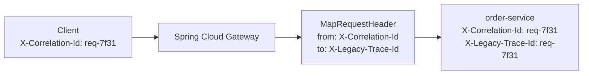
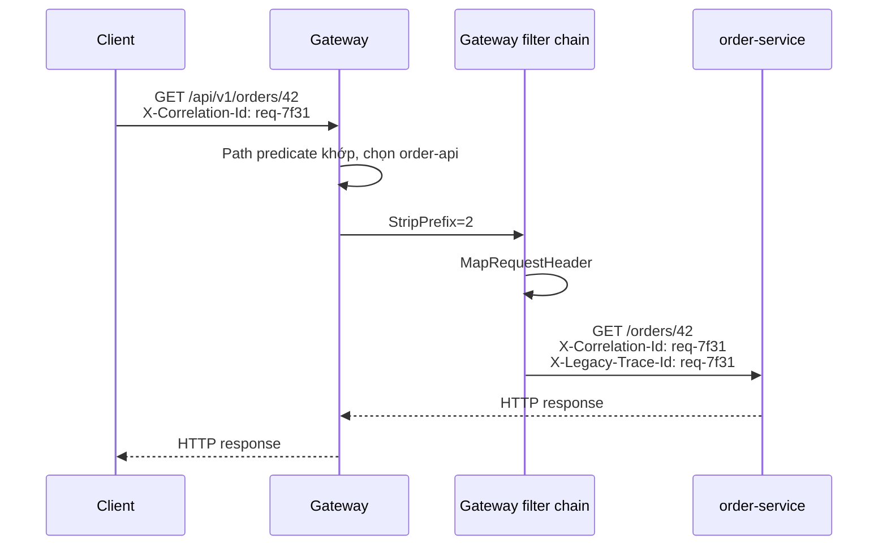
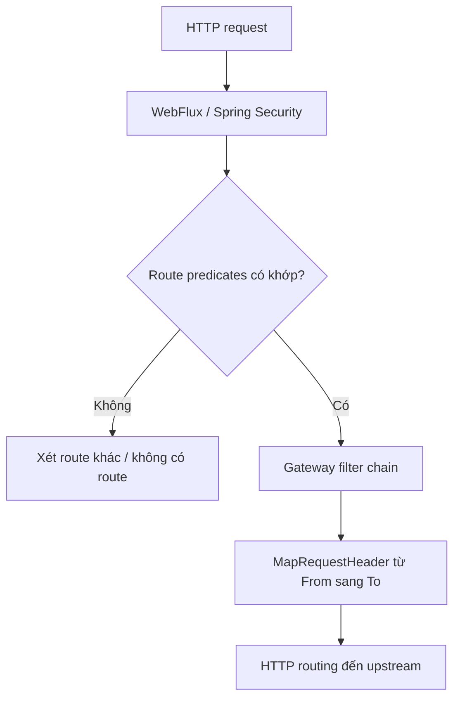

# MapRequestHeader và ánh xạ giá trị giữa các header

Trong kiến trúc microservices, client và dịch vụ đích không phải lúc nào cũng dùng cùng tên HTTP request header. Chẳng hạn ứng dụng phía ngoài gửi `X-Correlation-Id` để theo dõi request, nhưng một backend cũ chỉ đọc `X-Legacy-Trace-Id`. Khi xây dựng **Spring Cloud Gateway**, ta có thể dùng **`MapRequestHeader` GatewayFilter Factory** để sao chép giá trị từ header nguồn sang header đích ngay trên request được chuyển tiếp.

Bài thuộc chương **Header yêu cầu** và tập trung vào **cơ chế ánh xạ giữa hai tên request header**, xử lý header không tồn tại, header đa trị, hành vi bổ sung giá trị khi header đích đã có, thứ tự kết hợp filter và cách kiểm chứng request thực sự đến upstream. Các ví dụ đặt trong ngữ cảnh API Gateway sử dụng route predicate, filter chain, service discovery và các biện pháp bảo vệ microservices như Spring Security, rate limiting, retry, circuit breaker và TLS.

> **Phạm vi:** Nội dung áp dụng cho **Spring Cloud Gateway Server WebFlux**. Không dùng nguyên xi Java DSL của WebFlux cho Spring Cloud Gateway Server MVC. `MapRequestHeader` là cơ chế sao chép **giá trị header**, không phải hệ thống chuyển đổi giá trị theo bảng từ điển hay xác thực danh tính.

## 1. Bài toán: hai hệ thống dùng tên header khác nhau

Giả sử một ứng dụng gọi API:

```http
GET /api/v1/orders/42 HTTP/1.1
Host: api.example.test
X-Correlation-Id: req-7f31
Accept: application/json
```

Gateway chuyển request tới `order-service`. Dịch vụ này được phát triển từ hệ thống cũ và đang đọc header `X-Legacy-Trace-Id` thay vì `X-Correlation-Id`.

Nếu không ánh xạ, backend có thể không nhận được correlation ID trong tên header nó mong đợi. Cách giải quyết đơn giản là khai báo:

```yaml
filters:
  - MapRequestHeader=X-Correlation-Id,X-Legacy-Trace-Id
```

Khi `X-Correlation-Id` hiện diện, filter lấy **tất cả giá trị của header nguồn** và **bổ sung vào header đích** trên request được chuyển tiếp. Trong tình huống header đích chưa tồn tại, upstream sẽ nhận:

```http
GET /orders/42 HTTP/1.1
X-Correlation-Id: req-7f31
X-Legacy-Trace-Id: req-7f31
Accept: application/json
```

Đường dẫn `/orders/42` trong ví dụ là kết quả của filter `StripPrefix` được cấu hình **riêng**; bản thân `MapRequestHeader` không sửa path.



**Điều cần nhớ:** Header nguồn **vẫn tồn tại** sau khi ánh xạ. Filter **sao chép và bổ sung**, không mặc định đổi tên bằng cách xóa header nguồn.

## 2. Cú pháp và các tham số

`MapRequestHeader` nhận hai tham số:

| Tham số | Ý nghĩa | Ví dụ |
| --- | --- | --- |
| `fromHeader` | Tên request header được đọc giá trị | `X-Correlation-Id` |
| `toHeader` | Tên request header nhận các giá trị được sao chép | `X-Legacy-Trace-Id` |

Cú pháp shortcut:

```yaml
- MapRequestHeader=fromHeader,toHeader
```

Ví dụ:

```yaml
- MapRequestHeader=X-Correlation-Id,X-Legacy-Trace-Id
```

Có thể thêm một khoảng trắng sau dấu phẩy trong YAML shortcut để dễ đọc, nhưng nên giữ cú pháp nhất quán và kiểm tra cấu hình được nạp ở phiên bản Gateway đang sử dụng.

**Bên trái dấu phẩy là tên header nguồn; bên phải là tên header đích.** Nếu viết ngược lại, request có thể không được ánh xạ vì header mà filter cố đọc không tồn tại.

Các tên header là tên trường HTTP, ví dụ `X-Request-Id`, `X-Client-Version` hoặc `X-Legacy-Trace-Id`. Chúng **không phải biểu thức regex** và **không phải giá trị literal** cần gán. `MapRequestHeader=Gold,Blue` có nghĩa: tìm header tên `Gold`, lấy các giá trị của nó và bổ sung vào header tên `Blue`.

### So sánh với một phép gán đơn giản

Có thể tưởng tượng về mặt logic:

```text
nếu request có fromHeader:
    lấy toàn bộ danh sách giá trị của fromHeader
    bổ sung danh sách ấy vào toHeader
nếu không có fromHeader:
    giữ nguyên request
```

Đây là mô tả hành vi ở cấp **HTTP headers**; thực tế WebFlux xây dựng một request mới bằng cơ chế mutation/decorator phù hợp vì request HTTP server về cơ bản là dữ liệu bất biến trong pipeline.

## 3. Cấu hình một route thực tế bằng YAML

Ví dụ public API `/api/v1/orders/**` được chuyển đến dịch vụ đơn hàng và cần ánh xạ trace ID:

```yaml
spring:
  cloud:
    gateway:
      routes:
        - id: order-api
          uri: http://localhost:8081
          predicates:
            - Path=/api/v1/orders/**
          filters:
            - StripPrefix=2
            - MapRequestHeader=X-Correlation-Id,X-Legacy-Trace-Id
```

Với request `GET /api/v1/orders/42` có `X-Correlation-Id: req-7f31`:

1. WebFlux/Spring Security xử lý request theo cấu hình ứng dụng.
2. `Path` predicate khớp đường dẫn công khai `/api/v1/orders/42` và Gateway chọn route `order-api`.
3. `StripPrefix=2` bỏ hai đoạn `api` và `v1` để upstream nhận path `/orders/42`.
4. `MapRequestHeader` đọc `X-Correlation-Id` và bổ sung giá trị vào `X-Legacy-Trace-Id`.
5. Gateway chuyển request tới `http://localhost:8081/orders/42`.



Trong cấu hình này `uri` là URL cố định để dễ chạy thử. Khi sử dụng service discovery, có thể đặt `uri: lb://order-service`. Cách ánh xạ header không thay đổi; cần cấu hình LoadBalancer và nguồn danh sách instance để tên service được phân giải thành backend thực.

**Lưu ý phiên bản:** `spring.cloud.gateway.routes` là prefix quen thuộc của các bản Gateway WebFlux trước đây. Một số bản Spring Cloud Gateway Server WebFlux mới sử dụng `spring.cloud.gateway.server.webflux.routes`. Chọn một prefix phù hợp với starter và phiên bản thực tế, sau đó xác minh route đã được nạp. Việc thay prefix cấu hình không làm đổi hai tham số `fromHeader`/`toHeader` của filter.

## 4. Phân biệt sao chép, bổ sung và ghi đè

Điểm dễ gây sai nhất là tưởng `MapRequestHeader` **ghi đè** header đích. Thực tế, nếu `toHeader` đã có giá trị, giá trị mới được **bổ sung vào danh sách giá trị hiện có**.

Cho cấu hình:

```yaml
- MapRequestHeader=X-Correlation-Id,X-Legacy-Trace-Id
```

Bảng dưới đây biểu diễn giá trị logic trong `HttpHeaders` sau khi filter chạy:

| Header nguồn khi vào Gateway | Header đích trước filter | Header đích sau filter | Giải thích |
| --- | --- | --- | --- |
| `X-Correlation-Id: req-1` | Không có | `[req-1]` | Tạo header đích mới |
| Không có `X-Correlation-Id` | Không có | Không có | Không có gì để sao chép |
| Không có `X-Correlation-Id` | `[old]` | `[old]` | Không có nguồn: filter không thay đổi đích |
| `X-Correlation-Id: req-1` | `[old]` | `[old, req-1]` | Bổ sung, **không ghi đè** |
| `X-Correlation-Id: req-1`, `req-2` | Không có | `[req-1, req-2]` | Sao chép các giá trị của nguồn |
| `X-Correlation-Id: req-1`, `req-2` | `[old]` | `[old, req-1, req-2]` | Giữ giá trị cũ và thêm các giá trị nguồn |

**Phân biệt biểu diễn:** Bảng dùng ký hiệu danh sách như `[old, req-1]`. Trên đường truyền HTTP, thư viện server/client có thể biểu diễn giá trị của một header bằng nhiều dòng hoặc một trường có giá trị gộp, tùy quy tắc từng header và HTTP version. Không kết luận wire format luôn chứa đúng ký tự dấu phẩy như bảng minh họa.

Hai hệ quả thực tế:

- Nếu downstream yêu cầu header đích chỉ có **một giá trị duy nhất**, không nên mặc định `MapRequestHeader` đáp ứng yêu cầu đó khi client đã có header đích.
- Nếu logic ánh xạ bị chạy lặp trên cùng dữ liệu request, các giá trị có thể bị thêm nhiều lần. Hãy kiểm tra các chain có retry/filter custom và tránh cấu hình lặp không cần thiết.

### Tên header không phân biệt chữ hoa/chữ thường

Theo ngữ nghĩa HTTP, tên header không phân biệt chữ hoa/chữ thường. `X-Correlation-Id` và `x-correlation-id` là cùng một tên header về mặt HTTP. Tuy nhiên, **giá trị** của header có thể phân biệt chữ hoa/chữ thường theo hợp đồng của ứng dụng; `req-A` và `req-a` không mặc định là một giá trị.

Nếu header nguồn vắng mặt, filter không tạo giá trị mặc định. Muốn luôn có correlation ID, hệ thống cần một cơ chế **sinh hoặc điền header nguồn** từ trước, ví dụ WebFilter kiểm soát đầu vào hoặc hệ thống tracing.

### Không khuyến khích fromHeader và toHeader giống nhau

Nếu cấu hình:

```yaml
- MapRequestHeader=X-Correlation-Id,X-Correlation-Id
```

thì không có ý nghĩa ánh xạ tên. Với hành vi bổ sung giá trị, cấu hình như vậy còn có thể tạo giá trị lặp. Hãy sử dụng `MapRequestHeader` cho **hai tên header khác nhau** và giữ quy tắc ánh xạ rõ ràng.

## 5. MapRequestHeader không phải biến đổi nội dung giá trị

Giả sử Gateway nhận:

```http
X-Channel: mobile
```

Nhưng backend muốn:

```http
X-Backend-Channel: app
```

`MapRequestHeader=X-Channel,X-Backend-Channel` **không** có khả năng tự đổi từ `mobile` thành `app`. Nó chỉ tạo `X-Backend-Channel: mobile` nếu nguồn có giá trị `mobile`.

Đây là ranh giới quan trọng giữa:

- **Ánh xạ tên header:** sao chép giá trị từ `X-Channel` sang `X-Backend-Channel`.
- **Chuyển đổi giá trị:** ví dụ thay `mobile` bằng `app` hoặc chuẩn hóa chuỗi, kiểm tra một whitelist, tra cứu thông tin nghiệp vụ.

Đối với bài toán chuyển đổi giá trị theo regex, có thể xem xét `RewriteRequestHeader` hoặc filter tùy chỉnh thích hợp. Nếu cần kiểm tra token/danh tính, không dùng phép thay chuỗi đơn thuần mà phải dựa vào cơ chế bảo mật.

### So sánh các Gateway filter thường gặp

| Filter | Đầu vào | Kết quả chủ yếu |
| --- | --- | --- |
| `MapRequestHeader=From,To` | Giá trị header `From` của request | Thêm các giá trị của `From` vào `To`; giữ nguyên `From` |
| `AddRequestHeader=To,value` | Giá trị cấu hình hoặc biến được factory hỗ trợ | Thêm giá trị mới vào header `To` |
| `SetRequestHeader=To,value` | Giá trị được cấu hình | Đặt lại header `To` theo giá trị mới, thay các giá trị hiện có |
| `RemoveRequestHeader=From` | Tên header cần xóa | Xóa header `From` khỏi request |
| `RewriteRequestHeader=name,regexp,replacement` | Giá trị của một header và regex | Biến đổi nội dung của header theo regex, không đơn giản là sao chép sang tên khác |

Những filter trên thao tác **request header**. Filter xử lý **response header** như `AddResponseHeader`, `SetResponseHeader` hay `DedupeResponseHeader` phục vụ chiều dữ liệu khác.

Với trường hợp chỉ cần cùng một ID xuất hiện dưới hai tên, `MapRequestHeader` ngắn gọn và dễ hiểu hơn một filter Java viết tay. Với logic kiểm tra nguồn, chuẩn hóa nội dung, hợp nhất nhiều nguồn hoặc đưa ra quyết định theo danh tính, cần giải pháp được thiết kế riêng.

## 6. Thứ tự filter ảnh hưởng kết quả

Các Gateway filter chạy theo thứ tự của chain sau khi route đã được chọn. Nếu nhiều filter cùng động đến header nguồn hoặc đích, **thứ tự** quyết định giá trị mà upstream nhìn thấy.

### Trường hợp A: xóa header đích do client gửi rồi sao chép

Với hệ thống muốn loại bỏ giá trị cũ ở header đích, có thể cấu hình:

```yaml
filters:
  - RemoveRequestHeader=X-Legacy-Trace-Id
  - MapRequestHeader=X-Correlation-Id,X-Legacy-Trace-Id
```

Nếu request ban đầu chứa:

```http
X-Correlation-Id: req-123
X-Legacy-Trace-Id: attacker-supplied
```

thì theo thứ tự minh họa:

1. `RemoveRequestHeader` loại bỏ `X-Legacy-Trace-Id`.
2. `MapRequestHeader` sao chép giá trị `req-123` từ nguồn sang đích.

Header đích trên request chuyển tiếp chỉ nhận giá trị nguồn, thay vì `[attacker-supplied, req-123]`.

**Giới hạn bảo mật:** Cách này chỉ loại bỏ giá trị của **header đích do client kiểm soát**. Nếu `X-Correlation-Id` cũng được client tùy ý đặt, giá trị sao chép vẫn chưa đáng tin cậy. Muốn có header tin cậy, phải xác minh hoặc thay thế dữ liệu **nguồn** bằng một giá trị do Gateway/identity service đáng tin cậy phát hành.

### Trường hợp B: sao chép rồi mới xóa header nguồn

Nếu backend chỉ cần tên cũ `X-Legacy-Trace-Id`:

```yaml
filters:
  - MapRequestHeader=X-Correlation-Id,X-Legacy-Trace-Id
  - RemoveRequestHeader=X-Correlation-Id
```

Sau chuỗi này, header nguồn không còn trên request upstream, còn header đích chứa giá trị được sao chép. Đây là phép **đổi tên có chủ đích nhờ hai filter**, khác với bản thân `MapRequestHeader`.

### Trường hợp C: SetRequestHeader ghi đè kết quả đã map

```yaml
filters:
  - MapRequestHeader=X-Correlation-Id,X-Legacy-Trace-Id
  - SetRequestHeader=X-Legacy-Trace-Id,fixed
```

`SetRequestHeader` được thực thi sau có thể thay giá trị vừa được map bằng `fixed`, nên giá trị từ nguồn không còn hữu ích. Nếu đảo thứ tự, `SetRequestHeader` tạo giá trị `fixed` trước, rồi `MapRequestHeader` có thể bổ sung giá trị nguồn, dẫn đến header đích đa trị.

**Điểm cần kiểm tra:** Trong chuỗi Gateway, `GlobalFilter`, route `GatewayFilter` và các filter khác được sắp xếp theo order. Khi chỉ dùng các filter factory thông thường trên một route, thứ tự khai báo thể hiện thứ tự xử lý dự kiến; nếu có thêm order, filter custom hoặc retry, cần xác minh chain thực tế thay vì suy đoán từ danh sách YAML.

### MapRequestHeader chạy sau route predicate



Một `Header` route predicate không nhìn thấy kết quả từ `MapRequestHeader` thuộc **chính route đang được xét**, vì predicate đã chạy trước khi filter được thực thi. Ví dụ:

```yaml
predicates:
  - Path=/api/orders/**
  - Header=X-Legacy-Trace-Id
filters:
  - MapRequestHeader=X-Correlation-Id,X-Legacy-Trace-Id
```

Nếu client chỉ gửi `X-Correlation-Id` và **không gửi** `X-Legacy-Trace-Id`, route ở trên không khớp do `Header=X-Legacy-Trace-Id`; `MapRequestHeader` không có cơ hội chạy để tạo header đích. Hãy đặt predicate theo dữ liệu đầu vào cần kiểm tra, hoặc chuẩn hóa thông tin ở tầng WebFilter trước khi route matching nếu đó là yêu cầu thực sự.

## 7. Java RouteLocator DSL

Có thể cấu hình cùng ý nghĩa bằng Java DSL của Gateway WebFlux:

```java
@Configuration
public class OrderGatewayRoutes {

    @Bean
    RouteLocator orderRoutes(RouteLocatorBuilder builder) {
        return builder.routes()
            .route("order-api", route -> route
                .path("/api/v1/orders/**")
                .filters(filters -> filters
                    .stripPrefix(2)
                    .mapRequestHeader(
                        "X-Correlation-Id",
                        "X-Legacy-Trace-Id"))
                .uri("http://localhost:8081"))
            .build();
    }
}
```

Những kiểu cần import gồm `Configuration`, `Bean`, `RouteLocator` và `RouteLocatorBuilder`. API Java DSL khả dụng phụ thuộc phiên bản; ví dụ minh họa cách dùng `mapRequestHeader(fromHeader, toHeader)` trên builder có hỗ trợ.

Nếu yêu cầu phức tạp hơn chỉ sao chép giá trị, có thể tự viết `GatewayFilter` hoặc `GlobalFilter`, sử dụng `ServerHttpRequest.mutate()` để tạo request đã thay đổi header rồi chuyển tiếp qua `exchange.mutate()`. Tuy nhiên, viết filter tùy chỉnh cho thao tác map đơn giản sẽ tăng mã nguồn cần bảo trì; chỉ nên dùng khi có kiểm tra/biến đổi thực sự cần thiết.

## 8. Header đa trị và các giới hạn của HTTP

Trong Spring WebFlux, `HttpHeaders` có thể chứa **danh sách giá trị** cho một tên header. `MapRequestHeader` làm việc theo cơ chế sao chép các giá trị của nguồn sang đích.

Ví dụ, nếu Gateway đọc được:

```http
X-Feature: a
X-Feature: b
```

và cấu hình:

```yaml
- MapRequestHeader=X-Feature,X-Upstream-Feature
```

thì về mặt logic `X-Upstream-Feature` sẽ chứa hai giá trị `a`, `b`. Nếu đích đã có `base`, danh sách đích sẽ bao gồm `base` cùng các giá trị được sao chép.

**Đừng tự gộp mọi loại header bằng dấu phẩy.** Các trường HTTP khác nhau có quy tắc cú pháp khác nhau. Ví dụ `Cookie`, `Set-Cookie`, `Authorization`, `Content-Length`, `Host` và các hop-by-hop header có ngữ nghĩa riêng; một bản sao tùy ý sang tên khác có thể làm hỏng giao thức, làm sai logic xác thực hoặc rò rỉ thông tin nhạy cảm.

Những nguyên tắc an toàn khi thiết kế header mapping:

1. **Chỉ ánh xạ tên header được phép** trong hợp đồng tích hợp giữa Gateway và backend.
2. Không copy `Authorization`, cookie, API key hoặc token sang header custom chỉ để tiện log hay chẩn đoán; có thể làm mở rộng nơi dữ liệu bí mật xuất hiện.
3. Không tạo hoặc ghi đè tùy tiện `Host`, `Content-Length`, `Transfer-Encoding`, `Connection` và các header liên quan giao thức; HTTP client/routing layer cần kiểm soát chúng đúng chuẩn.
4. Không coi `X-Forwarded-For`, `Forwarded`, `X-User-Id` hoặc `X-Role` do client gửi là thông tin đáng tin cậy khi chưa xác minh.
5. Đặt giới hạn hợp lý cho số lượng/kích thước header ở proxy và Gateway; dữ liệu đầu vào quá lớn có thể gây lỗi hoặc tạo áp lực tài nguyên.
6. Xác minh backend có chấp nhận header đa trị hay chỉ một giá trị, và chọn chính sách thêm/ghi đè phù hợp.

Header name theo HTTP không phân biệt chữ hoa/thường, nhưng upstream có thể có thư viện xử lý giá trị phức tạp. Kiểm thử đa trị bằng request thật qua HTTP stack đúng phiên bản thay vì chỉ giả định từ cách chuỗi được in trong log.

## 9. Ánh xạ header và ranh giới bảo mật

### MapRequestHeader không xác thực danh tính

Một cấu hình như:

```yaml
- MapRequestHeader=X-Client-Role,X-Internal-Role
```

**không** có nghĩa `X-Internal-Role` chứa một vai trò được Gateway xác minh. Nếu client gửi `X-Client-Role: admin`, Gateway có thể chỉ sao chép đúng chuỗi `admin`. Nếu backend tin `X-Internal-Role` như bằng chứng phân quyền, đây là rủi ro nghiêm trọng.

Hãy tách trách nhiệm:

| Nhu cầu | Cơ chế phù hợp |
| --- | --- |
| Kiểm tra JWT, scope, role, phiên đăng nhập | Spring Security reactive, policy authorization đáng tin |
| Truyền access token theo kiến trúc OAuth2 phù hợp | Cơ chế token relay/security đã cấu hình |
| Sao chép correlation ID giữa hai tên header | `MapRequestHeader`, sau khi nguồn được kiểm soát |
| Gắn thông tin danh tính đã xác minh vào downstream | Filter chuyên dụng lấy dữ liệu từ security context, xóa header giả mạo, áp kênh tin cậy |
| Kiểm soát tần suất theo user/API key | Request rate limiter với key resolver sử dụng danh tính đã xác minh |
| Bảo vệ kết nối tới backend | TLS/mTLS, chính sách network và cấu hình HTTP client |

Một phương án an toàn cho correlation ID là để **WebFilter chạy sớm** sinh ID mới hoặc xác minh ID đầu vào, đặt nó vào header nguồn mà Gateway sẽ dùng. Sau đó `MapRequestHeader` chỉ thực hiện việc tương thích tên header cho backend cũ. Nếu cần truyền identity, dùng cơ chế đã ký/xác minh hoặc kênh nội bộ đáng tin cậy; microservice đích vẫn phải thực hiện kiểm soát quyền thích hợp.

### Header giả mạo và thứ tự Security

Spring Security trong WebFlux thường chạy ở lớp `WebFilter` trước `RoutePredicateHandlerMapping` và Gateway filter chain. Vì vậy `MapRequestHeader` thuộc Gateway route **không phải** nơi thay thế xác thực và phân quyền. Một request bị Spring Security từ chối có thể chưa bao giờ đi tới `MapRequestHeader`.

Nếu một `WebFilter` trước Security thay đổi request headers, cần đảm bảo việc thay đổi không khiến security context bị đọc từ các header có thể do client giả mạo. Còn nếu cần route policy theo principal, nên thiết kế cách lấy principal sau xác thực, thay vì tin header public chưa xác minh.

### Retry, circuit breaker và service discovery

`MapRequestHeader` không bật retry, không đặt timeout và không chuyển kết nối sang TLS. Khi đặt cùng route với `Retry` hoặc `CircuitBreaker`, hãy xác minh dữ liệu header trên **mỗi lần gửi đến upstream**, đặc biệt nếu các filter custom xử lý request mutation. Nếu giá trị map là correlation ID, thường mong muốn giữ một ID xuyên suốt cùng request dù có nhiều attempt; nếu cần attempt ID riêng, hãy thiết kế chính sách tại tầng quan sát/thực thi.

Với `lb://order-service`, service discovery/load balancing chọn instance, còn `MapRequestHeader` chỉ biến đổi request header trước khi routing. Một lỗi `503` do không tìm được instance không chứng minh filter mapping sai; cần quan sát route ID, URI đích và request mà upstream thật sự nhận.

## 10. Kiểm thử bằng curl và upstream giả lập

Giả sử:

- Gateway ở `http://localhost:8080`.
- `order-service` test ở `http://localhost:8081`.
- Route `/api/v1/orders/**` có `StripPrefix=2` và `MapRequestHeader=X-Correlation-Id,X-Legacy-Trace-Id`.
- Backend test có khả năng ghi lại method, path và các header đã nhận; không ghi token hay thông tin nhạy cảm.

### Trường hợp 1: có header nguồn

```bash
curl -i 'http://localhost:8080/api/v1/orders/42' \
  -H 'X-Correlation-Id: req-123'
```

Kỳ vọng backend nhận:

```text
method = GET
path = /orders/42
X-Correlation-Id = ["req-123"]
X-Legacy-Trace-Id = ["req-123"]
```

### Trường hợp 2: thiếu header nguồn

```bash
curl -i 'http://localhost:8080/api/v1/orders/42'
```

Kỳ vọng `MapRequestHeader` **không tự tạo** `X-Legacy-Trace-Id` khi nguồn không có. Tuy nhiên, nếu còn một filter hoặc proxy khác tự gắn header này, backend vẫn có thể thấy nó; phải biết toàn bộ cấu hình chuỗi xử lý để xác định nguyên nhân.

### Trường hợp 3: header đích đã có

```bash
curl -i 'http://localhost:8080/api/v1/orders/42' \
  -H 'X-Correlation-Id: req-123' \
  -H 'X-Legacy-Trace-Id: old'
```

Với **chỉ `MapRequestHeader`** (không có `RemoveRequestHeader` hoặc `SetRequestHeader` khác), header đích sau mapping chứa logic `[old, req-123]`. Đây là trường hợp cần kiểm thử đặc biệt nếu backend chỉ đọc giá trị đầu tiên hoặc cuối cùng.

Nếu cần một giá trị đích duy nhất, hãy kiểm soát nguồn và loại bỏ giá trị đích trước khi map; hoặc dùng một filter thay thế có quy tắc rõ ràng. Đừng dùng kết quả phụ thuộc thứ tự giá trị làm quyết định phân quyền.

### Trường hợp 4: hai giá trị nguồn

```bash
curl -i 'http://localhost:8080/api/v1/orders/42' \
  -H 'X-Correlation-Id: req-123' \
  -H 'X-Correlation-Id: req-456'
```

Kỳ vọng danh sách giá trị của header đích được bổ sung cả `req-123` và `req-456` nếu HTTP stack chuyển các giá trị đó thành danh sách tương ứng. Một số proxy có thể gộp hoặc chuẩn hóa các header trước khi Gateway nhận; kiểm tra ở upstream để xác định hành vi thực.

**Windows PowerShell:** Có thể dùng `curl.exe` khi `curl` là alias PowerShell; dấu `\` nối dòng ở đây dùng cú pháp Bash.

### Kiểm thử tích hợp với WebTestClient và upstream giả lập

Ví dụ phần kiểm thử minh họa với `WebTestClient` và WireMock:

```java
@Test
void mapsCorrelationIdToLegacyHeader() {
    wireMockServer.stubFor(
        get(urlPathEqualTo("/orders/42"))
            .willReturn(okJson("{\"id\":42}")));

    webTestClient.get()
        .uri("/api/v1/orders/42")
        .header("X-Correlation-Id", "req-123")
        .exchange()
        .expectStatus().isOk();

    wireMockServer.verify(1,
        getRequestedFor(urlPathEqualTo("/orders/42"))
            .withHeader(
                "X-Legacy-Trace-Id",
                equalTo("req-123")));
}
```

Đoạn mã mô tả **assertion cần có**, không phải test class tự chạy độc lập: dự án cần khai báo `wireMockServer`, `webTestClient`, dependencies và static imports tương ứng. Nếu Spring Security bật trên Gateway, test phải cấp danh tính hợp lệ hoặc sử dụng cấu hình security test phù hợp; nếu request bị `401` trước khi route được chọn thì chưa thể đánh giá `MapRequestHeader`.

Một kiểm thử quan trọng khác: gửi header đích sẵn có, rồi xác nhận backend quan sát được **cả giá trị cũ và giá trị được sao chép**. Để tránh lệ thuộc vào cách HTTP stack nối header, dùng test server có API đọc danh sách giá trị thực nhận hoặc matcher phù hợp với nhiều giá trị.

### Ma trận kiểm thử đề xuất

| Dữ liệu đầu vào | Kỳ vọng tại upstream | Cần quan sát |
| --- | --- | --- |
| Có `fromHeader`, không có `toHeader` | Tạo `toHeader` với giá trị nguồn | Sao chép đúng tên và giá trị |
| Thiếu `fromHeader` | Không phát sinh mapping mới | Filter no-op |
| Có cả nguồn và đích | Giá trị đích hiện có được bổ sung | Không phải overwrite |
| Nguồn có nhiều giá trị | Giá trị được sao chép theo danh sách | Không mất giá trị/không gộp sai |
| Có `RemoveRequestHeader=To` trước map | Không giữ giá trị `To` do client gửi | Thứ tự filter |
| Có `SetRequestHeader=To` sau map | Kết quả map có thể bị thay thế | Thứ tự filter |
| Không khớp route `Path`/`Method` | Mapping của route đó không chạy | Route ID/handler |
| Security trả `401`/`403` | Không có request đến upstream | Ranh giới security |
| Route dùng `lb://` nhưng không có instance | Mapping không giúp routing thành công | LoadBalancer/discovery |

## 11. Gỡ lỗi khi header không xuất hiện như dự kiến

| Triệu chứng | Nguyên nhân thường gặp | Cách kiểm tra/khắc phục |
| --- | --- | --- |
| Backend không thấy header đích | Header nguồn không tồn tại | Kiểm tra header thực tế mà Gateway nhận |
| Backend không thấy header đích | Request không khớp route | Kiểm tra predicate, route ID và security |
| Header đích có hai giá trị | Filter map bổ sung vào header đích đã có | Làm rõ chính sách và dùng remove/set phù hợp |
| Giá trị đích bị mất sau map | Một filter phía sau ghi đè hoặc xóa | Kiểm tra thứ tự Gateway filter chain |
| Backend vẫn thấy header nguồn | `MapRequestHeader` không xóa nguồn | Thêm `RemoveRequestHeader` sau mapping nếu hợp đồng cần |
| Lấy sai hướng dữ liệu | Đảo `fromHeader` và `toHeader` | Kiểm tra thứ tự hai tham số shortcut |
| Giá trị `mobile` không thành `app` | `MapRequestHeader` không biến đổi nội dung | Dùng rewrite/custom filter đúng nhu cầu |
| Local hoạt động nhưng sau ingress không có header | Proxy chặn, đổi tên hoặc chuẩn hóa header | Đối chiếu inbound headers tại Gateway và proxy |
| Route `lb://` trả lỗi `503` | Không tìm được upstream instance | Kiểm tra discovery và health service |
| Request nhận `401`/`403` | Security chặn trước Gateway routing | Kiểm tra token/quyền, tránh đổ lỗi cho mapping |
| Header trông đúng nhưng backend bỏ qua | Backend chỉ chấp nhận một giá trị, tên hoặc định dạng khác | Kiểm tra hợp đồng downstream và raw inbound request |
| YAML không có hiệu lực | Sai cấu hình theo version/profile | Xác minh Gateway routes được load qua log/Actuator an toàn |

Trong môi trường phát triển, có thể sử dụng `/actuator/gateway/routes` ở các phiên bản có hỗ trợ và đã bật Actuator để kiểm tra route/filter đang được nạp. Endpoint quản trị cần được bảo vệ và không phơi bày công khai. Khi ghi log, ưu tiên chỉ ghi **tên header được map, route ID, trạng thái, correlation ID an toàn và thời gian xử lý**; không ghi toàn bộ headers vì có thể chứa `Authorization`, cookie, token, PII hoặc dữ liệu nhạy cảm.

Để xác minh kết quả cuối cùng, **không chỉ nhìn HTTP status**. Một upstream có thể trả `200` dù thiếu header, và một upstream có thể trả `400` vì validation nghiệp vụ dù mapping đúng. Hãy ghi nhận request mà upstream test nhận được với các header cụ thể cần kiểm tra.

## 12. Bài tập thực hành: chuyển tiếp request sang dịch vụ cũ

Bạn quản lý một Gateway phục vụ hai microservices:

- API public `/api/v1/invoices/**` cần proxy đến `invoice-service`; backend chỉ hiểu `X-Legacy-Request-Id`.
- Client hoặc hệ thống ở lớp trước có thể gửi `X-Request-Id`. Đội vận hành muốn ánh xạ ID này sang header legacy để tiện truy vết, nhưng **không cho phép client tự thêm giá trị giả mạo vào header đích**.
- Backend có endpoint `/invoices/{id}`, trong khi client gọi `/api/v1/invoices/{id}`.
- Bảo mật bằng JWT và phân quyền theo scope phải được xử lý độc lập với việc đổi header.

**Một cấu hình minh họa:**

```yaml
spring:
  cloud:
    gateway:
      routes:
        - id: invoice-api
          uri: lb://invoice-service
          predicates:
            - Path=/api/v1/invoices/**
          filters:
            - StripPrefix=2
            - RemoveRequestHeader=X-Legacy-Request-Id
            - MapRequestHeader=X-Request-Id,X-Legacy-Request-Id
```

Ở đây, `RemoveRequestHeader` chặn việc giữ nguyên **giá trị header đích** do client gửi, sau đó `MapRequestHeader` bổ sung nguồn. Nhưng **nếu ID nguồn cần được tin cậy**, hệ thống phải có bước xác minh/sinh `X-Request-Id` đáng tin cậy ở lớp trước; cấu hình YAML trên **không tự xác minh** ID.

Khi nhận:

```http
GET /api/v1/invoices/88 HTTP/1.1
X-Request-Id: req-88
X-Legacy-Request-Id: spoofed
```

và sau khi Security cho phép, request phía upstream theo logic filter sẽ có:

```text
path = /invoices/88
X-Request-Id = ["req-88"]
X-Legacy-Request-Id = ["req-88"]
```

### Câu hỏi tự kiểm tra

1. `MapRequestHeader=From,To` có xóa `From` không? Vì sao?
2. Khi `To` đã có `old` và `From` có `new`, kết quả có phải chỉ còn `new` không?
3. Nếu client không gửi `From`, filter có tự tạo một ID mới không?
4. Vì sao dùng `MapRequestHeader=X-Role,X-Trusted-Role` không đủ để xác thực quyền?
5. Điều gì thay đổi nếu đặt `RemoveRequestHeader=X-Legacy-Request-Id` **sau** `MapRequestHeader`?
6. Một `Header` predicate của chính route có thấy header được `MapRequestHeader` bổ sung ở filter phía sau không?
7. Nếu upstream cần biến chuỗi `mobile` thành `app`, filter nào hoặc loại logic nào phù hợp hơn?
8. Khi response `503`, cần kiểm tra gì để phân biệt lỗi filter mapping với lỗi discovery hay backend?

**Ghi nhớ:** `MapRequestHeader` **sao chép các giá trị từ request header nguồn sang request header đích và bổ sung vào giá trị đích hiện có**. Nó không tự xóa nguồn, không ghi đè mặc định, không biến đổi nội dung, không xác thực danh tính và chỉ chạy khi Gateway route liên quan được chọn. Cấu hình đúng hướng `fromHeader → toHeader`, kiểm soát header đích có sẵn, tin cậy dữ liệu nguồn và kiểm thử upstream thực nhận là những điều kiện để sử dụng filter này an toàn.

