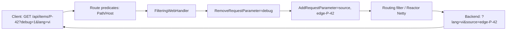

# AddRequestParameter và RemoveRequestParameter trong Spring Cloud Gateway

## 1. Mục tiêu và bài toán

Trong **SPRING_CLOUD_GATEWAY**, route predicate quyết định request nào được chuyển đến dịch vụ đích, còn **GatewayFilter** có thể thay đổi đường dẫn, HTTP header và tham số URL trước khi Gateway gửi request tới microservice. Hai filter thường gặp là:

- **`AddRequestParameter`**: bổ sung một **query parameter** vào URL của request chuyển tiếp.
- **`RemoveRequestParameter`**: xóa một **query parameter theo tên** khỏi URL của request chuyển tiếp.

Ví dụ client gọi:

```http
GET /api/products/P-42?lang=vi&debug=true HTTP/1.1
Host: localhost:8080
```

Gateway có thể xóa `debug`, thêm `source=edge` và chuyển tiếp đến backend:

```http
GET /api/products/P-42?lang=vi&source=edge HTTP/1.1
Host: 127.0.0.1:9001
```

Các query parameter ở ví dụ này xuất hiện **sau dấu `?` của URL**, không phải HTTP request headers. Dù bài học nằm trong chương **Header yêu cầu**, phân biệt hai loại metadata này là điều bắt buộc để tránh cấu hình nhầm filter. Một header có cú pháp như `X-Source: edge`; một query parameter có cú pháp `?source=edge`.

Sau bài học, bạn sẽ có thể:

1. Cấu hình đúng hai `GatewayFilter` trên một route của Gateway Server WebFlux.
2. Giải thích sự khác nhau giữa **thêm**, **xóa** và **thay thế** query parameter.
3. Sử dụng biến `{itemId}` hoặc `{tenant}` được trích xuất bởi predicate `Path`/`Host` khi thêm tham số.
4. Kiểm tra request thực tế đến downstream bằng một backend Echo và `curl`.
5. Nhận diện vấn đề khi tham số bị lặp, chứa ký tự đặc biệt, bị xóa nhầm hoặc liên quan tới thông tin nhạy cảm.
6. Liên hệ thao tác trên query string với xác thực, cache, rate limit, circuit breaker, retry và quan sát request.

**Phạm vi ví dụ:** Spring Cloud Gateway **Server WebFlux**, không phải Gateway Server MVC; sử dụng starter `spring-cloud-starter-gateway-server-webflux` và cấu hình theo prefix `spring.cloud.gateway.server.webflux` của Spring Cloud 2025.0.x / Gateway 4.3.x. Khi áp dụng cho dự án thuộc release train khác, đối chiếu tên starter và prefix trong tài liệu tương ứng.

## 2. Query parameter nằm ở đâu trong một HTTP request?

Xét URL:

```text
http://gateway.example.test:8080/api/products/P-42?lang=vi&debug=true#details
```

Các thành phần:

| Phần | Giá trị minh họa | Ý nghĩa |
| --- | --- | --- |
| Scheme | `http` | Giao thức HTTP giữa client và Gateway. |
| Authority | `gateway.example.test:8080` | Host và cổng mà client kết nối. |
| Path | `/api/products/P-42` | Đường dẫn được `Path` predicate dùng để match route. |
| Query string | `lang=vi&debug=true` | Danh sách cặp tên–giá trị sau `?`. |
| Fragment | `#details` | Phần client-side, không được gửi trong HTTP request target thông thường. |

Một request thật có thể gồm:

```http
GET /api/products/P-42?lang=vi&debug=true HTTP/1.1
Host: gateway.example.test:8080
Accept: application/json
X-Request-Id: abc-123
```

`lang=vi` và `debug=true` là query parameters; `Accept` và `X-Request-Id` là headers. Hai filter trong bài học thao tác trên **query string**. Để sửa header, dùng filter khác như `AddRequestHeader`, `SetRequestHeader`, `RemoveRequestHeader`.

### Một tên tham số có thể có nhiều giá trị

URL hợp lệ có thể chứa:

```text
/api/products?tag=java&tag=spring&lang=vi
```

Phía HTTP server có thể hiểu `tag` là một danh sách hai giá trị. Vì vậy, `AddRequestParameter=tag, cloud` **thêm** `tag=cloud`; không nên xem nó là thao tác thay thế `tag=java` hoặc `tag=spring`. Một số backend chọn giá trị đầu, một số chọn giá trị cuối, số khác lấy toàn bộ danh sách. Không dựa vào quy tắc "giá trị cuối thắng" nếu chưa kiểm soát cách upstream parse query.

## 3. AddRequestParameter: bổ sung query parameter

`AddRequestParameter` là một **GatewayFilterFactory** có sẵn. Nó nhận hai đối số:

```text
AddRequestParameter=<name>, <value>
```

- `name`: tên query parameter cần thêm.
- `value`: giá trị cần thêm, có thể chứa biến URI template đã được các predicate `Path`/`Host` trích xuất.
- Filter áp dụng cho các request **khớp route được cấu hình**, trước khi Gateway chuyển tiếp chúng tới URI upstream.

Ví dụ cấu hình tối giản:

```yaml
spring:
  cloud:
    gateway:
      server:
        webflux:
          routes:
            - id: catalog-route
              uri: http://127.0.0.1:9001
              predicates:
                - Path=/api/products/**
              filters:
                - AddRequestParameter=source, gateway
```

Client gọi:

```text
GET /api/products/P-42?lang=vi
```

Backend nhận query string có thêm tham số:

```text
GET /api/products/P-42?lang=vi&source=gateway
```

Trong trường hợp client không gửi query, filter sẽ tạo phần query phù hợp:

```text
Trước: /api/products/P-42
Sau:   /api/products/P-42?source=gateway
```

Đây là thao tác trên **request chuyển tiếp tới upstream**, không có nghĩa trình duyệt sẽ nhìn thấy URL mới trong thanh địa chỉ hoặc Gateway trả `302 Redirect`. Gateway proxy request theo URI đã biến đổi ở phía server.

### 3.1. Dùng biến từ Path predicate

Khi predicate chứa `{itemId}`, Gateway có thể trích xuất giá trị từ path. `AddRequestParameter` hỗ trợ thay biến này vào **giá trị** parameter.

```yaml
predicates:
  - Path=/api/products/{itemId}
filters:
  - AddRequestParameter=originItem, {itemId}
```

Với URL `/api/products/P-42`, filter thêm `originItem=P-42`. Biến này lấy từ **path**, không lấy từ query và không phải một biến môi trường của Java.

Cũng có thể ghép với chuỗi tĩnh:

```yaml
filters:
  - AddRequestParameter=requestContext, edge-{itemId}
```

Khi đó URL đích chứa `requestContext=edge-P-42`. Tên biến trong filter phải trùng chính xác với tên `{itemId}` ở predicate, bao gồm chữ hoa/chữ thường.

### 3.2. Dùng biến từ Host predicate

Một route phân loại request theo subdomain:

```yaml
predicates:
  - Host={tenant}.edge.example.test
  - Path=/api/orders/**
filters:
  - AddRequestParameter=tenantHint, {tenant}
```

Nếu request có `Host: alpha.edge.example.test`, filter thêm `tenantHint=alpha`. Hai predicate của cùng route phải cùng match.

**Cảnh báo bảo mật:** Host là dữ liệu từ request và có thể bị client điều khiển trực tiếp. Giá trị `tenantHint` chỉ là metadata định tuyến, **không chứng minh client được phép truy cập tenant alpha**. Nếu dùng đa tenant, Gateway hoặc backend phải đối chiếu với danh tính/quyền được xác thực.

## 4. RemoveRequestParameter: loại bỏ query parameter

`RemoveRequestParameter` cũng là `GatewayFilterFactory` có sẵn, nhưng chỉ nhận **tên tham số** cần xóa:

```text
RemoveRequestParameter=<name>
```

Cấu hình:

```yaml
spring:
  cloud:
    gateway:
      server:
        webflux:
          routes:
            - id: catalog-route
              uri: http://127.0.0.1:9001
              predicates:
                - Path=/api/products/**
              filters:
                - RemoveRequestParameter=debug
```

Request trước và sau filter:

```text
Client:
  /api/products/P-42?lang=vi&debug=true&sort=price

Upstream:
  /api/products/P-42?lang=vi&sort=price
```

Filter nhận diện tên `debug` và loại nó khỏi query string trước khi gửi request tới backend. Các tham số khác như `lang` và `sort` được giữ lại, ngoại trừ khi có những filter khác cũng thay đổi chúng.

### 4.1. Khi tham số xuất hiện nhiều lần

Ví dụ:

```text
/api/products/P-42?debug=1&lang=vi&debug=2
```

`RemoveRequestParameter=debug` loại toàn bộ giá trị gắn với tên `debug`; downstream chỉ còn `lang=vi` (nếu không có filter khác thay đổi).

Điều này khác với việc chỉ loại bỏ giá trị đầu tiên của `debug`. Nếu request không có `debug`, filter không có gì để xóa; nó vẫn cho request tiếp tục theo route.

### 4.2. Tên cần xóa được chỉ định rõ

`RemoveRequestParameter=debug` xóa theo **tên**, không lọc theo nội dung giá trị như `true` hay `1`. Nó cũng không có ý nghĩa "xóa tất cả query parameters". Nếu cần giới hạn một tập tham số được phép chuyển tiếp, hãy thiết kế chính sách rõ ràng, dùng các filter phù hợp hoặc viết một filter kiểm soát có kiểm thử.

Ví dụ về mặt bảo mật: xóa `access_token` khỏi URL outbound không khiến việc truyền token trong query trở nên an toàn. URL ban đầu có thể đã xuất hiện trong access log, tracing, lịch sử client hay reverse proxy. **Không thiết kế xác thực bằng token đặt trong query**; với Spring Cloud Gateway nên dùng Spring Security/OAuth2 Resource Server hoặc cách xác thực tiêu chuẩn phù hợp.

## 5. So sánh Add, Remove và RewriteRequestParameter

Ba thao tác dễ bị lẫn:

| Filter | Đối số | Tác động lên query | Trường hợp phù hợp |
| --- | --- | --- | --- |
| `AddRequestParameter` | Tên, giá trị | Thêm cặp tên–giá trị mới. | Bổ sung metadata do Gateway xác định. |
| `RemoveRequestParameter` | Tên | Xóa tham số cùng tên và các giá trị tương ứng. | Không chuyển metadata không cần thiết xuống backend. |
| `RewriteRequestParameter` | Tên, giá trị thay thế | Thay giá trị của tham số đã tồn tại; với nhiều giá trị cùng tên, kết quả thành một giá trị. Nếu tên không tồn tại, không thêm mới. | Chuẩn hóa giá trị của tham số đã có. |

Ví dụ minh họa cùng một đầu vào:

```text
Đầu vào:
  /search?campaign=old&lang=vi

AddRequestParameter=campaign, edge
  /search?campaign=old&campaign=edge&lang=vi
  (để ý campaign bị lặp)

RemoveRequestParameter=campaign
  /search?lang=vi

RewriteRequestParameter=campaign, edge
  /search?campaign=edge&lang=vi
```

Thứ tự các cặp trong query không phải điểm cốt lõi của ví dụ; nội dung tên–giá trị mới là điều cần kiểm tra. `RewriteRequestParameter` được đưa vào để so sánh, còn trọng tâm thực hành vẫn là **Add** và **Remove**.

**Không nhầm `RemoveRequestParameter` với `RemoveRequestHeader`.** Tham số `debug` trong URL hoàn toàn khác header `X-Debug` trong HTTP message. Việc xóa một loại không tự xóa loại còn lại.

### 5.1. Khi dùng Add và Remove cho cùng tên

Giả sử route có:

```yaml
filters:
  - RemoveRequestParameter=source
  - AddRequestParameter=source, gateway
```

Ý định thường là bỏ giá trị `source` do client gửi rồi thêm giá trị do Gateway xác định. Nếu dùng cả hai filter, **thứ tự thực thi** ảnh hưởng kết quả. Nếu đảo thứ tự để Add chạy trước Remove, giá trị mới cũng có thể bị xóa.

Các `GatewayFilter` của route được ghép với `GlobalFilter` và sắp xếp theo order khi xử lý. Trong cùng route, khai báo filter theo thứ tự mong muốn, tránh các global/custom filter khác thay đổi cùng tên, và **kiểm chứng bằng HTTP integration test**. Với nhu cầu đơn giản là thay giá trị của tham số có sẵn, cân nhắc `RewriteRequestParameter`; nếu client có thể gửi thiếu tham số, lưu ý rewrite không tự thêm mới.

### 5.2. URL encoding và các ký tự đặc biệt

Dấu cách, `&`, `=`, `+`, dấu `%` và ký tự Unicode trong query phải được xử lý đúng theo URI encoding. Ví dụ giá trị `hello world` có thể được biểu diễn thành chuỗi mã hóa trong URL. Đừng nối chuỗi query thủ công với một giá trị đầu vào từ client:

```java
// Không nên: giá trị người dùng có thể chứa '&', '?' hoặc ký tự đặc biệt.
String url = existingUrl + "?source=" + untrustedValue;
```

Filter có sẵn sử dụng API dựng URI của framework, giúp hạn chế lỗi khi thêm/xóa tham số. Khi yêu cầu ký URL, tạo cache key hoặc xác minh chữ ký (HMAC), cần kiểm thử cả cách encode/decode, tham số lặp và cách sắp xếp query vì những yếu tố này có thể làm chữ ký hoặc cache key khác nhau.

## 6. Vị trí của hai filter trong request-processing pipeline



Những điểm cần nhớ:

- Route được chọn theo predicate trước khi filter của route chạy. `AddRequestParameter` và `RemoveRequestParameter` không phải `RoutePredicateFactory`.
- Chúng làm biến đổi request **trước khi downstream nhận**. Chúng không thay đổi path hoặc HTTP headers, trừ khi một filter khác thực hiện.
- `GlobalFilter` và các `GatewayFilter` của route được hợp nhất theo order; filter chạy quá muộn so với bước định tuyến có thể không ảnh hưởng URI outbound như mong muốn.
- Request không khớp route sẽ không chạy các GatewayFilter của route đó.
- Nếu một filter phía trước short-circuit (ví dụ rate limiter từ chối), hai filter này có thể không chạy; upstream cũng có thể không nhận request.
- Nếu có retry, request được xử lý lại theo phạm vi retry; cần phân biệt số lần downstream được gọi và kết quả URL thực tế của từng attempt.

## 7. Thực hành: cấu hình Gateway và backend quan sát query string

Ta tạo một API Gateway Server WebFlux chạy cổng `8080` và một backend Echo dùng JDK chạy cổng `9001`. Bài thực hành giúp xác nhận **query parameter nào thực sự đi qua Gateway** mà không cần Eureka, Consul, Redis hay cơ sở dữ liệu.

Kịch bản:

- Client gọi `/api/items/{itemId}` với `debug` và `lang`.
- Gateway xóa `debug`, thêm `source=edge-{itemId}`.
- Backend nhận cùng path với `lang` và `source`, không nhận `debug`.

### 7.1. Tạo dự án Spring Boot / Maven

Yêu cầu JDK 17+, Maven và một cặp Spring Boot/Spring Cloud tương thích. Ví dụ dưới đây cố định Spring Boot `3.5.0` và Spring Cloud `2025.0.0` để minh họa cấu hình nhất quán, không hàm ý đây là bản vá nên dùng ở production hiện tại.

Tạo `pom.xml`:

```xml
<?xml version="1.0" encoding="UTF-8"?>
<project xmlns="http://maven.apache.org/POM/4.0.0"
         xmlns:xsi="http://www.w3.org/2001/XMLSchema-instance"
         xsi:schemaLocation="http://maven.apache.org/POM/4.0.0
                             https://maven.apache.org/xsd/maven-4.0.0.xsd">
    <modelVersion>4.0.0</modelVersion>

    <parent>
        <groupId>org.springframework.boot</groupId>
        <artifactId>spring-boot-starter-parent</artifactId>
        <version>3.5.0</version>
        <relativePath/>
    </parent>

    <groupId>com.example</groupId>
    <artifactId>request-parameter-gateway</artifactId>
    <version>0.0.1-SNAPSHOT</version>

    <properties>
        <java.version>17</java.version>
    </properties>

    <dependencyManagement>
        <dependencies>
            <dependency>
                <groupId>org.springframework.cloud</groupId>
                <artifactId>spring-cloud-dependencies</artifactId>
                <version>2025.0.0</version>
                <type>pom</type>
                <scope>import</scope>
            </dependency>
        </dependencies>
    </dependencyManagement>

    <dependencies>
        <dependency>
            <groupId>org.springframework.cloud</groupId>
            <artifactId>spring-cloud-starter-gateway-server-webflux</artifactId>
        </dependency>
    </dependencies>

    <build>
        <plugins>
            <plugin>
                <groupId>org.springframework.boot</groupId>
                <artifactId>spring-boot-maven-plugin</artifactId>
            </plugin>
        </plugins>
    </build>
</project>
```

`spring-cloud-dependencies` là BOM dùng để quản lý các thư viện thuộc Spring Cloud release train. Starter Gateway **không ghi version riêng**, để tránh trộn những phiên bản không tương thích. Dự án dùng WebFlux/Reactor Netty; không thêm `spring-boot-starter-web` cho bài thực hành này.

Tạo `src/main/java/com/example/gateway/GatewayApplication.java`:

```java
package com.example.gateway;

import org.springframework.boot.SpringApplication;
import org.springframework.boot.autoconfigure.SpringBootApplication;

@SpringBootApplication
public class GatewayApplication {
    public static void main(String[] args) {
        SpringApplication.run(GatewayApplication.class, args);
    }
}
```

### 7.2. Cấu hình route và hai filter

Tạo `src/main/resources/application.yml`:

```yaml
server:
  port: 8080

spring:
  application:
    name: request-parameter-gateway
  cloud:
    gateway:
      server:
        webflux:
          routes:
            - id: items-route
              uri: http://127.0.0.1:9001
              predicates:
                - Path=/api/items/{itemId}
              filters:
                - RemoveRequestParameter=debug
                - AddRequestParameter=source, edge-{itemId}
```

Giải thích:

| Dòng | Hành vi |
| --- | --- |
| `id: items-route` | Đặt ID của route để kiểm tra log và cấu hình. |
| `uri: http://127.0.0.1:9001` | Chọn backend Echo trên loopback. |
| `Path=/api/items/{itemId}` | Match một phân đoạn ID sau `/api/items/`, trích xuất `itemId`. |
| `RemoveRequestParameter=debug` | Không chuyển tiếp query parameter `debug`. |
| `AddRequestParameter=source, edge-{itemId}` | Thêm query parameter `source` chứa ID đã match. |

Bài này không đổi path bằng `StripPrefix` hoặc `SetPath`; backend nhận `/api/items/P-42` để có thể quan sát riêng hiệu ứng của query filter.

### 7.3. Tạo backend Echo

Tạo file `EchoBackend.java` ở một thư mục thử nghiệm ngoài source Gateway:

```java
import com.sun.net.httpserver.HttpServer;
import java.net.InetSocketAddress;
import java.nio.charset.StandardCharsets;

public class EchoBackend {
    public static void main(String[] args) throws Exception {
        HttpServer server = HttpServer.create(
                new InetSocketAddress("127.0.0.1", 9001), 0);

        server.createContext("/", exchange -> {
            String path = exchange.getRequestURI().getRawPath();
            String query = exchange.getRequestURI().getRawQuery();

            System.out.println("BACKEND RECEIVED path=" + path
                    + " query=" + query);

            String body = "path=" + path + "\n"
                    + "query=" + query + "\n"
                    + "x-debug-header=" + exchange.getRequestHeaders()
                            .getFirst("X-Debug") + "\n";

            byte[] payload = body.getBytes(StandardCharsets.UTF_8);
            exchange.getResponseHeaders().set(
                    "Content-Type", "text/plain; charset=UTF-8");
            exchange.sendResponseHeaders(200, payload.length);

            try (var stream = exchange.getResponseBody()) {
                stream.write(payload);
            }
        });

        server.start();
        System.out.println("EchoBackend listening on 127.0.0.1:9001");
    }
}
```

`EchoBackend` in **raw query string** từ request mà nó nhận được. Tùy URI encoding, cách biểu diễn ký tự đặc biệt có thể khác với giá trị đã decode; điều cần kiểm tra ở bài này là sự có mặt hoặc vắng mặt của **tên tham số**.

Chạy backend trong **terminal A**:

```bash
java EchoBackend.java
```

Chạy Gateway tại thư mục dự án có `pom.xml` trong **terminal B**:

```bash
mvn spring-boot:run
```

Nếu có Maven Wrapper, dùng `./mvnw spring-boot:run` trên Linux/macOS hoặc `mvnw.cmd spring-boot:run` trên Windows. Đảm bảo hai cổng `8080` và `9001` chưa được tiến trình khác sử dụng.

### 7.4. Kiểm thử: thêm và xóa cùng một request

Trong **terminal C**, gọi:

```bash
curl -i "http://127.0.0.1:8080/api/items/P-42?lang=vi&debug=true"
```

Kết quả kỳ vọng từ backend (thứ tự query có thể thay đổi):

```http
HTTP/1.1 200 OK
Content-Type: text/plain; charset=UTF-8

path=/api/items/P-42
query=lang=vi&source=edge-P-42
x-debug-header=null
```

Có thể rút ra ba điều:

1. `Path` predicate đã match, cung cấp `itemId=P-42`.
2. `RemoveRequestParameter` đã xóa `debug=true`.
3. `AddRequestParameter` đã thêm `source=edge-P-42`, trong khi `lang=vi` vẫn được giữ.

Nếu kết quả hiển thị `source` trước `lang`, điều đó không thay đổi ý nghĩa bài kiểm thử. Với ký URL hoặc cache key, việc thứ tự tham số có quan trọng hay không phụ thuộc vào hợp đồng của downstream.

### 7.5. Kiểm thử tham số trùng tên

```bash
curl -i "http://127.0.0.1:8080/api/items/P-43?debug=1&debug=2&lang=en"
```

Backend vẫn không thấy `debug=1` hay `debug=2`; query còn `lang=en` và `source=edge-P-43`.

Ngược lại, client thử tự gửi `source`:

```bash
curl -i "http://127.0.0.1:8080/api/items/P-44?source=client"
```

Vì `AddRequestParameter` **thêm** chứ không thay thế, backend có thể thấy `source=client` **và** `source=edge-P-44`. Đây là trường hợp cần quan sát để tránh nhầm khi downstream chỉ đọc một giá trị.

Nếu muốn `source` hoàn toàn do Gateway quản lý, cấu hình theo hướng **Remove trước, Add sau**:

```yaml
filters:
  - RemoveRequestParameter=debug
  - RemoveRequestParameter=source
  - AddRequestParameter=source, edge-{itemId}
```

Sau thay đổi, kiểm thử lại request có `source=client` và request không có `source`. Không coi quy tắc này là bằng chứng xác thực: một client có thể tự gửi nhiều dữ liệu khác, và backend phải có hợp đồng rõ ràng về dữ liệu nào tin cậy.

### 7.6. Kiểm chứng tham số và header là hai đối tượng khác nhau

```bash
curl -i -H "X-Debug: client-value" \
  "http://127.0.0.1:8080/api/items/P-45?debug=1"
```

Dù `debug` ở query bị xóa, backend vẫn thấy:

```text
x-debug-header=client-value
```

Bởi vì `RemoveRequestParameter=debug` **không xóa header `X-Debug`**. Nếu ứng dụng cần loại bỏ header đó, phải cấu hình riêng `RemoveRequestHeader=X-Debug` và kiểm thử hành vi.

Trên Windows PowerShell, dùng `curl.exe` nếu bí danh `curl` trỏ tới lệnh PowerShell khác.

### 7.7. Kiểm tra lỗi định tuyến

Request không khớp mẫu:

```bash
curl -i "http://127.0.0.1:8080/api/items"
curl -i "http://127.0.0.1:8080/api/items/P-42/details"
```

Với ứng dụng chỉ có route `items-route` và không có handler khác cho các path này, hai request thường nhận `404 Not Found`. Filter Add/Remove không chạy vì route không match.

Nếu tắt backend `9001` rồi gọi `/api/items/P-42`, route vẫn match và filter vẫn có thể biến đổi URL outbound, nhưng bước kết nối upstream thất bại, thường dẫn tới lỗi nhóm `5xx`. Phân biệt **không có route** với **route đã khớp nhưng upstream không hoạt động**.

## 8. Trường hợp mở rộng: tham số từ tên miền

Một cấu hình khác minh họa cách kết hợp `Host` predicate và `AddRequestParameter`:

```yaml
spring:
  cloud:
    gateway:
      server:
        webflux:
          routes:
            - id: tenant-orders-route
              uri: http://127.0.0.1:9001
              predicates:
                - Host={tenant}.edge.example.test
                - Path=/api/orders/**
              filters:
                - RemoveRequestParameter=internal
                - AddRequestParameter=tenantHint, {tenant}
```

Gửi thử bằng `curl` tới một Gateway chạy trên cổng `8080` với cấu hình trên:

```bash
curl -i -H "Host: alpha.edge.example.test" \
  "http://127.0.0.1:8080/api/orders/99?internal=1&lang=vi"
```

Khi route match, backend nhận `tenantHint=alpha`, `lang=vi` và không còn `internal=1`. `tenantHint` được lấy từ biến `{tenant}` của Host predicate.

**Đừng dùng `tenantHint` để quyết định quyền truy cập mà không xác thực.** Client có thể tự điều chỉnh `Host`; khi cần multi-tenancy, hãy kiểm tra host thuộc domain được phép và đối chiếu tenant với thông tin được xác thực (ví dụ claims từ token), đồng thời khóa kênh kết nối tin cậy tới backend.

## 9. Lưu ý về bảo mật và vận hành microservices

### 9.1. Query string không phải nơi lưu bí mật

Query string có thể xuất hiện trong:

- Access log của reverse proxy hoặc Gateway.
- Công cụ tracing, giám sát, dashboard hoặc báo cáo lỗi.
- URL được copy, bookmark, cache hoặc chia sẻ ngoài ý muốn.

Không dùng `AddRequestParameter` để gắn JWT, API key, mật khẩu hay dữ liệu nhạy cảm vào URL downstream. Xóa một query parameter trước khi proxy **không bảo đảm** dữ liệu ban đầu chưa được ghi nhận ở nơi khác trong hạ tầng. Với xác thực, dùng TLS và cơ chế xác thực được thiết kế phù hợp, chẳng hạn Spring Security WebFlux/OAuth2.

### 9.2. Không coi tham số bổ sung là danh tính đã được xác thực

`source=edge` hay `tenantHint=alpha` là metadata tiện lợi; giá trị được thêm không tự tạo ranh giới trust. Nếu backend dùng một tham số để đưa ra quyết định phân quyền, cần bảo đảm tham số được xử lý trong một hợp đồng bảo mật có xác thực, liên kết định danh và bảo vệ đường truyền Gateway–backend.

### 9.3. Ảnh hưởng tới cache, ký request và idempotency

Một thay đổi query có thể làm khác:

- **Cache key** của CDN, proxy hay ứng dụng.
- **Canonical request** dùng trong HMAC/signature verification.
- **Metric cardinality** nếu mỗi giá trị query trở thành một label.
- **Routing nghiệp vụ** của upstream nếu tên tham số trùng với tham số đặc biệt.

Chẳng hạn, thêm `source=edge-P-42` vào một URL được ký trước đó có thể khiến chữ ký không khớp. Với hệ thống dùng chữ ký hoặc cache, cần xác định rõ bước canonicalization và vị trí filter trong pipeline, đồng thời có integration tests cho query trùng tên và ký tự mã hóa.

### 9.4. Tương tác với các tính năng khác

- **Route predicates:** `Path`, `Host`, `Query` kiểm tra request để chọn route trước khi các filter của route chạy. `AddRequestParameter` không làm một route vốn không match đột nhiên match lại.
- **Filter chain:** những filter chỉ định trên route được sắp cùng global filters; nếu có custom filter khác sửa query, phải thử thứ tự thực tế.
- **Service discovery:** khi URI route là `lb://inventory`, cơ chế LoadBalancer/discovery quyết định instance; Add/Remove vẫn chỉ xử lý query gửi upstream.
- **Rate limiter:** thường chọn khóa theo client/identity; không dùng query parameter dễ giả mạo làm khóa duy nhất cho chính sách an toàn nếu không được ràng buộc với danh tính.
- **Retry/circuit breaker:** request có thể được phát lại hoặc trả fallback. Không suy việc có thêm query mới là bằng chứng một lần gọi upstream đã thành công.
- **TLS:** bảo vệ kết nối client–Gateway và Gateway–upstream theo cấu hình riêng; thay đổi query không tự cấu hình TLS.
- **Observability:** khi log route ID, status, latency và tracing, tránh log toàn bộ query có thông tin nhạy cảm; không đưa các ID biến thiên cao vào nhãn metrics.

## 10. Chẩn đoán sự cố thường gặp

| Hiện tượng | Nguyên nhân có thể | Cách kiểm tra |
| --- | --- | --- |
| Không có `source` ở backend | Route không khớp; YAML sai prefix; filter không được đăng ký. | Xem route ID, `Path` predicate, starter và prefix đúng release train. |
| `source` vẫn chứa `{itemId}` | Tên placeholder không trùng với `Path`/`Host` hoặc filter không có biến để thay. | Dùng `Path=/api/items/{itemId}`, giữ đúng chính tả tên biến. |
| `debug` vẫn xuất hiện | Filter đặt ở route khác; `debug` được thêm lại bởi filter sau; backend nhận request trực tiếp. | Xem route thực tế và log Echo, kiểm tra thứ tự/filter khác. |
| `source` xuất hiện hai lần | `AddRequestParameter` thêm giá trị mới dù client đã có tên `source`. | Xác định hợp đồng upstream; dùng Remove trước Add nếu cần. |
| Xóa `debug` nhưng `X-Debug` vẫn còn | Query parameter và HTTP header là hai thành phần khác nhau. | Dùng `RemoveRequestHeader` khi thực sự cần xóa header. |
| Backend nhận URL với ký tự `%`, `+` khác kỳ vọng | URI encoding/decoding hoặc ký tự đặc biệt trong query. | Kiểm tra raw query và query đã decode; test unicode, dấu cách, `&`, `=`. |
| Lỗi `404` | Không có route/handler khớp path hoặc Host. | So khớp các predicate trước khi xem filter. |
| Lỗi `5xx` khi route khớp | Upstream không chạy, timeout hoặc kết nối lỗi. | Gọi backend trực tiếp, kiểm tra `uri`, port và log routing. |
| Gateway không khởi động sau khi copy ví dụ cũ | Starter/prefix không phù hợp release train. | Kiểm tra tài liệu của phiên bản đang dùng và BOM. |
| Chữ ký của request không hợp lệ | URL thay đổi sau bước ký hoặc có query parameter bị lặp. | Thống nhất canonicalization và vị trí filter, kiểm thử end-to-end. |

## 11. Câu hỏi tự kiểm tra

**1. `AddRequestParameter` thay đổi HTTP header hay query string?**

Nó bổ sung một cặp tên–giá trị vào **query string** của request upstream. Với header, dùng `AddRequestHeader`.

**2. Request có `?tag=java`; filter `AddRequestParameter=tag, cloud` có tự thay `java` thành `cloud` không?**

Không. Đây là thao tác **thêm**, nên downstream có thể nhận cả `tag=java` và `tag=cloud`.

**3. `RemoveRequestParameter=debug` có xóa `debug=1&debug=2` không?**

Có. Filter loại tham số theo tên, bao gồm các giá trị lặp của tên đó.

**4. Nếu filter dùng `AddRequestParameter=product, {itemId}`, `itemId` lấy từ đâu?**

Từ biến URI template được predicate `Path` hoặc `Host` của route khớp trích xuất, chẳng hạn `Path=/api/items/{itemId}`.

**5. Một request `/api/items` không khớp `Path=/api/items/{itemId}`. Filter có được chạy không?**

Không chạy theo route đó vì Gateway chưa chọn route tương ứng.

**6. Có an toàn không nếu thêm `access_token` vào query rồi dùng `RemoveRequestParameter` trước khi gọi backend?**

Không. Token có thể đã xuất hiện trong log, URL hoặc hạ tầng trước khi bị xóa; nên dùng cơ chế xác thực được thiết kế đúng.

**7. Muốn thay giá trị `campaign` đã có trong URL, có nên chỉ dùng Add?**

Không. `RewriteRequestParameter` phù hợp với việc thay giá trị đã có. Nếu cần chắc chắn thay cả trường hợp client không có tham số, hãy thiết kế Remove rồi Add với test thứ tự.

**8. Xóa tham số `internal` trước khi chuyển tiếp có tự giới hạn lưu lượng hoặc ngăn SSRF không?**

Không. Remove chỉ xóa query parameter theo tên. Cần chính sách route/upstream, xác thực, rate limit và kiểm soát kết nối phù hợp riêng.

## Kết luận

Trong Spring Cloud Gateway Server WebFlux, **`AddRequestParameter`** giúp bổ sung query parameter vào HTTP request upstream; **`RemoveRequestParameter`** xóa tham số theo tên trước khi chuyển tiếp. Chúng là filter của chuỗi xử lý **sau khi route predicate đã match**, không phải bộ lọc HTTP header. Khi áp dụng cho microservices, cần kiểm tra trường hợp tham số trùng tên, URI template variables, encoding và thứ tự filter; đồng thời tránh đưa dữ liệu bí mật vào URL hoặc xem query parameter là bằng chứng xác thực. Kiểm thử backend thực nhận gì là cách chắc chắn nhất để xác nhận hành vi.

### Tài liệu tham khảo chính thức

- [Spring Cloud Gateway Server WebFlux 4.3 — AddRequestParameter GatewayFilter Factory](https://docs.spring.io/spring-cloud-gateway/reference/4.3/spring-cloud-gateway-server-webflux/gatewayfilter-factories/addrequestparameter-factory.html)
- [Spring Cloud Gateway Server WebFlux 4.3 — RemoveRequestParameter GatewayFilter Factory](https://docs.spring.io/spring-cloud-gateway/reference/4.3/spring-cloud-gateway-server-webflux/gatewayfilter-factories/removerequestparameter-factory.html)
- [Spring Cloud Gateway Server WebFlux 4.3 — RewriteRequestParameter GatewayFilter Factory](https://docs.spring.io/spring-cloud-gateway/reference/4.3/spring-cloud-gateway-server-webflux/gatewayfilter-factories/rewriterequestparameter-factory.html)
- [Spring Cloud Gateway Server WebFlux 4.3 — Route Predicate Factories](https://docs.spring.io/spring-cloud-gateway/reference/4.3/spring-cloud-gateway-server-webflux/request-predicates-factories.html)
- [Spring Cloud Gateway Server WebFlux 4.3 — How It Works](https://docs.spring.io/spring-cloud-gateway/reference/4.3/spring-cloud-gateway-server-webflux/how-it-works.html)
- [Spring Cloud — tương thích các release train với Spring Boot](https://spring.io/projects/spring-cloud/)
