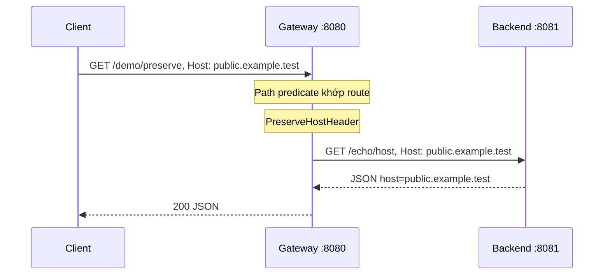

# PreserveHostHeader và SetRequestHostHeader

## 1. Vì sao Host header quan trọng trong API Gateway?

**Spring Cloud Gateway** là lớp cổng vào cho các microservices: route predicate chọn dịch vụ đích, filter chain biến đổi đường dẫn/header, và các tính năng bảo mật, rate limiting, retry, circuit breaker, TLS, quan sát request giúp hệ thống vận hành ổn định. Trong lớp **header yêu cầu**, một giá trị rất dễ gây nhầm lẫn là HTTP **`Host`**.

`Host` mô tả **tên host mà client muốn truy cập trong HTTP request**. Nó không nhất thiết giống DNS/IP mà Gateway dùng để mở kết nối sang backend. Giả sử:

```text
Client --> Gateway:
    GET /api/orders HTTP/1.1
    Host: api.example.test

Gateway --> backend:
    URI upstream: http://10.20.30.40:8081
    HTTP Host có thể là:
        10.20.30.40:8081        (mặc định theo HTTP client)
        api.example.test       (giữ Host client)
        orders.internal.test  (Host cố định do route đặt)
```

Hai filter của Spring Cloud Gateway cho hai nhu cầu khác nhau:

- **`PreserveHostHeader`:** yêu cầu routing filter **giữ Host của request đầu vào** khi tạo request downstream.
- **`SetRequestHostHeader`:** **thay Host downstream** bằng một giá trị `host` do route chỉ định.

Hoàn thành bài này, bạn sẽ phân biệt inbound Host, outbound Host, route URI, `Host` predicate và TLS SNI; cấu hình được hai filter; kiểm chứng bằng một backend echo và tránh rủi ro spoofing khi ứng dụng dùng Host để phân loại tenant.

> **Phạm vi:** Ví dụ chính dùng **Spring Cloud Gateway Server WebFlux 5.0.x** và namespace `spring.cloud.gateway.server.webflux`. Server Web MVC 5.0.x cũng có hai filter cùng tên, với API thực thi trên Servlet/WebMvc.fn; cấu hình riêng ở mục 8. Một số bản 4.x dùng namespace `spring.cloud.gateway.routes`. Chọn Boot/Cloud BOM và tài liệu đúng nhánh phiên bản đang triển khai.

## 2. Năm khái niệm cần tách bạch

| Khái niệm | Ví dụ | Chức năng |
|---|---|---|
| **Inbound Host** | `Host: public.example.test` | Giá trị trên request client gửi đến Gateway |
| **Route URI** | `http://127.0.0.1:8081` | Scheme, host và port để Gateway kết nối tới upstream |
| **Outbound Host** | `Host: orders.internal.test` | Giá trị host mà backend nhận trong HTTP request đã được proxy |
| **Forwarded host** | `X-Forwarded-Host: public.example.test` hoặc `Forwarded: host=...` | Metadata do proxy chuyển tiếp, không phải HTTP Host |
| **TLS SNI** | `orders.internal.test` | Tên có thể được gửi trong TLS handshake để server chọn chứng chỉ |

Trong **HTTP/1.1**, Host mang phần authority của request. Với **HTTP/2**, phần authority chủ yếu nằm ở pseudo-header **`:authority`**; vì vậy bài lab dùng `curl --http1.1` để nhìn Host rõ ràng.



**Quy tắc:** thay HTTP Host **không tự đổi** DNS/IP/port trong route URI, không rewrite path, không định nghĩa lại danh tính TLS certificate và cũng không tự xác thực quyền sử dụng một hostname. Mỗi lớp cần cơ chế kiểm tra riêng.

## 3. PreserveHostHeader: giữ Host đầu vào

### 3.1. Cơ chế

`PreserveHostHeader` là **GatewayFilter Factory không nhận tham số**. Trên WebFlux, factory này đặt một **request attribute** để routing filter biết phải gửi Host đầu vào, thay vì để HTTP client tự xác định Host theo backend URI. Nó không mở kết nối đến địa chỉ lấy từ Host input.

Ví dụ route:

```yaml
spring:
  cloud:
    gateway:
      server:
        webflux:
          routes:
            - id: preserve-host-route
              uri: http://127.0.0.1:8081
              predicates:
                - Path=/api/preserve/**
              filters:
                - StripPrefix=2
                - PreserveHostHeader
```

Nếu client gửi `GET /api/preserve/products` kèm `Host: public.example.test`, backend ở `127.0.0.1:8081` sẽ nhận path `/products` và Host `public.example.test` theo cơ chế preserve. Filter `StripPrefix` chỉ thay **path**, không quyết định Host.

**Điều PreserveHostHeader không làm:**

1. Không kiểm tra client có quyền sử dụng `public.example.test` hay không.
2. Không đặt một giá trị Host cố định: Host đi xuống có thể thay đổi theo request.
3. Không tự phục hồi Host public ban đầu nếu ingress đã thay Host **trước khi** request tới Gateway.
4. Không tự thay địa chỉ kết nối upstream, TLS SNI, certificate validation hoặc `X-Forwarded-Host`.
5. Không tự thay kết quả `Host` route predicate: predicate được kiểm tra **trước** chuỗi Gateway filters.

### 3.2. Khi nào dùng?

Phù hợp khi backend phục vụ nhiều **virtual host** hoặc domain public và cần biết chính xác hostname Gateway đã nhận:

```text
Host: shop-a.example.test  ->  virtual host A
Host: shop-b.example.test  ->  virtual host B
```

Trong ứng dụng **multi-tenant**, chính sách Host chỉ giúp định tuyến đến đúng virtual host. Việc người dùng **có quyền đọc dữ liệu tenant nào** phải được backend/Gateway security chain xác thực và phân quyền độc lập; client tự có thể điền Host giả.

Nếu backend chỉ phục vụ một hostname nội bộ cố định, preserve Host public có thể khiến backend không chọn được virtual host mong muốn. Khi đó xem `SetRequestHostHeader`.

## 4. SetRequestHostHeader: đặt Host mới

### 4.1. Cơ chế

`SetRequestHostHeader` nhận tham số **`host`** và thay Host request được chuyển tiếp bằng giá trị cấu hình. Trong Gateway Server WebFlux, dùng dạng đầy đủ để dễ đọc và kiểm soát:

```yaml
spring:
  cloud:
    gateway:
      server:
        webflux:
          routes:
            - id: fixed-host-route
              uri: http://127.0.0.1:8081
              predicates:
                - Path=/api/fixed/**
              filters:
                - StripPrefix=2
                - name: SetRequestHostHeader
                  args:
                    host: orders.internal.test
```

Nếu client gửi `Host: public.example.test`, backend sẽ thấy **`Host: orders.internal.test`**; upstream network target vẫn là **`127.0.0.1:8081`**. Đây là cơ chế thích hợp khi backend kiểm tra virtual host theo một hostname mà người vận hành đã quyết định.

Với HTTP/1.1, một Host hợp lệ có thể chứa **port** (ví dụ `orders.internal.test:8443`); định dạng phải phù hợp với endpoint backend. Không nhận Host mới trực tiếp từ một header hay query parameter không đáng tin rồi đưa vào cấu hình/logic rewrite.

### 4.2. Khác gì với SetRequestHeader hoặc AddRequestHeader?

`SetRequestHeader` là filter tổng quát thay một header theo tên; `AddRequestHeader` thêm header. Tuy nhiên, **Host có ý nghĩa đặc biệt** với HTTP client/routing layer và `:authority` trong HTTP/2. Khi mục tiêu là điều khiển Host gửi xuống backend, sử dụng đúng **filter chuyên dụng `SetRequestHostHeader`** theo tài liệu phiên bản đang chạy.

Không dùng `AddRequestHeader=Host,...` như một cách thay Host: kết quả có thể trùng nhiều giá trị hoặc bị HTTP client chuẩn hóa lại. Hãy kiểm tra **Host backend thực sự nhận**.

## 5. Bảng lựa chọn nhanh

| Tiêu chí | Không đặt filter Host | PreserveHostHeader | SetRequestHostHeader |
|---|---|---|---|
| Host HTTP downstream | HTTP client định, thường theo backend URI | Giữ Host inbound | Ghi đè thành `host` cấu hình |
| Tham số | Không | Không | `host` bắt buộc |
| Hai request có inbound Host khác nhau | Không bảo đảm backend nhìn thấy Host khác | Thường giữ hai Host tương ứng | Cùng Host cố định trên cùng route |
| Ví dụ phù hợp | Backend không quan tâm Host public | Backend xử lý virtual host public | Backend yêu cầu virtual host nội bộ |
| Đổi địa chỉ kết nối upstream | Không | Không | Không |
| Tự thay TLS SNI/chứng chỉ | Không | Không bảo đảm | Không bảo đảm |
| Tự xác thực tên host/tenant | Không | Không | Không |

**Chọn một chính sách Host cho mỗi route.** Không tùy tiện khai báo cả `PreserveHostHeader` lẫn `SetRequestHostHeader` với cùng route: một bên yêu cầu giữ Host đầu vào, bên kia thay Host bằng giá trị khác. Cách chúng tương tác phụ thuộc routing implementation/thứ tự filter; không nên xây bảo mật hoặc định tuyến tenant dựa trên kết quả chưa kiểm chứng.

## 6. Thực hành: xem Host thật mà backend nhận

Các ví dụ dùng **HTTP local** để tập trung vào Host header, tách biệt lỗi chứng chỉ TLS. Chuẩn bị hai ứng dụng Spring Boot độc lập:

| Ứng dụng | Cổng | Dependency chính | Nhiệm vụ |
|---|---:|---|---|
| `host-echo` | 8081 | Spring Web MVC theo bản Spring Boot | Backend phản hồi Host và path request |
| `host-gateway` | 8080 | `spring-cloud-starter-gateway-server-webflux` | Khai báo ba route so sánh |

Khởi tạo theo release train Spring Cloud tương thích với Spring Boot. Không thêm starter Servlet MVC vào chính ứng dụng Gateway Server WebFlux khi không chủ đích chạy stack MVC.

### 6.1. Backend echo

Trong dự án `host-echo`, tạo class:

```java
package com.example.hostecho;

import java.util.Map;
import jakarta.servlet.http.HttpServletRequest;
import org.springframework.boot.SpringApplication;
import org.springframework.boot.autoconfigure.SpringBootApplication;
import org.springframework.web.bind.annotation.GetMapping;
import org.springframework.web.bind.annotation.RequestHeader;
import org.springframework.web.bind.annotation.RestController;

@SpringBootApplication
@RestController
public class HostEchoApplication {

    public static void main(String[] args) {
        SpringApplication.run(HostEchoApplication.class, args);
    }

    @GetMapping("/echo/host")
    public Map<String, String> echo(
            @RequestHeader(name = "Host", defaultValue = "absent") String host,
            @RequestHeader(name = "X-Forwarded-Host",
                           defaultValue = "absent") String forwardedHost,
            HttpServletRequest request) {
        return Map.of(
            "host", host,
            "forwardedHost", forwardedHost,
            "path", request.getRequestURI()
        );
    }
}
```

Đặt `server.port: 8081` trong `application.yml` của **backend**:

```yaml
spring:
  application:
    name: host-echo
server:
  port: 8081
```

Chạy backend rồi kiểm tra **trực tiếp**:

```bash
curl --noproxy '*' --http1.1 -i \
  -H 'Host: public.example.test' \
  'http://127.0.0.1:8081/echo/host'
```

Backend dự kiến trả JSON chứa `"host":"public.example.test"` và `"path":"/echo/host"`. Tham số `--noproxy '*'` tránh việc `curl` dùng proxy HTTP được khai báo bởi môi trường, khiến bài thử không còn đi theo topology giả định. Với **PowerShell**, có thể gọi `curl.exe` để tránh alias `curl`.

### 6.2. Gateway gồm ba route khác nhau

Trong dự án `host-gateway` dùng Gateway Server WebFlux, cấu hình `application.yml`:

```yaml
server:
  port: 8080

spring:
  application:
    name: host-gateway
  cloud:
    gateway:
      server:
        webflux:
          routes:
            # A. Không có filter Host
            - id: host-default
              uri: http://127.0.0.1:8081
              predicates:
                - Path=/demo/default
              filters:
                - SetPath=/echo/host

            # B. Chuyển tiếp Host đầu vào
            - id: host-preserve
              uri: http://127.0.0.1:8081
              predicates:
                - Path=/demo/preserve
              filters:
                - SetPath=/echo/host
                - PreserveHostHeader

            # C. Đặt Host cố định
            - id: host-fixed
              uri: http://127.0.0.1:8081
              predicates:
                - Path=/demo/fixed
              filters:
                - SetPath=/echo/host
                - name: SetRequestHostHeader
                  args:
                    host: orders.internal.test
```

Cả ba route tới **cùng một địa chỉ và cổng backend**; `SetPath=/echo/host` giúp chúng gọi cùng endpoint để so sánh công bằng. Không có `Host` predicate, nên cả ba nhận một request với Host bất kỳ phù hợp định dạng HTTP. Trong production phải kiểm soát allowlist hostname riêng, không dùng cấu hình lab như quy tắc bảo mật.

### 6.3. Chạy ba request đối chiếu

Khởi động Gateway sau backend, sau đó gọi:

```bash
# A. Host do routing HTTP client quyết định
curl --noproxy '*' --http1.1 -sS \
  -H 'Host: public.example.test' \
  'http://127.0.0.1:8080/demo/default'

# B. Host do client gửi được bảo toàn
curl --noproxy '*' --http1.1 -sS \
  -H 'Host: public.example.test' \
  'http://127.0.0.1:8080/demo/preserve'

# C. Host ghi đè bằng giá trị trong YAML
curl --noproxy '*' --http1.1 -sS \
  -H 'Host: public.example.test' \
  'http://127.0.0.1:8080/demo/fixed'
```

**Kết quả dự kiến** cho HTTP/1.1 khi không có filter/ingress khác thay Host:

| Request | Backend echo trường `host` | Backend echo trường `path` |
|---|---|---|
| `/demo/default` | Thường là `127.0.0.1:8081` do HTTP client tạo | `/echo/host` |
| `/demo/preserve` | `public.example.test` | `/echo/host` |
| `/demo/fixed` | `orders.internal.test` | `/echo/host` |

Ví dụ JSON của route preserve:

```json
{
  "host": "public.example.test",
  "forwardedHost": "absent",
  "path": "/echo/host"
}
```

Trường `forwardedHost` **chỉ minh họa**: header ấy có thể khác hoặc có mặt tùy cấu hình proxy và Gateway `HttpHeadersFilter`. Kết quả thực tế của route mặc định cũng có thể khác đôi chút theo HTTP client, đặc biệt ở cách ghi port. Hãy kết luận dựa trên **Host backend nhận**, không dựa trên chuỗi kỳ vọng hardcode.

> Các lệnh và JSON ở đây là **hướng dẫn thực hành với kết quả dự kiến**; bài học không khẳng định đã khởi chạy dự án hoặc thực thi `curl`.

### 6.4. Kiểm chứng khác biệt giữa preserve và set

Thay Host input bằng `shop-b.example.test`:

```bash
curl --noproxy '*' --http1.1 -sS \
  -H 'Host: shop-b.example.test' \
  'http://127.0.0.1:8080/demo/preserve'

curl --noproxy '*' --http1.1 -sS \
  -H 'Host: shop-b.example.test' \
  'http://127.0.0.1:8080/demo/fixed'
```

Route preserve sẽ yêu cầu backend thấy `shop-b.example.test`; route fixed vẫn yêu cầu Host `orders.internal.test`. Điều này chứng minh bản chất **giữ giá trị động** so với **ghi đè một giá trị tĩnh**.

## 7. Khi phối hợp với predicate, TLS và reverse proxy

### 7.1. Host predicate chạy trước filter

Xét **phần bên trong một route**:

```yaml
predicates:
  - Host=api.example.test
  - Path=/orders/**
filters:
  - name: SetRequestHostHeader
    args:
      host: orders.internal.test
```

`Host=api.example.test` dùng **inbound Host** để chọn route. Sau khi route khớp, `SetRequestHostHeader` mới đặt Host downstream thành `orders.internal.test`. Nếu client gửi Host khác, route không khớp dù filter có khai báo. Một Host predicate khác với header được dùng để xác thực danh tính; client HTTP/1.1 vẫn có thể tự điền Host.

### 7.2. HTTPS: Host khác TLS SNI và tên chứng chỉ

```yaml
# Trích đoạn route HTTPS, không phải file cấu hình độc lập.
uri: https://backend.internal.test
filters:
  - name: SetRequestHostHeader
    args:
      host: tenant-a.example.test
```

Gateway kết nối theo URI upstream `https://backend.internal.test`. Việc đặt HTTP Host thành `tenant-a.example.test` **không bảo đảm** tên trong TLS SNI và certificate hostname verification cũng đổi theo. Nếu server chọn chứng chỉ bằng SNI hoặc virtual host HTTP bằng Host, cần phối hợp **DNS, TLS certificate/SAN, SNI và Host** một cách nhất quán.

Tùy backend, lệch hai lớp có thể dẫn tới lỗi TLS handshake/hostname verification, HTTP `404`, `421 Misdirected Request` hoặc đáp ứng từ virtual host khác. Với HTTP/2, kiểm tra thêm `:authority`. **Không tắt kiểm tra chứng chỉ** để che vấn đề này; thay vào đó cấu hình upstream DNS, trust store và chứng chỉ hợp lệ.

### 7.3. Host sau ingress có thể khác Host client

```text
Client (Host: public.example.test)
       |
       v
Ingress (thay Host: gateway.internal.test,
         có thể thêm X-Forwarded-Host: public.example.test)
       |
       v
Spring Cloud Gateway
       |
       v
Backend
```

`PreserveHostHeader` bảo toàn **Host mà Gateway nhận được**, ví dụ `gateway.internal.test`, chứ không tự khôi phục `public.example.test` từ một header phụ. Các header `Forwarded` / `X-Forwarded-Host` có cơ chế xử lý riêng và phải được làm sạch/chuẩn hóa tại proxy **được tin cậy**; không dùng header do client tự gửi để xác thực danh tính domain hoặc tenant.

Để biết Host ở mỗi hop, quan sát ingress access log, gateway route/config và backend echo. Không bật log header nhạy cảm tràn lan trên môi trường production.

### 7.4. Host header injection và multi-tenant

Nếu backend lấy Host input tạo URL trong email, redirect hoặc password-reset link, client có thể cố giả mạo Host để tạo **liên kết đến tên miền độc hại**. Khi backend dùng Host để chọn tenant, một hostname không được xác minh cũng có thể gây truy cập chéo tenant.

Các biện pháp cần thiết:

1. Enforce **allowlist Host** tại ingress/Gateway, giới hạn hostname và cổng được chấp nhận.
2. Ràng buộc tenant với **thông tin xác thực và phân quyền**, không chỉ với Host.
3. Chặn truy cập trực tiếp vào các hop nội bộ để không vượt qua ingress.
4. Dùng canonical public base URL đã được kiểm soát khi xây redirect/đường dẫn nhạy cảm.
5. Thử Host có port, tên viết hoa/thường, giá trị sai định dạng hoặc host không thuộc allowlist.

`SetRequestHostHeader` có thể giảm việc chuyển Host tùy ý từ client đến backend nhờ một giá trị cố định, nhưng nó **không tự thay thế** Spring Security, rate limiting, mTLS hay network policy.

### 7.5. Service discovery không thay ý nghĩa Host

Với route `uri: lb://orders-service`, Spring Cloud LoadBalancer chọn một instance từ nguồn service discovery đã cấu hình; `PreserveHostHeader` và `SetRequestHostHeader` vẫn kiểm soát **Host HTTP** theo chính sách route. `lb://` không đồng nghĩa với Host gửi xuống service, cũng không tự động giúp backend sở hữu DNS tên `orders.internal.test`. Phải cấu hình LoadBalancer/DiscoveryClient đúng dependency và kiểm tra HTTP/TLS trên kết nối được chọn.

## 8. Gateway Server Web MVC cũng có hai filter

Trên **Server Web MVC 5.0.x**, filter Host cùng tên nhưng chạy trong **Servlet/WebMvc.fn**; YAML đặt tại `spring.cloud.gateway.server.webmvc.routes`:

```yaml
# Chỉ dùng trong ứng dụng Gateway Server Web MVC.
spring:
  cloud:
    gateway:
      server:
        webmvc:
          routes:
            - id: mvc-preserve
              uri: http://127.0.0.1:8081
              predicates:
                - Path=/mvc/preserve
              filters:
                - SetPath=/echo/host
                - PreserveHostHeader

            - id: mvc-fixed
              uri: http://127.0.0.1:8081
              predicates:
                - Path=/mvc/fixed
              filters:
                - SetPath=/echo/host
                - name: SetRequestHostHeader
                  args:
                    host: orders.internal.test
```

Trong **Java Routes API của MVC**, các before filter functions tương ứng là `preserveHostHeader()` và `setRequestHostHeader("orders.internal.test")`. Đừng sao chép `RouteLocatorBuilder` hoặc `GlobalFilter` của WebFlux sang MVC: hai stack có API, runtime và cách xử lý connection riêng. Như mọi chính sách Host, cần thử với phiên bản Web MVC triển khai thực tế, nhất là khi proxy qua HTTPS.

## 9. Quan sát và gỡ lỗi khi Host không đúng

### 9.1. Lấy ba loại bằng chứng

Khi backend trả về virtual host sai, hãy thu thập thông tin theo đúng luồng:

| Vị trí | Cần biết | Công cụ phù hợp |
|---|---|---|
| **Client → Gateway** | Inbound Host, path, method, instance Gateway nhận request | `curl -H 'Host: ...'`, access log ingress/Gateway |
| **Gateway runtime** | Route ID thực match, `uri`, filter Host, các filter path/header khác | Actuator route snapshot, log có request ID |
| **Gateway → backend** | Host backend nhận, X-Forwarded-Host, path, status | Backend echo, access log upstream, tracing |
| **TLS khi có HTTPS** | SNI, certificate CN/SAN, hostname validation | TLS debug, công cụ client và health checks có kiểm chứng |

**Đừng suy ra Host outbound chỉ từ YAML** khi có nhiều instance, nhiều profile, default filters hoặc gateway config tải từ Config Server/DiscoveryClient. Đọc cấu hình **đúng instance thực sự xử lý request**.

### 9.2. Actuator xem route/filter đã được lắp ráp

Thêm Spring Boot Actuator vào Gateway WebFlux và cấu hình quyền đọc:

```yaml
management:
  endpoint:
    gateway:
      access: read-only
  endpoints:
    web:
      exposure:
        include: health,gateway
```

Khi ứng dụng chạy và chính sách bảo mật cho phép:

```bash
curl -sS 'http://127.0.0.1:8080/actuator/gateway/routes'
curl -sS 'http://127.0.0.1:8080/actuator/gateway/routes/host-default'
curl -sS 'http://127.0.0.1:8080/actuator/gateway/routes/host-preserve'
curl -sS 'http://127.0.0.1:8080/actuator/gateway/routes/host-fixed'
```

Endpoint trả thông tin **route và filter đã được tạo**, không thể chứng minh riêng giá trị Host thực sự đi qua HTTP client. Kết hợp Actuator với backend echo để xác minh kết quả. Ở production, hạn chế endpoint quản trị bằng authentication và network policy; không phơi bày thông tin route/URI nội bộ công khai.

### 9.3. Bảng nguyên nhân thường gặp

| Hiện tượng | Nguyên nhân có thể | Cách xử lý |
|---|---|---|
| Backend thấy `127.0.0.1:8081` thay vì Host public | Chưa có `PreserveHostHeader` trên route đúng, request match route khác | Xem route ID và filters; so sánh backend echo |
| Backend vẫn thấy Host public nhưng muốn Host nội bộ | Dùng preserve thay cho set hoặc cấu hình `args.host` chưa được nạp | Đổi sang `SetRequestHostHeader` theo policy backend và kiểm tra snapshot |
| Preserve không thấy Host gốc mà client từng gửi | Ingress đã thay Host trước Gateway | Quan sát Host ở hop trước Gateway và `X-Forwarded-Host` |
| Đổi `Host` client gửi thì route không khớp | Có `Host` predicate yêu cầu host khác | Kiểm tra thứ tự **route match trước filter** |
| Backend trả `404` dù đã vào đúng route | Virtual host không tồn tại hoặc path downstream sai | Kiểm tra Host, `SetPath`/`StripPrefix` và endpoint backend |
| HTTPS báo lỗi chứng chỉ | DNS/URI, TLS SNI hoặc SAN không tương thích | Sửa DNS/cert/trust store, không tắt xác minh TLS |
| HTTP local đúng nhưng HTTP/2 sai | Cách xử lý `:authority`/HTTP version khác | Kiểm thử HTTP/2 và backend thực tế |
| Redirect chứa hostname lạ | Backend tin Host/X-Forwarded-Host giả mạo | Dùng canonical URL và trusted proxy policy |
| Hai Gateway instance cho kết quả khác | Config revision, profile, route cache, phiên bản chưa đồng bộ | So sánh route snapshot và image/config trên từng instance |
| Response lỗi 5xx trước backend | Backend không chạy, DNS, timeout, TLS, discovery | Xác minh network và upstream status trước khi sửa filter Host |
| Client dùng proxy ngoài ý muốn khi test | `curl` nhận biến môi trường `HTTP_PROXY` | Dùng `--noproxy '*'` hoặc kiểm soát proxy topology |

Khi log, nên ghi **request ID, route ID, status và thời gian**. Không ghi Authorization token, cookie, dữ liệu cá nhân hoặc nguyên bộ request header trên môi trường thật nếu không có chính sách kiểm soát.

### 9.4. Các ca kiểm thử nên có khi triển khai

1. **Preserve với nhiều Host hợp lệ:** gọi cùng route bằng hai tên host được cho phép; backend nhận đúng từng tên.
2. **Set với nhiều Host đầu vào:** backend luôn nhận Host đã cấu hình.
3. **Host sai hoặc không thuộc allowlist:** request được từ chối/định tuyến rõ ràng, không đi vào tenant khác.
4. **Reverse proxy thay Host:** đảm bảo Gateway preserve đúng Host mà nó thực nhận; không lấy header forwarded chưa xác minh làm nguồn sự thật.
5. **HTTPS:** so sánh DNS upstream, certificate/SAN, SNI, Host, HTTP/2 `:authority` và phản hồi backend.
6. **Service discovery nhiều instance:** mọi backend instance có cùng chính sách virtual host; không xảy ra kết quả khác nhau khi load balancing.
7. **Các lớp bảo vệ khác:** xác minh Spring Security, rate limiting, retry/circuit breaker và TLS không tạo ra hành vi bất ngờ khi Host bị chỉnh.

## 10. Bài tập và câu hỏi tự kiểm tra

**Bài 1 — Dự đoán Host.** Route có URI `http://192.0.2.10:8080`; client gửi `Host: shop.example.test`. Hãy dự đoán Host backend nhận với (a) không filter Host, (b) `PreserveHostHeader`, (c) `SetRequestHostHeader(host=orders.internal.test)`. Điều gì không đổi giữa ba cấu hình?

**Bài 2 — Virtual host.** Backend định tuyến nhiều cửa hàng dựa trên Host public. Chọn filter và giải thích hai lớp bảo vệ cần có để tránh truy cập chéo tenant.

**Bài 3 — Ingress đổi Host.** Client gửi `Host: public.example.test`, ingress thay thành `Host: gateway.internal.test` và thêm `X-Forwarded-Host: public.example.test`. Nếu Gateway dùng `PreserveHostHeader` thì backend nhận Host nào? Có thể tin tuyệt đối vào X-Forwarded-Host không?

**Bài 4 — Predicate và filter.** Route có `Host=api.example.test` và `SetRequestHostHeader` đặt `orders.internal.test`. Client gửi `Host: unknown.example.test`; route có được chọn không? Vì sao?

**Bài 5 — TLS và Host.** URI upstream là `https://service.internal.test` nhưng Host sau filter là `tenant-a.example.test`. Những yếu tố TLS và virtual hosting cần kiểm tra trước khi nói cấu hình chạy đúng?

**Bài 6 — Quan sát.** Viết ba lệnh `curl` để thử default/preserve/fixed như bài lab. Bạn dựa vào endpoint Actuator nào và thông tin nào ở backend để xác nhận kết quả?

### Gợi ý đáp án

1. Mặc định Host thường dựa theo backend URI; preserve giữ `shop.example.test`; set đặt `orders.internal.test`. Cả ba vẫn kết nối đến upstream được chỉ định bởi route URI.
2. Dùng `PreserveHostHeader`, đồng thời enforce allowlist hostname và kiểm tra xác thực/phân quyền tenant trên backend.
3. Backend nhận `gateway.internal.test` vì đó là Host **Gateway nhận**. `X-Forwarded-Host` không phải nguồn xác thực nếu proxy không làm sạch header do client đưa vào.
4. **Không**. Predicate chạy khi chọn route, trước khi filter set Host downstream.
5. Xác minh DNS/URI backend, SNI, certificate SAN/hostname validation và Host HTTP hay `:authority` mà virtual host downstream dùng.
6. Gọi `/demo/default`, `/demo/preserve`, `/demo/fixed` với cùng `-H 'Host: public.example.test'`; kiểm tra `/actuator/gateway/routes/{id}` và trường `host` trong JSON của backend echo.

## Tài liệu tham khảo chính thức

- [Spring Cloud Gateway Server WebFlux 5.0 — PreserveHostHeader](https://docs.spring.io/spring-cloud-gateway/reference/5.0/spring-cloud-gateway-server-webflux/gatewayfilter-factories/preservehostheader-factory.html) — cơ chế request attribute và giữ Host đầu vào.
- [Spring Cloud Gateway Server WebFlux 5.0 — SetRequestHostHeader](https://docs.spring.io/spring-cloud-gateway/reference/5.0/spring-cloud-gateway-server-webflux/gatewayfilter-factories/setrequesthostheader-factory.html) — tham số `host` và giá trị Host downstream.
- [Spring Cloud Gateway Server Web MVC 5.0 — PreserveHostHeader](https://docs.spring.io/spring-cloud-gateway/reference/5.0/spring-cloud-gateway-server-webmvc/filters/preservehostheader.html) — filter và Java DSL tương ứng của MVC.
- [Spring Cloud Gateway Server Web MVC 5.0 — SetRequestHostHeader](https://docs.spring.io/spring-cloud-gateway/reference/5.0/spring-cloud-gateway-server-webmvc/filters/setrequesthostheader.html) — cấu hình filter ghi đè Host trên MVC.
- [Spring Cloud Gateway Server WebFlux 5.0 — HttpHeadersFilters](https://docs.spring.io/spring-cloud-gateway/reference/5.0/spring-cloud-gateway-server-webflux/httpheadersfilters.html) — xử lý `Forwarded`, `X-Forwarded-*` và trusted proxies.
- [Spring Cloud Gateway Server WebFlux 5.0 — Actuator API](https://docs.spring.io/spring-cloud-gateway/reference/5.0/spring-cloud-gateway-server-webflux/actuator-api.html) — quan sát route và filter runtime.
- [RFC 9110 — HTTP Semantics](https://www.rfc-editor.org/rfc/rfc9110) và [RFC 9113 — HTTP/2](https://www.rfc-editor.org/rfc/rfc9113) — HTTP authority, Host và `:authority`.
