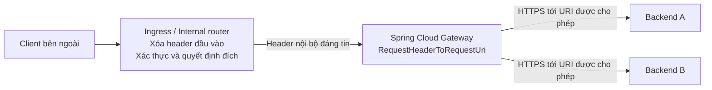
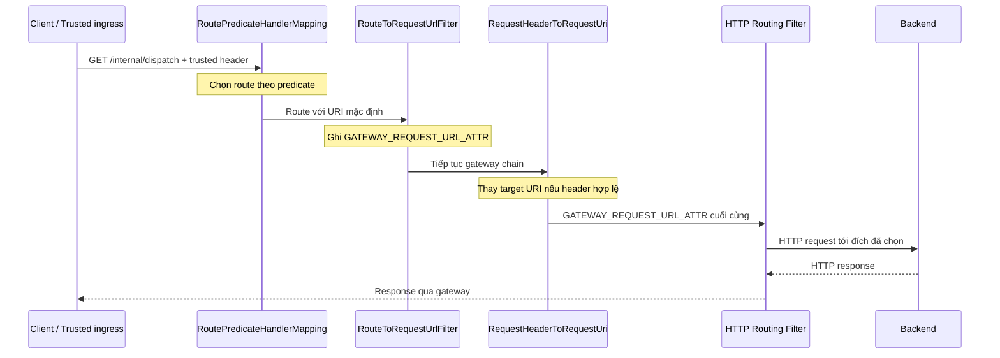
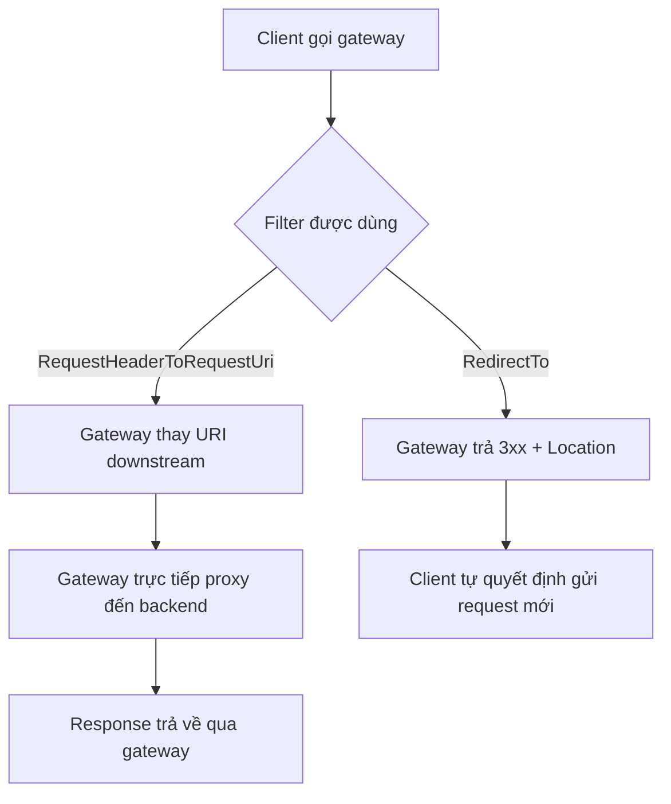
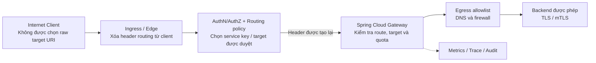

# RequestHeaderToRequestUri và kiểm soát đích chuyển tiếp

Khi xây dựng API Gateway cho microservices, ta thường khai báo URI backend trực tiếp trong route: `/api/catalog/**` chuyển đến `lb://catalog-service`, còn `/api/orders/**` chuyển đến `lb://order-service`. Nhưng đôi khi một **tầng định tuyến nội bộ đáng tin cậy** đã quyết định đích cụ thể của request và truyền quyết định ấy đến Spring Cloud Gateway qua một HTTP header. **`RequestHeaderToRequestUri`** là `GatewayFilter` có thể đọc header đó và dùng giá trị của nó làm **URI đích chuyển tiếp**.

Đây là khả năng mạnh và **rất nhạy cảm về bảo mật**: nếu một client bên ngoài được tự chọn URI bằng header, gateway có thể trở thành **open proxy** hoặc công cụ **Server-Side Request Forgery (SSRF)** để truy cập những máy chủ mà client không được phép gọi trực tiếp. Chính tài liệu Spring Cloud Gateway mô tả bộ lọc này dành cho **môi trường tin cậy** và yêu cầu loại bỏ header điều khiển đích khỏi request bên ngoài trước khi nó đến gateway.

Bài thuộc chương **Header yêu cầu** của module **SPRING_CLOUD_GATEWAY**. Nội dung giải thích chính xác `RequestHeaderToRequestUri` làm gì, cách route predicate và filter chain phối hợp, các trường hợp fallback, cách xác định trust boundary, kiểm soát URI, triển khai ví dụ an toàn hơn và kiểm chứng trong hệ thống có service discovery, xác thực, rate limiting, circuit breaker, retry, TLS và observability.

> **Phạm vi:** Ví dụ interface, filter order và thuộc tính request dưới đây áp dụng cho **Spring Cloud Gateway Server WebFlux**. Biến thể **Server Web MVC** có bộ lọc và cách cấu hình riêng; không sao chép nguyên API WebFlux sang MVC. Đường dẫn property, starter và chi tiết vận hành phải được kiểm tra theo bản Spring Boot/Spring Cloud/Gateway đã khóa.

## 1. Bài toán: URI route tĩnh và URI được quyết định theo request

Một route thông thường:

```yaml
id: catalog-route
uri: lb://catalog-service
predicates:
  - Path=/api/catalog/**
filters:
  - StripPrefix=2
```

được gateway khai báo trước. Khi request khớp, gateway sẽ dùng URI của route, kết hợp các filter cần thiết và tải danh sách instance của `catalog-service` nếu có Spring Cloud LoadBalancer/discovery.

Trong một số hệ thống, một **dịch vụ định tuyến nội bộ** đã xác định đích cụ thể. Ví dụ, một ingress hoặc bộ điều phối có xác thực chọn một trong hai cụm backend và tạo header:

```http
X-Internal-Target-Uri: https://catalog-a.internal.example:8443/internal/v1/products/42
```

Nếu `RequestHeaderToRequestUri` được cấu hình dùng header `X-Internal-Target-Uri`, gateway có thể dùng URI đầy đủ đó **thay cho URI upstream mặc định của route**.



**Điều kiện quan trọng của sơ đồ:** ingress/router phải **xóa hoặc ghi đè** header do client tự gửi; kênh từ tầng này đến gateway phải được kiểm soát bằng mạng riêng, ACL và/hoặc mTLS. Nếu client có thể bỏ qua ingress để gọi thẳng gateway, header không còn đáng tin.

### Khi nào đáng dùng?

- Tầng định tuyến nội bộ phải chọn một endpoint mà **route tĩnh không thể hiện hết**.
- Một hệ thống điều phối đã ra quyết định chọn vùng/instance/đích, và gateway chỉ thực hiện chuyển tiếp trong **phạm vi được phép**.
- Cần tích hợp một lớp routing hiện hữu vốn đã có tiêu chuẩn header tin cậy, cơ chế xác thực và kiểm soát outbound rõ ràng.

Nếu chỉ muốn chuyển `/api/catalog/**` đến các instance `catalog-service`, ưu tiên **route cố định + `lb://catalog-service` + service discovery**. Không cần đưa URI backend vào một header để giải quyết bài toán load balancing thông thường.

## 2. RequestHeaderToRequestUri hoạt động chính xác ra sao?

`RequestHeaderToRequestUriGatewayFilterFactory` nhận **một tham số `name`**, là tên request header cần đọc. Khi request đã khớp route và filter được chạy:

1. Tìm giá trị header có tên đã cấu hình.
2. Nếu có giá trị được nhận diện là URI hợp lệ, dùng URI đó để **ghi đè URI đích của request chuyển tiếp**.
3. Nếu header không có hoặc giá trị không phải URI hợp lệ theo bộ lọc của phiên bản đang chạy, **không thay đổi URI đích đã xác định**; request tiếp tục theo tuyến gốc.
4. Những bước routing phía sau dùng URI đích đang có hiệu lực để xử lý request.

**“URI hợp lệ” chỉ nói về cú pháp/khả năng phân tích**, không khẳng định đích an toàn, được phép truy cập hay có chứng chỉ TLS đúng.

### 2.1. Phân biệt ba URI

Ví dụ một request:

```http
GET /internal/dispatch?trace=demo HTTP/1.1
Host: api.example
X-Internal-Target-Uri: https://catalog-a.internal.example:8443/internal/products/42?lang=vi
```

| URI | Nguồn | Vai trò |
| --- | --- | --- |
| **Request URI phía client** | `https://api.example/internal/dispatch?trace=demo` | Dùng trong quá trình tiếp nhận request, kiểm tra security và route predicate. |
| **Route URI mặc định** | Ví dụ `https://fallback.internal.example` | Được khai báo bằng thuộc tính `uri` của route. |
| **Target URI từ header** | `https://catalog-a.internal.example:8443/internal/products/42?lang=vi` | Nếu hợp lệ và filter được chạy, ghi đè đích chuyển tiếp phía sau. |

Giá trị header là **một URI đầy đủ**, có thể mang scheme, hostname, port, path và query. Khi được chấp nhận, nó có thể thay đổi **cả authority lẫn path/query của URI downstream**. Đừng mặc định đường dẫn `/internal/dispatch` hoặc query `?trace=demo` của client được giữ nguyên.

### 2.2. Điểm đặt trong WebFlux gateway filter chain

Trong kiến trúc WebFlux:

- `RoutePredicateHandlerMapping` chọn route bằng predicate như `Path`, `Method` hoặc `Header`.
- `RouteToRequestUrlFilter` xây URI chuyển tiếp từ `Route` và đặt vào exchange attribute `GATEWAY_REQUEST_URL_ATTR`.
- Bộ lọc `RequestHeaderToRequestUri` được thiết kế để cập nhật **URI downstream** từ header khi có giá trị phù hợp, trước bước proxy HTTP tương ứng.
- Với URI `http` hoặc `https`, routing filter HTTP như `NettyRoutingFilter` sử dụng URL chuyển tiếp được xác định để gửi request.



Sơ đồ trình bày **thứ tự logic** của một dòng WebFlux hỗ trợ filter này. Các filter có `Ordered` và cơ chế sắp xếp riêng; hãy kiểm tra filter chain và dependency thực tế trước khi thêm custom filter sửa URI, chỉnh header hoặc thay thứ tự.

**Lưu ý:** filter này can thiệp vào **URI dùng để proxy** qua exchange attribute, không đồng nghĩa đổi `ServerHttpRequest.getURI()` cho mọi thành phần, cũng không tự thay header `Host`, áp chứng thực, thêm route mới hoặc đổi route ID.

## 3. Cấu hình RequestHeaderToRequestUri

### 3.1. Dạng shortcut trong YAML

Ví dụ dưới đây chỉ dùng trong **POC cô lập hoặc mạng nội bộ có kiểm soát**. Nó không an toàn nếu mở trực tiếp ra Internet để mọi client có thể gửi giá trị header tùy ý.

Với dòng Server WebFlux dùng nhánh property `spring.cloud.gateway.server.webflux.routes`:

```yaml
spring:
  cloud:
    gateway:
      server:
        webflux:
          routes:
            - id: trusted-dispatch
              uri: http://localhost:9001
              predicates:
                - Path=/internal/dispatch/**
              filters:
                - RequestHeaderToRequestUri=X-Internal-Target-Uri
```

Giải thích:

- `trusted-dispatch` là route ID; không phải tên backend.
- `Path=/internal/dispatch/**` xác định request nào được chọn trước khi filter chạy.
- `uri: http://localhost:9001` là **đích mặc định** nếu không có header hợp lệ.
- `RequestHeaderToRequestUri=X-Internal-Target-Uri` khai báo **tên header**, không khai báo một URI cố định.
- Nếu header chứa `http://localhost:9002/backend/products/42` và filter nhận URI đó, đích chuyển tiếp có thể đổi sang `localhost:9002` với path đã ghi trong header.

`localhost:9001` và `localhost:9002` là hai mock backend cho thực hành trên máy riêng; không dùng cấu hình này như một gateway công khai. Trong container, `localhost` trỏ tới chính container đang chạy, không mặc nhiên trỏ đến một container backend khác.

### 3.2. Dạng khai báo có tên tham số

```yaml
filters:
  - name: RequestHeaderToRequestUri
    args:
      name: X-Internal-Target-Uri
```

Tham số của factory là **`name`**. Nó không phải `url`, `targetUri` hay `uri`. Nếu dùng nhầm tên tham số, gateway có thể không tạo filter đúng như mong đợi hoặc không nạp được route.

### 3.3. Cấu hình các dòng phiên bản khác nhau

Một số hướng dẫn Spring Cloud Gateway WebFlux 4.x dùng:

```yaml
spring:
  cloud:
    gateway:
      routes:
        - id: trusted-dispatch
          uri: http://localhost:9001
          predicates:
            - Path=/internal/dispatch/**
          filters:
            - RequestHeaderToRequestUri=X-Internal-Target-Uri
```

Các tài liệu mới hơn tách rõ namespace `server.webflux` và `server.webmvc`. Không tự giả định cả hai prefix cùng hiệu lực. Phải đối chiếu **Configuration Properties**, starter, Spring Cloud BOM và bản Gateway thực sự trên classpath. Nếu route không được nạp, hãy kiểm tra binding trước khi điều tra header.

### 3.4. Bảng hành vi cần kiểm chứng

Với route POC ở mục 3.1 và request `GET /internal/dispatch/items?page=2`:

| Giá trị `X-Internal-Target-Uri` | Đích kỳ vọng ở mức logic |
| --- | --- |
| **Không có header** | Tiếp tục qua URI route mặc định `http://localhost:9001`, với cách dựng path/query của route thông thường. |
| `http://localhost:9002/backend/items?lang=vi` | URI downstream được ghi đè thành `http://localhost:9002/backend/items?lang=vi` nếu được phân tích hợp lệ. |
| Giá trị sai định dạng như `not a uri` | Không ghi đè; tiếp tục dùng URI đã được xác định trước đó. |
| Header có hostname không được phép nhưng cú pháp hợp lệ | Filter mặc định **không phải một bộ kiểm tra allowlist**; không được chấp nhận trong thiết kế an toàn. |
| Header lặp nhiều giá trị | Phải kiểm tra cơ chế đọc header của phiên bản; ở biên an toàn nên từ chối header đa giá trị. |

Không coi cơ chế fallback là bảo vệ. **Thiếu header có thể dẫn đến backend mặc định thay vì bị từ chối**. Nếu contract yêu cầu phải có chỉ thị routing nội bộ hợp lệ, hãy triển khai bước kiểm tra **fail closed** trước filter.

## 4. Cần phân biệt với các filter và predicate khác

| Công cụ | Hành vi chính | Có chọn host upstream bằng giá trị header không? |
| --- | --- | --- |
| `Header` route predicate | Quyết định route có khớp khi một header khớp điều kiện/regex. | Không trực tiếp; URI đích vẫn do route xác định. |
| `AddRequestHeader` | Thêm header vào request chuyển tiếp. | Không. |
| `SetRequestHeader` | Ghi đè giá trị của một header. | Không trực tiếp; có thể được kết hợp với bộ lọc đọc header. |
| `RemoveRequestHeader` | Loại bỏ header khỏi request. | Không, và nếu chạy trước bộ lọc URI có thể làm mất giá trị cần đọc. |
| `MapRequestHeader` | Sao chép giá trị từ header này sang header khác. | Không tự chọn URI đích. |
| **`RequestHeaderToRequestUri`** | Lấy URI đích từ một request header. | **Có**, trong phạm vi hành vi filter và tính hợp lệ URI. |
| `RewritePath` / `PrefixPath` | Thay đổi đường dẫn request chuyển tiếp. | Không tự chọn hostname đích. |
| `RedirectTo` | Trả HTTP 3xx với `Location` cho client. | Không phải proxy theo header như RequestHeaderToRequestUri. |
| `lb://catalog-service` | Nhờ LoadBalancer/discovery chọn instance theo tên dịch vụ. | Không cần header chứa URL tùy ý. |

### RequestHeaderToRequestUri không phải RedirectTo



Client không tự nhận một `302` chỉ vì gateway dùng `RequestHeaderToRequestUri`. Ngược lại, backend có thể trả redirect trong response, và gateway cần kiểm tra xem header `Location` có lộ địa chỉ nội bộ hoặc cho phép redirect đến miền ngoài không.

### Header predicate không đủ để chặn SSRF

Ví dụ:

```yaml
predicates:
  - Header=X-Internal-Target-Uri, .+
filters:
  - RequestHeaderToRequestUri=X-Internal-Target-Uri
```

Predicate ở trên chỉ kiểm tra **header tồn tại và khớp biểu thức**; nó không kiểm tra hostname có thuộc danh sách cho phép, request có đến từ router tin cậy hay đích có chuyển hướng vào mạng nội bộ hay không. Đây **không phải** một cấu hình bảo mật đủ an toàn.

## 5. Ranh giới tin cậy: ai được phép quyết định đích?

Mối nguy lớn nhất là một client có thể gửi:

```http
X-Internal-Target-Uri: https://some-unapproved-host.example/path
```

Nếu gateway coi chuỗi đó là đích chuyển tiếp mà không kiểm soát, client đã điều khiển **server-side outbound request** của gateway. Gateway thường có quyền truy cập mạng nội bộ rộng hơn client, nên hậu quả có thể nghiêm trọng hơn một request HTTP thông thường.

### 5.1. Các loại rủi ro

| Rủi ro | Vì sao xuất hiện | Phòng vệ trọng tâm |
| --- | --- | --- |
| **SSRF vào mạng nội bộ** | Client chọn URI dẫn tới dịch vụ không công khai. | Chỉ nhận quyết định từ nguồn tin cậy; allowlist đích và egress policy. |
| **Open proxy** | Gateway chuyển tiếp đến hostname tùy ý theo request. | Không cho client điều khiển raw URL; giới hạn host/scheme/port/path. |
| **Truy cập endpoint nhạy cảm** | URI có thể trỏ tới dịch vụ quản trị, vùng loopback hoặc metadata service. | Chặn private/loopback/link-local và endpoint nhạy cảm, trừ đích nội bộ được phê duyệt rõ ràng. |
| **DNS rebinding / thay đổi DNS** | Hostname hợp lệ khi kiểm tra nhưng sau đó resolve tới IP ngoài phạm vi dự kiến. | Kiểm soát DNS, kết nối outbound, proxy và egress network ACL tại thời điểm kết nối. |
| **Bypass TLS** | Header đổi từ HTTPS sang HTTP hoặc host khác. | Bắt buộc scheme `https` và xác minh TLS/certificate với backend phù hợp. |
| **Sai lệch Host/SNI** | Đích mới có authority khác request công khai. | Kiểm tra host header, TLS SNI và `PreserveHostHeader` theo topology thực tế. |
| **Rò rỉ token/header** | Header `Authorization` hoặc cookie có thể bị forward đến đích không mong muốn. | Chặn egress sai đích và xây chính sách chuyển tiếp header theo route. |
| **Phá giới hạn lưu lượng** | Đích tùy ý ngoài nhóm upstream dự kiến. | Rate limit theo identity/route trước proxy, cùng với hạn chế đích. |
| **Gây tải hoặc chi phí** | Client điều khiển URL trả chậm hoặc tải dữ liệu lớn. | Timeout, giới hạn body/response, quota và circuit breaker khi phù hợp. |

Một URI có `https` không tự bảo đảm an toàn; nó có thể trỏ đến một hostname không được phép. Một URI có hostname nằm trong allowlist cũng chưa đủ nếu cấu hình DNS, cổng đích hoặc HTTP redirect cho phép đi sang nơi khác.

### 5.2. Quy tắc cơ bản

**Không bao giờ dùng trực tiếp một header URL do client không tin cậy cung cấp để quyết định đích.** Có hai hướng an toàn hơn:

1. **Tốt nhất khi có thể:** route tĩnh, hoặc lấy khóa logic từ request rồi ánh xạ **ở server** đến URI được quản lý/cho phép. Không dùng raw URI từ client.
2. **Nếu bắt buộc dùng RequestHeaderToRequestUri:** chỉ cho tầng routing nội bộ đáng tin cậy sinh header; ingress xóa header client trước khi thêm header mới; gateway chỉ nhận traffic từ tầng ấy, kiểm tra allowlist và có egress network control.

Các kiểm tra trong mã ứng dụng là một lớp bảo vệ. Chúng cần đi kèm chính sách ở tầng network, TLS và service identity để hạn chế hậu quả nếu một filter bị cấu hình sai.

## 6. Thiết kế chuỗi tin cậy nhiều tầng



Với mô hình này:

- **Ingress** nhận request bên ngoài và xóa `X-Internal-Target-Uri` do client gửi, kể cả khi client gửi nhiều lần hoặc dùng dạng viết hoa/thường khác nhau.
- **Router nội bộ** chỉ thêm lại header sau khi đã xác thực nguồn và áp chính sách điều phối. Không dùng IP trong `X-Forwarded-For` làm bằng chứng duy nhất rằng request đến từ router tin cậy.
- **Gateway** chỉ mở ingress mạng từ router được cho phép và có thể xác minh danh tính bằng mTLS giữa các thành phần.
- **Cơ chế egress** giới hạn gateway được kết nối tới những hostname/IP/port đã phê duyệt, bảo vệ thêm khi có lỗi cấu hình hoặc lỗ hổng trong mã.
- **Backend** xác thực/ủy quyền theo tài nguyên và không tin một header client-supplied như `X-User-Id` mà chưa có kiểm tra nguồn.

### Vì sao chỉ xóa header ở một route chưa đủ?

Nếu client có thể trực tiếp gọi gateway qua đường mạng khác, các request ấy có thể đi vào route dùng `RequestHeaderToRequestUri` mà không qua ingress đã xóa header. Cần kiểm tra **toàn bộ đường vào**: load balancer công khai, cổng quản trị, service port, mesh ingress, môi trường staging và các đường gọi nội bộ khác.

Trường hợp router nội bộ cần nhiều tầng proxy, hãy quy định rõ **tầng nào là nguồn duy nhất được phép đặt header**. Các tầng trước đó phải xóa giá trị client-supplied; các tầng sau không được thêm giá trị từ đầu vào không tin cậy.

## 7. Thiết kế tốt hơn: client chọn khóa logic, server chọn URI

Giả sử hệ thống chỉ có hai backend được phép: `catalog` và `inventory`. Thay vì để client gửi một URL tùy ý, nó gửi **khóa logic**:

```http
X-Backend-Key: catalog
```

Gateway hoặc router nội bộ tra bảng do **ứng dụng kiểm soát**:

| Khóa | URI upstream do server quyết định |
| --- | --- |
| `catalog` | `https://catalog.internal.example/internal/query` |
| `inventory` | `https://inventory.internal.example/internal/query` |

Một filter có thể từ chối khóa không tồn tại, xóa mọi giá trị target header do client gửi, rồi đặt `X-Internal-Target-Uri` thành URI **từ bảng allowlist**. `RequestHeaderToRequestUri` sau đó chỉ đọc header đã được tạo lại.

### 7.1. Ví dụ GlobalFilter WebFlux xây header từ allowlist

Đây là một minh họa cách **không tin raw target URI**. Nó chỉ bảo vệ route `trusted-dispatch`, hoạt động trước các bước routing thông thường, và bắt buộc chọn một trong những đích đã khai báo trong code.

```java
import java.net.URI;
import java.util.Map;

import org.springframework.cloud.gateway.filter.GatewayFilterChain;
import org.springframework.cloud.gateway.filter.GlobalFilter;
import org.springframework.cloud.gateway.route.Route;
import org.springframework.cloud.gateway.support.ServerWebExchangeUtils;
import org.springframework.core.Ordered;
import org.springframework.http.HttpStatus;
import org.springframework.http.server.reactive.ServerHttpRequest;
import org.springframework.stereotype.Component;
import org.springframework.web.server.ServerWebExchange;
import reactor.core.publisher.Mono;

@Component
public class TrustedTargetHeaderFilter implements GlobalFilter, Ordered {

    private static final String TARGET_HEADER = "X-Internal-Target-Uri";
    private static final String KEY_HEADER = "X-Backend-Key";

    // Các URI là cấu hình đáng tin cậy do server sở hữu, không do client gửi.
    private static final Map<String, URI> ALLOWED_TARGETS = Map.of(
        "catalog",
        URI.create("https://catalog.internal.example/internal/query"),
        "inventory",
        URI.create("https://inventory.internal.example/internal/query")
    );

    @Override
    public int getOrder() {
        // Chạy trước RequestHeaderToRequestUri theo filter order WebFlux.
        return -100;
    }

    @Override
    public Mono<Void> filter(
            ServerWebExchange exchange,
            GatewayFilterChain chain) {

        Route route = exchange.getAttribute(
            ServerWebExchangeUtils.GATEWAY_ROUTE_ATTR);

        if (route == null || !"trusted-dispatch".equals(route.getId())) {
            return chain.filter(exchange);
        }

        var keys = exchange.getRequest().getHeaders().get(KEY_HEADER);
        String key = keys != null && keys.size() == 1
            ? keys.get(0) : null;

        URI target = key == null ? null : ALLOWED_TARGETS.get(key);
        if (target == null) {
            exchange.getResponse().setStatusCode(HttpStatus.BAD_REQUEST);
            return exchange.getResponse().setComplete();
        }

        ServerHttpRequest safeRequest = exchange.getRequest().mutate()
            .headers(headers -> {
                // Loại bỏ URI đích do caller cố tình gửi trước đó.
                headers.remove(TARGET_HEADER);
                headers.remove(KEY_HEADER);
                headers.set(TARGET_HEADER, target.toString());
            })
            .build();

        return chain.filter(exchange.mutate().request(safeRequest).build());
    }
}
```

Giải thích:

1. Filter chỉ xử lý route ID `trusted-dispatch`; các route khác không bị thay đổi.
2. Chỉ chấp nhận đúng một `X-Backend-Key` có trong bảng cố định; thiếu hoặc lặp header bị từ chối, và không chấp nhận URI do client chọn.
3. Header target đầu vào bị **xóa rồi tạo lại** từ URI trong `ALLOWED_TARGETS`. Header khóa logic cũng được loại khỏi request tiếp tục để tránh chuyển tiếp thông tin điều phối không cần thiết.
4. Nếu thiếu/không có khóa hợp lệ, filter trả `400` và **không gọi chain**. Vì thế không rơi xuống URI mặc định một cách ngoài ý muốn.
5. Giá trị `getOrder() = -100` giúp filter chạy sớm trong pipeline WebFlux thông thường. Thứ tự phải được xác minh với bản Gateway được triển khai.

**Lưu ý:** Ví dụ chỉ minh họa việc chọn đích từ một allowlist và xử lý fallback. Nếu `catalog` và `inventory` là hai tài nguyên có yêu cầu phân quyền khác nhau, phải xác thực và **ủy quyền khóa mà caller được chọn** trước khi proxy. Cần thêm kiểm soát egress, TLS, bảo vệ endpoint và chính sách loại bỏ header nội bộ khỏi request tới backend nếu không cần thiết.

### 7.2. Route dùng với filter trên

```yaml
spring:
  cloud:
    gateway:
      server:
        webflux:
          routes:
            - id: trusted-dispatch
              uri: https://catalog.internal.example
              predicates:
                - Path=/internal/dispatch
              filters:
                - RequestHeaderToRequestUri=X-Internal-Target-Uri
```

Ở cấu hình minh họa này, `TrustedTargetHeaderFilter` chuẩn bị header từ bảng server trước khi `RequestHeaderToRequestUri` dùng nó để thay URI. Nếu route còn có một filter khác đọc hoặc xóa `X-Internal-Target-Uri`, cần kiểm tra **order thực tế** để không vô tình xóa giá trị trước khi được tiêu thụ.

Các hostname `*.internal.example` chỉ là giá trị ví dụ. Một hệ thống thật cần DNS, TLS certificate và network policy tương ứng. Khi POC ở máy local, thay thành mock upstream được cô lập thay vì cho gateway kết nối tùy ý tới Internet.

### 7.3. Một hướng còn đơn giản hơn

Nếu mỗi khóa logic chỉ chọn một dịch vụ, hãy cân nhắc **khai báo route riêng**:

```yaml
routes:
  - id: catalog-route
    uri: lb://catalog-service
    predicates:
      - Path=/api/catalog/**
  - id: inventory-route
    uri: lb://inventory-service
    predicates:
      - Path=/api/inventory/**
```

Đây là cấu hình route rút gọn, cần đặt dưới prefix đúng phiên bản. Nó không cần `RequestHeaderToRequestUri`, giúp việc audit, rate limiting, metrics và phân quyền theo route rõ ràng hơn.

## 8. Nếu buộc phải nhận URI động: phải kiểm tra những gì?

Trong trường hợp business thật sự cần URI do một **đối tác nội bộ đáng tin** quyết định, xây bộ kiểm tra nghiêm ngặt trước khi dùng header:

| Thuộc tính | Kiểm tra nên có |
| --- | --- |
| **Scheme** | Chỉ `https` nếu chính sách yêu cầu; từ chối scheme khác, không chỉ kiểm tra chuỗi bắt đầu `https`. |
| **Hostname** | So khớp allowlist **chính xác**, không dùng `endsWith("example.com")` dễ nhận nhầm host giả. |
| **Port** | Chỉ cho phép cổng cụ thể; không để header tùy chọn mọi port trong mạng nội bộ. |
| **Đường dẫn** | Giới hạn path prefix/endpoint được gọi; không chỉ allowlist toàn bộ hostname nếu trên host có API quản trị. |
| **Query** | Chỉ cho phép tham số cần thiết, kiểm tra encoding và không truyền dữ liệu nhạy cảm tùy ý sang đích mới. |
| **Userinfo/fragment** | Từ chối URI có `user:pass@host` hoặc fragment nếu không có lý do rõ ràng; chúng làm khó kiểm tra và logging. |
| **DNS/IP** | Chặn đích loopback, link-local, metadata, IP/private subnet ngoài phạm vi đã được phê duyệt; chặn thay đổi DNS nguy hiểm ở tầng kết nối. |
| **Redirect từ upstream** | Không tự cho phép client hoặc proxy theo redirect sang hostname khác nếu policy egress không bao gồm đích đó. |
| **Header đa giá trị** | Từ chối duplicate/ambiguous headers; không dựa vào cách chọn “giá trị đầu” khác nhau giữa các proxy. |
| **Độ dài** | Giới hạn kích thước header/URI, tránh parser, log hoặc HTTP client chịu dữ liệu quá lớn. |
| **Danh tính nguồn** | Xác thực ingress/router hoặc service identity, ví dụ mTLS; không chỉ tin header tự nhận là “internal”. |

### Vì sao regex đơn giản không đủ?

Kiểm tra:

```text
uri.contains("internal.example")
```

là không an toàn vì chuỗi này có thể nằm trong **path, query hoặc userinfo**, không phải hostname. Hãy phân tích URI thành các thành phần bằng parser chuẩn, kiểm tra giá trị host theo danh sách tên đầy đủ, đối chiếu port/scheme/path và thực thi egress ACL.

Ngay cả khi kiểm tra hostname trong Java, kết nối HTTP có thể resolve DNS ở một thời điểm khác; **DNS rebinding** hoặc thay đổi record có thể khiến IP thực khác dự kiến. Egress policy, DNS nội bộ được quản lý và giới hạn kết nối đến các mạng đích là lớp bảo vệ bổ sung cần thiết.

### Nên xử lý lỗi bằng fail closed

Trong thiết kế bắt buộc có quyết định routing:

| Tình huống | Chính sách khuyến nghị |
| --- | --- |
| Không có header/khóa lựa chọn đích | Trả lỗi ở tầng kiểm tra, không âm thầm forward tới fallback nếu contract không cho phép. |
| URI parse được nhưng host không nằm trong allowlist | Từ chối, ghi sự kiện an toàn, không thực hiện kết nối. |
| URI có scheme hoặc port lạ | Từ chối. |
| Không xác thực được nguồn cung cấp chỉ thị | Từ chối trước khi chuyển tiếp. |
| DNS/IP target không phù hợp policy egress | Không thiết lập kết nối outbound. |
| Backend được phép nhưng đang lỗi | Áp timeout/circuit breaker, trả lỗi đúng chính sách; không tự chọn hostname mới từ client. |

Đừng nhầm **không hợp lệ về cú pháp** với **không được phép về bảo mật**. Filter mặc định có thể fallback với trường hợp thứ nhất, nhưng một URI được parse thành công vẫn có thể cần bị từ chối bởi chính sách của ứng dụng.

## 9. Các điểm tinh tế về path, query và header

### 9.1. URI trong header có thể thay cả path/query

Ví dụ client gọi:

```http
GET /api/catalog/products/42?currency=VND
```

Tầng nội bộ cung cấp:

```http
X-Internal-Target-Uri: https://catalog.internal.example/v2/products/42?locale=vi
```

Khi URI header được dùng làm downstream URI, **không mặc định** query `currency=VND` được tự động nối với `locale=vi`. Header đã chứa URI có query riêng. Nếu cần giữ hoặc hợp nhất query, phải có quy tắc được thiết kế ở tầng tạo URI tin cậy và test đầy đủ việc encode, trùng key, giá trị rỗng và ký tự Unicode.

### 9.2. Host header và TLS SNI

URI downstream `https://catalog.internal.example/...` xác định đích kết nối được dùng bởi HTTP routing layer. Nhưng request `Host` mà backend nhìn thấy còn phụ thuộc HTTP client, filter `PreserveHostHeader`, forwarded headers và các thành phần proxy trung gian.

Không tự đặt `Host` theo dữ liệu do client cung cấp để khắc phục lỗi backend; cần xác định chính xác host, TLS certificate, SNI và trust boundary. Mỗi hostname mới cần được đánh giá về chính sách TLS/mTLS và xác thực upstream tương ứng.

### 9.3. Header chỉ thị đích có nên gửi tới backend?

Thông tin điều phối nội bộ như `X-Internal-Target-Uri` không nhất thiết có lý do xuất hiện ở backend. Nếu phải loại bỏ, cần đặt thao tác **sau thời điểm `RequestHeaderToRequestUri` đã đọc giá trị**, nhưng trước khi gửi HTTP request; kiểm tra thứ tự thực tế của các filter tích hợp và tùy chỉnh.

**Không suy luận “đặt `RemoveRequestHeader` ở dòng YAML phía sau thì chắc chắn chạy sau”**: filter có thể mang `Ordered` riêng. Nếu xóa quá sớm, filter URI không còn header và sẽ dùng fallback. Nếu xóa quá muộn, giá trị điều phối có thể đã bị truyền tới upstream. Quan sát bằng mock backend thay vì dựa vào thứ tự văn bản.

### 9.4. Tránh truyền thông tin xác thực sang đích khác

Nếu gateway nhận `Authorization: Bearer ...` dành cho một resource server và header làm đổi đích sang service khác, token có thể bị chuyển tới nơi không nên nhận. Xác thực **client → gateway** và ủy quyền **gateway → upstream** là hai mối quan hệ riêng.

Hãy giới hạn tập header được forward, dùng token relay có kiểm soát hoặc chứng thực service-to-service khi cần, và không mang cookie/session/token nhạy cảm sang đích mới ngoài quyền cho phép.

## 10. Tương tác với service discovery, timeout và filter chain

| Cơ chế | Quan hệ với `RequestHeaderToRequestUri` | Điều cần kiểm chứng |
| --- | --- | --- |
| **Route predicate** | Chọn route dựa trên request trước khi filter URI chạy. | Client path/host/method và ưu tiên route. |
| **`StripPrefix` / `RewritePath`** | Có thể biến đổi path request, nhưng header URI là một URI downstream riêng. | Không giả định biến đổi path tự áp dụng lên URI đầy đủ trong header; test thứ tự. |
| **Spring Cloud LoadBalancer** | `lb://service` giải quyết tên logic; header `https://host/...` có thể thay đường đi đó. | Tránh vô tình bỏ qua discovery/load balancing hoặc routing policy. |
| **Spring Security** | Kiểm tra danh tính và quyền trước/tại gateway. | Bảo vệ route điều phối, quyền chọn backend và quyền ở backend. |
| **RequestRateLimiter** | Giới hạn số request theo key/route. | Không cho lựa chọn đích gây bypass quota; quota thống nhất giữa nhiều gateway replica. |
| **CircuitBreaker** | Bảo vệ lời gọi upstream theo cấu hình. | Cấu hình timeout, fallback và lỗi cho từng tập đích hợp lệ. |
| **Retry** | Có thể gọi upstream lại khi lỗi. | Không retry bừa tác vụ ghi và không để URI đổi ngoài ý muốn giữa các lần gọi. |
| **TLS/mTLS** | Bảo vệ kết nối trên từng chặng. | URI header được phép phải phù hợp yêu cầu HTTPS, chứng chỉ, SNI. |
| **Observability** | Cần đo route ID, nhóm upstream, status, latency. | Không log raw URI nhạy cảm và không tạo nhãn metric cardinality cao. |

### URI từ header có thể bỏ qua `lb://`

Giả sử route khai báo `uri: lb://catalog-service`, còn header đưa đến `https://catalog-a.internal.example:8443/api`. Nếu filter dùng URI header hợp lệ để thay URL downstream, request có thể đi đến **host cụ thể** theo header thay vì được chọn instance như luồng `lb://catalog-service` thông thường.

Không coi `lb://` trong route là **hàng rào bảo vệ** để giới hạn những hostname mà header có thể chỉ định. Lớp kiểm soát đích phải nằm ở phía tạo/kiểm tra header và tầng egress.

### Retry không bảo đảm cùng ý nghĩa nếu target thay đổi

Một request có thể được thử lại vì timeout hoặc lỗi mạng. Với URI động, cần bảo đảm:

- Target được quyết định **một lần theo chính sách** cho request, hoặc có quy tắc chuyển đổi target đã được phê duyệt.
- Các lần thử không nhân bản tác dụng phụ như tạo đơn hàng hoặc thanh toán.
- Total timeout bao gồm các lần retry, không chỉ giới hạn từng lần.
- Circuit breaker và metrics có nhóm nhãn upstream hữu hạn, tránh tạo một series riêng cho mỗi raw URI.

Nếu cần failover giữa nhiều instance, dùng cơ chế load balancing/discovery và resilience có kiểm soát thường rõ ràng hơn việc để client thay hostname mỗi lần retry.

## 11. Bài thực hành POC trong mạng cô lập

### 11.1. Môi trường

Dựng một Spring Cloud Gateway **Server WebFlux** và hai backend mock trên máy phát triển hoặc mạng thử nghiệm chỉ truy cập nội bộ:

| Thành phần | Địa chỉ minh họa | Endpoint mock |
| --- | --- | --- |
| Gateway | `http://localhost:8080` | `/internal/dispatch/**` |
| Backend mặc định | `http://localhost:9001` | Echo method, path và query |
| Backend thứ hai | `http://localhost:9002` | Echo method, path và query |

Chỉ dùng route minh họa ở mục 3.1 trong POC cô lập. Không phơi route này ra mạng công khai.

### 11.2. Kiểm tra fallback không có header

```bash
curl -i "http://localhost:8080/internal/dispatch/items?page=2"
```

Kỳ vọng theo filter mặc định: không có header để ghi đè URI, request tiếp tục qua URI route mặc định. Backend `9001` sẽ thấy path/query tương ứng theo quy tắc dựng URI của route và các filter khác. Xác minh bằng mock backend, không chỉ nhìn HTTP status.

### 11.3. Kiểm tra header hợp lệ trong POC

```bash
curl -i \
  -H "X-Internal-Target-Uri: http://localhost:9002/backend/items?lang=vi" \
  "http://localhost:8080/internal/dispatch/items?page=2"
```

Trong **môi trường thử nghiệm cô lập**, request nên được chuyển tới mock `9002` với URI `/backend/items?lang=vi` khi giá trị header được chấp nhận. Đo chính xác path/query mà mock nhận; đừng suy diễn rằng query `page=2` của client được tự động hợp nhất.

### 11.4. Header thiếu/sai và route không khớp

```bash
# Header có cú pháp không phù hợp để tạo URI downstream
curl -i \
  -H "X-Internal-Target-Uri: not a uri" \
  "http://localhost:8080/internal/dispatch/items"

# Request không khớp predicate của route minh họa
curl -i "http://localhost:8080/api/unknown"
```

Với header không hợp lệ, xem gateway có fallback đúng mô tả của phiên bản không. Với path không khớp, `RequestHeaderToRequestUri` của route không được chạy; thường nhận `404` nếu không có handler khác.

### 11.5. Kiểm tra chính sách an toàn hơn

Sau đó bật filter kiểm soát theo **khóa logic/allowlist** ở mục 7 và cấu hình route tương ứng. Xác minh:

1. Client gửi `X-Backend-Key: catalog` → gateway tạo đích `catalog` từ cấu hình đáng tin.
2. Client gửi `X-Backend-Key: inventory` → gateway tạo đích `inventory` từ cấu hình đáng tin.
3. Client gửi key không tồn tại → bị từ chối, không kết nối upstream.
4. Client tự thêm `X-Internal-Target-Uri` → giá trị đó bị xóa và thay bằng đích do server chọn.
5. Một user không được phép gọi backend nhạy cảm vẫn bị chặn bởi authentication/authorization ngay cả khi key tồn tại.
6. Khi backend không có DNS/certificate thực tế, dùng mock endpoint phù hợp thay vì giả định `*.internal.example` tồn tại.

### 11.6. Bảng ghi kết quả

| Case | Đầu vào | Kết quả cần chứng minh |
| --- | --- | --- |
| H01 | Không có header target | Fallback của filter đúng behavior phiên bản. |
| H02 | Header target là URI HTTP tới mock thứ hai | Mock thứ hai nhận request, đúng URI. |
| H03 | Header target sai cú pháp | Không ghi đè URI; ghi rõ fallback quan sát được. |
| H04 | Header target đa giá trị | Chính sách an toàn từ chối tình huống nhập nhằng. |
| H05 | Key trong allowlist | Đích do server quyết định, không do client gửi raw URI. |
| H06 | Key ngoài allowlist | Fail closed, không gọi upstream. |
| H07 | Request từ đường bypass ingress | Không được truy cập route header-controlled. |
| H08 | Header HTTPS tới host không nằm trong allowlist | Bị chặn trước kết nối. |
| H09 | Đích hợp lệ nhưng upstream lỗi | Timeout, circuit breaker và metrics báo tình trạng phù hợp. |
| H10 | Đích hợp lệ nhưng có response redirect | Không đi đến host ngoài policy do cơ chế redirect thiếu kiểm soát. |
| H11 | Hai instance gateway | Cả hai áp cùng allowlist, security policy và egress policy. |
| H12 | Header chứa credential/query nhạy cảm | Không bị ghi raw vào log hoặc metrics. |

Đối với H08/H10, dùng mock và kiểm tra chính sách từ chối, không thử kết nối đến hệ thống riêng tư hoặc endpoint quản trị thật ngoài phạm vi POC.

## 12. Quan sát request và xử lý sự cố

Khi điều tra lỗi, phân biệt rõ **route đã khớp chưa**, **URI đích từ header có được chấp nhận không** và **HTTP client có kết nối được tới đích không**.

| Triệu chứng | Nguyên nhân khả dĩ | Nơi kiểm tra |
| --- | --- | --- |
| Header có nhưng luôn đi backend mặc định | Sai tên header, bị proxy xóa, giá trị không parse được hoặc filter chưa gắn route. | Route runtime, filter chain, ingress và log validation an toàn. |
| Route không xuất hiện | Sai property prefix, starter hoặc config chưa được nạp. | Configuration Properties, actuator route list, dependency. |
| Chuyển đến sai path/query | Header chứa URI đầy đủ khác với URL client. | URI do router tạo, mock echo, encoding và query contract. |
| Chuyển đến host lạ | Cho phép raw client header hoặc allowlist sai. | Chặn egress ngay, kiểm tra luồng đặt header và policy. |
| 404 từ backend | URI từ header trỏ đến endpoint không tồn tại. | Phân biệt 404 ở gateway do không khớp route với 404 ở upstream. |
| Lỗi TLS handshake | Chứng chỉ/hostname/SNI/trust store không phù hợp. | TLS ở chặng gateway → backend. |
| `lb://` không còn được dùng như dự định | Header absolute HTTP(S) đã ghi đè URI đích. | Filter order, route URI và đích hiệu lực. |
| 401/403 | AuthN/AuthZ từ gateway hoặc backend từ chối. | Security chain, token và quyền tài nguyên. |
| 429 | Rate limit vượt quota. | KeyResolver/limiter và trạng thái dùng chung giữa replica. |
| Kết quả khác nhau giữa các gateway replica | Chính sách/header/config/route không đồng bộ. | Revision cấu hình, route IDs, network policy của từng instance. |

### Log và metrics nên ghi

Một mẫu sự kiện quan sát có thể là:

```text
traceId: [trace ID]
routeId: trusted-dispatch
targetPolicy: allowlisted
targetService: catalog
targetScheme: https
status: 200
elapsedMs: [đo thực tế]
```

Nên ghi **tên dịch vụ từ danh sách hữu hạn**, route ID và kết quả chính sách thay vì toàn bộ raw target URI. Path/query có thể chứa dữ liệu nhạy cảm, ID động và token; nếu dùng làm metric tag sẽ tạo cardinality cao. Để theo dõi phân tán, kết hợp Micrometer, Actuator và tracing theo chuẩn mà dự án đã chọn.

### Giới hạn cần nhớ khi quan sát

`GATEWAY_REQUEST_URL_ATTR` có thể thay đổi ở nhiều bước routing, nên việc quan sát nó **trước hay sau** `RequestHeaderToRequestUri` có thể cho ra giá trị khác nhau. Một `GlobalFilter` có `Ordered` chạy sớm chưa chắc thấy đích cuối cùng; filter quan sát sau có thể bị short-circuit hoặc retry ảnh hưởng. Khi cần audit thực tế, xem cả log ở HTTP routing layer và mock upstream, đồng thời bảo vệ dữ liệu nhạy cảm.

## 13. Kiểm tra phiên bản và tương thích

| Hạng mục | Cần xác minh |
| --- | --- |
| Biến thể Gateway | Server **WebFlux** cho `RequestHeaderToRequestUriGatewayFilterFactory` trong bài; MVC dùng API/filter riêng. |
| Spring Boot / Spring Cloud | Chọn release train tương thích và BOM quản lý phiên bản dependency. |
| Property prefix | Một số dòng dùng `spring.cloud.gateway.routes`, dòng khác dùng `spring.cloud.gateway.server.webflux.routes`. |
| Tham số factory | `name` là tên header; kiểm tra tên factory và binding trong bản đang chạy. |
| Cách parse URI | URI thiếu scheme, sai cú pháp, URI đa giá trị và scheme lạ được xử lý thế nào. |
| Filter order | RouteToRequestUrl, RequestHeaderToRequestUri, custom header filter, RemoveRequestHeader và HTTP routing. |
| Client HTTP/TLS | Host header, SNI, kết nối pooled, timeout, redirect và egress policy. |
| Actuator và truy vết | Endpoint nào được bật, quyền truy cập, trường trong response và loại metric. |
| Deployment nhiều replica | Chính sách kiểm tra target, allowlist, cấu hình route và refresh đồng nhất. |

Tài liệu tham khảo chính thức để đối chiếu theo phiên bản:

- [Spring Cloud Gateway Server WebFlux — RequestHeaderToRequestUri GatewayFilter Factory](https://docs.spring.io/spring-cloud-gateway/reference/spring-cloud-gateway-server-webflux/gatewayfilter-factories/requestheadertorequesturi-factory.html)
- [Spring Cloud Gateway Server WebFlux — Global Filters](https://docs.spring.io/spring-cloud-gateway/reference/spring-cloud-gateway-server-webflux/global-filters.html)
- [Spring Cloud Gateway Server WebFlux — GatewayFilter Factories](https://docs.spring.io/spring-cloud-gateway/reference/spring-cloud-gateway-server-webflux/gatewayfilter-factories.html)
- [Spring Cloud Gateway — Configuration Properties](https://docs.spring.io/spring-cloud-gateway/reference/configprops.html)
- [Spring Cloud Gateway Server Web MVC — How It Works](https://docs.spring.io/spring-cloud-gateway/reference/spring-cloud-gateway-server-webmvc/how-it-works.html)

## 14. Checklist trước khi cho phép routing bằng request header

- [ ] Đã xác định **lý do thật sự cần URI động**; nếu route tĩnh hoặc `lb://service` đủ, không thêm header-controlled routing.
- [ ] Chỉ một tầng routing nội bộ đáng tin cậy được phép tạo header target.
- [ ] Mọi ingress công khai **xóa hoặc ghi đè** header target client-supplied, kể cả biến thể chữ hoa/thường và đa giá trị.
- [ ] Gateway không có đường network bypass từ client tới route nhạy cảm.
- [ ] Đã bật authentication/authorization cho quyền chọn target hoặc khóa logic, khi có yêu cầu.
- [ ] Mỗi target có scheme, hostname, port và path thuộc allowlist; các kiểu URI lạ bị từ chối.
- [ ] Có chính sách DNS/IP và egress network ACL chặn đích ngoài phạm vi.
- [ ] Thử URI thiếu/sai, URI hợp lệ nhưng trái phép, và xác nhận **fail closed** khi bắt buộc có target.
- [ ] Đã kiểm tra thứ tự filter, nhất là lúc xóa/thay header sau khi đọc.
- [ ] Đã kiểm tra URI header có path/query đầy đủ; không mặc định bảo toàn URL client.
- [ ] Header `Host`, TLS/SNI, forwarded headers và chứng chỉ được kiểm soát theo từng chặng.
- [ ] Header xác thực/cookie không bị chuyển đến upstream ngoài quyền cho phép.
- [ ] Rate limit, timeout, retry, circuit breaker và giới hạn response/body được kiểm chứng dưới tải.
- [ ] Metrics/tracing/audit nhận diện được route và nhóm backend, không log toàn bộ raw URI/secret.
- [ ] Các gateway replica dùng cùng policy/allowlist và có quy trình rollback khi thay đổi cấu hình.

## 15. Câu hỏi tự kiểm tra

1. `RequestHeaderToRequestUri` nhận tham số `name` có ý nghĩa gì? Nó chứa tên header hay URI đích?
2. Nếu header thiếu hoặc không phân tích được thành URI hợp lệ, Gateway Server WebFlux thường xử lý đích chuyển tiếp thế nào?
3. Tại sao một `Header` route predicate khớp regex bất kỳ chưa đủ để bảo vệ gateway khỏi SSRF?
4. Khi client gọi `/internal/dispatch?x=1` nhưng header chứa `https://catalog.internal.example/api/items?y=2`, vì sao không nên mặc định query `x=1` vẫn xuất hiện ở backend?
5. Nếu route khai báo `lb://catalog-service` mà header chỉ tới một URI HTTPS khác, load balancing có còn nhất thiết được dùng theo cách bạn kỳ vọng không?
6. Vì sao `RemoveRequestHeader` không nên được gắn mà chưa kiểm tra filter order khi đang dùng `RequestHeaderToRequestUri`?
7. Trong ví dụ `X-Backend-Key`, vì sao ánh xạ `catalog` sang URI cố định ở server an toàn hơn nhận raw URL từ client?
8. Những lớp phòng vệ nào cần có ngoài kiểm tra hostname trong Java để tránh DNS rebinding và truy cập mạng ngoài phạm vi?
9. Vì sao xác thực JWT ở gateway không tự đảm bảo một user được phép chọn tất cả các backend có trong allowlist?
10. Khi chuyển từ Gateway Server WebFlux sang MVC hoặc nâng Spring Cloud release train, cần kiểm tra những phần nào trước khi tái sử dụng cấu hình?

**Ghi nhớ:** **`RequestHeaderToRequestUri` dùng giá trị URI trong một request header để thay đích proxy downstream**, còn route predicate vẫn quyết định route nào được chọn. Filter không tự xác thực nguồn header, không tự kiểm tra allowlist và có thể fallback về URI route khi header không hợp lệ hoặc vắng mặt. Vì vậy, với cổng vào microservices, hãy ưu tiên **routing theo route/service discovery** khi có thể; khi cần routing từ header, phải kiểm soát nguồn tạo header, quyền chọn đích, chính sách egress và hành vi của filter chain trên đúng phiên bản Spring Cloud Gateway.
