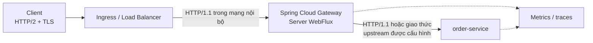
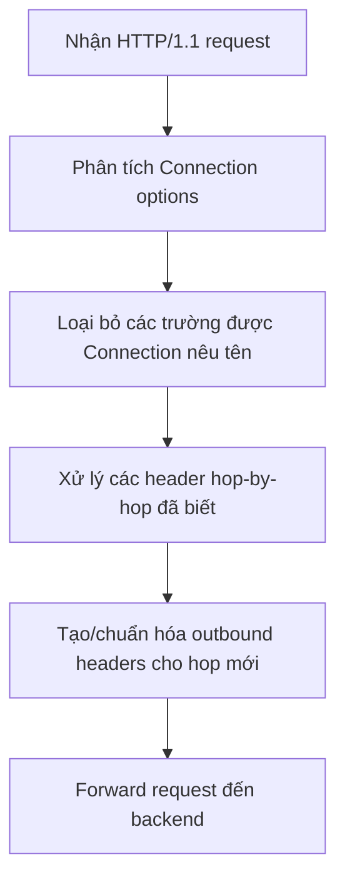
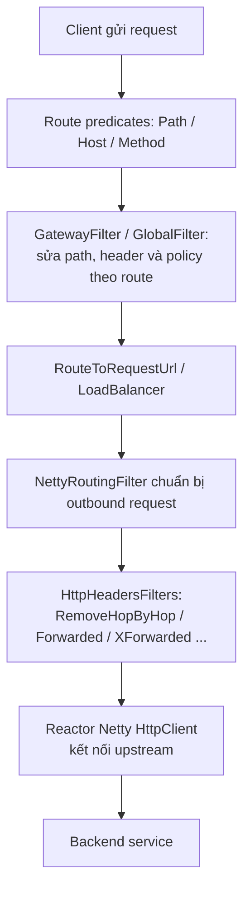

# RemoveHopByHop và các header dành riêng từng chặng

Khi client gọi một API qua **Spring Cloud Gateway**, request không được gửi thẳng từ client đến microservice. Nó đi qua nhiều kết nối riêng: client → load balancer/ingress (nếu có) → gateway → backend. Mỗi kết nối có thể sử dụng một phiên bản HTTP, cơ chế giữ kết nối và cách đóng khung body khác nhau. Vì thế, **không phải header HTTP nào cũng được chuyển nguyên vẹn tới chặng kế tiếp**.

Ví dụ một client gửi `Connection: keep-alive` và `Keep-Alive: timeout=10`. Hai header này nói về **kết nối giữa client và thành phần trực tiếp nhận request**, không phải một chỉ dẫn hợp lệ cho kết nối mới giữa gateway và `order-service`. Nếu gateway chuyển tiếp thiếu kiểm soát, backend có thể hiểu nhầm ý nghĩa header, gặp lỗi giao thức hoặc chịu rủi ro bảo mật.

Trong **Spring Cloud Gateway Server WebFlux**, `RemoveHopByHop` thuộc nhóm **`HttpHeadersFilter`** dùng để loại bỏ một số header gắn với từng chặng trước khi proxy request đến backend. Bài thuộc chương **Header yêu cầu** trong module **SPRING_CLOUD_GATEWAY**, nơi chúng ta học cách xây dựng API Gateway với route predicate, filter chain, biến đổi đường dẫn/header, khám phá dịch vụ, xác thực, giới hạn lưu lượng, circuit breaker, retry, TLS và quan sát request.

Sau bài này, bạn có thể:

1. Phân biệt **hop-by-hop** với **end-to-end** header và giải thích vai trò của `Connection`.
2. Nhớ được **tám header trong danh sách mặc định của RemoveHopByHop** ở Gateway WebFlux và ý nghĩa của từng header.
3. Biết cách cấu hình danh sách header cần loại bỏ và nhận ra việc tùy chỉnh là thay danh sách, không đơn giản thêm một mục.
4. Phân biệt `RemoveHopByHop` với `RemoveRequestHeader`, `SetRequestHeader`, `Forwarded` và `X-Forwarded-*`.
5. Kiểm thử outbound request tới backend, kể cả các trường hợp HTTP/1.1, HTTP/2, WebSocket và header `Connection` chứa tên trường khác.

> **Phạm vi:** Nội dung mô tả **Spring Cloud Gateway Server WebFlux** sử dụng Spring WebFlux/Reactor Netty. Spring Cloud Gateway Server MVC có cách tích hợp proxy khác. Tên một số thuộc tính cấu hình đã đổi qua các thế hệ Spring Cloud Gateway; bài sử dụng namespace trong tài liệu WebFlux **4.3.x/5.x** và chỉ ra điểm cần kiểm tra theo phiên bản.

## 1. “Hop” nghĩa là gì trong chuỗi proxy?

**Hop (chặng)** là một đoạn kết nối trực tiếp giữa hai HTTP peer. Hệ thống có thể có các chặng sau:



Nếu client nói với ingress rằng “sau khi trả lời hãy giữ kết nối này mở”, chỉ dẫn đó áp dụng cho **client ↔ ingress**. Nó không cho biết ingress hay gateway phải giữ kết nối **gateway ↔ backend** trong bao lâu. Kết nối outbound thường do HTTP client, connection pool, keepalive/idle timeout và cấu hình riêng của gateway quản lý.

Theo mô hình HTTP:

| Loại header | Ý nghĩa | Ví dụ | Cách xử lý khi proxy |
| --- | --- | --- | --- |
| **Hop-by-hop** | Dành cho một kết nối hiện tại, không có ý nghĩa toàn chuỗi | `Connection`, `Keep-Alive`, `Transfer-Encoding`, `Upgrade` | Intermediary loại bỏ/tiêu thụ rồi chỉ tạo lại thông tin chặng mới khi giao thức cần |
| **End-to-end** | Mô tả request, representation hoặc chính sách liên quan tới origin/final recipient | `Accept`, `Content-Type`, `Accept-Encoding`, `If-None-Match` | Thông thường được giữ theo contract, trừ khi policy yêu cầu thay đổi |
| **Danh tính/ủy quyền** | Mang thông tin dùng cho authentication/authorization | `Authorization`, cookie, header danh tính nội bộ | Phải xác minh và chỉ chuyển theo chính sách tin cậy; việc không thuộc danh sách hop-by-hop không có nghĩa mặc định an toàn |
| **Metadata proxy** | Mô tả đường đi hoặc địa chỉ gốc | `Forwarded`, `X-Forwarded-For`, `X-Forwarded-Proto` | Chỉ tin proxy đã được cấu hình là đáng tin; chuẩn hóa trước khi dùng |
| **HTTP framing** | Cách một message được gửi trên kết nối cụ thể | `Content-Length`, `Transfer-Encoding` | Không tự sửa tùy ý; HTTP server/client phải xử lý theo protocol và request body thực tế |

Một header có thể cần bị xóa, thêm hoặc viết lại vì **nhiều lý do khác nhau**. `RemoveHopByHop` chỉ giải quyết một nhóm vấn đề ở lớp giao thức; nó không thay thế các chính sách xác thực, kiểm soát danh tính hay quy tắc dữ liệu nghiệp vụ.

## 2. RFC 9110: tại sao Connection quan trọng hơn một danh sách cố định?

Trong HTTP/1.1, `Connection` cho phép bên gửi liệt kê các **connection option**. Ngoài các token điều khiển kết nối như `close`, nó còn có thể liệt kê **tên header khác** chỉ có giá trị trên chặng hiện tại.

Ví dụ:

```http
GET /api/orders/42 HTTP/1.1
Host: api.example.com
Connection: keep-alive, X-Hop-Trace
Keep-Alive: timeout=5
X-Hop-Trace: only-for-this-connection
Accept: application/json
X-Request-Id: 6c83e
```

Diễn giải:

- `Connection: keep-alive` là lựa chọn quản lý kết nối hiện tại, không phải chỉ dẫn end-to-end.
- `Connection: X-Hop-Trace` khai báo `X-Hop-Trace` là trường dành cho kết nối này.
- `Keep-Alive` chứa các tham số gợi ý về kết nối hiện tại.
- `Accept` và `X-Request-Id` không được khai báo là hop-by-hop trong ví dụ; chúng có thể được xử lý theo policy chuyển tiếp riêng.

**Quy tắc chuẩn quan trọng trong RFC 9110, mục 7.6.1:** intermediary phải phân tích danh sách token trong `Connection`, xóa các header/trailer có tên tương ứng **trước khi forward**, sau đó xóa hoặc thay `Connection` bằng các option của kết nối mới.



**Hai mức cần phân biệt:**

1. **Yêu cầu của giao thức HTTP** là loại bỏ cả các trường **được chỉ định động** trong `Connection`.
2. **Tài liệu Spring Cloud Gateway về `RemoveHopByHop`** liệt kê một **tập header mặc định cố định**. Không nên từ danh sách đó suy ra rằng riêng filter này đã xử lý mọi tên bất kỳ được nêu trong `Connection`. Cần kiểm tra toàn bộ HTTP server, header filters và outbound HTTP client của đúng phiên bản đang triển khai bằng thử nghiệm tích hợp.

Một client cố tình gửi `Connection: Authorization` hoặc `Connection: X-User-Id` là dấu hiệu cần xem xét nghiêm túc: theo chuẩn, trường được nêu có ý nghĩa dành cho hop, nhưng những trường này lại liên quan tới bảo mật ứng dụng. Thay vì thiết kế cơ chế phân quyền dựa trên khả năng một proxy có/không xóa header, hãy xác minh identity ở đúng tầng và **từ chối request có chỉ dẫn Connection bất thường** theo chính sách bảo mật tại biên khi phù hợp.

## 3. RemoveHopByHop trong Spring Cloud Gateway là gì?

**`RemoveHopByHop`** là bộ lọc xử lý HTTP header được Gateway WebFlux áp dụng khi chuẩn bị gửi request đến downstream service. Tài liệu xếp nó trong nhóm **`HttpHeadersFilters`**; nhóm này được áp dụng trước khi `NettyRoutingFilter` gửi outbound request bằng Reactor Netty HTTP client.

Điều đó có nghĩa:

- Gateway đã match một route, có URL backend cuối cùng và đang chuẩn bị headers cho outbound HTTP request.
- `RemoveHopByHop` loại bỏ các tên header trong danh sách cấu hình khỏi tập header được forward.
- HTTP client phía gateway tự quản lý kết nối HTTP mới, cách gửi body và các header framing tương ứng.
- Việc xóa header trước khi proxy không tự tạo HTTP redirect, không thay path, không xác thực JWT và không gọi thêm API nghiệp vụ.

### Vị trí trong request pipeline



Sơ đồ nhấn mạnh **trách nhiệm logic**, không hàm ý tất cả filter đều chạy trong một danh sách tuyến tính với thứ tự cố định. Các `HttpHeadersFilter` là điểm mở rộng xử lý tập header outbound; `GatewayFilter` và `GlobalFilter` điều khiển các bước rộng hơn của filter chain. Spring Security WebFlux thường tham gia ở lớp `WebFilter` khác.

**Không nên** cấu hình `RemoveHopByHop` như một dòng route filter thông thường:

```yaml
# Ví dụ KHÔNG dùng làm cấu hình route:
filters:
  - RemoveHopByHop
```

Thao tác loại bỏ các hop-by-hop header thường đã có sẵn ở tầng `HttpHeadersFilter`. Muốn thay đổi **danh sách**, dùng **property cấu hình chuyên dụng** ở mục 5.

## 4. Tám header mặc định được loại bỏ

Theo tài liệu chính thức của Spring Cloud Gateway Server WebFlux, danh sách mặc định là:

| Header | Chức năng trong giao thức/chặng | Vì sao không nên forward nguyên vẹn |
| --- | --- | --- |
| **`Connection`** | Liệt kê các option điều khiển kết nối HTTP/1.1 và các tên field dành cho hop hiện tại | Option và tên field đó không áp dụng cho kết nối mới |
| **`Keep-Alive`** | Gợi ý timeout, giới hạn request cho kết nối persistent trong các triển khai cũ | Kết nối gateway → backend do HTTP client/connection pool riêng quản lý |
| **`Proxy-Authenticate`** | Server proxy yêu cầu client xác thực với proxy, gắn với ngữ cảnh `407` | Không phải chỉ dẫn xác thực tới origin service ở chặng tiếp theo |
| **`Proxy-Authorization`** | Credential dùng cho quá trình xác thực với một proxy | Không được tùy ý chuyển token xác thực của một chặng proxy sang chặng khác |
| **`TE`** | Khả năng tiếp nhận transfer coding/trailer của kết nối hiện tại | Áp dụng cho liên kết hiện tại, không phải thương lượng với mọi upstream |
| **`Trailer`** | Thông báo các trailer field dự kiến ở phần cuối message | Phải được xử lý phù hợp khi chuyển tiếp trailer và framing |
| **`Transfer-Encoding`** | Cho biết transfer coding của message trên một hop, ví dụ `chunked` | Outbound HTTP client phải quyết định framing cho hop mới |
| **`Upgrade`** | Đề nghị nâng cấp protocol trên kết nối HTTP hiện tại | Không thể gửi nguyên yêu cầu nâng cấp sang một kết nối khác như request HTTP thông thường |

Đây là **tám tên header cụ thể** trong danh sách mặc định của Gateway WebFlux. Header matching HTTP không phân biệt chữ hoa/chữ thường: `Connection` và `connection` là cùng tên theo ngữ nghĩa giao thức.

Một số header khác có liên quan nhưng **không xuất hiện trong danh sách tám mục**: `Proxy-Connection` (header phi chuẩn thường gặp trong hệ thống cũ), những header tùy biến được nêu trong `Connection`, hoặc header do một proxy cụ thể thêm vào. Khi cần xử lý chúng, phải đánh giá theo giao thức, topology và policy; không nên tuyên bố danh sách mặc định bao trùm mọi trường hợp.

### Thông tin đặc biệt: Transfer-Encoding không phải Content-Encoding

Hai tên rất giống nhau nhưng khác ý nghĩa:

| Header | Mô tả | Thường áp dụng ở đâu? |
| --- | --- | --- |
| `Transfer-Encoding: chunked` | Cách đóng khung dữ liệu trên kết nối HTTP/1.1 | **Hop**; bộ transport phải quản lý lại khi proxy |
| `Content-Encoding: gzip` | Dữ liệu biểu diễn đã được nén bằng gzip | **Representation**; thường cần giữ để backend giải nén/hiểu body |
| `Accept-Encoding: gzip` | Client cho biết content coding mong muốn có thể nhận | Nội dung thương lượng end-to-end; không thuộc mặc định RemoveHopByHop |
| `Content-Length: 123` | Độ dài message body theo framing liên quan | Phải khớp body thực tế và quy tắc HTTP framing ở mỗi hop |

Nếu client gửi body `Transfer-Encoding: chunked`, việc bỏ **header framing inbound** không nhất thiết làm mất **body**. HTTP server đã giải mã framing để cung cấp body cho pipeline; Reactor Netty HTTP client có thể gửi body ra upstream với framing hợp lệ do nó chọn. Backend vẫn có thể nhìn thấy `Transfer-Encoding` mới do outbound transport tạo ra. **Mục tiêu là không sao chép header hop cũ**, không phải cấm tuyệt đối xuất hiện tên header đó trên mọi kết nối.

## 5. Cấu hình danh sách RemoveHopByHop

Ở các phiên bản Spring Cloud Gateway Server WebFlux **4.3.x và 5.x** được tài liệu hiện tại mô tả, thuộc tính cấu hình là:

```properties
spring.cloud.gateway.server.webflux.filter.remove-hop-by-hop.headers
```

Đây là **cấu hình cấp gateway**, không cần đặt trong mảng `filters` của từng route.

Ví dụ nếu hệ thống phải loại thêm `Proxy-Connection`, cần khai báo **toàn bộ danh sách được phép loại bỏ**, trong đó **giữ lại tám tên mặc định**:

```yaml
spring:
  cloud:
    gateway:
      server:
        webflux:
          filter:
            remove-hop-by-hop:
              headers:
                - Connection
                - Keep-Alive
                - Proxy-Authenticate
                - Proxy-Authorization
                - TE
                - Trailer
                - Transfer-Encoding
                - Upgrade
                - Proxy-Connection
```

Trong ví dụ, `Proxy-Connection` được thêm như một **chính sách bổ sung cho môi trường có client/proxy legacy**, không phải mục mặc định thứ chín của Gateway.

**Lưu ý đặc biệt:** Property `headers` là **danh sách được dùng để cấu hình tên cần xóa**. Khi tự đặt danh sách này, hãy coi đó là **thay thế toàn bộ danh sách mặc định**, không dựa vào giả định framework tự động cộng thêm các mục mới vào tám mục cũ. Một cấu hình như:

```yaml
# Không nên: dễ làm thiếu những header cần xóa theo mặc định
spring:
  cloud:
    gateway:
      server:
        webflux:
          filter:
            remove-hop-by-hop:
              headers:
                - Proxy-Connection
```

có thể dẫn đến không còn xóa `Connection`, `TE`, `Upgrade`, v.v. theo cấu hình mặc định. Đây là thay đổi liên quan tới **tính đúng giao thức và bảo mật**, cần kiểm thử trước khi triển khai.

### Cấu hình route vẫn độc lập

Ví dụ một route gửi request tới `order-service` với namespace Gateway WebFlux **5.x**:

```yaml
spring:
  cloud:
    gateway:
      server:
        webflux:
          routes:
            - id: orders-api
              uri: http://localhost:8081
              predicates:
                - Path=/api/orders/**
              filters:
                - StripPrefix=1
```

Khi client gọi `GET /api/orders/42`, backend được giả định nhận `GET /orders/42`. `RemoveHopByHop` nằm trong quy trình chuẩn bị outbound request, không cần khai báo tại `filters` của route. Với WebFlux Gateway thế hệ cũ có property routes `spring.cloud.gateway.routes`, phải dùng namespace route tương ứng với phiên bản thực tế; không nhầm namespace routes với namespace của `remove-hop-by-hop`.

### Có nên loại bỏ mọi header lạ?

Không. Việc loại bỏ toàn bộ header không có trong một allowlist cực hẹp có thể làm hỏng `Accept`, `Content-Type`, `If-Match`, `traceparent`, custom header hợp đồng API hoặc thông tin request cần thiết khác. Ngược lại, không nên forward mù quáng các header identity do client tự khai báo. Cần có **chính sách header rõ ràng theo trust boundary**, phân biệt hop-by-hop cleanup với thông tin nghiệp vụ/identity.

## 6. Khác nhau giữa RemoveHopByHop và RemoveRequestHeader

Cùng làm giảm số header outbound nhưng hai cơ chế có phạm vi và mục đích khác nhau:

| Tiêu chí | **`RemoveHopByHop` `HttpHeadersFilter`** | **`RemoveRequestHeader` `GatewayFilter`** |
| --- | --- | --- |
| Đặt ở đâu? | Nhóm xử lý header trước khi HTTP client gửi upstream | Trong `filters` của một route hoặc `default-filters` |
| Mục tiêu chính | Loại header dành cho kết nối/hop theo danh sách | Loại header bất kỳ theo yêu cầu route/chính sách |
| Phạm vi thường dùng | Toàn bộ HTTP routing đi qua cơ chế header filtering tương ứng | Route được cấu hình, hoặc toàn tuyến nếu khai báo mặc định |
| Ví dụ | Xóa `Connection`, `Keep-Alive`, `TE` | Xóa `X-User-Id`, `X-Internal-Secret` mà client không được tự khai |
| Thay thế cho authentication? | Không | Không |
| Xử lý biến đổi body/path? | Không | Không |

Ví dụ, client có thể gửi:

```http
GET /api/orders/42 HTTP/1.1
Host: api.example.com
Connection: keep-alive
X-User-Id: admin
Authorization: Bearer <token>
```

Theo chính sách hệ thống, ta có thể:

1. Dùng **Spring Security WebFlux** xác minh access token trên kết nối inbound.
2. Dùng `RemoveRequestHeader=X-User-Id` để loại header user giả mạo trước khi forward.
3. Để `RemoveHopByHop` loại `Connection` và các header hop-by-hop trong outbound request.
4. Backend thực hiện **authorization trên tài nguyên thực tế**, không tin `X-User-Id` do client tùy ý gửi.

Ví dụ route:

```yaml
spring:
  cloud:
    gateway:
      server:
        webflux:
          routes:
            - id: orders-api
              uri: http://localhost:8081
              predicates:
                - Path=/api/orders/**
              filters:
                - StripPrefix=1
                - RemoveRequestHeader=X-User-Id
```

`RemoveRequestHeader` là filter theo route; nó **không chỉ định được hành vi đầy đủ cho các header do `Connection` nêu tên**, trừ khi ta có logic kiểm tra các token tương ứng. Các trường hợp bất thường phải được kiểm thử/kiểm soát theo giao thức và policy của hệ thống.

## 7. Kịch bản chi tiết: inbound headers và outbound headers

Giả sử một HTTP/1.1 request tới Gateway:

```http
GET /api/orders/42 HTTP/1.1
Host: api.example.com
Connection: keep-alive
Keep-Alive: timeout=5, max=100
TE: trailers
Proxy-Connection: keep-alive
Accept: application/json
X-Request-Id: abc-42
X-User-Id: forged-admin
Authorization: Bearer <access-token>
```

Route đã cấu hình:

```yaml
- id: orders-api
  uri: http://localhost:8081
  predicates:
    - Path=/api/orders/**
  filters:
    - StripPrefix=1
    - RemoveRequestHeader=X-User-Id
```

Đây là một **mảnh route** nằm trong danh sách `routes`, không phải `application.yml` độc lập.

Trước khi HTTP client proxy request:

| Header inbound | Bộ lọc/chính sách xử lý | Điều cần kiểm chứng ở backend |
| --- | --- | --- |
| `Connection` | Thuộc danh sách mặc định RemoveHopByHop | Không phải header `Connection` từ chặng client được sao chép nguyên vẹn |
| `Keep-Alive` | Thuộc danh sách mặc định | Không mang timeout/max inbound sang kết nối upstream |
| `TE` | Thuộc danh sách mặc định | Không sao chép `TE: trailers` như yêu cầu của chặng client |
| `Proxy-Connection` | Không có trong tám mục mặc định; ví dụ cấu hình mục 5 bổ sung | Xác minh có bị loại bỏ nếu policy yêu cầu |
| `Accept` | Thường là end-to-end header | Được giữ nếu không có policy nào thay đổi |
| `X-Request-Id` | Correlation metadata của ứng dụng | Theo policy: có thể chuẩn hóa hoặc tạo lại trace ID đáng tin |
| `X-User-Id` | `RemoveRequestHeader` của route | Không nhận giá trị `forged-admin` từ client |
| `Authorization` | Spring Security + chính sách forward token | Chỉ chuyển tiếp nếu cần và được phép; không ghi token vào log |
| `Host` | Chính sách HTTP client/proxy và `PreserveHostHeader` nếu áp dụng | Tương thích host/upstream; không mặc định giống Host public |

**Đừng kiểm thử bằng cách đòi mọi header kể trên vắng mặt tại backend.** Ví dụ `Host` cần tồn tại và có thể được HTTP client viết lại; `Authorization` có thể phải chuyển tiếp cho backend; `Accept` thường nên giữ. Với `Connection` hoặc `Transfer-Encoding`, outbound HTTP client có thể tự sinh giá trị mới đúng cho hop mới. Test cần xác định **có sao chép nguyên dữ liệu inbound bị cấm hay không**, thay vì chỉ dựa vào sự hiện diện của cùng tên header.

## 8. Connection chỉ định một header khác: trường hợp dễ bị bỏ sót

Xét request thử nghiệm:

```http
GET /api/orders/42 HTTP/1.1
Host: api.example.com
Connection: X-Hop-Debug
X-Hop-Debug: only-for-this-hop
Accept: application/json
```

Theo **RFC 9110**, `X-Hop-Debug` đã được nêu trong `Connection` nên intermediary không được forward nó như một header end-to-end. Tuy nhiên `X-Hop-Debug` **không nằm trong tám tên mặc định** của `RemoveHopByHop`.

Vì vậy, phải phân biệt:

- **Điều chuẩn HTTP yêu cầu:** xóa trường có tên được liệt kê trong `Connection` cùng các connection-specific fields trước khi forward.
- **Danh sách cấu hình RemoveHopByHop:** tên cố định được liệt kê hoặc tự cấu hình.
- **Hành vi hệ thống thực tế:** còn phụ thuộc cách Reactor Netty HTTP server/client và các header filter xử lý message. Chỉ một integration test đúng version mới xác nhận đầy đủ hành vi.

Khi hệ thống xử lý dữ liệu nhạy cảm, test cần bao gồm ít nhất các trường hợp `Connection` chỉ định **một header thông thường** và **một header nhạy cảm**. Nếu stack không đáp ứng policy dự kiến, hãy xử lý tại lớp HTTP edge tin cậy, chặn yêu cầu bất thường hoặc bổ sung cơ chế cleanup được thiết kế đúng. Tránh viết một filter xóa/tái tạo `Authorization` mà không hiểu thứ tự xác thực và những proxy nằm trước Gateway.

### Tại sao đây là vấn đề bảo mật?

Một số rủi ro khi intermediaries không thống nhất ý nghĩa của header:

- **Header spoofing:** backend tin `X-User-Id` hoặc `X-Tenant-Id` do client tự gửi.
- **Header stripping:** một thành phần bỏ header dựa trên `Connection`, thành phần khác giữ, dẫn tới hai bên nhìn thấy khác nhau.
- **HTTP request smuggling/desynchronization:** các hop hiểu độ dài/body framing khác nhau, đặc biệt khi xử lý `Content-Length`, `Transfer-Encoding` hoặc request bất thường.
- **Nhầm ngữ cảnh xác thực proxy:** `Proxy-Authorization` bị chuyển đến sai hop, làm rò rỉ credential.

**Lưu ý về request smuggling:** không thể khắc phục hoàn toàn bằng cách “xóa `Transfer-Encoding` sau khi request đã được parse”. HTTP server ở biên phải **validate và từ chối message có framing mâu thuẫn hoặc sai chuẩn**, phối hợp với proxy trước/sau để các thành phần giải thích request nhất quán. Không thử nghiệm payload request-smuggling trên hạ tầng sản xuất không thuộc phạm vi kiểm soát.

## 9. HTTP/1.1 và HTTP/2 xử lý header kết nối khác nhau

`Connection` là cơ chế quan trọng trong HTTP/1.1, nhưng **HTTP/2 không sử dụng các connection-specific header kiểu HTTP/1.1**.

Theo **RFC 9113, mục 8.2.2**, endpoint HTTP/2 **không được** tạo message có `Connection` và các connection-specific fields như `Proxy-Connection`, `Keep-Alive`, `Transfer-Encoding`, `Upgrade`. Message vi phạm phải được coi là malformed. Riêng `TE` trong request HTTP/2 là trường hợp ngoại lệ rất hẹp: **chỉ giá trị `trailers` được phép**.

| Khía cạnh | HTTP/1.1 | HTTP/2 |
| --- | --- | --- |
| `Connection` | Có thể dùng để liệt kê connection options | Không được xuất hiện |
| `Keep-Alive` | Tồn tại trong triển khai cũ, liên quan một hop | Không được sử dụng như connection-specific header |
| `Transfer-Encoding: chunked` | Là cơ chế đóng khung body trên một hop HTTP/1.1 | Không được dùng; HTTP/2 có DATA frames riêng |
| `TE` | Chỉ thị khả năng transfer coding/trailer theo quy tắc HTTP/1.1 | Chỉ `TE: trailers` được phép trong request |
| `Upgrade` | Có thể dùng trong thủ tục nâng cấp HTTP/1.1 | Không được đưa nguyên theo cách HTTP/1.1 vào message HTTP/2 |
| Kết nối client → gateway và gateway → backend | Có thể đều HTTP/1.1 hoặc khác nhau | Có thể chuyển HTTP/2 ở một hop sang HTTP/1.1 ở hop khác |

Điều này giải thích vì sao **không thể “copy headers” một cách thô sơ khi proxy từ HTTP/2 sang HTTP/1.1 hoặc ngược lại**. HTTP transport và filter phải tạo các trường hợp lệ cho mỗi hop. Với ứng dụng sử dụng **gRPC, HTTP/2 trailers hoặc streaming**, cần kiểm tra support thực tế của gateway/starter và yêu cầu giao thức, thay vì chỉ tắt RemoveHopByHop để “giữ cho đủ header”.

### TLS không thay thế lọc header

TLS bảo vệ **tính bí mật/toàn vẹn kết nối** trên hop được mã hóa. Nó không chuyển một chỉ dẫn `Connection` của client thành chỉ dẫn hợp lệ cho hop upstream. Ngay cả khi cả hai kết nối đều HTTPS, gateway vẫn phải xử lý hop-by-hop headers đúng chuẩn và vẫn phải áp dụng authentication, authorization.

## 10. WebSocket và Upgrade có phải ngoại lệ?

Một số request nâng cấp từ HTTP/1.1 lên WebSocket sử dụng:

```http
GET /chat HTTP/1.1
Host: api.example.com
Upgrade: websocket
Connection: Upgrade
Sec-WebSocket-Key: <handshake-key>
Sec-WebSocket-Version: 13
```

Trong một **reverse proxy HTTP thông thường**, `Upgrade` và `Connection` thuộc cơ chế của hop hiện tại, nên không thể sao chép nguyên chúng như end-to-end headers. Nhưng WebSocket thực sự cần **một cơ chế handshake và proxy giao thức phù hợp**.

Với Spring Cloud Gateway, nếu cần WebSocket, hãy dùng **WebSocket routing** với URI phù hợp `ws://` hoặc `wss://` (và cấu hình hỗ trợ tương ứng) thay vì mong `NettyRoutingFilter` HTTP thông thường + một custom RemoveRequestHeader hoạt động như WebSocket proxy. Gateway sẽ cần xử lý handshake/upgrade theo đường chuyên biệt.

Ví dụ định tuyến WebSocket mang tính minh họa:

```yaml
spring:
  cloud:
    gateway:
      server:
        webflux:
          routes:
            - id: chat-ws
              uri: ws://localhost:8082
              predicates:
                - Path=/chat/**
```

Khi đó request WebSocket thực tế đi qua nhánh routing chuyên dụng. Không nên hiểu `RemoveHopByHop` “xóa `Upgrade` nên chắc chắn làm WebSocket hỏng”. Ngược lại, tự **giữ lại `Upgrade`** trong outbound HTTP proxy thông thường cũng không làm WebSocket tự hoạt động. Hãy kiểm thử handshake và session WebSocket end-to-end.

## 11. Forwarded, X-Forwarded và Host: không nằm trong tám mục mặc định

Đặc biệt trong mô hình ingress → gateway → service, người học dễ nhầm hop-by-hop với các header mô tả vị trí client/proxy.

- `Forwarded` (chuẩn RFC 7239) có thể chứa thông tin `for`, `proto`, `host` và `by`.
- `X-Forwarded-For`, `X-Forwarded-Proto`, `X-Forwarded-Host` là các header thông dụng giúp backend hiểu địa chỉ client và URL public.
- `Host` / HTTP authority mô tả host đích trong request và ảnh hưởng tới routing, virtual host, link generation.
- `X-Request-Id`, `traceparent` và các trace headers hỗ trợ quan sát luồng request xuyên nhiều service.

Những header này **không thuộc tám tên mặc định RemoveHopByHop**, nhưng vẫn cần chính sách trust riêng. Ví dụ, một client không được tự gửi `X-Forwarded-For: 127.0.0.1` rồi khiến gateway tin rằng request đến từ loopback, hoặc tự gửi `X-User-Id: admin` để được phân quyền.

Trong tài liệu Gateway WebFlux hiện hành, việc tạo/đọc các forwarded headers liên quan cấu hình như `spring.cloud.gateway.server.webflux.trusted-proxies`, tùy loại header filter và topology. Hãy giới hạn proxy được tin, loại bỏ giá trị do client giả mạo ở edge và kiểm tra chính xác request mà backend nhận. `RemoveHopByHop` **không tự tạo hàng rào tin cậy cho Forwarded/X-Forwarded**.

### Authorization cũng không phải Proxy-Authorization

| Header | Mục đích | Chính sách |
| --- | --- | --- |
| `Authorization` | Xác thực client với origin/API được bảo vệ | Xác minh token/credential; chỉ forward khi contract bảo mật yêu cầu |
| `Proxy-Authorization` | Xác thực với một HTTP proxy trên một hop | Thường không forward nguyên credential proxy sang service đích |
| `X-User-Id` | Header ứng dụng không có quy tắc tin cậy chung | Không tin giá trị client tự đặt; dùng identity đã xác thực |
| `Forwarded` / `X-Forwarded-*` | Chứa metadata qua các proxy | Chỉ tin nguồn đã xác định và chuẩn hóa |

Một nguyên tắc bền vững: gateway có thể **xác thực request ở biên**, còn service vẫn phải kiểm tra **quyền truy cập tài nguyên nghiệp vụ**. Header cleanup là bước giao thức, không biến mọi header còn lại thành thông tin đáng tin.

## 12. Quan sát hành vi RemoveHopByHop bằng backend thử nghiệm

**Mục tiêu:** xác minh gateway không sao chép bừa các hop-by-hop header từ request inbound sang backend, đồng thời giữ các header end-to-end cần thiết.

### 12.1. Chuẩn bị hai ứng dụng

Giả sử Gateway Server WebFlux chạy tại `http://localhost:8080`, backend thử nghiệm tại `http://localhost:8081`. Route là:

```yaml
spring:
  cloud:
    gateway:
      server:
        webflux:
          routes:
            - id: orders-api
              uri: http://localhost:8081
              predicates:
                - Path=/api/orders/**
              filters:
                - StripPrefix=1
                - RemoveRequestHeader=X-User-Id
```

Tạo backend thử nghiệm đơn giản chỉ echo **tên header mục tiêu**, tránh echo token/cookie từ request thật:

```java
import java.util.LinkedHashMap;
import java.util.Map;
import org.springframework.http.HttpHeaders;
import org.springframework.http.server.reactive.ServerHttpRequest;
import org.springframework.web.bind.annotation.GetMapping;
import org.springframework.web.bind.annotation.PathVariable;
import org.springframework.web.bind.annotation.RestController;
import reactor.core.publisher.Mono;

@RestController
class HeaderInspectController {

    @GetMapping("/orders/{id}")
    Mono<Map<String, Object>> inspect(
            @PathVariable String id,
            ServerHttpRequest request) {

        HttpHeaders headers = request.getHeaders();
        Map<String, Object> result = new LinkedHashMap<>();
        result.put("id", id);
        result.put("connection", headers.getFirst("Connection"));
        result.put("keepAlive", headers.getFirst("Keep-Alive"));
        result.put("te", headers.getFirst("TE"));
        result.put("proxyConnection", headers.getFirst("Proxy-Connection"));
        result.put("xHopDebug", headers.getFirst("X-Hop-Debug"));
        result.put("xUserId", headers.getFirst("X-User-Id"));
        result.put("accept", headers.getFirst("Accept"));
        return Mono.just(result);
    }
}
```

**Chú ý:** Snippet phù hợp cho backend thử nghiệm Spring WebFlux. `LinkedHashMap` cho phép giá trị `null` khi header không tồn tại; `Map.of(...)` không chấp nhận `null`. Không sử dụng endpoint này để phản chiếu `Authorization`, cookie hoặc dữ liệu cá nhân trong production.

### 12.2. Kiểm thử header trong danh sách mặc định

Dùng `curl` trên kết nối HTTP/1.1 local:

```bash
curl --http1.1 -i \
  -H "Connection: keep-alive" \
  -H "Keep-Alive: timeout=5" \
  -H "TE: trailers" \
  -H "Accept: application/json" \
  -H "X-User-Id: forged" \
  http://localhost:8080/api/orders/42
```

Kỳ vọng quan sát:

- Backend thấy `/orders/42` nhờ `StripPrefix=1`.
- `Keep-Alive: timeout=5` và `TE: trailers` từ client không được sao chép bừa vào backend theo danh sách cleanup mặc định.
- `X-User-Id` do client gửi không còn vì `RemoveRequestHeader` trên route.
- `Accept: application/json` thường được chuyển tiếp vì không nằm trong nhóm hop-by-hop.
- Nếu backend thấy `Connection`, phải xem **giá trị có phải được outbound HTTP client tạo cho hop mới hay không**, thay vì kết luận filter thất bại từ tên header.

Với header bất thường, HTTP server của gateway hoặc thư viện `curl` có thể từ chối/chỉnh sửa request trước khi tới filter; cần ghi nhận kết quả đúng theo layer thực sự xử lý.

### 12.3. Kiểm thử Connection chỉ định một header khác

```bash
curl --http1.1 -i \
  -H "Connection: X-Hop-Debug" \
  -H "X-Hop-Debug: hop-only" \
  http://localhost:8080/api/orders/42
```

Theo RFC 9110, `X-Hop-Debug` không được đi qua intermediary như end-to-end header. Test xác minh **hành vi của toàn bộ Gateway/Netty trong version thực tế**. Nếu backend vẫn thấy `X-Hop-Debug`, không được coi đó là kết quả mong muốn chỉ vì header này không xuất hiện trong tám mục mặc định. Cần đánh giá cách xử lý `Connection` hoặc chính sách chặn request bất thường tại edge.

### 12.4. Kiểm thử cấu hình mở rộng

Thêm `Proxy-Connection` vào danh sách **đầy đủ** như mục 5, sau đó gửi:

```bash
curl --http1.1 -i \
  -H "Proxy-Connection: keep-alive" \
  http://localhost:8080/api/orders/42
```

Kiểm tra backend không nhận giá trị `Proxy-Connection` từ request inbound. Nếu HTTP server tự chặn hoặc loại bỏ header trước gateway, ghi rõ điều đó trong biên bản test.

### 12.5. So sánh request trước/sau gateway

| Trường kiểm tra | Inbound client | Backend được kỳ vọng | Điểm cần quan sát |
| --- | --- | --- | --- |
| Path | `/api/orders/42` | `/orders/42` | Route filter hoạt động |
| `Keep-Alive` | `timeout=5` | Không forward giá trị inbound | Hop-by-hop cleanup |
| `TE` | `trailers` | Không copy bừa giá trị inbound | Giao thức & transport |
| `Connection` | `keep-alive` | Không mang nguyên option inbound | Có thể có header mới do transport tạo |
| `X-User-Id` | `forged` | Vắng mặt | Policy route-level |
| `Accept` | `application/json` | Được giữ nếu không có policy khác | End-to-end |
| `Proxy-Connection` | `keep-alive` | Vắng khi đã cấu hình bổ sung | Danh sách tùy chỉnh |
| `X-Hop-Debug` | `hop-only`, được `Connection` nêu | Vắng theo RFC | Test cơ chế xử lý token động |

## 13. Khi request không qua NettyRoutingFilter

`RemoveHopByHop` được tài liệu gắn với việc xử lý outbound headers trước khi proxy HTTP. Không phải response nào tại gateway cũng xuất phát từ HTTP client này.

| Tình huống | Điều xảy ra | Ý nghĩa với RemoveHopByHop |
| --- | --- | --- |
| Predicate không match route | Gateway không chọn được route HTTP tương ứng | Không có outbound request của route đó |
| Spring Security trả `401`/`403` sớm | Request dừng ở lớp bảo mật | Không thể suy ra đã gọi backend |
| Rate limiter trả `429` | Filter có thể ngừng chain | Không cần chuyển header đến backend |
| Circuit breaker fallback nội bộ | Có thể tạo response cục bộ | Cần phân biệt fallback với HTTP upstream |
| `forward://` | Đi qua nhánh forward nội bộ | Không áp dụng nguyên xi hành vi outbound Netty |
| WebSocket `ws://` | Đi qua routing dành cho WebSocket | Handshake/connection upgrade có quy trình riêng |
| HTTP upstream `http://`/`https://` | Reactor Netty HttpClient thực hiện proxy | Nhóm `HttpHeadersFilter` tham gia chuẩn bị headers |

Hãy dựa trên **route ID, trace ID, status và outbound request thực tế** để chẩn đoán, không chỉ dựa vào log ở một filter bất kỳ.

## 14. Những lỗi triển khai và cách xử lý

| Triệu chứng | Nguyên nhân thường gặp | Cách điều tra |
| --- | --- | --- |
| Cấu hình `RemoveHopByHop` trong mảng route filters gây lỗi | Nhầm `HttpHeadersFilter` với `GatewayFilter` | Dùng property `remove-hop-by-hop.headers` theo version |
| Sau khi bổ sung `Proxy-Connection`, `Connection` lại đi tới backend | Danh sách cấu hình bị **ghi đè**, thiếu tám mục mặc định | Khôi phục toàn bộ danh sách, thêm header mới vào cuối |
| Backend nhìn thấy `Transfer-Encoding: chunked` | Outbound transport có thể tạo framing mới | Phân biệt header **mới** với giá trị inbound sao chép nguyên |
| Backend thiếu `Authorization` | Policy bảo mật/header hoặc `Connection` token bất thường tác động | Kiểm tra các hop và xử lý request bất thường; không nới quyền để bỏ lỗi |
| Backend tin `X-Forwarded-For` giả mạo | Chưa cấu hình trusted proxies hoặc ingress không chuẩn hóa | Xác định trust boundary, chặn/tái tạo forwarded metadata |
| WebSocket không nâng cấp được | Route sai URI scheme, thiếu WebSocket routing, TLS/proxy không phù hợp | Kiểm tra `ws://`/`wss://`, handshake và route cụ thể |
| H2 request bị từ chối khi có `Connection` | Header này bị cấm trong HTTP/2 | Đừng cố cho phép, sửa client/proxy để gửi message đúng chuẩn |
| Trailing headers bị thiếu | HTTP version, framework hoặc proxy không bảo toàn trailers | Test end-to-end theo đúng giao thức, không bật toàn bộ TE/Trailer tùy tiện |
| Lỗi 400/502 với `Content-Length` và `Transfer-Encoding` | Framing mơ hồ hoặc các hop parse khác nhau | Kiểm tra ingress/server validation và request framing theo RFC |
| p95/p99 tăng sau khi thêm custom header filter | Logic filter tự gọi I/O blocking hoặc xử lý chuỗi phức tạp | Dùng API reactive, giảm thao tác trên event loop, đo profiler/metrics |

Không nên tự viết một custom filter bổ sung chỉ vì thấy một header lạ; xác định nguyên nhân ở **HTTP parser**, **gateway header filter**, **route filter**, **outbound client** hay **backend** trước khi sửa.

## 15. Checklist trước khi vận hành gateway

- [ ] Xác định đang dùng **Spring Cloud Gateway Server WebFlux** và phiên bản cấu hình tương ứng.
- [ ] Phân biệt header **hop-by-hop** với **end-to-end**, header danh tính và metadata proxy.
- [ ] Hiểu quy tắc `Connection`: intermediary cần xử lý **cả tên field được liệt kê động**, không chỉ tập cố định.
- [ ] Biết tám header mặc định của `RemoveHopByHop`; không nhầm `Proxy-Connection` là mục mặc định.
- [ ] Nếu tùy chỉnh `remove-hop-by-hop.headers`, giữ đủ danh sách cần loại; tránh vô tình chỉ khai báo một header rồi mất chính sách cũ.
- [ ] Không đưa `RemoveHopByHop` thành route filter thông thường; dùng property cho `HttpHeadersFilter`.
- [ ] Kiểm thử outbound HTTP/1.1 và HTTP/2 (khi triển khai), tách header inbound cũ với header transport phát sinh mới.
- [ ] Khi cần WebSocket/gRPC/trailers, xác minh hỗ trợ giao thức và luồng routing riêng, không tắt cơ chế dọn header tùy tiện.
- [ ] Chuẩn hóa `Forwarded`, `X-Forwarded-*`, `Host` theo proxy tin cậy; không tin header do client giả mạo.
- [ ] Loại header identity client tự đặt bằng policy phù hợp, bảo vệ service nội bộ và kiểm tra quyền nghiệp vụ ở backend.
- [ ] Chặn hoặc xử lý đúng request có framing/header mâu thuẫn; không trông đợi `RemoveHopByHop` thay HTTP parser.
- [ ] Ghi route ID, trace ID, latency, status và dữ liệu kiểm thử header **đã che thông tin nhạy cảm**.
- [ ] Giữ retry, timeout, circuit breaker, TLS và rate limiting phù hợp; chính sách header không thay thế các biện pháp này.

## 16. Câu hỏi tự kiểm tra

**1. Tại sao `Keep-Alive: timeout=5` từ client không nên gửi nguyên đến backend?**

> Vì nó mô tả một kết nối hiện tại. Gateway tạo/thuê kết nối outbound riêng, có pool và timeout của nó.

**2. Tám header mặc định RemoveHopByHop có bao gồm `Proxy-Connection` không?**

> Không. Danh sách mặc định gồm `Connection`, `Keep-Alive`, `Proxy-Authenticate`, `Proxy-Authorization`, `TE`, `Trailer`, `Transfer-Encoding` và `Upgrade`. Có thể bổ sung `Proxy-Connection` theo chính sách bằng cấu hình đầy đủ.

**3. Nếu `Connection: X-Hop-Debug` thì chỉ bỏ `Connection` đã đủ chưa?**

> Chưa đủ theo RFC 9110. Intermediary còn phải bỏ trường có tên `X-Hop-Debug` trước khi forward. Cần kiểm tra hành vi thực tế của stack Gateway và các lớp proxy.

**4. `Content-Encoding: gzip` có phải hop-by-hop header bị xóa mặc định không?**

> Không. Nó mô tả content coding của representation, khác `Transfer-Encoding`. Không xóa mù quáng nếu backend cần hiểu body.

**5. Tại sao `Authorization` không nằm trong danh sách RemoveHopByHop?**

> Nó phục vụ xác thực với API/origin theo ngữ nghĩa ứng dụng, khác `Proxy-Authorization` của một proxy. Tuy vậy, chuyển tiếp token phải được quyết định theo chính sách bảo mật, không đơn thuần vì header không thuộc danh sách.

**6. Nếu backend vẫn có `Transfer-Encoding` sau proxy, có chắc filter lỗi?**

> Không. HTTP client ở hop outbound có thể tạo framing mới. Cần kiểm tra **giá trị inbound có bị sao chép nguyên** hay không và request có hợp lệ theo giao thức hay không.

**7. HTTP/2 có chấp nhận `Connection: keep-alive` không?**

> Không. HTTP/2 cấm connection-specific headers; `TE` chỉ là ngoại lệ giới hạn với giá trị `trailers` trong request.

**8. `RemoveHopByHop` có thay thế việc kiểm tra quyền với `order 42` không?**

> Không. Gateway xử lý header/giao thức và xác thực biên; `order-service` vẫn phải kiểm tra người gọi có quyền trên đơn hàng cụ thể.

## Kết luận

**`RemoveHopByHop`** là thành phần dọn **request headers dành riêng từng chặng** trong Spring Cloud Gateway Server WebFlux trước khi HTTP client forward request. Danh sách mặc định gồm tám header giao thức quen thuộc: `Connection`, `Keep-Alive`, `Proxy-Authenticate`, `Proxy-Authorization`, `TE`, `Trailer`, `Transfer-Encoding` và `Upgrade`. Khi cấu hình mở rộng, cần giữ đầy đủ các mục cũ cần thiết và test theo đúng phiên bản Gateway.

Đặc biệt, **RFC 9110 yêu cầu xử lý cả các header được `Connection` liệt kê động**; không được giả định một danh sách cố định đã giải quyết mọi trường hợp. Kết hợp lọc header đúng chuẩn với kiểm soát forwarded metadata, xác thực, giới hạn lưu lượng, TLS, khả năng chịu lỗi và quan sát request giúp Gateway trở thành cổng vào microservices an toàn và dễ vận hành mà không làm sai ngữ nghĩa HTTP.

## Tài liệu tham khảo

- [Spring Cloud Gateway Server WebFlux 5.x — HttpHeadersFilters / RemoveHopByHop](https://docs.spring.io/spring-cloud-gateway/reference/spring-cloud-gateway-server-webflux/httpheadersfilters.html)
- [Spring Cloud Gateway Server WebFlux 4.3.x — HttpHeadersFilters](https://docs.spring.io/spring-cloud-gateway/reference/4.3/spring-cloud-gateway-server-webflux/httpheadersfilters.html)
- [Spring Cloud Gateway 5.x — Configuration Properties](https://docs.spring.io/spring-cloud-gateway/reference/configprops.html)
- [RFC 9110 — HTTP Semantics, mục 7.6.1 Connection](https://www.rfc-editor.org/rfc/rfc9110.html#section-7.6.1)
- [RFC 9112 — HTTP/1.1](https://www.rfc-editor.org/rfc/rfc9112.html)
- [RFC 9113 — HTTP/2, mục 8.2.2 Connection-Specific Header Fields](https://www.rfc-editor.org/rfc/rfc9113.html#section-8.2.2)
