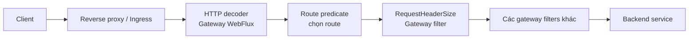
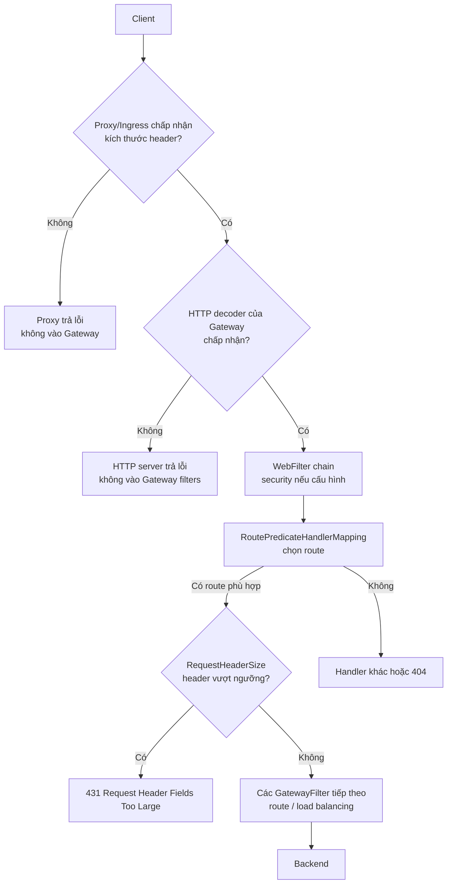

# Giới hạn kích thước header bằng RequestHeaderSize khi được hỗ trợ

Một API Gateway có thể nhận request chứa các header rất lớn: token xác thực JWT dài, cookie tích lũy qua nhiều phiên làm việc, chuỗi tracing, header do client tự tạo hoặc dữ liệu bất thường được gửi để thử khả năng chịu tải của hệ thống. Dù HTTP request body nhỏ, chỉ riêng phần header quá lớn cũng có thể khiến proxy, HTTP decoder hoặc dịch vụ phía sau gặp lỗi, tiêu tốn tài nguyên và khó chẩn đoán.

Trong **Spring Cloud Gateway**, khi phiên bản/biến thể đang sử dụng hỗ trợ, **`RequestHeaderSize` GatewayFilter Factory** cho phép giới hạn kích thước **từng request header, tính cả tên và giá trị**. Khi có header vượt mức cho phép, gateway có thể từ chối request bằng **HTTP 431 Request Header Fields Too Large** trước khi chuyển tiếp tới backend. Chức năng này giúp đưa quy tắc về header vào cấu hình route và phát hiện sớm một số request bất thường.

Bài thuộc chương **Header yêu cầu** của module **SPRING_CLOUD_GATEWAY**. Bên cạnh route predicate, filter chain, biến đổi path/header và khám phá dịch vụ, cấu hình này liên hệ với xác thực, rate limiting, circuit breaker, retry, TLS và observability. Cần hiểu chính xác vị trí của `RequestHeaderSize` trong pipeline để bảo vệ API mà không gây lỗi cho các request hợp lệ.

> **Phạm vi:** Các ví dụ chính dùng **Spring Cloud Gateway Server WebFlux**. Tên filter, cú pháp cấu hình và namespace phải được kiểm tra theo **phiên bản Spring Cloud Gateway** và starter đang chạy. Trong tài liệu hiện hành cho Server WebFlux, factory `RequestHeaderSize` nhận các tham số `maxSize`, `errorHeaderName` và trả `431` khi một header vượt ngưỡng. Với Server MVC hoặc phiên bản khác, cần đối chiếu tài liệu riêng. Cụm “khi được hỗ trợ” là một yêu cầu triển khai thực tế: **đừng giả định filter hiện diện chỉ vì ứng dụng dùng Spring Boot hoặc Spring WebFlux**.

## 1. Vì sao phải giới hạn kích thước HTTP request header?

HTTP request gồm một request line hoặc thông tin tương đương của giao thức, tập header và body tùy chọn. Header truyền metadata như:

```http
GET /api/orders/42 HTTP/1.1
Host: api.example.test
Authorization: Bearer eyJhbGciOi...
Cookie: session=abc123; preferences=...
X-Correlation-Id: 1f7c2e30
Accept: application/json
```

Trong hệ thống microservices, một request như vậy có thể đi qua nhiều chặng:



Mỗi chặng có thể có **giới hạn header riêng**. Nếu một request quá lớn bị proxy hoặc HTTP server từ chối ngay từ lúc phân tích cú pháp HTTP, `RequestHeaderSize` ở Gateway **không có cơ hội chạy**. Nếu request đi qua được các tầng trước và khớp route có filter, quy tắc của Gateway mới được áp dụng.

Lợi ích thực tế của giới hạn header:

- **Bảo vệ tài nguyên:** giảm nguy cơ một header quá dài tiêu thụ bộ nhớ hoặc chi phí xử lý không cần thiết ở các tầng downstream.
- **Quản lý giao thức API:** quy định kích thước metadata mà từng API chấp nhận, ví dụ API đối tác có giới hạn khác API nội bộ.
- **Phát hiện lỗi client:** tránh gửi cookie tích lũy hoặc token quá dài sang backend rồi mới thất bại.
- **Thống nhất tín hiệu lỗi:** với request được xử lý bởi filter, trả mã `431` phù hợp với tình huống header quá lớn.

Giới hạn này chỉ là **một lớp kiểm soát**. Nó không tự chứng minh token hợp lệ, không giới hạn body, không thay thế rate limiting và không chặn mọi hình thức lạm dụng HTTP.

## 2. `RequestHeaderSize` là gì?

Trong Spring Cloud Gateway Server WebFlux, `RequestHeaderSize` là một **GatewayFilter Factory** được gắn với route hoặc áp dụng dưới dạng default filter cho các gateway routes.

Theo tài liệu Spring Cloud Gateway, factory có hai tham số:

| Tham số | Ý nghĩa | Ví dụ |
| --- | --- | --- |
| **`maxSize`** | Kích thước tối đa cho phép đối với **mỗi request header, bao gồm tên và giá trị**. | `1000B`, `1KB` |
| **`errorHeaderName`** | Tên **response header** chứa thông báo lỗi khi request bị từ chối; mặc định là `errorMessage`. | `X-Gateway-Header-Error` |

Ví dụ ngắn nhất từ tài liệu:

```yaml
filters:
  - RequestHeaderSize=1000B
```

Ý nghĩa: nếu **bất kỳ request header nào** lớn hơn ngưỡng `1000B` theo cách framework tính kích thước, Gateway phản hồi **HTTP 431** thay vì tiếp tục xử lý backend qua route đó.

**Điều quan trọng nhất:** Giới hạn ở ví dụ này áp dụng cho **từng header**. Không nên hiểu nó là “tổng kích thước của toàn bộ tập header phải nhỏ hơn 1000B”. Việc giới hạn **tổng số byte tất cả header** hoặc **tổng số lượng header** phụ thuộc khả năng HTTP server/proxy hoặc các cơ chế chuyên biệt khác.

### 2.1. Kích thước của tên và giá trị đều có ý nghĩa

Hai header sau có cùng ý tưởng nhưng kích thước không hoàn toàn giống nhau:

```http
X-A: abcdef
X-Very-Long-Custom-Header-Name: abcdef
```

Vì tên header dài hơn, giới hạn tính cả **key** và **value** có thể khiến header thứ hai vượt ngưỡng trước dù hai giá trị bằng nhau.

Tương tự, `Authorization`, `Cookie` hoặc `X-Custom-Claims` thường có giá trị dài hơn tên. Không nên coi phần tên là “miễn phí” khi chọn ngưỡng.

**Không tự suy ra công thức đếm byte tuyệt đối từ cách hiển thị trong trình soạn thảo.** Mã hóa ký tự, nhiều giá trị cho cùng tên header và cách proxy chuẩn hóa header có thể làm số byte framework xử lý khác với số ký tự người dùng nhìn thấy. Khi chọn ngưỡng sát ranh giới, hãy kiểm thử trên đúng HTTP stack đang triển khai.

### 2.2. `431` có nghĩa là gì?

**HTTP 431 Request Header Fields Too Large** biểu thị server không muốn xử lý request vì kích thước một hoặc nhiều HTTP request header field quá lớn.

Một phản hồi minh họa:

```http
HTTP/1.1 431 Request Header Fields Too Large
errorMessage: <thông báo do Gateway tạo>
Content-Length: 0
```

Phần tên header `errorMessage` là mặc định được tài liệu mô tả. **Chuỗi thông báo lỗi, body và những response headers còn lại** có thể khác theo phiên bản/framework và cách cấu hình, nên không nên viết client phụ thuộc vào nguyên văn thông báo. Ví dụ trên chỉ mô tả **status** và vị trí thông báo, không cam kết response wire format cố định.

Không nhầm `431` với những mã lỗi khác:

| Status | Ý nghĩa thông thường | Khi nào gặp trong Gateway |
| --- | --- | --- |
| **`431`** | Request header field quá lớn | `RequestHeaderSize` hoặc tầng HTTP server/proxy chặn header. |
| **`413`** | Nội dung request quá lớn | Request body vượt ngưỡng của `RequestSize` hoặc HTTP server/proxy. |
| **`429`** | Quá nhiều request | `RequestRateLimiter` hoặc cơ chế quota/tốc độ. |
| **`401`** | Chưa xác thực hợp lệ | Hệ thống security yêu cầu thông tin xác thực. |
| **`403`** | Không được phép truy cập | Chính sách phân quyền từ chối. |
| **`400`** | Request không hợp lệ | Có thể do HTTP parser/proxy từ chối cú pháp hoặc header trước khi Gateway filter chạy. |

Lưu ý: mã HTTP thực tế của **proxy hay HTTP decoder** khi từ chối request không nhất thiết trùng với `431` mà filter định nghĩa. Phải xác định **lớp nào** phát sinh phản hồi.

## 3. Cấu hình RequestHeaderSize theo phiên bản

### 3.1. Dạng cấu hình Server WebFlux mới

Ví dụ sau dùng namespace trong tài liệu Spring Cloud Gateway Server WebFlux hiện hành:

```yaml
spring:
  cloud:
    gateway:
      server:
        webflux:
          routes:
            - id: orders-api
              uri: lb://order-service
              predicates:
                - Path=/api/orders/**
              filters:
                - RequestHeaderSize=1000B
                - StripPrefix=1
```

Diễn giải:

1. `Path=/api/orders/**` là **route predicate**; request phải khớp route này trước.
2. `RequestHeaderSize=1000B` kiểm tra kích thước header trong **gateway filter chain** của route đã chọn.
3. Request đạt điều kiện sẽ tiếp tục qua `StripPrefix=1` để bỏ segment `api` khỏi path.
4. URI `lb://order-service` được giải quyết bằng tích hợp **Spring Cloud LoadBalancer** và nguồn instance phù hợp trước khi proxy đến backend.
5. Request bị từ chối ở filter sẽ không đi tới bước gọi backend trong luồng bình thường của route.

Ví dụ dùng `1000B` cho mục đích **quan sát filter khi thực hành**. Không nên sao chép ngưỡng nhỏ này vào production khi API có JWT, cookie hoặc tracing metadata dài mà chưa kiểm tra kích thước thực tế. Các endpoint xác thực hiện đại có thể phát sinh header hợp lệ lớn hơn 1KB.

**Điều kiện để route thực sự chạy:** ứng dụng phải dùng đúng starter Gateway Server WebFlux, cấu hình route được nạp, có backend mà URI định nghĩa trỏ đến và có Spring Cloud LoadBalancer/discovery thích hợp nếu dùng `lb://`. Giới hạn header bản thân nó có thể kiểm thử bằng URI HTTP cố định để tách khỏi lỗi discovery.

### 3.2. Namespace thường gặp ở các phiên bản Server WebFlux 4.x

Trong Spring Cloud Gateway 4.2, ví dụ tài liệu chính thức dùng:

```yaml
spring:
  cloud:
    gateway:
      routes:
        - id: orders-api
          uri: http://localhost:9090
          predicates:
            - Path=/api/orders/**
          filters:
            - RequestHeaderSize=1000B
            - StripPrefix=1
```

Ở đây `localhost:9090` là backend ví dụ để người học dễ chạy thử. **Không khai báo đồng thời cả `spring.cloud.gateway.routes` và `spring.cloud.gateway.server.webflux.routes`** để “chắc chắn”: chọn namespace đúng theo version dependency đang sử dụng.

### 3.3. Dạng tên và tham số rõ ràng

Khi muốn hiển thị cả tên header phản hồi, có thể khai báo một filter bằng dạng đầy đủ:

```yaml
filters:
  - name: RequestHeaderSize
    args:
      maxSize: 1000B
      errorHeaderName: X-Gateway-Header-Error
```

Trong môi trường có filter tương ứng, cấu hình thể hiện hai ý định:

- `maxSize` là ngưỡng cho phép;
- `errorHeaderName` đổi tên response header chứa mô tả lỗi từ mặc định `errorMessage` sang `X-Gateway-Header-Error`.

**Không nên trả lại nguyên giá trị header nhạy cảm** trong thông báo lỗi tùy biến hay log, đặc biệt với `Authorization` và `Cookie`. Nếu có yêu cầu phản hồi nhất quán giữa các tầng, chuẩn hóa trên **status 431** và một mã lỗi ứng dụng có kiểm soát, thay vì phụ thuộc vào nội dung header lỗi do một phiên bản framework tạo ra.

### 3.4. Áp dụng trên nhiều route

Nếu nhiều route cần cùng chính sách, Server WebFlux hỗ trợ cấu hình **default filters** theo namespace của phiên bản. Ví dụ cho dòng cấu hình mới:

```yaml
spring:
  cloud:
    gateway:
      server:
        webflux:
          default-filters:
            - RequestHeaderSize=8KB
          routes:
            - id: orders-api
              uri: http://localhost:9090
              predicates:
                - Path=/api/orders/**
            - id: catalog-api
              uri: http://localhost:9091
              predicates:
                - Path=/api/catalog/**
```

`default-filters` giúp những **gateway routes được chọn** sử dụng filter chung, nhưng **không đồng nghĩa giới hạn áp dụng cho tất cả HTTP request vào process**. Một request bị HTTP decoder từ chối, Spring Security `WebFilter` từ chối trước khi mapping, hoặc một handler khác xử lý có thể **không đi qua Gateway filter chain**.

Trước khi áp dụng mặc định rộng khắp, cần đánh giá mức phù hợp của tất cả API: login/OAuth2, cookie, tracing, API đối tác và các endpoint upload có header đặc biệt. Nếu một số API cần ngưỡng khác, hãy thiết kế route/policy phù hợp và kiểm tra **thứ tự filter**; tránh xếp hai filter ngưỡng khác nhau rồi kỳ vọng filter sau “nới” được giới hạn đã áp dụng ở filter trước.

## 4. “Khi được hỗ trợ” nghĩa là phải xác minh những gì?

Cấu hình có tên filter không bảo đảm mọi dự án Spring đều hiểu nó. Cần kiểm tra những khác biệt:

| Câu hỏi kiểm tra | Vì sao quan trọng? |
| --- | --- |
| Ứng dụng đang dùng **Gateway Server WebFlux** hay **Server MVC**? | Hai stack có tập API/filter và namespace cấu hình riêng; không sao chép cấu hình giữa chúng một cách mù quáng. |
| Phiên bản Spring Cloud Gateway nào? | Factory và cơ chế binding cấu hình cần khớp tài liệu đúng phiên bản. |
| Starter và dependency có được khai báo đúng không? | Chỉ có Spring Boot WebFlux không tự tạo tất cả GatewayFilterFactory. |
| Đúng tiền tố `routes` / `default-filters` chưa? | Sai namespace có thể dẫn tới route không được nạp như dự kiến. |
| Có thấy filter ở danh sách route **runtime** không? | File YAML đúng cú pháp chưa chứng minh route/filter đã được Spring dựng thành công. |
| Backend và gateway HTTP server có giới hạn thấp hơn không? | Request có thể bị từ chối trước khi `RequestHeaderSize` xử lý. |

Một số triệu chứng khi thiếu hỗ trợ hoặc cấu hình không khớp:

- Khi khởi động, framework báo không tìm thấy `GatewayFilterFactory` tên `RequestHeaderSize`, hoặc lỗi binding tham số.
- Cấu hình không được nạp vào `RouteLocator`, khiến request không khớp route.
- Request có header vượt ngưỡng nhưng vẫn được backend nhận, vì filter chưa được gắn đúng route hoặc có route khác được chọn.
- Gateway trả `400`/`431` sớm từ proxy/server, không có header lỗi của `RequestHeaderSize`, vì request chưa vào filter chain.

**Cách xử lý:** xác định đúng dependency/version, tham chiếu tài liệu tương ứng, dùng namespace đúng, kiểm tra route runtime và thử một request có header vượt ngưỡng trong **môi trường kiểm thử**. Nếu phiên bản/stack không hỗ trợ factory hoặc yêu cầu là chặn request **trước khi parse HTTP**, hãy sử dụng giới hạn của reverse proxy và HTTP server; có thể bổ sung một cơ chế WebFlux/custom filter phù hợp nếu cần điều kiện ở cấp ứng dụng, nhưng phải cân nhắc hiệu năng và bảo mật.

## 5. RequestHeaderSize được thực thi ở giai đoạn nào?

Trong luồng xử lý Server WebFlux:



Sơ đồ trên là **một đường đi minh họa**. Một `WebFilter` như Spring Security có thể từ chối request trước khi route matching, và các `GatewayFilter` khác có thể được sắp xếp trước hoặc sau `RequestHeaderSize` theo cấu hình.

Hai hệ quả quan trọng:

**Thứ nhất: `RequestHeaderSize` kiểm tra sau khi request đã được parse đủ để vào WebFlux.** Nó không thể thay thế các hạn mức ở socket/decoder, vốn ngăn request quá lớn làm tiêu tốn tài nguyên trước khi tạo `ServerHttpRequest`.

**Thứ hai: phạm vi filter phụ thuộc route được chọn.** Nếu chỉ gắn filter ở route `orders-api`, request đi vào route `catalog-api` không tự được giới hạn bởi cùng cấu hình. Nếu một route tổng quát `Path=/api/**` có ưu tiên cao hơn che mất route orders, các filters gắn riêng với orders có thể không chạy.

### 5.1. Trật tự với các filter biến đổi header

Spring Cloud Gateway có thể có `AddRequestHeader`, `SetRequestHeader` và `RemoveRequestHeader`:

```yaml
filters:
  - RequestHeaderSize=1000B
  - RemoveRequestHeader=X-Client-Debug
```

Trong một filter chain, thời điểm của thao tác **kiểm tra** và thao tác **biến đổi** có thể ảnh hưởng đến kết quả. Nếu header quá dài đã bị chặn bởi filter trước, filter sau không có cơ hội xóa nó. Ngược lại, kiểm tra được đặt sau một bước loại bỏ header không đáng tin cậy có thể nhìn thấy bộ header đã được thay đổi, tùy thứ tự thực thi.

Đừng dùng `RemoveRequestHeader` để “hợp thức hóa” một header khổng lồ trước khi HTTP decoder nhận request; việc xóa chỉ diễn ra **sau parse**. Hạn mức an toàn ở edge/server vẫn cần thiết, và thứ tự cụ thể phải được xác nhận bằng integration test.

### 5.2. Trật tự với xác thực và rate limiting

Một JWT lớn có thể bị chặn trước khi Spring Security hoặc backend xác thực nếu filter giới hạn được áp dụng sớm trong Gateway. Trong triển khai khác, Spring Security `WebFilter` có thể phân tích token trước khi Gateway chọn route, hoặc từ chối request trước khi `RequestHeaderSize` chạy.

`RequestRateLimiter` giải quyết **tần suất** request, còn `RequestHeaderSize` giải quyết **kích thước** header. Cả hai có thể cùng xuất hiện trong API gateway nhưng có tiêu chí và status khác nhau. Khi kiểm thử, đừng dùng cùng một request vừa quá giới hạn header vừa vượt quota rồi kỳ vọng luôn nhận `431`; response nào xuất hiện còn phụ thuộc thứ tự thực thi và các tầng upstream.

## 6. Phân biệt giới hạn Gateway filter với giới hạn HTTP server

Một backend bảo vệ đúng cách nên đặt giới hạn từ các tầng bên ngoài vào trong:

| Lớp | Ví dụ cơ chế | Thời điểm áp dụng | Mục đích |
| --- | --- | --- | --- |
| **Ingress / reverse proxy / WAF** | Giới hạn kích thước header của Nginx, Envoy, load balancer hoặc WAF | Trước khi request vào Gateway | Chặn request bất thường sớm, bảo vệ kết nối và tài nguyên gateway. |
| **HTTP server của Gateway** | Cấu hình request header limit của Reactor Netty/embedded server | Trong giai đoạn decode HTTP | Ngăn parser nhận request vượt khả năng chấp nhận. |
| **Spring Cloud Gateway filter** | `RequestHeaderSize` trên route/default filters | Sau khi có request WebFlux và route phù hợp | Quy định ngưỡng ở cấp API/route và trả `431` theo filter khi được thực thi. |
| **Backend service** | Giới hạn parser, kiểm tra header nghiệp vụ | Sau khi request được proxy | Bảo vệ dịch vụ nếu bị gọi trực tiếp hoặc lưu lượng bypass gateway. |

Ví dụ, **Spring Boot 3.x** có thuộc tính:

```yaml
server:
  max-http-request-header-size: 8KB
```

Đây là **cấu hình HTTP server**, không phải alias của `RequestHeaderSize` GatewayFilter. Spring Boot ghi rõ cách áp dụng giới hạn phụ thuộc embedded server: các implementation có thể tính **từng header** hoặc **tổng request line và headers** khác nhau. Trong Spring Cloud Gateway reactive dùng Reactor Netty, phải kiểm tra hành vi decoder của đúng phiên bản.

Nếu muốn Gateway filter kiểm tra ở ngưỡng `1000B`, cần bảo đảm **proxy và HTTP server cho phép request thí nghiệm đó đi đến filter**. Ngược lại, khi mục tiêu là giảm nguy cơ bị tấn công bằng header cực lớn, đặt hạn mức đủ sớm ở proxy và HTTP decoder; chỉ dựa vào GatewayFilter là chưa đầy đủ.

### 6.1. Không nhầm giới hạn từng header với tổng kích thước header

Giả sử cấu hình filter là `RequestHeaderSize=1000B`:

| Request mẫu | Kỳ vọng theo ý nghĩa tài liệu factory | Cần kiểm tra thêm |
| --- | --- | --- |
| Một header riêng lẻ dài hơn 1000B | Có thể bị Gateway filter chặn bằng `431`. | Proxy/decoder có thể từ chối trước. |
| Mười header, mỗi header 300B | **Không suy ra filter sẽ chặn chỉ vì tổng khoảng 3000B.** | Giới hạn tổng/đếm header ở HTTP server hoặc proxy. |
| Request có body 3MB, header nhỏ | Không phải bài toán của `RequestHeaderSize`. | `RequestSize`/upload/body limits. |
| Request gửi 1000 lần/giây, mỗi header nhỏ | Không bị chặn theo số request bởi filter này. | `RequestRateLimiter`/WAF/quotas. |
| Một JWT hợp lệ dài khoảng 1500B | Có thể bị chặn nếu cấu hình ngưỡng 1000B. | Tăng ngưỡng theo contract, không mặc định token quá dài là độc hại. |

Với hệ thống thực, chính sách an toàn thường gồm **ngưỡng kích thước header**, **số lượng header**, **giới hạn tổng**, **giới hạn body**, **request rate** và **timeout** ở các lớp phù hợp.

## 7. Lựa chọn ngưỡng phù hợp

Không có một mức `maxSize` tối ưu cho mọi API. Những yếu tố thường khiến header hợp lệ lớn:

- **`Authorization`:** JWT có nhiều claims, khóa/cấu trúc ký số, token từ identity provider.
- **`Cookie`:** cookie phiên, phân tích dữ liệu, A/B testing và các tính năng web.
- **Truy vết phân tán:** `traceparent`, `baggage` hoặc một số header truyền ngữ cảnh nội bộ.
- **Thông tin tổ chức/API:** custom metadata cho API đối tác hoặc hệ thống legacy.
- **Proxy:** một số proxy có thể thêm `Forwarded`, `X-Forwarded-*` hoặc biến đổi nhiều header trước khi request tới gateway.

Quy trình chọn ngưỡng:

1. **Đo kích thước ở môi trường đại diện** bằng dữ liệu đã làm sạch, bao gồm percentile như p95/p99 nếu thích hợp; không lưu nguyên token/cookie nhạy cảm.
2. **Xác định request hợp lệ lớn nhất** theo contract, đặc biệt ở login/OAuth2, API đối tác và clients cũ.
3. **Chọn ngưỡng có khoảng dự phòng hợp lý** cho thay đổi token/cookie và hạ tầng; không lấy đúng p99 làm ngưỡng nếu 1% request hợp lệ còn lại sẽ bị chặn.
4. **Đặt giới hạn proxy/decoder tương thích** để request hợp lệ có thể đến đúng route và filter, đồng thời ngăn request cực lớn trước khi giải mã.
5. **Thử hành vi khi vượt ngưỡng**: status nào thực tế xuất hiện, lớp nào trả response, backend có được gọi không.
6. **Theo dõi và điều chỉnh** dựa trên số lượng `431`, tỷ lệ request bị từ chối, loại client và thay đổi kích thước token.

**Tránh lựa chọn 1000B cho production chỉ vì đó là ví dụ tài liệu.** Một vài JWT hợp lệ có thể dài hơn 1000B, khiến API đột ngột trả `431` sau khi triển khai.

### 7.1. Ngưỡng là một phần của hợp đồng API

Nếu API dành cho mobile/web, hãy công bố hoặc truyền đạt ràng buộc về kích thước headers cho các nhóm client liên quan. Khi giảm ngưỡng, cần tính đến các phiên bản ứng dụng cũ chưa nâng cấp. Một thay đổi header limit không làm thay đổi JSON schema, nhưng vẫn có thể là **breaking change**.

Với API đối tác, nên kiểm thử token thực tế của partner trước khi bật chặn. Nếu một client vô tình gửi cookie không liên quan đến API, giải pháp tốt hơn có thể là **sửa client để giảm metadata gửi đi**, bên cạnh đặt hạn mức phía server.

## 8. Thực hành kiểm thử RequestHeaderSize

### 8.1. Chuẩn bị gateway và backend giả

Giả sử đã chạy một backend HTTP nội bộ tại `http://localhost:9090` và gateway tại `http://localhost:8080` với route:

```yaml
spring:
  cloud:
    gateway:
      server:
        webflux:
          routes:
            - id: demo-header-limit
              uri: http://localhost:9090
              predicates:
                - Path=/api/demo/**
              filters:
                - RequestHeaderSize=1000B
                - StripPrefix=1
```

Vì `StripPrefix=1`, request `GET /api/demo/ping` đi đến backend dưới path `/demo/ping` nếu được chấp nhận. Nếu backend giả trả `200` và ghi nhận request, có thể phân biệt hai kết quả:

- **Request bình thường:** backend nhận request, Gateway trả kết quả upstream.
- **Request có header vượt 1000B:** nếu không bị chặn sớm ở tầng khác, Gateway trả `431` và backend **không nhận** request.

### 8.2. Request dưới ngưỡng

```bash
curl -i "http://localhost:8080/api/demo/ping" \
  -H "X-Demo: small-value"
```

Kỳ vọng: nếu backend hoạt động và không có policy khác chặn, request không bị `RequestHeaderSize` từ chối.

### 8.3. Request trên ngưỡng bằng PowerShell

Lệnh sau dùng **`curl.exe`** (không phải alias PowerShell `curl`) và tạo header giá trị dài 1200 ký tự:

```powershell
$largeHeader = "X-Demo: " + ("a" * 1200)
curl.exe -i "http://localhost:8080/api/demo/ping" -H $largeHeader
```

Kỳ vọng khi request đến được filter:

```http
HTTP/1.1 431 Request Header Fields Too Large
```

Header `X-Demo` dài rõ rệt hơn ngưỡng `1000B` kể cả chưa tính tên. Nếu nhận `400`, `431` nhưng không có response header lỗi từ factory, hoặc không thấy route ID trong log Gateway, cần điều tra xem **HTTP server/proxy đã chặn request trước filter** hay chưa.

Đừng test bằng header `Authorization` giả cực dài trong môi trường có Spring Security nếu mục tiêu là cô lập filter: security có thể trả `401` sớm, khiến phép thử không chứng minh chính sách kích thước header.

### 8.4. Kiểm tra header lỗi tùy biến

Thay cấu hình:

```yaml
filters:
  - name: RequestHeaderSize
    args:
      maxSize: 1000B
      errorHeaderName: X-Gateway-Header-Error
```

Lặp lại request có `X-Demo` dài và kiểm tra **status 431** cùng sự xuất hiện của header `X-Gateway-Header-Error`. Không assert nguyên văn giá trị thông báo nếu API/framework không cam kết định dạng ổn định.

### 8.5. Ma trận kiểm thử cần có

| Case | Đầu vào | Kỳ vọng kiểm thử | Điều cần xác nhận |
| --- | --- | --- | --- |
| A | Header nhỏ, route khớp | Request đi tiếp đến backend | Backend nhận đúng path/header. |
| B | Một header vượt ngưỡng rõ rệt | `431` nếu filter được thực thi | Backend không bị gọi. |
| C | Nhiều header nhỏ, tổng lớn | Không mặc định filter từng header từ chối | Proxy/decoder có giới hạn tổng hoặc số lượng không? |
| D | `Authorization` hợp lệ nhưng rất dài | Có thể bị chặn nếu vượt ngưỡng | Chính sách có chấp nhận token hợp lệ không? |
| E | Header lớn đến route không gắn filter | Có thể không bị filter này chặn | Route nào thực sự được chọn? |
| F | Header quá lớn so với HTTP decoder | Từ chối trước Gateway filter | Status thực tế và log của tầng decoder. |
| G | POST body lớn, header nhỏ | `RequestHeaderSize` không giải quyết body | Kiểm tra `RequestSize`/body limits. |
| H | Header không hợp lệ về cú pháp | Có thể bị parser từ chối | Không nhầm với chính sách kích thước. |
| I | Response có lỗi auth/rate limit | Có thể xuất hiện `401`/`403`/`429` tùy pipeline | Thứ tự WebFilter/GatewayFilter. |

## 9. Integration test có kiểm chứng backend không bị gọi

Trong kiểm thử tích hợp, nên chạy gateway với một downstream stub ghi nhận số lần được gọi. Chỉ kiểm tra status `431` là chưa đủ nếu test đi qua proxy hoặc server có thể trả cùng status trước GatewayFilter.

Một ví dụ phần **assert phản hồi** với `WebTestClient` trong môi trường đã khởi động gateway và backend giả:

```java
String oversizedValue = "a".repeat(1200);

webTestClient.get()
    .uri("/api/demo/ping")
    .header("X-Demo", oversizedValue)
    .exchange()
    .expectStatus()
    .isEqualTo(431);
```

Sau đó kiểm tra qua backend stub:

```java
// Pseudocode: API phụ thuộc công cụ stub/mocking đang sử dụng.
assertThat(backendCallCountFor("/demo/ping")).isZero();
```

Đây là **mẫu test minh họa**, không phải một test class hoàn chỉnh: cần cấu hình `WebTestClient`, stub backend, port và route thật. Để xác định filter chính là thành phần từ chối, kiểm tra thêm header lỗi tùy biến và so sánh với request dưới ngưỡng.

Một bộ kiểm thử tốt còn phải xác nhận rằng:

- Route đúng được nạp và khớp request;
- Header trong phép thử được truyền đúng như dự kiến qua HTTP client và mọi proxy;
- Request dưới ngưỡng đi qua;
- Request trên ngưỡng bị chặn;
- Backend không nhận request bị chặn;
- Không có log chứa giá trị token/cookie lớn hoặc nhạy cảm.

Nếu test dùng `@WebFluxTest` chỉ dựng controller, nó có thể **không nạp toàn bộ Gateway filter chain**. Với mục tiêu kiểm tra hành vi end-to-end, cấu hình integration test đầy đủ với Gateway và một backend giả sẽ đáng tin cậy hơn.

## 10. Các sai lầm thường gặp

### Sai lầm 1 — Coi RequestHeaderSize là giới hạn tổng HTTP request

`RequestHeaderSize` dùng để kiểm tra **request header**, không giới hạn request body hay tổng request. Với body JSON lớn, cần dùng giới hạn body/request thích hợp.

### Sai lầm 2 — Tin rằng mọi request đều phải đi qua GatewayFilter

Route không khớp, handler khác xử lý, security WebFilter từ chối hoặc HTTP decoder chặn từ sớm đều có thể khiến `RequestHeaderSize` không chạy. Đừng cho rằng “đã bật default-filter” là tất cả HTTP lưu lượng đều được bao phủ.

### Sai lầm 3 — Dùng ngưỡng quá thấp làm hỏng xác thực

Một bearer token có thể vượt 1000B hoàn toàn hợp lệ. Nếu filter chặn `Authorization` trước khi downstream xác thực, client sẽ nhận `431` thay vì phản hồi auth mong đợi. Giải pháp là đo token thực tế, chọn ngưỡng hợp đồng hợp lý và kiểm thử với identity provider đang dùng.

### Sai lầm 4 — Nhầm `errorHeaderName` là tên request header cần giới hạn

`errorHeaderName` **không phải** tên header đầu vào cần kiểm tra, cũng không phải danh sách header được miễn. Nó chỉ xác định **tên response header chứa thông báo lỗi**. `RequestHeaderSize` kiểm tra các request headers theo chính sách kích thước, không chọn riêng `X-Custom` chỉ vì đặt error header có tên đó.

### Sai lầm 5 — Chờ filter chặn trước HTTP parser

GatewayFilter chỉ chạy sau khi HTTP server đã chấp nhận và giải mã request. Muốn bảo vệ tài nguyên ở bước tiếp nhận ban đầu, hãy cấu hình HTTP decoder và reverse proxy.

### Sai lầm 6 — Cấu hình sai namespace hoặc không có factory

Dùng `spring.cloud.gateway.routes` trên stack cần `spring.cloud.gateway.server.webflux.routes` (hoặc ngược lại) có thể khiến route không được nạp. Nếu startup báo không tìm thấy factory, kiểm tra version, starter và biến thể WebFlux/MVC. Không tự đặt một filter class có tên giống framework rồi coi đó là tính năng tương đương nếu chưa kiểm chứng.

### Sai lầm 7 — Nhầm thứ tự filter làm mất hiệu lực bảo vệ

Nếu một filter khác biến đổi header trước khi kiểm tra, `RequestHeaderSize` có thể nhìn thấy phiên bản đã chỉnh sửa. Nếu một filter trước đó kết thúc response, filter này có thể không chạy. Hãy xác định phạm vi chính sách theo **header nguyên gốc ở biên** hay **header sau biến đổi**, và thực hiện kiểm chứng đúng pipeline.

### Sai lầm 8 — Log nguyên JWT/Cookie khi báo lỗi 431

Để điều tra, thường chỉ cần route ID, tên header (khi được phép), kích thước đã chuẩn hóa, ngưỡng, status và correlation ID. Không lưu toàn bộ giá trị `Authorization`, `Cookie` hay dữ liệu cá nhân trong log/metrics. Tránh trả thông tin nhạy cảm trong error header hoặc error body.

## 11. Quan sát và vận hành

Trong sản xuất, cần biết **bao nhiêu request bị từ chối, vì sao, và ở tầng nào**.

| Chỉ số/quan sát | Giá trị vận hành |
| --- | --- |
| Số phản hồi `431` theo endpoint/route ID | Phát hiện các client vượt kích thước header và thay đổi sau deployment. |
| Số `400`/`431` tại proxy/HTTP decoder | Phân biệt lỗi tiếp nhận request với lỗi Gateway filter. |
| Phân bố kích thước header đã làm sạch | Chọn ngưỡng dựa trên thực tế, tránh làm hỏng JWT/cookie hợp lệ. |
| Tỷ lệ `401`/`403`/`429` | Phát hiện tương tác với security hoặc rate limiting. |
| Backend traffic khi có `431` | Kiểm chứng request bị từ chối không đi xuống service. |
| Route/factory runtime sau refresh | Kiểm tra thay đổi giới hạn có thực sự áp dụng hay chưa. |

**Đừng gán mặc định tất cả `431` cho `RequestHeaderSize`.** Tầng proxy, load balancer hoặc HTTP server có thể phản hồi `431` trước Gateway. Tracing ứng dụng cũng có thể **không ghi nhận request bị chặn sớm**, vì chưa tạo exchange/filter span.

Khi tăng mức nghiêm ngặt, nên phát hành theo quy trình:

1. Đo baseline từ những request hợp lệ, gồm client web/mobile/đối tác.
2. Đặt giới hạn proxy và embedded server thống nhất với phạm vi cần chặn.
3. Bật filter trên một hoặc vài route thử nghiệm khi tính năng có sẵn.
4. So sánh status `431` và số request đi backend.
5. Giám sát lỗi của JWT/cookie và request sau lần phát hành mới.
6. Mở rộng đến các route phù hợp; chuẩn bị cách rollback cấu hình và cập nhật đồng bộ gateway replicas.

Với nhiều replica Gateway, mỗi instance cần cùng phiên bản và cấu hình giới hạn. Nếu hai replica có ngưỡng khác nhau, một client có thể gặp lỗi `431` không ổn định tùy replica nào xử lý request.

## 12. Câu hỏi tự ôn tập

**Tình huống A.** Cấu hình `RequestHeaderSize=1000B`, client gửi ba header khoảng 500B mỗi header. Có chắc Gateway filter trả `431` vì tổng vượt 1000B không?

**Trả lời:** Không. Factory được mô tả là kiểm tra **kích thước từng request header**. Một giới hạn khác ở proxy/HTTP decoder có thể xử lý tổng kích thước nếu được cấu hình, nhưng không nên gán hành vi đó cho `RequestHeaderSize`.

**Tình huống B.** Request POST có body JSON 5MB, mọi header rất nhỏ. Có thể dùng `RequestHeaderSize=1KB` để chặn payload này không?

**Trả lời:** Không. Cần cấu hình giới hạn request body như `RequestSize` hoặc kiểm soát ở HTTP server/proxy tùy yêu cầu.

**Tình huống C.** Header `Authorization` chứa JWT dài 1400B, Gateway filter giới hạn 1000B. Token hợp lệ có được xử lý không?

**Trả lời:** Nếu request tới được route/filter và header vượt ngưỡng theo cách tính thực tế, Gateway sẽ trả `431` trước khi tiếp tục luồng downstream. Cần điều chỉnh hợp đồng kích thước sao cho không chặn token hợp lệ.

**Tình huống D.** Đã cấu hình filter nhưng request quá lớn bị proxy trả `400`, không xuất hiện trong Gateway logs. Có phải factory hỏng?

**Trả lời:** Chưa thể kết luận. Proxy có thể từ chối request trước Gateway; cần xem access log và cấu hình giới hạn của từng hop.

**Tình huống E.** Thêm `errorHeaderName: X-Limit` nhưng thấy một header khác vẫn vượt ngưỡng. Cấu hình có chỉ kiểm tra `X-Limit` không?

**Trả lời:** Không. `errorHeaderName` là **tên header phản hồi chứa thông báo lỗi**, không phải tên header cần kiểm tra.

**Tình huống F.** Một route `Path=/api/**` được ưu tiên hơn route orders có `RequestHeaderSize`. Request lớn đến `/api/orders/42` có bị filter orders chặn không?

**Trả lời:** Không chắc. Nếu route tổng quát thắng và không có filter tương ứng, filter gắn riêng với orders sẽ không chạy. Cần xem route matching, `order` và nơi áp dụng policy.

**Tình huống G.** Ứng dụng chạy Spring Cloud Gateway Server MVC, nhưng copy YAML `spring.cloud.gateway.server.webflux.routes`. Có đảm bảo filter được áp dụng không?

**Trả lời:** Không. Server MVC có cấu hình và mô hình filter riêng. Phải tra tài liệu đúng biến thể và xác minh runtime.

## 13. Ghi nhớ

1. **`RequestHeaderSize`** là filter giới hạn kích thước **từng request header, gồm tên và giá trị**, khi factory được phiên bản/stack Gateway hỗ trợ.
2. **`maxSize`** đặt ngưỡng, ví dụ `1000B`; **`errorHeaderName`** đặt tên response header thông báo lỗi, mặc định `errorMessage`.
3. Khi header vượt giới hạn và request thực sự đi qua filter, Gateway trả **HTTP 431**; response có thể được tạo sớm hơn bởi proxy hoặc HTTP decoder.
4. **Không nhầm với** `RequestSize` (body), `RequestRateLimiter` (tần suất) và giới hạn HTTP server/proxy (bảo vệ trước khi route filter chạy).
5. **Chọn ngưỡng dựa trên JWT, cookie, tracing và khách hàng thật**; kiểm thử header quá ngưỡng, header hợp lệ, route khác và backend không bị gọi.
6. **Xác minh namespace, starter và phiên bản**. Khi factory không được hỗ trợ, dùng cơ chế giới hạn ở HTTP server/edge và giải pháp ứng dụng được kiểm chứng thay vì giả định một filter không tồn tại vẫn hoạt động.

**Nguyên tắc vận hành:** Bảo vệ header nên bắt đầu từ proxy và HTTP decoder, sau đó bổ sung chính sách Gateway ở những route cần thiết. `RequestHeaderSize` giúp đặt ranh giới ở cấp API, nhưng chỉ có hiệu quả khi request đã được chấp nhận để vào đúng filter chain; cần giám sát `431` theo từng lớp và giữ các request hợp lệ đi qua.

### Tài liệu tham khảo

- [Spring Cloud Gateway Server WebFlux — RequestHeaderSize GatewayFilter Factory](https://docs.spring.io/spring-cloud-gateway/reference/spring-cloud-gateway-server-webflux/gatewayfilter-factories/requestheadersize-factory.html): `maxSize`, `errorHeaderName`, ví dụ `1000B` và phản hồi `431`.
- [Spring Cloud Gateway 4.2 — RequestHeaderSize GatewayFilter Factory](https://docs.spring.io/spring-cloud-gateway/reference/4.2/spring-cloud-gateway/gatewayfilter-factories/requestheadersize-factory.html): cấu hình ở namespace `spring.cloud.gateway.routes`.
- [Spring Cloud Gateway Server MVC — RequestHeaderSize Filter](https://docs.spring.io/spring-cloud-gateway/reference/spring-cloud-gateway-server-webmvc/filters/requestheadersize.html): tham khảo riêng khi sử dụng Server MVC.
- [Spring Boot 3.5 — Common Application Properties](https://docs.spring.io/spring-boot/3.5/appendix/application-properties/): thuộc tính `server.max-http-request-header-size` và sự khác biệt theo embedded server.
