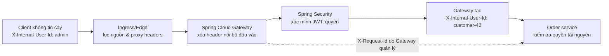
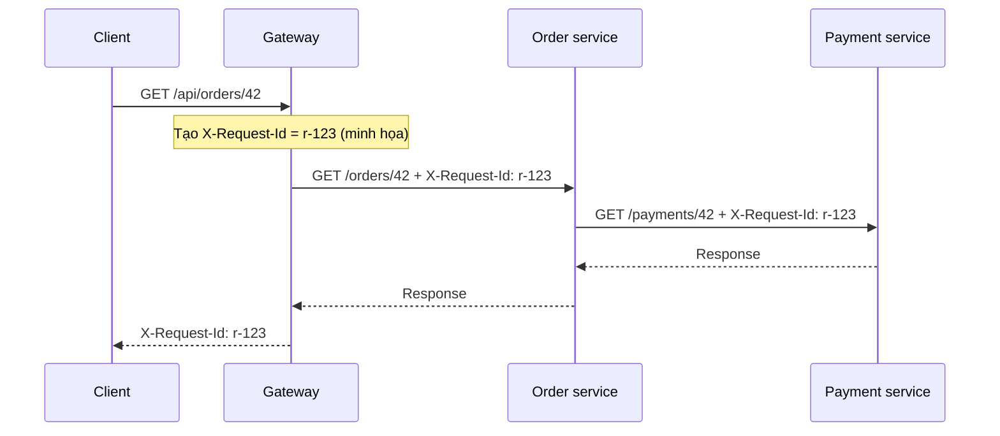

# Giữ định danh yêu cầu và ngăn client giả mạo header nội bộ trong Spring Cloud Gateway

Trong hệ thống microservices, một request có thể đi qua **API Gateway → order-service → payment-service** rồi mới trả phản hồi cho client. Khi có lỗi, đội vận hành cần biết những log ở các service khác nhau có thuộc **cùng một request** hay không. Đồng thời, backend thường nhận thêm header về người dùng hoặc tenant do Gateway cung cấp. Nếu Gateway chuyển tiếp nguyên các header đó từ Internet, kẻ tấn công có thể tự gửi `X-Internal-User-Id: admin` để **giả mạo danh tính**.

Bài học thuộc chương **Header yêu cầu** của module **SPRING_CLOUD_GATEWAY**. Ta sẽ thiết kế một đường biên tin cậy (*trust boundary*): **giữ một mã request nhất quán để truy vết, nhưng xóa các header nội bộ do client tự khai báo; chỉ tái tạo danh tính nội bộ từ thông tin đã xác thực**. Đây là nền tảng cho xác thực, phân quyền, giới hạn lưu lượng, circuit breaker, retry, TLS và quan sát request khi Spring Cloud Gateway làm cổng vào microservices.

> **Phạm vi phiên bản:** Các ví dụ Gateway dùng **Spring Cloud Gateway Server WebFlux 5.0.x**, với cấu hình `spring.cloud.gateway.server.webflux.routes` trên Spring Cloud 2025.1 / Spring Boot 4. Dòng cũ có thể dùng tiền tố `spring.cloud.gateway.routes`; Server Web MVC sử dụng filter API khác. Hãy kiểm tra BOM/starter tương ứng với release thực tế trước khi triển khai.

## 1. Mục tiêu học tập

Sau bài này, bạn có thể:

1. Phân biệt **request/correlation ID**, **trace ID**, **user ID** và **tenant ID**.
2. Đặt quy tắc xử lý header ở ranh giới client → Gateway → backend.
3. Dùng `GlobalFilter` của Gateway Server WebFlux để sinh `X-Request-Id` mới, loại bỏ header định danh nội bộ do client khai báo và trả request ID về client.
4. Hiểu vì sao `RemoveRequestHeader` hoặc `SetRequestHeader` ở YAML hữu ích nhưng chưa đủ để chứng thực một user.
5. Tái tạo `X-Internal-User-Id` từ JWT đã được Spring Security xác minh, không từ cookie, query hay một header tự khai.
6. Kiểm tra hành vi bằng backend echo, `curl` và log; xử lý các vấn đề về route matching, forwarded headers, retry và request đi vòng Gateway.

## 2. Một request có những loại định danh nào?

Giả sử client gửi:

```http
GET /api/orders/42 HTTP/1.1
Host: api.example.test
X-Request-Id: mobile-123
X-Internal-User-Id: admin
X-Internal-Tenant-Id: privileged
Authorization: Bearer <access-token>
```

Các dòng này **không có cùng độ tin cậy**:

| Thông tin | Mục đích | Client có thể tự đặt? | Backend nên tin ngay? |
|---|---|---|---|
| `X-Request-Id` | Gắn log/sự kiện của một logical request | Có | Không coi đây là bằng chứng danh tính; Gateway nên sinh hoặc kiểm soát đầu vào |
| `traceparent` | Ngữ cảnh distributed tracing theo W3C | Có thể | Không dùng làm chứng thực danh tính |
| `X-Internal-User-Id` | User ID đã xác minh mà các dịch vụ nội bộ có thể nhận | Có thể gửi giả | **Không**; phải xóa đầu vào từ Internet rồi tạo lại từ nguồn tin cậy |
| `X-Internal-Tenant-Id` | Tenant/organization đã xác minh | Có thể gửi giả | **Không**; phải kiểm tra quyền tenant trước khi tạo |
| `Authorization: Bearer ...` | Credential để xác thực | Có | Chỉ đáng tin sau khi **xác minh** token, issuer, thời hạn, audience và policy tương ứng |
| `Forwarded` / `X-Forwarded-*` | Metadata về proxy, host, scheme, IP | Có thể gửi giả | Chỉ tin khi đến từ chuỗi reverse proxy/ingress đã cấu hình tin cậy |

**Request ID không phải user ID.** Một giá trị như `82b2...` rất hữu ích khi tìm request trong log, nhưng bất kỳ ai biết giá trị đó cũng không có quyền truy cập tài nguyên.

**Trace ID cũng không phải request ID theo nghĩa tuyệt đối.** Một trace phân tán có thể chứa nhiều span, nhiều request HTTP liên tiếp và cả hoạt động bất đồng bộ. `X-Request-Id` có thể là ID ứng dụng dùng ở một ranh giới Gateway cụ thể; `traceparent` là tiêu chuẩn riêng cho trace context. Hai hệ thống có thể được liên kết trong logs/tracing, nhưng không nên giả định chúng luôn bằng nhau.

## 3. Threat model: client giả mạo header nội bộ

Giả sử order-service tin vào header `X-Internal-User-Id` và dùng nó để lấy đơn hàng:

```text
GET /orders/42
X-Internal-User-Id: customer-42
```

Nếu Gateway **chuyển tiếp nguyên header do client gửi**, kẻ tấn công có thể thử:

```bash
curl -i http://localhost:8080/api/orders/42 \
  -H "X-Internal-User-Id: admin"
```

Rủi ro xuất hiện khi order-service coi `admin` là danh tính đã được Gateway chứng thực. Đây là lỗi **trust boundary**, không được khắc phục chỉ bằng việc đặt tên header là `X-Internal-*`.

Một kiến trúc hợp lý:



Lưu ý về **thứ tự thực tế**: Spring Security WebFlux thường hoạt động ở lớp `WebFilter`, còn `GlobalFilter` được chạy khi Gateway đã match một route. Sơ đồ là **các trách nhiệm cần có**, không phải biểu đồ thứ tự callback của mọi framework filter. Hệ thống phải đảm bảo không có thành phần trước bước sanitize nào dùng header tự khai để đưa ra quyết định bảo mật.

### 3.1. Ba quy tắc ranh giới

1. **Không tin các header nội bộ đến từ Internet.** Xóa `X-Internal-User-Id`, `X-Internal-Tenant-Id` và mọi header nhận dạng/quyền mà backend xem là tin cậy.
2. **Chỉ thêm lại thông tin đã được xác thực và phân quyền.** Ví dụ lấy `sub` từ JWT hợp lệ; tenant ID phải thuộc tập tenant mà người dùng có quyền truy cập.
3. **Bảo vệ đường từ Gateway đến backend.** Dùng mạng riêng, kiểm soát truy cập mạng, mTLS hoặc xác thực service-to-service khi cần. Nếu client gọi thẳng backend rồi tự gắn `X-Internal-User-Id`, việc sanitize tại Gateway sẽ bị bỏ qua.

Không coi việc “đã đi qua Gateway” là thay thế cho kiểm tra quyền sở hữu đơn hàng ở backend. Với dữ liệu nhạy cảm, backend vẫn cần áp dụng chính sách phân quyền thích hợp.

## 4. Chiến lược tạo và giữ `X-Request-Id`

Có hai hướng thiết kế thường dùng:

| Hướng | Cách làm | Khi phù hợp |
|---|---|---|
| **Gateway tạo ID mới ở ranh giới ngoài** | Bỏ qua hoặc thay `X-Request-Id` do client gửi, tạo UUID mới và chuyển tiếp | Cổng public, không có proxy đầu vào đáng tin cậy |
| **Nhận ID từ ingress tin cậy** | Ingress xóa ID client, tạo ID mới; Gateway chấp nhận ID chỉ từ kênh ingress đã khóa chặt | Hạ tầng có reverse proxy/ingress kiểm soát đường đi và chính sách |

Trong bài thực hành, chọn **Gateway tạo UUID mới**. Khi client gửi `X-Request-Id: forged-id`, backend vẫn nhìn thấy một UUID do Gateway tạo. Cách này rõ ràng, tránh log injection từ đầu vào không được chuẩn hóa, tránh giá trị quá dài và tránh dùng ID client làm bằng chứng truy cập.

Một request đi qua ba thành phần nên giữ cùng ID:



**Quan trọng:** Gateway có thể thêm header cho **lời gọi Gateway → order-service**, nhưng order-service phải chủ động chuyển tiếp ID khi nó gọi `payment-service`. HTTP client của mọi framework không tự động truyền một header tùy biến sang mọi request outbound. Nếu đã dùng Micrometer Tracing/OpenTelemetry, ưu tiên cơ chế truyền `traceparent`/span theo chuẩn và chỉ bổ sung request ID khi có yêu cầu ứng dụng rõ ràng.

### 4.1. Những thuộc tính nên có của request ID

- Được tạo bởi thành phần đáng tin và đủ khó trùng, chẳng hạn `UUID.randomUUID()`.
- Chỉ chứa ký tự an toàn để lưu log hoặc đưa vào HTTP header.
- Không chứa email, số điện thoại, access token hoặc dữ liệu định danh cá nhân.
- Được đưa vào log bằng một trường có cấu trúc, chẳng hạn `requestId`; đừng ghi toàn bộ `Authorization`, `Cookie`.
- Có quy tắc vòng đời: mỗi request client mới có thể nhận ID mới; các thao tác downstream giữ ID để truy vết; retry có thể giữ cùng logical ID nhưng cần thêm thông tin `attempt`/span để phân biệt các lần gọi backend.

Nếu chấp nhận ID bên ngoài từ một **proxy đã xác thực và cô lập**, cần giới hạn chiều dài/định dạng (chẳng hạn allowlist ký tự và kích thước tối đa), tránh nhận giá trị chứa CR/LF hoặc chuỗi dài bất thường. Sự hợp lệ về cú pháp không làm ID trở thành chứng thực danh tính.

## 5. Các cách thao tác header trong Spring Cloud Gateway

Server WebFlux có những filter thường gặp:

| Filter | Hành vi | Tình huống |
|---|---|---|
| `RemoveRequestHeader` | Xóa header theo **tên chính xác** trước khi proxy | Loại bỏ `X-Internal-User-Id` giả mạo |
| `SetRequestHeader` | Thay tất cả giá trị header cùng tên bằng giá trị cấu hình | Đặt header tĩnh theo route |
| `AddRequestHeader` | Thêm một giá trị cho header; có thể dẫn tới nhiều giá trị | Gắn thông tin demo không nhạy cảm |
| `GlobalFilter` tùy biến | Thao tác trên request của các route đã match, có thể sinh giá trị động | Sinh UUID, sanitize tập header, tái tạo identity từ nguồn đã xác thực |
| `GatewayFilter` theo route | Chỉ áp dụng khi route tương ứng được chọn | Chính sách riêng của một backend |

**Không dùng** `AddRequestHeader=X-Internal-User-Id, ...` để bảo đảm xóa giá trị do client giả mạo: `AddRequestHeader` có thể **thêm** giá trị mới mà không loại bỏ giá trị cũ. Backend đọc giá trị đầu tiên hay cuối cùng có thể khác nhau. Dùng `remove` + `set` hoặc `SetRequestHeader` khi đã có nguồn thông tin tin cậy.

### 5.1. Chỉ xóa bằng YAML khi không cần tái tạo identity

Ví dụ route độc lập chỉ muốn **loại bỏ** hai header nội bộ:

```yaml
server:
  port: 8080

spring:
  cloud:
    gateway:
      server:
        webflux:
          routes:
            - id: orders-sanitized
              uri: http://localhost:9001
              predicates:
                - Path=/api/orders/**
              filters:
                - StripPrefix=1
                - RemoveRequestHeader=X-Internal-User-Id
                - RemoveRequestHeader=X-Internal-Tenant-Id
```

Với request `GET /api/orders/42`, backend nhận path `/orders/42` và **không nhận** hai header bị loại bỏ. Tuy nhiên cấu hình này **không sinh `X-Request-Id` động** và **không biết người dùng là ai**.

`RemoveRequestHeader` nhận tên một header; nó **không phải wildcard** để xóa mọi header bắt đầu bằng `X-Internal-`. Nếu hệ thống có nhiều header nhạy cảm, hãy duy trì danh sách trung tâm hoặc viết sanitizing filter rõ ràng.

> **Không ghép nguyên đoạn YAML này với ví dụ `GlobalFilter` tái tạo `X-Internal-User-Id` ở mục 9.** Nếu một route filter xóa header sau khi global filter vừa tạo lại, backend có thể mất danh tính hợp lệ. Khi kết hợp, thiết kế và kiểm tra thứ tự filter cụ thể.

## 6. Ví dụ chính: `GlobalFilter` sinh request ID và xóa header giả

Ta tạo một Gateway có endpoint công khai `GET /api/orders/42` để dễ quan sát. Filter này thực hiện ba việc:

1. Sinh một `X-Request-Id` mới cho request đã match route.
2. Loại bỏ các header mà client **không được tự định nghĩa** (user ID, tenant ID, role...).
3. Đưa ID vào request gửi backend và response gửi client.

### 6.1. Dependency và cấu hình route

Tạo ứng dụng Spring Boot tương thích với Spring Cloud 2025.1.x và thêm **Spring Cloud Gateway Server WebFlux**. Phần dependency Maven cốt lõi:

```xml
<dependency>
    <groupId>org.springframework.cloud</groupId>
    <artifactId>spring-cloud-starter-gateway-server-webflux</artifactId>
</dependency>
```

BOM tương thích với Spring Boot là bắt buộc trong dự án Maven thủ công; snippet trên không phải toàn bộ `pom.xml`. Với WebFlux, không thêm `spring-boot-starter-webmvc` một cách vô ý.

`src/main/resources/application.yml`:

```yaml
server:
  port: 8080

spring:
  application:
    name: request-header-gateway
  cloud:
    gateway:
      server:
        webflux:
          routes:
            - id: orders-route
              uri: http://localhost:9001
              predicates:
                - Path=/api/orders/**
                - Method=GET
              filters:
                - StripPrefix=1
```

**Đây là cấu hình dành cho demo sanitize header**, chưa bật Resource Server; mục 9 sẽ chỉ cách nâng cấp thành route được xác thực bằng JWT.

### 6.2. Viết filter `RequestBoundaryFilter`

Đặt class trong package được `@SpringBootApplication` quét:

```java
import java.util.UUID;

import org.slf4j.Logger;
import org.slf4j.LoggerFactory;
import org.springframework.cloud.gateway.filter.GatewayFilterChain;
import org.springframework.cloud.gateway.filter.GlobalFilter;
import org.springframework.core.Ordered;
import org.springframework.http.server.reactive.ServerHttpRequest;
import org.springframework.stereotype.Component;
import org.springframework.web.server.ServerWebExchange;
import reactor.core.publisher.Mono;

@Component
public final class RequestBoundaryFilter implements GlobalFilter, Ordered {
    private static final Logger log =
            LoggerFactory.getLogger(RequestBoundaryFilter.class);

    public static final String REQUEST_ID = "X-Request-Id";
    public static final String INTERNAL_USER = "X-Internal-User-Id";
    public static final String INTERNAL_TENANT = "X-Internal-Tenant-Id";

    @Override
    public int getOrder() {
        return -100;
    }

    @Override
    public Mono<Void> filter(
            ServerWebExchange exchange,
            GatewayFilterChain chain) {

        // Không dựa vào X-Request-Id do client tự gửi.
        String requestId = UUID.randomUUID().toString();

        ServerHttpRequest request = exchange.getRequest().mutate()
                .headers(headers -> {
                    // Xóa TẤT CẢ giá trị của từng header cùng tên.
                    headers.remove(REQUEST_ID);
                    headers.remove(INTERNAL_USER);
                    headers.remove(INTERNAL_TENANT);
                    headers.remove("X-Internal-Role");
                    headers.remove("X-Authenticated-User");

                    // Tạo một giá trị correlation ID duy nhất.
                    headers.set(REQUEST_ID, requestId);
                })
                .build();

        ServerWebExchange sanitized =
                exchange.mutate().request(request).build();

        // Đặt header phản hồi trước khi response commit.
        sanitized.getResponse().beforeCommit(() -> {
            sanitized.getResponse().getHeaders()
                    .set(REQUEST_ID, requestId);
            return Mono.empty();
        });

        return chain.filter(sanitized)
                .doFinally(signal -> log.info(
                        "requestId={} method={} path={} signal={}",
                        requestId,
                        exchange.getRequest().getMethod(),
                        exchange.getRequest().getPath().value(),
                        signal));
    }
}
```

**Vì sao code dùng `headers.remove()` rồi `headers.set()`?**

- `remove` bảo đảm không còn các giá trị cùng tên mà client đã khai báo.
- `set` đặt đúng **một** giá trị mới ở tên đó.
- `HttpHeaders` xử lý tên header theo ngữ nghĩa HTTP không phân biệt chữ hoa/thường, nên biến thể `x-internal-user-id` cũng được xử lý theo tên tương ứng.
- `beforeCommit` giúp chốt request ID trên response trước khi header được gửi về client.
- `doFinally` ghi trạng thái kết thúc reactive (thành công, lỗi hoặc hủy); không ghi raw token/cookie.

**Giới hạn thứ tự:** `GlobalFilter` được gọi cho request đã match Gateway route. Nó **không sanitize header trước route predicate**; nếu một route dùng `Header=X-Internal-User-Id, admin` làm điều kiện bảo mật, kẻ tấn công vẫn có thể làm predicate khớp **trước khi filter chạy**. Cần loại bỏ ý tưởng đó và thực thi kiểm soát ở ingress/Spring Security hoặc tầng thích hợp hơn.

Ngoài ra, các `WebFilter`/phần mềm đứng trước Gateway vẫn có thể nhìn thấy header đầu vào. Đừng để chúng tin các trường `X-Internal-*` chưa được xác minh.

### 6.3. Một lớp Spring Boot khởi động tối thiểu

```java
import org.springframework.boot.SpringApplication;
import org.springframework.boot.autoconfigure.SpringBootApplication;

@SpringBootApplication
public class GatewayApplication {
    public static void main(String[] args) {
        SpringApplication.run(GatewayApplication.class, args);
    }
}
```

Khi chạy, Spring đăng ký `RequestBoundaryFilter` vì có `@Component` trong package được quét.

## 7. Dựng backend echo và kiểm tra spoofing

Tạo file `OrderHeaderEcho.java` trong một thư mục thực hành; dùng JDK 17+ và HTTP server tích hợp để không cần thêm backend framework:

```java
import com.sun.net.httpserver.HttpServer;
import java.net.InetSocketAddress;
import java.nio.charset.StandardCharsets;

public class OrderHeaderEcho {
    public static void main(String[] args) throws Exception {
        HttpServer server = HttpServer.create(
                new InetSocketAddress("127.0.0.1", 9001), 0);

        server.createContext("/", exchange -> {
            String response =
                    "path=" + exchange.getRequestURI().getRawPath() + "\n" +
                    "requestId=" + exchange.getRequestHeaders()
                            .getFirst("X-Request-Id") + "\n" +
                    "userId=" + exchange.getRequestHeaders()
                            .getFirst("X-Internal-User-Id") + "\n" +
                    "tenantId=" + exchange.getRequestHeaders()
                            .getFirst("X-Internal-Tenant-Id") + "\n";

            byte[] body = response.getBytes(StandardCharsets.UTF_8);
            exchange.getResponseHeaders().set(
                    "Content-Type", "text/plain; charset=utf-8");
            exchange.sendResponseHeaders(200, body.length);
            try (var out = exchange.getResponseBody()) {
                out.write(body);
            }
        });

        server.start();
        System.out.println("Order header echo listening on :9001");
    }
}
```

Mở terminal thứ nhất:

```bash
java --add-modules jdk.httpserver OrderHeaderEcho.java
```

Mở terminal thứ hai ở thư mục Gateway:

```bash
# Linux/macOS
./mvnw spring-boot:run

# Windows PowerShell
.\mvnw.cmd spring-boot:run
```

### 7.1. Không gửi header nội bộ

```bash
curl -i http://localhost:8080/api/orders/42
```

Phản hồi minh họa:

```http
HTTP/1.1 200 OK
X-Request-Id: 3b60d615-871f-4cd3-b887-22b599e7f34f
Content-Type: text/plain; charset=utf-8

path=/orders/42
requestId=3b60d615-871f-4cd3-b887-22b599e7f34f
userId=null
tenantId=null
```

UUID trong request và response **phải bằng nhau** đối với một lần gọi; lần gọi tiếp theo thường có UUID khác. Giá trị UUID trên chỉ là ví dụ, không được hardcode.

### 7.2. Cố tình gửi header giả mạo

```bash
curl -i "http://localhost:8080/api/orders/42" \
  -H "X-Request-Id: attacker-controlled" \
  -H "X-Internal-User-Id: admin" \
  -H "X-Internal-Tenant-Id: root-tenant"
```

Kết quả kỳ vọng:

```text
HTTP response: X-Request-Id = <UUID mới do Gateway tạo>
Backend body:
  path=/orders/42
  requestId=<cùng UUID do Gateway tạo>
  userId=null
  tenantId=null
```

Gateway đã thay `attacker-controlled` bằng UUID mới và chặn hai header nội bộ. Nếu gọi **trực tiếp** backend:

```bash
curl -i http://localhost:9001/orders/42 \
  -H "X-Internal-User-Id: admin"
```

backend echo sẽ nhìn thấy `userId=admin`, vì demo backend **không có bảo vệ mạng hoặc xác thực**. Điều này minh họa tại sao hệ thống thật phải chặn đường vòng Gateway bằng network policy, mTLS, service-to-service authentication hoặc xác thực trực tiếp ở backend.

> Trên Windows PowerShell 5.1, gọi `curl.exe` nếu `curl` là alias của `Invoke-WebRequest`; viết các lệnh có dấu `\` nối dòng thành một dòng khi dùng PowerShell.

### 7.3. Gọi lặp và so sánh ID

```bash
curl -i http://localhost:8080/api/orders/42
curl -i http://localhost:8080/api/orders/42
```

Hai response nên có hai `X-Request-Id` khác nhau. Nếu log của gateway có trường `requestId`, dùng nó để liên kết cùng ID trong response và backend.

**Chú ý:** Demo này chỉ minh họa **header hygiene** và request correlation. Route hiện đang công khai, không có user được xác thực, nên việc `userId=null` là đúng. Muốn backend nhận user ID tin cậy, phải thêm xác thực ở mục tiếp theo.

## 8. Tái sử dụng request ID trong các service

Gateway sinh ID một lần. Trong order-service, ứng dụng có thể đọc:

```java
String requestId = request.getHeader("X-Request-Id");
```

Đoạn trên minh họa trường hợp backend dùng Servlet API. Nếu backend là WebFlux, đọc tương đương từ `ServerWebExchange.getRequest().getHeaders()`. Khi order-service gọi payment-service bằng `WebClient`, có thể chuyển tiếp:

```java
webClient.get()
        .uri("http://payment-service/payments/42")
        .header("X-Request-Id", requestId)
        .retrieve()
        .bodyToMono(String.class);
```

Ví dụ chỉ cho thấy **cách gắn header đã có** vào một HTTP client call. Trong ứng dụng thực, nên có interceptor/filter chung hoặc tracing instrumentation để bảo đảm mọi lời gọi downstream được gắn đúng context. Phải kiểm tra trường hợp ID không tồn tại, trùng và bất đồng bộ; không tạo một ID mới ở từng service rồi mất khả năng liên kết log.

### 8.1. Giữ ID khi retry và circuit breaker

Với `Retry`, một request logic của client có thể tạo nhiều lần gọi backend:

```text
requestId = r-123 (request client)
  attempt=1 -> order-service -> timeout
  attempt=2 -> order-service -> 503
  attempt=3 -> order-service -> 200
```

Tất cả các attempt có thể giữ **cùng request ID** để liên kết với request client. Dùng thêm attempt counter hoặc span ID để phân biệt từng lần thử. Đừng đếm log `requestId=r-123` ba lần rồi kết luận có ba request client độc lập.

Với circuit breaker/fallback, ghi rõ route ID, trạng thái circuit, thời gian và kết quả cuối. Không log `Authorization`, `Cookie` hay access token để tìm request; request ID và trace ID đã đủ làm khóa tra cứu trong nhiều trường hợp.

### 8.2. Request ID và W3C Trace Context

Khi dùng Micrometer Tracing/OpenTelemetry, request có thể mang:

```http
traceparent: 00-4bf92f3577b34da6a3ce929d0e0e4736-00f067aa0ba902b7-01
```

Đây là cấu trúc W3C trace context, phục vụ liên kết span/traces, không phải xác thực user. Hệ thống tracing thường có cơ chế kiểm tra định dạng và tạo trace mới khi context không hợp lệ. `tracestate` và `baggage` có thể mang dữ liệu bổ sung; phải kiểm soát trường được phép truyền và không đặt PII/credential vào baggage.

Không được lấy `traceparent`, `X-Request-Id` hoặc `X-Forwarded-For` làm danh tính đáng tin để phân quyền và tính quota người dùng.

## 9. Tái tạo `X-Internal-User-Id` từ JWT đã xác minh

Sanitize header mới giải quyết **nửa đầu** bài toán. Nếu backend cần biết user đang đăng nhập, Gateway có thể xác thực JWT và cung cấp một header **do chính nó tạo**.

Với Spring Boot 4, dependency resource server được khuyến nghị:

```xml
<dependency>
    <groupId>org.springframework.boot</groupId>
    <artifactId>spring-boot-starter-security-oauth2-resource-server</artifactId>
</dependency>
```

Bạn cần cấu hình Authorization Server / issuer **thật**, ví dụ minh họa:

```yaml
spring:
  security:
    oauth2:
      resourceserver:
        jwt:
          issuer-uri: https://identity.example.test/issuer
```

Đoạn `issuer-uri` dùng tên miền giả để chỉ vị trí cấu hình; **không chạy được nếu chưa có nhà phát hành JWT thật**. Hệ thống production còn cần kiểm tra `aud` (audience), thuật toán, scope/quyền và các claim tùy hợp đồng bảo mật. Mặc định việc kiểm chữ ký, thời hạn và issuer là trách nhiệm của Resource Server được cấu hình đúng; không được chỉ decode payload JWT rồi coi đã xác thực.

### 9.1. Bảo vệ route với Spring Security WebFlux

Ví dụ bảo vệ mọi `/api/orders/**` bằng JWT:

```java
import org.springframework.context.annotation.Bean;
import org.springframework.context.annotation.Configuration;
import org.springframework.security.config.Customizer;
import org.springframework.security.config.web.server.ServerHttpSecurity;
import org.springframework.security.web.server.SecurityWebFilterChain;

@Configuration
public class GatewaySecurityConfiguration {
    @Bean
    SecurityWebFilterChain securityWebFilterChain(ServerHttpSecurity http) {
        return http
                .authorizeExchange(exchanges -> exchanges
                        .pathMatchers("/api/orders/**").authenticated()
                        .anyExchange().permitAll())
                .oauth2ResourceServer(oauth -> oauth.jwt(
                        Customizer.withDefaults()))
                .build();
    }
}
```

Khi đã bật cấu hình này, request đến route đơn hàng mà **không có JWT hợp lệ** sẽ bị từ chối ở tầng security (thường HTTP `401` cho trường hợp chưa xác thực), nên các lệnh `curl` công khai trong demo mục 7 không còn trả `200`. Đây là **bước nâng cấp riêng**, thực hiện sau khi đã xác nhận demo sanitize hoạt động.

Với ứng dụng dùng **cookie session + CSRF** hoặc browser login, chính sách bảo vệ có thể khác; đừng tắt CSRF không cân nhắc. `authenticated()` chỉ yêu cầu danh tính đã đăng nhập; quyền truy cập tài nguyên cụ thể phải tiếp tục được kiểm tra theo nghiệp vụ.

### 9.2. Filter thêm user ID sau khi xác thực

Sau khi đã có `RequestBoundaryFilter` ở mục 6 để xóa đầu vào giả, thêm filter sau. Nó **không đọc** `X-Internal-User-Id` từ client; thay vào đó đọc `JwtAuthenticationToken` do Spring Security tạo sau khi xác minh JWT.

```java
import org.springframework.cloud.gateway.filter.GatewayFilterChain;
import org.springframework.cloud.gateway.filter.GlobalFilter;
import org.springframework.core.Ordered;
import org.springframework.http.server.reactive.ServerHttpRequest;
import org.springframework.security.oauth2.server.resource.authentication.JwtAuthenticationToken;
import org.springframework.stereotype.Component;
import org.springframework.web.server.ServerWebExchange;
import reactor.core.publisher.Mono;

@Component
public final class VerifiedUserHeaderFilter
        implements GlobalFilter, Ordered {

    @Override
    public int getOrder() {
        // Chạy sau RequestBoundaryFilter (-100), trước bước proxy.
        return -90;
    }

    @Override
    public Mono<Void> filter(
            ServerWebExchange exchange,
            GatewayFilterChain chain) {

        return exchange.getPrincipal()
                .ofType(JwtAuthenticationToken.class)
                .flatMap(auth ->
                    Mono.justOrEmpty(auth.getToken().getSubject()))
                .defaultIfEmpty("")
                .flatMap(subject -> {
                    ServerHttpRequest request = exchange.getRequest()
                            .mutate()
                            .headers(headers -> {
                                // Luôn loại bỏ tất cả giá trị trước khi set.
                                headers.remove("X-Internal-User-Id");
                                if (!subject.isBlank()) {
                                    headers.set("X-Internal-User-Id", subject);
                                }
                            })
                            .build();

                    return chain.filter(
                            exchange.mutate().request(request).build());
                });
    }
}
```

Điểm cần hiểu:

- Filter chỉ có `subject` khi principal là `JwtAuthenticationToken` với `sub` tồn tại.
- Khi request không có JWT đã xác minh, `defaultIfEmpty("")` khiến filter **xóa** header và đi tiếp **không có user ID**; route cần bảo vệ vẫn do `SecurityWebFilterChain` từ chối.
- `flatMap` quanh `chain.filter(...)` bảo đảm chain được gọi **một lần** trên nhánh đã chọn. Tránh dùng `switchIfEmpty(chain.filter(...))` trực tiếp với `Mono<Void>`, vì `Mono<Void>` thành công hoàn tất rỗng và có thể khiến chain chạy thêm một lần.
- `sub` cần đại diện user ổn định theo hợp đồng issuer; với nhiều issuer, không mặc định `sub` một mình là duy nhất toàn hệ thống. Có thể cần định danh ghép issuer + subject hoặc một ID nội bộ được ánh xạ.
- Đừng copy `roles`, `tenant` hoặc quyền từ request header tùy ý vào header tin cậy. Với tenant, cần xác minh claim, tenant membership và quyền trên tài nguyên trước khi sinh `X-Internal-Tenant-Id`.

### 9.3. Chặn đường vòng và xác minh tại backend

Ngay cả khi Gateway tái tạo `X-Internal-User-Id` chuẩn, backend **không tự biết header đến từ Gateway**. Một client có thể gọi backend trực tiếp nếu backend public, hoặc một service nội bộ bị xâm nhập có thể giả mạo header.

Các lựa chọn tùy mức độ nhạy cảm:

- Chỉ cho phép backend nhận traffic từ Gateway/ingress đáng tin qua private networking hoặc network policy.
- Dùng mTLS hoặc xác thực service-to-service để backend biết phía gọi là thành phần tin cậy.
- Với dữ liệu nhạy cảm, backend có thể **tự xác minh JWT** hoặc một token nội bộ ngắn hạn có chữ ký, rồi kiểm tra phân quyền tài nguyên.
- Đồng bộ hợp đồng: ai phát `X-Internal-User-Id`, service nào được phép tin, lúc nào header phải bị loại bỏ và cách ghi audit.

**Header được Gateway set lại là dữ liệu do Gateway cung cấp, nhưng sự hiện diện của header đơn độc không phải bằng chứng mật mã.**

## 10. `Forwarded` và `X-Forwarded-*`: một ranh giới khác

Reverse proxy thường thêm các header:

```http
Forwarded: for=203.0.113.10;proto=https;host=api.example.test
X-Forwarded-For: 203.0.113.10
X-Forwarded-Proto: https
X-Forwarded-Host: api.example.test
```

Chúng được dùng khi Gateway đứng sau load balancer/ingress để suy ra client IP, scheme và host gốc. Nhưng **client trực tiếp cũng có thể tự gửi các header cùng tên**.

Vì vậy:

1. Ở **ingress** public, loại bỏ các forwarded headers do Internet khai báo; ingress tự ghi lại thông tin đáng tin của kết nối thật.
2. Cấu hình Gateway chỉ tin các proxy thuộc mạng/chứng thực kiểm soát; không coi mọi `X-Forwarded-For` là IP thật của client.
3. Trên Gateway Server WebFlux 5.0, cơ chế `Forwarded`/`XForwarded` có cấu hình `spring.cloud.gateway.server.webflux.trusted-proxies` theo regex xác định các proxy được tin. Các cờ append/enable ảnh hưởng cách header được tạo và ghép. Kiểm tra tài liệu và thử qua topology thật.
4. Nếu dùng client IP làm một phần rate limiting, phải chứng minh nguồn IP đã được chuẩn hóa qua ingress. Với hạn mức người dùng, ưu tiên user ID đã xác thực.

Đừng gộp mọi trường `X-Forwarded-*` vào danh sách xóa tùy tiện trong Gateway mà không hiểu reverse proxy đang làm gì; điều đó có thể làm hỏng URL redirect, TLS scheme và ghi log IP. Chính sách sanitize phải được triển khai nhất quán ở **ranh giới đầu tiên có thể xác thực nguồn proxy**.

## 11. Route matching và thứ tự filter: hai bẫy thường gặp

### 11.1. Một `GlobalFilter` không hoạt động trước route predicate

Spring Cloud Gateway tìm route dựa trên các predicate `Path`, `Host`, `Header`... **trước khi** chuỗi Gateway `GlobalFilter + GatewayFilter` chạy.

Ví dụ cấu hình sai về mặt bảo mật:

```yaml
predicates:
  - Path=/api/admin/**
  - Header=X-Internal-Role, admin
```

Một client có thể gửi `X-Internal-Role: admin` để làm predicate khớp. Xóa header trong `GlobalFilter` sau đó **không hủy** quyết định chọn route đã được thực hiện. Route predicate chỉ là logic định tuyến; dùng Spring Security và policy xác thực/phân quyền để bảo vệ admin endpoint.

### 11.2. Filter có thể xóa chính header tin cậy vừa được tạo

Giả sử một `GlobalFilter` sinh `X-Internal-User-Id` sau khi xác thực nhưng route lại có:

```yaml
filters:
  - RemoveRequestHeader=X-Internal-User-Id
```

Nếu bộ lọc route chạy sau, backend có thể không nhận ID. Khi thiết kế cần phân biệt:

- **Vệ sinh đầu vào** (*sanitize ingress headers*) ở một ranh giới trước khi bất kỳ thành phần nào tin chúng.
- **Tạo lại header tin cậy** sau xác thực và trước HTTP routing.
- **Không xóa/ghi đè lần nữa** ở route/default/global filter khác.

Các filter Gateway được hợp nhất và sắp xếp theo `Ordered`. Giá trị `routes[*].order` quyết định độ ưu tiên **chọn route**, **không** quyết định thứ tự filter. Với ví dụ `RequestBoundaryFilter=-100` và `VerifiedUserHeaderFilter=-90`, hai filter có thứ tự rõ ràng giữa chúng, nhưng vẫn cần kiểm tra cạnh các filter khác trong ứng dụng.

### 11.3. Request không match route

`GlobalFilter` của Gateway chạy trong xử lý route đã match; request không match route có thể không nhận `X-Request-Id` từ `RequestBoundaryFilter`. Nếu cần correlation ID cho **toàn bộ** request, kể cả lỗi 404 trước routing, cần đặt phần tạo ID ở **WebFilter/ingress phù hợp** (trước route matching) rồi truyền ID đã kiểm soát cho Gateway. Đừng giả định `GlobalFilter` là điểm can thiệp HTTP sớm nhất trong ứng dụng.

## 12. Quan sát và kiểm tra trên môi trường thực

### 12.1. Actuator Gateway

Khi đã bổ sung `spring-boot-starter-actuator`, ở Gateway 5.0.x có thể bật endpoint chỉ đọc:

```yaml
management:
  endpoint:
    gateway:
      access: read-only
  endpoints:
    web:
      exposure:
        include: health,info,gateway
```

Gọi:

```bash
curl -i http://localhost:8080/actuator/gateway/routes
curl -i http://localhost:8080/actuator/gateway/globalfilters
```

Endpoint `routes` giúp xác nhận `orders-route` đã nạp; `globalfilters` có thể hiển thị các global filter và order của chúng. Nó **không tự chứng minh** việc header đã được xóa/set đúng. Để xác minh dữ liệu, cần request `curl`, backend echo và log/tracing có cấu trúc.

Đừng mở endpoint quản trị ra Internet công khai nếu không có chính sách truy cập phù hợp; route URI và filter settings có thể tiết lộ thông tin nội bộ.

### 12.2. Một ma trận kiểm thử tối thiểu

| Tình huống | Backend nên nhận | Client nên nhận |
|---|---|---|
| Không gửi `X-Request-Id` | Một ID mới do Gateway sinh | Cùng ID trong response header |
| Gửi `X-Request-Id: forged` | Một ID mới, không phải `forged` | ID mới |
| Gửi `X-Internal-User-Id: admin` khi chưa xác thực (demo) | Không có user ID | Response không được coi là đăng nhập |
| Gửi nhiều giá trị `X-Internal-User-Id` | Không còn giá trị nào | Không có thông tin user giả trong response |
| Có JWT hợp lệ và route được bảo vệ | ID mới và user ID từ token đã xác minh | Response theo chính sách của API |
| JWT thiếu/hết hạn trên route bảo vệ | Không proxy đến backend | Thường HTTP `401` (tùy cơ chế security) |
| User đã xác thực nhưng thiếu quyền | Không được truy cập tài nguyên | Thường HTTP `403` khi policy từ chối |
| Gọi backend trực tiếp với header giả | Backend có thể nhận nếu chưa có network/auth boundary | Phải được ngăn tại production |
| Client gọi path không khớp route | `GlobalFilter` demo có thể không chạy | Có thể không có `X-Request-Id` nếu chưa triển khai ở WebFilter/ingress |

**Kiểm tra bổ sung:** Khi backend trả 503, Gateway timeout, retry hoặc client hủy kết nối, theo dõi xem `requestId` có được giữ nhất quán trong log và các attempt không. Với rate limiting, đảm bảo khóa tính quota là nguồn đã xác thực; request ID nên dùng để truy vết, không phải khóa quota do mỗi request đều khác.

## 13. Lỗi thường gặp và cách sửa

| Hiện tượng | Nguyên nhân | Cách xử lý |
|---|---|---|
| Backend vẫn nhận `X-Internal-User-Id: admin` do client gửi | Chưa sanitize hoặc có route đi vòng filter | Tạo ranh giới loại bỏ header và kiểm tra mọi tuyến |
| Client gửi `X-Request-Id: forged` và backend thấy nguyên chuỗi | Dùng `AddRequestHeader` thay vì ghi đè; hoặc chưa đăng ký filter | Xóa + set lại, kiểm tra global filter bean/order |
| Header `X-Internal-User-Id` có hai giá trị | Dùng `add` thay vì `set` sau khi xóa | Dùng `headers.remove` / `headers.set` |
| Login JWT thành công nhưng backend không thấy user ID | `VerifiedUserHeaderFilter` chưa được đăng ký hoặc route filter xóa sau đó | Kiểm tra principal, `Ordered` và route/default filters |
| Request không match route không có request ID | `GlobalFilter` chỉ chạy sau route matching | Đặt tạo request ID tại ingress/WebFilter nếu cần bao phủ 404 |
| Cấu hình `Header=X-Internal-Role, admin` khiến route admin khớp | Predicate kiểm tra đầu vào trước sanitize | Không dùng client header làm authorization; dùng Spring Security |
| User ID từ JWT sai tenant | Tin claim/tenant tự khai mà không kiểm tra membership | Kiểm tra claim và chính sách tài nguyên trước khi cấp identity |
| Gọi thẳng backend vượt qua Gateway | Backend có public endpoint/thiếu auth service-to-service | Giới hạn mạng, mTLS hoặc xác thực tại backend |
| Request ID không đi sang payment-service | Backend không tự truyền header tùy biến | Thêm propagation vào HTTP client/interceptor hoặc tracing |
| Log chứa `Authorization`, `Cookie` | Ghi toàn bộ request headers để debug | Redact secret; log request ID, route ID, status, latency |
| `X-Forwarded-For` bị client giả | Ingress/Gateway tin forwarded headers từ nguồn không tin cậy | Xây danh sách proxy tin cậy và chính sách overwrite/append |
| Retry làm metrics đếm trùng | Đếm mỗi backend attempt như một request khách hàng | Phân biệt logical request ID và attempt/span |

## 14. Câu hỏi tự kiểm tra

**Câu 1.** `X-Request-Id` và `X-Internal-User-Id` có cùng ý nghĩa không?

**Trả lời:** Không. `X-Request-Id` liên kết log của một request; `X-Internal-User-Id` biểu diễn danh tính user theo hợp đồng tin cậy giữa các service và phải được tạo sau xác thực.

**Câu 2.** Tại sao không dùng `AddRequestHeader=X-Internal-User-Id, real-user` để ghi đè giá trị giả?

**Trả lời:** `AddRequestHeader` có thể bổ sung thêm một giá trị, giữ giá trị giả cũ. Phải loại bỏ giá trị đầu vào và dùng `set`/`SetRequestHeader` từ nguồn đáng tin.

**Câu 3.** Nếu client gửi `X-Request-Id: attacker`, ví dụ `RequestBoundaryFilter` sẽ làm gì?

**Trả lời:** Xóa ID đầu vào và sinh UUID mới; backend và response nhận UUID mới giống nhau cho một request.

**Câu 4.** Có thể coi `Header=X-Internal-Role, admin` là bảo vệ route admin nếu `GlobalFilter` sau đó xóa header không?

**Trả lời:** Không. Route predicate được xét **trước** Gateway global filter; giá trị client tự gửi có thể làm route khớp. Cần xác thực/phân quyền trước khi cho truy cập.

**Câu 5.** Dùng `JwtAuthenticationToken` trong ví dụ để làm gì?

**Trả lời:** Lấy `sub` từ token JWT đã qua xác minh của Spring Security, rồi **tạo lại** header nội bộ. Không đọc user ID do client tự khai.

**Câu 6.** Vì sao backend vẫn cần chính sách bảo vệ khi Gateway đã sanitize header?

**Trả lời:** Vì request có thể đi vòng Gateway hoặc từ một service không được tin cậy. Backend phải được giới hạn truy cập hoặc xác minh nguồn gọi/danh tính/quyền độc lập theo yêu cầu bảo mật.

**Câu 7.** Nếu một request retry 3 lần, nên dùng ba request ID khác nhau không?

**Trả lời:** Thường giữ một ID cho **logical request**, và ghi thêm attempt/span ID để phân biệt các lần gọi downstream.

**Câu 8.** `X-Forwarded-For` có phải user ID hoặc IP client đã được kiểm chứng không?

**Trả lời:** Không. Nó là metadata proxy, có thể bị giả khi đến từ Internet; chỉ tin theo cấu hình proxy/ingress và không dùng làm danh tính người dùng.

**Bài tập mở rộng:** Từ demo ở mục 6, (1) gửi đồng thời header `X-Internal-Role: admin` và `X-Internal-User-Id: attacker`, quan sát backend không nhận các header giả; (2) thêm `VerifiedUserHeaderFilter` sau khi cấu hình JWT Resource Server thật; (3) xác minh route bảo vệ trả 401 khi thiếu token và truyền đúng `sub` khi token hợp lệ; (4) cấu hình backend chỉ cho phép traffic từ Gateway, thử gọi thẳng backend để đảm bảo bị chặn.

## 15. Tài liệu chính thức

- [Spring Cloud Gateway Server WebFlux 5.0 — How It Works](https://docs.spring.io/spring-cloud-gateway/reference/5.0/spring-cloud-gateway-server-webflux/how-it-works.html).
- [Spring Cloud Gateway Server WebFlux 5.0 — Global Filters và `Ordered`](https://docs.spring.io/spring-cloud-gateway/reference/5.0/spring-cloud-gateway-server-webflux/global-filters.html).
- [Spring Cloud Gateway Server WebFlux 5.0 — Developer Guide: custom GlobalFilter](https://docs.spring.io/spring-cloud-gateway/reference/5.0/spring-cloud-gateway-server-webflux/developer-guide.html).
- [Spring Cloud Gateway Server WebFlux 5.0 — `RemoveRequestHeader`](https://docs.spring.io/spring-cloud-gateway/reference/5.0/spring-cloud-gateway-server-webflux/gatewayfilter-factories/removerequestheader-factory.html).
- [Spring Cloud Gateway Server WebFlux 5.0 — `SetRequestHeader`](https://docs.spring.io/spring-cloud-gateway/reference/5.0/spring-cloud-gateway-server-webflux/gatewayfilter-factories/setrequestheader-factory.html).
- [Spring Cloud Gateway Server WebFlux 5.0 — `HttpHeadersFilters` và trusted proxies](https://docs.spring.io/spring-cloud-gateway/reference/5.0/spring-cloud-gateway-server-webflux/httpheadersfilters.html).
- [Spring Security 7.0 — Reactive OAuth2 Resource Server JWT](https://docs.spring.io/spring-security/reference/7.0/reactive/oauth2/resource-server/jwt.html).
- [Spring Boot 4.0 — Security OAuth2 Resource Server starter](https://docs.spring.io/spring-boot/4.0/reference/using/build-systems.html).
- [W3C Trace Context](https://www.w3.org/TR/trace-context/).

**Ghi nhớ:** Một Gateway đáng tin cậy phải làm rõ **ai tạo request ID, ai được phép tạo header danh tính, và backend dựa vào đâu để tin nguồn gửi**. Sinh hoặc kiểm soát `X-Request-Id` để theo dõi xuyên service; xóa mọi header nội bộ do client khai báo; chỉ tái tạo user/tenant từ thông tin đã xác thực; bảo vệ cả đường trực tiếp tới backend. Đó là cách giữ khả năng quan sát request mà không mở đường cho giả mạo danh tính.
