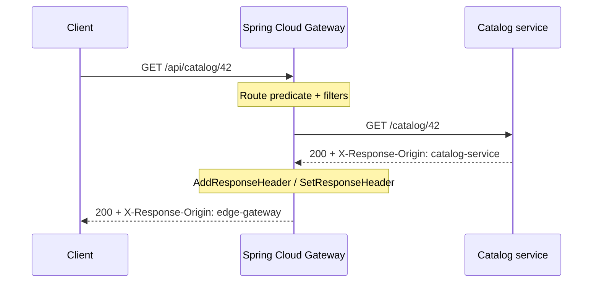
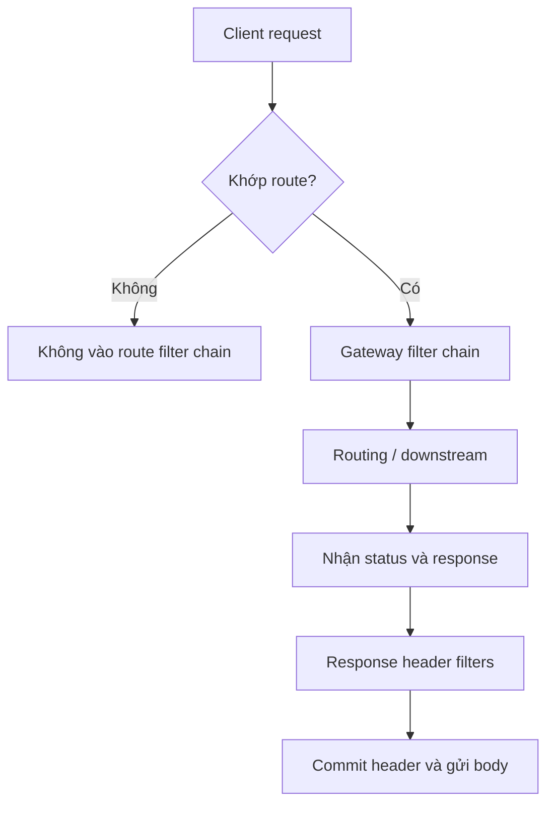

# AddResponseHeader và SetResponseHeader trong Spring Cloud Gateway

## 1. Vấn đề: nên bổ sung hay ghi đè response header?

Khi xây dựng **API Gateway với Spring Cloud Gateway**, request của client được định tuyến tới các microservice nhờ **route predicate**, đi qua **filter chain**, có thể được biến đổi path/header, xác thực, giới hạn lưu lượng hoặc xử lý bởi retry/circuit breaker. Sau khi dịch vụ phía sau (*downstream*) trả kết quả, Gateway cũng có thể điều chỉnh **HTTP response header** trước khi gửi cho client.

Giả sử dịch vụ `catalog` trả:

```http
HTTP/1.1 200 OK
Content-Type: application/json
X-Response-Origin: catalog-service
X-Edge-Hop: backend

{"id":"42"}
```

Gateway muốn làm hai việc: **thay** `X-Response-Origin` thành `edge-gateway` để không công bố tên service nội bộ, đồng thời **bổ sung** giá trị `gateway` vào `X-Edge-Hop` để biểu thị một chặng xử lý. Đây là khác biệt trọng tâm giữa **`SetResponseHeader`** và **`AddResponseHeader`**.

Sau bài học, bạn có thể phân biệt hai filter, viết cấu hình YAML/Java DSL, xác định phạm vi áp dụng, mở rộng biến từ route, kiểm thử response và nhận diện các trường hợp đặc biệt về CORS, bảo mật, cache, chuyển hướng, response commit và mã trạng thái.

> **Phiên bản:** ví dụ trọng tâm dùng **Spring Cloud Gateway Server WebFlux 4.3+/5.x** với namespace `spring.cloud.gateway.server.webflux.routes`. Ở Gateway Server WebFlux 4.2 trở về trước, prefix thường là `spring.cloud.gateway.routes`. Gateway Server Web MVC dùng `server.webmvc` và Java API khác; xem mục 8.

## 2. Phân biệt request header, response header và HTTP status



| Mục tiêu | Filter thường dùng | Phía nhận thay đổi |
|---|---|---|
Thêm header request | `AddRequestHeader` | **Backend** nhận header mới |
Thay header request | `SetRequestHeader` | **Backend** nhận header đã thay |
Thêm giá trị response header | **`AddResponseHeader`** | **Client** nhận giá trị bổ sung |
Thay mọi giá trị cùng tên trên response | **`SetResponseHeader`** | **Client** nhận giá trị mới |
Xóa response header | `RemoveResponseHeader` | Client không nhận tên header đã xóa, nếu không có bước khác thêm lại |
Thay HTTP status | `SetStatus` | Thay **mã trạng thái HTTP**, không phải header |

Ví dụ `SetResponseHeader=X-Status, 401` chỉ tạo header `X-Status` có nội dung `401`; **nó không trả HTTP 401**. Status của response vẫn phụ thuộc backend hoặc những thành phần khác trong Gateway.

## 3. `AddResponseHeader`: thêm giá trị

### 3.1. Cú pháp ngắn và dạng đầy đủ

```yaml
filters:
  - AddResponseHeader=X-Edge-Hop, gateway
```

Filter nhận **`name`** (tên header) và **`value`** (giá trị cần thêm). Trong cấu hình dạng đầy đủ:

```yaml
filters:
  - name: AddResponseHeader
    args:
      name: X-Edge-Hop
      value: gateway
```

Hai khối này là **cách viết thay thế**, không nên đặt cả hai vào một route nếu chỉ muốn thêm một lần.

Khi response chưa có `X-Edge-Hop`, Gateway tạo giá trị `gateway`. Nếu backend đã gửi `X-Edge-Hop: backend`, giá trị `gateway` được **thêm**, vì Add không có nghĩa là xóa giá trị cũ.

| Backend gửi | Filter | Kết quả logic ở client |
|---|---|---|
Không có `X-Edge-Hop` | `AddResponseHeader=X-Edge-Hop, gateway` | `X-Edge-Hop: gateway` |
`X-Edge-Hop: backend` | Cùng filter | Hai giá trị `backend` và `gateway` có thể cùng tồn tại |
`X-Response-Origin: catalog` | Cùng filter | `X-Response-Origin` không bị thay |

Header HTTP **không phân biệt chữ hoa/chữ thường ở tên**. Tuy nhiên một số client/proxy có thể hiện hai giá trị dưới hai dòng hoặc dạng gộp, và không phải header nào cũng được phép gộp bằng dấu phẩy. Đặc biệt, `Set-Cookie` cần xử lý theo quy tắc riêng.

### 3.2. Tùy chọn `override` ở các dòng mới

Tài liệu Gateway Server WebFlux **5.0.x** mô tả tham số thứ ba của `AddResponseHeader` là **`override`**, mặc định `true`:

```yaml
filters:
  - AddResponseHeader=X-Build-Label, gateway
  - AddResponseHeader=X-Existing-Label, default-value, false
```

Ở ví dụ thứ hai, khi response **đã có** `X-Existing-Label`, `override=false` giúp không thêm `default-value`; khi chưa có header, giá trị có thể được thêm vào. Ở chế độ mặc định, sự tồn tại của header không tự ngăn thao tác add.

**Lưu ý:** chữ `override` trong tham số này **không biến Add thành Set**. Muốn chắc chắn chỉ còn một giá trị, dùng `SetResponseHeader`. Không tự thêm tham số thứ ba khi dự án đang chạy một phiên bản Gateway cũ chưa có tùy chọn này.

## 4. `SetResponseHeader`: thay toàn bộ giá trị cùng tên

```yaml
filters:
  - SetResponseHeader=X-Response-Origin, edge-gateway
```

`SetResponseHeader` nhận `name` và `value`. Nếu backend đã trả `X-Response-Origin: catalog-service`, Gateway **thay tất cả giá trị** của header cùng tên bằng `edge-gateway`.

```yaml
filters:
  - name: SetResponseHeader
    args:
      name: X-Response-Origin
      value: edge-gateway
```

| Backend gửi | Sau `SetResponseHeader=X-Response-Origin, edge-gateway` |
|---|---|
Không có header này | Thêm `X-Response-Origin: edge-gateway` |
`X-Response-Origin: catalog-service` | Chỉ còn `X-Response-Origin: edge-gateway` |
Hai giá trị `catalog` và `legacy` của `X-Response-Origin` | Cả hai bị thay bằng `edge-gateway` |
`X-Service-Version: v1` | Giữ nguyên, vì tên header khác |

Khi yêu cầu là “client **không được nhận** tên dịch vụ nội bộ”, Set thường phù hợp hơn Add. Nhưng nếu backend dùng nhiều giá trị có ý nghĩa, Set có thể **làm mất dữ liệu**: ví dụ, ghi đè `Set-Cookie` có nguy cơ xóa cookie phiên hoặc các cookie nghiệp vụ của backend.

### 4.1. So sánh Add và Set

| Tiêu chí | `AddResponseHeader` | `SetResponseHeader` |
|---|---|---|
Ý định | Bổ sung giá trị | Thay tất cả giá trị của một tên |
Header chưa tồn tại | Thêm header mới | Thêm header mới |
Header đã tồn tại | Có thể tạo thêm giá trị | Thay giá trị cũ |
Header đa giá trị | Có thể bổ sung vào tập giá trị | Giảm còn một giá trị được đặt |
Tham số cơ bản | `name`, `value` | `name`, `value` |
Tham số tùy chọn theo phiên bản | `override` trên một số bản mới | Không có trong ví dụ chuẩn |
Mở rộng biến URI template | Có | Có |
Rủi ro thường gặp | Header trùng, hợp đồng HTTP không cho nhiều giá trị | Xóa giá trị quan trọng do backend tạo |

## 5. Ví dụ WebFlux: hai route và hai kiểu response header

Giả sử Gateway nghe ở cổng `8080`, `catalog-service` ở `8081` và `orders-service` ở `8082`:

```yaml
# application.yml — Gateway Server WebFlux 4.3+/5.x
server:
  port: 8080

spring:
  application:
    name: edge-gateway
  cloud:
    gateway:
      server:
        webflux:
          routes:
            - id: catalog-route
              uri: http://localhost:8081
              predicates:
                - Path=/api/catalog/**
              filters:
                - StripPrefix=1
                - AddResponseHeader=X-Edge-Hop, gateway
                - SetResponseHeader=X-Response-Origin, edge-gateway

            - id: orders-route
              uri: http://localhost:8082
              predicates:
                - Path=/api/orders/{orderId}
              filters:
                - StripPrefix=1
                - AddResponseHeader=X-Order-Reference, order-{orderId}
                - SetResponseHeader=X-Response-Origin, edge-gateway
```

**Luồng catalog:** client gọi `GET /api/catalog/42` → predicate khớp `catalog-route` → `StripPrefix=1` loại segment `api` → backend nhận `GET /catalog/42` → Gateway xử lý response headers.

**Luồng orders:** client gọi `GET /api/orders/17` → predicate lấy biến `orderId=17` → backend nhận `GET /orders/17` → client nhận thêm `X-Order-Reference: order-17`. Giá trị `{orderId}` là **URI template variable** lấy từ predicate, không phải placeholder `${orderId}` hay Java regex replacement.

Nếu backend catalog gửi:

```http
HTTP/1.1 200 OK
X-Response-Origin: catalog-service
X-Edge-Hop: backend
Content-Type: application/json

{"id":"42"}
```

Client đi qua Gateway có thể nhận tương đương:

```http
HTTP/1.1 200 OK
X-Response-Origin: edge-gateway
X-Edge-Hop: backend
X-Edge-Hop: gateway
Content-Type: application/json

{"id":"42"}
```

Hai dòng `X-Edge-Hop` trên minh họa **hai giá trị**; client hoặc proxy có thể trình bày khác. Mã status `200` và body vẫn do backend quyết định vì cả Add lẫn Set **không tự đổi status/body**.

### 5.1. Mở rộng URI variables trong header

Các route predicate `Path` và `Host` có thể cung cấp biến để dùng trong giá trị response header:

```yaml
predicates:
  - Path=/api/orders/{orderId}
filters:
  - AddResponseHeader=X-Order-Reference, order-{orderId}
  - SetResponseHeader=X-Order-Scope, orders-{orderId}
```

`GET /api/orders/17` cho các giá trị tương ứng `order-17` và `orders-17`. Tuy nhiên, **không công bố token, cookie hoặc định danh nhạy cảm** trong header chỉ vì filter cho phép mở rộng biến. Header có thể xuất hiện trong proxy logs, browser DevTools hoặc telemetry.

### 5.2. Áp dụng cho nhiều route bằng `default-filters`

Khi muốn thêm header chung cho các **route definitions**, có thể dùng:

```yaml
spring:
  cloud:
    gateway:
      server:
        webflux:
          default-filters:
            - AddResponseHeader=X-Edge-Product, api-gateway
          routes:
            - id: catalog-route
              uri: http://localhost:8081
              predicates:
                - Path=/api/catalog/**
```

`default-filters` của Gateway Server WebFlux được gắn qua cơ chế tạo route definitions. Chúng **không tự áp cho mọi endpoint WebFlux**, URL không khớp route hoặc mọi route Java DSL trực tiếp. Khi chính sách phải bao phủ cả lỗi trước route matching, cần thiết kế ở lớp WebFlux/Spring Security thích hợp.

## 6. Thứ tự filter, short-circuit và response commit

Khi một request match route, `GatewayFilter` của route và `GlobalFilter` được ghép thành chain, rồi sắp xếp theo order. Filter có thể thực thi logic khi đi vào và khi chuỗi bên trong hoàn tất. Việc chúng tác động lên response header **không có nghĩa** chúng luôn chạy như bước cuối sau khi toàn bộ response body đã được tải về.



Đây là mô hình **logic** để học, không mô tả chính xác thời điểm callback nội bộ của mỗi factory. Khi một filter trả response ngay mà không gọi chain tiếp theo, các filter nằm **phía trong** nó có thể không được chạy.

### 6.1. Không nên Add và Set cùng một tên mà thiếu chính sách

```yaml
filters:
  - AddResponseHeader=X-Mode, from-add
  - SetResponseHeader=X-Mode, from-set
```

Hai filter này có thể cạnh tranh trên `X-Mode`. Giá trị cuối phụ thuộc thứ tự tác động và có thể chịu ảnh hưởng từ filter khác. Nếu chỉ muốn một giá trị, hãy sử dụng **một `SetResponseHeader`** phù hợp; nếu muốn nhiều giá trị, dùng Add và kiểm tra hợp đồng HTTP cụ thể.

### 6.2. Response đã commit

Khi response **đã commit**, headers/status thường không còn sửa tùy ý được. Các factory built-in lo cơ chế cập nhật theo Gateway; nếu viết `GlobalFilter` riêng trong WebFlux, có thể đăng ký `beforeCommit(...)` trước khi gọi chain:

```java
// Bên trong GlobalFilter WebFlux:
exchange.getResponse().beforeCommit(() -> {
    exchange.getResponse().getHeaders()
        .set("X-Response-Stage", "gateway");
    return reactor.core.publisher.Mono.empty();
});
return chain.filter(exchange);
```

Đoạn trên là ví dụ một phần của method, **không phải class Java hoàn chỉnh**. Đừng sửa headers trong `doFinally(...)` rồi kỳ vọng chúng luôn đến client: callback có thể chạy sau khi commit hoặc khi kết nối đã hủy.

## 7. Lỗi HTTP và việc filter có chạy hay không

| Tình huống | Có thể kỳ vọng gì? |
|---|---|
Backend trả `200` | Add/Set có thể chỉnh response của route đã match |
Backend trả `404`/`500` HTTP bình thường | Response vẫn có thể đi qua filters, status không tự đổi |
Request không khớp route | Filters riêng của route không chạy |
Security trả `401`/`403` **trước** Gateway handler | Có thể chưa vào Gateway filter chain |
Rate limiter trả `429` | Tùy vị trí filter và thời điểm commit; cần kiểm tra response thực |
Circuit breaker trả fallback | Header của fallback và filter order cần được đối chiếu |
Kết nối TLS tới backend lỗi, client hủy kết nối | Có thể không có response hoàn chỉnh để gửi header |

`SetResponseHeader` không thay HTTP status. `SetStatus`, exception handler, circuit breaker và retry có thể ảnh hưởng status theo cấu hình riêng. Đừng giả định một header như `X-Status: 500` là chứng cứ rằng mã HTTP thực sự đã đổi.

## 8. Java DSL: khác biệt WebFlux và Web MVC

### 8.1. Gateway Server WebFlux

```java
package com.example.gateway;

import org.springframework.cloud.gateway.route.RouteLocator;
import org.springframework.cloud.gateway.route.builder.RouteLocatorBuilder;
import org.springframework.context.annotation.Bean;
import org.springframework.context.annotation.Configuration;

@Configuration
public class GatewayRoutes {
    @Bean
    RouteLocator catalogRoutes(RouteLocatorBuilder builder) {
        return builder.routes()
            .route("catalog-route", r -> r
                .path("/api/catalog/**")
                .filters(f -> f
                    .stripPrefix(1)
                    .addResponseHeader("X-Edge-Hop", "gateway")
                    .setResponseHeader("X-Response-Origin", "edge-gateway"))
                .uri("http://localhost:8081"))
            .build();
    }
}
```

Đây là cách tạo route trực tiếp qua `RouteLocatorBuilder`. Nếu muốn header chung, có thể tự thêm filter vào từng Java route hoặc thiết kế `GlobalFilter` phù hợp; không tự giả định rằng mọi route trực tiếp sẽ kế thừa YAML `default-filters`.

### 8.2. Gateway Server Web MVC

Gateway Server Web MVC dùng `RouterFunction` và `AfterFilterFunctions`:

```java
import org.springframework.context.annotation.Bean;
import org.springframework.context.annotation.Configuration;
import org.springframework.web.servlet.function.RouterFunction;
import org.springframework.web.servlet.function.ServerResponse;

import static org.springframework.cloud.gateway.server.mvc.filter.BeforeFilterFunctions.uri;
import static org.springframework.cloud.gateway.server.mvc.filter.AfterFilterFunctions.addResponseHeader;
import static org.springframework.cloud.gateway.server.mvc.filter.AfterFilterFunctions.setResponseHeader;
import static org.springframework.cloud.gateway.server.mvc.handler.GatewayRouterFunctions.route;
import static org.springframework.cloud.gateway.server.mvc.handler.HandlerFunctions.http;

@Configuration
class MvcGatewayRoutes {
    @Bean
    RouterFunction<ServerResponse> catalog() {
        return route("catalog-route")
            .GET("/api/catalog/**", http())
            .before(uri("http://localhost:8081"))
            .after(addResponseHeader("X-Edge-Hop", "gateway"))
            .after(setResponseHeader("X-Response-Origin", "edge-gateway"))
            .build();
    }
}
```

Ví dụ MVC **không có `StripPrefix`**, nên backend phải xử lý path `/api/catalog/**` khi gọi theo route này. Nếu cần rewrite path, dùng **before-filter của Server Web MVC** với API đúng phiên bản. Tránh trộn các loại filter hoặc prefix `server.webflux` và `server.webmvc`.

## 9. CORS, bảo mật và cache: header không chỉ là chuỗi

### 9.1. CORS phải là một chính sách thống nhất

Đoạn sau **không phải** là cấu hình CORS đầy đủ:

```yaml
filters:
  - AddResponseHeader=Access-Control-Allow-Origin, *
```

Preflight `OPTIONS`, allowed origins, methods, headers và credentials cần được xử lý bởi CORS configuration thích hợp. `Access-Control-Allow-Origin: *` không hợp lệ cho CORS request có credentials. Khi Gateway và backend cùng sinh header CORS, có thể cần `DedupeResponseHeader`:

```yaml
filters:
  - DedupeResponseHeader=Access-Control-Allow-Credentials Access-Control-Allow-Origin, RETAIN_FIRST
```

Các chiến lược chính là `RETAIN_FIRST` (mặc định), `RETAIN_LAST`, `RETAIN_UNIQUE`. Chúng loại giá trị trùng theo chiến lược, **không sửa được một chính sách CORS sai**.

### 9.2. Những header cần thận trọng khi Set

| Header | Vì sao cần thận trọng? |
|---|---|
`Set-Cookie` | Có thể có nhiều cookie độc lập; Set sai sẽ xóa cookie phiên/ứng dụng |
`Content-Length`, `Transfer-Encoding`, `Content-Encoding` | Phải phù hợp body thực và framing của HTTP |
`ETag`, `Last-Modified` | Liên quan cache validation; không được mâu thuẫn representation |
`Cache-Control`, `Vary` | Có thể làm CDN/browser cache nhầm dữ liệu cá nhân |
`Location` | Dùng trong redirect; cân nhắc `RewriteLocationResponseHeader` hoặc `RewriteResponseHeader` |
`Strict-Transport-Security`, `Content-Security-Policy` | Cần chính sách bảo mật được kiểm chứng; không tùy tiện đặt một giá trị cho mọi API |
`Forwarded`, `X-Forwarded-*` | Cần mô hình trusted proxies; không dựa vào dữ liệu giả từ client |

**TLS đầu vào** thường được cấu hình qua HTTPS/server; TLS **đi xuống backend** được cấu hình cho HTTP client tương ứng. Việc thêm một response header không bật TLS, JWT validation, service discovery, rate limiting hay circuit breaker.

## 10. Thực hành kiểm chứng với backend mẫu

### 10.1. Backend trả hai header thử nghiệm

Với backend Spring Boot Web MVC trên `8081`, có thể tạo controller:

```java
import java.util.Map;
import org.springframework.http.ResponseEntity;
import org.springframework.web.bind.annotation.GetMapping;
import org.springframework.web.bind.annotation.PathVariable;
import org.springframework.web.bind.annotation.RestController;

@RestController
class CatalogEchoController {
    @GetMapping("/catalog/{id}")
    ResponseEntity<Map<String, String>> item(@PathVariable String id) {
        return ResponseEntity.ok()
            .header("X-Response-Origin", "catalog-service")
            .header("X-Edge-Hop", "backend")
            .body(Map.of("id", id));
    }
}
```

Đây là phần controller, cần được đặt trong một ứng dụng backend Spring Boot hoàn chỉnh và chạy riêng ở `8081`. Gateway ở `8080` phải dùng route `catalog-route` tại mục 5.

### 10.2. So sánh HTTP response trực tiếp và qua Gateway

```bash
# Gọi trực tiếp backend
curl -i http://localhost:8081/catalog/42

# Gọi qua Gateway
curl -i http://localhost:8080/api/catalog/42
```

| Kiểm tra | Backend trực tiếp | Qua Gateway |
|---|---|---|
`X-Response-Origin` | `catalog-service` | `edge-gateway` |
`X-Edge-Hop` | `backend` | Có `backend` và `gateway` |
Status | `200` | `200` nếu không có chính sách khác sửa |
Body | `{"id":"42"}` | Cùng nội dung JSON |

Thử thay backend để không trả `X-Response-Origin`: Set vẫn tạo tên header với giá trị mới. Thử route không khớp:

```bash
curl -i http://localhost:8080/api/unknown/42
```

Nếu ứng dụng chỉ có hai route ở mục 5, request này không match chúng, thường trả `404` và **không có** hai header riêng của `catalog-route`.

### 10.3. Kiểm tra route đã được nạp

Khi đã cài Spring Boot Actuator và bật/bảo vệ Gateway endpoint phù hợp, có thể quan sát danh sách route:

```bash
curl -i http://localhost:8080/actuator/gateway/routes
```

Endpoint này không tự khả dụng trên mọi ứng dụng. Chỉ cấp quyền truy cập cho người vận hành; kết hợp route ID, metrics/tracing, status và downstream logs để nhận ra filter không được áp dụng vì route không match, vì security chặn trước route hay vì response đã commit.

## 11. Lỗi thường gặp

| Triệu chứng | Nguyên nhân khả dĩ | Cách xử lý |
|---|---|---|
Route tồn tại trong YAML nhưng header không xuất hiện | Sai prefix cấu hình hoặc request không match | Kiểm tra phiên bản, route ID, `server.webflux.routes` và predicates |
Header có hai giá trị khi chỉ muốn một | Dùng Add thay vì Set | Chuyển sang `SetResponseHeader` |
Header backend bị mất | Set thay toàn bộ giá trị cùng tên | Dùng Add hoặc bỏ filter nếu cần giữ giá trị cũ |
Header bị lặp | Backend, `default-filters` và route đều thêm | Xem chain và chính sách áp dụng theo route |
Header khác kỳ vọng khi vừa Add vừa Set | Các filter tác động cùng tên | Thiết kế một nguồn điều khiển duy nhất, kiểm tra thứ tự |
Response `401` thiếu header | Security xử lý trước route handler | Đặt chính sách bắt buộc ở tầng WebFilter/Security phù hợp |
CORS bị browser từ chối | Thiếu preflight, sai origin/credentials hoặc trùng header | Dùng CORS configuration và dedupe phù hợp |
Client đọc body lỗi sau khi Set header | Ghi sai `Content-Length`/encoding | Không đổi framing/representation headers bừa bãi |
`SetResponseHeader=X-Status, 503` nhưng HTTP vẫn 200 | Chỉ sửa header, không đổi status | Dùng `SetStatus`/exception handler tương ứng |
Không thấy header khi downstream mất kết nối | Có thể không có response HTTP hoàn chỉnh | Kiểm tra timeout, TLS, retry và error handling |

## 12. Tình huống tự kiểm tra

**Bài 1.** Backend trả `X-Response-Origin: inventory`. Muốn client chỉ thấy `X-Response-Origin: edge`, dùng gì?

**Đáp án:** `SetResponseHeader=X-Response-Origin, edge` để thay mọi giá trị cũ cùng tên.

**Bài 2.** Backend đã có `X-Edge-Hop: backend`, route thêm `AddResponseHeader=X-Edge-Hop, gateway`. Client có chắc chỉ thấy `gateway`?

**Đáp án:** không. Add bổ sung giá trị, nên `backend` và `gateway` có thể cùng tồn tại. Muốn một giá trị, dùng Set.

**Bài 3.** Route có `Path=/api/orders/{orderId}` và `AddResponseHeader=X-Order, order-{orderId}`. Với `/api/orders/37`, filter thêm gì?

**Đáp án:** `X-Order: order-37`, nếu route match và response đi qua filter chain. `{orderId}` là biến URI template.

**Bài 4.** Team thêm `Access-Control-Allow-Origin: *` bằng Add cho tất cả route và cần gửi cookie cross-origin. Cấu hình đã đủ chưa?

**Đáp án:** chưa. CORS có credentials không thể dùng wildcard `*`; cần cấu hình origin cụ thể, preflight, methods/headers và credential policy đúng.

**Bài 5.** Request bị Spring Security chặn `401` trước khi Gateway chọn route. Có chắc SetResponseHeader của route chạy?

**Đáp án:** không, route filters có thể chưa tham gia. Muốn áp chính sách trên những phản hồi này, dùng tầng WebFlux/Security phù hợp.

**Bài 6.** Vì sao `SetResponseHeader=Set-Cookie, demo=1` có thể gây lỗi phiên đăng nhập?

**Đáp án:** Set thay toàn bộ giá trị `Set-Cookie`, có thể làm mất các cookie do backend gửi. Cần xử lý cookie theo chính sách riêng.

## 13. Tài liệu chính thức

- [Spring Cloud Gateway Server WebFlux – AddResponseHeader GatewayFilter Factory](https://docs.spring.io/spring-cloud-gateway/reference/spring-cloud-gateway-server-webflux/gatewayfilter-factories/addresponseheader-factory.html): `name`, `value`, tùy chọn `override` theo phiên bản và URI variables.
- [Spring Cloud Gateway Server WebFlux – SetResponseHeader GatewayFilter Factory](https://docs.spring.io/spring-cloud-gateway/reference/spring-cloud-gateway-server-webflux/gatewayfilter-factories/setresponseheader-factory.html): thay mọi giá trị header cùng tên.
- [Spring Cloud Gateway Server WebFlux – DedupeResponseHeader](https://docs.spring.io/spring-cloud-gateway/reference/spring-cloud-gateway-server-webflux/gatewayfilter-factories/deduperesponseheader-factory.html): giảm trùng lặp header và CORS.
- [Spring Cloud Gateway Server Web MVC – AddResponseHeader](https://docs.spring.io/spring-cloud-gateway/reference/spring-cloud-gateway-server-webmvc/filters/addresponseheader.html) và [SetResponseHeader](https://docs.spring.io/spring-cloud-gateway/reference/spring-cloud-gateway-server-webmvc/filters/setresponseheader.html): API after-filter của MVC.
- [Spring Cloud Gateway 5.1 – Configuration Properties](https://docs.spring.io/spring-cloud-gateway/reference/5.1/configprops.html): prefix `server.webflux.routes`/`server.webmvc.routes`.
- [Spring Cloud Gateway – Global Filters](https://docs.spring.io/spring-cloud-gateway/reference/spring-cloud-gateway-server-webflux/global-filters.html): filter chain, thứ tự và response lifecycle.

**Ghi nhớ:** **`AddResponseHeader` bổ sung giá trị**, **`SetResponseHeader` thay tất cả giá trị cùng tên**. Hai filter hoạt động trên **response gửi về client của route phù hợp**, không tự đổi HTTP status hay bảo vệ những request bị chặn trước route. Luôn xem header đã tồn tại hay chưa, kiểm tra quy tắc HTTP của header cụ thể và quan sát response thực tế trước khi triển khai trên Gateway production.
