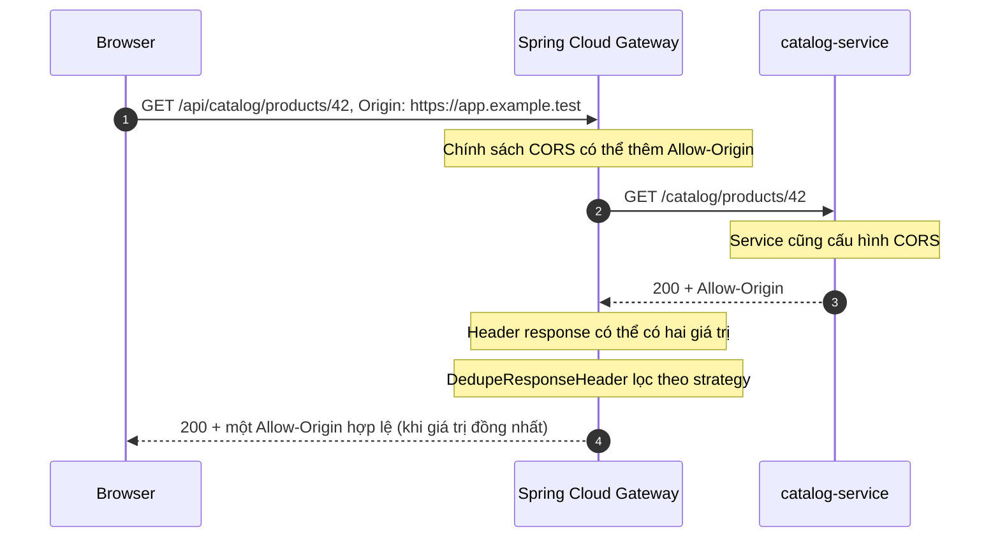

# DedupeResponseHeader khi gateway và dịch vụ cùng ghi header

## 1. Bối cảnh: một HTTP response có thể được nhiều lớp bổ sung header

Trong kiến trúc microservices, **Spring Cloud Gateway** nhận request của client, lựa chọn route bằng predicate, chạy filter chain rồi chuyển tiếp đến dịch vụ đích. Chiều phản hồi đi ngược trở lại: microservice trả status, header và body; Gateway có thể bổ sung hoặc biến đổi response trước khi gửi cho client. Một reverse proxy, ingress hoặc CDN bên ngoài Gateway còn có thể sửa header lần nữa.

Điều này tạo ra tình huống một **tên response header** được ghi bởi nhiều thành phần. Chẳng hạn:

- Gateway cấu hình chính sách **CORS** và tự ghi `Access-Control-Allow-Origin`.
- `catalog-service` cũng bật CORS và trả cùng header.
- Một `GatewayFilter` dùng `AddResponseHeader` để bổ sung header mà upstream đã có.
- Hai lớp cùng phát `Access-Control-Allow-Credentials: true`.

Nếu trình duyệt thấy hai giá trị `Access-Control-Allow-Origin`, ngay cả khi chúng bằng nhau, kết quả có thể bị từ chối vì CORS yêu cầu một giá trị hợp lệ duy nhất. Phản hồi từ service có thể là `200 OK`, nhưng JavaScript trên trình duyệt vẫn không đọc được response.

**`DedupeResponseHeader`** là `GatewayFilter` của **Spring Cloud Gateway Server WebFlux**, dùng để giải quyết những header phản hồi có nhiều giá trị. Nó nhận danh sách **tên header** và chiến lược giữ giá trị (`RETAIN_FIRST`, `RETAIN_LAST`, `RETAIN_UNIQUE`) để loại giá trị dư thừa trên đường phản hồi.

Bài thuộc chương **Header và trạng thái** của module **SPRING_CLOUD_GATEWAY**. Bạn sẽ học cách cấu hình filter, chọn chiến lược phù hợp, kiểm tra CORS, đọc status và debug sự tương tác giữa Gateway, upstream và các filter khác. Những chính sách như xác thực JWT, rate limiting, circuit breaker, retry, TLS, service discovery và observability vẫn cần cấu hình riêng; `DedupeResponseHeader` không tự bật những tính năng đó.

> **Phạm vi:** các ví dụ YAML theo cách khai báo `spring.cloud.gateway.routes` thường gặp trong **Spring Cloud Gateway Server WebFlux 4.x**. Namespace cấu hình, dependency và một số chi tiết API có thể khác giữa các phiên bản hoặc khi dùng Gateway Server MVC. Luôn đối chiếu tài liệu đúng phiên bản dự án.

## 2. Phân biệt tên header, nhiều giá trị và lỗi CORS

HTTP header gồm **tên** và **giá trị**. Cùng một tên có thể xuất hiện trên nhiều dòng hoặc được biểu diễn thành nhiều giá trị trong cấu trúc `HttpHeaders` của framework.

Ví dụ response từ một hệ thống có hai lớp ghi CORS:

```http
HTTP/1.1 200 OK
Content-Type: application/json
Access-Control-Allow-Origin: https://app.example.test
Access-Control-Allow-Origin: https://app.example.test
Access-Control-Allow-Credentials: true
Access-Control-Allow-Credentials: true

{"id":42,"name":"Notebook"}
```

Hai dòng `Access-Control-Allow-Origin` giống nhau vẫn là một cấu hình không phù hợp cho trình duyệt. Một số proxy/HTTP client có thể biểu diễn nhiều giá trị thành danh sách hoặc một dòng gộp; **đừng dùng hình thức hiển thị một dòng để kết luận chắc chắn dữ liệu chỉ có một giá trị**.

Bảng thuật ngữ:

| Khái niệm | Ý nghĩa | Ví dụ |
| --- | --- | --- |
| Tên header | Khóa HTTP, so khớp không phân biệt chữ hoa/thường theo HTTP | `Access-Control-Allow-Origin` |
| Giá trị header | Nội dung do từng lớp thêm vào | `https://app.example.test` |
| Nhiều giá trị cho một tên | Có hơn một giá trị trong danh sách header | Hai lần `Access-Control-Allow-Origin` |
| Giá trị trùng nhau | Hai giá trị giống nhau | `true`, `true` |
| Giá trị xung đột | Hai giá trị khác nhau nhưng cùng tên | `https://a.example`, `https://b.example` |
| Dedupe | Lọc danh sách giá trị theo chính sách đã chọn | Giữ một hoặc các giá trị duy nhất |

Cần phân biệt **dedupe giá trị** với **gộp nội dung header**. Ví dụ `Vary: Origin` và `Vary: Accept-Encoding` là hai giá trị khác nhau cần cân nhắc ngữ nghĩa cache; xóa bớt một giá trị chỉ để thấy “một dòng header” có thể làm sai hành vi cache. `DedupeResponseHeader` không phải trình phân tích toàn bộ ngữ nghĩa các loại HTTP header.

## 3. Header bị nhân đôi ở bước nào?

Ví dụ luồng phản hồi:



Ở đây `DedupeResponseHeader` thực hiện **xử lý phản hồi** trong các route có filter này. Nếu không có route phù hợp, hoặc response được xử lý ở một chuỗi WebFlux khác và không đi qua Gateway filter, không nên giả định filter sẽ can thiệp.

Lưu ý thêm: một ingress hoặc CDN **đứng sau Gateway theo chiều phản hồi** có thể bổ sung header sau khi Gateway đã xử lý. Lúc đó `DedupeResponseHeader` trong Gateway không thể nhìn thấy giá trị được thêm ở lớp ngoài. Cần xác định chính xác hệ thống nào ghi header bằng cách so sánh phản hồi từng chặng.

## 4. Cấu hình DedupeResponseHeader theo route

### 4.1. Dạng khai báo ngắn

Giả sử `catalog-service` chạy ở `http://localhost:8081`, Gateway chạy ở `http://localhost:8080`. Client gọi `/api/catalog/products/42`; service xử lý `/catalog/products/42`. Ta muốn loại giá trị CORS trùng nhau khi cả hai lớp đều thêm chúng:

```yaml
spring:
  cloud:
    gateway:
      routes:
        - id: catalog-route
          uri: http://localhost:8081
          predicates:
            - Path=/api/catalog/**
          filters:
            - StripPrefix=1
            - DedupeResponseHeader=Access-Control-Allow-Origin Access-Control-Allow-Credentials
```

Đọc cấu hình:

1. `Path=/api/catalog/**` là predicate xác định request nào được chọn.
2. `StripPrefix=1` bỏ segment `api` trước khi chuyển upstream.
3. `DedupeResponseHeader` xử lý **response header**, không đổi URL, request body hay status.
4. Hai tên header được ngăn cách bằng dấu cách; filter có thể nhận nhiều tên trong tham số `name`.
5. Không truyền `strategy` thì chiến lược mặc định là **`RETAIN_FIRST`**.

Ví dụ này không tự bật CORS tại Gateway. Nó chỉ mô tả bước lọc giá trị nếu response thực sự có nhiều giá trị cần xử lý.

### 4.2. Dạng khai báo tường minh, chỉ rõ strategy

```yaml
spring:
  cloud:
    gateway:
      routes:
        - id: catalog-route
          uri: http://localhost:8081
          predicates:
            - Path=/api/catalog/**
          filters:
            - StripPrefix=1
            - name: DedupeResponseHeader
              args:
                name: Access-Control-Allow-Origin Access-Control-Allow-Credentials
                strategy: RETAIN_UNIQUE
```

Trong dạng này:

- `name` bên ngoài chỉ **tên GatewayFilter factory**.
- `args.name` là **danh sách tên HTTP header** cần xử lý.
- `args.strategy` quyết định cách giữ lại các giá trị của từng header.

Cách viết tường minh phù hợp khi một team muốn mọi lựa chọn có thể đọc và review rõ ràng. Một cách viết ngắn tương đương:

```yaml
filters:
  - DedupeResponseHeader=Access-Control-Allow-Origin Access-Control-Allow-Credentials, RETAIN_UNIQUE
```

Hãy dùng một trong hai dạng `filters` cho cùng route. Các ví dụ không nhằm tạo nhiều `catalog-route` trùng ID trong cùng cấu hình.

## 5. Ba chiến lược giữ giá trị

`DedupeResponseHeader` hỗ trợ các strategy phổ biến sau:

| Strategy | Hành vi | Phù hợp khi |
| --- | --- | --- |
| **`RETAIN_FIRST`** | Chỉ giữ giá trị đầu tiên trong danh sách của header | Đã xác minh thứ tự và muốn ưu tiên giá trị đứng đầu |
| **`RETAIN_LAST`** | Chỉ giữ giá trị cuối cùng | Đã xác minh thứ tự và muốn ưu tiên giá trị đứng cuối |
| **`RETAIN_UNIQUE`** | Giữ các giá trị phân biệt, loại các bản sao trùng | Các nguồn lặp lại đúng cùng giá trị; muốn không xóa giá trị khác nhau |

Ví dụ một response có danh sách giá trị:

```text
X-Deployment: alpha
X-Deployment: beta
X-Deployment: beta
```

Kết quả:

| Strategy | Giá trị còn lại |
| --- | --- |
| `RETAIN_FIRST` | `alpha` |
| `RETAIN_LAST` | `beta` |
| `RETAIN_UNIQUE` | `alpha`, `beta` |

Các ví dụ trên diễn giải ở mức **danh sách giá trị header**. Đừng nhầm `RETAIN_UNIQUE` với “luôn chỉ còn một giá trị”: khi các giá trị **khác nhau**, nó giữ lại nhiều giá trị.

### 5.1. Tại sao RETAIN_UNIQUE chưa chắc sửa được CORS?

Trường hợp hai nguồn ghi **cùng một origin**:

```http
Access-Control-Allow-Origin: https://app.example.test
Access-Control-Allow-Origin: https://app.example.test
```

Với `RETAIN_UNIQUE`, danh sách còn một giá trị, nên sự trùng lặp này được xử lý.

Nhưng nếu hai nguồn ghi **origin khác nhau**:

```http
Access-Control-Allow-Origin: https://app.example.test
Access-Control-Allow-Origin: https://other.example.test
```

`RETAIN_UNIQUE` giữ **cả hai** vì chúng khác nhau; CORS vẫn không hợp lệ cho một response. `RETAIN_FIRST` hoặc `RETAIN_LAST` có thể làm kết quả còn một giá trị, nhưng lựa chọn đó chỉ có ý nghĩa khi đã xác định **ai là nguồn đáng tin cậy** và giá trị nào phải có mặt.

Không nên dựa vào việc “Gateway luôn thêm trước” hay “upstream luôn thêm sau” để chọn chiến lược. Thứ tự giá trị thực tế có thể phụ thuộc global filters, route filters, CORS handling, hạ tầng trung gian và phiên bản. Hãy kiểm tra response thật trước khi quyết định.

### 5.2. Không chuẩn hóa giá trị tùy ý

`DedupeResponseHeader` là cơ chế **lọc giá trị**, không phải công cụ chuẩn hóa URL, origin, ký tự khoảng trắng hoặc trường danh sách nhiều token. Hai giá trị trông tương đương về ý nghĩa nhưng khác cách biểu diễn có thể không bị coi là một bản sao. Nếu header đang xung đột do cấu hình khác nhau, hãy sửa chính sách tại nguồn.

### 5.3. Giá trị đơn hoặc header không có mặt

Nếu response chỉ có một `Access-Control-Allow-Origin` thì không có bản sao cần loại. Nếu header hoàn toàn vắng mặt, `DedupeResponseHeader` **không tự tạo** giá trị thay thế. Filter không phải cơ chế “bảo đảm trình duyệt luôn được phép gọi API”.

## 6. CORS: trường hợp thực tế cần DedupeResponseHeader

### 6.1. Bật CORS ở Gateway

Ví dụ Gateway Server WebFlux phục vụ ứng dụng web tại `https://app.example.test` và proxy `catalog-service`. Cấu hình thử nghiệm:

```yaml
spring:
  cloud:
    gateway:
      globalcors:
        cors-configurations:
          '[/**]':
            allowedOrigins:
              - https://app.example.test
            allowedMethods:
              - GET
              - POST
              - OPTIONS
            allowedHeaders:
              - Authorization
              - Content-Type
            allowCredentials: true
      routes:
        - id: catalog-route
          uri: http://localhost:8081
          predicates:
            - Path=/api/catalog/**
          filters:
            - StripPrefix=1
            - DedupeResponseHeader=Access-Control-Allow-Origin Access-Control-Allow-Credentials, RETAIN_UNIQUE
```

Trong ví dụ:

- `globalcors` là phần cấu hình CORS ở Gateway cho những request đi qua cơ chế tương ứng.
- `allowCredentials: true` yêu cầu dùng origin cụ thể được cho phép; **không cấu hình `allowedOrigins: '*'` cùng credentials true**.
- `DedupeResponseHeader` xử lý khi Gateway và backend cùng trả một giá trị header CORS.
- Cần cấu hình Spring Security phù hợp nếu API có xác thực. CORS quyết định quyền đọc response từ trình duyệt, **không thay thế xác thực hoặc phân quyền**.

Giả sử upstream cũng trả hai header:

```http
Access-Control-Allow-Origin: https://app.example.test
Access-Control-Allow-Credentials: true
```

Sau khi Gateway thêm hai header tương ứng, một response chưa dedupe có thể chứa hai bản sao cho mỗi tên; `RETAIN_UNIQUE` giúp giữ lại một giá trị của từng loại **nếu giá trị thực sự giống nhau**.

**Thiết kế ưu tiên:** chọn một nơi làm chủ chính sách CORS cho tuyến API, ví dụ Gateway. Khi có thể, tắt việc thêm CORS trùng lặp ở upstream; `DedupeResponseHeader` hữu ích để xử lý hệ thống cũ hoặc giai đoạn chuyển đổi nhưng không thay thế quản trị chính sách.

### 6.2. Một số header CORS khác và ý nghĩa

| Header | Ý nghĩa chính | Lưu ý khi kiểm tra |
| --- | --- | --- |
| `Access-Control-Allow-Origin` | Origin nào được phép đọc response | Chỉ một origin cụ thể hoặc `*` theo ngữ nghĩa CORS |
| `Access-Control-Allow-Credentials` | Có cho phép sử dụng credentials hay không | Dùng `true` khi cần và chính sách origin phù hợp |
| `Access-Control-Allow-Methods` | Những method được phép trong preflight | Có thể là danh sách; không tự ý xóa thông tin hợp lệ |
| `Access-Control-Allow-Headers` | Những request header được phép trong preflight | Có thể là danh sách; phải khớp yêu cầu thực tế |
| `Access-Control-Expose-Headers` | Response header nào JavaScript được đọc | Có thể là danh sách, cần xét ngữ nghĩa thay vì chỉ xóa bản sao |
| `Vary` | Ảnh hưởng khóa cache theo request headers | Đừng xóa tùy tiện `Origin` hoặc các giá trị liên quan preflight |

Với CORS động theo origin, hãy chú ý `Vary: Origin` và các biến thể liên quan. Một response CORS đúng khi không qua cache có thể trở thành sai khi CDN cache dùng chung cho các origin khác nhau nếu `Vary` bị quản lý sai.

### 6.3. Preflight OPTIONS: filter route có thể không được chạy

Trình duyệt có thể gửi **preflight request**:

```http
OPTIONS /api/catalog/products/42 HTTP/1.1
Origin: https://app.example.test
Access-Control-Request-Method: GET
Access-Control-Request-Headers: authorization
```

Một số preflight được Spring WebFlux xử lý **trước hoặc ngoài** Gateway route filter chain; route predicate chỉ cho `GET` cũng có thể khiến `OPTIONS` không khớp. Khi đó, **đừng giả định `DedupeResponseHeader` sẽ chạy trên mọi preflight** chỉ vì route GET có filter.

Ở một số cấu hình Gateway Server WebFlux, tùy chọn sau giúp xử lý CORS cho những request không khớp predicate ở mức route:

```yaml
spring:
  cloud:
    gateway:
      globalcors:
        add-to-simple-url-handler-mapping: true
```

Tùy chọn này bổ trợ việc ánh xạ CORS, **không phải công tắc dedupe toàn bộ response OPTIONS**. Nếu dùng Spring Security, cần bảo đảm preflight được xử lý đúng trong chuỗi bảo mật. Kiểm tra cả `OPTIONS` và request thực tế từ browser trước khi tuyên bố CORS đã hoạt động.

## 7. Đặt filter trên một route hay mặc định cho nhiều route?

### 7.1. Chỉ áp dụng trên tuyến cần xử lý

```yaml
spring:
  cloud:
    gateway:
      routes:
        - id: catalog-route
          uri: http://localhost:8081
          predicates:
            - Path=/api/catalog/**
          filters:
            - DedupeResponseHeader=Access-Control-Allow-Origin Access-Control-Allow-Credentials
```

Ưu điểm: phạm vi rõ ràng, không ảnh hưởng những API khác. Phù hợp khi chỉ một upstream cũ ghi trùng CORS header.

### 7.2. Cấu hình default-filters

Nếu nhiều route thực sự gặp cùng vấn đề:

```yaml
spring:
  cloud:
    gateway:
      default-filters:
        - name: DedupeResponseHeader
          args:
            name: Access-Control-Allow-Origin Access-Control-Allow-Credentials
            strategy: RETAIN_UNIQUE
```

`default-filters` gắn filter mặc định vào các **route do Gateway xử lý**. Nó không bảo đảm chạy cho response mà WebFlux/Spring Security xử lý độc lập trước khi chọn route, cũng không ảnh hưởng header do CDN bổ sung sau Gateway.

Chỉ chọn phạm vi global mặc định sau khi hiểu chính sách của tất cả upstream. Đặc biệt, tránh cấu hình một danh sách dài những header nhạy cảm chỉ vì thấy giá trị lặp ở một API.

### 7.3. Dùng AddResponseHeader hoặc SetResponseHeader khi nào?

Các filter khác có vai trò khác nhau:

| Filter | Hành vi điển hình | Khi sử dụng |
| --- | --- | --- |
| `AddResponseHeader` | Bổ sung một giá trị vào response header | Chủ ý thêm header mới; có thể gây nhiều giá trị nếu đã tồn tại |
| `SetResponseHeader` | Đặt/ghi đè giá trị của một header | Gateway phải là nguồn quyết định giá trị, theo thứ tự xử lý đã xác minh |
| `RemoveResponseHeader` | Loại header khỏi response | Ngăn phát lộ header hoặc gỡ header không mong muốn |
| `DedupeResponseHeader` | Chọn hoặc giữ các giá trị phân biệt của header đã có | Nhiều lớp cùng thêm giá trị và cần lọc bản sao |

Ví dụ nếu microservice luôn gửi `X-Environment` không đáng tin cậy, giải pháp đúng có thể là Gateway **ghi đè** bằng giá trị do deployment cấp, thay vì “chọn bản đầu tiên” rồi hy vọng đó là giá trị thật. Nếu muốn thống nhất CORS, sửa cấu hình CORS ở nguồn thường rõ ràng hơn thay vì phụ thuộc vào thứ tự header.

## 8. Cẩn thận với các header không nên dedupe tùy tiện

Không phải hai dòng có cùng tên đều là lỗi. HTTP cho phép một số header có nhiều giá trị với ngữ nghĩa riêng; xử lý thiếu hiểu biết có thể làm thay đổi tính năng hoặc rủi ro bảo mật.

| Header | Vì sao phải thận trọng? | Hướng xử lý |
| --- | --- | --- |
| `Set-Cookie` | Một response có thể chủ ý đặt nhiều cookie khác nhau; cách gộp cookie cũng có quy tắc riêng | Không đưa `Set-Cookie` vào danh sách dedupe rộng chỉ để còn một giá trị |
| `Vary` | Mỗi giá trị có thể ảnh hưởng cache key | Giữ đầy đủ những chiều phân biệt cache cần thiết |
| `Cache-Control` | Các directive phối hợp kiểm soát cache; xóa một phần có thể đổi chính sách | Xác định chủ thể sở hữu chính sách cache và kiểm tra ngữ nghĩa |
| `Content-Security-Policy` | Nhiều policy có thể đồng thời áp dụng ràng buộc; giữ một policy có thể đổi bảo mật | Chuẩn hóa chính sách tại nguồn, kiểm tra trên trình duyệt |
| `WWW-Authenticate` | Có thể cần nhiều challenge xác thực | Không ép giữ một giá trị nếu làm mất challenge hợp lệ |
| `Warning` và header danh sách khác | Có thể có nhiều phần tử mang ý nghĩa độc lập | Xử lý theo đặc tả riêng của header |
| `Content-Length`, `Transfer-Encoding` | Gắn với framing HTTP và cách transport xử lý body | Để HTTP stack/transport kiểm soát; điều tra cấu hình hạ tầng nếu bất thường |

Một trường hợp điển hình: service gửi hai `Set-Cookie` cho `session` và `preferences`. Chọn `RETAIN_FIRST` sẽ xóa cookie thứ hai, gây lỗi đăng nhập hoặc trải nghiệm. Ngay cả `RETAIN_UNIQUE` cũng cần cân nhắc vì những header có cùng chuỗi nhưng xuất hiện nhiều lần không mặc nhiên có thể bị xóa mà không xét ngữ nghĩa.

Nếu một header chỉ định **một giá trị duy nhất** (như `Access-Control-Allow-Origin`), cần kiểm tra xung đột giữa các nguồn. Nếu một header biểu diễn **danh sách hoặc chính sách tổng hợp**, cần hợp nhất theo chuẩn riêng thay vì áp dụng máy móc một trong ba strategy.

## 9. Trình tự filter, thời điểm response được ghi và mã trạng thái

### 9.1. Filter xử lý khi nào?

`DedupeResponseHeader` là filter làm việc trên **response** của route. Nó tham gia Gateway filter chain cùng những filter khác như `AddResponseHeader`, `SetResponseHeader`, filter retry hoặc các `GlobalFilter` của framework.

Thứ tự rất quan trọng:

- Nếu một filter khác bổ sung giá trị **sau bước dedupe**, response vẫn có thể bị trùng.
- Nếu bộ lọc dedupe chạy trước khi giá trị từ một tầng được đưa vào response, nó không thể xóa giá trị chưa tồn tại.
- Nếu response đã được **commit/gửi ra mạng**, một filter thực thi muộn không thể tự ý sửa header đã gửi.
- Nếu request không đi qua route filter chain, filter này có thể không được gọi.

Khi tự viết filter hoặc cố sắp xếp order trong Java DSL, đừng dựa vào giả định chỉ theo vị trí khai báo. Gateway có `GlobalFilter`, `GatewayFilter` và thứ tự pre/post; một số lớp CORS/security ở WebFlux còn hoạt động ngoài chuỗi GatewayFilter. Kiểm tra thứ tự và response thực tế theo phiên bản dự án.

### 9.2. DedupeResponseHeader không đổi status

Lọc header không tương đương thay HTTP status. Ví dụ:

| Status do hệ thống trả | Sau khi lọc CORS header trùng | Ý nghĩa |
| --- | --- | --- |
| `200 OK` | Thông thường vẫn 200 | Browser có thể đọc response nếu toàn bộ CORS hợp lệ |
| `401 Unauthorized` | Thông thường vẫn 401 | Không biến token sai thành request hợp lệ |
| `403 Forbidden` | Thông thường vẫn 403 | Không cấp quyền truy cập tài nguyên |
| `429 Too Many Requests` | Thông thường vẫn 429 | Rate limiting độc lập với dedupe |
| `503 Service Unavailable` | Thông thường vẫn 503 | Sửa header không làm upstream hoạt động lại |

Từ “thông thường” nhấn mạnh rằng status thực tế còn chịu ảnh hưởng các filter/handler khác. `DedupeResponseHeader` **không phải filter ánh xạ lỗi**: nó không tự thay 500 thành 200, không tự retry và không tự tạo fallback.

Với response lỗi phát sinh **trước khi route được chọn**, chính sách CORS/headers nên được kiểm tra riêng vì DedupeResponseHeader của một route không nhất thiết chạy. Đây là lý do phải thử cả ca thành công lẫn ca lỗi.

### 9.3. Filter order khác với trách nhiệm xác thực

Một JWT không hợp lệ nên bị chặn bởi chính sách Spring Security phù hợp. Kể cả khi response 401 chứa header CORS hợp lệ, client vẫn không có quyền. Ngược lại, một response 200 có header CORS sai cũng không có nghĩa service chưa xử lý request: browser có thể ngăn ứng dụng JavaScript đọc kết quả.

Nếu hệ thống xác thực người dùng, rate limit theo danh tính, chuyển HTTPS ở Gateway hoặc dùng TLS tới upstream, cần giữ các chính sách đó độc lập. Header từ client không được tin để quyết định danh tính chỉ vì Gateway có filter sửa response.

## 10. Kiểm thử bằng curl và trình duyệt

### 10.1. So sánh upstream và Gateway

Giả sử Gateway chạy `http://localhost:8080`, upstream `catalog-service` chạy `http://localhost:8081`, route bỏ `/api`.

Gọi trực tiếp upstream:

```bash
curl -i \
  -H "Origin: https://app.example.test" \
  http://localhost:8081/catalog/products/42
```

Gọi qua Gateway:

```bash
curl -i \
  -H "Origin: https://app.example.test" \
  http://localhost:8080/api/catalog/products/42
```

So sánh các giá trị `Access-Control-Allow-Origin`, `Access-Control-Allow-Credentials`, `Vary`, status và response body. Gọi trực tiếp giúp xem upstream phát header nào; gọi qua Gateway cho thấy response cuối của Gateway **trước những hạ tầng đứng ngoài Gateway**.

Các URL là ví dụ. Nếu upstream chưa có endpoint, kết quả `404` không chứng minh dedupe hoạt động sai; cần dùng endpoint thực sự có phản hồi và quan sát header trên cả response thành công lẫn lỗi.

### 10.2. Kiểm thử trước và sau khi bật filter

Tạo một bảng kiểm thử với response giả lập từ upstream:

| Ca | Danh sách giá trị trước filter | Strategy | Kỳ vọng |
| --- | --- | --- | --- |
| H1 | `[https://app.example.test]` | `RETAIN_UNIQUE` | Giữ một giá trị |
| H2 | `[https://app.example.test, https://app.example.test]` | `RETAIN_UNIQUE` | Giữ một giá trị |
| H3 | `[https://a.example, https://b.example]` | `RETAIN_UNIQUE` | Còn hai giá trị; vẫn cần sửa CORS |
| H4 | `[https://a.example, https://b.example]` | `RETAIN_FIRST` | Giữ `https://a.example` |
| H5 | `[https://a.example, https://b.example]` | `RETAIN_LAST` | Giữ `https://b.example` |
| H6 | Header không tồn tại | Bất kỳ | Không tự sinh header |
| H7 | Hai `Set-Cookie` phục vụ hai cookie khác nhau | Không cấu hình dedupe | Giữ đúng các cookie hợp lệ |

Các giá trị trong cột đầu vào là **giả định để kiểm thử**, không phải kết quả đã chạy. Muốn test có giá trị, dùng upstream mock có thể cấu hình số lần phát header và assert danh sách header ở response Gateway, thay vì chỉ kiểm tra một status `200`.

### 10.3. Kiểm tra preflight OPTIONS

```bash
curl -i -X OPTIONS \
  -H "Origin: https://app.example.test" \
  -H "Access-Control-Request-Method: GET" \
  -H "Access-Control-Request-Headers: authorization" \
  http://localhost:8080/api/catalog/products/42
```

Quan sát status, `Access-Control-Allow-Origin`, `Access-Control-Allow-Methods`, `Access-Control-Allow-Headers`, `Access-Control-Allow-Credentials` và `Vary`. Nếu preflight không qua route Gateway, thay đổi `DedupeResponseHeader` trên route GET có thể không ảnh hưởng kết quả; cần kiểm tra cấu hình CORS/WebFlux và Security.

### 10.4. Dùng trình duyệt để xác nhận hành vi CORS

`curl` **không tự thực thi chính sách CORS của browser**. Nó giúp xem header và status thô. Muốn xác nhận web app gọi được API:

1. Mở DevTools → Network, tìm request hoặc preflight liên quan.
2. So sánh `Origin` của request với `Access-Control-Allow-Origin` của response.
3. Kiểm tra `Access-Control-Allow-Credentials` khi ứng dụng cần cookie hoặc credentials.
4. Phân biệt lỗi CORS hiển thị ở console với HTTP status thực tế trên Network.
5. Nếu response đi qua CDN/ingress, kiểm tra header **đến browser**, không chỉ phản hồi tại cổng Gateway nội bộ.

Nếu browser vẫn báo nhiều giá trị `Access-Control-Allow-Origin` sau khi đã bật dedupe, hãy xác định có lớp nào bổ sung header **sau Gateway**, hoặc có hai giá trị khác nhau được `RETAIN_UNIQUE` giữ lại.

## 11. Khi cả Gateway và upstream không đồng ý về CORS

Tình huống production:

- Gateway cho phép `https://app.example.test`.
- Upstream cũ cho phép `https://legacy.example.test`.
- Client gửi `Origin: https://app.example.test`.
- Gateway và upstream cùng ghi một `Access-Control-Allow-Origin` nhưng khác giá trị.

Đây là **xung đột chính sách**, không đơn thuần là “hai bản sao giống nhau”.

Giải pháp ưu tiên theo thứ tự tư duy:

1. Quyết định **tầng nào chịu trách nhiệm CORS** cho route công khai; thông thường Gateway là nơi phù hợp nếu các client đều đi qua Gateway.
2. Nếu có thể, bỏ CORS trùng lặp ở upstream công khai qua Gateway; giữ kiểm soát truy cập và xác thực nghiệp vụ ở service.
3. Nếu chưa thể sửa upstream ngay, xác nhận strategy nào thực sự cho response đúng, kiểm thử nguồn/thứ tự và thêm cơ chế kiểm soát trong thời gian chuyển đổi.
4. Đối chiếu preflight, actual request, status 4xx/5xx và hành vi cache qua `Vary`.
5. Ngăn backend hoặc tầng trung gian tự phản chiếu origin không kiểm soát khi có credentials.

**Không dùng `RETAIN_UNIQUE` như cách tự động giải quyết hai origin khác nhau**: giá trị khác nhau vẫn còn, browser vẫn có thể chặn. **Không tùy tiện chọn `RETAIN_LAST`** nếu không biết nguồn cuối cùng là ai: giá trị được giữ lại có thể thuộc chính sách sai.

## 12. Chẩn đoán lỗi thường gặp

| Hiện tượng | Nguyên nhân có thể | Cách xử lý |
| --- | --- | --- |
| Browser báo nhiều `Access-Control-Allow-Origin` | Gateway và upstream cùng ghi header | Kiểm tra hai chặng, cấu hình dedupe và thống nhất CORS policy |
| Bật `RETAIN_UNIQUE` nhưng vẫn có 2 giá trị origin | Hai giá trị khác nhau | Sửa xung đột cấu hình CORS; cân nhắc single owner |
| Header vẫn trùng sau Gateway | Ingress/CDN bổ sung ở bước sau | Kiểm tra response qua từng hop |
| CORS fail dù header chỉ xuất hiện một lần | Origin sai, credentials không phù hợp, preflight thiếu method/header hoặc chính sách khác | Đối chiếu đầy đủ CORS và Network/Console |
| GET hợp lệ nhưng OPTIONS fail | Preflight đi qua chuỗi khác, predicate hoặc Security chặn | Kiểm tra global CORS, preflight, WebFilter/Security |
| Status vẫn 401 hoặc 403 sau dedupe | Sai token hoặc quyền truy cập | Sửa chính sách auth; dedupe không cấp quyền |
| `Set-Cookie` bị mất | Đã dedupe header có nhiều giá trị hợp lệ bằng `RETAIN_FIRST/LAST` | Gỡ cấu hình dedupe tùy tiện, kiểm tra cookie semantics |
| `Vary` thiếu `Origin` | Một lớp ghi đè/xóa Vary hoặc cấu hình cache chưa đúng | Kiểm tra CDN/cache policy và các giá trị Vary cần thiết |
| `AddResponseHeader` làm xuất hiện hai giá trị | Gateway append header vốn đã được upstream gửi | Dùng source-of-truth hoặc `SetResponseHeader`/dedupe phù hợp |
| Filter không chạy với response lỗi | Response tạo trước khi khớp route hoặc bị xử lý ở tầng khác | Xác định pipeline sinh lỗi và áp dụng CORS ở đúng tầng |
| Chuyển sang version mới bị lỗi tên property | Namespace/config/API Gateway thay đổi | Tra tài liệu đúng phiên bản WebFlux, sửa config và thử request |

Khi ghi log để debug, nên ghi **route ID, HTTP status, tên header và số lượng giá trị** thay vì ghi nguyên token, cookie hoặc nội dung nhạy cảm. Origin thường có thể quan sát phục vụ CORS, nhưng vẫn cần tuân theo chính sách log và tránh nhãn metrics có độ phân biệt quá cao.

## 13. Bài thực hành: xử lý duplicated CORS mà không làm mất header hợp lệ

**Yêu cầu:** Gateway định tuyến `GET /api/products/**` đến `product-service`. Gateway và upstream đều trả:

```http
Access-Control-Allow-Origin: https://shop.example.test
Access-Control-Allow-Credentials: true
```

Client web ở `https://shop.example.test` cần gọi API có credentials. Hãy:

1. Cấu hình Gateway CORS cho đúng origin, phương thức và header thực tế.
2. Thêm `DedupeResponseHeader` với `RETAIN_UNIQUE` cho hai tên header nêu trên.
3. Dùng upstream giả lập cho response `200`, `401` và `500`, xác nhận status không bị tự động đổi do dedupe.
4. Thử `OPTIONS` preflight và `GET` thực tế; đối chiếu header trên trình duyệt.
5. Thêm tình huống upstream trả `Access-Control-Allow-Origin: https://other.example.test`; ghi lại vì sao `RETAIN_UNIQUE` không giải quyết được.
6. Thêm hai `Set-Cookie` khác nhau; chứng minh cần giữ chúng nguyên vẹn, không thêm `Set-Cookie` vào danh sách dedupe.

Một route minh họa:

```yaml
spring:
  cloud:
    gateway:
      routes:
        - id: products
          uri: http://localhost:8081
          predicates:
            - Path=/api/products/**
            - Method=GET
          filters:
            - StripPrefix=1
            - DedupeResponseHeader=Access-Control-Allow-Origin Access-Control-Allow-Credentials, RETAIN_UNIQUE
```

Vì route ở ví dụ giới hạn `Method=GET`, **preflight `OPTIONS` có thể không khớp route**. Đây là một phần của bài: phải kiểm tra xem cấu hình CORS tại WebFlux hoặc Gateway global mapping có xử lý OPTIONS hay không. Mã `200` từ một upstream mock đơn lẻ không đủ để khẳng định browser đã gọi API thành công.

### Checklist khi review cấu hình

- [ ] Xác định đúng **tên header** cần dedupe; không đưa tùy tiện các header có nhiều giá trị hợp lệ vào danh sách.
- [ ] Chọn `RETAIN_FIRST`, `RETAIN_LAST` hoặc `RETAIN_UNIQUE` theo **ngữ nghĩa** và giá trị quan sát thật.
- [ ] Không giả định `RETAIN_UNIQUE` có thể giải quyết CORS nếu Gateway/upstream phát **hai origin khác nhau**.
- [ ] Kiểm tra actual request, preflight OPTIONS và ít nhất một response lỗi 401/403/5xx.
- [ ] Xem header ở browser và ở các hop ingress/CDN nếu có.
- [ ] Thống nhất một tầng chịu trách nhiệm chính sách CORS khi có thể.
- [ ] Giữ nguyên các response header có ngữ nghĩa đa giá trị như `Set-Cookie` và `Vary`.
- [ ] Bảo vệ JWT/cookie/token, giới hạn thông tin nhạy cảm trong log và công cụ quan sát.
- [ ] Kiểm tra lại property namespace, route/filter order sau mỗi lần nâng cấp Gateway.

## 14. Tổng kết

**`DedupeResponseHeader` trong Spring Cloud Gateway** giải quyết tình huống một response header có nhiều giá trị khi Gateway và microservice cùng bổ sung dữ liệu. Filter có ba chiến lược:

- **`RETAIN_FIRST`** giữ giá trị đầu tiên.
- **`RETAIN_LAST`** giữ giá trị cuối cùng.
- **`RETAIN_UNIQUE`** giữ các giá trị khác nhau, loại các bản sao giống nhau.

Công cụ này đặc biệt hữu ích với `Access-Control-Allow-Origin` và `Access-Control-Allow-Credentials` khi Gateway và upstream cùng triển khai CORS. Tuy nhiên, dedupe **không tự giải quyết mâu thuẫn chính sách**, không thay đổi mã trạng thái, không cấp quyền truy cập và không làm thay công việc của security, rate limiting, circuit breaker, retry, TLS hay hệ thống quan sát request.

Khi xử lý một sự cố header, nên đi theo thứ tự **xác định nguồn phát → kiểm tra danh sách giá trị → chọn chiến lược phù hợp → kiểm thử cả preflight và response lỗi → sửa cấu hình gốc nếu có xung đột**. Cách làm đó giúp Gateway giữ hành vi HTTP đúng đắn mà không làm mất những header hợp lệ khác.

Tài liệu chính thức để đối chiếu theo phiên bản:

- [Spring Cloud Gateway Server WebFlux — DedupeResponseHeader](https://docs.spring.io/spring-cloud-gateway/reference/spring-cloud-gateway-server-webflux/gatewayfilter-factories/deduperesponseheader-factory.html).
- [Spring Cloud Gateway Server WebFlux — CORS Configuration](https://docs.spring.io/spring-cloud-gateway/reference/spring-cloud-gateway-server-webflux/cors-configuration.html).
- [MDN — Cross-Origin Resource Sharing (CORS)](https://developer.mozilla.org/en-US/docs/Web/HTTP/Guides/CORS).
