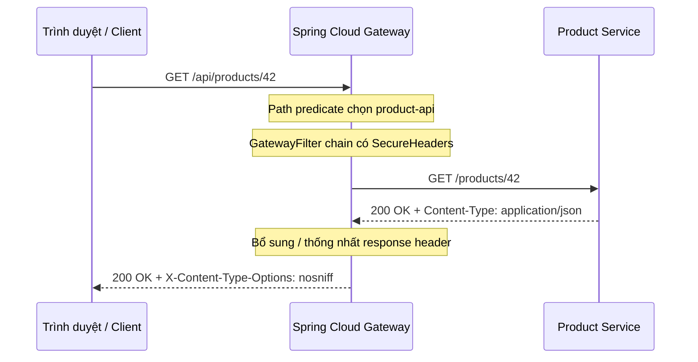
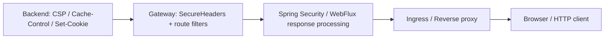

# SecureHeaders và tùy chỉnh chính sách header bảo mật trong Spring Cloud Gateway

Một API Gateway không chỉ quyết định request đi đến backend nào. Nó còn là nơi phù hợp để áp dụng **chính sách response header bảo mật** nhất quán cho các API và ứng dụng web nằm sau cổng vào. Chẳng hạn, gateway có thể yêu cầu trình duyệt không đoán kiểu nội dung, ngăn nhúng trang trong iframe ngoài ý muốn, giới hạn nguồn script được tải và khuyến khích kết nối HTTPS.

Trong **Spring Cloud Gateway Server WebFlux**, `SecureHeaders` là một **GatewayFilter Factory** cung cấp một bộ header bảo mật mặc định. Có thể áp dụng nó trên một route hoặc qua `default-filters` để dùng chung cho nhiều route, sau đó điều chỉnh chính sách theo từng loại ứng dụng. Nhưng bật một filter không tự giải quyết toàn bộ vấn đề: phải hiểu **header tác động lên ai**, **response nào thực sự mang header**, **giá trị nào phù hợp** và **cách tránh xung đột** với Spring Security, proxy hoặc backend.

Bài học thuộc chương **Header và trạng thái** của module `SPRING_CLOUD_GATEWAY`. Những kiến thức này bổ trợ cho route predicate, filter chain, biến đổi header/path, khám phá dịch vụ và các chính sách xác thực, rate limiting, circuit breaker, retry, TLS, observability khi vận hành gateway microservices an toàn.

> **Phạm vi phiên bản:** Các ví dụ hướng tới **Spring Cloud Gateway Server WebFlux**. Namespace cấu hình đã thay đổi giữa các thế hệ Spring Cloud Gateway; nên đối chiếu đúng starter và version đang chạy. Các giá trị header bên dưới là minh họa/chính sách cần đánh giá, không phải bảng cam kết giá trị mặc định giống nhau ở mọi phiên bản.

## 1. Header bảo mật nằm ở đâu trong luồng request/response?

Giả sử client gọi `GET /api/products/42`. Gateway chọn route `product-api` và chuyển tiếp tới Product Service. Backend trả JSON; gateway có thể bổ sung một số response header trước khi trả kết quả cho client.



**Hai lớp cần tách biệt:**

| Lớp | Quyết định chính | Ví dụ |
| --- | --- | --- |
| **Request** | Có cho phép người gọi truy cập API, định tuyến ở đâu, giới hạn số lần gọi và chuyển tiếp như thế nào? | Spring Security, `Path` predicate, `RequestRateLimiter`, `StripPrefix`, `lb://product-service`. |
| **Response** | Client nhận mã HTTP, dữ liệu và chính sách xử lý response nào? | `SecureHeaders`, `SetResponseHeader`, `RemoveResponseHeader`, `Cache-Control`. |

Các header như Content Security Policy (CSP), `X-Frame-Options` và `Referrer-Policy` chủ yếu hướng dẫn **trình duyệt**. Một HTTP client tùy chỉnh hoặc một backend **không tự động tuân thủ** chính sách này như browser. Vì vậy, response headers **không thay thế** xác thực token, phân quyền tài nguyên, kiểm soát đầu vào, TLS hoặc các chính sách chống tấn công tại server.

## 2. `SecureHeaders` là gì và áp dụng ở phạm vi nào?

`SecureHeaders` là bộ lọc cấu hình được tạo bởi `SecureHeadersGatewayFilterFactory`. Khi route có bộ lọc này, Gateway bổ sung những response header bảo mật mà filter hỗ trợ theo cấu hình đang có.

Ba điều quan trọng:

1. `SecureHeaders` là **GatewayFilter**, gắn với route đã khớp; nó **không tự bật cho mọi endpoint** chỉ vì ứng dụng có Spring Cloud Gateway.
2. Có thể dùng `default-filters` để áp dụng factory này cho các route. Đây là cách thường dùng khi nhiều microservice cần chung một bộ header.
3. `SecureHeaders` xử lý **header**; nó không tự tạo HTTPS certificate, tự xác thực user hay tự quyết định mã HTTP `401/403/429/503`.

Các nhóm header mà các bản SecureHeaders WebFlux phổ biến hỗ trợ gồm:

| Header | Mục đích chính | Lưu ý |
| --- | --- | --- |
| `Strict-Transport-Security` | Thông báo browser ưu tiên HTTPS cho host trong thời hạn `max-age`. | Chỉ có ý nghĩa đáng tin khi nhận qua HTTPS; có thể gây tác động dài hạn với host/subdomain. |
| `Content-Security-Policy` | Giới hạn nguồn tài nguyên trình duyệt được tải/chạy. | Phải phù hợp từng ứng dụng HTML; cấu hình quá rộng yếu, quá chặt làm vỡ trang. |
| `X-Frame-Options` | Hạn chế việc nhúng trang qua iframe/frame ở browser hỗ trợ. | Thường `DENY` hoặc `SAMEORIGIN`; CSP `frame-ancestors` là cơ chế hiện đại hơn. |
| `X-Content-Type-Options` | Ngăn browser tự đoán MIME type trong các ngữ cảnh áp dụng. | Giá trị thường dùng: `nosniff`. |
| `Referrer-Policy` | Điều khiển thông tin referrer gửi khi điều hướng hoặc tải tài nguyên. | Ví dụ `no-referrer` hoặc `strict-origin-when-cross-origin`. |
| `X-XSS-Protection` | Cơ chế lọc XSS của một số browser cũ. | **Di sản**, không thay thế CSP và escaping; nhiều browser hiện đại bỏ hỗ trợ. |
| `X-Download-Options` | Chính sách download cho client cũ. | `noopen` chủ yếu liên quan một số trình duyệt cũ. |
| `X-Permitted-Cross-Domain-Policies` | Hạn chế các policy file cross-domain của runtime cũ. | Thường `none`; không phải giải pháp CORS. |

**Không đồng nhất “SecureHeaders hỗ trợ” với “mọi hệ thống đều nên bật y hệt”.** Chẳng hạn, một chính sách CSP hợp với trang tài liệu tĩnh có thể làm giao diện React cần script/asset ngoài domain không hoạt động; HSTS có phạm vi tác động dài hơn một lần request.

Một số chính sách hữu ích khác như `Permissions-Policy`, `Cache-Control` và `Cross-Origin-Resource-Policy` **không nên mặc định giả định là một phần của bộ SecureHeaders ở mọi bản**. Chúng có thể được cấu hình bằng những filter/header riêng sau khi xác định yêu cầu cụ thể.

## 3. Bật SecureHeaders cho một route

Ví dụ Gateway công bố API sản phẩm qua đường dẫn `/api/products/**` và forward tới Product Service:

```yaml
spring:
  cloud:
    gateway:
      server:
        webflux:
          routes:
            - id: product-api
              uri: http://localhost:8081
              predicates:
                - Path=/api/products/**
              filters:
                - StripPrefix=1
                - SecureHeaders
```

Khi `GET /api/products/42` khớp route:

- `StripPrefix=1` biến path gửi backend thành `/products/42`.
- `SecureHeaders` áp dụng các response header đã được cấu hình.
- Backend xử lý nghiệp vụ rồi trả status/body; Gateway có thể thêm header trước khi response hoàn tất.

**Lưu ý:** `SecureHeaders` không có nghĩa mỗi response đều phải là `200 OK`. Nếu backend trả `404`, Gateway có thể chuyển tiếp status `404` và vẫn bổ sung header. Nếu request không khớp route này, filter của route không tham gia.

Ở các nhánh Spring Cloud Gateway Server WebFlux cũ, cấu hình route thường nằm dưới `spring.cloud.gateway.routes` thay vì `spring.cloud.gateway.server.webflux.routes`. Phải sử dụng namespace được phiên bản cụ thể nhận diện, cùng starter tương ứng.

### 3.1. Áp dụng cho nhiều route bằng `default-filters`

Nếu cả Product Service và Order Service cần cùng bộ header cơ bản:

```yaml
spring:
  cloud:
    gateway:
      server:
        webflux:
          default-filters:
            - SecureHeaders
          routes:
            - id: product-api
              uri: http://localhost:8081
              predicates:
                - Path=/api/products/**
              filters:
                - StripPrefix=1

            - id: order-api
              uri: http://localhost:8082
              predicates:
                - Path=/api/orders/**
              filters:
                - StripPrefix=1
```

`default-filters` biến cấu hình `SecureHeaders` thành một GatewayFilter được áp dụng cho những route tương ứng. Cả hai route vẫn có thể có filter biến đổi path riêng.

Đừng khai báo thêm `SecureHeaders` trên từng route một lần nữa nếu đã áp dụng nó qua `default-filters` mà không có lý do cụ thể: lặp filter có thể làm khó dự đoán việc ghép header và gỡ lỗi.

### 3.2. Vì sao `GlobalFilter` và `WebFilter` không tương đương?

`SecureHeaders` được đưa vào **Gateway filter chain** sau khi chọn route, giống các `GatewayFilter` khác. `GlobalFilter` của Gateway cũng thường hoạt động trong chain này, dù phạm vi của nó rộng hơn từng route. Một `WebFilter` của Spring WebFlux hoặc Spring Security nằm ở **tầng web bên ngoài route matching**.

Hệ quả: nếu request `GET /unknown` **không khớp route nào**, không thể kết luận nó chắc chắn nhận toàn bộ header từ `default-filters: SecureHeaders`. Muốn một số header xuất hiện trên cả `404` do Gateway tự tạo trước khi chọn route, trang lỗi của ứng dụng hoặc endpoint Actuator, cần xem xét thêm vị trí áp dụng chính sách ở **WebFlux/Spring Security, reverse proxy hoặc edge** và kiểm thử riêng.

## 4. Những header quan trọng và cách chọn giá trị

### 4.1. `X-Content-Type-Options: nosniff`

Ví dụ một response trả JSON:

```http
HTTP/1.1 200 OK
Content-Type: application/json
X-Content-Type-Options: nosniff
```

`nosniff` ngăn browser bỏ qua MIME type được khai báo trong một số tình huống. Tuy nhiên header này **không sửa được** trường hợp backend khai báo sai `Content-Type`; hãy đảm bảo backend và Gateway công bố kiểu dữ liệu chính xác.

Đối với tài nguyên tĩnh, hãy kiểm tra CSS/JavaScript được gửi đúng MIME type. Khi thêm `nosniff`, những cấu hình frontend vốn dựa vào cơ chế browser đoán loại nội dung có thể bắt đầu thất bại; cần sửa server/caching thay vì tắt chính sách một cách tùy tiện.

### 4.2. `X-Frame-Options` và CSP `frame-ancestors`

Để ngăn trang nhạy cảm bị nhúng trong iframe ngoài ý muốn:

```http
X-Frame-Options: DENY
Content-Security-Policy: frame-ancestors 'none'
```

- `DENY` từ chối nhúng trang ở những browser hỗ trợ header truyền thống.
- `SAMEORIGIN` chỉ cho phép nhúng từ cùng origin theo cách browser hiểu.
- `frame-ancestors 'none'` trong CSP cung cấp cơ chế hiện đại, linh hoạt hơn để chỉ định nguồn được phép nhúng.

Đừng chọn `DENY` cho một trang thực sự cần được nhúng trong hệ thống portal hoặc công cụ nội bộ mà không điều chỉnh hợp đồng tích hợp. Và đừng nhầm `frame-ancestors` (ai được nhúng **trang này**) với `frame-src` (trang này được phép tạo iframe tới đâu).

### 4.3. `Content-Security-Policy` (CSP)

Một policy thận trọng dành cho **trang HTML tĩnh tự phục vụ** có thể là:

```http
Content-Security-Policy: default-src 'self'; object-src 'none'; base-uri 'self'; frame-ancestors 'none'
```

Ý nghĩa:

| Directive | Chức năng |
| --- | --- |
| `default-src 'self'` | Chính sách mặc định cho nhiều loại tài nguyên chỉ từ cùng origin. |
| `script-src` | Hạn chế nguồn script; nếu không khai báo, một số quy tắc fallback áp dụng theo CSP. |
| `style-src` | Điều khiển stylesheet/style được phép. |
| `img-src` | Điều khiển nguồn hình ảnh. |
| `connect-src` | Giới hạn đích cho fetch/XHR/WebSocket trong browser. |
| `object-src 'none'` | Không tải các loại plugin/object nhúng theo directive này. |
| `base-uri 'self'` | Hạn chế `<base>` được dùng để thay cách phân giải URL tương đối. |
| `frame-ancestors 'none'` | Không cho trang bị nhúng từ origin khác hoặc chính nó. |

CSP chỉ phát huy giá trị khi được **thiết kế theo ứng dụng**. Ví dụ SPA tải API từ `https://api.example.com` có thể cần `connect-src 'self' https://api.example.com`; một trang dùng font CDN hợp lệ cần chính sách font tương ứng. Không nên dùng `script-src * 'unsafe-inline'` để “sửa nhanh” mọi lỗi CSP vì sẽ làm giảm đáng kể mục tiêu phòng vệ.

Một ứng dụng yêu cầu script inline có thể cân nhắc **nonce/hash** do server sinh theo từng response. Nonce ngẫu nhiên không thể được tạo đúng chỉ bằng cách hard-code một chuỗi cố định trong YAML của Gateway. CSP có thể chặn một số kỹ thuật XSS trong trình duyệt, nhưng **không thay thế** encoding, validation và thiết kế ứng dụng an toàn.

**API JSON thuần túy** ít hưởng lợi từ các directive kiểm soát script so với một trang HTML, nhưng vẫn có thể nhận những header cơ bản. Với API và web UI đi qua cùng Gateway, hãy tránh ép một CSP rất cụ thể lên mọi route nếu nó phá vỡ frontend.

### 4.4. `Referrer-Policy`

Ví dụ:

```http
Referrer-Policy: strict-origin-when-cross-origin
```

Đây là một lựa chọn phổ biến nhằm hạn chế thông tin đường dẫn đầy đủ khi điều hướng sang origin khác trong các tình huống áp dụng. `no-referrer` chặt hơn: browser không gửi referrer theo chính sách này.

Nếu hệ thống có OAuth/OIDC, thanh toán hoặc tích hợp bên thứ ba, kiểm thử các luồng điều hướng phụ thuộc vào referrer trước khi thay đổi. **Không được dùng referrer làm nguồn xác thực hoặc phân quyền** vì nó có thể vắng mặt hoặc thay đổi.

### 4.5. `Strict-Transport-Security` (HSTS)

Ví dụ minh họa cho **host public đã phục vụ HTTPS ổn định**:

```http
Strict-Transport-Security: max-age=31536000
```

Browser nhận header HSTS qua kết nối HTTPS hợp lệ và ghi nhớ chính sách theo thời hạn `max-age`. HSTS không biến một kết nối nội bộ HTTP giữa Gateway và backend thành HTTPS; việc đó cần cấu hình client TLS và URI upstream riêng.

**Cẩn trọng với `includeSubDomains` và `preload`:** chúng mở rộng tác động ra các subdomain hoặc danh sách preload của browser, yêu cầu đánh giá toàn bộ hạ tầng liên quan. Không bật chỉ vì một ví dụ cấu hình. Một chính sách HSTS quá dài có thể khó thu hồi với client đã lưu cache.

Đối với môi trường phát triển dùng HTTP, localhost hoặc proxy thử nghiệm không có TLS public ổn định, hãy thiết kế chính sách HSTS phù hợp và kiểm tra hành vi thực tế. Browser không tiếp nhận HSTS qua phản hồi HTTP thông thường như qua HTTPS tin cậy.

## 5. Tùy chỉnh các giá trị mặc định của SecureHeaders

Có hai lớp cấu hình khác nhau và cần tách rõ:

- **Cấu hình `SecureHeaders`**: điều chỉnh giá trị mà factory sử dụng khi filter tạo header.
- **Cấu hình các filter response header bổ sung**: đặt/xóa/thay header riêng theo từng route hoặc theo chính sách ứng dụng.

Trong một số nhánh Spring Cloud Gateway Server WebFlux sử dụng namespace cũ, thuộc tính tùy chỉnh SecureHeaders có dạng:

```yaml
spring:
  cloud:
    gateway:
      filter:
        secure-headers:
          content-security-policy: "default-src 'self'; object-src 'none'; base-uri 'self'; frame-ancestors 'none'"
          frame-options: DENY
          content-type-options: nosniff
          referrer-policy: no-referrer
          strict-transport-security: "max-age=31536000"
```

Đây là **mẫu thuộc tính của các phiên bản WebFlux cũ** (`spring.cloud.gateway.filter.secure-headers`). Các nhánh mới tổ chức namespace theo `server.webflux`; hãy tìm key cấu hình chính xác của `SecureHeadersProperties` trong **đúng phiên bản** thay vì sao chép nguyên mẫu này sang ứng dụng mới và giả định nó đã có hiệu lực.

Đặc biệt:

1. Cấu hình thuộc tính chỉ thay **giá trị** của các header mà SecureHeaders quản lý; filter vẫn cần được áp dụng cho route bằng `SecureHeaders` hoặc `default-filters`.
2. Một giá trị CSP **phải khớp đặc điểm frontend**; ví dụ policy trên dành cho một ứng dụng HTML đơn giản, chưa đủ cho mọi SPA.
3. Một giá trị HSTS **phải khớp điều kiện triển khai TLS public**, không sao chép từ bài viết mà không xác minh domain.
4. Nếu muốn bỏ hẳn một header mặc định, cần dùng cơ chế vô hiệu hóa header được bản SecureHeaders hỗ trợ hoặc thiết kế một filter xử lý response có thứ tự xác định; không nên đặt một giá trị rỗng rồi mặc định browser sẽ diễn giải đúng.

Ở những phiên bản có hỗ trợ danh sách vô hiệu hóa, ví dụ tên header được cấu hình trong một thuộc tính `disable` của `SecureHeadersProperties` (chẳng hạn `x-frame-options` hoặc `strict-transport-security`). **Tên key và định dạng giá trị phải kiểm chứng theo phiên bản thực tế**, sau đó dùng `curl` hoặc kiểm thử tích hợp để đảm bảo header đã biến mất; việc YAML parse thành công không chứng minh thuộc tính đã được bind.

## 6. Chính sách chung và ngoại lệ theo route

Không phải mọi response đều cần cùng bộ header. Một thiết kế Gateway thực tế có thể gồm:

- **API JSON**: `X-Content-Type-Options`, cache policy, CORS riêng theo nhu cầu; CSP có tác dụng hạn chế hơn.
- **Trang web HTML**: CSP, `frame-ancestors`/`X-Frame-Options`, `Referrer-Policy` cùng chính sách cookie.
- **Endpoint admin**: không cho cache thông tin nhạy cảm và không cho nhúng trong iframe khi không có nhu cầu.
- **Tài nguyên public cacheable**: cho cache với điều kiện rõ ràng; không áp đặt `no-store` lên mọi tài nguyên tĩnh.

### 6.1. Kết hợp SecureHeaders với filter response riêng

Ví dụ chỉ tuyến tài khoản yêu cầu cấm lưu response nhạy cảm:

```yaml
spring:
  cloud:
    gateway:
      server:
        webflux:
          default-filters:
            - SecureHeaders
          routes:
            - id: account-private
              uri: lb://account-service
              predicates:
                - Path=/api/account/**
              filters:
                - StripPrefix=1
                - SetResponseHeader=Cache-Control, no-store

            - id: catalog-public
              uri: lb://catalog-service
              predicates:
                - Path=/api/catalog/**
              filters:
                - StripPrefix=1
```

Với `account-private`, `SecureHeaders` và `SetResponseHeader` được kết hợp vào filter chain sau khi route khớp. `Cache-Control: no-store` cho client và cache trung gian biết response không nên được lưu theo ngữ nghĩa HTTP tương ứng. Route `catalog-public` không nhận filter `SetResponseHeader=Cache-Control, no-store` vì đó là cấu hình riêng của tuyến tài khoản.

Lưu ý:

- `no-store` có thể phù hợp với dữ liệu cá nhân, nhưng chỉ là một lớp bảo vệ. Nó không giải quyết xác thực hay phân quyền ở backend.
- Không đặt `Cache-Control: public` cho response chứa thông tin riêng tư.
- Với `lb://account-service`, Gateway cần Spring Cloud LoadBalancer và danh sách instance từ discovery hoặc nguồn cấu hình phù hợp.
- Nếu Spring Security, backend hoặc proxy cũng ghi `Cache-Control`, cần kiểm thử **giá trị cuối cùng** client thực sự nhận.

### 6.2. `AddResponseHeader`, `SetResponseHeader` và `RemoveResponseHeader`

| Filter | Ý nghĩa | Rủi ro nếu dùng không đúng |
| --- | --- | --- |
| `AddResponseHeader` | Thêm một giá trị response header. | Có thể tạo nhiều giá trị cho cùng một tên header. |
| `SetResponseHeader` | Đặt/thay giá trị của một header trong response. | Có thể ghi đè chính sách mà backend đã thiết kế theo nội dung thực tế. |
| `RemoveResponseHeader` | Xóa header trước khi response được gửi nếu thực thi đúng thời điểm. | Có thể xóa header an toàn đang được tầng khác thêm. |
| `DedupeResponseHeader` | Khử trùng lặp cho các header được chỉ định theo chiến lược hỗ trợ. | Khử trùng lặp không tự chọn được policy bảo mật đúng khi có hai giá trị khác nhau. |

Ví dụ `RemoveResponseHeader=X-Powered-By` có thể dùng để giảm lộ thông tin framework nếu header này xuất hiện qua Gateway; tuy nhiên cách tốt hơn vẫn là cấu hình backend/proxy **không phát tán** thông tin không cần thiết. Không hứa rằng chỉ xóa một header có thể ẩn hoàn toàn công nghệ máy chủ.

**Thứ tự filter quan trọng.** Nếu một filter gắn header rồi filter khác ghi đè/xóa, kết quả phụ thuộc vào pre/post phase, thời điểm response header được biết và việc response đã commit hay chưa. Không dựa đơn thuần vào vị trí dòng YAML nếu còn các `GlobalFilter`, default filters và filter từ framework.

## 7. Chỉnh CSP theo response bằng GlobalFilter

Một số hệ thống vừa trả JSON vừa phục vụ HTML, và cần CSP riêng cho nội dung HTML. Trong trường hợp này, một `GlobalFilter` có thể đăng ký callback chạy **ngay trước khi response commit**, đọc `Content-Type` thực tế rồi đặt CSP tương ứng.

Ví dụ Java (Server WebFlux) để minh họa **kỹ thuật**:

```java
import org.springframework.cloud.gateway.filter.GatewayFilterChain;
import org.springframework.cloud.gateway.filter.GlobalFilter;
import org.springframework.core.Ordered;
import org.springframework.http.HttpHeaders;
import org.springframework.http.MediaType;
import org.springframework.stereotype.Component;
import org.springframework.web.server.ServerWebExchange;
import reactor.core.publisher.Mono;

@Component
public class HtmlCspHeaderFilter implements GlobalFilter, Ordered {

    private static final String CSP = "Content-Security-Policy";

    @Override
    public int getOrder() {
        return -100;
    }

    @Override
    public Mono<Void> filter(ServerWebExchange exchange,
                             GatewayFilterChain chain) {

        exchange.getResponse().beforeCommit(() -> {
            HttpHeaders headers = exchange.getResponse().getHeaders();
            MediaType contentType = headers.getContentType();

            if (contentType != null &&
                    MediaType.TEXT_HTML.isCompatibleWith(contentType)) {
                headers.set(
                    CSP,
                    "default-src 'self'; object-src 'none'; " +
                    "base-uri 'self'; frame-ancestors 'none'"
                );
            }

            return Mono.empty();
        });

        return chain.filter(exchange);
    }
}
```

Giải thích:

1. `beforeCommit` được đăng ký **trước** khi phần còn lại của Gateway chain tạo response. Nó được chạy tại thời điểm WebFlux chuẩn bị commit response, khi header chưa được khóa.
2. `Content-Type` lúc đó được dùng để chọn chỉ đặt CSP cho `text/html`. Với response JSON thông thường, callback không sửa CSP ở ví dụ này.
3. `headers.set(...)` thay giá trị CSP hiện có tại thời điểm callback, tránh vô tình thêm một bản CSP nữa chỉ vì dùng `add(...)`.
4. `chain.filter(exchange)` được **trả về** để framework quản lý subscription; không gọi `block()` hoặc `subscribe()` trong event loop.
5. `getOrder()=-100` là order minh họa nhằm đăng ký callback sớm; vẫn phải xét các filter thực tế có thứ tự cao hơn hoặc kết thúc request trước nó.

Nếu `SecureHeaders` đã đặt CSP mặc định hoặc backend cũng đặt CSP, callback có thể **thay policy đó** cho HTML. Đây là hành vi cần quyết định rõ quyền sở hữu, không nên vô tình ghi đè chính sách nghiêm ngặt do ứng dụng tạo (nhất là khi backend sử dụng nonce/hash riêng).

Trong production, hãy ưu tiên giữ CSP ở **ứng dụng phục vụ HTML** nếu ứng dụng cần nonce động, hash theo từng bản build hoặc quy tắc nhiều nguồn phức tạp. Gateway có thể cung cấp **baseline** và các header đơn giản; policy chịu trách nhiệm ở một nơi rõ ràng sẽ dễ kiểm thử hơn.

> `GlobalFilter` vẫn nằm trong chuỗi Gateway sau khi route khớp. Nếu muốn bao phủ response trước route matching, cần đặt logic ở tầng khác như `WebFilter`/Spring Security hoặc reverse proxy.

## 8. Quan hệ giữa SecureHeaders, Spring Security và backend

Trên cùng một response có thể có nhiều nơi thêm header:



Sơ đồ biểu diễn **các lớp có thể tác động lên response**, không khẳng định mọi filter thực thi đúng thứ tự thời gian của các hộp trong mọi ứng dụng. Tùy pipeline, response đi qua callbacks, commit hooks, middleware và reverse proxy với thứ tự cụ thể.

### 8.1. Vấn đề có nhiều giá trị CSP hoặc HSTS

Nếu backend đã trả:

```http
Content-Security-Policy: default-src 'self'; script-src 'nonce-abc123'
```

và Gateway lại **thêm** một CSP khác, browser có thể áp dụng đồng thời nhiều policy, khiến ứng dụng bị chặn ngoài dự kiến. Không nên kỳ vọng hai policy tự “hợp nhất” thành một policy đúng với nghiệp vụ.

Với `Strict-Transport-Security`, các giá trị trùng lặp hoặc mâu thuẫn có thể làm hành vi client khó dự đoán. Với `X-Frame-Options`, một số browser/client có cách xử lý khác nhau khi header xuất hiện nhiều lần.

**Khuyến nghị:** xác định **một thành phần chịu trách nhiệm chính** cho từng nhóm header:

- HSTS thường phù hợp ở **edge HTTPS** có đầy đủ thông tin hostname public và điều kiện triển khai.
- CSP động có nonce thường thuộc **backend hoặc tầng frontend HTML**.
- Các header phổ quát, đơn giản có thể gắn ở **Gateway** nếu tất cả route đều tương thích.
- Spring Security có khả năng tạo một số response security headers; phải rà soát để tránh bật hai chính sách mâu thuẫn ở hai lớp.

Không khử trùng lặp một cách mù quáng để “sửa” hai policy khác nhau. Việc khử trùng lặp chỉ thực sự an toàn khi đã quyết định giá trị nào là nguồn tin cậy.

### 8.2. Header response không bảo vệ API khỏi truy cập trái phép

Bật `X-Frame-Options: DENY` không ngăn một script server-side gửi HTTP request tới API. CSP cũng không khiến bearer token không thể bị đánh cắp trong mọi trường hợp.

Các nhiệm vụ sau vẫn cần thiết:

| Rủi ro | Cơ chế phù hợp |
| --- | --- |
| Người lạ gọi endpoint cần đăng nhập | Xác thực/token, Spring Security và bảo vệ backend. |
| Người dùng đọc đơn hàng của người khác | Kiểm tra quyền đối với tài nguyên ở backend. |
| Client gọi API quá nhiều | `RequestRateLimiter` với khóa xác định đúng, chính sách chống lạm dụng. |
| Backend liên tục lỗi hoặc timeout | Circuit breaker, timeout, retry có điều kiện và idempotency. |
| Nghe lén hoặc giả mạo đường truyền | TLS/mTLS, xác minh chứng chỉ, cấu hình trust. |
| Browser render nội dung web không an toàn | CSP, frame policy, MIME policy, escaping và phòng vệ XSS đúng cách. |

Bộ lọc response header chỉ là một phần của **defense in depth** cho toàn bộ cổng vào microservices.

## 9. SecureHeaders với CORS, cookie và cache: khác nhau thế nào?

### 9.1. CORS cần cấu hình riêng

`Access-Control-Allow-Origin`, `Access-Control-Allow-Methods` và `Access-Control-Allow-Credentials` thuộc cơ chế **CORS**. Chúng không phải những policy mặc định cần suy ra từ `SecureHeaders`.

CORS mô tả khi nào browser cho mã JavaScript ở một origin đọc response của origin khác. Nó **không thay thế** xác thực hoặc cho phép server bỏ qua kiểm tra quyền.

Không cấu hình `Access-Control-Allow-Origin: *` đồng thời với `Access-Control-Allow-Credentials: true` rồi mong browser cho phép gửi và đọc response có credentials. Nếu hỗ trợ nhiều origin được phép, cần kiểm soát nguồn gốc và xử lý header `Vary: Origin` phù hợp với cache.

Một số lỗi response header trùng lặp phát sinh khi cả Gateway và backend đều cấu hình CORS. Nên chọn một lớp chịu trách nhiệm rõ ràng và kiểm thử **preflight OPTIONS** cũng như request thực tế.

### 9.2. Cookie an toàn là trách nhiệm riêng

`Secure`, `HttpOnly` và `SameSite` là thuộc tính của **`Set-Cookie`**:

```http
Set-Cookie: session=opaque-value; Path=/; Secure; HttpOnly; SameSite=Lax
```

- `Secure` hạn chế gửi cookie qua kết nối không bảo mật trong phạm vi browser áp dụng.
- `HttpOnly` ngăn JavaScript truy cập cookie qua API như `document.cookie`.
- `SameSite` hỗ trợ giảm một số tình huống gửi cookie xuyên site; giá trị phụ thuộc luồng đăng nhập và tích hợp.

`SecureHeaders` không tự sửa tất cả cookie do backend trả. Nếu muốn áp chính sách cookie tập trung, nên cấu hình nơi tạo session/cookie hoặc cơ chế rewrite cookie chuyên dụng đã được kiểm chứng, tránh phá login OAuth/OIDC.

### 9.3. Cache-Control là chính sách dữ liệu

`Cache-Control: no-store` thường cần cho response chứa dữ liệu tài khoản, thanh toán, phiên đăng nhập hoặc thông tin riêng tư. Ngược lại, tài nguyên public tĩnh có thể cần caching để giảm tải.

Không chọn một giá trị mặc định quá rộng chỉ vì áp filter chung: đặt `no-store` cho mọi ảnh, CSS, JS có thể làm giảm hiệu suất; đặt `public` cho response nhạy cảm có thể làm lộ dữ liệu qua cache dùng chung.

## 10. Status code và vòng đời response ảnh hưởng SecureHeaders ra sao?

Một response HTTP chỉ có thể sửa header một cách an toàn **trước khi commit**. Trong WebFlux, response có thể được hoàn tất bằng `setComplete()` hoặc bắt đầu truyền body bất đồng bộ. Khi header đã gửi cho client, việc gọi `set`/`add` sau đó không bảo đảm còn tác dụng.

Điều này quan trọng với các trạng thái:

| Tình huống | Ai thường tạo status? | SecureHeaders có chắc chạy? |
| --- | --- | --- |
| `200` từ backend | Backend, Gateway chuyển tiếp | Có thể chạy nếu route khớp và filter được áp đúng chain. |
| `404` từ backend | Backend | Có thể chạy nếu route vẫn khớp và response đi qua chain. |
| `404` vì **không route khớp** | Tầng Gateway/WebFlux handler mapping | **Không bảo đảm** `SecureHeaders` thuộc route/default filter được gọi. |
| `401`/`403` trước route matching | Spring Security/WebFlux | Không bảo đảm chạy Gateway filter; cần chính sách header ở tầng này nếu cần. |
| `429` do `RequestRateLimiter` | Filter rate limiting | Phụ thuộc thứ tự và việc filter có short-circuit trước SecureHeaders không. |
| `503` khi load balancer không có instance | Load balancer/Gateway handling | Nếu route đã khớp, filter có thể đã chạy; kiểm thử response thực tế. |
| `302` từ `RedirectTo` | GatewayFilter redirect | Nếu redirect kết thúc chain trước SecureHeaders thì filter sau nó không chạy. |

**Không thể kết luận “đã đặt `default-filters: SecureHeaders` nên mọi response đều có header”**. Muốn bảo vệ đồng nhất cả lỗi trước route matching, trang lỗi và Actuator endpoints, cần thiết kế nơi áp dụng policy phù hợp với kiến trúc triển khai.

Một ví dụ không nên làm:

```java
return chain.filter(exchange)
    .doFinally(signal -> {
        // Có thể quá muộn vì response đã commit.
        exchange.getResponse().getHeaders()
            .set("X-Content-Type-Options", "nosniff");
    });
```

`doFinally` dành cho quan sát tín hiệu hoàn tất/lỗi/hủy, không phải điểm đáng tin để chỉnh header. Nếu viết custom filter, đăng ký `beforeCommit` từ sớm như ví dụ mục 7.

## 11. Ví dụ vận hành: Gateway API và trang quản trị

Xét kiến trúc:

- Gateway public: `https://api.example.com`.
- Product Service: route `/api/products/**`, trả JSON.
- Account Service: route `/api/account/**`, trả JSON chứa dữ liệu riêng tư.
- Admin UI: route `/admin/**`, trả HTML.

Một chính sách có thể là:

| Route | Header nền | Header/chính sách riêng |
| --- | --- | --- |
| `/api/products/**` | `X-Content-Type-Options` và các header nền đã được kiểm chứng. | Cache theo tính chất dữ liệu; không áp CSP frontend quá cụ thể nếu chỉ trả JSON. |
| `/api/account/**` | Cùng header nền. | `Cache-Control: no-store`; auth và resource authorization ở các lớp phù hợp. |
| `/admin/**` | Header nền, CSP phù hợp HTML. | `frame-ancestors 'none'`; kiểm thử script/font/style của Admin UI. |

Ở edge HTTPS, HSTS được bật **sau khi** đã xác nhận tất cả endpoint/subdomain liên quan có thể sử dụng HTTPS bền vững. Không dùng `SecureHeaders` để giả định tự chuyển HTTP sang HTTPS; chuyển hướng HTTPS thuộc cơ chế proxy/edge hoặc filter redirect được cấu hình riêng.

### 11.1. Một ví dụ cấu hình nhiều route

```yaml
spring:
  cloud:
    gateway:
      server:
        webflux:
          default-filters:
            - SecureHeaders
          routes:
            - id: product-api
              uri: lb://product-service
              predicates:
                - Path=/api/products/**
              filters:
                - StripPrefix=1

            - id: account-api
              uri: lb://account-service
              predicates:
                - Path=/api/account/**
              filters:
                - StripPrefix=1
                - SetResponseHeader=Cache-Control, no-store

            - id: admin-ui
              uri: http://localhost:8090
              predicates:
                - Path=/admin/**
```

Cấu hình này **minh họa phạm vi áp dụng filter**, chưa đủ để định nghĩa một policy CSP chuyên biệt cho Admin UI. Khi Admin UI có CSP động hoặc yêu cầu tài nguyên riêng, nên đặt policy tại ứng dụng hoặc một filter được thiết kế riêng, rồi kiểm tra kết quả thực tế.

Với `lb://`, tên dịch vụ phải phân giải được qua Spring Cloud LoadBalancer và nguồn `ServiceInstance` hợp lệ. Việc không tìm thấy instance không phải lỗi cấu hình `SecureHeaders`.

### 11.2. Các trường hợp cần thử

| Request | Status có thể thấy | Điều cần xác minh |
| --- | --- | --- |
| `GET /api/products/42` | 200/404 từ backend | `nosniff`, không có header mâu thuẫn, JSON đúng `Content-Type`. |
| `GET /api/account/me` khi đã xác thực | 200 | `Cache-Control: no-store`, header nền, không lộ dữ liệu qua cache. |
| `GET /api/account/me` chưa xác thực | 401/403 | Chính sách header có xuất hiện ở response bị Spring Security chặn trước route không? |
| `GET /admin/index.html` | 200 | CSP phù hợp script/style, frame policy và HSTS qua HTTPS. |
| `GET /unknown` | 404 ở Gateway | Header nền có xuất hiện ở trường hợp không match route? |
| Request bị rate limit | 429 | Header nền và mã retry/quota nếu có; thứ tự filter short-circuit. |
| Backend ngừng hoạt động | 5xx | Response có leak thông tin nội bộ hay thiếu header cần thiết không? |

## 12. Kiểm thử bằng curl và trình duyệt

### 12.1. Xem status và toàn bộ response header

```bash
curl -sS -D - -o /dev/null "https://api.example.com/api/products/42"
```

Dùng **URL của môi trường kiểm thử bạn quản lý** thay cho `api.example.com`. Xác minh status và những header thực tế đã bật. Những kiểm tra điển hình:

```http
HTTP/2 200
content-type: application/json
x-content-type-options: nosniff
referrer-policy: no-referrer
strict-transport-security: max-age=31536000
```

Đây là **response mẫu minh họa**, không phải cam kết tất cả header và giá trị này sẽ xuất hiện chỉ từ một cấu hình `SecureHeaders` bất kỳ. Đặc biệt, HSTS cần được kiểm thử ở **địa chỉ HTTPS public thực tế** qua proxy/ingress cuối cùng.

Không dùng `-k`/`--insecure` để xác nhận TLS an toàn: tùy chọn đó bỏ qua một phần kiểm tra chứng chỉ và có thể che giấu lỗi tin cậy.

### 12.2. Kiểm tra cả response lỗi

```bash
curl -sS -D - -o /dev/null "https://api.example.com/unknown"
curl -sS -D - -o /dev/null "https://api.example.com/api/account/me"
```

Những request này có thể lần lượt tạo 404 và 401/403. So sánh các header để phát hiện khoảng trống do route không khớp hoặc Spring Security short-circuit.

Nếu muốn xem kết quả sau redirect, lưu ý `curl -L` sẽ theo `Location` và có thể chỉ cho thấy response cuối nếu không quan sát toàn bộ chuỗi. Kiểm tra cả phản hồi **3xx ban đầu** lẫn phản hồi ở đích.

### 12.3. Kiểm tra header trùng và nội dung CSP

Hãy xem response có **nhiều `Content-Security-Policy`, `Strict-Transport-Security`, `X-Frame-Options` hoặc `Cache-Control`** với giá trị khác nhau hay không. Đừng chỉ tìm tên header và kết luận đã an toàn.

Ở browser, mở DevTools:

1. Xem tab **Network** để kiểm tra request/response headers thật.
2. Xem **Console** để phát hiện CSP violation, tài nguyên script/CSS bị chặn và frame bị từ chối.
3. Kiểm tra request trực tiếp đến API và các trường hợp chuyển trang, iframe, fetch, CORS preflight khi có sử dụng.

Đặc biệt với CSP, việc header xuất hiện chưa chứng minh giao diện hoạt động đúng. Một policy quá chặt có thể khiến chức năng bị hỏng dù request trả `200`.

### 12.4. Dùng Report-Only khi triển khai CSP

Để quan sát vi phạm trước khi chặn, có thể triển khai `Content-Security-Policy-Report-Only` trên route cần thử nghiệm:

```yaml
filters:
  - name: SetResponseHeader
    args:
      name: Content-Security-Policy-Report-Only
      value: "default-src 'self'; object-src 'none'; base-uri 'self'"
```

Report-Only không áp dụng việc chặn giống policy cưỡng chế; nó giúp quan sát các vi phạm theo cơ chế browser hỗ trợ. Nếu muốn nhận báo cáo tự động, còn cần cấu hình reporting endpoint/header phù hợp và bảo vệ dữ liệu báo cáo.

**Quan trọng:** nếu response đồng thời có một `Content-Security-Policy` cưỡng chế do SecureHeaders/backend thêm, header cưỡng chế đó **vẫn chặn** theo policy của nó. Report-Only không vô hiệu hóa CSP đã được áp dụng. Muốn rollout an toàn, xác định rõ toàn bộ các policy đang hiện diện.

## 13. Những lỗi dễ gặp khi cấu hình SecureHeaders

| Triệu chứng | Nguyên nhân cần kiểm tra | Cách tiếp cận |
| --- | --- | --- |
| Không thấy header sau khi chỉ khai báo thuộc tính `secure-headers`. | Chưa gắn `SecureHeaders` vào route/default filters hoặc dùng sai namespace. | Xác nhận filter đã tham gia route và property thực sự được bind. |
| Gateway route 200 có header nhưng 404 ở `/unknown` thì không. | `default-filters` chỉ tác động route đã khớp. | Xem xét WebFilter/Spring Security/proxy cho response trước route matching. |
| Frontend trắng màn hình sau bật CSP. | `script-src`, `style-src`, `connect-src` hoặc font/img bị chặn. | Xem CSP violations, thiết kế policy đúng frontend; tránh nới rộng mù quáng. |
| Admin UI không thể nhúng trong portal. | `X-Frame-Options: DENY` hoặc `frame-ancestors 'none'`. | Quyết định origin được phép nhúng và đồng bộ hai chính sách. |
| Response có hai `Content-Security-Policy`. | Gateway và backend/Spring Security cùng tạo CSP. | Chỉ định chủ sở hữu và kiểm tra effective policy. |
| Header HSTS biến mất trên 401/404. | Response được tạo ngoài route filter chain hoặc bị proxy thay đổi. | Kiểm tra tầng chịu trách nhiệm HSTS tại HTTPS edge. |
| HTTPS public hoạt động nhưng bật HSTS gây lỗi subdomain. | Thêm `includeSubDomains` khi subdomain chưa sẵn sàng HTTPS. | Rà soát toàn bộ domain trước khi nâng thời hạn/phạm vi. |
| Browser bỏ qua header bảo mật. | Header không phù hợp browser, sai cú pháp, nhận qua HTTP hoặc bị trùng. | Kiểm tra tiêu chuẩn header, scheme và DevTools. |
| CORS vẫn lỗi dù đã bật SecureHeaders. | CORS là chính sách riêng. | Cấu hình CORS trên đúng lớp; kiểm tra OPTIONS và credential policy. |
| Cookie vẫn thiếu `Secure` hoặc `SameSite`. | SecureHeaders không tự sửa tất cả `Set-Cookie`. | Cấu hình cookie/session tại nơi phát hành. |
| Response bị mất `Cache-Control` sau khi qua Gateway. | `SetResponseHeader` hoặc filter khác ghi đè policy backend. | Kiểm tra thứ tự, phân vai nguồn sở hữu cache policy. |
| Có header nhưng client vẫn đọc tài nguyên người khác. | Response header không thay thế xác thực/phân quyền. | Kiểm tra identity, quyền tài nguyên và bảo vệ backend. |
| Lỗi chỉ xuất hiện ở circuit breaker fallback/429. | Short-circuit hoặc fallback trả response ở nhánh khác. | Kiểm thử từng nhánh status với header cuối cùng. |

## 14. Bài tập ứng dụng có đáp án

### Bài 1 — Chọn phạm vi SecureHeaders

Gateway có 20 route API và tất cả đều cần các header nền giống nhau. Bạn nên khai báo `SecureHeaders` lặp lại 20 lần hay áp qua `default-filters`?

**Đáp án:** `default-filters` phù hợp để áp dụng một cấu hình chung, giảm cấu hình lặp lại. Tuy nhiên phải kiểm tra các route ngoại lệ, khả năng trùng header và cả response không có route khớp.

### Bài 2 — Xử lý 404 không route

`GET /api/products/42` trả về `X-Content-Type-Options: nosniff` nhưng `GET /not-found` trả 404 không có header đó. Có phải bộ lọc SecureHeaders bị lỗi?

**Đáp án:** Chưa đủ căn cứ. `SecureHeaders` là GatewayFilter tham gia route đã khớp. Nếu `/not-found` không khớp route nào, cần xem chính sách ở tầng WebFlux/Spring Security hoặc proxy để bao phủ response 404 này.

### Bài 3 — CSP cho trang quản trị

Một ứng dụng admin HTML không cho phép nhúng trong iframe, chỉ tải script và stylesheet nội bộ. Hãy đề xuất các directive CSP làm điểm xuất phát.

**Gợi ý:** `default-src 'self'; object-src 'none'; base-uri 'self'; frame-ancestors 'none'; script-src 'self'; style-src 'self'`. Cần kiểm thử build, hình ảnh/font, AJAX/WebSocket và các script inline; policy cuối cùng phải dựa trên tài nguyên thực.

### Bài 4 — HSTS trên môi trường test

Một đồng nghiệp đề xuất bật `Strict-Transport-Security: max-age=63072000; includeSubDomains; preload` ngay cho tất cả môi trường, kể cả subdomain đang dùng HTTP. Có nên không?

**Đáp án:** Không. HSTS kéo dài và phạm vi subdomain có thể khiến browser ép HTTPS trên các host chưa sẵn sàng. Chỉ cân nhắc chính sách ấy sau khi rà soát domain, chứng chỉ, ingress, khả năng rollback và yêu cầu preload.

### Bài 5 — Header do nhiều lớp thêm

Backend đặt CSP kèm nonce động cho HTML, Gateway áp `SecureHeaders` với một CSP mặc định khác. Nên làm gì?

**Đáp án:** Chọn một nguồn chịu trách nhiệm chính cho CSP của trang. Thường nên giữ CSP nonce động ở ứng dụng HTML; cấu hình Gateway không thêm CSP mâu thuẫn với nó. Sau đó kiểm tra response thực tế để chắc chắn không còn nhiều policy ngoài ý muốn.

### Bài 6 — Không nhầm header với authorization

Route `/api/orders/{id}` trả `X-Frame-Options: DENY`. Người dùng đã đăng nhập nhưng gọi `GET /api/orders/999` là đơn hàng của người khác. Header này có chặn truy cập không?

**Đáp án:** Không. `X-Frame-Options` chỉ liên quan việc nhúng trang trong browser. Backend vẫn phải xác minh người dùng có quyền đọc đơn hàng `999` hay không.

### Bài 7 — Chọn filter response

Chỉ route `/api/account/**` cần `Cache-Control: no-store`; route `/api/catalog/**` vẫn cho phép cache hợp lệ. Nên đặt policy ở đâu?

**Đáp án:** Đặt `SetResponseHeader=Cache-Control, no-store` ở route tài khoản hoặc tại backend của route đó. Không áp chính sách `no-store` cho mọi route nếu không có lý do và cần kiểm thử response thực tế khi Spring Security/proxy cũng đặt cache policy.

### Bài 8 — Report-Only có ngăn script nguy hiểm?

Một response chứa `Content-Security-Policy-Report-Only: script-src 'self'` nhưng không có CSP cưỡng chế nào. Browser có chắc chắn chặn script ngoài origin không?

**Đáp án:** Không. Report-Only chủ yếu để quan sát/báo cáo vi phạm, không phải chính sách chặn. Muốn chặn phải thiết kế và áp dụng `Content-Security-Policy` cưỡng chế phù hợp.

## 15. Checklist trước khi vận hành

- [ ] Đã xác định route nào cần `SecureHeaders` và route nào có ngoại lệ hợp lệ.
- [ ] `SecureHeaders` thực sự được đăng ký qua route/default filters, đúng namespace phiên bản.
- [ ] Có **một nguồn sở hữu chính** cho HSTS, CSP, frame policy và cache policy.
- [ ] `X-Content-Type-Options: nosniff` đi kèm MIME type đúng của backend.
- [ ] CSP đã được kiểm thử với HTML/SPA, script, style, font, image, API fetch và WebSocket.
- [ ] Không bật HSTS dài hạn, `includeSubDomains` hoặc `preload` trước khi bảo đảm HTTPS end-to-end ở phạm vi liên quan.
- [ ] Chính sách `X-Frame-Options` và CSP `frame-ancestors` đồng nhất với yêu cầu iframe.
- [ ] Các header di sản như `X-XSS-Protection` không được hiểu là giải pháp chống XSS hiện đại.
- [ ] Response không có các header CSP/HSTS/Cache-Control xung đột hoặc trùng lặp ngoài ý muốn.
- [ ] Cache policy của API nhạy cảm được kiểm tra trên cả status 200 và response lỗi có dữ liệu.
- [ ] Cookie, CORS và auth có cơ chế riêng; không dựa vào `SecureHeaders` để thay thế.
- [ ] Đã kiểm thử 200, 401, 403, 404 (backend và không match route), 429, 5xx và redirect.
- [ ] Các header vẫn phù hợp khi gateway đi qua ingress, reverse proxy, CDN và TLS termination.
- [ ] Custom filter chỉnh response **trước commit**, không đặt header trong `doFinally`.
- [ ] Logs/metrics/traces theo dõi route ID, status và lỗi mà không lộ token, cookie, query nhạy cảm.
- [ ] Đã có kế hoạch cập nhật/rollback cho chính sách CSP/HSTS có tác động tới client.

## 16. Tổng kết

**`SecureHeaders` là GatewayFilter Factory giúp Spring Cloud Gateway Server WebFlux bổ sung một bộ response header bảo mật cho các route được cấu hình.** `default-filters` là cách thuận tiện để dùng chung các header nền, còn `SetResponseHeader`, `RemoveResponseHeader` hoặc custom filter có thể phục vụ những quy tắc riêng khi được thiết kế đúng.

Giá trị của cơ chế này nằm ở **chính sách phù hợp, vị trí áp dụng chính xác và kết quả thực tế trên response cuối cùng**. HSTS cần quyết định theo HTTPS public; CSP cần khớp HTML/frontend; frame policy phải phù hợp yêu cầu nhúng; CORS, cookie, cache và xác thực có trách nhiệm riêng. Cần kiểm thử cả response thành công lẫn lỗi, nhận diện xung đột từ backend, Spring Security và reverse proxy, đồng thời không chỉnh header sau khi response commit.

Khi quản lý tốt các trách nhiệm đó, Gateway có thể bổ sung lớp phòng vệ hữu ích cho trình duyệt và API client mà vẫn phối hợp được với route predicate, filter chain, khám phá dịch vụ, rate limiting, retry, circuit breaker, TLS và observability trên cổng vào microservices.
