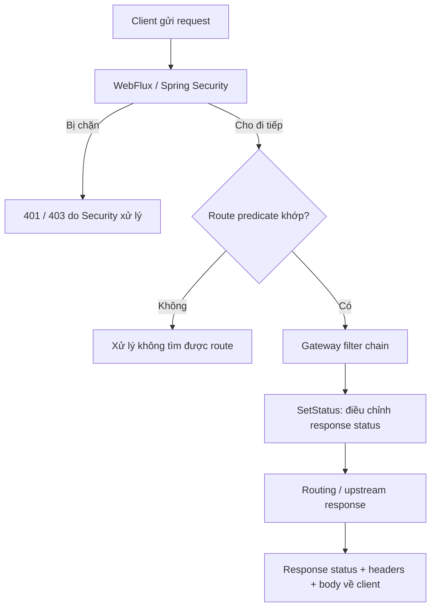
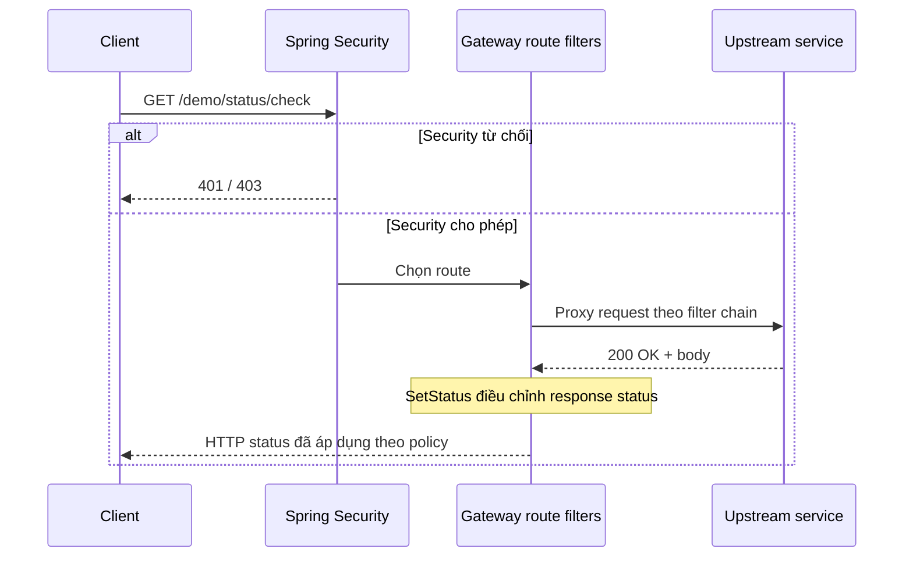

# SetStatus và hợp đồng mã HTTP trả về client

Khi một client gọi API qua **Spring Cloud Gateway**, nó cần nhận được mã HTTP có ý nghĩa nhất quán, dù Gateway định tuyến tới microservice nào. Mã `200` cho biết request được xử lý thành công theo hợp đồng; `401` yêu cầu xác thực; `429` báo vượt hạn mức; `503` thường nói dịch vụ tạm không sẵn sàng. Một mã HTTP không phù hợp có thể khiến ứng dụng xử lý sai, cơ chế retry hoạt động nguy hiểm hoặc hệ thống giám sát đếm nhầm tỷ lệ lỗi.

Trong chương **Header và trạng thái**, **`SetStatus` GatewayFilter Factory** là công cụ thay đổi HTTP **response status** mà Spring Cloud Gateway trả về. Bài học này giải thích cách cấu hình `SetStatus`, giới hạn của nó và cách giữ **hợp đồng HTTP** khi phối hợp route predicate, filter chain, Spring Security, rate limiting, circuit breaker, retry, TLS và quan sát request.

> **Phạm vi:** Các ví dụ dùng **Spring Cloud Gateway Server WebFlux**. Spring Cloud Gateway Server MVC có pipeline và API cấu hình khác. `SetStatus` chỉ điều chỉnh mã trạng thái của response; nó không tự biến đổi response body thành một thông báo lỗi đúng hợp đồng, không xác thực người dùng và không mặc định ngăn request đến upstream.

## 1. Phân biệt ba loại “trạng thái” trong một request

Trước khi dùng `SetStatus`, cần phân biệt:

| Loại trạng thái | Ví dụ | Nó biểu diễn điều gì? |
| --- | --- | --- |
| **HTTP response status** | `200`, `404`, `429`, `503` | Kết quả mà client nhận ở tầng giao thức HTTP |
| **Reactive terminal signal** | `onComplete`, `onError`, `cancel` | Vòng đời thực thi `Mono`/`Flux` trong WebFlux/Reactor |
| **Trạng thái upstream** | Backend trả `201`, connection timeout, instance unavailable | Kết quả hoặc sự cố xảy ra khi Gateway giao tiếp với dịch vụ đích |

Ba thứ có liên hệ nhưng **không đồng nhất**. Ví dụ backend có thể trả một response HTTP `503` hợp lệ, Gateway proxy nó về client rồi luồng Reactor vẫn kết thúc bằng `onComplete`. Ngược lại, lỗi socket có thể tạo `onError` và được một bộ xử lý lỗi chuyển thành HTTP `502` hoặc `503`.

`SetStatus` tác động lên **mã HTTP trả về**, chứ không tự chuyển `onError` thành một response có body, không thay đổi kết quả nghiệp vụ đã xảy ra ở backend và không xác định client có nên retry hay không.



Sơ đồ thể hiện **trách nhiệm** của các tầng, không cố định vị trí thực thi từng callback pre/post trong filter chain. Thứ tự filter, cách routing xử lý response và thời điểm response được commit là những yếu tố cần kiểm tra khi triển khai thực tế.

## 2. Cú pháp SetStatus GatewayFilter Factory

`SetStatus` nhận **một tham số**: mã trạng thái HTTP mong muốn.

Cách khai báo shortcut phổ biến:

```yaml
filters:
  - SetStatus=UNAUTHORIZED
```

Hoặc dùng **mã số**:

```yaml
filters:
  - SetStatus=401
```

Trong những phiên bản Spring Cloud Gateway hỗ trợ dạng này, `UNAUTHORIZED` là tên tương ứng với HTTP `401` theo `HttpStatus` của Spring. Có thể dùng các tên chuẩn như `NOT_FOUND`, `TOO_MANY_REQUESTS`, `SERVICE_UNAVAILABLE`, `GATEWAY_TIMEOUT` hoặc số HTTP tương ứng.

Một route minh họa:

```yaml
spring:
  cloud:
    gateway:
      routes:
        - id: status-demo
          uri: http://localhost:8081
          predicates:
            - Path=/demo/status/**
          filters:
            - SetStatus=SERVICE_UNAVAILABLE
```

Nếu request khớp route và filter áp dụng được trước khi response commit, Gateway sẽ đặt HTTP status mà client nhận thành **`503 Service Unavailable`**.

**Cảnh báo rất quan trọng:** Cấu hình trên vẫn có `uri` và chuỗi Gateway routing. `SetStatus` **không có nghĩa “không gọi backend”**. Nó là một thao tác đặt status trong filter chain, không phải mặc nhiên một lệnh short-circuit. Dùng `SetStatus=SERVICE_UNAVAILABLE` làm “chế độ bảo trì” mà không kiểm tra việc gọi upstream có thể khiến backend tiếp tục nhận request, kể cả request ghi dữ liệu.

### Hai kiểu cấu hình

| Cú pháp | Ý nghĩa |
| --- | --- |
| `SetStatus=404` | Đặt mã HTTP `404` |
| `SetStatus=NOT_FOUND` | Đặt mã HTTP `404` bằng tên hằng |
| `SetStatus=429` | Đặt mã HTTP `429` |
| `SetStatus=TOO_MANY_REQUESTS` | Đặt mã HTTP `429` bằng tên hằng |
| `SetStatus=503` | Đặt mã HTTP `503` |
| `SetStatus=SERVICE_UNAVAILABLE` | Đặt mã HTTP `503` bằng tên hằng |

Dùng tên hằng giúp người đọc nhận diện ý nghĩa, dùng số gần với mã mà client thấy. Khi dùng giá trị không được phiên bản Spring hỗ trợ hoặc sai chính tả, ứng dụng có thể không khởi tạo/không nạp route thành công; phải xác minh log cấu hình và các route được đăng ký.

**Lưu ý về phiên bản:** `spring.cloud.gateway.routes` là prefix quen thuộc trong các bản Spring Cloud Gateway WebFlux truyền thống. Một số bản mới sử dụng `spring.cloud.gateway.server.webflux.routes`. Chọn prefix phù hợp với starter/phiên bản đang dùng; cú pháp `SetStatus=...` không thay đổi bản chất vì sự khác biệt prefix này.

## 3. SetStatus được áp dụng ở đâu trong pipeline?

Từ góc nhìn request:

1. WebFlux nhận request; nếu có Spring Security, lớp bảo mật có thể từ chối trước khi Gateway chọn route.
2. `RoutePredicateHandlerMapping` đánh giá các điều kiện `Path`, `Method`, `Host`, `Header`, `Query`… và chọn một route phù hợp.
3. `FilteringWebHandler` kết hợp `GlobalFilter` và `GatewayFilter` của route đã chọn thành chuỗi có thứ tự.
4. `SetStatus` chạy trong **Gateway filter chain** để thay đổi response status theo cấu hình.
5. Các filter routing/response khác tiếp tục tham gia xử lý; response được commit rồi gửi đến client.

Vì vậy:

- `SetStatus` của một route **không chạy** nếu request không khớp route đó.
- Nếu Spring Security trả `401`/`403` trước khi Gateway route được chọn, `SetStatus` của route **không thể đi ngược lại** để sửa response của Security.
- Nếu filter khác đã commit response headers hoặc bắt đầu streaming body, việc đổi status muộn có thể không còn hiệu lực.
- Nếu có nhiều filter cùng sửa status, kết quả cuối phụ thuộc thứ tự/thời điểm chúng được áp dụng. Không dùng nhiều chính sách ghi status mâu thuẫn mà không kiểm thử.

### Response commit là ranh giới không thể bỏ qua

Trong HTTP, mã trạng thái được gửi ở phần đầu response. Khi headers đã được commit ra mạng, Gateway **không thể đáng tin cậy thay `200` bằng `503`** sau đó.

```text
Trước commit:
    status = 200          -> có thể đặt status = 503
    headers còn sửa được -> có thể thêm Retry-After

Sau commit:
    status/headers đã gửi -> không thể “đổi response” đã đến client
    body có thể đang stream -> lỗi tiếp theo có thể ngắt stream/kết nối
```

Trong filter Java tùy chỉnh, `ServerHttpResponse.setStatusCode(...)` trả về kết quả cho biết có thể đặt status hay không; có thể kiểm tra `isCommitted()` để xác định response đã ở trạng thái commit. Còn khi sử dụng `SetStatus`, hãy đặt yêu cầu theo đúng điểm trong pipeline và **kiểm thử request thật**, đặc biệt với streaming, response lớn, các filter viết response sớm hoặc error handling.

`SetStatus` không phải một “lưới an toàn” đảm bảo mọi exception đều đổi thành một HTTP status mới. Những exception xảy ra trước khi response hình thành cần được xử lý bởi cơ chế lỗi WebFlux/Gateway phù hợp.

## 4. HTTP status là một phần của hợp đồng API

Mỗi nhóm mã HTTP có ngữ nghĩa mà client, proxy, cache và công cụ giám sát thường dựa vào.

| Mã HTTP | Ý nghĩa thông thường | Hệ quả hợp đồng cần xem xét |
| --- | --- | --- |
| `200 OK` | Thành công, có representation tùy phương thức | Body phải phù hợp schema thành công |
| `201 Created` | Đã tạo resource | Nên có representation hoặc URI tài nguyên mới qua `Location` khi phù hợp |
| `202 Accepted` | Đã nhận để xử lý chưa hoàn tất | Cần cơ chế theo dõi tác vụ/kết quả nếu xử lý async |
| `204 No Content` | Thành công, không có response content | **Không gửi response body** |
| `301`/`308` | Chuyển hướng lâu dài | Phải cân nhắc `Location`, cache và hành vi client |
| `302`/`307` | Chuyển hướng tạm thời | `Location` và khác biệt về việc giữ method rất quan trọng |
| `400 Bad Request` | Request không hợp lệ | Nội dung lỗi nên chỉ rõ loại validation sai |
| `401 Unauthorized` | Thiếu/không hợp lệ thông tin xác thực | Với HTTP authentication, cần `WWW-Authenticate` phù hợp |
| `403 Forbidden` | Đã hiểu request nhưng từ chối quyền | Không dùng thay `401` khi đơn thuần chưa xác thực |
| `404 Not Found` | Không tìm thấy tài nguyên/handler | Phân biệt route không tồn tại và backend trả 404 |
| `405 Method Not Allowed` | Method không hỗ trợ cho resource | Cần header `Allow` theo quy tắc HTTP |
| `409 Conflict` | Xung đột trạng thái resource | Trả dữ liệu giúp client giải quyết xung đột nếu an toàn |
| `422 Unprocessable Content` | Nội dung request hợp cú pháp nhưng không xử lý được theo ngữ nghĩa | Phân biệt với lỗi cú pháp `400` theo contract |
| `429 Too Many Requests` | Quá giới hạn request | Thường dùng `Retry-After` hoặc thông tin quota phù hợp |
| `500 Internal Server Error` | Lỗi xử lý phía server | Tránh lộ stack trace và thông tin nội bộ |
| `502 Bad Gateway` | Gateway nhận response không hợp lệ từ upstream | Phân loại lỗi tích hợp/proxy |
| `503 Service Unavailable` | Dịch vụ tạm không sẵn sàng | Có thể kèm `Retry-After`; tránh gây retry storm |
| `504 Gateway Timeout` | Gateway không nhận kết quả kịp thời từ upstream | Cần timeout budget và chính sách retry có giới hạn |

**Đổi status không đồng nghĩa đã đáp ứng hợp đồng.** Một body báo `"success": true` nhưng status `503` tạo ra thông điệp mâu thuẫn. Tương tự, đặt status `201` không tự tạo tài nguyên, `Location` hoặc representation của resource đó.

### Ví dụ về hợp đồng không nhất quán

Giả sử backend trả:

```http
HTTP/1.1 200 OK
Content-Type: application/json

{"orderId":42,"status":"CONFIRMED"}
```

Gateway đặt `SetStatus=503` nhưng giữ response body thành công. Client sẽ nhận một response có status lỗi nhưng body khẳng định đơn hàng đã xác nhận. Một số client tự retry khi thấy `503`, có thể tạo thao tác lặp.

Hệ quả:

1. **Client logic** khó quyết định nên retry, báo lỗi hay hiển thị dữ liệu.
2. **Monitoring** đếm lỗi 5xx dù backend thực hiện thành công.
3. **Caching** và retry infrastructure có thể thay đổi hành vi theo status.
4. **Giao dịch ghi** có thể đã commit, dù client nhận mã lỗi.

Cần sử dụng `SetStatus` khi việc đổi mã là **chính sách có chủ đích và hợp đồng response đã được thiết kế đầy đủ**, không dùng để che mọi lỗi của hệ thống.

## 5. Phân biệt SetStatus với trả response ngay lập tức

Có hai nhu cầu rất khác nhau:

**Nhu cầu A — Điều chỉnh mã status của một response đang được xử lý:** dùng `SetStatus` khi toàn bộ chain và nội dung response phù hợp.

**Nhu cầu B — Từ chối request và không gửi upstream:** cần **short-circuit** trong một filter hoặc cơ chế chuyên trách. `SetStatus` tự nó không có hợp đồng “dừng chuỗi xử lý”.

Ví dụ một `GatewayFilter` viết bằng Java theo kiểu minh họa, trả `503` ngay mà **không gọi `chain.filter(exchange)`**:

```java
GatewayFilter maintenanceFilter = (exchange, chain) -> {
    ServerHttpResponse response = exchange.getResponse();

    response.setStatusCode(HttpStatus.SERVICE_UNAVAILABLE);
    response.getHeaders().set(HttpHeaders.RETRY_AFTER, "120");

    return response.setComplete();
};
```

Ví dụ dùng `GatewayFilter`, `ServerHttpResponse`, `HttpStatus` và `HttpHeaders`. Phần mã trên có thể được tích hợp vào một factory custom hoặc cách xây dựng route Java tương ứng. Đây là bộ lọc **luôn từ chối** khi được áp dụng, chưa có điều kiện bật/tắt bảo trì; hệ thống thực tế cần thêm chính sách vận hành phù hợp.

Khác biệt cốt lõi:

| Đặc điểm | `SetStatus=503` | Filter trả `response.setComplete()` sớm |
| --- | --- | --- |
| Đặt HTTP status | Có | Có |
| Mặc định gọi tiếp route chain | Có, không đại diện cho thao tác chặn ngay | Không, nếu không gọi `chain.filter` |
| Mặc định tạo response body chuẩn lỗi | Không | Không; phải tự tạo nếu contract yêu cầu |
| Có thể tránh gọi upstream | Không thể suy ra chỉ từ `SetStatus` | Có, nếu filter chặn **trước routing** |
| Phù hợp dùng làm maintenance gate tuyệt đối | Không đủ một mình | Có thể, nếu vị trí/order và policy được kiểm soát |

Đối với response lỗi dạng JSON, một filter custom cần đặt status, `Content-Type` và body phù hợp, xử lý đúng `DataBuffer` và commit. Nếu chỉ cần response không có body, `setComplete()` là cách đơn giản. Với lỗi chung, hãy cân nhắc bộ xử lý lỗi tập trung của WebFlux và các Gateway filter sẵn có trước khi viết giải pháp tùy chỉnh.

## 6. So sánh SetStatus với các cơ chế sinh status khác

| Trường hợp | Cơ chế phù hợp hơn | Vì sao |
| --- | --- | --- |
| Route có yêu cầu đổi mã response cố định, đã biết contract | `SetStatus` | Thay đổi status trên response của route |
| Client chưa xác thực | Spring Security authentication entry point | Sinh `401` cùng `WWW-Authenticate` và xử lý token |
| Client đã xác thực nhưng thiếu quyền | Spring Security access denied handler | Sinh `403` đúng chính sách |
| Request vượt quota | `RequestRateLimiter` hoặc cơ chế tương đương | Từ chối request `429` theo key/quota được cấu hình |
| Upstream timeout | Timeout trong HTTP client hoặc filter bảo vệ + error mapping | Xác định deadline và phân loại lỗi thành `504` khi phù hợp |
| Upstream lỗi và có fallback | `CircuitBreaker`/fallback hợp lệ | Giảm phụ thuộc upstream, tạo nội dung fallback nhất quán |
| Upstream trả mã lỗi có ý nghĩa | Proxy response và policy xử lý lỗi có chọn lọc | Giữ nguyên hợp đồng dịch vụ hoặc chuyển đổi có kiểm soát |
| Không tìm thấy Gateway route | WebFlux handler mapping/error handling | Route filter không chạy vì chưa chọn route |
| Cần response chặn ngay và không proxy | Custom filter hoặc handler trả response và dừng chain | Kiểm soát body, headers, status và việc gọi upstream |

**Ví dụ 401:** `SetStatus=UNAUTHORIZED` không tự xác minh JWT, không tạo challenge authentication và không bảo vệ các route khác. Để bảo vệ API, cấu hình `SecurityWebFilterChain` cùng OAuth2 resource server/authorization policy phù hợp.

**Ví dụ 429:** `SetStatus=TOO_MANY_REQUESTS` trên mọi request không tính quota và không kiểm tra danh tính/rate key. Dùng `RequestRateLimiter` với thuật toán và key resolver thích hợp để chỉ từ chối request **vượt hạn mức**.

**Ví dụ 504:** Một route gắn `SetStatus=GATEWAY_TIMEOUT` không tự đợi backend đến khi hết hạn; nó chỉ đặt status, không có timeout timer. Hãy đặt connection/response timeout đúng vị trí, quyết định timeout budget và ánh xạ exception đúng ngữ nghĩa.

## 7. Phối hợp SetStatus với header phản hồi

Một response HTTP gồm status line, headers và có thể có body. Khi cố tình thay status, hãy kiểm tra các header liên quan.

### `503 Service Unavailable` và `Retry-After`

`Retry-After` có thể biểu diễn số giây chờ hoặc thời điểm HTTP-date mà client có thể cân nhắc trước lần thử lại:

```http
HTTP/1.1 503 Service Unavailable
Retry-After: 120
Cache-Control: no-store
```

Có thể thêm response header bằng một Gateway filter tương ứng:

```yaml
filters:
  - SetStatus=SERVICE_UNAVAILABLE
  - AddResponseHeader=Retry-After,120
  - AddResponseHeader=Cache-Control,no-store
```

**Đây chỉ là minh họa việc đặt status/headers.** Nó không ngăn upstream được gọi và không đảm bảo body phù hợp. Nếu mục tiêu là chặn request bảo trì, hãy dùng short-circuit hoặc handler chuyên trách như mục 5.

### `401 Unauthorized` và `WWW-Authenticate`

Trong luồng xác thực HTTP, `401` thường cần `WWW-Authenticate` để mô tả cách xác thực. Với API dùng Bearer JWT, Spring Security resource server xử lý challenge theo ngữ cảnh lỗi xác thực. `SetStatus=401` đơn lẻ không tạo challenge hoặc phân biệt token hết hạn, sai chữ ký, thiếu scope.

Đừng tự chèn `WWW-Authenticate` cố định trên mọi request nếu chưa hiểu scheme và chính sách bảo mật. Ví dụ thiếu authentication và token không có quyền là hai trường hợp cần mã/phản hồi khác nhau.

### `201 Created` và `Location`

Nếu backend đã tạo resource, `201` có thể đi kèm URI tài nguyên mới, ví dụ:

```http
HTTP/1.1 201 Created
Location: https://api.example.test/api/orders/42
Content-Type: application/json

{"id":42}
```

Chỉ dùng `SetStatus=CREATED` khi có hành động tạo resource thực sự và representation/`Location` phù hợp. Nếu upstream trả `200` vì thao tác chỉ đọc, đổi sang `201` không khiến resource xuất hiện.

### `204 No Content`

`204` nghĩa là response **không có content**. Nếu upstream đã có JSON body, đổi status thành `204` mà không phối hợp xử lý body/header là hợp đồng sai và có thể dẫn tới client đọc dữ liệu bất thường. Cần quyết định nơi tạo response `204` đúng chuẩn, loại bỏ body, và tránh header content không hợp lệ.

### `405 Method Not Allowed` và `Allow`

`405` cần header `Allow` liệt kê các method được hỗ trợ. `Method` route predicate không khớp thường làm Gateway xét route khác hoặc không tìm được route; điều đó **không tự đảm bảo** phát `405` cùng `Allow`. Nếu API yêu cầu contract `405` rõ ràng, cần thiết kế xử lý ở tầng phù hợp.

### `3xx Redirect` và `Location`

`SetStatus=FOUND` (302) hoặc `SetStatus=TEMPORARY_REDIRECT` (307) không tự chọn URL đích. Client cần biết `Location`. Hơn nữa, `301`/`302` và `307`/`308` có thể khác nhau về việc giữ method khi redirect; chọn mã dựa trên yêu cầu thực tế của API, tránh đổi `POST` thành chuyển hướng có hành vi không mong muốn.

## 8. Cấu hình nhiều route và phân biệt chính sách status

Giả sử Gateway có các route:

- `/api/products/**` chuyển tiếp bình thường đến `product-service`.
- `/demo/status/**` dùng để kiểm tra filter `SetStatus` trong môi trường phát triển.
- `/api/orders/**` được bảo vệ bằng JWT và rate limiter phù hợp.

Một cấu hình kiểm thử tách route rõ ràng:

```yaml
spring:
  cloud:
    gateway:
      routes:
        - id: products
          order: 0
          uri: http://localhost:8081
          predicates:
            - Path=/api/products/**
          filters:
            - StripPrefix=1

        - id: status-lab
          order: 0
          uri: http://localhost:8082
          predicates:
            - Path=/demo/status/**
          filters:
            - SetStatus=SERVICE_UNAVAILABLE
            - AddResponseHeader=X-Status-Demo,enabled
```

Request `GET /api/products/42` không bị `SetStatus` của route `status-lab` tác động, vì filter đó chỉ thuộc route `status-lab`. Ngược lại, `GET /demo/status/check` có thể nhận status `503` theo cấu hình filter. Đừng hiểu rằng trạng thái của một route được áp dụng chung cho toàn Gateway.

Nếu khai báo một filter ở cấu hình `default-filters`, nó có thể được áp dụng cho nhiều route theo cơ chế Gateway. Đặt `SetStatus` tại đó sẽ có phạm vi rộng hơn nhiều so với khai báo trên một route. Vì status là hợp đồng API, phải kiểm tra tất cả route trước khi cấu hình mặc định làm thay đổi mã HTTP của chúng.

### Khi nào dùng Java DSL?

Route có thể được mô tả bằng `RouteLocatorBuilder` ở Gateway WebFlux. Ví dụ tương đương về ý tưởng:

```java
@Configuration
public class StatusDemoRoutes {

    @Bean
    RouteLocator statusRoutes(RouteLocatorBuilder builder) {
        return builder.routes()
            .route("status-lab", route -> route
                .path("/demo/status/**")
                .filters(filters -> filters
                    .setStatus(HttpStatus.SERVICE_UNAVAILABLE))
                .uri("http://localhost:8082"))
            .build();
    }
}
```

Các kiểu cần import gồm `Configuration`, `Bean`, `RouteLocator`, `RouteLocatorBuilder` và `HttpStatus`. Chữ ký overload của Java DSL có thể khác theo phiên bản, vì vậy cần đối chiếu với API của bản Spring Cloud Gateway đang cài; ý nghĩa của filter vẫn là đặt HTTP status trong route filter chain.

## 9. Thứ tự filter và các yếu tố có thể ghi đè status

Khi có nhiều thành phần xử lý response, cần hiểu ai là **chủ sở hữu cuối cùng** của status:



Các tình huống cần lưu ý:

1. **Route filter không chạy:** Request bị Security từ chối, không khớp route hoặc được một handler khác xử lý.
2. **Có nhiều filter thay đổi status:** Một filter custom, fallback hoặc error handler có thể can thiệp; thứ tự và commit quyết định kết quả.
3. **Upstream thất bại ở tầng kết nối:** Không có response HTTP upstream để chỉ đơn giản “đổi status”; phải xử lý lỗi connection/timeout ở tầng đúng.
4. **Response đã commit:** Việc sửa status quá muộn không thể đảm bảo hiệu lực.
5. **Streaming body:** Khi response được gửi dần, không thể đổi status ở giữa stream chỉ vì gặp lỗi sau đó.

**Cách kiểm tra:** Quan sát route ID, status upstream, status Gateway trả client, error signal, timeout/retry và thời điểm response bắt đầu. Không dựa riêng vào một log `onError` để xác nhận mã HTTP cuối cùng.

### Status ban đầu và status sau thay đổi

Trong một số phiên bản Gateway, cơ chế `SetStatus` có tùy chọn ghi mã HTTP gốc từ response được proxy vào một response header cấu hình riêng để phục vụ quan sát. Nếu dự án sử dụng tính năng này, cần kiểm tra **tên thuộc tính và hành vi theo phiên bản**, đồng thời chỉ dùng nội bộ hoặc cân nhắc bảo mật trước khi phơi bày status gốc cho client.

Ngoài header chẩn đoán, nên có metric/tracing rõ ràng cho:

- Route ID.
- HTTP method, path template hoặc route pattern.
- HTTP status cuối cùng trả client.
- Upstream status nếu có response từ backend.
- Loại exception nếu không nhận được HTTP response.
- Số lần retry/circuit breaker fallback, thời gian xử lý và trace ID.

Tránh log Bearer token, cookie và body nhạy cảm.

## 10. Kiểm thử SetStatus bằng request thật

Giả sử Gateway chạy tại `http://localhost:8080`, upstream giả lập ở `http://localhost:8082` và route `status-lab` như mục 8. Upstream trả `200 OK` cùng body:

```http
HTTP/1.1 200 OK
Content-Type: application/json

{"message":"upstream-ok"}
```

### Gửi request

```bash
curl -i 'http://localhost:8080/demo/status/check'
```

Với điều kiện route khớp, filter hoạt động và response chưa bị commit sớm, cần kiểm tra status client nhận là `503` theo `SetStatus=SERVICE_UNAVAILABLE`. Đồng thời cần quan sát **upstream có được gọi hay không**. Không suy luận từ `503` rằng request chưa từng tới backend.

### Kiểm tra bằng mock upstream

Một đoạn test minh họa với WireMock và `WebTestClient`:

```java
@Test
void setStatusOverridesProxiedHttpStatus() {
    wireMockServer.stubFor(
        get(urlEqualTo("/demo/status/check"))
            .willReturn(aResponse()
                .withStatus(200)
                .withHeader("Content-Type", "application/json")
                .withBody("{\"message\":\"upstream-ok\"}")));

    webTestClient.get()
        .uri("/demo/status/check")
        .exchange()
        .expectStatus().isEqualTo(HttpStatus.SERVICE_UNAVAILABLE)
        .expectHeader().valueEquals("X-Status-Demo", "enabled");

    wireMockServer.verify(1,
        getRequestedFor(urlEqualTo("/demo/status/check")));
}
```

Đây là **phần kiểm thử minh họa**, không phải toàn bộ test class tự chạy độc lập. Dự án cần khai báo `wireMockServer`, `webTestClient`, cấu hình route và static imports WireMock; nếu Spring Security được bật, request phải đi qua security policy kiểm thử phù hợp.

Kiểm thử có hai mục đích đồng thời:

- Xác nhận **HTTP status cuối cùng** trả client có thể được thay đổi bởi `SetStatus`.
- Xác nhận **upstream vẫn được gọi** trong trường hợp cấu hình filter không short-circuit.

Nếu policy yêu cầu “không gọi upstream khi đang bảo trì”, bài test trên **phải được thay bằng assertion backend không được gọi**, cùng một filter chặn request thực sự.

### Thêm test cho các trường hợp biên

| Kịch bản | Điều cần kiểm tra |
| --- | --- |
| Upstream trả `200`, route có `SetStatus=503` | Status client, body, header có nhất quán không; upstream có được gọi không |
| Upstream trả `404`, route có `SetStatus=503` | Có cần giữ nguyên ý nghĩa lỗi tài nguyên không |
| Request không khớp `/demo/status/**` | `SetStatus` của route không chạy |
| Không có JWT cho API yêu cầu xác thực | Security trả `401` trước khi Gateway filter chạy |
| Response stream bắt đầu rồi gặp lỗi | Không cố viết status mới sau commit |
| Backend timeout/connection refused | Error handler quyết định HTTP error; không coi SetStatus là timeout mechanism |
| `SetStatus=204` trên response có body | Contract không có body phải được kiểm tra |
| `SetStatus=302` nhưng không có `Location` | Client không nhận đủ thông tin redirect |
| `SetStatus=429` và `Retry-After` | Chỉ áp dụng khi có chính sách rate limit thực và retry guidance phù hợp |

### Kiểm thử tương thích client

Một API có client Java, JavaScript và mobile không nên chỉ được kiểm thử bằng `curl`. Thử thêm logic xử lý response ở client: cách nó parse body, xử lý `4xx`/`5xx`, hiển thị lỗi, retry và cache. `WebClient.retrieve()` trong Spring WebFlux thường chuyển status lỗi thành exception theo chính sách mặc định, trong khi `exchangeToMono()` cho phép tự xử lý `ClientResponse`. Các client khác có thể không tự ném exception cho HTTP `503`. Đây là lý do status phải đúng ngữ nghĩa.

## 11. Lỗi thiết kế hay gặp và hướng xử lý

| Triệu chứng | Nguyên nhân khả dĩ | Cách xử lý |
| --- | --- | --- |
| Cấu hình `SetStatus=503` nhưng backend vẫn thực hiện nghiệp vụ | SetStatus không mặc định dừng chain | Dùng filter/handler short-circuit nếu muốn chặn upstream |
| Client nhận `401` dù route gắn `SetStatus=503` | Security từ chối trước khi route được chọn | Kiểm tra security entry point và quyền truy cập |
| Client nhận `404` vì sai path | Route gắn `SetStatus` không được chọn | Kiểm tra `Path`/`Method`/`Host` và order |
| Client nhận `503` với body thành công | Chỉ thay status, không thay body | Thiết kế hợp đồng body/status thống nhất |
| Client retry một thao tác ghi đã thành công | Status lỗi gây retry ở client/proxy | Không ngụy tạo `5xx`; dùng idempotency key và đối soát |
| `SetStatus=201` nhưng không có resource mới | Đổi status không tạo tài nguyên | Để backend quyết định trạng thái tạo tài nguyên |
| `SetStatus=204` nhưng vẫn có content | Không xử lý body/header theo ngữ nghĩa 204 | Trả response không body đúng hợp đồng |
| `SetStatus=302` nhưng browser không chuyển hướng đúng | Thiếu/sai `Location` | Kiểm tra URI public và loại redirect |
| `SetStatus=429` nhưng quota không được tính | SetStatus không phải rate limiter | Dùng `RequestRateLimiter` với key/quota đúng |
| Lỗi timeout không thành `504` như dự kiến | Không có timeout policy hoặc exception mapping phù hợp | Cấu hình HTTP client timeout/error handler |
| Status không đổi dù filter được gọi | Response đã commit hoặc filter khác thay đổi status | Xem thứ tự filter và thời điểm write/commit |
| Route không được nạp | Sai YAML, prefix cấu hình hoặc tên status không hợp lệ | Kiểm tra log startup và danh sách route thực tế |

Khi điều tra, phân biệt **“Gateway đã chọn route nhưng upstream trả lỗi”** với **“Gateway không tìm thấy route”**. Trường hợp đầu có thể có route ID và upstream status; trường hợp sau không chạy `SetStatus` của route không được chọn.

## 12. Bài thực hành: bảo trì API thanh toán an toàn

Một Gateway phục vụ:

- `GET /api/payments/{id}`: xem trạng thái thanh toán.
- `POST /api/payments`: gửi yêu cầu tạo thanh toán.
- Upstream `payment-service` được cấu hình qua `lb://payment-service`.
- Khi bảo trì, hệ thống phải trả `503` cùng `Retry-After` và **không thực hiện POST** ở backend.
- Client phải có cách biết rằng kết quả thanh toán chưa được xác nhận, tránh gửi lặp nếu một lần xử lý trước đó đã bắt đầu.

### Phương án không đủ an toàn

```yaml
spring:
  cloud:
    gateway:
      routes:
        - id: payments
          uri: lb://payment-service
          predicates:
            - Path=/api/payments/**
          filters:
            - SetStatus=SERVICE_UNAVAILABLE
```

Cấu hình này **không bảo đảm dừng routing**. Nó có thể làm client thấy `503` trong khi `payment-service` đã xử lý `POST`, dẫn đến nguy cơ client retry thanh toán trùng.

### Nguyên tắc triển khai đúng

Hãy thiết kế một maintenance gate ở tầng phù hợp, trước routing:

1. Kiểm tra trạng thái bảo trì qua nguồn cấu hình đáng tin cậy.
2. Nếu đang bảo trì, đặt status `503`, header `Retry-After` nếu hợp lệ và body lỗi rõ ràng theo contract; **không gọi `chain.filter(exchange)`**.
3. Nếu không bảo trì, trả về `chain.filter(exchange)` để Gateway xử lý bình thường.
4. Giữ authorization tại Spring Security; không để maintenance filter thay thế kiểm tra quyền truy cập.
5. Dùng idempotency key, transaction state và quy trình đối soát cho thao tác thanh toán.
6. Kiểm thử backend **không nhận request** trong chế độ bảo trì và client nhận đúng headers/body.

### Bài tập kiểm tra kiến thức

1. `SetStatus=NOT_FOUND` và `SetStatus=404` khác nhau về ý nghĩa HTTP không?
2. Vì sao `SetStatus=503` không bảo đảm backend chưa được gọi?
3. `SetStatus=UNAUTHORIZED` có thay thế cấu hình Spring Security JWT không?
4. Nếu response body ghi `{"success":true}` nhưng status là `503`, những client/proxy nào có thể xử lý khác kỳ vọng?
5. Vì sao `204` không nên được áp dụng trên response có JSON body mà không sửa hợp đồng?
6. Khi request không khớp route, `SetStatus` của route đó có chạy không?
7. `429` đúng nghĩa cần thêm những yếu tố nào ngoài một mã status?
8. Khi response đã commit, filter có thể đổi `200` thành `504` để phản ánh timeout giữa stream không?
9. Để bảo đảm không gọi backend khi bảo trì, hành vi nào trong `GatewayFilter` bắt buộc khác với `SetStatus` thông thường?
10. Vì sao cần đo cả status upstream và status cuối cùng client nhìn thấy?

**Ghi nhớ:** **`SetStatus` chỉ thay đổi HTTP response status trong phạm vi Gateway route đã được chọn**. Nó không tự xác thực, không tự tính hạn mức, không sinh body hợp đồng, không tạo redirect, không quyết định timeout và không mặc định ngăn upstream được gọi. Sử dụng đúng nghĩa của từng mã HTTP, phối hợp headers/body, kiểm soát response commit và xác minh hành vi bằng request thật giúp API Gateway vận hành an toàn và có thể quan sát được.

