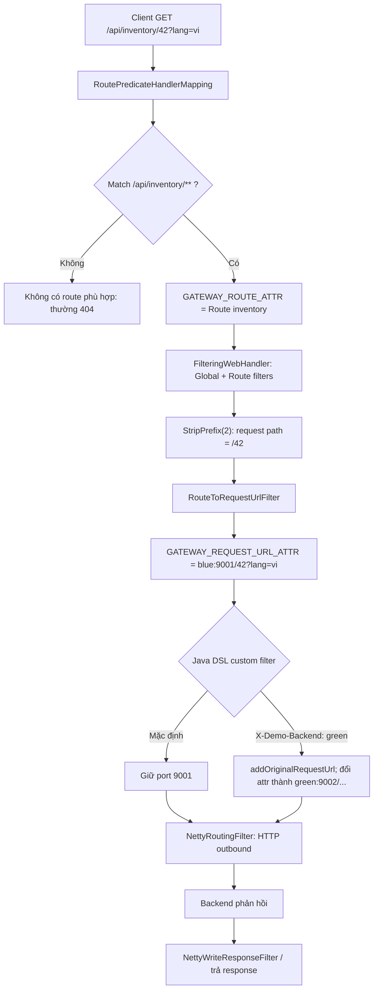

# Đổi URI đích qua Java DSL và kiểm soát exchange attributes

## 1. Mục tiêu và tình huống thực tế

Trong **SPRING_CLOUD_GATEWAY**, client gửi request đến một địa chỉ Gateway, nhưng Gateway có thể chọn máy chủ khác để chuyển tiếp. Thông thường đích được cấu hình sẵn trong route qua `uri`; với các nhu cầu đặc biệt, ứng dụng cũng có thể **đổi URI chuyển tiếp của từng request** bằng Java DSL và một `GatewayFilter` tùy biến.

Ví dụ, hệ thống inventory có hai backend thử nghiệm:

- **Blue:** `http://127.0.0.1:9001`
- **Green:** `http://127.0.0.1:9002`

Cả hai phục vụ `GET /42?lang=vi`. Một route duy nhất nhận `GET /api/inventory/42?lang=vi`; Gateway mặc định chuyển tới Blue, nhưng trong môi trường thử nghiệm có thể chọn Green khi request chứa `X-Demo-Backend: green`. Tên host/port đầu ra phải nằm trong **danh sách đích cố định mà ứng dụng cho phép**, không được xây trực tiếp từ URL hay header tùy ý của client.

Chủ đề này thuộc chương **Header và trạng thái**, vì thay đích HTTP ảnh hưởng đến `Host`, request/response headers, status và tính khả dụng của upstream. Tuy nhiên, cơ chế trung tâm là **các thuộc tính nội bộ của `ServerWebExchange`**, không phải viết một header điều khiển routing.

Sau bài học, bạn sẽ:

1. Khai báo route bằng `RouteLocatorBuilder` trong Java DSL.
2. Phân biệt **route URI** (`Route.getUri()`), **request URI từ client** và **URI đích đã phân giải** (`GATEWAY_REQUEST_URL_ATTR`).
3. Đổi đích đúng thời điểm: **sau** `RouteToRequestUrlFilter`, **trước** HTTP routing filter.
4. Bảo toàn path/query khi đổi host/port, đồng thời ghi nhận URI trước khi thay đổi qua `addOriginalRequestUrl`.
5. Giải thích vai trò và giới hạn của `GATEWAY_ROUTE_ATTR`, `GATEWAY_ORIGINAL_REQUEST_URL_ATTR`, `GATEWAY_SCHEME_PREFIX_ATTR`, `GATEWAY_ALREADY_ROUTED_ATTR`.
6. Kiểm thử backend thực nhận request và phân biệt lỗi route, lỗi mạng, HTTP status và response header.
7. Áp dụng đúng ranh giới an toàn cho service discovery, auth, rate limit, retry, circuit breaker, TLS và observability.

> **Phạm vi phiên bản:** ví dụ dùng **Spring Cloud Gateway Server WebFlux** thuộc Spring Cloud 2025.0.x / Gateway 4.3.x, với Spring Boot 3.5.x. Starter minh họa là `spring-cloud-starter-gateway-server-webflux`. Các ví dụ dành cho Gateway Server MVC hoặc release train cũ có thể khác tên starter, gói API hoặc prefix cấu hình; cần đối chiếu tài liệu đúng phiên bản.

## 2. Ba loại URI dễ bị nhầm lẫn

Giả sử client gửi:

```http
GET /api/inventory/42?lang=vi HTTP/1.1
Host: localhost:8080
```

Route Java DSL khai báo:

```java
.uri("http://127.0.0.1:9001")
```

Và filter `StripPrefix=2` loại `/api/inventory`. Khi xử lý, có ba URI liên quan:

| Loại | Giá trị minh họa | Ý nghĩa |
| --- | --- | --- |
| **Request URI phía client** | `http://localhost:8080/api/inventory/42?lang=vi` | URI của request đi vào Gateway, lấy từ `exchange.getRequest().getURI()`. |
| **Route URI** | `http://127.0.0.1:9001` | Đích khai báo tĩnh trong đối tượng `Route`. |
| **Resolved routing URI** | `http://127.0.0.1:9001/42?lang=vi` | URI sử dụng cho bước gửi request đến backend; được lưu trong exchange attribute `GATEWAY_REQUEST_URL_ATTR`. |

Điều này dẫn tới hai quy tắc:

- `Route.getUri()` mô tả đích từ cấu hình route. Nó không phải nơi chứa toàn bộ URL upstream cuối cùng của mọi request.
- `exchange.getRequest().getURI()` biểu diễn request hiện tại trong WebFlux; việc mutate request path và việc thay đổi **`GATEWAY_REQUEST_URL_ATTR`** là hai thao tác có quan hệ nhưng khác mục đích.

Khi Java DSL thay `GATEWAY_REQUEST_URL_ATTR` từ port `9001` sang `9002`, đó là **đổi đích proxy nội bộ**. Gateway vẫn trả response trực tiếp cho client qua URL `localhost:8080`; nó **không** gửi HTTP 301/302/307/308 hay bắt trình duyệt tự điều hướng tới Green.

### Tác động của path trong route URI

Gateway Server WebFlux xây dựng URL định tuyến từ URI của request và các thông tin route; **phần path được ghi trực tiếp trong route URI không phải cách đáng tin cậy để thêm prefix cho upstream**. Chẳng hạn:

```java
.uri("http://127.0.0.1:9001/hidden-prefix")
```

Không nên kỳ vọng `/hidden-prefix` sẽ tự động được chèn trước mọi request. Nếu muốn đổi path, hãy khai báo rõ `StripPrefix`, `SetPath`, `PrefixPath`, `RewritePath` hoặc filter mutate path phù hợp và kiểm thử URI đầu ra.

## 3. Dòng chảy của exchange attributes trong Gateway

Một request đã match route đi qua `RoutePredicateHandlerMapping` rồi `FilteringWebHandler`. Chuỗi này hợp nhất `GlobalFilter` với `GatewayFilter` của route và sắp xếp theo `Ordered`.



Các attribute quan trọng thuộc `ServerWebExchangeUtils`:

| Attribute / API | Loại dữ liệu thường gặp | Vai trò và lưu ý |
| --- | --- | --- |
| `GATEWAY_ROUTE_ATTR` | `Route` | Route đã được chọn theo predicate. Có thể đọc `id`, `uri`, `metadata`. |
| `GATEWAY_REQUEST_URL_ATTR` | `URI` | URI được bộ lọc định tuyến sử dụng. Đây là thuộc tính cần thay đổi khi muốn đổi đích HTTP cho request hiện tại. |
| `GATEWAY_ORIGINAL_REQUEST_URL_ATTR` | Tập URI lịch sử (thường là `LinkedHashSet<URI>`) | Ghi lại URI trước các bước biến đổi khi framework/filter chủ động thêm vào. Không giả định luôn có đúng một URI hay luôn chứa chính xác URL client đầu tiên. |
| `GATEWAY_SCHEME_PREFIX_ATTR` | Chuỗi scheme-prefix, nếu có | Phục vụ các trường hợp như `lb:ws://...`; không chỉnh tùy tiện nếu không nắm rõ đường định tuyến. |
| `GATEWAY_ALREADY_ROUTED_ATTR` | Dấu trạng thái nội bộ | Được routing filter dùng để tránh thực hiện routing nhiều lần. Không tự đánh dấu đã route **trước khi** HTTP outbound thực sự xảy ra. |
| `CLIENT_RESPONSE_ATTR` | Phản hồi HTTP client Netty | Dữ liệu phía routing/response-writing; thường không cần can thiệp khi chỉ đổi URI đích. |

Các attribute này nằm trong `exchange.getAttributes()`, **không phải HTTP headers** tự động gửi tới client hoặc upstream. Chúng chỉ sống trong phạm vi request/exchange hiện tại. Không lưu chúng vào biến static, singleton mutable map hoặc cache chung giữa nhiều request.

### Vì sao thứ tự thực thi quyết định thành bại?

`RouteToRequestUrlFilter` đọc `GATEWAY_ROUTE_ATTR`, tạo URI dựa trên route và request đã biến đổi, rồi **ghi đè `GATEWAY_REQUEST_URL_ATTR`**. Vì vậy:

- Nếu custom filter ghi URI vào `GATEWAY_REQUEST_URL_ATTR` **trước** bước này, giá trị có thể bị filter của framework thay thế.
- Nếu custom filter chạy **sau** HTTP routing filter, việc đổi URI quá muộn và không ảnh hưởng request đã được gửi.
- Trong ví dụ WebFlux 4.3.x, đặt filter chọn đích ngay **sau** `RouteToRequestUrlFilter`, thông qua `RouteToRequestUrlFilter.ROUTE_TO_URL_FILTER_ORDER + 1`, rồi để Netty routing tiếp tục.

`RouteToRequestUrlFilter.ROUTE_TO_URL_FILTER_ORDER` có giá trị `10000` trong dòng được minh họa. Việc dùng hằng số làm rõ quan hệ thứ tự; vẫn cần kiểm tra chuỗi filter của phiên bản thực tế khi nâng cấp hoặc thêm filter khác.

## 4. Đổi route URI tĩnh bằng Java DSL

Trường hợp đơn giản nhất là muốn các route khác nhau đi đến các dịch vụ xác định sẵn. Dùng `RouteLocatorBuilder`:

```java
@Bean
RouteLocator staticRoutes(RouteLocatorBuilder builder) {
    return builder.routes()
            .route("inventory-route", r -> r
                    .path("/api/inventory/**")
                    .filters(f -> f.stripPrefix(2))
                    .uri("http://127.0.0.1:9001"))
            .route("orders-route", r -> r
                    .path("/api/orders/**")
                    .filters(f -> f.stripPrefix(2))
                    .uri("http://127.0.0.1:9010"))
            .build();
}
```

Đoạn trên thuộc class `@Configuration`, với `@Bean`, `RouteLocator`, `RouteLocatorBuilder` được import. Không cần truy cập exchange attributes vì mỗi route đã có một URI đích cố định.

| Request | Route được chọn | URI outbound |
| --- | --- | --- |
| `/api/inventory/42` | `inventory-route` | `http://127.0.0.1:9001/42` |
| `/api/orders/71` | `orders-route` | `http://127.0.0.1:9010/71` |
| `/unknown` | Không có route phù hợp | Không có proxy qua hai route này |

**Thay đổi DSL trong khi ứng dụng đang chạy** không đồng nghĩa tự cập nhật mọi route đã tạo. `RouteLocator` được cung cấp qua Spring bean; muốn cấu hình động trong production cần cơ chế quản lý/làm mới route rõ ràng hoặc triển khai dựa trên cấu hình/dịch vụ khám phá thích hợp. Không coi lời gọi `.uri(...)` là một API chuyển đích theo từng request.

Khi muốn **một route** có thể chọn giữa các backend từ một tập được duyệt, ví dụ tiếp theo minh họa dùng custom filter tại đúng vị trí trong chain.

## 5. Ví dụ Java DSL thay URI đích theo từng request

Ta chọn hai backend cố định trên máy local; header `X-Demo-Backend` chỉ có ý nghĩa trong bài thực hành. Các giá trị ngoài `green` sẽ dùng backend mặc định **blue**. Mã không lấy hostname từ header, nhờ đó không tạo open proxy đến địa chỉ tùy ý.

### 5.1. Khởi tạo dự án

Sử dụng JDK 17+, Maven, Spring Boot 3.5.x và Spring Cloud 2025.0.x tương thích. Ví dụ `pom.xml` hoàn chỉnh:

```xml
<?xml version="1.0" encoding="UTF-8"?>
<project xmlns="http://maven.apache.org/POM/4.0.0"
         xmlns:xsi="http://www.w3.org/2001/XMLSchema-instance"
         xsi:schemaLocation="http://maven.apache.org/POM/4.0.0
                             https://maven.apache.org/xsd/maven-4.0.0.xsd">
    <modelVersion>4.0.0</modelVersion>

    <parent>
        <groupId>org.springframework.boot</groupId>
        <artifactId>spring-boot-starter-parent</artifactId>
        <version>3.5.0</version>
        <relativePath/>
    </parent>

    <groupId>com.example</groupId>
    <artifactId>gateway-uri-demo</artifactId>
    <version>0.0.1-SNAPSHOT</version>

    <properties>
        <java.version>17</java.version>
    </properties>

    <dependencyManagement>
        <dependencies>
            <dependency>
                <groupId>org.springframework.cloud</groupId>
                <artifactId>spring-cloud-dependencies</artifactId>
                <version>2025.0.0</version>
                <type>pom</type>
                <scope>import</scope>
            </dependency>
        </dependencies>
    </dependencyManagement>

    <dependencies>
        <dependency>
            <groupId>org.springframework.cloud</groupId>
            <artifactId>spring-cloud-starter-gateway-server-webflux</artifactId>
        </dependency>
    </dependencies>

    <build>
        <plugins>
            <plugin>
                <groupId>org.springframework.boot</groupId>
                <artifactId>spring-boot-maven-plugin</artifactId>
            </plugin>
        </plugins>
    </build>
</project>
```

Bản `3.5.0`/`2025.0.0` là **cặp ví dụ về release train**, không phải khuyến nghị sử dụng bản patch đầu tiên cho production. Khi tạo dự án mới, chọn patch được hỗ trợ theo bảng tương thích chính thức. Starter không gắn version riêng vì Spring Cloud BOM sẽ quản lý nó.

Tạo entry point `src/main/java/com/example/gateway/GatewayApplication.java`:

```java
package com.example.gateway;

import org.springframework.boot.SpringApplication;
import org.springframework.boot.autoconfigure.SpringBootApplication;

@SpringBootApplication
public class GatewayApplication {
    public static void main(String[] args) {
        SpringApplication.run(GatewayApplication.class, args);
    }
}
```

Tạo `src/main/resources/application.yml`:

```yaml
server:
  port: 8080

spring:
  application:
    name: gateway-uri-demo
```

Route của bài này được tạo bằng **Java DSL**, nên không thêm một route YAML trùng `/api/inventory/**` để tránh mơ hồ khi chọn route.

### 5.2. Viết `GatewayRoutes.java`

Tạo `src/main/java/com/example/gateway/GatewayRoutes.java`:

```java
package com.example.gateway;

import java.net.URI;

import org.springframework.cloud.gateway.filter.GatewayFilter;
import org.springframework.cloud.gateway.filter.RouteToRequestUrlFilter;
import org.springframework.cloud.gateway.route.RouteLocator;
import org.springframework.cloud.gateway.route.builder.RouteLocatorBuilder;
import org.springframework.context.annotation.Bean;
import org.springframework.context.annotation.Configuration;
import org.springframework.web.util.UriComponentsBuilder;

import reactor.core.publisher.Mono;

import static org.springframework.cloud.gateway.support.ServerWebExchangeUtils
        .GATEWAY_REQUEST_URL_ATTR;
import static org.springframework.cloud.gateway.support.ServerWebExchangeUtils
        .addOriginalRequestUrl;

@Configuration
public class GatewayRoutes {

    private static final String SELECTED_TARGET_ATTR =
            "demo.gateway.selectedTarget";

    @Bean
    RouteLocator gatewayRoutes(RouteLocatorBuilder builder) {

        return builder.routes()
                .route("inventory-route", r -> r
                        .path("/api/inventory/**")
                        .filters(f -> f
                                // Đổi path trước khi framework dựng URI đích.
                                .stripPrefix(2)
                                // Chạy sau RouteToRequestUrlFilter.
                                .filter(
                                        selectBackend(),
                                        RouteToRequestUrlFilter
                                                .ROUTE_TO_URL_FILTER_ORDER + 1)
                                // Header response chỉ để quan sát demo.
                                .addResponseHeader(
                                        "X-Gateway-Route", "inventory-route"))
                        // Backend mặc định, do Java DSL khai báo.
                        .uri("http://127.0.0.1:9001"))
                .build();
    }

    private GatewayFilter selectBackend() {
        return (exchange, chain) -> {

            URI current = exchange.getAttribute(
                    GATEWAY_REQUEST_URL_ATTR);

            if (current == null) {
                return Mono.error(new IllegalStateException(
                        "Gateway request URL missing; check filter order"));
            }

            // Tình huống demo chỉ hỗ trợ route HTTP đến 127.0.0.1:9001.
            if (!"http".equalsIgnoreCase(current.getScheme())
                    || !"127.0.0.1".equals(current.getHost())
                    || current.getPort() != 9001) {
                return Mono.error(new IllegalStateException(
                        "Unexpected route destination"));
            }

            String requestChoice = exchange.getRequest()
                    .getHeaders()
                    .getFirst("X-Demo-Backend");

            boolean useGreen = "green".equalsIgnoreCase(requestChoice);
            String selected = useGreen ? "green" : "blue";

            if (useGreen) {
                // Thay port trên URI đã phân giải, giữ nguyên path/query.
                URI greenUri = UriComponentsBuilder.fromUri(current)
                        .port(9002)
                        .build(true)
                        .toUri();

                // Lưu URI trước khi đổi vào lịch sử của exchange.
                addOriginalRequestUrl(exchange, current);

                // HTTP routing filter đọc giá trị mới ở đây.
                exchange.getAttributes().put(
                        GATEWAY_REQUEST_URL_ATTR, greenUri);
            }

            // Metadata nội bộ dành riêng cho request hiện tại.
            exchange.getAttributes().put(
                    SELECTED_TARGET_ATTR, selected);

            // Header demo phản ánh quyết định chọn target,
            // không xác nhận downstream đã trả 2xx.
            exchange.getResponse().getHeaders()
                    .set("X-Demo-Backend", selected);

            return chain.filter(exchange);
        };
    }
}
```

Đây là một route có **đích mặc định** `9001` và một custom `GatewayFilter` **chỉ được gắn vào route này**. Không dùng bean `GlobalFilter` cho toàn bộ Gateway vì yêu cầu chỉ thay đích request inventory.

Giải thích các phần quan trọng:

1. `.path("/api/inventory/**")` chọn route trước khi chạy các filter.
2. `.stripPrefix(2)` biến `/api/inventory/42` thành `/42`.
3. `.uri("http://127.0.0.1:9001")` đặt upstream **mặc định** cho route.
4. `.filter(selectBackend(), ROUTE_TO_URL_FILTER_ORDER + 1)` gắn filter ở thứ tự được kiểm soát. Đến thời điểm này, `RouteToRequestUrlFilter` đã tạo `GATEWAY_REQUEST_URL_ATTR`.
5. `current` là **URI outbound đã phân giải**, nên có path và query hiện hành. Chỉ thay port bằng `UriComponentsBuilder.fromUri(current).port(9002)` để giữ lại phần còn lại.
6. `addOriginalRequestUrl(exchange, current)` lưu URI trước thay đổi vào tập lịch sử. Không lấy `exchange.getRequest().getURI()` để thay cho `current` ở đây vì URI request phía client có thể khác URI outbound.
7. `exchange.getAttributes().put(GATEWAY_REQUEST_URL_ATTR, greenUri)` đưa URI mới tới các routing filter kế tiếp.
8. `demo.gateway.selectedTarget` là **attribute tự định nghĩa**, không ảnh hưởng routing trừ khi một filter khác chủ động sử dụng. `X-Demo-Backend` chỉ là response header quan sát được trong bài thử nghiệm.
9. `return chain.filter(exchange)` cho phép phần còn lại của chuỗi tiếp tục. Nếu bỏ lệnh này, request có thể bị dừng trước khi proxy.
10. Filter không gọi I/O blocking và không sử dụng state dùng chung có thể bị thay đổi giữa các request.

**Tại sao dùng `build(true)`?** `UriComponentsBuilder.fromUri(current)` tiếp nhận URI hiện tại với các thành phần đã được encode. `build(true)` thông báo các thành phần đó đã được encode, giúp giữ nguyên phần path/query đang có khi chỉ đổi port. Nếu tự ghép chuỗi URL hoặc decode/re-encode không kiểm soát, các dấu `%`, `+`, `&` hoặc ký tự Unicode có thể bị biến đổi ngoài ý muốn.

### 5.3. Vì sao không sửa `Route.getUri()`?

`Route` được tạo từ cấu hình/DSL là metadata định tuyến dùng chung, còn quyết định dùng Green trong ví dụ là **riêng một request**. Không chỉnh sửa một route bean hoặc field tĩnh có thể ảnh hưởng đồng thời đến request khác.

Muốn thay đích cho từng request, cập nhật đúng `GATEWAY_REQUEST_URL_ATTR` của **exchange hiện tại**. Những request khác vẫn nhận thuộc tính riêng và mặc định hướng về Blue, trừ khi chúng cũng có lựa chọn Green.

## 6. Tạo hai backend cục bộ và kiểm chứng bằng curl

Để biết request thực tế đã đến đâu, dùng một server Echo nhỏ từ JDK thay vì dựa vào log Gateway.

Tạo file `EchoBackend.java` trong thư mục demo riêng, ngoài mã nguồn Gateway:

```java
import com.sun.net.httpserver.HttpServer;
import java.net.InetSocketAddress;
import java.nio.charset.StandardCharsets;

public class EchoBackend {
    public static void main(String[] args) throws Exception {
        int port = Integer.parseInt(args[0]);
        String name = args[1];

        HttpServer server = HttpServer.create(
                new InetSocketAddress("127.0.0.1", port), 0);

        server.createContext("/", exchange -> {
            String path = exchange.getRequestURI().getRawPath();
            String query = exchange.getRequestURI().getRawQuery();

            System.out.println(name + " RECEIVED " + path
                    + (query == null ? "" : "?" + query));

            String body = "backend=" + name + "\n"
                    + "path=" + path + "\n"
                    + "query=" + query + "\n";

            byte[] bytes = body.getBytes(StandardCharsets.UTF_8);

            exchange.getResponseHeaders().set(
                    "Content-Type", "text/plain; charset=UTF-8");
            exchange.sendResponseHeaders(200, bytes.length);

            try (var output = exchange.getResponseBody()) {
                output.write(bytes);
            }
        });

        server.start();
        System.out.println(name + " ready on 127.0.0.1:" + port);
    }
}
```

Đây là server học tập chỉ lắng nghe loopback. Nó không triển khai xác thực, TLS, rate limiting hoặc circuit breaker; không dùng trong production.

Mở ba terminal, chạy lần lượt:

**Terminal A – backend Blue:**

```bash
java EchoBackend.java 9001 blue
```

**Terminal B – backend Green:**

```bash
java EchoBackend.java 9002 green
```

**Terminal C – Gateway** (tại thư mục dự án có `pom.xml`):

```bash
mvn spring-boot:run
```

Nếu sử dụng Maven Wrapper, dùng `./mvnw spring-boot:run` trên Linux/macOS hoặc `mvnw.cmd spring-boot:run` trên Windows.

### 6.1. Request mặc định đi tới Blue

```bash
curl -i "http://127.0.0.1:8080/api/inventory/42?lang=vi"
```

Response kỳ vọng:

```http
HTTP/1.1 200 OK
X-Gateway-Route: inventory-route
X-Demo-Backend: blue
Content-Type: text/plain; charset=UTF-8

backend=blue
path=/42
query=lang=vi
```

Terminal Blue in `blue RECEIVED /42?lang=vi`; terminal Green không nhận thêm request.

### 6.2. Request chọn Green

```bash
curl -i -H "X-Demo-Backend: green" \
    "http://127.0.0.1:8080/api/inventory/42?lang=vi"
```

Trên Windows PowerShell, dùng một dòng:

```powershell
curl.exe -i -H "X-Demo-Backend: green" "http://127.0.0.1:8080/api/inventory/42?lang=vi"
```

Response kỳ vọng:

```http
HTTP/1.1 200 OK
X-Gateway-Route: inventory-route
X-Demo-Backend: green
Content-Type: text/plain; charset=UTF-8

backend=green
path=/42
query=lang=vi
```

Terminal Green in `green RECEIVED /42?lang=vi`, còn terminal Blue không nhận request này. Điều đó xác nhận filter đã đổi URI đích trước bước proxy mà **không đổi path hoặc query**.

### 6.3. Header lạ không biến Gateway thành open proxy

```bash
curl -i -H "X-Demo-Backend: attacker.example.invalid:9999" \
    "http://127.0.0.1:8080/api/inventory/43"
```

Theo code trên, mọi giá trị ngoài `green` sẽ đi Blue, nên backend nhận request vẫn là `127.0.0.1:9001`. Ứng dụng **không** ghép hostname từ header thành đích outbound. Với production, lựa chọn backend nên dựa trên cấu hình có kiểm soát hoặc chính sách phân quyền rõ ràng; header minh họa không phải cơ chế xác thực.

### 6.4. Thử lỗi upstream

Dừng tiến trình Green, giữ Blue và Gateway đang chạy rồi gọi lại với `X-Demo-Backend: green`. Route vẫn match, filter vẫn quyết định chuyển tới Green, nhưng kết nối `9002` thất bại và Gateway thường trả lỗi nhóm **5xx**.

Response có thể vẫn chứa `X-Demo-Backend: green`, nhưng header chỉ mô tả **đích đã chọn**; nó không đảm bảo một cuộc gọi tới backend đã thành công hoặc đã trả 200.

Thử `/not-configured`: nếu không có route/handler khác, request thường trả **404**. Nó không vào filter `selectBackend` vì không khớp predicate.

## 7. Đọc và kiểm soát exchange attributes

### 7.1. Đọc route và URI đích

Trong một `GatewayFilter` hoặc `GlobalFilter` có biến `exchange`:

```java
Route selectedRoute = exchange.getAttribute(
        ServerWebExchangeUtils.GATEWAY_ROUTE_ATTR);

URI outbound = exchange.getAttribute(
        ServerWebExchangeUtils.GATEWAY_REQUEST_URL_ATTR);

String routeId = selectedRoute == null
        ? "unknown"
        : selectedRoute.getId();
```

Các import tương ứng:

```java
import java.net.URI;
import org.springframework.cloud.gateway.route.Route;
import org.springframework.cloud.gateway.support.ServerWebExchangeUtils;
```

Không giả định `GATEWAY_REQUEST_URL_ATTR` luôn tồn tại tại mọi thời điểm. Một filter chạy trước `RouteToRequestUrlFilter` có thể thấy giá trị `null`, và request không match route không đi qua cùng pipeline như request đã match.

### 7.2. Ghi lịch sử URI khi chuyển đích

Khi tự biến đổi URI đã phân giải, sử dụng:

```java
URI before = exchange.getAttribute(
        ServerWebExchangeUtils.GATEWAY_REQUEST_URL_ATTR);

ServerWebExchangeUtils.addOriginalRequestUrl(exchange, before);
exchange.getAttributes().put(
        ServerWebExchangeUtils.GATEWAY_REQUEST_URL_ATTR, changedUri);
```

Trong ví dụ này, `before` phải được kiểm tra khác `null` và `changedUri` phải được tạo/kiểm tra trước. Hàm `addOriginalRequestUrl` giúp duy trì lịch sử URI qua các bước transform. **Lịch sử có thể có nhiều mục**, do LoadBalancer, forward hoặc filter khác cũng có thể ghi. Không nên dùng một vị trí mặc định của tập URI để suy luận "luôn là URI gốc từ trình duyệt".

### 7.3. Metadata tự định nghĩa

Bạn có thể lưu thông tin phục vụ filter khác hoặc tracing trong exchange:

```java
private static final String SELECTED_TARGET_ATTR =
        "demo.gateway.selectedTarget";

exchange.getAttributes().put(SELECTED_TARGET_ATTR, "green");

String selected = exchange.getAttribute(SELECTED_TARGET_ATTR);
```

Dùng tên key có namespace riêng để tránh đụng các khóa của framework. Attribute tự định nghĩa không tự trở thành HTTP header; nếu thật sự cần thông báo cho downstream/client, phải thêm header ở tầng tương ứng và cân nhắc dữ liệu nhạy cảm.

### 7.4. Khi nào không nên sửa attribute?

| Việc định làm | Khuyến nghị |
| --- | --- |
| Đổi host/port upstream của request đã match | Có thể sửa `GATEWAY_REQUEST_URL_ATTR` tại đúng order và với đích đã được duyệt. |
| Đổi path upstream | Ưu tiên `SetPath`, `RewritePath`, `StripPrefix` hoặc `PrefixPath`. |
| Thay HTTP `Host` gửi upstream | Dùng filter/header API phù hợp; đừng giả định `GATEWAY_ROUTE_ATTR` hay URI client thay đổi thì `Host` outbound luôn đúng ý. |
| Thay status response | Dùng response API hoặc `SetStatus` filter. Thay URI không tự đổi status thành một giá trị cụ thể. |
| Chuyển hướng trình duyệt sang URL khác | Dùng `RedirectTo`/response HTTP 3xx có `Location`, không sửa routing attr để giả làm redirect. |
| Đánh dấu request đã route | Để routing filter quản lý `GATEWAY_ALREADY_ROUTED_ATTR`, không tự đặt để "tăng tốc". |
| Tự sửa `GATEWAY_SCHEME_PREFIX_ATTR` | Tránh nếu không thiết kế rõ luồng `lb:`, `ws:` hoặc `wss:`. |

## 8. Thay URI đích liên quan gì đến LoadBalancer và service discovery?

Ví dụ ở trên dùng hai URI HTTP **cụ thể**. Trong microservices thực tế, route thường được khai báo như:

```java
.uri("lb://inventory-service")
```

Khi đó:

1. `RouteToRequestUrlFilter` tạo URI định tuyến mang `lb` scheme.
2. `ReactiveLoadBalancerClientFilter` cần Spring Cloud LoadBalancer và danh sách `ServiceInstance` từ discovery hoặc cấu hình hợp lệ.
3. Filter LoadBalancer thay địa chỉ `lb://...` thành địa chỉ host/port HTTP(S) của instance được chọn.
4. HTTP routing filter mới proxy đến instance đó.

**Không áp dụng nguyên xi filter chọn port `9001/9002` của bài vào route `lb://`**: guard trong ví dụ cố ý chỉ chấp nhận HTTP route tĩnh đến loopback. Nếu muốn override đích cho route load-balanced, phải quyết định rõ thay đổi **trước** hay **sau** LoadBalancer, tuân thủ order và đặc tính URI scheme, đồng thời xem xét retry/circuit breaker, tình trạng instance và TLS. Đổi URI thành một địa chỉ tĩnh có thể vô tình **bỏ qua service discovery và cân bằng tải**.

Trường hợp thông thường nên để LoadBalancer chọn instance, dùng metadata và chính sách chọn instance phù hợp. Chỉ tùy biến exchange attribute khi nhu cầu không giải quyết được qua cơ chế chuẩn và đã có test liên kết.

## 9. Header, status và TLS khi thay backend

### HTTP headers

`GATEWAY_REQUEST_URL_ATTR` là URI outbound. Việc đổi host/port ở đây **khác** với:

- `Host` header của request từ client.
- `X-Forwarded-Host`, `Forwarded` và các header proxy.
- Header tùy biến như `X-Demo-Backend` trong ví dụ.

Backend cần biết host public hay host nội bộ nào là một vấn đề **độc lập** với việc Gateway đã chọn server nào. Với `PreserveHostHeader` hoặc `SetRequestHostHeader`, phải hiểu yêu cầu của upstream và ranh giới proxy tin cậy. Đừng chuyển tiếp vô điều kiện một `Host` do client giả mạo tới backend có logic dựa vào tên miền.

### HTTP status và response

Nếu route match nhưng backend Green tắt, Gateway có thể trả lỗi 5xx. Nếu backend Green trả `404`, Gateway có thể chuyển tiếp response 404 từ Green. Nếu client không match route, lỗi 404 có thể được tạo ngay tại Gateway trước bước định tuyến. Các trường hợp này cần phân biệt bằng route ID, log/tracing và thông tin kết nối.

`X-Demo-Backend` trong ví dụ là header **chẩn đoán**, phản ánh quyết định chọn đích. Đừng xuất hiện địa chỉ IP nội bộ hay thông tin hạ tầng bí mật trong response production. Nếu muốn trả lỗi chủ động ngay tại Gateway, đó là cơ chế **short-circuit**: set status/body rồi không gọi `chain.filter(exchange)`.

### TLS

Với `https://` outbound, Netty HTTP client cần thiết lập TLS với upstream. Việc đổi URI từ một host HTTPS sang host HTTPS khác có thể ảnh hưởng chứng chỉ, SNI, tên miền kiểm tra và cấu hình trust. Đổi `https` thành `http` chỉ để tránh lỗi TLS làm giảm bảo mật kết nối. Trong ví dụ local dùng `http://127.0.0.1` để đơn giản hóa bài thực hành; không lấy đó làm chính sách production.

## 10. An toàn khi đổi đích động

Một Gateway cho phép client tự chỉ định URL backend qua query/header mà không kiểm soát có nguy cơ trở thành **open proxy** hoặc đường tấn công **SSRF (Server-Side Request Forgery)**. Một request độc hại có thể cố ép Gateway truy cập metadata service của môi trường cloud, loopback, địa chỉ nội bộ hoặc hệ thống không được phép.

Áp dụng các nguyên tắc:

1. **Allowlist đích:** chọn từ tập host/port cố định hoặc service ID được tổ chức phê duyệt. Không dùng `new URI(clientHeader)` rồi ghi thẳng vào `GATEWAY_REQUEST_URL_ATTR`.
2. **Kiểm soát danh tính:** nếu quyết định chọn tenant/backend phụ thuộc quyền, xác thực trước bằng Spring Security WebFlux/OAuth2 và đối chiếu quyền với tenant hoặc service đã chọn.
3. **Ngăn chuyển hướng DNS/IP ngoài ý muốn:** không tin hostname động chưa được kiểm tra. Kể cả allowlist tên miền, cần tính đến DNS resolution và chính sách network egress ở runtime.
4. **Bảo toàn thuộc tính HTTP:** path, query, method, body và timeout phải được kiểm thử. Không ghép URL với dữ liệu client bằng thao tác nối chuỗi.
5. **Giới hạn độ trễ và lỗi:** cấu hình connect/response timeout, circuit breaker, retry có kiểm soát; không retry mù quáng `POST` có tác dụng phụ.
6. **TLS đúng chuẩn:** xác minh chứng chỉ upstream, không tắt xác minh để có thể gọi một địa chỉ khác.
7. **Quan sát có giới hạn:** ghi route ID, backend alias, status và latency; không log JWT, cookie, header nhạy cảm hoặc toàn bộ URL chứa query cá nhân.

Hai đích Blue/Green chỉ là **mô hình học tập**. Nếu cần canary hoặc traffic splitting ở production, cân nhắc route weighting/load-balancing và hạ tầng release management thay vì dựa vào header client tùy ý.

## 11. Những lỗi thường gặp

| Triệu chứng | Nguyên nhân cần kiểm tra | Cách xử lý |
| --- | --- | --- |
| Đã ghi `GATEWAY_REQUEST_URL_ATTR` nhưng request vẫn đi Blue | Custom filter chạy trước `RouteToRequestUrlFilter` nên URI bị ghi đè. | Gắn order chạy sau `ROUTE_TO_URL_FILTER_ORDER`, trước routing filter. |
| Custom filter thấy URI là `null` | Filter chạy quá sớm hoặc không ở nhánh đã chọn route. | Kiểm tra order và `GATEWAY_ROUTE_ATTR`. |
| Request đi Green nhưng path còn `/api/inventory/42` | Thiếu hoặc sai `StripPrefix(2)`. | Kiểm tra filter biến đổi path trước bước dựng URL. |
| URI đích mất query/encode sai | Tự nối chuỗi hoặc tạo URI từ path đã decode. | Sử dụng `UriComponentsBuilder.fromUri(current)`; test ký tự đặc biệt. |
| Header `X-Demo-Backend: green` nhưng client thấy lỗi 5xx | Header phản ánh quyết định, không chứng minh upstream trả 200. | Kiểm tra log kết nối, backend và metrics. |
| Route không khớp `/api/inventory/**` | Predicate sai hoặc route Java DSL chưa đăng ký. | Xem class `@Configuration`, route ID, startup logs. |
| Chọn backend dựa trên URL/header bất kỳ | Rủi ro open proxy/SSRF. | Chỉ dùng allowlist/chính sách kiểm soát và egress restrictions. |
| Đổi `lb://` thành HTTP đích tĩnh ngoài ý muốn | Tùy biến routing attr bỏ qua LoadBalancer. | Tách rõ luồng `lb://` và HTTP; dùng service discovery theo thiết kế. |
| Ghi `GATEWAY_ALREADY_ROUTED_ATTR` trước khi gọi chain | Routing filter có thể cho rằng request đã được proxy. | Không sửa thuộc tính này thủ công. |
| Status/response headers khác dự kiến | Có filter response khác hoặc upstream tự đặt status/header. | Quan sát thứ tự, response commit, status thực tế và filter chain. |
| Không phân biệt target mỗi request | Lưu lựa chọn backend vào field mutable singleton. | Dùng `exchange.getAttributes()` theo từng request. |

### Gợi ý quan sát filter chain

Trong môi trường dev, nếu có Spring Boot Actuator và endpoint quản trị Gateway được hỗ trợ, hãy xem **route và order của filter thực tế**. Bật endpoint theo tài liệu đúng phiên bản và bảo vệ quyền truy cập; không công khai API quản trị trên Internet. Khi muốn kết luận request đã đến backend nào, luôn kết hợp response marker của demo với log tại chính backend hoặc HTTP test server có bộ đếm, không suy ra chỉ từ trace "filter END".

## 12. Bộ kiểm thử hồi quy tối thiểu

Khi thay route URI qua Java DSL, một bộ test nên bao phủ:

| Kiểm thử | Đầu vào | Kết quả phải xác nhận |
| --- | --- | --- |
| Đích mặc định | `GET /api/inventory/42` | Backend Blue nhận `/42`. |
| Chọn Green | Cùng path, `X-Demo-Backend: green` | Backend Green nhận `/42`, Blue không nhận request. |
| Bảo toàn query | `?lang=vi&tag=a&tag=b` | Upstream giữ các cặp tên–giá trị theo hợp đồng đã xác định. |
| Header không hợp lệ | `X-Demo-Backend: random-host:1234` | Không truy cập địa chỉ ngoài allowlist; dùng Blue theo demo. |
| Không match route | `GET /unknown` | Không có proxy qua route inventory; thường 404. |
| Green bị tắt | Request chọn Green | Lỗi kết nối được nhận diện, không âm thầm gọi Blue nếu chưa có policy fallback. |
| Concurrent requests | Gửi đồng thời Blue/Green | Không rò đích giữa các exchange; mỗi request vào đúng backend. |
| HTTP status | Green trả 404 hoặc 503 | Quan sát status chính xác, không coi header chẩn đoán là status. |
| Chữ ký/encoding | Path/query có `%2F`, `+`, `%`, Unicode | Không double encode hoặc đổi ngữ nghĩa request ngoài chủ đích. |
| Bảo mật | Header chứa URI tùy ý, tenant không đủ quyền | Không tạo SSRF/đổi đích trái quyền, không log dữ liệu nhạy cảm. |

Với test tự động, chạy hai HTTP mock server gắn bộ đếm và xác minh cả **địa chỉ nhận request** lẫn **path/query/body được nhận**. Điều này mạnh hơn chỉ kiểm tra response header `X-Demo-Backend`.

## 13. Câu hỏi tự kiểm tra

**1. Thay `.uri("http://...")` bằng giá trị khác trong Java DSL có đồng nghĩa đổi backend cho từng request không?**

Không. `.uri(...)` định nghĩa đích của route khi xây dựng route. Lựa chọn đích cho từng request cần logic chạy khi xử lý request, ví dụ custom filter ghi `GATEWAY_REQUEST_URL_ATTR`.

**2. Vì sao custom filter sửa URI quá sớm có thể không có tác dụng?**

Vì `RouteToRequestUrlFilter` tạo URI từ route và có thể ghi đè `GATEWAY_REQUEST_URL_ATTR` sau đó.

**3. Đổi port trong `GATEWAY_REQUEST_URL_ATTR` có tự tạo HTTP redirect cho client không?**

Không. Đây là chuyển tiếp nội bộ của Gateway. Redirect 3xx dùng status và header `Location`.

**4. Vì sao nên gọi `addOriginalRequestUrl(exchange, before)` trước khi ghi URI mới?**

Để duy trì lịch sử URI trong exchange cho các bước xử lý/quan sát liên quan. Lịch sử có thể chứa nhiều URI và không mặc định đồng nghĩa với URL gốc phía client.

**5. `GATEWAY_ROUTE_ATTR` có chức năng gì?**

Chứa đối tượng `Route` đã match. Có thể đọc route ID, URI cấu hình và metadata; không dùng nó thay cho URI outbound cuối cùng.

**6. Vì sao không lấy host trực tiếp từ header rồi ghép vào URI đích?**

Vì client có thể điều khiển header và ép Gateway truy cập các đích tùy ý, tạo rủi ro SSRF/open proxy. Cần allowlist, quyền truy cập và chính sách egress.

**7. Một response có `X-Demo-Backend: green` nhưng status 503 chứng minh điều gì?**

Chỉ chứng minh filter đã chọn nhãn Green theo code minh họa. Không chứng minh kết nối tới Green đã thành công hay upstream đã trả status nào.

**8. Nếu route dùng `lb://inventory-service`, có nên áp dụng ngay filter thay port cục bộ không?**

Không. Phải hiểu thứ tự LoadBalancer, service discovery và URI scheme; lựa chọn instance nên để cơ chế chuẩn xử lý nếu phù hợp.

## Kết luận

Đổi URI đích trong Spring Cloud Gateway Server WebFlux có hai cấp độ: **đổi `uri` của route bằng Java DSL** khi cấu hình tĩnh, hoặc **đổi `GATEWAY_REQUEST_URL_ATTR` trong `ServerWebExchange`** khi có một quyết định được kiểm soát cho từng request. Trường hợp thứ hai cần đúng order: sau `RouteToRequestUrlFilter` và trước bước HTTP routing, đồng thời giữ path/query, cập nhật lịch sử URI và không làm sai trạng thái "đã route". Sử dụng exchange attributes một cách có kỷ luật giúp Gateway xử lý việc chọn dịch vụ, header, status, retry, circuit breaker, TLS và tracing nhất quán hơn. Đích có thể thay đổi linh hoạt, nhưng danh sách đích, quyền chọn đích và network egress phải được bảo vệ.

### Tài liệu tham khảo

- [Spring Cloud Gateway Server WebFlux 4.3 — Fluent Java Routes API](https://docs.spring.io/spring-cloud-gateway/reference/4.3/spring-cloud-gateway-server-webflux/fluent-java-routes-api.html)
- [Spring Cloud Gateway Server WebFlux 4.3 — Global Filters](https://docs.spring.io/spring-cloud-gateway/reference/4.3/spring-cloud-gateway-server-webflux/global-filters.html)
- [Spring Cloud Gateway Server WebFlux 4.3 — How It Works](https://docs.spring.io/spring-cloud-gateway/reference/4.3/spring-cloud-gateway-server-webflux/how-it-works.html)
- [Spring Cloud Gateway Server WebFlux 4.3 — Route Metadata Configuration](https://docs.spring.io/spring-cloud-gateway/reference/4.3/spring-cloud-gateway-server-webflux/route-metadata-configuration.html)
- [Spring Cloud 2025.0 Release Notes — tên starter và property prefixes](https://github.com/spring-cloud/spring-cloud-release/wiki/Spring-Cloud-2025.0-Release-Notes)
- [Spring Cloud — đối chiếu Spring Boot / Spring Cloud release trains](https://spring.io/projects/spring-cloud/)
