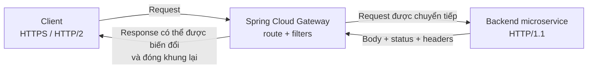
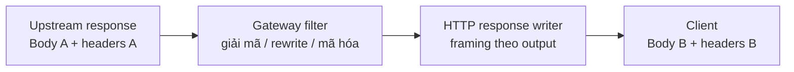

# Xử lý Content-Length, Transfer-Encoding và nội dung được biến đổi

## Mục tiêu bài học

Trong chương **Header và trạng thái**, bài này giải thích cách một **Spring Cloud Gateway** xử lý độ dài nội dung và cách đóng khung HTTP khi chuyển tiếp hoặc **biến đổi response body**. Chủ đề gắn trực tiếp với filter chain, route, response status và việc vận hành API Gateway an toàn giữa client với các microservices.

Sau bài này, bạn có thể:

- Phân biệt chính xác **`Content-Length`**, **`Transfer-Encoding`** và **`Content-Encoding`**; hiểu đặc điểm của HTTP/1.1 và HTTP/2.
- Giải thích vì sao việc đổi JSON/text/body nén khiến header độ dài cũ có thể không còn đúng.
- Xác định nơi response body được biến đổi trong Spring Cloud Gateway Server WebFlux và cách sử dụng `ModifyResponseBody` đúng mục đích.
- Phân tích các status **không có response body** như `204`, `304`, request `HEAD` và trường hợp `206 Partial Content`.
- Nhận diện nguy cơ **cắt cụt response, treo kết nối, lỗi framing, cache sai và request/response desynchronization**.
- Thiết kế kiểm thử theo byte thực tế, giao thức, trạng thái và tải để xác nhận response cuối cùng được client nhận hợp lệ.

> Phạm vi kỹ thuật: **Spring Cloud Gateway Server WebFlux**, với routing qua Reactor Netty và các Gateway filters phổ biến. Gateway Server MVC có cơ chế thực thi khác. Header/giao thức HTTP tuân theo các quy tắc nền tảng, nhưng hành vi cụ thể của codec và body rewrite cần kiểm tra trên phiên bản ứng dụng thực tế.

## 1. Gateway nằm giữa hai phiên HTTP

Client có thể kết nối với API Gateway bằng HTTPS/HTTP/2, trong khi Gateway kết nối tới backend qua HTTP/1.1 hoặc HTTPS/HTTP/2 tùy hạ tầng. Spring Cloud Gateway xử lý **một HTTP request/response tại mỗi chặng**; header liên quan đến truyền tải không mặc nhiên được sao chép nguyên xi giữa các kết nối.



Một route có thể chỉ chuyển tiếp response hoặc có filter thay body:

```text
Backend gửi:  Content-Type: text/plain; charset=UTF-8
              Content-Length: 2
              Body: OK

Gateway đổi:  Body: OK ✅

Client cần:   Framing hợp lệ cho 6 byte UTF-8 của "OK ✅"
```

Nếu gateway vẫn gửi `Content-Length: 2` sau khi body thành 6 byte, client có thể chỉ đọc hai byte đầu, còn byte dư bị diễn giải sai hoặc khiến kết nối không dùng lại được. Nếu khai báo chiều dài lớn hơn dữ liệu gửi thật, client có thể chờ thêm byte rồi timeout.

Vì vậy, khi biến đổi nội dung, **header mô tả kích thước và cách truyền phải phù hợp với bytes cuối cùng**, không dựa trên body cũ.

## 2. Ba header dễ nhầm: Length, Transfer và Content Encoding

| Header | Mô tả | Phạm vi | Ví dụ |
| --- | --- | --- | --- |
| **`Content-Length`** | Số **octet/byte** của nội dung HTTP được gửi theo quy tắc giao thức | Được dùng để xác định độ dài content trong những trường hợp hợp lệ | `Content-Length: 152` |
| **`Transfer-Encoding`** | Cách mã hóa để **truyền thông điệp trên chặng HTTP/1.1**; ví dụ chunked | **Hop-by-hop**, không phải metadata bất biến của API | `Transfer-Encoding: chunked` |
| **`Content-Encoding`** | Cách mã hóa **representation/body**, chẳng hạn gzip | Thuộc nội dung được gửi; bên nhận cần giải mã để lấy dữ liệu gốc | `Content-Encoding: gzip` |
| **`Content-Type`** | Kiểu media và có thể có charset của nội dung | Để consumer diễn giải body | `Content-Type: application/json` |

Ví dụ:

```http
HTTP/1.1 200 OK
Content-Type: application/json
Content-Encoding: gzip
Content-Length: 87

<87 byte dữ liệu JSON đã nén bằng gzip>
```

Trong ví dụ này, **87 là số byte được gửi sau content coding gzip**, không phải số byte của JSON khi giải nén. Nếu Gateway giải nén, thay JSON rồi gửi lại không nén, không được giữ nguyên `Content-Encoding: gzip` hoặc `Content-Length: 87`.

Một ví dụ HTTP/1.1 khác:

```http
HTTP/1.1 200 OK
Content-Type: text/plain; charset=UTF-8
Transfer-Encoding: chunked

4
Wiki
5
pedia
0

```

Các số `4`, `5`, `0` là phần của **chunked transfer coding** ở chặng HTTP/1.1. Body nội dung được ghép lại là `Wikipedia`; những dòng kích thước chunk không thuộc chuỗi nội dung ứng dụng đọc được sau khi HTTP stack giải mã.

### 2.1. `Content-Length` đếm byte, không đếm ký tự

Với UTF-8, chuỗi tiếng Việt và emoji có thể chiếm nhiều byte hơn số ký tự hiển thị:

```java
import java.nio.charset.StandardCharsets;

String body = "OK ✅";

System.out.println(body.length()); // 5 UTF-16 code units
System.out.println(
    body.getBytes(StandardCharsets.UTF_8).length
); // 6 byte UTF-8
```

Không lấy `String.length()` để đặt `Content-Length`. Nếu response thực sự cần độ dài cố định, giá trị phải tính theo **byte của representation cuối cùng** sau khi áp dụng charset, content encoding và các phép biến đổi liên quan.

Nếu body có thể được stream và chưa biết tổng số byte, HTTP server có thể sử dụng framing thích hợp mà **không cần tự đặt `Content-Length`**.

### 2.2. `Transfer-Encoding` không giống `Content-Encoding`

`Transfer-Encoding: chunked` nói cách đóng khung thông điệp trên một chặng HTTP/1.1. Nó không biến JSON thành một định dạng JSON khác và không có nghĩa dữ liệu đã nén.

`Content-Encoding: gzip` nói rằng representation đang được nén theo gzip. Nội dung nén này vẫn có thể:

- Được gửi kèm `Content-Length` nếu số byte đã biết và giao thức cho phép.
- Được gửi bằng chunked transfer coding trên HTTP/1.1 nếu chưa biết chiều dài trước khi gửi.
- Được gửi qua các DATA frames của HTTP/2 mà không dùng `Transfer-Encoding: chunked`.

Khi một Gateway sửa response body, phải quan tâm đến **cả mã hóa nội dung và framing**.

## 3. HTTP/1.1 và HTTP/2 không đóng khung giống nhau

### 3.1. HTTP/1.1

HTTP/1.1 có nhiều cách xác định kết thúc nội dung phản hồi, tùy status và loại thông điệp:

- `Content-Length` hợp lệ khi biết đúng số byte cần gửi.
- `Transfer-Encoding: chunked` cho phép gửi nội dung theo các chunk và đánh dấu chunk kết thúc.
- Một số response được phân định bằng việc đóng kết nối nếu không có framing rõ hơn; cách này kém thuận tiện cho kết nối tái sử dụng.
- Các status/method đặc biệt có quy tắc riêng và không cho phép body, xem mục 8.

**Không gửi đồng thời `Content-Length` và `Transfer-Encoding` trong cùng một thông điệp HTTP/1.1.** Việc tồn tại cả hai là bất thường, có thể dẫn đến nhiều bên trung gian hiểu khác nhau về biên thông điệp.

Đối với một proxy, xử lý thông điệp có hai header mâu thuẫn phải tuân theo quy tắc HTTP và chính sách bảo mật nghiêm ngặt; không nên lấy một giá trị tùy ý rồi chuyển tiếp nguyên cả hai.

### 3.2. HTTP/2

HTTP/2 dùng **DATA frames** và cờ kết thúc stream để đóng khung payload. Nó **không sử dụng `Transfer-Encoding: chunked`**. `Content-Length` vẫn có thể xuất hiện nếu hợp lệ, nhưng nếu được gửi, giá trị phải nhất quán với số byte nội dung thực của thông điệp theo quy tắc HTTP/2.

Lưu ý phân biệt tên header **`TE`** với **`Transfer-Encoding`**: HTTP/2 chỉ có ngoại lệ hạn chế cho `TE: trailers`, không phải cho `Transfer-Encoding: chunked`.

Vì thế, cùng một API có thể hợp lệ khi Gateway nhận response upstream dùng chunked HTTP/1.1 nhưng gửi xuống client qua HTTP/2 **không có** header `Transfer-Encoding`. Đây là hành vi bình thường của một gateway/proxy, không nhất thiết là lỗi mất header.

### 3.3. Header hop-by-hop không phải hợp đồng end-to-end

Các header gắn với quản lý kết nối như `Connection`, `Keep-Alive`, `Transfer-Encoding`, `Upgrade` có semantics **hop-by-hop**. Gateway có thể loại bỏ hoặc tạo lại các header kết nối phù hợp với kết nối outbound/inbound.

Không xây logic nghiệp vụ của backend dựa vào việc client trước Gateway đã dùng chunked, cũng không yêu cầu Gateway “giữ nguyên Transfer-Encoding từ upstream” khi chuyển sang một giao thức khác. Điều quan trọng là **payload và headers cuối cùng hợp lệ trên từng chặng**.

## 4. Điều gì xảy ra nếu Gateway chỉ chuyển tiếp mà không đổi body?

Giả sử Catalog Service trả:

```http
HTTP/1.1 200 OK
Content-Type: application/json
Content-Length: 19

{"item":"notebook"}
```

Trong ví dụ, chuỗi JSON chỉ gồm ASCII và có **19 byte**. Nếu Gateway không thay đổi representation, nó có thể chuyển tiếp cùng bytes nội dung, còn lớp HTTP writer/Netty quyết định framing hợp lệ trên kết nối đến client.

Có hai điều không nên suy ra:

1. **Không đổi body không có nghĩa mọi header được chuyển nguyên dạng.** Hop-by-hop headers có thể khác vì kết nối HTTP hoặc protocol khác.
2. **Có `Content-Length` từ backend không có nghĩa phải giữ đúng giá trị đó trong mọi tình huống.** Nếu một thành phần giải nén, nén lại, filter thay payload hoặc framework chọn cách truyền khác, phải điều chỉnh framing tương ứng.

Trong **Spring Cloud Gateway Server WebFlux**, các thành phần tiêu biểu:

| Thành phần | Trách nhiệm liên quan |
| --- | --- |
| `RoutePredicateHandlerMapping` | Chọn route dựa trên predicate như `Path`, `Method`, `Host` |
| `FilteringWebHandler` | Kết hợp `GlobalFilter` và các filter của route theo thứ tự |
| `NettyRoutingFilter` | Dùng URI đích được chuẩn bị để thực hiện HTTP request tới upstream |
| `NettyWriteResponseFilter` | Tham gia ghi response downstream về client ở pha trả kết quả |
| `ModifyResponseBody` | Cho phép đọc/chuyển đổi response body trong phạm vi filter và ghi lại bằng body mới |
| `HttpHeadersFilter` và các response-header filters | Xử lý một số headers, bao gồm những header không nên truyền trực tiếp giữa các chặng |

Tên và hành vi chi tiết của các lớp/factory có thể phụ thuộc phiên bản. Tuy nhiên, quy tắc nền tảng không đổi: **không được để headers mô tả payload cũ đi cùng payload đã biến đổi**.

## 5. Biến đổi nội dung khiến những headers nào trở nên nhạy cảm?

Xét luồng:



Một filter có thể:

- Thêm thông tin vào chuỗi văn bản.
- Chuyển đổi JSON hoặc loại bỏ trường nhạy cảm.
- Đổi kiểu dữ liệu, ví dụ nhận JSON rồi trả một đối tượng khác.
- Thay đổi charset, nén/giải nén.
- Chuyển từ body được buffer sang luồng streaming, hoặc ngược lại.
- Tạo response fallback từ circuit breaker thay cho response backend.

Khi làm điều đó, cần xem xét:

| Header / metadata | Vì sao cần kiểm tra sau rewrite? |
| --- | --- |
| `Content-Length` | Kích thước byte có thể đổi; length cũ gây lỗi framing |
| `Transfer-Encoding` | Framing là quyết định của HTTP writer trên từng chặng; không nên giữ/cài đặt thủ công theo body cũ |
| `Content-Type` / `charset` | Body mới có thể không còn cùng media type hoặc charset |
| `Content-Encoding` | Nếu giải nén/chuyển sang không nén hoặc nén lại, encoding phải khớp bytes cuối |
| `ETag` | Entity tag của representation cũ có thể không còn hợp lệ |
| `Content-Digest` / checksum | Digest cũ không còn mô tả representation mới |
| `Content-Range` | Byte ranges cũ không còn đúng khi đổi độ dài hoặc nội dung |
| `Cache-Control`, `Vary` | Chính sách cache/biến thể representation có thể cần điều chỉnh |

**Không phải rewrite nào cũng buộc thay tất cả headers.** Ví dụ chỉ đổi một response header không liên quan nội dung thì không nhất thiết đổi `Content-Length`. Nhưng bất kỳ thao tác nào thay **payload bytes** đều cần xem lại framing và các metadata gắn với representation.

### 5.1. Vì sao `Content-Length` cũ đặc biệt nguy hiểm?

Giả sử:

```text
Response upstream:
  Body bytes: 100
  Content-Length: 100

Gateway rewrite:
  Body bytes cuối: 125
```

Nếu client nhận `Content-Length: 100` nhưng Gateway gửi 125 byte, client có thể hiểu **100 byte đầu là một thông điệp** và 25 byte còn lại là dữ liệu dư. Nếu cùng kết nối HTTP/1.1 được tái sử dụng, điều này có thể gây lỗi phân tích response và nguy cơ desynchronization.

Ngược lại, nếu sau rewrite chỉ còn 70 byte nhưng vẫn khai báo 100, client có thể chờ 30 byte không bao giờ tới, phát sinh timeout hoặc truncated response.

Giải pháp đúng là để **lớp ghi response biết chính xác body cuối cùng**, đặt lại length nếu đã biết, hoặc loại bỏ length và dùng framing hợp lệ do HTTP stack quản lý khi chưa biết tổng số byte. **Không sửa length bằng cách đếm ký tự Java hoặc ước lượng độ dài JSON.**

### 5.2. Giữ nguyên `Content-Encoding` sau khi đổi body

Nếu backend trả gzip và Gateway biến đổi body theo chuỗi text, cần xác định:

1. Thành phần nào giải mã gzip trước khi chạy rewrite?
2. Rewrite nhận **bytes đã giải mã** hay bytes nén?
3. Gateway có mã hóa gzip lại hay quyết định gửi response không nén?
4. `Content-Encoding`, `Content-Length` và `Vary: Accept-Encoding` cuối cùng có khớp?

Không được coi `ModifyResponseBody` tự giải quyết mọi tổ hợp compression/codec trên mọi phiên bản. Nếu cần biến đổi nội dung đã nén, thiết kế rõ **giải mã → biến đổi → mã hóa lại (hoặc bỏ content coding)**, cấu hình tương ứng và test thực tế với `Accept-Encoding: gzip`.

### 5.3. Cache và validators

Một backend có thể trả:

```http
ETag: "original-v7"
Cache-Control: public, max-age=60
```

Nếu Gateway loại bỏ một trường JSON, representation phía client đã khác. Giữ nguyên **strong ETag** dành cho body cũ có thể làm cache hoặc conditional request hoạt động sai. Cần loại bỏ/tạo lại validator theo representation mới và xem lại chính sách cache nếu biến đổi phụ thuộc người dùng, tenant hoặc header.

Đặc biệt thận trọng với `Vary`, `Content-Range`, `Accept-Ranges` và `206 Partial Content`: biến đổi body có thể làm các byte ranges và cache validators không còn nhất quán.

## 6. `ModifyResponseBody`: cách biến đổi response trong Gateway WebFlux

Spring Cloud Gateway cung cấp **`ModifyResponseBody` GatewayFilter Factory** để biến đổi nội dung response. Với Server WebFlux, filter này được cấu hình qua **Java DSL** trong những phiên bản phổ biến.

Ví dụ minh họa: upstream trả text `OK`, Gateway bổ sung chuỗi ` ✅` trước khi gửi cho client.

```java
import org.springframework.cloud.gateway.route.RouteLocator;
import org.springframework.cloud.gateway.route.builder.RouteLocatorBuilder;
import org.springframework.context.annotation.Bean;
import reactor.core.publisher.Mono;

@Bean
RouteLocator messageRoute(RouteLocatorBuilder builder) {
    return builder.routes()
        .route("message", r -> r.path("/api/message")
            .filters(f -> f.modifyResponseBody(
                String.class,
                String.class,
                (exchange, originalBody) -> {
                    if (originalBody == null) {
                        return Mono.empty();
                    }
                    return Mono.just(originalBody + " ✅");
                }
            ))
            .uri("http://localhost:9001"))
        .build();
}
```

Giả định backend test ở `localhost:9001` nhận `GET /api/message` và trả:

```http
HTTP/1.1 200 OK
Content-Type: text/plain; charset=UTF-8
Content-Length: 2

OK
```

Gateway sẽ tạo body logic mới là `OK ✅`. Khi encode theo UTF-8, **body mới dài 6 byte**, dù `String.length()` của Java là 5. Response cuối phải có framing phù hợp: có thể dùng length mới hoặc cơ chế streaming/chunked tùy writer và giao thức.

**Ý nghĩa của các tham số:**

- `String.class` đầu tiên: kiểu body dùng để đọc nội dung từ response upstream.
- `String.class` thứ hai: kiểu body sau rewrite.
- `(exchange, originalBody) -> ...`: hàm tạo **reactive publisher** chứa nội dung mới.
- `Mono.empty()` xử lý trường hợp không có body, không tự tạo một nội dung giả.

Đây là ví dụ **response `text/plain` đơn giản**, không phải mẫu để sửa JSON nhạy cảm, dữ liệu nhị phân, ảnh hoặc streaming vô hạn. Nếu xử lý JSON, nên dùng codec và cấu trúc dữ liệu phù hợp, cân nhắc `Content-Type` và tránh sửa JSON bằng replace chuỗi mù.

### 6.1. Vì sao không tự ghi `Content-Length` trong hàm rewrite?

Hàm `rewriteFunction` trả nội dung logic mới. Trước khi body được encode, người viết filter có thể chưa biết chính xác:

- Charset cuối cùng.
- Content coding (gzip/br) có được áp dụng không.
- Body có được stream theo nhiều buffer không.
- HTTP writer sẽ sử dụng length hay transfer coding nào.

Vì vậy, nên để **framework/body writer và filter rewrite** xử lý việc tạo bytes và framing tương ứng. Nếu ứng dụng có filter tùy chỉnh thay đổi body ở cấp `DataBuffer`, chính filter đó phải đảm bảo headers phản ánh bytes cuối hoặc để HTTP stack chọn framing hợp lệ.

Đừng dùng `SetResponseHeader=Content-Length,...` với một con số tính tay để chữa lỗi body mismatch. Tương tự, một `RemoveResponseHeader=Content-Length` áp dụng tùy tiện **không bảo đảm** sửa đúng tất cả vấn đề liên quan compression, status, cache hoặc response đã commit.

### 6.2. Viết JSON rewrite đúng nghĩa

Với một JSON response:

```json
{
  "id": 42,
  "name": "book",
  "internalCost": 120
}
```

Nếu Gateway được giao loại trường `internalCost`, cần biến đổi bằng parser/object mapper hoặc một DTO phù hợp. Không thay:

```java
body.replace("\"internalCost\":120", "");
```

vì cách làm đó dễ tạo dấu phẩy thừa, bỏ sót định dạng có khoảng trắng hoặc xóa dữ liệu xuất hiện trong chuỗi văn bản. Sau khi tạo JSON mới, cần đảm bảo `Content-Type` vẫn đúng, byte length tương ứng, validator/cache đã được xem lại, và kiểm thử các trường hợp JSON rỗng/lỗi.

Đối với phân quyền dữ liệu nhạy cảm, **không nên dựa duy nhất vào Gateway body rewrite để che trường bí mật**. Backend chịu trách nhiệm trả dữ liệu đúng quyền; Gateway chỉ nên bổ trợ những chuyển đổi có hợp đồng rõ.

## 7. Thứ tự filter và thời điểm response được ghi ra mạng

Filter chain của Spring Cloud Gateway Server WebFlux có tính **bao bọc**: filter `Ordered` có order nhỏ thường chạy sớm hơn ở pha request (pre); các xử lý response (post) được thực thi theo cấu trúc publisher khi trả về.

```text
Client request
  ↓
Route predicate match
  ↓
GlobalFilter / GatewayFilter (pha pre)
  ↓
RouteToRequestUrl / Load balancing (nếu có)
  ↓
NettyRoutingFilter: gửi request tới backend
  ↓
Nhận status + headers + body upstream
  ↓
Gateway filters xử lý response
  ↓
NettyWriteResponseFilter / response writer
  ↓
Client nhận response hợp lệ
```

Sơ đồ là mô hình khái quát; các filter rewrite response thường dùng decorator hoặc publisher để can thiệp **trước khi body thực sự được gửi**. Tên phương thức và thứ tự cụ thể có thể khác theo phiên bản.

### 7.1. Đừng sửa headers sau khi response đã commit

Trong WebFlux, response có thời điểm **commit**, khi status/headers bắt đầu được gửi. Một filter cố thay `Content-Length`, `Content-Type` hay status sau thời điểm này có thể không còn tác dụng, hoặc gây lỗi vì headers đã phát ra.

Ví dụ không phù hợp:

```java
return chain.filter(exchange)
    .then(Mono.fromRunnable(() -> {
        // Chạy quá muộn nếu response đã commit.
        exchange.getResponse()
            .getHeaders()
            .setContentLength(100);
    }));
```

Đoạn trên có thể được kích hoạt sau khi response đã gửi; nó không biết payload cuối dài bao nhiêu byte. Không dùng nó để “vá” framing.

Nếu cần can thiệp body, ưu tiên factory hỗ trợ rewrite hoặc một `ServerHttpResponseDecorator` được thiết kế đúng vòng đời. Nếu cần đổi headers, làm trong phạm vi **trước commit** và bảo đảm nội dung nhất quán với header. Đừng tạo `subscribe()` riêng trong filter vì sẽ tách vòng đời request/response, khó kiểm soát lỗi và cancellation.

### 7.2. Response header filters và body filters có nhiệm vụ khác nhau

Ví dụ:

```yaml
filters:
  - AddResponseHeader=X-Gateway-Policy,checked
  - RemoveResponseHeader=X-Debug-Internal
```

Những filter trên chỉ thao tác headers được chỉ định; **không làm thay đổi response body**. Do đó tự thêm một response header không bắt buộc phải sửa `Content-Length`.

Ngược lại, `ModifyResponseBody` thay bytes của body; điều quan trọng không phải tên filter có chữ “header” mà là **payload sau cùng có còn giống trước không**.

Một số filter có thể đổi status, ví dụ cơ chế `SetStatus`, circuit breaker fallback hoặc filter xử lý lỗi. Khi status đổi từ response có body sang response không được phép có body (như 204), **cần đảm bảo body và headers cùng tuân theo status mới**. Không chỉ đổi status code rồi để writer gửi body cũ.

### 7.3. Route matching, rewrite request và rewrite response

Đừng nhầm hai hướng:

| Hướng | Ví dụ filter | Ảnh hưởng tới |
| --- | --- | --- |
| **Request → backend** | `RewritePath`, `SetRequestHeader`, `ModifyRequestBody` | URI/header/body của request gửi upstream |
| **Backend → client** | `ModifyResponseBody`, `SetResponseHeader`, `AddResponseHeader`, `RemoveResponseHeader` | Status/header/body của response trả client |

Nếu filter thay **request body**, `Content-Length`/`Transfer-Encoding` của **request outbound** cũng phải được xử lý đúng. Bài này tập trung response, nhưng nguyên tắc **framing dựa trên bytes thật** áp dụng cho cả hai hướng.

## 8. Status code và method đặc biệt: không phải response nào cũng có body

Các quy tắc HTTP định nghĩa rõ khi nào **không được** truyền response content:

| Trường hợp | Body truyền tới client? | Lưu ý với `Content-Length` / framing |
| --- | --- | --- |
| **`HEAD`** | Không, dù GET tương ứng có thể có body | Có thể gửi metadata như `Content-Length` của representation tương ứng nếu tuân thủ quy tắc, không tự kết luận length phải bằng 0 |
| **`204 No Content`** | Không | Không tạo response content; không gửi `Content-Length` với 204 |
| **`304 Not Modified`** | Không | Có thể chứa `Content-Length` biểu thị kích thước representation mà GET tương ứng có thể trả; không đồng nghĩa response hiện tại mang body |
| **Các response `1xx`** | Không | Là thông điệp thông tin, không gửi body |
| **`205 Reset Content`** | Không tạo content | Tuân theo semantics reset; tránh dựng JSON body đi kèm |
| **`206 Partial Content`** | Có thể có body một phần | `Content-Range` và length phải mô tả phần dữ liệu thực, không phải body đầy đủ |
| **`200 OK` thông thường** | Tùy API | Có thể có body rỗng hoặc body thực; framing phải nhất quán |

Điểm dễ nhầm: với `HEAD` hoặc `304`, thấy `Content-Length: 4096` **không có nghĩa** 4096 byte body đang được truyền. Những trường hợp này có quy tắc đặc biệt cho metadata của representation. Không viết một filter chung kiểu “không có body thì ép `Content-Length: 0`” cho tất cả status/method.

### 8.1. Thay status thành 204 khi body đã tồn tại

Giả sử backend trả:

```http
HTTP/1.1 200 OK
Content-Type: application/json
Content-Length: 12

{"ok":true}
```

Nếu custom filter đổi status thành `204 No Content`, response cuối cần **không gửi content**, và metadata không được mâu thuẫn với quy tắc 204. Chỉ gọi `setStatusCode(NO_CONTENT)` nhưng không kiểm soát quá trình viết body có thể tạo kết quả sai.

Nếu nghiệp vụ muốn trả một JSON thông báo, hãy chọn status cho phép body theo contract API. Nếu muốn 204, đảm bảo pipeline không viết JSON sau đó.

### 8.2. Partial Content và range requests

Client có thể yêu cầu:

```http
Range: bytes=0-99
```

Backend trả:

```http
HTTP/1.1 206 Partial Content
Content-Range: bytes 0-99/1000
Content-Length: 100
```

Nếu Gateway tự ý chèn thêm ký tự vào nội dung một đoạn byte range, `Content-Range`/length sẽ không còn mô tả đúng dữ liệu. Không áp dụng text/JSON rewrite trên response `206` hoặc file download có range một cách tự động nếu chưa thiết kế thuật toán xử lý ranges, validators và cache.

### 8.3. Streaming, SSE và WebSocket

- **Server-Sent Events (`text/event-stream`)** có thể được gửi liên tục, chưa biết thời điểm kết thúc. Không cố buffer toàn bộ stream chỉ để tính trước `Content-Length`.
- **File download lớn** nên tận dụng streaming/backpressure và framing do HTTP stack xử lý; tránh buộc toàn bộ file vào memory.
- **WebSocket Upgrade (`101 Switching Protocols`)** chuyển sang giao thức khác sau handshake, không nên coi luồng frame WebSocket như một response body JSON để chạy `ModifyResponseBody`.

Với streaming trên HTTP/1.1, chunked có thể là một cách framing hợp lệ; trên HTTP/2, các DATA frames đảm nhiệm việc truyền. **Không ép `Transfer-Encoding: chunked` trên HTTP/2**.

## 9. Response compression trong một Gateway

Nén giúp giảm băng thông nhưng làm việc sửa body phức tạp hơn.

### 9.1. Hai luồng có thể xảy ra

```text
Luồng A: không đổi representation
Backend (JSON gzip) → Gateway proxy → Client (JSON gzip)

Luồng B: cần đổi representation
Backend (JSON gzip)
  → giải nén hợp lệ
  → sửa JSON
  → chọn gửi JSON không nén hoặc nén lại
  → tạo headers/framing nhất quán
  → Client
```

Ở luồng B, nếu giữ `Content-Encoding: gzip` nhưng gửi bytes JSON plain, client giải nén sẽ lỗi. Nếu gửi bytes gzip mới nhưng giữ length của gzip cũ, client có thể đọc thiếu/thừa.

### 9.2. Những câu hỏi cần trả lời trước khi bật rewrite

1. Backend có trả gzip/br khi client gửi `Accept-Encoding` không?
2. Gateway HTTP client có giải nén tự động hay không? Phần rewrite đang nhận bytes ở dạng nào?
3. Content type và charset nào được bộ codec dùng để decode/encode?
4. Response cuối có được nén lại không, và ai sở hữu header `Content-Encoding`?
5. `Vary: Accept-Encoding`, ETag, digest và cache có cần tính lại?
6. Body lớn hoặc payload nén có thể làm memory tăng bao nhiêu khi giải nén?

Đừng đánh giá bằng cách chỉ thử `curl` không gửi `Accept-Encoding`. Cần thử cả request chấp nhận gzip, phản hồi upstream có nén, payload Unicode và body đủ lớn để phân biệt streaming với buffering.

## 10. Lỗi và rủi ro khi framing không nhất quán

| Hiện tượng | Nguyên nhân khả dĩ | Hướng kiểm tra |
| --- | --- | --- |
| Client chỉ nhận đầu response | `Content-Length` nhỏ hơn số byte thực | So sánh declared length với payload trên từng chặng; kiểm tra filter rewrite |
| Client chờ đến timeout | Declared length lớn hơn số byte gửi, hoặc thiếu dấu kết thúc chunk | Kiểm tra writer, cancellation, lỗi upstream |
| Client báo “invalid chunk” | Chunk framing lỗi hoặc header/chunk bị chuyển tiếp sai | Kiểm tra HTTP/1.1 raw response, proxy hop-by-hop headers |
| HTTP/2 báo protocol error | Cố dùng `Transfer-Encoding: chunked` hoặc length không khớp | Kiểm tra framing/headers cuối trên kết nối HTTP/2 |
| JSON không parse được | Thay body như text gây sai JSON, encoding hoặc cắt cụt | So sánh bytes/charset và parse JSON đầu ra |
| Client không giải nén được | Body/plain và `Content-Encoding` không khớp | Kiểm tra gzip/br và `Accept-Encoding` |
| Cache trả dữ liệu cũ | ETag/digest của representation trước rewrite còn sót | Kiểm tra cache validators và `Vary` |
| Chỉ lỗi với `HEAD`/`304` | Áp quy tắc length/body của 200 lên response không body | Kiểm tra semantics của status/method |
| File tải về bị hỏng đoạn | Rewrite response `206` nhưng vẫn giữ `Content-Range` | Tắt rewrite với partial responses hoặc hỗ trợ ranges đúng |

### 10.1. Rủi ro khi có cả `Content-Length` và `Transfer-Encoding`

Một thông điệp HTTP/1.1 chứa cả hai header có thể khiến các hệ thống ở hai đầu proxy giải thích biên thông điệp khác nhau. Với request, đây là nguyên nhân kinh điển của **HTTP request smuggling**; với response, framing mâu thuẫn cũng có thể làm sai lệch cách client phân tích dữ liệu.

Không triển khai logic kiểu “nếu có cả hai, cứ tin Content-Length” để tự điều phối body. Gateway/proxy cần tuân theo tiêu chuẩn HTTP và **phát hiện hoặc từ chối thông điệp mơ hồ** theo chính sách bảo mật, đồng thời chuẩn hóa framing khi chuyển tiếp hợp lệ. Đặc biệt không chuyển tiếp cả hai header mâu thuẫn cho hop tiếp theo.

### 10.2. Giới hạn tài nguyên khi rewrite

Body rewrite có thể yêu cầu giải mã hoặc gom nhiều `DataBuffer` trước khi tạo nội dung mới. Với payload rất lớn hoặc nội dung nén có tỷ lệ giải nén cao, điều này có thể làm tăng bộ nhớ và áp lực GC.

Nên đặt:

- Giới hạn kích thước request/response hoặc phạm vi endpoint được phép rewrite.
- Chính sách timeout và giới hạn đồng thời phù hợp với backend.
- Giới hạn codec/buffer phù hợp với phiên bản WebFlux đang dùng.
- Kiểm thử áp lực với payload lớn, nén mạnh, nhiều request đồng thời và client hủy giữa chừng.

Không dùng một filter biến đổi toàn bộ body cho video, file lớn hay SSE nếu nhu cầu có thể thực hiện ở backend hoặc bằng một cơ chế streaming chuyên dụng.

## 11. Retry, circuit breaker và lỗi body rewrite

Spring Cloud Gateway có thể dùng **Retry** hoặc **CircuitBreaker** theo route. Những cơ chế này không làm biến mất yêu cầu framing:

### 11.1. Retry

Nếu request GET tới backend lỗi trước khi response gửi cho client, Gateway có thể thử lại theo chính sách. Client cuối cùng thường chỉ nên nhận **một response hợp lệ** từ attempt được chọn.

Khi thực hiện retry:

- Không gắn `Content-Length` từ attempt lỗi vào body của attempt thành công.
- Đừng để filter custom viết một phần body rồi mới cố retry; khi headers/body đã commit, không thể gửi lại status/headers mới một cách tùy ý.
- Nếu body rewrite có state mutable, kiểm tra không tích lũy dữ liệu của nhiều attempts hoặc subscriptions.
- Không retry các thao tác ghi không idempotent nếu chưa có hợp đồng idempotency và cơ chế bảo vệ phù hợp.

### 11.2. Circuit breaker fallback

Giả sử backend trả lỗi và Gateway sinh fallback:

```json
{"message":"service temporarily unavailable"}
```

Response fallback là **nội dung khác** với response gốc. Nó cần status đúng (ví dụ `503` theo contract), `Content-Type` đúng và framing hợp lệ. Không lấy `Content-Length` hoặc `Content-Encoding` từ một upstream response khác để mô tả fallback.

Thứ tự giữa response rewrite filter, retry và circuit breaker còn ảnh hưởng đến **response nào được biến đổi**. Thay đổi order phải đi kèm integration test có cả đường thành công, lỗi và fallback.

## 12. Kiểm thử: xác minh bytes thực sự client nhận

Một test chỉ kiểm tra `status == 200` không đủ. Với body rewrite, cần kiểm tra **body bytes, Content-Type, Content-Encoding và framing của giao thức thực tế**.

### 12.1. Kịch bản backend giả lập

Tạo backend test trả:

```http
HTTP/1.1 200 OK
Content-Type: text/plain; charset=UTF-8
Content-Length: 2

OK
```

Gateway áp dụng `ModifyResponseBody` như mục 6. Kết quả kỳ vọng là `OK ✅` với 6 byte UTF-8. Response có thể:

- Mang `Content-Length: 6` khi writer gửi body đúng 6 byte và điều kiện HTTP cho phép.
- Hoặc không có `Content-Length` và dùng framing hợp lệ, ví dụ chunked trên HTTP/1.1.

**Không buộc mọi HTTP response phải luôn có Content-Length.** Điều cần bảo đảm là bytes cuối khớp metadata/framing mà client nhận, không có cả `Content-Length` và `Transfer-Encoding` mâu thuẫn, và kết nối kết thúc đúng.

### 12.2. Thử bằng `curl`

Giả sử Gateway chạy ở `http://localhost:8080` và route `/api/message` đã cấu hình:

```bash
# Quan sát status và headers ở chặng client → Gateway:
curl -i --http1.1 "http://localhost:8080/api/message"

# Xem chi tiết kết nối, header và các thông báo từ HTTP client:
curl -v --http1.1 "http://localhost:8080/api/message"

# Thử khi client yêu cầu response nén (nếu backend hỗ trợ):
curl -v --http1.1 --compressed \
  "http://localhost:8080/api/message"

# Kiểm tra một endpoint hỗ trợ HEAD:
curl -I --http1.1 "http://localhost:8080/api/message"
```

`curl -i` hiển thị headers và body đã được HTTP client xử lý, **không chứng minh chính xác wire framing của từng chunk**. Khi cần điều tra lỗi framing khó, dùng công cụ bắt gói/HTTP debugging phù hợp trong môi trường thử nghiệm và so sánh hai chặng upstream–Gateway, Gateway–client.

Nếu hạ tầng hỗ trợ HTTP/2, thử thêm client HTTP/2 và xác minh không có `Transfer-Encoding: chunked` trong response HTTP/2.

### 12.3. Assertion với `WebTestClient`

Trong integration test đã chạy Gateway và backend giả lập:

```java
webTestClient.get()
    .uri("/api/message")
    .exchange()
    .expectStatus().isOk()
    .expectBody(String.class)
    .isEqualTo("OK ✅");
```

Đây là **đoạn assertion minh họa**, cần `WebTestClient` được cấu hình trỏ đến Gateway thực trong test. Kiểm tra `String` giúp xác nhận body logic; muốn xác nhận framing cần quan sát response trên **kết nối HTTP thực**, vì một test client chạy trong cùng application context có thể không đi qua đầy đủ network encoding.

Nếu response có `Content-Length`, cần kiểm tra bằng số **byte**:

```java
byte[] encoded = "OK ✅".getBytes(StandardCharsets.UTF_8);
// encoded.length == 6
```

Khi response không chứa `Content-Length`, đó có thể vẫn là response hợp lệ. Đừng viết test thất bại chỉ vì header này bị bỏ để HTTP writer chọn cách framing khác.

### 12.4. Ma trận kiểm thử tối thiểu

| Ca | Response backend / điều kiện | Kỳ vọng phía client |
| --- | --- | --- |
| Không rewrite | `200`, body 20 byte, length đúng | Body không đổi, framing hợp lệ |
| Rewrite body dài hơn | `200`, body 2 byte → 6 byte | Client đọc đủ 6 byte, length nếu có là 6 |
| Rewrite body ngắn hơn | `200`, body dài → body ngắn | Không timeout do length cũ |
| Unicode/emoji | Text UTF-8 | Tính theo byte, không theo `String.length()` |
| Upstream chunked | HTTP/1.1, chưa biết length | Client nhận đủ nội dung; Gateway dùng framing hợp lệ |
| Client HTTP/2 | Kết nối H2 | Không có `Transfer-Encoding: chunked` |
| Gzip | Upstream `Content-Encoding: gzip` | Body/encoding/length khớp sau rewrite |
| `204` | Không có body | Không tự thêm body hoặc Content-Length sai |
| `HEAD` | Endpoint tương ứng trả metadata | Không truyền body; length nếu có có semantics đúng |
| `304` | Cache conditional request | Không truyền body; validator nhất quán |
| `206` | Trả một byte range | Không sửa nội dung làm sai `Content-Range` |
| Backend timeout | Không có response hoàn chỉnh | Gateway trả lỗi theo policy; không gửi response dở dang |
| Circuit breaker fallback | Gateway tạo body lỗi riêng | Status, media type và framing thuộc fallback |
| Request đồng thời | Nhiều response được rewrite | Không rò dữ liệu/chia sẻ buffer giữa các requests |

## 13. Hướng dẫn chẩn đoán theo từng lớp

Khi báo lỗi “Content-Length không khớp”, “truncated chunked encoding” hoặc “HTTP/2 protocol error”, hãy lần lượt kiểm tra:

1. **Route nào được chọn?** Xem route ID và các predicates; có thể request đi tới backend khác dự kiến.
2. **Backend thực gửi gì?** Ghi lại status, `Content-Type`, `Content-Encoding`, `Content-Length`/`Transfer-Encoding` và số byte từ một HTTP client ở cùng mạng với Gateway.
3. **Filter nào đổi body?** Kiểm tra `ModifyResponseBody`, filter tùy chỉnh, compression và fallback. Không chỉ tìm những filter có chữ `Content-Length`.
4. **Body có đổi encoding/charset không?** Đặc biệt khi chứa ký tự Unicode hoặc response nén.
5. **Response status có cho phép body không?** Kiểm tra `HEAD`, `204`, `304`, `206`.
6. **Writer gửi header và body khi nào?** Tìm những thao tác thay headers sau commit, hoặc custom filter `subscribe()` độc lập.
7. **Hai chặng dùng giao thức nào?** H1 upstream và H2 downstream có cách đóng khung khác; header hop-by-hop không buộc giống nhau.
8. **Có retry/circuit breaker không?** Kiểm tra attempts, fallback và response cuối client nhìn thấy.
9. **Lỗi xảy ra với payload nào?** Test body trống, Unicode, gzip, nội dung dài/streaming và kết nối bị hủy.
10. **Có vấn đề bảo mật hoặc cache không?** Kiểm tra framing mâu thuẫn, ETag/digest cũ và thông tin nhạy cảm trong log.

Để quan sát trên production, ưu tiên metrics/trace theo **route ID, status, latency, retry, kích thước response ở mức tổng hợp và lỗi encode/decode**. Không ghi body nhạy cảm, bearer token hay toàn bộ header của người dùng vào log chỉ để debug Content-Length.

## 14. Bài thực hành có đáp án

Một route trả nội dung text qua Gateway. Backend có response:

```http
HTTP/1.1 200 OK
Content-Type: text/plain; charset=UTF-8
Content-Length: 2

OK
```

Gateway dùng `ModifyResponseBody` để tạo `OK ✅`.

**Câu hỏi:**

1. Nếu dùng UTF-8, body cuối dài bao nhiêu byte? Có được đặt `Content-Length` bằng độ dài chuỗi Java không?
2. Nếu Gateway gửi HTTP/1.1 và chưa biết tổng kích thước trước khi stream, có thể dùng phương pháp framing nào?
3. Nếu client nhận HTTP/2, có được thêm `Transfer-Encoding: chunked` không?
4. Nếu backend đã gzip body, có được giữ `Content-Encoding: gzip` sau khi đổi thành text plain mà không nén lại không?
5. Nếu backend trả `204 No Content`, có nên chạy phép nối thêm ` ✅` để tạo body mới không?
6. Nếu response ban đầu là `206 Partial Content`, vì sao việc rewrite có thể làm sai dữ liệu?
7. Sau rewrite, ETag của backend có nhất thiết còn hợp lệ không?
8. Để xác minh điều kiện đúng, chỉ kiểm tra HTTP status 200 đã đủ chưa?

**Gợi ý đáp án:**

1. **6 byte** UTF-8; không. `String.length()` cho kết quả 5 UTF-16 code units, không phải số byte cần truyền.
2. Có thể sử dụng **chunked transfer coding** cho HTTP/1.1 nếu phù hợp với response và writer, hoặc một phương thức framing hợp lệ khác do HTTP stack quản lý.
3. **Không.** HTTP/2 dùng DATA frames, không hỗ trợ `Transfer-Encoding: chunked`.
4. **Không.** Body không còn là gzip; phải bỏ/sửa content coding hoặc nén lại đúng cách và cập nhật length/framing.
5. **Không.** Response 204 không mang content; hãy giữ semantics của status.
6. Vì byte ranges và `Content-Range` mô tả các byte của representation gốc; rewrite có thể làm đổi vị trí, độ dài và nội dung.
7. **Không nhất thiết.** Validator và digest gắn với representation cũ cần được xem lại; strong ETag cũ thường không phù hợp với bytes mới.
8. **Chưa đủ.** Cần đọc đủ body bytes, xác minh headers/encoding, kiểm tra status đặc biệt và thử trên giao thức thực.

## Tổng kết

**`Content-Length` là độ dài theo byte, `Transfer-Encoding` là framing của một chặng HTTP/1.1 và `Content-Encoding` mô tả cách mã hóa representation.** Chúng phục vụ các mục đích khác nhau. Khi Spring Cloud Gateway biến đổi response body, giá trị length và các metadata của representation cũ có thể không còn đúng; HTTP writer phải truyền bytes mới theo cách phù hợp với giao thức.

Thiết kế Gateway an toàn cần tính đến **thứ tự filter, response commit, compression, status không body, byte ranges, retry và fallback**. Ưu tiên API rewrite được hỗ trợ, tránh tự đặt `Content-Length` bằng ước lượng, không chuyển tiếp header framing mâu thuẫn và kiểm thử bằng client thực ở cả upstream lẫn downstream. Điều này giúp hệ thống microservices tránh lỗi cắt cụt response, kết nối treo, cache sai và rủi ro bảo mật do thông điệp HTTP không nhất quán.
