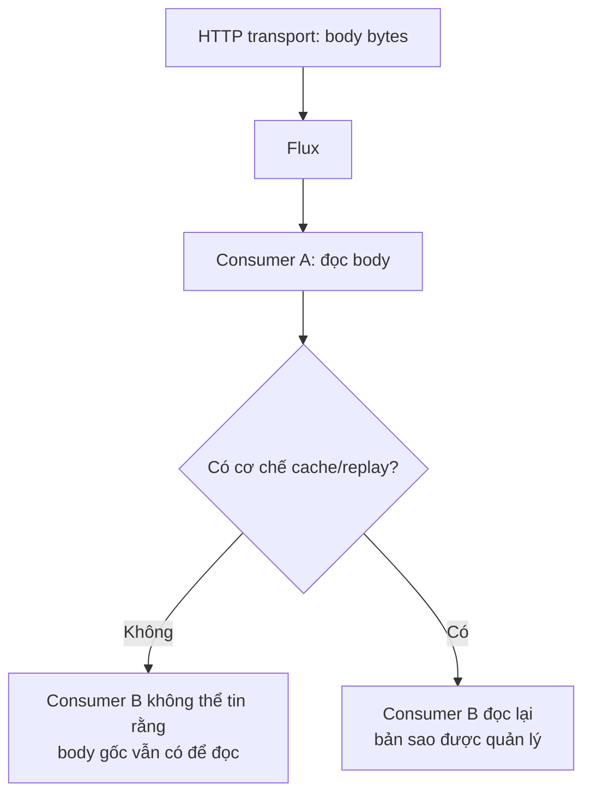
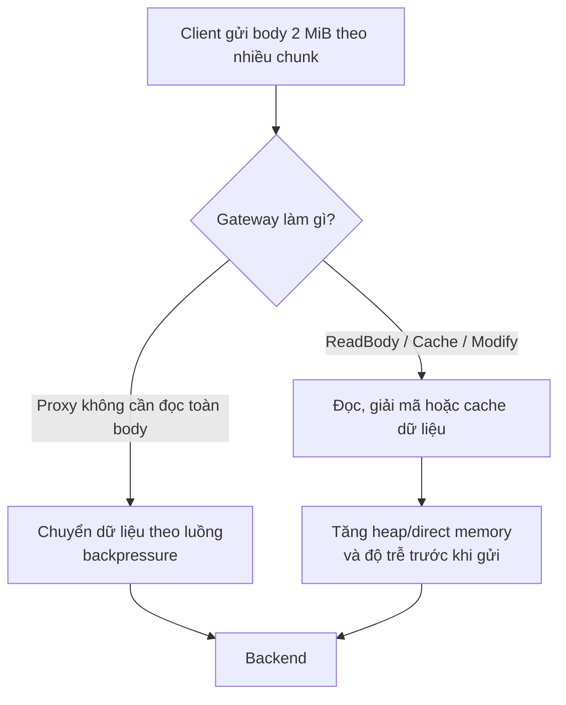

# Vì sao request body thường chỉ được đọc một lần trong WebFlux?

**Chương:** Nội dung HTTP  
**Module:** `SPRING_CLOUD_GATEWAY` — Spring Cloud Gateway

Khi xây dựng API Gateway cho microservices, ta thường muốn đọc request body để ghi log, xác thực chữ ký, kiểm tra nội dung JSON, chọn route hoặc biến đổi payload. Tuy nhiên, một lỗi rất phổ biến trong **Spring WebFlux** là: bộ lọc đầu tiên đọc được body, nhưng controller hoặc dịch vụ downstream lại nhận body rỗng, lỗi tiêu thụ luồng hoặc không còn dữ liệu để xử lý. Nguyên nhân bắt đầu từ bản chất **HTTP request body là một luồng byte đi qua kết nối mạng**, không phải một chuỗi hoặc đối tượng có thể tùy ý đọc lại.

Trong Spring Cloud Gateway Server WebFlux, các thành phần như route predicate, filter chain và HTTP routing cùng làm việc với request này. Nếu một thành phần đọc body để kiểm tra hoặc biến đổi, nó phải quản lý **cách đưa body đến thành phần tiếp theo**. Bài học giải thích cơ chế `Flux<DataBuffer>`, tính chất tiêu thụ một lượt, caching/replay, backpressure và rủi ro bộ nhớ; sau đó cung cấp bài lab để kiểm chứng bằng một backend HTTP nhỏ. Kiến thức này đặc biệt quan trọng trước khi triển khai xác thực nội dung, retry, rate limiting, circuit breaker, TLS và quan sát request tại Gateway.

> **Phạm vi:** Các ví dụ chính dành cho **Spring Cloud Gateway Server WebFlux**. Gateway Server Web MVC có mô hình Servlet khác, còn Proxy Exchange là một cách chuyển tiếp HTTP từ annotated handler; không áp dụng nguyên API/filter của WebFlux cho các flavor khác. Request body không tự nhiên có thể đọc lặp chỉ vì chạy trên MVC: input stream của Servlet cũng có tính chất tiêu thụ một lượt nếu không được bọc/cache.

## 1. Mục tiêu học tập

Sau bài này, bạn có thể:

1. Giải thích sự khác nhau giữa body dạng **stream** và một đối tượng đã được đọc hết vào bộ nhớ.
2. Mô tả `ServerHttpRequest.getBody()`, `Flux<DataBuffer>`, subscription và hành vi nhận dữ liệu từ HTTP transport.
3. Phân tích vì sao một filter đọc body trước sẽ có thể khiến handler/downstream phía sau không đọc lại được.
4. Phân biệt **đọc một lần** với **cache để phát lại**, và chọn đúng cơ chế `CacheRequestBody`, `ModifyRequestBody`, `ReadBody` hoặc retry.
5. Kiểm thử nội dung body đi qua Spring Cloud Gateway, kể cả JSON, request body rỗng và lỗi kích thước.
6. Thiết kế giới hạn body, logging và xác thực phù hợp khi số lượng request đồng thời tăng.

## 2. Request body thực chất đến từ đâu?

Một HTTP request thường có các phần:

```http
POST /api/echo HTTP/1.1
Host: gateway.example.test
Content-Type: application/json
Content-Length: 29

{"event":"created","count":3}
```

Ở mức mạng, payload không nhất thiết tới ứng dụng một lần dưới dạng một `String` hoàn chỉnh. Dữ liệu có thể được nhận từng đợt do TCP, TLS, HTTP/1.1 chunked transfer hoặc HTTP/2 frames. WebFlux cung cấp lớp trừu tượng reactive để chương trình nhận các phần dữ liệu khi chúng sẵn sàng, thay vì buộc server tạo sẵn một mảng byte cho mọi request.

Với Spring WebFlux, một API quan trọng là:

```java
Flux<DataBuffer> body = exchange.getRequest().getBody();
```

`DataBuffer` đại diện cho một vùng dữ liệu byte; `Flux<DataBuffer>` là một `Publisher` có thể phát **không, một hoặc nhiều** buffer, rồi hoàn thành hoặc báo lỗi. Việc xử lý dữ liệu được kích hoạt khi có subscriber phù hợp, đồng thời tuân theo yêu cầu số lượng dữ liệu (*demand*) và cơ chế **backpressure** của Reactive Streams.

### 2.1. Không phải cứ một request là một buffer

Ví dụ request chứa 20 KiB có thể được đưa lên pipeline thành nhiều buffer nhỏ; số lượng buffer, kích thước mỗi buffer và ranh giới của chúng **không có nghĩa nghiệp vụ**. Không được viết logic dựa vào giả định buffer đầu tiên chứa toàn bộ JSON:

```text
HTTP request body:  {"orderId":"A-42","priority":true}
                          |
          +---------------+----------------+
          |               |                |
          v               v                v
     DataBuffer #1   DataBuffer #2    DataBuffer #3
     {"orderId":     "A-42","pri       ority":true}
          |               |                |
          +---------------+----------------+
                          |
                  HTTP message decoder
                          |
                DTO / Map / String Java
```

Đây là sơ đồ **minh họa**, không phải số buffer bắt buộc. Parser JSON có thể đọc qua nhiều buffer; khi muốn lấy cả body thành một `String` hoặc DTO, HTTP message reader/decoder có thể cần tổng hợp dữ liệu theo giới hạn bộ đệm.

### 2.2. Vì sao hệ thống streaming có lợi?

Với một proxy xử lý hàng nghìn kết nối, streaming cho phép chuyển dữ liệu khi đang nhận và tạo backpressure khi phía nhận chậm. Gateway không phải luôn giữ toàn bộ request body trong heap trước khi chuyển tiếp. Điều này đặc biệt hữu ích với file upload, streaming và request có payload lớn.

Khi một filter tự ý chuyển mọi body thành `byte[]`, `String` hoặc `Map`, lợi thế streaming có thể mất đi, vì bộ nhớ phải giữ đủ payload và bản sao decode. Do đó, **đọc cả body để ra quyết định phải là nhu cầu được cân nhắc**, không phải thao tác mặc định cho mọi route.

## 3. “Thường chỉ được đọc một lần” có nghĩa chính xác là gì?

Không phải mọi `Flux` hoặc `Mono` chỉ cho phép subscribe một lần. Nhiều reactive publishers là **cold publishers** có thể tạo lại giá trị cho mỗi lần subscribe; các nguồn có caching hoặc replay cũng có thể phát lại giá trị đã lưu. Hạn chế ở đây là **nguồn body của một HTTP request thực đang được tiêu thụ từ transport**: các byte đi vào từ kết nối mạng không tự xuất hiện lại mỗi khi có consumer mới.

Trong một request WebFlux điển hình:

1. HTTP server nhận các byte từ socket và đưa chúng vào reactive body stream.
2. Consumer đầu tiên subscribe và đọc dữ liệu (có thể thông qua decoder).
3. Dữ liệu đã bị tiêu thụ khỏi nguồn nhận; lần đọc tiếp theo trên cùng request **không được bảo đảm** phát lại nội dung.
4. Tùy HTTP runtime và hoàn cảnh, lần subscribe khác có thể nhận luồng rỗng, lỗi về việc đã có subscriber nhận dữ liệu hoặc hành vi khác. Không dựa vào một mã lỗi cố định cho mọi phiên bản.
5. Nếu ứng dụng cần nhiều thành phần dùng body, phải **cache/replay hoặc chuyển đổi stream có kiểm soát** trước khi consumer tiếp theo cần đọc.



Khái niệm **một lượt** áp dụng cho việc **tiêu thụ body gốc**, không có nghĩa toàn bộ chuỗi xử lý HTTP chỉ được nhìn vào payload một lần. Sau khi một thành phần đã cache dữ liệu, các thành phần tiếp theo có thể nhìn vào **bản sao có vòng đời được quản lý**, nhưng việc cache phải có giới hạn và xử lý hủy/giải phóng dữ liệu.

### 3.1. So sánh với Spring MVC

Trong Spring MVC, request body thường đi qua `HttpServletRequest.getInputStream()` hoặc `getReader()`, cũng là một nguồn dữ liệu cần được tiêu thụ. Một servlet filter đọc hết input stream rồi cho controller đọc lần nữa có thể gây cùng lỗi body rỗng. WebFlux thể hiện rõ mô hình này qua `Publisher` và yêu cầu quản lý `DataBuffer`/backpressure.

Vì vậy cách giải thích “WebFlux chỉ đọc một lần vì nó dùng Reactor” là **chưa chính xác**. Tính chất nguồn HTTP streaming và việc không tự động lưu lại toàn bộ payload mới là nguyên nhân cốt lõi.

## 4. Lỗi phổ biến: một filter đọc body trước controller

Giả sử API Gateway nhận `POST /api/orders`, cần chuyển tiếp body đến `order-service`. Một người phát triển thêm filter để in body vào log:

```java
// MINH HỌA SAI - không sử dụng trong ứng dụng thật.
// Đăng ký một subscriber để xem request body ...
exchange.getRequest().getBody().subscribe(dataBuffer -> {
    // Đọc / ghi log nội dung từ dataBuffer ở đây.
});

// ... sau đó tiếp tục chain như thể body chưa từng bị tiêu thụ.
return chain.filter(exchange);
```

Đoạn trên có nhiều lỗi:

- `subscribe()` kích hoạt một consumer độc lập trong khi filter chain vẫn được trả về. Hai luồng xử lý có thể tranh chấp body, thứ tự chạy không xác định và downstream không còn nhận được dữ liệu đầy đủ.
- Nếu chỉ log byte rồi bỏ qua `DataBuffer`, chương trình có thể quản lý sai vùng nhớ tham chiếu đếm (*reference-counted*) của Netty: dễ rò rỉ hoặc sử dụng buffer đã được giải phóng.
- Không có kiểm soát kích thước, mức độ nhạy cảm và backpressure. Toàn bộ nội dung body có thể lọt vào log và áp lực bộ nhớ/CPU tăng.
- `subscribe()` thủ công làm mất việc phối hợp lỗi, hủy và vòng đời request từ reactive chain mà framework quản lý.

**Nguyên tắc:** trong một reactive filter, không gọi `subscribe()` chỉ để “đọc trước cho biết” rồi trả `chain.filter(exchange)`. Nếu cần biến đổi payload, hãy dùng một luồng reactive duy nhất với request decorator hoặc tiện ích Gateway được hỗ trợ.

### 4.1. Controller cũng là consumer

Trong WebFlux, đoạn controller:

```java
@PostMapping("/orders")
public Mono<ResponseEntity<String>> orders(@RequestBody Mono<String> body) {
    return body.map(text -> ResponseEntity.ok("received: " + text));
}
```

để framework đọc body qua codec và cung cấp giá trị cho method. Nếu một `WebFilter` hoặc `GatewayFilter` ở trước đã tiêu thụ body nhưng không phát lại, `@RequestBody Mono<String>` có thể không có dữ liệu để đọc. Trường hợp body rỗng còn phụ thuộc `@RequestBody` có `required` hay không và decoder của runtime; không mặc định luôn trả một trạng thái HTTP giống nhau.

### 4.2. Lỗi xảy ra trước hay sau khi chọn route?

```text
Client POST + body
  -> WebFilter / Spring Security / tầng ingress
  -> HandlerMapping chọn route bằng predicates
  -> GatewayFilter chain của route đã chọn
  -> HTTP routing xuống backend
```

Một `WebFilter` có thể tham gia trước khi Gateway chọn route; `GlobalFilter` của Gateway được đưa vào chuỗi xử lý của **route đã được chọn**; `GatewayFilter` gắn với route chạy trong chain tương ứng. Chỗ bạn đọc body quyết định tầng nào còn có thể nhìn thấy dữ liệu và giới hạn/filter nào đã có cơ hội chạy.

Ví dụ `ReadBody` là **route predicate**: nó có thể đọc và cache body ngay trong giai đoạn chọn route, trước `RequestSize` hoặc các filter khác của route. `CacheRequestBody` là một **GatewayFilter**: nó chỉ được thực thi khi route đã được chọn. Hai thành phần xử lý cùng một loại dữ liệu, nhưng không chạy cùng thời điểm.

## 5. Những cách xử lý body đúng theo nhu cầu

| Nhu cầu | Cơ chế nên đánh giá | Có cần giữ toàn bộ body? |
|---|---|---|
| Chuyển tiếp nguyên payload, không cần đọc nội dung | Để Gateway HTTP routing chuyển stream | Thường không cần cache toàn body |
| Chọn route theo một trường trong JSON | `ReadBody` predicate qua Java DSL | Có thể cần decode/cache trước route |
| Filter khác cần truy cập body đã decode | `CacheRequestBody` GatewayFilter | Thường cache theo `bodyClass` |
| Thay đổi nội dung trước khi chuyển tiếp | `ModifyRequestBody` GatewayFilter | Thường decode và tạo body thay thế |
| Gửi lại request trong retry | `Retry` filter với cơ chế replay phù hợp | Có thể phải cache body để retry |
| Ghi log request | Ưu tiên method/path/status/route ID/correlation ID | Tránh lưu body thô nếu không thực sự cần |
| Xử lý file upload lớn | Giữ streaming, dùng API upload/streaming thích hợp | Không chủ động aggregate toàn file |

**Phân biệt quan trọng:** “đọc một lần” không tự động buộc tất cả ứng dụng phải thêm `CacheRequestBody`. Nếu Gateway chỉ proxy HTTP và không kiểm tra/biến đổi body, cơ chế routing bình thường xử lý stream mà không cần chủ động giữ bản sao.

### 5.1. `CacheRequestBody` là gì?

Gateway Server WebFlux cung cấp `CacheRequestBody` GatewayFilter để đọc request body theo `bodyClass` và đưa nội dung đã cache vào exchange attributes cho những bộ lọc phía sau; framework cũng xử lý request đã được bọc/điều chỉnh để tiếp tục pipeline. Đây là cơ chế được hỗ trợ thay vì để nhiều filter tự `subscribe()` vào inbound stream.

### 5.2. `ModifyRequestBody` là gì?

`ModifyRequestBody` dùng khi mục tiêu không chỉ quan sát mà **thay nội dung** request, ví dụ chuẩn hóa một trường JSON hoặc redaction trước khi gửi downstream. Nó có API Java DSL để chỉ định kiểu đầu vào/đầu ra và hàm rewrite trả về `Mono`. Không giải quyết vấn đề bằng cách tiêu thụ raw body rồi sửa một biến `String` cục bộ: request gốc sẽ không tự có body mới.

### 5.3. `ReadBody` là gì?

`ReadBody` là predicate để quyết định route có khớp dựa vào body, thông thường khai báo qua `RouteLocatorBuilder` trong Java DSL. Vì xét body **trước khi có route**, nó cần cơ chế cache thích hợp để request tiếp tục được xử lý. Không khai báo một lambda Java tùy ý dưới `predicates:` trong YAML rồi giả định Gateway có thể thực thi.

### 5.4. Vì sao retry cần đặc biệt thận trọng?

Nếu Gateway phải gửi lại một POST có body sau timeout/lỗi, nó không thể xin HTTP transport “gửi lại đúng các byte từ client” theo cách mặc định. Cơ chế retry phải có cách phát lại body đã được lưu hoặc tái tạo. Điều này làm tăng chi phí bộ nhớ và có thể gây **gửi trùng thao tác nghiệp vụ**. Với thanh toán/đơn hàng, chỉ bật retry khi đã xử lý idempotency và điều kiện retry phù hợp.

## 6. Thực hành: quan sát body trên một backend Spring Boot

Mục tiêu là tạo **hai ứng dụng riêng**:

| Ứng dụng | Cổng | Chức năng |
|---|---:|---|
| Echo Backend (Spring MVC) | `8081` | Nhận `POST /echo` rồi trả JSON có body nhận được |
| Spring Cloud Gateway Server WebFlux | `8080` | Nhận `POST /lab/echo` rồi chuyển tiếp tới backend |

Ứng dụng Gateway có thể chạy WebFlux, còn backend có thể chạy MVC. Việc giao tiếp giữa chúng dùng HTTP, không đòi cùng web stack.

### 6.1. Dựng backend Echo

Tạo dự án `echo-backend` với Spring Initializr, Java và dependency **Spring Web**. Với Spring Boot 3.x, Java 17 trở lên được hỗ trợ; với Spring Boot 4.x, chọn đúng tên starter trên Initializr thay vì sao chép tên của phiên bản khác.

Tạo `src/main/resources/application.yml`:

```yaml
server:
  port: 8081
spring:
  application:
    name: echo-body-backend
```

Tạo `EchoBackendApplication.java` trong package `com.example.echo`:

```java
package com.example.echo;

import org.springframework.boot.SpringApplication;
import org.springframework.boot.autoconfigure.SpringBootApplication;

@SpringBootApplication
public class EchoBackendApplication {
    public static void main(String[] args) {
        SpringApplication.run(EchoBackendApplication.class, args);
    }
}
```

Tạo `EchoController.java` trong cùng package:

```java
package com.example.echo;

import jakarta.servlet.http.HttpServletRequest;
import java.nio.charset.StandardCharsets;
import java.util.LinkedHashMap;
import java.util.Map;
import org.springframework.http.MediaType;
import org.springframework.web.bind.annotation.PostMapping;
import org.springframework.web.bind.annotation.RequestBody;
import org.springframework.web.bind.annotation.RestController;

@RestController
public class EchoController {

    @PostMapping(
        value = "/echo",
        consumes = MediaType.TEXT_PLAIN_VALUE,
        produces = MediaType.APPLICATION_JSON_VALUE)
    public Map<String, Object> echo(
            @RequestBody(required = false) String body,
            HttpServletRequest request) {

        Map<String, Object> result = new LinkedHashMap<>();
        result.put("service", "echo-backend");
        result.put("method", request.getMethod());
        result.put("path", request.getRequestURI());
        result.put("body", body);
        result.put("bodyUtf8Bytes", body == null
                ? 0
                : body.getBytes(StandardCharsets.UTF_8).length);
        return result;
    }
}
```

Controller này trả lại nội dung body **chỉ để phục vụ bài lab**. Không gửi token, mật khẩu, dữ liệu khách hàng hoặc body có thông tin nhạy cảm đến endpoint như vậy. Trong production, không nên xây dựng endpoint phản chiếu payload thô chỉ để debug.

Trong thư mục backend, chạy:

```bash
./mvnw spring-boot:run
```

Trên Windows PowerShell/Command Prompt:

```powershell
.\mvnw.cmd spring-boot:run
```

Trước khi có Gateway, thử direct:

```bash
curl -i "http://localhost:8081/echo" \
  -H "Content-Type: text/plain; charset=utf-8" \
  --data-binary "hello from backend"
```

Phản hồi thường có HTTP `200` và body gần như:

```json
{
  "service": "echo-backend",
  "method": "POST",
  "path": "/echo",
  "body": "hello from backend",
  "bodyUtf8Bytes": 18
}
```

Nếu gọi trực tiếp backend chưa thành công, kiểm tra cổng, mapping và `Content-Type` trước khi thêm Gateway.

### 6.2. Dựng Gateway WebFlux

Tạo ứng dụng Spring Cloud Gateway Server WebFlux riêng chạy `8080`. Với dòng Spring Cloud 2025.0+ tương thích, dependency Maven là:

```xml
<dependency>
    <groupId>org.springframework.cloud</groupId>
    <artifactId>spring-cloud-starter-gateway-server-webflux</artifactId>
</dependency>
```

Sử dụng Spring Cloud BOM tương thích Spring Boot đang chạy; không tự trộn version Spring Boot với Spring Cloud Gateway. Đặt cấu hình vào `application.yml` **của Gateway**:

```yaml
server:
  port: 8080

spring:
  cloud:
    gateway:
      server:
        webflux:
          routes:
            - id: echo-body-route
              uri: http://localhost:8081
              predicates:
                - Path=/lab/**
                - Method=POST
              filters:
                - StripPrefix=1
                - name: CacheRequestBody
                  args:
                    bodyClass: java.lang.String
```

Giải thích:

- `Path=/lab/**` và `Method=POST` chỉ chọn request phù hợp.
- `StripPrefix=1` chuyển `/lab/echo` thành `/echo`.
- `CacheRequestBody` yêu cầu Gateway đọc body dưới dạng `String` rồi quản lý bản cache để các thành phần tiếp theo dùng; đây là **route filter**, nên chỉ chạy sau khi route đã được chọn.
- `uri: http://localhost:8081` chuyển request đến backend có endpoint `POST /echo`.

**Chú ý phiên bản:** cấu hình ví dụ dùng prefix `spring.cloud.gateway.server.webflux.routes` của các release train mới (ví dụ Spring Cloud 2025.0+). Những bản Server WebFlux cũ thường dùng `spring.cloud.gateway.routes` và tên starter khác. Trước khi khởi động, kiểm tra đúng tài liệu của phiên bản trong dự án.

### 6.3. Gửi request qua Gateway

Giữ cả backend và Gateway chạy. Mở terminal thứ ba:

```bash
curl -i "http://localhost:8080/lab/echo" \
  -H "Content-Type: text/plain; charset=utf-8" \
  -H "X-Lab-Request-Id: body-001" \
  --data-binary "hello from gateway"
```

Kết quả JSON kỳ vọng:

```json
{
  "service": "echo-backend",
  "method": "POST",
  "path": "/echo",
  "body": "hello from gateway",
  "bodyUtf8Bytes": 18
}
```

Từ kết quả trên, bạn biết:

1. Client gọi `/lab/echo` nhưng backend thực nhận `/echo` — `StripPrefix` đã hoạt động.
2. Backend đọc được chuỗi `hello from gateway` đầy đủ — việc Gateway xử lý/cache body không làm mất payload trên đường forward.
3. Cả method `POST` và content type dạng text tương thích controller.

Backend có thể không nhận được header `X-Lab-Request-Id` nếu một filter bảo mật khác xóa nó; request demo chưa dùng header này để quyết định kết quả. Nếu muốn quan sát header, thêm một trường boolean hoặc giá trị **không nhạy cảm** vào JSON của backend.

### 6.4. Cache có thực sự cần trong route này?

Với ví dụ chỉ chuyển tiếp body nguyên trạng và **không có filter nào khác cần truy cập nội dung**, hãy thử xóa riêng phần:

```yaml
- name: CacheRequestBody
  args:
    bodyClass: java.lang.String
```

Khởi động lại Gateway với route gồm `Path`, `Method` và `StripPrefix`, rồi chạy lại lệnh cURL. Backend **vẫn nên nhận body đầy đủ**. Đây là kết quả mong muốn: Gateway WebFlux có thể chuyển request stream bình thường khi không có filter tự ý tiêu thụ. Caching được thêm khi thực sự cần nhiều thành phần đọc/biến đổi body, không phải yêu cầu bắt buộc cho mọi request POST.

Thử nghiệm này chỉ chứng minh đường proxy HTTP của bài lab hoạt động; không có nghĩa có thể đọc trực tiếp body nhiều lần mà không cần cache.

### 6.5. Thử body rỗng và sai method

```bash
# POST không có body (bạn sẽ thấy body=null hoặc xử lý rỗng tùy runtime).
curl -i -X POST \
  -H "Content-Type: text/plain" \
  "http://localhost:8080/lab/echo"

# GET không khớp predicate Method=POST, thường 404 nếu không có route khác.
curl -i "http://localhost:8080/lab/echo"
```

Không xem `GET` bị từ chối là lỗi về body. Predicate đã loại request trước khi `CacheRequestBody` chạy. Đối với POST rỗng, kết quả `null` hay chuỗi rỗng có thể thay đổi theo client và HTTP message reader; cần xem request thực và cách controller khai báo `required`.

## 7. Thực hành nâng cao: biến đổi body bằng Java DSL

Thay vì đọc dữ liệu rồi bỏ nó đi, ta thử tình huống Gateway cần **chuẩn hóa chuỗi text** trước khi chuyển tiếp. `ModifyRequestBody` giúp tạo body mới trong pipeline được quản lý bởi Gateway.

Thêm bean cấu hình route vào ứng dụng Gateway WebFlux:

```java
package com.example.gateway;

import org.springframework.cloud.gateway.route.RouteLocator;
import org.springframework.cloud.gateway.route.builder.RouteLocatorBuilder;
import org.springframework.context.annotation.Bean;
import org.springframework.context.annotation.Configuration;
import org.springframework.http.HttpMethod;
import org.springframework.http.MediaType;
import reactor.core.publisher.Mono;

@Configuration
public class TextTransformRoutes {

    @Bean
    public RouteLocator textTransformRoute(RouteLocatorBuilder builder) {
        return builder.routes()
            .route("normalize-text", route -> route
                .path("/normalize/**")
                .and()
                .method(HttpMethod.POST)
                .filters(filters -> filters
                    .stripPrefix(1)
                    .modifyRequestBody(
                        String.class,
                        String.class,
                        MediaType.TEXT_PLAIN_VALUE,
                        (exchange, body) ->
                            Mono.justOrEmpty(body).map(String::trim)))
                .uri("http://localhost:8081"))
            .build();
    }
}
```

Với route mới, gọi:

```bash
curl -i "http://localhost:8080/normalize/echo" \
  -H "Content-Type: text/plain; charset=utf-8" \
  --data-binary "   text has spaces   "
```

Backend sẽ nhận `text has spaces` thay vì chuỗi gồm các khoảng trắng ở hai đầu nếu filter hoạt động đúng; request đã được biến đổi **trong một chuỗi xử lý reactive**. Không cần tự gọi `subscribe()` và không gán giá trị vào object request bất biến.

Hai route có path khác nhau (`/lab/**` và `/normalize/**`), nên có thể cùng tồn tại. Không đặt một route Java và một route YAML trùng ID/path rồi suy diễn route nào sẽ thắng.

### 7.1. Điều gì cần giữ nguyên khi thay body?

Các thành phần cùng phải nhất quán:

- **`Content-Type`:** kiểu dữ liệu body mới phải phù hợp; ví dụ này dùng `text/plain`.
- **`Content-Length` / transfer framing:** khi số byte của body mới thay đổi, không giữ header độ dài cũ một cách thủ công. Hãy để các thành phần HTTP của Gateway tính toán/điều chỉnh framing theo cơ chế hỗ trợ.
- **Mã hóa ký tự:** chiều dài `String.length()` là số đơn vị UTF-16 của Java, không phải luôn là số byte UTF-8 trên mạng.
- **Content-Encoding:** nếu request thực tế được nén, phải hiểu byte nào đang được đọc/giải mã và đừng biến đổi nội dung nén như chuỗi văn bản thuần.
- **Chữ ký request:** sửa body có thể làm sai HMAC/signature do client gửi. Cần xác minh chữ ký ở vị trí và trên biểu diễn byte được hợp đồng quy định, rồi ký lại hoặc truyền thông tin đáng tin nếu có yêu cầu.

Khi backend yêu cầu chính xác từng byte, **không nên dùng thao tác trim hoặc parse/serialize tùy tiện**. Một JSON object có thể tương đương về nghĩa nhưng khác thứ tự key, khoảng trắng hoặc encoding, khiến hash/chữ ký thay đổi.

### 7.2. Vì sao không thêm CacheRequestBody trước mọi ModifyRequestBody?

`ModifyRequestBody` đã có cơ chế riêng để đọc/giải mã và tạo body thay thế. Thêm `CacheRequestBody` một cách máy móc có thể khiến logic filter và vòng đời dữ liệu phức tạp hơn, tăng chi phí bộ nhớ hoặc gây hiểu sai. Chỉ kết hợp nhiều filter xử lý body khi có lý do rõ ràng và đã **kiểm tra thứ tự, body downstream và memory usage** trên đúng phiên bản Gateway.

## 8. Chi tiết vòng đời của `DataBuffer` và bộ nhớ

Một body stream trong WebFlux có thể đi qua các `DataBuffer` được cấp phát bởi các cơ chế khác nhau. Với Reactor Netty, buffer có thể dựa trên Netty `ByteBuf` có **reference counting**. Điều này giải thích vì sao một custom filter tự giữ buffer để đọc lại không đơn giản như giữ một tham chiếu Java:

| Hành động | Rủi ro nếu làm sai |
|---|---|
| Đọc buffer sau khi nó đã bị release | Đọc dữ liệu không hợp lệ hoặc lỗi sử dụng buffer |
| Không giải phóng buffer khi đã sở hữu trách nhiệm release | Rò rỉ direct memory |
| Release buffer quá sớm khi consumer khác còn cần | Lỗi runtime, mất hoặc hỏng payload |
| Tự `subscribe()` ngoài reactive chain | Mất phối hợp cancellation/error/backpressure |
| Gom mọi buffer thành một `byte[]` không giới hạn | Cạn heap hoặc tăng GC |
| Giữ decoded JSON và raw body cùng lúc | Tăng số bản sao và tổng memory footprint |

Spring cung cấp `DataBufferUtils` với các tiện ích như `join` và `release`; Gateway có request decoration/caching của riêng nó. Khi viết custom code ở mức `DataBuffer`, phải hiểu ai **sở hữu** từng buffer, ai được phép giữ tham chiếu, khi nào release và cách xử lý hủy request. Chỉ dùng các tiện ích này khi không thể giải quyết bằng filter được hỗ trợ.

**`DataBufferUtils.join(...)` không tự biến transport gốc thành nguồn có thể phát lại vô hạn.** Nó tổng hợp các buffer và trả một buffer kết quả cần được xử lý đúng vòng đời. Việc gọi `join` rồi tiếp tục chain với request gốc không tạo replay. Trong các ứng dụng có yêu cầu dùng lại body, cần một request decorator/representation mới và quản lý buffer an toàn.

### 8.1. Buffering có thể mất tính streaming



Mục tiêu của hệ thống reactive không phải “cấm cache tuyệt đối”, mà là **chỉ buffer ở những route cần thiết, với giới hạn phù hợp**. Ví dụ route API JSON nhỏ cần kiểm tra nội dung có thể chấp nhận buffering, trong khi route tải file nhiều GB không nên đọc toàn bộ body vào một `String`.

## 9. Giới hạn kích thước request body

### 9.1. Không có một giới hạn duy nhất áp dụng cho mọi tầng

Khi body được cache hoặc decode, nên phân biệt ba lớp:

| Lớp | Khi nào áp dụng | Bảo vệ chính | Điểm hạn chế |
|---|---|---|---|
| **Ingress / giới hạn byte thực nhận trước route** | Khi request đi vào hệ thống | Giảm nguy cơ payload lớn đi vào bước cache/decode | Phải kiểm tra bytes thực nhận, không chỉ tin `Content-Length` |
| **HTTP codecs / `maxInMemorySize`** | Khi reader/decoder buffer hoặc aggregate | Giới hạn kích thước mà codec hỗ trợ giữ trong bộ nhớ | Không bảo đảm bao phủ mọi filter/custom buffering |
| **`RequestSize` GatewayFilter** | Sau khi đã chọn route | Có thể từ chối request vượt ngưỡng bằng HTTP `413` | Không ngăn một predicate như `ReadBody` đã đọc body ở giai đoạn chọn route |

Với route có `Path`/`Method` thông thường, `RequestSize` được đặt trước `CacheRequestBody` trong filter chain có thể giúp từ chối một số request quá lớn trước khi bước cache chạy. Tuy nhiên, cơ chế xác định kích thước của filter có thể phụ thuộc phiên bản, cách truyền body và header `Content-Length`. Với HTTP/1.1 chunked hoặc HTTP/2, có thể không biết toàn bộ kích thước ngay từ đầu. **Không coi thứ tự hai filter này là bằng chứng đã có một byte-limit tuyệt đối.**

### 9.2. Giới hạn codec trong WebFlux

Ví dụ code cấu hình default codecs trong một ứng dụng WebFlux:

```java
package com.example.gateway;

import org.springframework.context.annotation.Configuration;
import org.springframework.http.codec.ServerCodecConfigurer;
import org.springframework.web.reactive.config.WebFluxConfigurer;

@Configuration
public class CodecLimitConfig implements WebFluxConfigurer {

    @Override
    public void configureHttpMessageCodecs(ServerCodecConfigurer configurer) {
        configurer.defaultCodecs().maxInMemorySize(256 * 1024);
    }
}
```

Cấu hình này biểu đạt ngưỡng buffer của **default codecs** là `256 KiB`. Cách cấu hình bằng property Boot và việc Gateway dùng đúng codec nào cần kiểm tra theo phiên bản Spring Boot/Spring Cloud thực tế. Nếu vượt giới hạn trong lúc giải mã, có thể xuất hiện `DataBufferLimitException`; **mã HTTP cuối cùng không mặc định luôn là 413**, vì còn phụ thuộc exception mapping.

Không tăng ngưỡng này lên hàng chục MB mà không có giới hạn concurrency, memory budget và thử tải. Một số request có body 10 MiB có thể dẫn đến hàng trăm MiB nếu cùng được cache trong thời gian ngắn.

### 9.3. RequestSize route filter

Với một route YAML thông thường:

```yaml
spring:
  cloud:
    gateway:
      server:
        webflux:
          routes:
            - id: limited-echo
              uri: http://localhost:8081
              predicates:
                - Path=/limited/**
              filters:
                - StripPrefix=1
                - name: RequestSize
                  args:
                    maxSize: 64KB
                - name: CacheRequestBody
                  args:
                    bodyClass: java.lang.String
```

Lưu ý đoạn trên để `RequestSize` đứng trước `CacheRequestBody`. Khi body được khai báo kích thước rõ ràng và filter nhận diện request vượt ngưỡng, Gateway thường có thể trả `413 Payload Too Large` thay vì gửi request xuống backend. Trong một số phiên bản, `RequestSize` có các giới hạn phụ thuộc cách kiểm tra `Content-Length`; cần thử riêng request chunked, không có độ dài khai báo và request qua HTTP/2 trước khi coi cơ chế này là hàng rào bắt buộc.

Đặc biệt, nếu bạn chọn route bằng **`ReadBody` predicate**, predicate có thể cache body **trước khi bất kỳ GatewayFilter nào của route chạy**. Khi đó, dù đặt `RequestSize` đầu danh sách filters, bạn vẫn chưa đảm bảo body không bị đọc/cache vượt giới hạn. Lớp bảo vệ bytes thực nhận **trước route selection** là cần thiết cho những yêu cầu an toàn nghiêm ngặt.

### 9.4. Ước tính bộ nhớ theo concurrency

Giả sử mỗi request cần cache body 64 KiB:

| Request đang cache đồng thời | Dữ liệu raw body ước tính |
|---:|---:|
| 20 | ~1,25 MiB |
| 100 | ~6,25 MiB |
| 1.000 | ~62,5 MiB |
| 4.000 | ~250 MiB |

Đây chỉ là phép nhân `số request × kích thước body`. Bộ nhớ còn có object Java sau decode, HTTP buffers, số bản sao trung gian, request/response metadata, retry state và GC. Cần đo memory trong runtime thật; không thể tính memory budget chỉ từ số byte payload trên mạng.

## 10. Vì sao chỉ kiểm tra Content-Length là chưa đủ?

Trên HTTP, `Content-Length` có thể cho biết kích thước payload do client khai báo, nhưng:

- HTTP/1.1 có thể dùng `Transfer-Encoding: chunked` thay vì gửi `Content-Length` từ đầu.
- HTTP/2 truyền body trong các DATA frames và không bắt buộc có `Content-Length`.
- Client/proxy có thể cung cấp metadata không như mong đợi; tầng bảo vệ phải xử lý request bị lỗi giao thức, đóng kết nối sớm hoặc gửi ít/nhiều byte bất thường.
- Payload nén như gzip có thể có kích thước trên mạng nhỏ nhưng sau giải nén lớn hơn nhiều. Phải xác định ngưỡng đang áp dụng với bytes **đã mã hóa** hay **đã giải mã**, tùy tầng xử lý.

Chẳng hạn, đoạn mã:

```java
long declaredLength = exchange.getRequest()
        .getHeaders()
        .getContentLength();

if (declaredLength > 64 * 1024) {
    // Có thể từ chối sớm request đã khai báo quá lớn.
}
```

chỉ là một phép kiểm tra **fast-fail theo header**. `getContentLength()` có thể trả `-1` khi không xác định được kích thước. Để bảo đảm không nhận quá giới hạn, cần **đếm số byte thực nhận khi tiêu thụ stream** và ngừng/cancel request đúng cách, hoặc dùng ingress/reverse proxy có chức năng giới hạn body đã được kiểm chứng.

Không cần tự triển khai một cơ chế gộp mọi `DataBuffer` chỉ để đo độ dài; làm vậy có thể gây đúng vấn đề bộ nhớ bạn đang muốn tránh.

## 11. Xác thực, dữ liệu nhạy cảm và thứ tự xử lý

Một yêu cầu thực tế là kiểm tra HMAC của webhook:

```text
Provider -> POST /webhook
        -> Gateway / Security phải kiểm tra signature
        -> Chỉ request hợp lệ mới đến backend
```

Nếu chữ ký dựa trên **raw bytes**, cần tránh giải mã JSON rồi serialize lại trước khi kiểm tra, vì thay đổi dấu cách, thứ tự field hoặc encoding có thể làm sai signature dù nội dung ngữ nghĩa không đổi. Nếu filter đã đọc hết raw bytes để kiểm tra, phải có cơ chế replay đúng byte cho các consumer tiếp theo hoặc chuyển sang thiết kế để backend tự kiểm tra chữ ký tại nơi nhận request.

Một số lưu ý:

1. **Không dùng raw body làm thông tin xác thực duy nhất.** Các field JSON như `"role":"admin"` hoặc `"tenant":"gold"` do client gửi không chứng minh quyền truy cập.
2. **Không log credential/body nhạy cảm** như mật khẩu, token, thông tin thanh toán hay dữ liệu cá nhân. Xóa `Authorization` sau khi log không xóa được dữ liệu đã ghi ở bước trước.
3. **Chặn hoặc giới hạn kích thước sớm.** Không để request chưa xác thực gửi body tùy ý nhiều MB rồi mới bắt đầu kiểm tra header/token.
4. **Phân biệt body và header:** `RemoveRequestHeader` chỉ xóa một header trong request downstream, không xóa nội dung JSON hoặc multipart đang được chuyển tiếp.
5. **Dùng TLS đúng chặng:** HTTPS ở client → Gateway không tự bảo đảm Gateway → backend cũng dùng HTTPS; chọn `uri: https://...` và kiểm tra trust/certificate nếu chính sách yêu cầu.
6. **Kiểm soát service discovery:** `lb://service-id` thay cách tìm backend, không thay đổi tính chất chỉ đọc một lượt của HTTP body.

### 11.1. Chọn tầng xác thực trước khi đọc body

Nếu cần kiểm tra JWT bearer token ở header, nhiều chính sách có thể được xử lý **trước khi cần đọc payload**. Nếu cần xác thực chữ ký nội dung, đọc body là việc có chủ đích và cần buffer có giới hạn. Spring Security, WebFilter và GatewayFilter không phải lúc nào chạy cùng thời điểm; khi thiết kế, cần xác định chính xác route selection, auth và body decoding diễn ra ở đâu.

### 11.2. Rate limiting và circuit breaker không giải quyết cache body

`RequestRateLimiter` hạn chế số request theo một key; `CircuitBreaker` bảo vệ backend lỗi; chúng không tự biến body thành nguồn phát lại và không thay giới hạn kích thước. Nếu đã chọn route bằng `ReadBody`, các filter theo route có thể chỉ chạy **sau khi** body đã được đọc để đánh giá predicate.

Đối với route có retry, một client request có thể dẫn tới nhiều lượt backend xử lý. Cần quan sát **số lần downstream nhận POST** và thiết kế `Idempotency-Key`/de-duplication ở mức nghiệp vụ khi có thao tác tạo dữ liệu.

## 12. Quan sát và gỡ lỗi request body an toàn

Để hiểu pipeline, trước hết ghi metadata:

| Tín hiệu | Có ích cho điều gì? | Điều cần tránh |
|---|---|---|
| Method, normalized path, route ID | Biết request đi tuyến nào | Lưu path chứa token hoặc định danh nhạy cảm |
| HTTP status class và backend status | Phân biệt route mismatch với lỗi backend | Quy hết lỗi 5xx cho body |
| Content-Type và dải kích thước body | Tìm payload bất thường/decoder mismatch | In toàn bộ body ra metrics |
| Request/trace ID được kiểm soát | Đối chiếu log xuyên service | Tin mọi ID do client tự khai |
| Decode failure/`DataBufferLimitException` | Biết lỗi đọc/aggregate payload | Tự động coi mọi lỗi là HTTP 413 |
| Heap, direct memory, GC, concurrent requests | Đo chi phí caching thực tế | Chỉ nhìn kích thước một request đơn lẻ |
| Latency trước/sau routing | Phân biệt decode chậm với downstream chậm | Kết luận từ tổng thời gian client đơn lẻ |

**Không dùng nội dung body làm metric label.** Cardinality sẽ bùng nổ và có thể gây rò rỉ dữ liệu. Một hệ thống tracing phù hợp có thể sử dụng W3C Trace Context/Micrometer Observation để nối các sự kiện ở Gateway và backend mà không cần lưu payload thô.

### 12.1. Ba góc nhìn khác nhau

```text
Client:
  Gửi POST + body tới Gateway, thấy HTTP response cuối.

Gateway:
  Chọn route, đọc/cache/biến đổi (nếu được cấu hình),
  rồi gửi request đã chuẩn bị đến downstream.

Backend:
  Thấy method, path, Content-Type và body thực nhận.
```

Chỉ nhìn vào log client không thể khẳng định backend đã nhận nguyên body. Chỉ nhìn vào YAML cũng chưa chứng minh filter cache/modify hoạt động trong runtime đang chạy. Vì vậy bài lab có backend Echo để đối chiếu **giá trị thực nhận**; trong production nên thay việc phản chiếu payload bằng test dữ liệu giả hoặc kiểm chứng hash/metadata an toàn.

## 13. Những lỗi thường gặp

| Biểu hiện | Nguyên nhân có thể | Cách xử lý |
|---|---|---|
| Controller/backend nhận body rỗng sau một filter | Filter đầu đã subscribe/consume stream và không replay | Loại bỏ subscribe thủ công; dùng filter hỗ trợ cache/modify |
| `Only one receive subscriber` hoặc lỗi tương tự | Nhiều consumer cùng đọc một inbound HTTP stream | Tìm nơi `getBody()` được subscribe hai lần |
| Lỗi `DataBufferLimitException` | Reader/decoder aggregate quá giới hạn | Kiểm tra size, codec limit, route có cần cache không |
| Request lớn làm tăng memory/GC | Cache/biến đổi nhiều body đồng thời | Áp size/concurrency limit; tách route streaming |
| Đọc body thành công nhưng body xuống backend khác | ModifyRequestBody/re-serialization thay bytes, encoding hoặc content type | So sánh payload/charset/header trên cả hai tầng |
| Backend trả HTTP `415 Unsupported Media Type` | `Content-Type` không phù hợp controller/decoder | Kiểm tra media type và codec |
| Backend báo HTTP `400` với JSON lỗi | Payload không hợp lệ, decoder không parse được | Phân biệt lỗi dữ liệu với lỗi một-lượt-đọc |
| HTTP `404` khi client gọi qua Gateway | Path predicate không khớp hoặc `StripPrefix` sai | Kiểm tra route ID, path backend nhận |
| HTTP `413` cho payload vượt giới hạn | Ingress/RequestSize đã chặn | Xác định tầng trả 413, kiểm thử chunked |
| Cấu hình `CacheRequestBody` không chạy | Route không khớp hoặc prefix YAML sai version | Kiểm tra release train, path/method và route config |
| Body bị phát lại khi retry | Retry có cơ chế cache/replay | Xác minh idempotency và số lần xử lý downstream |
| Bị mất trace khi ghi log body | Đọc/log ở một subscriber độc lập, mất context | Dùng reactive chain và tracing framework tương thích |
| Gọi `localhost:8081` thất bại trong Docker | `localhost` bên trong container Gateway trỏ về chính container | Dùng service DNS/host phù hợp mạng container |

### 13.1. Trình tự chẩn đoán hiệu quả

1. Gọi trực tiếp `POST http://localhost:8081/echo` với body nhỏ để xác minh backend.
2. Kiểm tra `Path=/lab/**`, `Method=POST` và `StripPrefix=1` ở Gateway.
3. Gửi cùng body qua `POST http://localhost:8080/lab/echo`; đối chiếu JSON.
4. Loại `CacheRequestBody` khỏi route thử và kiểm tra proxy thuần vẫn forward body thành công.
5. Nếu bạn có custom filter xử lý body, tìm mọi `subscribe()` hoặc `bodyToMono()` đọc trước downstream.
6. Kiểm tra các filter modify/cache/retry có thứ tự hợp lý, bodyClass và Content-Type tương thích.
7. Kiểm tra request lớn, codec limit và bộ nhớ thực tế; phân biệt lỗi decoder với response backend.
8. Kiểm tra cancellation, timeout và bảo đảm buffer không bị giữ lại sau request lỗi.

Không quy tất cả trường hợp body rỗng cho giới hạn “chỉ một lượt” nếu body thực sự chưa được client gửi, request không khớp route hoặc backend sai mapping/Content-Type.

## 14. Bài tập củng cố

Thực hiện trong môi trường lab:

1. **Proxy không cache:** từ cấu hình phần 6, bỏ `CacheRequestBody` và gửi `hello from gateway`. Vì sao body vẫn đến backend?
2. **Cache có chủ đích:** bật lại `CacheRequestBody` và so sánh response. Cơ chế cache giúp ích khi nào và tốn tài nguyên ở đâu?
3. **Transform:** thử `POST /normalize/echo` với chuỗi có khoảng trắng đầu/cuối. So sánh body đến backend và độ dài byte.
4. **Rỗng và sai method:** thử POST không body và GET đến `/lab/echo`. Phân biệt vấn đề decode với predicate mismatch.
5. **Kích thước:** thêm `RequestSize` rồi gửi body vượt giới hạn. Tại sao mã HTTP 413 không chứng minh rằng body chưa từng được buffer ở các bước trước?
6. **Tải đồng thời:** tính bộ nhớ thô của 500 request cache 128 KiB mỗi request; nêu ít nhất ba loại overhead chưa có trong phép nhân.
7. **Security:** một webhook có chữ ký HMAC trên raw bytes. Điều gì có thể xảy ra nếu Gateway parse JSON rồi serialize lại trước khi backend kiểm tra chữ ký?
8. **Retry:** một POST tạo đơn hàng được gửi lại hai lần đến backend. Nêu cách ngăn tạo hai đơn hàng dù client chỉ gọi Gateway một lần.

### Tiêu chí hoàn thành

| Hạng mục | Điều kiện đạt |
|---|---|
| Hiểu nguồn dữ liệu | Giải thích được `Flux<DataBuffer>` đến từ HTTP transport và không tự replay |
| Tránh lỗi subscribe | Không dùng `getBody().subscribe()` riêng rồi tiếp tục chain |
| Proxy cơ bản | Backend nhận body qua Gateway ngay cả khi không bật cache |
| CacheRequestBody | Biết lý do dùng và chi phí bộ nhớ |
| ModifyRequestBody | Backend nhận body đã thay đổi theo DSL khi được cấu hình |
| Route selection | Phân biệt `ReadBody` predicate với các body filters sau route |
| Giới hạn bộ nhớ | Phân biệt ingress size, codec limit và `RequestSize` |
| Vận hành an toàn | Không log body nhạy cảm, có giới hạn concurrency/size |
| Resilience | Giải thích được vì sao retry POST cần replay và idempotency |

## 15. Câu hỏi ôn tập nhanh

**1.** Có đúng `Mono` và `Flux` trong Reactor luôn chỉ được subscribe một lần không?  
**Không.** Hạn chế đến từ nguồn HTTP inbound đã được tiêu thụ, không phải quy tắc chung cho mọi reactive publisher.

**2.** Nếu Gateway chỉ chuyển tiếp POST mà không kiểm tra body, có cần `CacheRequestBody` không?  
**Thông thường không.** HTTP routing có thể truyền dữ liệu theo pipeline mà không cần giữ toàn payload.

**3.** Một filter đọc body rồi gọi `chain.filter(exchange)` có an toàn không?  
**Chưa chắc.** Nếu filter đã tiêu thụ nguồn inbound mà không tạo request decorator/replay hợp lệ, downstream có thể mất body.

**4.** Tại sao `RequestSize` không bảo vệ triệt để một `ReadBody` predicate?  
Vì `ReadBody` tham gia **chọn route**, còn `RequestSize` là **route filter** chạy sau khi route đã được chọn.

**5.** Khi chuyển từ JSON sang JSON, tại sao raw bytes có thể khác dù object giống nhau?  
Parser/serializer có thể thay thứ tự field, dấu cách, ký tự escape hoặc encoding. Chữ ký dựa trên raw bytes có thể mất hiệu lực.

**6.** Nguyên tắc nào quan trọng nhất khi tự xử lý `DataBuffer`?  
Quản lý đúng ownership, reference counting, release, cancellation và backpressure; ưu tiên tiện ích có sẵn thay vì tự subscribe/replay.

## 16. Tổng kết

Body của một HTTP request trong WebFlux **thường chỉ được tiêu thụ trực tiếp một lượt** vì nguồn dữ liệu xuất phát từ mạng và không tự phát lại khi consumer khác subscribe. `Flux<DataBuffer>` là cách framework biểu diễn luồng này; khi filter đọc trước mà không có cơ chế replay, handler hoặc backend phía sau có thể không còn dữ liệu. Đây là vấn đề vòng đời của request stream, không phải giới hạn chung rằng mọi `Mono`/`Flux` chỉ có một subscriber.

Trong Spring Cloud Gateway, **đừng đọc body khi không cần**. Khi thực sự phải định tuyến theo nội dung, ghi nhận hoặc biến đổi payload, hãy dùng cơ chế được hỗ trợ như `ReadBody`, `CacheRequestBody` và `ModifyRequestBody`, đồng thời quản lý giới hạn codec, tổng số byte đầu vào, concurrency, memory budget và việc phát lại khi retry. Đặt các biện pháp xác thực, rate limiting, circuit breaker, TLS, service discovery và observability đúng tầng để cổng vào microservices vẫn hoạt động an toàn.

## Tài liệu tham khảo chính thức

1. [Spring Framework — WebFlux: Reactive Core](https://docs.spring.io/spring-framework/reference/web/webflux/reactive-spring.html).
2. [Spring Framework — WebFlux: HTTP Message Codecs](https://docs.spring.io/spring-framework/reference/web/webflux/config.html).
3. [Spring Framework — DataBuffer and Codecs](https://docs.spring.io/spring-framework/reference/core/databuffer-codec.html).
4. [Spring Cloud Gateway Server WebFlux — CacheRequestBody GatewayFilter](https://docs.spring.io/spring-cloud-gateway/reference/spring-cloud-gateway-server-webflux/gatewayfilter-factories/cacherequestbody-factory.html).
5. [Spring Cloud Gateway Server WebFlux — ModifyRequestBody GatewayFilter](https://docs.spring.io/spring-cloud-gateway/reference/spring-cloud-gateway-server-webflux/gatewayfilter-factories/modifyrequestbody-factory.html).
6. [Spring Cloud Gateway Server WebFlux — Route Predicate Factories](https://docs.spring.io/spring-cloud-gateway/reference/spring-cloud-gateway-server-webflux/request-predicates-factories.html).
7. [Spring Cloud Gateway Server WebFlux — Retry GatewayFilter](https://docs.spring.io/spring-cloud-gateway/reference/spring-cloud-gateway-server-webflux/gatewayfilter-factories/retry-factory.html).
8. [Spring Cloud Gateway Server WebFlux — RequestSize GatewayFilter](https://docs.spring.io/spring-cloud-gateway/reference/spring-cloud-gateway-server-webflux/gatewayfilter-factories/requestsize-factory.html).

> **Phiên bản:** Tên starter, Java DSL và prefix cấu hình trong Gateway Server WebFlux có thể thay đổi giữa các Spring Cloud release trains. Hãy kiểm tra tài liệu ứng với đúng phiên bản Spring Boot, Spring Cloud và Gateway hiện dùng. Bài học trình bày cơ chế và thực hành; kiểm thử hiệu năng, memory leak, bảo mật và chính sách vận hành phải thực hiện trên deployment thực tế.
